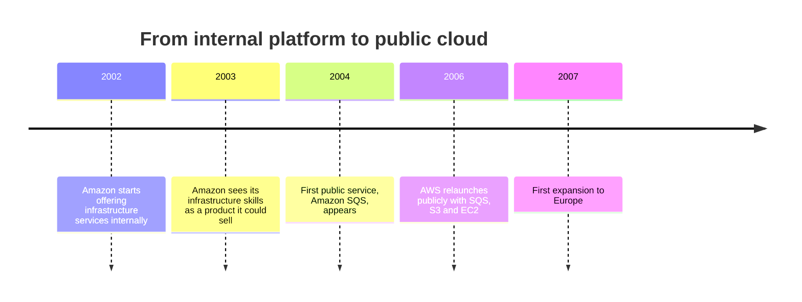
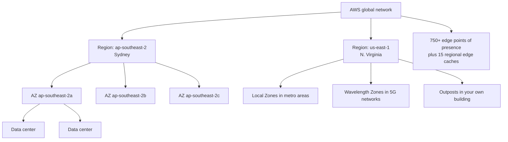
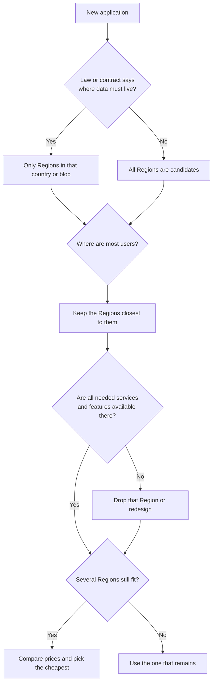
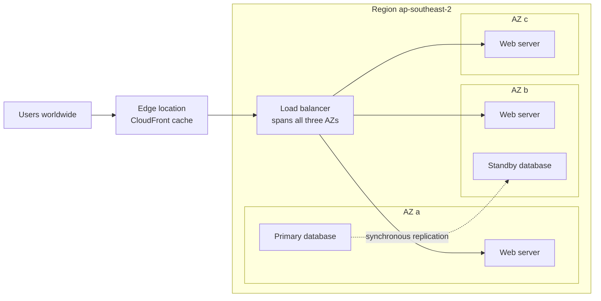

# Getting Started with AWS

## Summary

Amazon Web Services (AWS) rents out computing on demand: servers, storage, databases, networking and hundreds of higher-level services that you create in minutes, pay for by usage, and delete when you no longer need them. Before you can design anything on it, you need a mental map of **where** AWS runs: a set of isolated geographic **Regions**, each built from at least three **Availability Zones** (groups of data centers), plus hundreds of **edge points of presence** that bring content and DNS closer to users, and extensions such as Local Zones, Wavelength Zones and Outposts for latency or on-premises needs. You pick a Region for compliance, latency, service availability and price; you spread workloads across AZs to survive failures; and you use edge services for global reach. This lesson also explains how the SAA-C03 exam is built, which services are global versus Regional, and how to find your way around the AWS Management Console.

## Key concepts

- **AWS** is a cloud provider: you get IT resources over the internet **on demand**, **pay as you go**, and scale up or down without buying hardware.
- A **Region** (for example `us-east-1`, `eu-west-3`) is a separate geographic area containing a cluster of data centers; **most services are Region-scoped**, so resources live in the Region where you create them.
- Choose a Region by **compliance / data residency**, **latency to users**, **service and feature availability**, and **price**.
- Every Region has **at least three Availability Zones** (`us-east-1` has six); an **AZ** is one or more data centers with independent power, networking and connectivity.
- AZs in a Region are **many kilometers apart but within 100 km**, linked by redundant low-latency fiber, and all traffic between them is encrypted.
- Design for **high availability** by running copies of a workload in **two or more AZs**.
- An **AZ name** (`us-east-1a`) is a per-account label in some older Regions; an **AZ ID** (`use1-az1`) is the same physical zone in every account.
- **Edge locations / points of presence (PoPs)** (750+ today) serve CloudFront, Route 53, Global Accelerator, WAF and Shield close to users.
- **Local Zones** (metro areas), **Wavelength Zones** (5G carrier networks) and **Outposts** (your data center) extend a parent Region.
- **Global services** include IAM, Route 53, CloudFront and AWS WAF for CloudFront; their configuration lives in one home Region (usually `us-east-1`).
- Regions introduced **after 20 March 2019 are opt-in**: you must enable them before you can use them.
- Service models: **IaaS** (EC2), **PaaS** (Elastic Beanstalk), **FaaS** (Lambda), **SaaS** (fully managed apps and APIs such as Rekognition).
- The **AWS Management Console** has a **Region selector**, **Unified Search**, a **Services** menu and a **CloudShell** button; if a resource "disappeared", check the Region first.
- **SAA-C03**: 65 questions (50 scored), 130 minutes, pass mark 720 out of 1,000, four domains weighted 30/26/24/20.

## About this course and the SAA-C03 exam

The Solutions Architect – Associate certification tests whether you can pick and combine AWS services to meet a business requirement. It is a design exam, not a trivia exam: most questions describe a company, a constraint ("most cost-effective", "least operational overhead", "must survive the loss of an AZ") and four or five plausible answers. The course behind these notes covers over 30 services in depth and many more at the "know what it is for" level. At first the catalogue feels like a tangle of overlapping, interconnected services; it untangles once you file each service under the problem it solves. Basic IT knowledge (what a server, an IP address and a database are) helps, but beginners can follow along if they take their time.

| Exam fact | Value (SAA-C03) |
|---|---|
| Questions | 65: 50 scored + 15 unscored (you cannot tell which) |
| Question types | Multiple choice (1 of 4) and multiple response (2+ of 5 or more) |
| Time | 130 minutes |
| Score | Scaled 100–1,000; pass at **720**; compensatory (no per-domain minimum) |
| Guessing | No penalty: an unanswered question counts as wrong, so always answer |
| Price | USD 150 |
| Delivery | Pearson VUE test center or online proctored |

| Domain | Weight | This course's sections that feed it most |
|---|---|---|
| Design Secure Architectures | 30% | IAM, encryption, VPC security, threat protection |
| Design Resilient Architectures | 26% | Multi-AZ, load balancing, Auto Scaling, decoupling, DR |
| Design High-Performing Architectures | 24% | Storage and database choice, caching, edge services |
| Design Cost-Optimized Architectures | 20% | Purchasing options, storage classes, right-sizing |

> [!TIP] How to read a question
> Underline the requirement words first: "highly available", "lowest cost", "least operational overhead", "without code changes". Two answers usually work technically; the requirement words decide which one is *best*. The global infrastructure in this lesson (Regions, AZs, edge) shows up inside almost every resilient and performant question.

> [!NOTE] Italian exam language
> The exam page lists the Italian version as retiring after 31 December 2026; English and eight other languages remain.

## What AWS is and why it matters

Before cloud computing, launching a website meant buying servers, waiting weeks for delivery, racking them in a data center and guessing how much capacity next year's traffic would need. AWS turned that into an API call. You ask for a virtual machine, a database or a storage bucket, it is ready in seconds to minutes, you pay only while it exists, and you can add capacity when traffic grows or remove it when traffic drops. Some of the busiest sites on the internet, including Amazon's own retail store and Netflix, run on it.

> [!EXAMPLE] A ticket-sales startup
> A small company sells concert tickets. Most days it needs two small servers; when a big tour goes on sale it needs fifty for two hours. On premises it would have to own fifty servers all year. On AWS it runs two, scales out to fifty for the sale and back down afterwards, paying for roughly the hours it used.

### A short history

AWS itself dates its launch to 2006, when Amazon S3 and then Amazon EC2 became available. Those three original services (queues, object storage and virtual servers) are still central to the exam today.

### AWS by the numbers

None of these figures are exam material; they explain why AWS is the platform most architecture jobs ask for.

| Fact | Current figure |
|---|---|
| Annual revenue | USD 128.7 billion in 2025, up 20% on 2024 {{updated: The slides quote USD 90 billion for 2023}} |
| Cloud infrastructure market share | About 28% in Q2 2026 (Microsoft 20%, Google 15%), per Synergy Research {{updated: The slides quote 31% for Q1 2024, with Microsoft at 25%}} |
| Gartner Magic Quadrant for Strategic Cloud Platform Services | A Leader for the 16th year in a row (report published 1 September 2026) {{updated: The slides say 13 consecutive years}} |
| Customers | "Millions of customers", from start-ups to governments, per AWS's own overview page {{updated: The slides quote more than 1,000,000 active users; AWS no longer publishes an exact count}} |

### What people build on AWS

AWS is used across almost every industry. Typical workloads you will meet in exam scenarios:

| Use case | Example scenario | Services you will learn |
|---|---|---|
| Enterprise IT | Move an internal ERP system out of a company data center | EC2, RDS, VPC, Direct Connect |
| Backup and storage | Keep seven years of compliance archives cheaply | S3, S3 Glacier storage classes, AWS Backup |
| Big data analytics | Query terabytes of click logs without running servers | S3, Athena, Glue, Redshift |
| Websites | Host a company site that survives traffic spikes | CloudFront, S3, ALB, Auto Scaling |
| Mobile and social apps | Back end for an app with millions of users | API Gateway, Lambda, DynamoDB, Cognito |
| Gaming | Low-latency multiplayer servers near players | EC2, Global Accelerator, Local Zones |

## AWS global infrastructure at a glance

AWS's physical footprint is layered. Data centers are grouped into Availability Zones, AZs are grouped into Regions, and a separate, much larger network of edge sites sits close to end users. You can explore it on the interactive map at infrastructure.aws.

| Building block | What it is | Typical count | Why you care |
|---|---|---|---|
| Data center | A building full of AWS servers | Not published per AZ | You never pick one directly |
| Availability Zone | One or more data centers with independent power, cooling and network | 3 to 6 per Region | Unit of failure: spread across AZs for high availability |
| Region | A geographic area with 3+ AZs and its own copy of most services | 39 worldwide | Unit of isolation, data residency and pricing |
| Edge point of presence | Cache, DNS and network entry sites in cities worldwide | 750+ | Low latency for global users |
| Local Zone / Wavelength Zone | Small AWS sites that extend a Region to a city or a 5G network | 46 / 33 | Single-digit millisecond latency to specific users |
| Outpost | AWS-owned rack or server installed in your facility | Ordered per customer | Data or latency that must stay on premises |

> [!UPDATED] The footprint has grown a lot since the slides
> The slide snapshot shows a Region list of about twenty entries and "400+" points of presence. As of October 2026 AWS lists **39 geographic Regions with 124 AZs**, **750+ CloudFront PoPs plus 15 regional edge caches**, **46 Local Zones** and **33 Wavelength Zones**, with two more Regions (Saudi Arabia and Chile) announced.

## Regions

A **Region** is a physical location somewhere in the world (Northern Virginia, Ireland, Sydney, São Paulo) where AWS runs a cluster of data centers organized into AZs. Each Region has a code and a friendly name:

| Code | Name | Code | Name |
|---|---|---|---|
| `us-east-1` | US East (N. Virginia) | `eu-west-1` | Europe (Ireland) |
| `us-east-2` | US East (Ohio) | `eu-west-3` | Europe (Paris) |
| `us-west-2` | US West (Oregon) | `eu-central-1` | Europe (Frankfurt) |
| `ap-southeast-2` | Asia Pacific (Sydney) | `sa-east-1` | South America (São Paulo) |
| `ap-northeast-1` | Asia Pacific (Tokyo) | `ca-central-1` | Canada (Central) |

The code tells you roughly where you are: a geographic prefix (`us`, `eu`, `ap`, `sa`, `ca`, `me`, `af`, `il`, `mx`), a direction (`east`, `west`, `central`, `north`, `south`, `northeast`, `southeast`) and a number.

Regions are designed to be **independent of each other**. A problem in one Region should not spread to another, and most services have a completely separate deployment in each Region. That is why the exam treats "another Region" as the answer for disaster recovery against a whole-Region outage, and "another AZ" as the answer for surviving a data center failure.

**Most AWS services are Region-scoped.** An EC2 instance, an RDS database or a Lambda function exists only in the Region where you created it. If you switch the console to another Region, you see a different, usually empty, set of resources. To run the same application in two Regions you deploy it twice (and copy things like machine images or backups across).

> [!NOTE] Opt-in Regions
> Regions launched before 20 March 2019 (17 of them, including all four US Regions, Ireland, Frankfurt, Tokyo and Sydney) are enabled in every account. Regions launched after that date, such as Cape Town, Milan, Zurich, Hyderabad, Melbourne, Jakarta, Calgary, Tel Aviv, Bahrain, UAE, Malaysia, Thailand, Taipei, New Zealand and Mexico, are **disabled by default**. A disabled opt-in Region does not even appear in the console's Region selector. An administrator must enable it (in the AWS Global View console, or in the **AWS Regions** section of the **Account** page reached from the account menu) before anyone can launch resources there. Enabling is free, copies your IAM users and roles into the Region, and can take from a few minutes to several hours. The 17 default Regions cannot be disabled.

> [!NOTE] Separate partitions
> A normal AWS account sees 34 Regions. The two **AWS GovCloud (US)** Regions and the two **China** Regions (Beijing, Ningxia) need separate account types, and the **AWS European Sovereign Cloud**, which reached general availability in January 2026 with a first Region in Brandenburg, Germany, is also run independently. Together that makes the 39 Regions AWS advertises. Resources and accounts in one partition cannot see the others.

### How to choose a Region

When a company launches a new application, the first architecture decision is where to put it. Four factors drive the choice, roughly in this order:

1. **Compliance and data residency.** Laws or contracts may require that data stays in a country or bloc (for example, health records that must remain in Germany). AWS does not move your content out of the Region you chose unless you configure something that does, such as cross-Region replication. A legal requirement is a hard constraint: it overrides every other factor.
2. **Latency to users.** Light in fiber needs time to cross oceans. An app for customers in Brazil served from `sa-east-1` responds noticeably faster than the same app served from Oregon.
3. **Service and feature availability.** New services and features usually launch in a few large Regions first and roll out over months or years. If your design needs a specific service (say, a particular AI service or instance family), confirm it exists in the candidate Region.
4. **Price.** The same service has a different price in each Region, published on every service's pricing page and in the AWS Pricing Calculator. When requirements allow several Regions, cost can break the tie.

> [!EXAMPLE] Choosing for a French insurer
> A French insurer must keep policyholder data inside the EU and most of its customers are in France. Paris (`eu-west-3`) is closest, but the team needs a service that is only in Frankfurt and Ireland today. Compliance allows all three; latency favors Paris; availability rules Paris out for now. Between Frankfurt and Ireland, both are fast enough from France, so they compare prices and also check whether the opt-in Regions (Milan, Spain, Zurich) would need enabling.

> [!UPDATED] Where to check service availability
> The slides point to the "Region Table" page. That page now sends you to **AWS Capabilities by Region** in AWS Builder Center (launched November 2025), which compares services, features, APIs and CloudFormation resources across Regions side by side and shows planned launches. From a shell you can also query public Systems Manager parameters under `/aws/service/global-infrastructure`.

## Availability Zones

An **Availability Zone (AZ)** is a group of one or more separate data centers inside a Region; each zone has its own redundant power, cooling, networking and connectivity. Think of an AZ as a **failure domain**: a flood, fire, power cut or network failure is expected to affect at most one AZ at a time.

Key facts about AZs:

- **How many.** Every Region has **at least three** AZs. Most have three, a few have four (for example Oregon, Tokyo and Seoul), and N. Virginia has **six** {{updated: AWS docs list a seventh us-east-1 AZ, in Maryland, as coming in 2026; the slides give six as the maximum}}.
- **How far apart.** AWS places AZs many kilometers from each other so a local disaster cannot hit two at once, yet keeps them **within 100 km (60 miles)** so they can talk quickly.
- **How connected.** AZs in a Region are linked by redundant, dedicated metro fiber that gives high throughput and low latency, good enough for synchronous database replication. **All traffic between AZs is encrypted.**
- **Naming.** An AZ name is the Region code plus a letter: Sydney (`ap-southeast-2`) has `ap-southeast-2a`, `ap-southeast-2b` and `ap-southeast-2c`.

The practical consequence is the most important design rule in this course: **for high availability, run at least two copies of every critical component in at least two AZs.** If one AZ fails, the other keeps serving.

> [!EXAMPLE] Losing an AZ
> In the diagram above, suppose AZ a loses power. The load balancer's health checks fail for the web server there and it sends all requests to AZ b and AZ c. The managed database promotes the standby in AZ b. Users notice at most a short pause. Had everything been in AZ a, the whole site would be down.

### AZ names versus AZ IDs

In the oldest Regions, AWS originally shuffled AZ names per account so that customers who always picked "a" would not all land in the same physical zone. So `us-east-1a` in your account might be a different building from `us-east-1a` in a partner's account. To refer to the same physical zone across accounts, use the **AZ ID**, such as `use1-az1` or `apse2-az3`, which is identical in every account.

| | AZ name | AZ ID |
|---|---|---|
| Example | `us-east-1a` | `use1-az4` |
| Format | Region code + letter | Region prefix + `-az` + number |
| Same physical zone in every account? | Not always (older Regions) | Yes |
| Use it for | Everyday launches inside one account | Coordinating across accounts: shared subnets, cross-account latency-sensitive setups, capacity planning |
| Where to see the mapping | EC2 console, AWS Global View, `aws ec2 describe-availability-zones` | Same places (the `ZoneId` field) |

> [!UPDATED] New accounts get a uniform mapping
> Independent per-account mapping only ever applied to nine early Regions (N. Virginia, N. California, Oregon, Singapore, Sydney, Tokyo, Ireland, São Paulo and GovCloud US-West); every Region added after November 2012 maps names uniformly. AWS docs now state that **accounts created from November 2025 onward get the same name-to-zone mapping** even in those nine Regions. Older accounts keep their shuffled mapping, so AZ IDs are still the safe way to compare accounts.

> [!NOTE] Not every account sees every AZ
> When an AZ runs short of room to grow, AWS can stop new accounts from creating resources there. Newer accounts, for example, see only **two** of the three AZs in US West (N. California). So "every Region has at least three AZs" describes the Region, not necessarily what your account can use. Always check with `describe-availability-zones` before you design around a specific count.

## Points of presence (edge locations)

Regions are where your application runs; **points of presence (PoPs)** are where AWS meets your users. They are small sites in many more cities than there are Regions, and they host the data planes of AWS's edge services:

- **Amazon CloudFront** caches copies of your content (images, video, API responses) so users download from a nearby city instead of from your Region.
- **Amazon Route 53** answers DNS queries from PoPs worldwide.
- **AWS Global Accelerator** lets user traffic enter the AWS private network at the nearest PoP, then rides AWS's backbone to your Region.
- **AWS WAF** (when attached to CloudFront) and **AWS Shield** inspect and absorb traffic at the edge, before it reaches your application.

Between the edge locations and your origin sit **regional edge caches**: bigger caches that hold content which is not popular enough to stay at every edge location, so fewer requests travel all the way back to your origin.

| Edge component | Current count | Role |
|---|---|---|
| Points of presence (edge locations) | 750+ in 100+ cities, 50+ countries | Serve cached content and DNS close to users |
| Regional edge caches | 15 | Larger mid-tier cache between PoPs and your origin |
| Embedded POPs | 1,140+ in 300+ cities | CloudFront caches placed inside internet providers' networks for large-scale streaming and downloads |

> [!UPDATED] Edge network numbers
> The slides counted a little over 400 PoPs, with ten-plus regional caches, spread over more than 90 cities in over 40 countries. CloudFront now lists **750+ PoPs in 100+ cities across 50+ countries** and **15 regional edge caches**, plus **1,140+ embedded POPs** inside internet service provider networks.

> [!TIP] Region versus edge in one sentence
> You **deploy** applications into Regions and AZs; you **accelerate and protect** them with services that run at the edge. Edge locations do not run your EC2 instances or databases.

## Extending AWS beyond Regions

Some workloads need AWS closer than the nearest Region. Three options extend a Region outward; each is managed from, and connected back to, a **parent Region**.

| Option | Where it runs | Pick it when | Example |
|---|---|---|---|
| **AWS Local Zones** | Small AWS sites in large metro areas (46 today) | Users in one city need single-digit millisecond latency, or local data residency rules apply | Visual-effects studio in Los Angeles running render workstations in the LA Local Zone of `us-west-2` |
| **AWS Wavelength** | Inside telecom carriers' 5G networks (33 Wavelength Zones) | Mobile devices on a 5G network need the lowest possible latency | Connected-car or AR game back end sitting at the carrier's edge |
| **AWS Outposts** | AWS-owned racks (42U) or 1U/2U servers installed in your data center | Data must stay on premises, or apps need very low latency to on-premises systems, but you want AWS APIs and tools | Factory that processes machine data on site while managing it like any other AWS resource |

You opt in to a Local Zone or Wavelength Zone, then create a subnet there in your VPC; an Outpost appears as an extension of one AZ of its parent Region.

## Global versus Regional services

When you open a service in the console, the Region selector tells you its scope. A handful of services are **global**: you configure them once and they work in every Region.

| Scope | Services (examples) | What it means |
|---|---|---|
| **Global** | IAM, Route 53 (public DNS), CloudFront, AWS WAF for CloudFront, AWS Organizations, Global Accelerator, Billing | One configuration for the whole account; the console shows no Region choice (or "Global") |
| **Regional** | EC2 (AMIs, security groups, key pairs), Elastic Beanstalk, Lambda, Rekognition, RDS, DynamoDB, SQS, VPC and most others | Resources live in one Region; repeat the setup in each Region you use |
| **Zonal** (inside a Region) | EC2 instances, EBS volumes, subnets | Resources live in one AZ; spread them across AZs yourself |

Three nuances worth knowing early, because they become exam questions later:

- **AWS WAF is both.** Protection for CloudFront distributions is global, but you must create that protection pack (web ACL) in **US East (N. Virginia)**. Protection for Regional resources, such as an Application Load Balancer, API Gateway REST API, AppSync GraphQL API, Cognito user pool, App Runner service or Verified Access instance, is **Regional** and must be created in the same Region as that resource.
- **Global still has a home.** Global services keep their configuration (control plane) in one Region, mostly `us-east-1` (Global Accelerator's is in `us-west-2`), while their data planes run everywhere. That is why a TLS certificate from AWS Certificate Manager for a CloudFront distribution must be requested in `us-east-1`.
- **Amazon S3 looks global but is Regional.** Bucket names are unique across all of AWS, and listing your buckets can show buckets from every Region, yet each bucket and its data live in the single Region you choose.

> [!UPDATED] WAF wording in the new console
> In the redesigned AWS WAF console, web ACLs are labelled **protection packs (web ACLs)**. The concept is unchanged.

## Cloud service models

The console tour slide labels four services with the "as a Service" model they represent. The models differ in how much of the stack AWS manages for you.

| Model | You manage | AWS manages | AWS example | Everyday analogy |
|---|---|---|---|---|
| **IaaS** (Infrastructure as a Service) | Operating system, runtime, app, data, scaling | Hardware, virtualization, network, data centers | **Amazon EC2** | Renting an empty apartment |
| **PaaS** (Platform as a Service) | Your application code and settings | Servers, OS patching, load balancing, scaling plumbing | **AWS Elastic Beanstalk** | Renting a furnished apartment |
| **FaaS** (Function as a Service, serverless) | Individual functions and their triggers | Everything else, including scaling to zero | **AWS Lambda** | Paying per night in a hotel |
| **SaaS** (Software as a Service) | Only your data and how you call it | The whole application | **Amazon Rekognition** (image and video analysis through an API) | Eating at a restaurant |

> [!EXAMPLE] Same job, four ways
> Resizing uploaded photos: on **EC2** you launch a server, install an image library and keep it patched. On **Elastic Beanstalk** you upload the app and Beanstalk builds the servers and load balancer. On **Lambda** you upload a function that runs only when a photo arrives. If you only need to detect faces or labels in the photos, **Rekognition** does it with one API call and no code of your own to host.

## Tour of the AWS Management Console

The **AWS Management Console** at console.aws.amazon.com is the web interface for everything in AWS. After you sign in you land on **Console Home**, a page of widgets (recently visited services, cost, health, and so on) that you can rearrange. The navigation bar across the top is the same on every service page:

| Navigation bar element | What it does |
|---|---|
| **Search** box (Unified Search) | Finds services, features, documentation, blogs, knowledge articles, tutorials, Marketplace products and your resources; start a query with `/Resources` to search only your resources |
| **Services** menu | Browse every service by category, see recently visited ones and mark favorites |
| **Region selector** | Shows the current Region by name; choose it to switch. Global services show no Region choice |
| **CloudShell** icon | Opens AWS CloudShell, a browser terminal already signed in as you |
| Notifications and help | AWS Health events, notifications and support resources |
| Settings gear | **Unified Settings**: language, visual mode and **default Region** |
| Account menu | Account ID, organization, Service Quotas, Billing and Cost Management, sign out |

> [!TIP] "My instance disappeared!"
> The number one beginner panic: you launched something yesterday and today the console shows nothing. You are almost certainly looking at a different Region. Resources such as EC2 instances appear only in the Region where they were created. Set a **default Region** in Unified Settings (otherwise the console reopens in the last Region you visited), or use **AWS Global View** to list resources across Regions.

**AWS CloudShell** is worth knowing from day one. It gives you a Bash, PowerShell or Z shell terminal in the browser with the AWS CLI v2, Python, Node.js and common tools preinstalled, using the same credentials you signed in with. There is no extra charge, you get **1 GB of persistent home-directory storage per Region** (deleted after 120 days without a session in that Region), and sessions end after about 20–30 minutes without interaction. CloudShell follows the console's Region selection and falls back to the nearest supported Region if the current one does not offer it.

**AWS Global View** (in the console search, type "Global View") lists every Region and zone available to your account with its opt-in status and AZ IDs, and lets you enable opt-in Regions.

> [!WARNING] Protect your account and your wallet from day one
> A new account starts with only the **root user**, which can do anything, including closing the account. The IAM lesson that follows shows how to add MFA and create day-to-day users instead. Also set a budget alert: AWS Budgets monitoring is free, and the **Zero spend budget** template emails you as soon as you spend beyond the Free Tier. Lab 02 in this section walks through it.

> [!NOTE] Free Tier in 2026
> Accounts created on or after 15 July 2025 choose a **Free account plan** or **Paid account plan** at sign-up and receive USD 100 in credits (up to USD 100 more for completing activities). The Free plan lasts six months or until the credits run out, whichever comes first, and does not charge you until you upgrade. Over 30 services also have **Always Free** monthly allowances. Accounts created before that date keep the legacy 12-month Free Tier.

## Exam tips

> [!EXAM] Choosing a Region
> "Data must remain in country X" → only Regions in that country, whatever the latency or price. "Users are mostly in Asia and complain about slow responses" → deploy in a Region near them, or add CloudFront / Global Accelerator in front of the existing Region.

> [!EXAM] AZ versus Region resilience
> "Survive the failure of a data center or an AZ" → deploy across **multiple AZs in one Region** (Multi-AZ). "Survive the loss of an entire Region" or "disaster recovery in another geography" → **multi-Region**. Multi-AZ is the default answer for high availability; multi-Region costs more and is chosen only when the question asks for it.

- "Lowest latency for users around the world for static or cached content" → **CloudFront** at edge locations.
- "Single-digit millisecond latency for users in one specific city" → **Local Zones**. "5G mobile devices" → **Wavelength**. "Must run on premises with AWS APIs" → **Outposts**.
- "Share a subnet with another account and make sure workloads land in the same physical AZ" → compare **AZ IDs**, not AZ names.
- "Certificate or WAF rules for a CloudFront distribution" → create them in **us-east-1**.
- "A new service is not visible in the console" → it may not be offered in that Region yet, or the Region is opt-in and not enabled.
- "Least operational overhead" usually favors the most managed model: SaaS/FaaS over PaaS over IaaS, as long as it meets the requirements.

## Common traps

> [!TRAP] Edge locations are not mini-Regions
> Answers that "deploy EC2 instances to edge locations" are wrong. Edge locations run CloudFront, Route 53, Global Accelerator, WAF and Shield. To run compute close to a city, the answer is a Local Zone (or Wavelength for 5G), not an edge location.

> [!TRAP] Two subnets in one AZ is not high availability
> A design with two instances in two subnets of the **same** AZ looks redundant but fails together when that AZ fails. High availability needs **different AZs**.

> [!TRAP] AZ letters do not match across accounts
> In older accounts, `us-east-1a` in account A can be a different physical zone from `us-east-1a` in account B. If a question involves coordinating placement across accounts, the correct answer uses AZ IDs.

- **"IAM users are per Region."** No: IAM is global. A user or role you create works in every Region.
- **"Multi-Region is always more available, so pick it."** It is also more expensive and complex. If the question only asks to survive an AZ failure, Multi-AZ is the cost-effective answer.
- **"Choose the cheapest Region."** Price is the last tie-breaker. A compliance requirement or a missing service rules a Region out regardless of price.
- **"AWS WAF is a global service, so create the web ACL anywhere."** For an ALB or API Gateway, the web ACL must be in the resource's Region; only CloudFront protection uses us-east-1.
- **"S3 is global, so my data is everywhere."** Bucket names are global; the data stays in the bucket's Region unless you set up replication.
