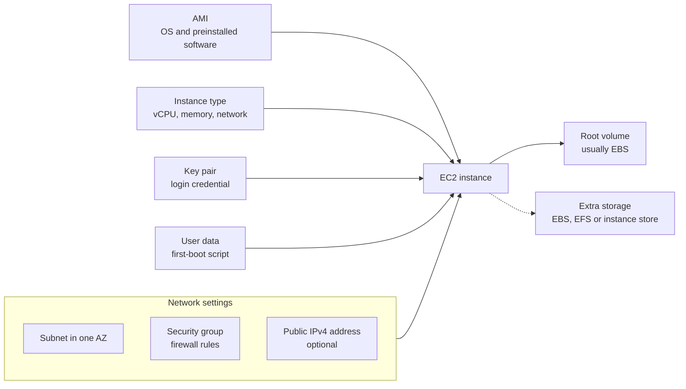
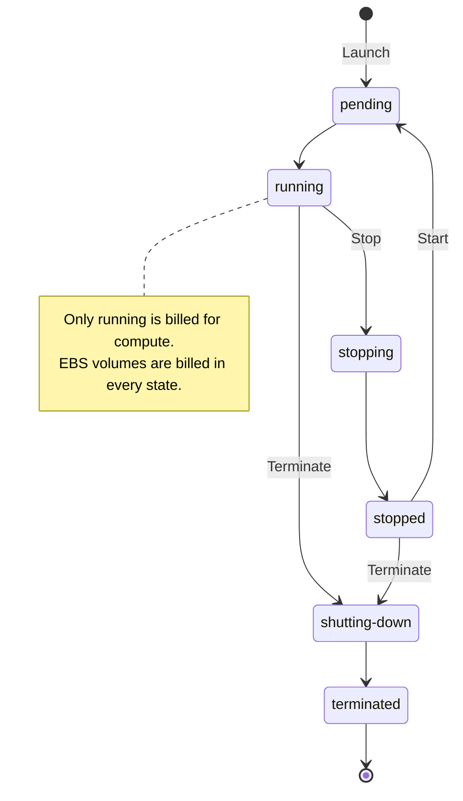
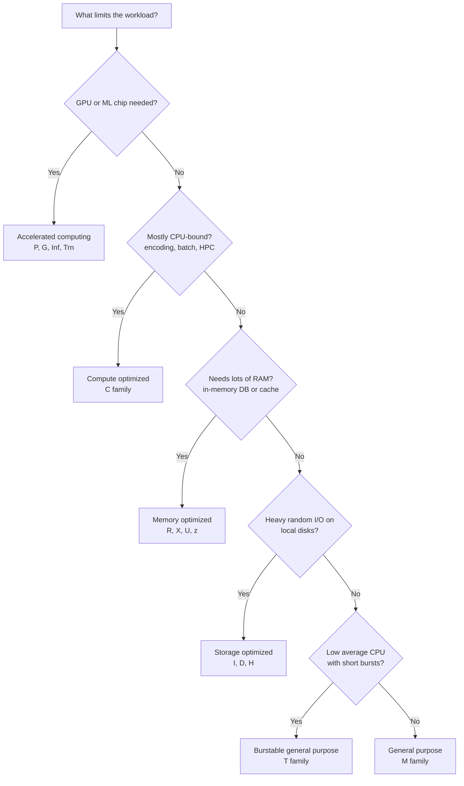
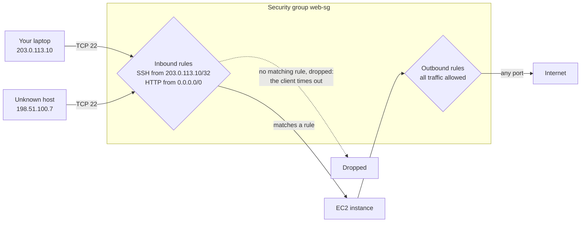
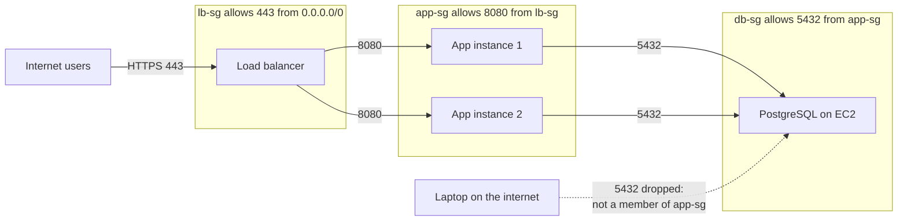
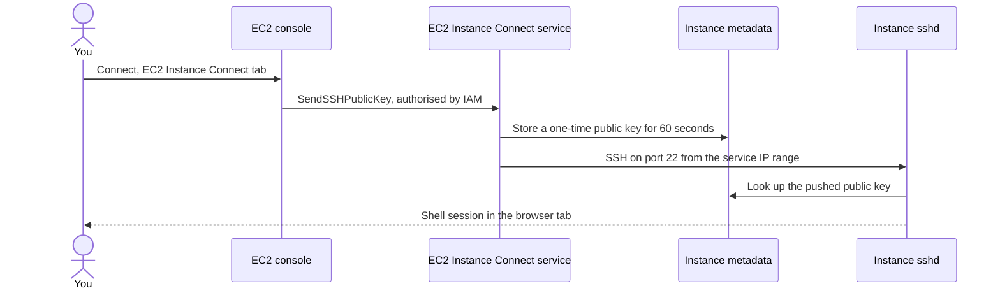

# EC2 Fundamentals

## Summary

**Amazon EC2** (Elastic Compute Cloud) lets you rent virtual servers, called **instances**, by the
second and throw them away when you are done. It is AWS's core Infrastructure as a Service offer:
AWS runs the hardware and the virtualisation layer, and you choose and manage everything from the
operating system up. When you launch an instance you decide its **AMI** (operating system and
software), its **instance type** (how much CPU, memory, network and local storage), its storage,
its **security group** (the firewall in front of it) and an optional **user data** script that
configures it on first boot. You then reach it with **SSH**, **PuTTY**, **EC2 Instance Connect**
or Session Manager. Pick EC2 when you need full control of the operating system or software that
does not fit a managed or serverless service; the exam expects you to size it correctly, lock it
down with security groups and diagnose connection problems.

## Key concepts

- **EC2 = IaaS**: AWS manages the physical hosts; you patch and secure the guest OS and everything you install.
- **Instance** = AMI + instance type + network settings (subnet, security group, public IP) + storage + optional key pair and user data.
- **User data** is a script that runs **once, as root, on the first boot** by default; limit 16 KB before base64 encoding.
- **Instance type names** read *series + generation + options . size*, for example `c7gn.xlarge`.
- **Families**: general purpose (M, T), compute optimized (C), memory optimized (R, X, U, z), storage optimized (I, D, H), plus accelerated computing (P, G, Inf, Trn) and HPC (Hpc).
- **Security groups** are stateful firewalls attached to network interfaces; they hold **allow rules only**.
- A new security group **denies all inbound** and **allows all outbound** traffic until you change it.
- Rules can name an **IP range**, a **prefix list** or **another security group** as the source.
- **Timeout** when connecting usually means a security group (or network) problem; **connection refused** means the traffic arrived but nothing is listening.
- **Ports**: 22 SSH/SFTP, 21 FTP, 80 HTTP, 443 HTTPS, 3389 RDP.
- **Key pairs**: AWS keeps the public key; you download the private key once (`.pem` for OpenSSH, `.ppk` for PuTTY) and set `chmod 400`.
- **EC2 Instance Connect** pushes a one-time public key for 60 seconds; from the console, the security group must still allow port 22 from the service's IP range.
- **Stop** keeps the EBS root volume and private IP but changes the public IPv4 address; **terminate** deletes the instance (and, by default, its root volume).

## What EC2 is and where it fits

Before the cloud, a new server meant ordering hardware, waiting weeks and paying for it for years.
With EC2 you call an API (or click **Launch instance**) and a virtual machine is running within
minutes. You pay only while it is in the `running` state, billed per second with a one-minute
minimum for most Linux and Windows instances, and you stop paying for compute the moment you stop
or terminate it.

EC2 is rarely used alone. Four building blocks appear together in almost every architecture on the
exam, and each gets its own lesson later in this course:

| Building block | What it does | Lesson |
|---|---|---|
| **EC2 instances** | Virtual servers that run your code | This lesson |
| **Amazon EBS** volumes (and EFS file systems) | Network storage that outlives a single instance | EC2 Instance Storage |
| **Elastic Load Balancing** | Spreads incoming requests over many instances | Elastic Load Balancing |
| **EC2 Auto Scaling** groups | Adds and removes instances to match demand | Auto Scaling Groups |

Because EC2 is Infrastructure as a Service, the **shared responsibility model** puts more on you
than a managed service does: you choose the AMI, apply OS patches, configure the firewall rules and
protect your login keys. AWS secures the data centres, hosts and hypervisor.

## What you choose at launch

Every instance is assembled from the same handful of choices. The console's **launch instance
wizard** groups them into sections, and the same parameters exist in the CLI (`aws ec2
run-instances`) and in launch templates.



| Choice | What it decides | Launch wizard section |
|---|---|---|
| Operating system and image | Linux distributions, Windows Server or macOS, plus any preinstalled software | **Application and OS Images (Amazon Machine Image)** |
| CPU and memory | Number of vCPUs, GiB of RAM, processor maker (Intel, AMD, AWS Graviton) | **Instance type** |
| Login credential | Which public key is placed on the instance | **Key pair (login)** |
| Network | VPC, subnet (and so the AZ), public IP, security groups | **Network settings** |
| Storage | Root volume size and type, extra EBS volumes, EFS or FSx mounts | **Configure storage** |
| Bootstrap and extras | User data, IAM instance profile, shutdown behaviour, termination protection, purchasing option | **Advanced details** |

A few details worth knowing about these choices:

- **Operating system.** Most workloads run Linux (Amazon Linux 2023 is the console default) or
  Windows Server. **macOS** is also available, but only on Mac instances that run on a whole
  **Dedicated Host** with a 24-hour minimum allocation, which makes it a niche, build-and-sign-iOS-apps option.
- **Storage comes in two flavours.** *Network-attached* storage (EBS volumes, EFS file systems)
  survives when the instance stops or is replaced. *Hardware* storage (the **instance store**) is a
  disk inside the host: very fast, but its data disappears when the instance stops or terminates.
- **Network card and public IP.** Bigger instance types get more network bandwidth. In a default
  subnet the wizard assigns a public IPv4 address automatically.
- **Firewall.** Every instance needs a security group; if you do not pick an existing one, the
  wizard creates a new group with a rule that allows SSH (Linux) or RDP (Windows) from any address,
  which is acceptable for a 10-minute test and unsafe for anything else.

> [!UPDATED] Public IPv4 addresses are billed
> Since February 2024 every public IPv4 address costs USD 0.005 per hour (about USD 3.60 per
> month), whether it is attached to a running instance or idle. Accounts on the legacy 12-month Free
> Tier get 750 hours a month free; on the newer credit-based Free plan the charge is paid from your
> credits. Instances that do not need to be reached from the internet should not get one.

### Start, stop, reboot and terminate

The first hands-on in the course launches a web server and then stops, starts and terminates it.
These actions behave differently, and exam questions about lost data or changed IP addresses depend
on knowing how.



| Action | Same host? | Private IPv4 | Public IPv4 | EBS root volume | Instance store data | Compute billing |
|---|---|---|---|---|---|---|
| **Reboot** | Yes | Kept | Kept | Kept | Kept | Continues, no new minimum |
| **Stop, then start** | Usually moves to a new host | Kept | **New address** (unless you use an Elastic IP) | Kept | **Lost** | Stops while stopped; each start bills at least one minute |
| **Terminate** | Instance is gone | Released | Released | **Deleted by default** (`DeleteOnTermination`) | Lost | Stops at `shutting-down` |

> [!EXAMPLE] Why your bookmark broke
> You launch a test web server, browse to `http://54.210.10.20`, stop the instance overnight and
> start it in the morning. The page no longer loads at that address: a stop/start released the
> public IPv4 address and assigned a new one. The fix for a stable address is an **Elastic IP**
> (covered in the EC2 Networking lesson) or, better, a DNS name pointing at a load balancer.

## Bootstrapping with EC2 user data

**Bootstrapping** means running setup commands automatically when a server starts for the first
time, so nobody has to log in and type them. On EC2 you pass a script in the **User data** field
(under **Advanced details**) or with `--user-data file://script.sh` on the CLI.

How it behaves on Linux:

- **Runs once.** By default the script runs only during the first boot of the instance. Stopping
  and starting later does not run it again unless you configure cloud-init to run on every boot.
- **Runs as root.** Do not prefix commands with `sudo`, and remember that files it creates belong
  to root. Commands must be non-interactive (`dnf install -y`, not a prompt that waits for "yes").
- **Format.** A shell script starting with `#!` (for example `#!/bin/bash`) or cloud-init directives
  starting with `#cloud-config`. Windows instances use `<powershell>` or `<script>` blocks; they
  also run once by default, and adding `<persist>true</persist>` makes them run at every start.
- **Size limit 16 KB** in raw form, before base64 encoding. The console and `run-instances` encode
  it for you.
- **Debugging.** The output lands in `/var/log/cloud-init-output.log` on the instance. From your
  laptop you can view the boot console with **Actions** → **Monitor and troubleshoot** → **Get system log**.
- **Changing it.** You can view user data any time, but you can only edit it while the instance is
  **stopped** (**Actions** → **Instance settings** → **Edit user data**). User data is an instance
  attribute, so it is not part of an AMI you create from the instance; but cloud-init keeps a copy of
  the script under `/var/lib/cloud/instances/<instance-id>/` on the root volume, so delete it before
  you create an AMI.
- **No secrets.** Anyone or anything on the instance can read user data through the instance
  metadata service, and it is not encrypted. Put passwords in Secrets Manager or Parameter Store and
  give the instance an IAM role instead. If the script calls AWS APIs, it needs that IAM role too.

A typical script for a web server:

```bash
#!/bin/bash
dnf update -y
dnf install -y httpd
echo "<h1>Hello from $(hostname -f)</h1>" > /var/www/html/index.html
systemctl enable --now httpd
```

> [!TIP] User data or a custom AMI?
> User data is flexible but adds its run time to every launch: installing packages can take
> minutes, which slows down Auto Scaling when traffic spikes. For heavy, unchanging setup, **bake a
> custom AMI** (a "golden image") and keep user data for the small per-instance bits, such as
> pulling the latest config file. The exam often contrasts the two: "reduce boot time" points to an
> AMI; "configure at launch" points to user data.

## Instance types

An **instance type** fixes the virtual hardware: number of vCPUs, amount of memory, network
bandwidth, EBS bandwidth and whether local instance store disks are included. Hundreds exist, but
they follow one naming pattern and fall into a few families.

### Reading an instance type name

Take `m5.2xlarge`, the example from the course, and `c7gn.xlarge`, the example AWS uses today:

| Part | `m5.2xlarge` | `c7gn.xlarge` | Meaning |
|---|---|---|---|
| Series (family letter) | `m` | `c` | The kind of workload it is built for: `m` general purpose, `c` compute optimized |
| Generation | `5` | `7` | Higher is newer; newer generations usually give better price-performance |
| Options | none | `gn` | Extra capabilities: `g` Graviton (Arm) CPU, `n` extra network and EBS bandwidth |
| Size (after the dot) | `2xlarge` | `xlarge` | How big within the family; each step up roughly doubles vCPU and memory |

Common option letters: `a` AMD processor, `g` AWS Graviton, `i` Intel, `d` local NVMe instance store
disks, `n` network optimized, `e` extra memory or storage, `z` high CPU frequency, `b` block
storage optimized, `flex` a cheaper Flex variant. Sizes run `nano`, `micro`, `small`, `medium`,
`large`, `xlarge`, `2xlarge` and up, with `metal` meaning the whole physical server.

> [!UPDATED] Naming has more parts than the slides show
> The course describes the name as class + generation + size. AWS now documents a third position,
> the **options** (for example `gn`, `d`, `flex`), and some series are several letters long (`Hpc`,
> `Inf`, `Trn`, `Mac`). The first part is officially called the *series*.

### The families

| Category | Series | Balance | Use it for | Current examples |
|---|---|---|---|---|
| **General purpose** | M, T, Mac | Even mix of CPU, memory and network (about 4 GiB per vCPU for M) | Web and app servers, code repositories, small databases, dev/test | `m8g`, `m7i`, `m7i-flex`, `t3`, `t4g` |
| **Compute optimized** | C | More CPU per GiB (about 2 GiB per vCPU) | Batch jobs, media transcoding, high-traffic web servers, HPC, scientific modelling, ML inference, game servers | `c8g`, `c7i`, `c7i-flex` |
| **Memory optimized** | R, X, U, z | More memory per vCPU (8 GiB or more) | In-memory databases and caches, large relational or NoSQL databases, real-time analytics on big data sets | `r8g`, `r7i`, `x8g`, `u7i` |
| **Storage optimized** | I, D, H | Large, fast **local** disks with very high IOPS or throughput | High-transaction OLTP, NoSQL databases (Cassandra, MongoDB), data warehousing, distributed file systems, search indexes | `i8g`, `i7ie`, `i4i`, `d3` |
| Accelerated computing | P, G, Inf, Trn, F | GPUs or custom chips | ML training and inference, graphics rendering, video | `p5`, `g6`, `inf2`, `trn2` |
| High-performance computing | Hpc | Many cores and fast interconnect | Tightly coupled simulations | `hpc7g`, `hpc7a` |

> [!UPDATED] Newer families and two extra categories
> The slides' family tabs (M5, C5, R5, I3 and friends, plus M4, C4, R4 and A1) date from an earlier
> generation. AWS now lists M4, C4, R4 and A1 as **previous generation**, and the newest families
> include M8g/M8i, C8g/C8i, R8g/R8i and the Graviton-based M9g/C9g/R9g. The instance types page also
> has two categories the slides do not cover: **accelerated computing** and **high-performance
> computing**.

To make the numbers concrete, here are real sizes from each family (specifications from the AWS
instance type pages):

| Instance | vCPU | Memory (GiB) | Local storage | Network (baseline / burst) |
|---|---|---|---|---|
| `t3.micro` | 2 | 1 | EBS only | 0.064 / up to 5 Gbps |
| `m7i.large` | 2 | 8 | EBS only | 0.781 / up to 12.5 Gbps |
| `c7i.4xlarge` | 16 | 32 | EBS only | 6.25 / up to 12.5 Gbps |
| `c5d.4xlarge` | 16 | 32 | 1 x 400 GB NVMe SSD | 5 / up to 10 Gbps |
| `r7i.16xlarge` | 64 | 512 | EBS only | 25 Gbps |
| `i4i.4xlarge` | 16 | 128 | 1 x 3,750 GB NVMe SSD | 9.375 / up to 25 Gbps |

Notice the ratios: the `c` instance with 16 vCPUs has 32 GiB, the `m` instance has four times as
much memory as vCPUs, and the `r` instance has eight. The `d` in `c5d` adds a local NVMe disk; the
`i4i` is built around a much larger one. Size also buys dedicated **EBS bandwidth**, separate from
the network figure: a `c5d.4xlarge` gets 4,750 Mbps to its EBS volumes, an `r7i.16xlarge` 20,000
Mbps, while small T sizes only burst to their maximum for short periods.



### Burstable T instances

The **T** family (`t3`, `t3a`, `t4g`, the new `t8i`) gives a baseline share of CPU and earns
**CPU credits** while it runs below that baseline; it spends them to burst to full speed. That
suits workloads that are idle most of the time, like a small website or a dev box. A `t3` launched
in **Unlimited** mode (the default for T3) can keep bursting after credits run out, at an extra
charge. If a T instance runs hot all day, a fixed-performance M or C instance is usually cheaper and
faster.

> [!UPDATED] t2.micro is no longer the Free Tier default
> The course uses `t2.micro`. For AWS accounts created on or after 15 July 2025, the EC2 Free Tier
> page lists `t3.micro`, `t3.small`, `t4g.micro`, `t4g.small`, `c7i-flex.large` and `m7i-flex.large`
> as **Free tier eligible**; `t2.micro` is not on that list. The T8i launch in September 2026 adds
> `t8i.micro` and `t8i.small`, but not every AWS page agrees yet (see the VERIFY note below).
> Older accounts on the
> legacy 12-month Free Tier get 750 hours a month of `t2.micro`, or of `t3.micro` only in Regions
> where `t2.micro` is not offered (such as Stockholm). The labs in this course use `t3.micro`, which
> new accounts pay from their credits; on a legacy account in a Region that still offers `t2.micro`
> (us-east-1, for example), pick `t2.micro` instead to stay inside the free hours.

> [!VERIFY] Are t8i.micro and t8i.small Free tier eligible?
> Checked 2026-10-04, and AWS's own pages disagree. Yes, say the
> [burstable performance instances page](https://docs.aws.amazon.com/AWSEC2/latest/UserGuide/burstable-performance-instances.html),
> the [T8i product page](https://aws.amazon.com/ec2/instance-types/t8i/) and the
> [T8i launch post of 17 September 2026](https://aws.amazon.com/blogs/aws/new-low-cost-burstable-amazon-ec2-t8i-instances-are-generally-available/).
> The table on [Track your Free Tier usage for Amazon EC2](https://docs.aws.amazon.com/AWSEC2/latest/UserGuide/ec2-free-tier-usage.html)
> and the [Free compute services page](https://aws.amazon.com/free/compute/) still list only the six
> types above. Still unknown: whether those two pages are simply out of date. T8i also launched in only
> some Regions. Before you count on a free T8i, look for the **Free tier eligible** label in the launch
> wizard, or run `aws ec2 describe-instance-types --filters Name=free-tier-eligible,Values=true` in
> your Region. The labs use `t3.micro`, which every list includes.

> [!TIP] Let the console compare for you
> In the launch wizard, **Compare instance types** shows vCPUs, memory, storage and network side by
> side, and **Get advice** runs the EC2 instance type finder. The **Instance Types** page in the EC2
> console and the AWS documentation spec pages list every size. Once instances are running, AWS
> Compute Optimizer recommends right-sizing from real usage.

## Security groups

A **security group** is a virtual firewall that controls which traffic may reach an instance and
which traffic may leave it. It is the first line of network defence for EC2 and appears in a large
share of exam questions.



### How security groups behave

- **Allow rules only.** You cannot write a "deny" rule. Anything not explicitly allowed is
  blocked. (To block one bad IP address you need a network ACL or AWS WAF, covered later.)
- **Default rules.** A new security group has **no inbound rules** (everything inbound is
  blocked) and **one outbound rule that allows everything**. You can remove the outbound rule to
  restrict egress.
- **Stateful.** If a request is allowed in, the response is allowed out automatically, and
  vice versa. You do not need an outbound rule for replies to inbound traffic.
- **Attached to network interfaces.** The group is enforced *outside* the guest OS, on the
  instance's network interface. Blocked packets never reach the instance, so nothing shows up in the
  OS logs. One instance can have several groups (5 per interface by default, up to 16), and their
  rules are combined into a single allow list.
- **Reusable.** One group can be attached to many instances, and a rule change applies to all of
  them immediately, without a restart.
- **Scoped to a VPC in one Region.** You create a group in a VPC and use it for resources in that
  VPC (see the Updated note below for the newer exceptions).
- **Quotas.** By default 2,500 security groups per Region and 60 inbound plus 60 outbound rules per
  group (IPv4 and IPv6 counted separately). Rules per group multiplied by groups per interface cannot
  exceed 1,000.
- **No charge.** Security groups are free.

Each rule has a **protocol** (TCP, UDP, ICMP or all), a **port range** (`22`, or `7000-8000`) and a
**source** (for inbound) or **destination** (for outbound), which can be:

| Source type | Example | When to use it |
|---|---|---|
| Single IPv4 address | `203.0.113.10/32` (console: **My IP**) | Admin SSH or RDP from your own machine |
| IPv4 or IPv6 range | `10.0.0.0/16`, `0.0.0.0/0` (**Anywhere-IPv4**), `::/0` | A corporate network, or public web traffic |
| **Another security group** | `sg-0abc...` | Allow every instance that carries that group, whatever its IP |
| Prefix list | `pl-...`, such as the EC2 Instance Connect list | A set of CIDRs managed by AWS or by you |

> [!UPDATED] A security group is no longer limited to a single VPC
> The course says a group is locked to one Region and VPC. The Region limit still holds, but since
> October 2024 you can **associate a security group with other VPCs in the same Region** that you own
> or that share subnets with you (not the default VPC or default group), and you can **share
> security groups** with other accounts in your AWS Organization through AWS RAM for use in shared
> VPC subnets.

### Referencing other security groups

Instead of listing IP addresses, a rule can say "allow port 8080 from any instance in group
`lb-sg`". When the load balancer scales or instances are replaced, their IP addresses change, but
their group membership does not, so the rule keeps working with no edits. The referenced group
contributes only its *membership*; none of its rules are copied.



> [!EXAMPLE] Reading the referencing rule
> `db-sg` has one inbound rule: TCP 5432, source `app-sg`. Instance A carries `app-sg` and connects
> to the database: allowed. Instance B carries only `lb-sg` and tries the same port: dropped, even
> though both instances sit in the same subnet. A third instance launched next week with `app-sg`
> attached is allowed on day one, with no rule change. Referencing works within a VPC and across
> VPC peering (and, for inbound rules, across a transit gateway); traffic flows over private IP
> addresses.

### Good practices and diagnosis

- Keep a **separate security group for administrative access** (SSH or RDP) so you can grant or
  remove it without touching the application rules.
- Open SSH and RDP only to known addresses, never `0.0.0.0/0`. Better still, keep admin ports off
  the internet: Session Manager needs no inbound port at all, and EC2 Instance Connect Endpoint
  needs port 22 open only to the endpoint inside your VPC.
- Learn to read the symptom:

| What you see | What it usually means | Where to look |
|---|---|---|
| The connection hangs, then **times out** | Packets are silently dropped before they reach the instance | Security group inbound rule, then network ACL, route table, public IP |
| **Connection refused** | Packets reached the instance, but no process listens on that port (or the OS firewall rejects) | The application: is it installed, started, listening on the right port? |
| `Permission denied (publickey)` | Network is fine; the login failed | Username or private key file |

### Ports to recognise

| Port | Protocol | Typical use |
|---|---|---|
| 22 | SSH | Log in to a Linux instance |
| 22 | SFTP | Transfer files over SSH (same port as SSH) |
| 21 | FTP | Classic file transfer to a file share (unencrypted) |
| 80 | HTTP | Unencrypted websites |
| 443 | HTTPS | TLS-encrypted websites and APIs |
| 3389 | RDP | Remote Desktop to a Windows instance |

Database ports often appear in scenario answers too: 3306 MySQL/Aurora MySQL, 5432 PostgreSQL,
1433 Microsoft SQL Server, 1521 Oracle, and 2049 NFS for EFS.

## Connecting to your instance

### Key pairs

A **key pair** is how you prove your identity to a Linux instance over SSH. When you create one
in the console (**Network & Security** → **Key Pairs** → **Create key pair**), AWS stores the
**public key** and your browser downloads the **private key** once. You cannot download it again,
so keep it safe. At launch, the public key is placed in `~/.ssh/authorized_keys` of the default
user.

- **Key types**: RSA (Linux and Windows) or ED25519 (Linux only).
- **File formats**: `.pem` for OpenSSH (macOS, Linux, Windows 10 and later), `.ppk` for PuTTY.
- **Permissions**: on macOS and Linux run `chmod 400 my-key.pem`, otherwise SSH refuses a key that
  others can read ("UNPROTECTED PRIVATE KEY FILE"). On Windows, remove inherited permissions so only
  your user can read it.
- **Default usernames**: `ec2-user` (Amazon Linux, Oracle, FreeBSD; also accepted on RHEL, SUSE,
  Fedora and CentOS), `ubuntu` (Ubuntu), `admin` (Debian), `centos` (CentOS), `fedora` (Fedora),
  `rocky` (Rocky Linux).

### Choosing a connection method

| Method | Works from | Needs a key file? | Needs inbound port 22? | Notes |
|---|---|---|---|---|
| **SSH client** (OpenSSH) | macOS, Linux, Windows 10 (1809+) and 11 | Yes, `.pem` | Yes, from your IP | `ssh -i my-key.pem ec2-user@<public-DNS-or-IP>` |
| **PuTTY** | Any Windows version | Yes, `.ppk` | Yes, from your IP | Convert `.pem` with PuTTYgen, or create the key pair in `.ppk` format |
| **EC2 Instance Connect** | A browser (console) or AWS CLI v2 | No, a temporary key is pushed for you | Yes, from the **EC2 Instance Connect IP range** (console) or your IP (CLI) | IAM controls who may connect; logged in CloudTrail |
| Session Manager (Systems Manager) | Browser or CLI | No | **No** | Needs the SSM Agent and an IAM instance profile; covered in a later lesson |
| EC2 Instance Connect Endpoint | Browser or CLI | No (or your own key) | From the endpoint only | Reach instances with **no public IP**, without a bastion host |

> [!UPDATED] Windows users no longer need PuTTY
> The course splits Windows into "before 10" (PuTTY) and "10 or later" (built-in SSH). Microsoft
> now ships the OpenSSH client as an optional feature for Windows 10 build 1809 and later and
> Windows 11; check by typing `ssh` in PowerShell, and add it from **Optional features** if missing.
> EC2 can also create the key pair directly in `.ppk` format, so PuTTYgen conversion is optional.

To save typing on macOS or Linux, add an entry to `~/.ssh/config`:

```text
Host web-test
    HostName 54.210.10.20
    User ec2-user
    IdentityFile ~/.ssh/ec2-basics-key.pem
```

Then `ssh web-test` is enough. Update `HostName` after every stop/start, because the public IP
changes.

### EC2 Instance Connect

EC2 Instance Connect gives you an SSH session in the browser (or through the CLI) without handling
key files. Behind the scenes it is still SSH on port 22.



Requirements to remember:

- **The instance needs the EC2 Instance Connect package.** It comes preinstalled on Amazon Linux
  2023 (standard AMI), Amazon Linux 2 (2.0.20190618 or later), Ubuntu 20.04 or later and recent macOS
  AMIs; it can be installed on RHEL, CentOS and older Ubuntu.
- **The security group must allow SSH from the service.** For the console experience, the source
  must include the AWS-managed prefix list `com.amazonaws.<region>.ec2-instance-connect` (or a wider
  range). A rule that allows only **My IP** blocks the browser session, because the connection comes
  from AWS's addresses, not yours.
- **A public IPv4 or IPv6 address** for the console path; private-only instances need EC2 Instance
  Connect Endpoint.
- **IAM permission** `ec2-instance-connect:SendSSHPublicKey` for the person connecting.
- It costs nothing extra.

> [!UPDATED] Not just Amazon Linux 2 any more
> The slides say Instance Connect works out of the box only with Amazon Linux 2. Today it is
> preinstalled on Amazon Linux 2023, Ubuntu 20.04+ and recent macOS AMIs as well. Amazon Linux 2
> itself reached **end of support on 30 June 2026**; use Amazon Linux 2023 for new instances.

> [!TIP] If SSH just will not work
> Check, in order: the instance is `running` and passed its status checks; it has a public IP; the
> security group allows port 22 from where you are (your public IP changes on home and mobile
> networks); you use the right username; and the key file is the one named in the instance's
> **Key pair name** with `chmod 400`. If one method works (SSH, PuTTY or Instance Connect), the
> instance is fine and the problem is on the client side.

## Exam tips

> [!EXAM] Timeout versus refused
> "Users get a **timeout** when connecting to the application on EC2" points to the **security
> group** (or NACL/route) not allowing the port. "**Connection refused**" means the network path is
> fine and the application is down or listening on another port.

> [!EXAM] Configure at first boot
> "Install software and updates automatically when each instance launches" points to **EC2 user
> data**. Remember: it runs as **root**, only on the **first boot** by default. "Make instances
> boot faster" points to a **custom AMI** instead.

> [!EXAM] Allow traffic from a tier, not from IPs
> "Only the application servers may reach the database, and servers are added and removed
> automatically" points to a database security group rule whose **source is the application
> tier's security group**, not a list of IP addresses or a whole subnet CIDR.

> [!EXAM] Match the family to the bottleneck
> In-memory cache or database, real-time big-data processing → **memory optimized (R/X)**. Batch,
> transcoding, HPC, game servers → **compute optimized (C)**. Very high random I/O on local disks,
> NoSQL or OLTP on instance store → **storage optimized (I/D)**. Mixed or unknown → **general
> purpose (M/T)**.

- "Block one specific malicious IP address" → not a security group (allow-only); use a **network ACL** or **AWS WAF**.
- "Stateful firewall at the instance level" → **security group**.
- "Connect from the browser without managing SSH keys" → **EC2 Instance Connect**; "without opening any inbound port" → **Session Manager**.
- "Instance in a private subnet with no public IP, no bastion" → **EC2 Instance Connect Endpoint** or Session Manager.
- "Public IP changed after restart" → stop/start releases the public IPv4; use an **Elastic IP** or DNS.
- "Do not store database passwords in the launch configuration" → keep secrets out of **user data**; use Secrets Manager or Parameter Store with an IAM role.

## Common traps

> [!TRAP] Adding a deny rule to a security group
> Answers that "add a deny rule to the security group" are always wrong: security groups have no
> deny rules. If something is allowed you must remove or narrow the allow rule, or use a NACL.

> [!TRAP] Adding an outbound rule for responses
> Security groups are stateful. If inbound HTTPS is allowed, the replies flow back out automatically.
> An answer that adds outbound rules "so responses can return" is solving a problem that does not
> exist (that is how NACLs behave, not security groups).

> [!TRAP] Expecting user data to rerun after a restart
> Editing user data on a stopped instance and starting it does **not** rerun the script by default.
> User data runs on the first boot only unless cloud-init is configured for every boot.

> [!TRAP] Instance Connect with SSH limited to My IP
> A security group that allows SSH only from your own IP blocks the console's EC2 Instance Connect
> session, because the connection originates from the EC2 Instance Connect service's IP range.

> [!TRAP] Picking a T instance for steady heavy CPU
> Burstable T instances are cheap only while average CPU stays low. A workload pinned at 80 % CPU
> exhausts credits; in Unlimited mode it pays surplus charges, in Standard mode its CPU drops back
> to the baseline.
> Choose an M or C instance for sustained load.

- **"Storage optimized" is about local instance store disks**, not EBS. A database on EBS that needs more memory wants memory optimized, not storage optimized.
- **Stopping does not erase EBS, terminating usually does.** The root volume is deleted on termination by default; instance store data is lost even on a stop.
- **Security groups are not per subnet.** A rule allowing `sg-app` admits only instances that carry that group, not everything in the subnet.
- **A key pair deleted in the console does not lock you out.** The public key already on the instance stays; you only lose the ability to launch new instances with that key name.
