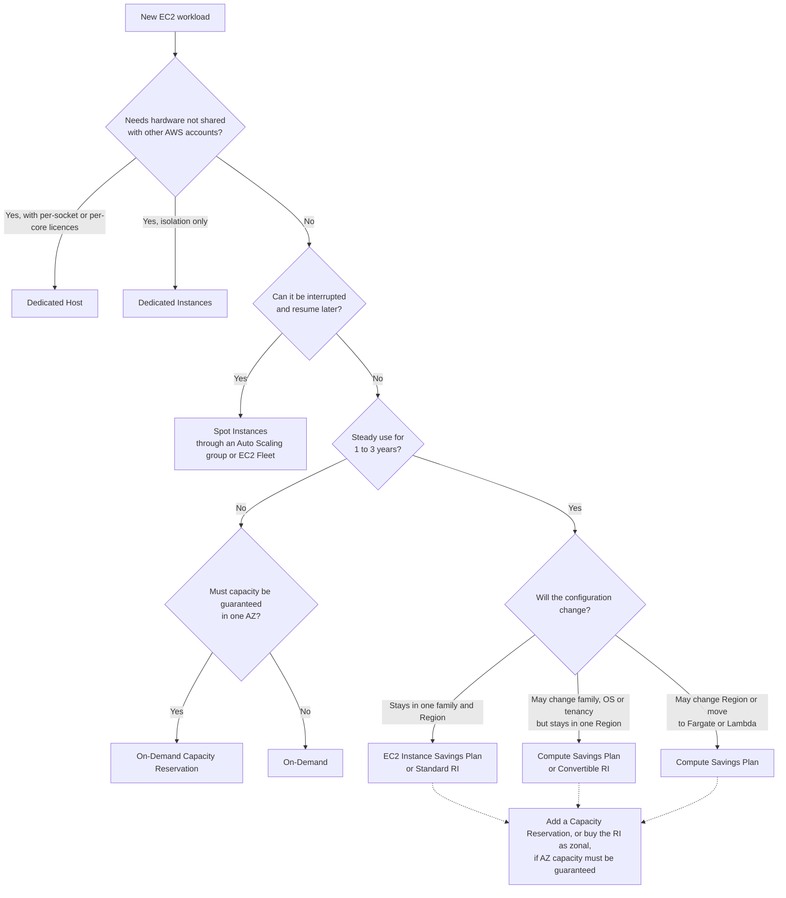
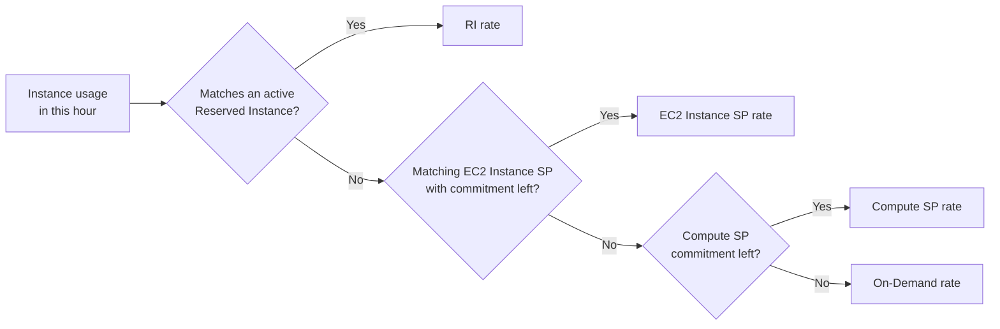
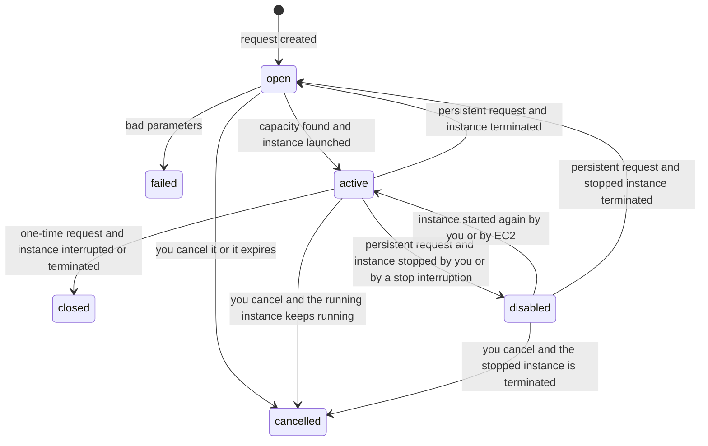
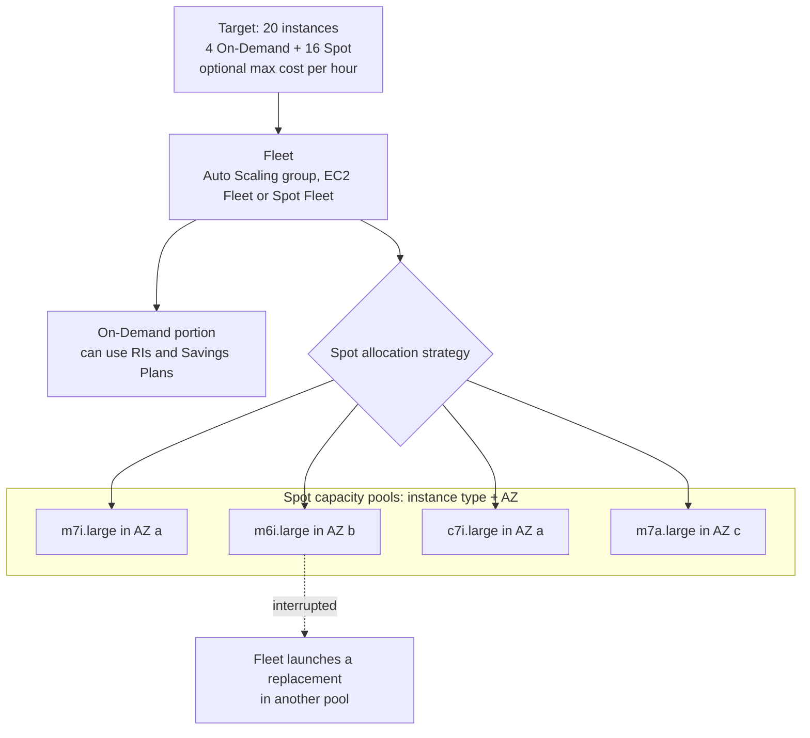
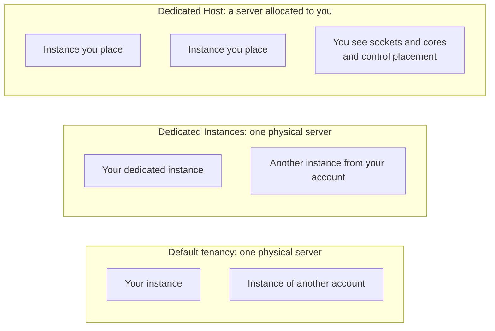

# EC2 Purchasing Options

## Summary

The same EC2 instance can cost very different amounts depending on how you buy it. **On-Demand** is
the flexible, full-price default. **Reserved Instances** and **Savings Plans** trade a 1- or 3-year
commitment for a large discount on steady usage. **Spot Instances** sell spare capacity at up to 90%
off, but AWS can take them back with two minutes' warning. **Dedicated Hosts** and **Dedicated
Instances** give you hardware that no other AWS account uses, for licensing or compliance.
**Capacity Reservations** guarantee that capacity exists in one Availability Zone without giving any
discount by themselves. On the exam, you pick the option that matches the workload's duration,
tolerance for interruption, need for guaranteed capacity and licensing rules, at the lowest cost.

## Key concepts

- **On-Demand**: no commitment, pay per second (60-second minimum) for most operating systems; highest price.
- **Reserved Instance (RI)**: a billing discount, not a server, for a fixed instance type, Region, tenancy and OS over 1 or 3 years.
- **Standard vs Convertible RI**: Standard gives the deeper discount and can be resold; Convertible can be exchanged for different attributes.
- **Regional vs zonal RI**: only a **zonal** RI reserves capacity; a **regional** RI is flexible across AZs (and sizes for Linux).
- **Savings Plans**: commit to a USD-per-hour spend for 1 or 3 years; AWS now recommends them over RIs.
- **EC2 Instance Savings Plan** is tied to one family in one Region; **Compute Savings Plan** follows you across families, Regions, Fargate and Lambda.
- **Spot Instances**: up to 90% off, interrupted with a **two-minute notice** when EC2 needs the capacity back.
- **Spot request types**: **one-time** ends after the first interruption; **persistent** keeps restarting or replacing its instance until cancelled.
- **Cancel first, then terminate**: cancelling a Spot request does not stop its running instances.
- **Fleets**: Auto Scaling groups (recommended), EC2 Fleet or the legacy Spot Fleet mix Spot and On-Demand across many capacity pools.
- **price-capacity-optimized** is the recommended Spot allocation strategy for most workloads.
- **Dedicated Host**: a whole physical server you control, for per-socket / per-core licences (BYOL).
- **Dedicated Instance**: single-account hardware without placement control, plus a per-Region hourly fee.
- **On-Demand Capacity Reservation**: guaranteed capacity in one AZ, billed at the On-Demand rate whether used or not.

## The options at a glance

Think of each option as answering two questions: *how much flexibility do I give up?* and *what do I
get back for it?*

| Option | Commitment | Typical saving vs On-Demand | Capacity guaranteed? | Best for |
|---|---|---|---|---|
| On-Demand | None | 0% (baseline) | No | Short, spiky or unknown workloads that must not be interrupted |
| Standard Reserved Instance | 1 or 3 years, fixed configuration | Up to 72% | Only if zonal | Steady workloads that will not change (a database server) |
| Convertible Reserved Instance | 1 or 3 years, exchangeable | Up to 66% | Only if zonal | Steady workloads that may change family, OS or tenancy |
| EC2 Instance Savings Plan | 1 or 3 years of USD/hour in one family + Region | Up to 72% | No | Steady use of one family where sizes and OS vary |
| Compute Savings Plan | 1 or 3 years of USD/hour, any EC2, Fargate, Lambda | Up to 66% | No | Organisations that move between families, Regions or to containers / serverless |
| Spot Instances | None | Up to 90% | No, can be interrupted | Fault-tolerant, flexible-start work: batch, CI, analytics, rendering |
| Dedicated Host | On-Demand per host, or 1–3-year host reservation | Reservation up to 70% off host price | The host is yours | BYOL per-socket / per-core licences, strict compliance |
| Dedicated Instances | Per instance (On-Demand, RI, Spot, Savings Plans) | Price premium plus per-Region fee | No | Isolation from other AWS accounts without managing hosts |
| On-Demand Capacity Reservation | None (immediate use) | 0% unless combined with a regional RI or Savings Plan | Yes, in one AZ | Events, DR or regulatory needs that require capacity to be there |

> [!NOTE] Percentages are ceilings
> The "up to" figures are AWS's published maximums. Real discounts depend on the instance type,
> Region, term and payment option. The exam does not ask for exact percentages; it asks which
> option fits. The worked price example later in this lesson shows realistic numbers.

> [!EXAMPLE] An analogy: renting cars
> **On-Demand** is walking up to the rental desk and paying the daily rate. A **Reserved Instance**
> is a long lease on one specific model. A **Savings Plan** is a monthly mobility budget you promise
> to spend, usable on any car in the fleet. **Spot** is a standby car the agency lends cheaply but
> can recall with a short warning. A **Dedicated Host** is leasing the entire garage. A **Capacity
> Reservation** is paying to keep a car parked with your name on it, whether you drive it or not.

## On-Demand Instances

On-Demand is what you get when you launch an instance and choose nothing else.

- **Billing**: you pay only while the instance is `running`. Linux, Windows (including the SQL
  Server editions), RHEL and Ubuntu Pro are billed **per second with a 60-second minimum**; SUSE Linux
  Enterprise Server is still billed by the full hour. Stopped instances cost nothing for compute (EBS
  volumes are still billed).
- **Price**: the highest per-hour rate of all non-dedicated options, but fixed and with **no upfront
  payment and no long-term commitment**.
- **Capacity**: not guaranteed. If an AZ runs out of a type, a launch can fail with an
  insufficient-capacity error.
- **Quotas**: the number of running On-Demand instances is limited per Region by **vCPU count** per
  family group (for example, "Running On-Demand Standard (A, C, D, H, I, M, R, T, Z) instances").
  You can request an increase in Service Quotas.

**Use it for** short-term or irregular workloads whose behaviour you cannot predict yet, and anything
that must not be interrupted: a new application in its first weeks, a load test, a developer box.

**Avoid it for** workloads that will run 24/7 for a year or more (commit instead) or batch jobs that
can tolerate interruption (use Spot).

> [!UPDATED] More operating systems now billed per second
> The slides say only Linux and Windows get per-second billing. The current On-Demand pricing page
> also lists RHEL, Ubuntu Pro and the Windows with SQL Server editions as per-second; SUSE Linux
> Enterprise Server is the notable exception that is still billed per full hour.

## Reserved Instances

A Reserved Instance is a **billing discount that is applied automatically** to running On-Demand
instances that match its attributes. Buying one does not launch anything. If you buy an RI for
`m7i.large` Linux in `us-east-1` and you have such an instance running, its hourly rate drops
immediately; if you don't, you are still paying for the reservation.

The price of an RI depends on:

- **Instance attributes**: instance type (family + size), Region, tenancy (shared or dedicated) and
  platform (OS).
- **Term**: 1 year or 3 years. Longer term, deeper discount.
- **Payment option**: **No Upfront** (discounted hourly rate every hour of the term), **Partial
  Upfront** (part paid now, lower hourly rate) or **All Upfront** (everything paid now, no hourly
  charge). The more you pay upfront, the lower the effective rate.
- **Offering class**: Standard or Convertible.

RIs **cannot be cancelled** once bought and **do not renew automatically**. When the term ends,
matching instances keep running at On-Demand rates. You can queue the purchase of a regional RI (up
to three years ahead) so that a new one starts as the old one expires.

**Use it for** steady-state workloads whose configuration is known, such as a production database
server that runs around the clock.

### Scope: regional or zonal

| | Regional RI | Zonal RI |
|---|---|---|
| Reserves capacity | No | Yes, in the chosen AZ |
| AZ flexibility | Discount applies in any AZ of the Region | Only in the chosen AZ |
| Size flexibility | Yes within the family (Linux/Unix, default tenancy) | No, exact size only |
| Queued purchase | Supported | Not supported |
| Price | Same | Same |

> [!EXAMPLE] Size flexibility in action
> You own a regional RI for one `m7i.xlarge` Linux. Its discount can cover two `m7i.large`
> instances instead, because sizes are normalised within the family. A zonal RI for `m7i.xlarge`
> in `us-east-1a` only discounts an `m7i.xlarge` running in `us-east-1a`, but it also guarantees
> you can launch that instance there.

### Offering class: Standard or Convertible

| | Standard RI | Convertible RI |
|---|---|---|
| Maximum discount | Up to 72% | Up to 66% |
| Modify AZ, scope, or size within the same family and generation (size: Linux/Unix only) | Yes | Yes |
| Exchange for a different family, OS, tenancy or scope (same Region) | No | Yes, for another Convertible RI of equal or higher value |
| Sell in the Reserved Instance Marketplace | Yes | No |
| Buy in the Reserved Instance Marketplace | Yes | No |

### Reserved Instance Marketplace

If your needs change, you can list unused **Standard** RIs for sale to other customers in the
Reserved Instance Marketplace. Buyers often get shorter remaining terms and lower upfront prices
than buying from AWS. Convertible RIs cannot be bought or sold there.

> [!UPDATED] AWS now recommends Savings Plans over Reserved Instances
> The EC2 User Guide opens its Reserved Instances page by recommending Savings Plans instead: same
> maximum discount (up to 72%) with more flexibility. RIs still exist, still appear on the exam, and
> are still the only commitment that can reserve capacity (zonal RIs).

## Savings Plans

With a Savings Plan you commit to **spend a fixed amount per hour** (for example USD 10/hour) for 1
or 3 years, with No, Partial or All Upfront payment. In return, eligible usage up to that amount is
billed at discounted Savings Plan rates. Usage beyond the commitment is billed at normal On-Demand
rates, and if you use less, you still pay the full commitment for that hour. Each hour's commitment
is used within that hour and does not carry over.

### Savings Plan types

| Type | Applies to | Locked to | Flexible across | Max discount |
|---|---|---|---|---|
| **EC2 Instance Savings Plan** | EC2 instances | One instance family in one Region (for example M7i in us-east-1) | Size, OS, tenancy, AZ | Up to 72% |
| **Compute Savings Plan** | EC2, Fargate, Lambda | Nothing beyond the commitment | Family, size, Region, OS, tenancy, and moving to ECS / EKS on Fargate or Lambda | Up to 66% |
| SageMaker AI Savings Plan | SageMaker AI instance usage | — | Family, size, Region, component | Up to 64% |
| Database Savings Plan | Aurora, RDS, DynamoDB, ElastiCache, DocumentDB, Neptune and other database services | — | Engine, family, size, AZ, Region, serverless | Up to 35% |

Both EC2-related plans also apply to EC2 instances that run inside EMR, EKS and ECS clusters (but not
to the EKS control-plane fee). Savings Plans **never apply to Spot Instances**, and Spot spend does
not count toward your commitment. The USD 2/hour Dedicated Instances Regional fee is not discounted.

> [!UPDATED] Four Savings Plan types, not just the EC2 plan
> The slides describe only the EC2 Instance Savings Plan. AWS now lists four types: Compute, EC2
> Instance, SageMaker AI and the newer **Database Savings Plans** (up to 35% across managed
> database services). For SAA-C03, focus on Compute versus EC2 Instance.

### How discounts are applied each hour

AWS applies Reserved Instances first, then EC2 Instance Savings Plans (narrower), then Compute
Savings Plans (broader). Within a plan, usage with the highest percentage saving is covered first.

> [!EXAMPLE] A USD 10/hour Compute Savings Plan
> In one hour your instances would cost USD 14 at Savings Plan rates. The plan covers USD 10 worth
> of that usage at SP rates; the remainder is billed at On-Demand rates. Next hour your usage drops to
> USD 6 at SP rates: you still pay USD 10, because the commitment is per hour. That is why AWS's
> recommendations (Billing and Cost Management → **Savings Plans** → **Recommendations**) size the
> commitment from your past steady baseline, not your peaks.

**Use a Savings Plan** when you can predict a minimum hourly spend but not the exact instances. Pick
**Compute** if the workload might change family, Region, or move to Fargate or Lambda; pick **EC2
Instance** for a slightly larger discount when you will stay in one family and Region.

## Spot Instances

A Spot Instance runs on **spare EC2 capacity** at a steep discount (up to 90% off On-Demand). The
catch: when EC2 needs that capacity back, it interrupts your instance after a **two-minute
interruption notice**. The Spot price for each instance type in each AZ is set by EC2 and moves
**gradually** with long-term supply and demand; you always pay the current Spot price, never more
than the On-Demand price.

Key terms:

- **Spot capacity pool**: unused instances of one type in one AZ (for example `m7i.large` in
  `us-east-1b`). Each pool has its own price and interruption risk.
- **Rebalance recommendation**: an earlier signal that an instance is at elevated risk, so you can
  move work before the two-minute notice.
- **Interruption behaviour**: **terminate** (default), **stop** or **hibernate**. Stop and hibernate
  need a persistent request (or a `maintain` fleet), and the EBS data survives.

**Good fits**: batch processing, data analysis, image and video processing, CI/CD build agents,
big-data clusters, rendering, stateless web or container workers behind a load balancer, and any
distributed job that checkpoints its progress or has a flexible start and end time.

**Poor fits**: databases, single critical servers, anything stateful that cannot be stopped at short
notice, or jobs with a hard deadline and no checkpointing.

> [!WARNING] Design for interruption
> Never put the only copy of important data or the only instance of a critical service on Spot.
> Keep state in S3, EBS snapshots, DynamoDB or a queue, spread capacity across several instance types
> and AZs, and handle the two-minute notice (for example drain work from a queue and checkpoint).

### Maximum price

You *can* set a maximum price per instance-hour. If the Spot price climbs above it, EC2 interrupts
your instance; if your maximum is already below the current Spot price, nothing launches and the
request waits in the `open` state (status `price-too-low`) until the price falls.
Whatever maximum you set, you are charged the **current Spot price**, not your maximum.

> [!UPDATED] No bidding, and AWS recommends no maximum price
> The slides describe a user-defined maximum price and use a bidding analogy. Spot prices are no
> longer driven by bids: EC2 adjusts them gradually. The console default is **No maximum price**
> (capped at the On-Demand price) and AWS marks it as recommended, because setting your own maximum
> makes interruptions more frequent. Capacity, not price, is now the usual cause of interruption.

### Spot Instance requests: one-time or persistent

Every Spot Instance is backed by a **Spot Instance request**, created by you (launch wizard or
`run-instances` with `--instance-market-options`) or on your behalf by a fleet. A request holds the
launch specification, the request type, an optional maximum price and an optional validity period.

- **One-time**: after the instance launches, the request is done. If the instance is interrupted or
  terminated, the request closes and nothing is relaunched. Only **terminate** is valid as the
  interruption behaviour.
- **Persistent**: the request stays alive until it expires or you cancel it. What happens next
  depends on how the instance stops running:
  - EC2 interrupts it with **stop** or **hibernate** behaviour: the request becomes `disabled`, the
    EBS volumes are kept, and EC2 itself restarts the same instance when capacity returns in that AZ.
  - The instance is **terminated** (by you, or by an interruption with terminate behaviour, which
    only the legacy `request-spot-instances` API allows on a persistent request): the request goes
    back to `open` and EC2 launches a brand-new instance when capacity returns.
  - **You stop** the instance: the request becomes `disabled` until you start the instance again.

### Getting rid of Spot Instances in the right order

Requests can be cancelled only while they are `open`, `active` or `disabled`. The trap is
**persistent** requests:

1. If you terminate the instance first, the persistent request reopens and launches a new one.
2. If you cancel an `active` request, its running instance is **not** terminated; it keeps running
   (and billing) until you terminate it.

So the safe sequence is: **cancel the request, then terminate its instances.** In the console,
**Spot Requests** → select the request → **Actions** → **Cancel request**, and tick **Terminate
instances** in the dialog to do both at once.

> [!UPDATED] Cancelling a disabled request now cleans up the stopped instance
> According to the current EC2 User Guide, if you cancel a `disabled` request whose instance is
> stopped, the Spot service terminates that stopped instance for you (after a short delay). Running
> instances still need to be terminated by you.

## Spot Fleet, EC2 Fleet and Auto Scaling groups

Asking for one instance type in one AZ is the riskiest way to use Spot: if that single pool runs dry,
you lose everything at once. A **fleet** spreads your request across many **launch pools** (instance
type + AZ, optionally different AMIs or subnets) and keeps working toward a **target capacity**.

A **Spot Fleet** is a set of Spot Instances plus, optionally, On-Demand Instances. You define the
target capacity (in instances, vCPUs or custom units), the candidate pools and, optionally, a
**maximum cost per hour**. The fleet stops launching when it reaches the target or the spending cap.
With request type `maintain` (default) it replaces interrupted Spot Instances; with `request` it
makes a one-off attempt.

### Spot allocation strategies

| Strategy (Spot Fleet name) | How it picks pools | Use when |
|---|---|---|
| **priceCapacityOptimized** (recommended) | Pools with the most spare capacity first, then the cheapest of those | Almost everything: stateless web, containers, batch, analytics |
| **capacityOptimized** | Pools with the most spare capacity, price ignored | Interruptions are very expensive (long CI, rendering, HPC, deep learning) |
| **capacityOptimizedPrioritized** | Like capacityOptimized but honours your instance-type priorities where it can | You prefer certain types but still want few interruptions |
| **diversified** | Spreads instances evenly across all pools | Large, long-running fleets; one pool's loss hits only a fraction |
| **lowestPrice** (not recommended) | Cheapest pool with capacity | Short jobs where only price matters; highest interruption risk |

> [!UPDATED] Spot Fleet is now a legacy API
> The EC2 User Guide says Spot Fleet uses a legacy API with no planned investment and strongly
> discourages it. AWS recommends an **Auto Scaling group** (mixed instances policy, health checks,
> load balancer integration) or, if you must manage the lifecycle yourself, **EC2 Fleet** (CLI/API
> only, with an `instant` type). The allocation strategies are the same. Also new since the slides:
> **capacityOptimizedPrioritized**, and AWS now labels **lowestPrice** as not recommended, even
> though it is still the CLI default.

## Dedicated Hosts and Dedicated Instances

By default, instances run on **shared tenancy** hardware: your instance may sit on the same physical
server as instances from other AWS accounts (isolated by the hypervisor). Two options remove other
accounts from your hardware.

**Dedicated Host**: a physical server with all of its instance capacity dedicated to you. You
allocate the host, see its sockets and physical cores, choose which instances go on it, and can keep
an instance on the same host across stops and starts (**host affinity**). That visibility is what
lets you **bring your own per-socket, per-core or per-VM licences** (Windows Server, SQL Server,
RHEL, SUSE and other server-bound software). Billing is **per host**, regardless of how many
instances you run on it: On-Demand per second (60-second minimum), or a **Dedicated Host
Reservation** for 1 or 3 years (No, Partial or All Upfront) at up to 70% off. Savings Plans can also
cover Dedicated Hosts. It is the most expensive way to run EC2.

**Dedicated Instances**: instances on hardware dedicated to **your account**, but you get no view of
or control over the host. They may share a server with your own non-dedicated instances, and after a
stop and start they can land on different hardware. Billing is **per instance** plus a **USD 2/hour
fee per Region** in which at least one Dedicated Instance runs.

| | Dedicated Host | Dedicated Instance |
|---|---|---|
| Hardware dedicated to | You (capacity can be shared with other accounts via AWS RAM) | Your account |
| Billing | Per host | Per instance + Regional fee |
| See sockets, cores, host ID | Yes | No |
| Host affinity and targeted placement | Yes | No |
| Bring your own licence (per-socket / per-core) | Full support | Limited |
| Automatic instance recovery | Supported | Supported |
| Capacity Reservations | Not supported | Supported |

**Choose a Dedicated Host** for complicated licensing (BYOL bound to cores or sockets) or regulations
that require control over the physical server. **Choose Dedicated Instances** when the requirement is
only "no other customer on our hardware".

## Capacity Reservations

An **On-Demand Capacity Reservation** sets aside capacity for a given instance type, platform and
tenancy in **one specific AZ**. When you request one for immediate use, there is **no term**: you
create it, modify it and cancel it whenever you like.

- **Billing**: the reservation is charged at the **On-Demand rate whether or not instances run in
  it** (per second, 60-second minimum). When a matching instance runs inside it, you pay for the
  instance and nothing extra for the reservation.
- **No discount by itself**. Combine it with a **regional RI** or a **Savings Plan** to get a
  discount. **Zonal RI discounts do not apply** to Capacity Reservations.
- **Instance eligibility**: **open** (any matching instance uses it automatically) or **targeted**
  (only instances that name the reservation).
- Reservations count against your On-Demand vCPU quota even when unused, can be shared with other
  accounts, and cannot be used with Dedicated Hosts.

| | Capacity Reservation | Zonal RI | Regional RI | Savings Plan |
|---|---|---|---|---|
| Term | None (immediate use) | 1 or 3 years | 1 or 3 years | 1 or 3 years |
| Capacity reserved | Yes, one AZ | Yes, one AZ | No | No |
| Billing discount | No (unless combined) | Yes | Yes | Yes |

**Use it for** short-term or uninterrupted workloads that must run in a particular AZ: a product launch
or sales event, disaster recovery capacity in a second AZ or Region, or regulatory high-availability
requirements.

> [!UPDATED] Future-dated reservations and Capacity Blocks for ML
> Since the slides, Capacity Reservations gained a **future-dated** mode: you choose a start date
> (5 to 120 days ahead) and a commitment duration (minimum 14 days for most families, at least 32
> vCPUs in total). Cancelling within eight weeks of the start date or during the commitment can
> incur a cancellation charge. **Capacity Blocks for ML** reserve accelerated instances (P-family
> GPUs and Trainium) for a defined period starting up to eight weeks ahead and cannot be cancelled.
> "No time commitment" now applies only to immediate-use reservations.

## Putting numbers on it

Example: `m7i.large` (2 vCPU, 8 GiB), Linux, shared tenancy, `us-east-1`, from AWS's public price
data (On-Demand and RI rates published 2026-09-25, Savings Plans rates published 2026-10-03, Spot
price sampled 2026-10-03). Effective hourly rates include the upfront payment spread over the term.

| How you buy it | Effective price per hour | Saving vs On-Demand |
|---|---|---|
| On-Demand | USD 0.1008 | — |
| Spot (current price, changes over time) | about USD 0.045 | about 55% |
| Standard RI, 1 year | 0.0667 (No Upfront) to 0.0622 (All Upfront) | 34–38% |
| Standard RI, 3 years | 0.0457 (No Upfront) to 0.0398 (All Upfront) | 55–61% |
| Convertible RI, 1 year | 0.0741 (No Upfront) to 0.0691 (All Upfront) | 27–31% |
| Convertible RI, 3 years | 0.0511 (No Upfront) to 0.0464 (All Upfront) | 49–54% |
| Compute Savings Plan, 1 year | 0.0741 (No Upfront) to 0.0691 (All Upfront) | 27–31% |
| Compute Savings Plan, 3 years | 0.0511 (No Upfront) to 0.0464 (All Upfront) | 49–54% |
| EC2 Instance Savings Plan, 1 year | 0.0667 (No Upfront) to 0.0622 (All Upfront) | 34–38% |
| EC2 Instance Savings Plan, 3 years | 0.0457 (No Upfront) to 0.0398 (All Upfront) | 55–61% |
| Dedicated Host | Per-host On-Demand rate | Host Reservation up to 70% |
| Capacity Reservation | USD 0.1008, used or not | 0% unless a regional RI or SP applies |

Patterns worth remembering: three years beats one year; All Upfront beats No Upfront; Standard beats
Convertible; for this instance, EC2 Instance Savings Plan rates equal Standard RI rates and Compute
Savings Plan rates equal Convertible RI rates, so the plans add flexibility at no extra cost; Spot is
usually cheapest but the saving varies by pool and day.

> [!UPDATED] Example instance changed from m4.large to m7i.large
> The slides price an older `m4.large`. This table uses a current-generation instance and today's
> published rates. The relative order of the options is the same; the exact numbers will drift.

## Exam tips

> [!EXAM] Match the keyword to the option
> - "Steady state", "24/7 for 3 years", "database that will not change" → **Standard RI** or **EC2 Instance Savings Plan** (3-year, All Upfront for maximum saving).
> - "Commit to spend", "flexibility to change instance family / Region", "also uses Fargate or Lambda" → **Compute Savings Plan**.
> - "Might change instance type or OS during the term" and RIs are mentioned → **Convertible RI**.
> - "Fault tolerant", "can be interrupted", "batch", "flexible start time", "most cost-effective" → **Spot**.
> - "Short-term, unpredictable, cannot be interrupted" → **On-Demand**.
> - "Per-socket / per-core licence", "BYOL", "visibility of physical cores" → **Dedicated Host**.
> - "Must not share hardware with other customers" (no licence detail) → **Dedicated Instances**.
> - "Guarantee capacity in a specific AZ for a short event, no long-term commitment" → **On-Demand Capacity Reservation**.

> [!EXAM] Capacity guarantees
> Only three things reserve capacity: a **zonal RI**, an **On-Demand Capacity Reservation** (or a
> Capacity Block) and a **Dedicated Host** you have allocated. Regional RIs and Savings Plans are
> discounts only.

> [!EXAM] Spot at scale
> For a resilient fleet on Spot, look for an **Auto Scaling group with multiple instance types across
> several AZs** and the **price-capacity-optimized** allocation strategy, with On-Demand as a base.
> "Diversified" is the answer when the question stresses spreading a large long-running fleet across
> pools; "lowest price" is a cost-only distractor.

- "Stop paying for Spot Instances from a persistent request" → cancel the request first, then terminate.
- "Keep the EBS data when a Spot Instance is reclaimed" → persistent request with **stop** or **hibernate** interruption behaviour.
- "Discount on capacity you have already reserved" → add a **regional RI** or **Savings Plan** to the Capacity Reservation.

## Common traps

> [!TRAP] Regional RIs do not reserve capacity
> A question asks for guaranteed capacity *and* a discount. A regional RI only gives the discount.
> Use a zonal RI, or a Capacity Reservation combined with a regional RI or Savings Plan.

> [!TRAP] Capacity Reservations are not discounts
> They are billed at the On-Demand rate, used or unused. Choosing a Capacity Reservation for "the
> cheapest option" is wrong unless the requirement is guaranteed capacity.

> [!TRAP] A cancelled Spot request leaves its running instances alive
> And terminating the instance of a persistent request just makes the request launch another one. The
> order is cancel, then terminate.

> [!TRAP] Spot for databases or critical single servers
> Spot is the cheapest option, which makes it tempting for every "cost-effective" question. If the
> workload cannot tolerate interruption (a primary database, a payment service on one instance), Spot
> is wrong no matter how cheap it is.

> [!TRAP] Dedicated Instance versus Dedicated Host
> Both give single-tenant hardware. Only the Host gives socket/core visibility, placement control and
> full BYOL support. Licensing keywords point to the Host; plain isolation points to Dedicated
> Instances, which are cheaper and simpler.

- **Convertible RIs cannot be sold** in the Reserved Instance Marketplace; only Standard RIs can.
- **Savings Plans do not cover Spot** usage, and Spot spend does not count toward a commitment.
- **RIs do not renew automatically**; at expiry the instance silently goes back to On-Demand rates.
- **A Savings Plan commitment is per hour**: unused commitment in a quiet hour is lost, and usage above it is billed On-Demand.
- **Setting a low Spot maximum price does not lower your bill**: you always pay the current Spot price; a low maximum only causes more interruptions.
