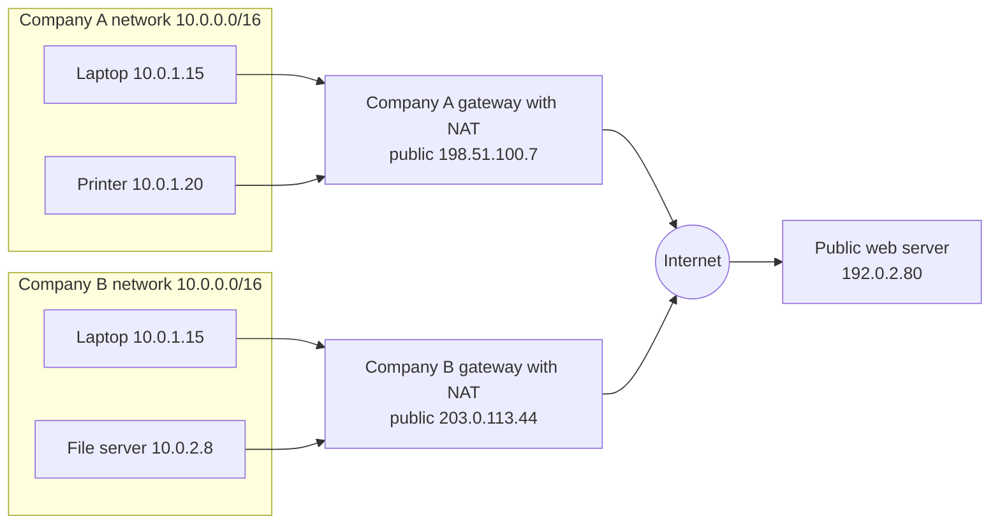
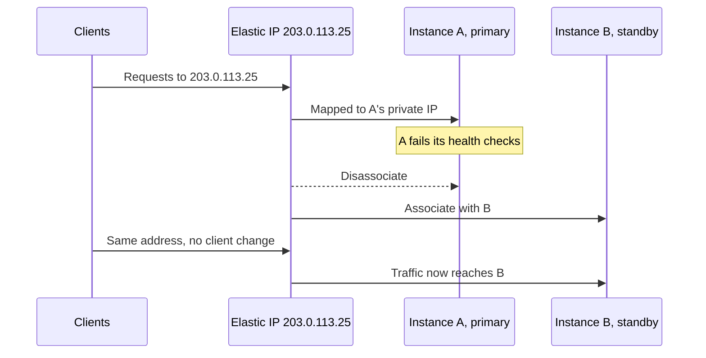
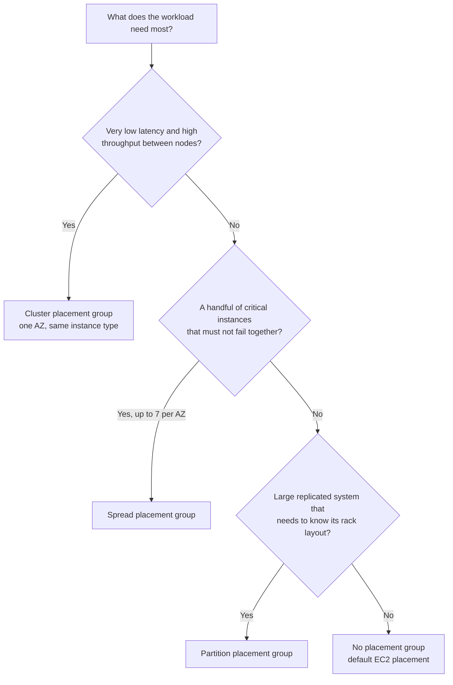
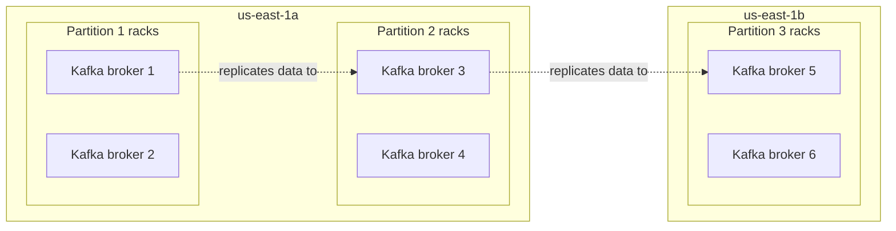
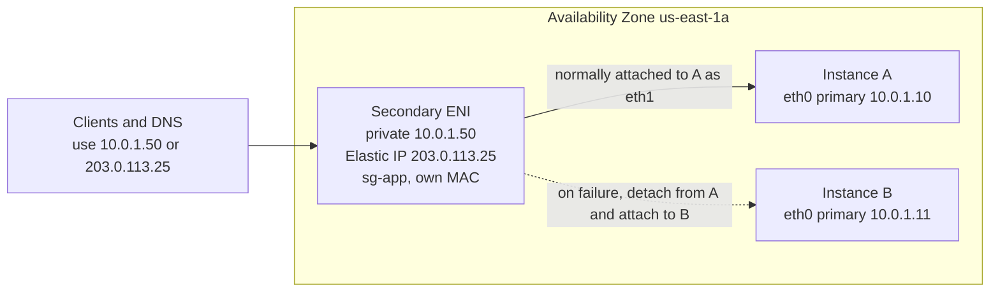
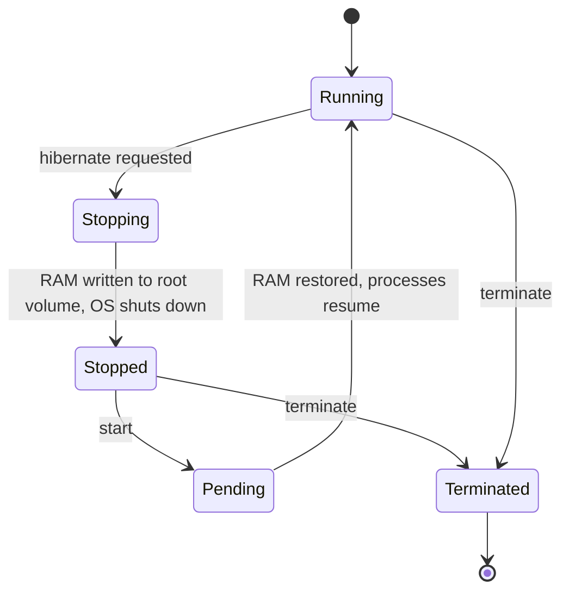

# EC2 Networking & Placement

## Summary

Every EC2 instance gets a **private IPv4 address** that never changes while the instance exists, and
can also get a **public IPv4 address** that AWS hands back to its pool whenever you stop the instance.
When something outside AWS must always find the same address, an **Elastic IP** fixes it, although a
DNS name or a load balancer is usually the better design, and every public IPv4 address now costs
money by the hour. **Placement groups** let you decide how instances sit on the physical hardware:
packed together for speed (**cluster**), kept apart for safety (**spread**), or split into isolated
rack groups for big distributed systems (**partition**). An **elastic network interface (ENI)** is a
virtual network card you can move from one instance to another in the same Availability Zone, taking
its IPs with it. **EC2 Hibernate** stops an instance without losing what is in its memory, so
slow-starting applications come back exactly where they left off.

## Key concepts

- **Private IPv4**: reachable only inside the VPC (or networks connected to it); kept through stop, start and hibernate; released at termination.
- **Public IPv4**: reachable from the internet; comes from Amazon's pool, is **released on every stop or hibernate** and replaced on start.
- **RFC 1918 ranges**: `10.0.0.0/8`, `172.16.0.0/12` and `192.168.0.0/16`, reused freely by any private network.
- **Public IPv4 charge**: USD 0.005 per hour for every public IPv4 address, attached or idle, Elastic IPs included.
- **Elastic IP (EIP)**: a static public IPv4 address owned by your account in one Region until you release it; **5 per Region** by default.
- **Avoid EIPs where you can**: prefer a DNS name, or a load balancer in front of instances that have no public IP at all.
- **Cluster placement group**: one AZ, lowest latency, up to 10 Gbps per flow; an AZ problem takes down the whole group.
- **Spread placement group**: each instance on its own rack; **max 7 running instances per AZ** per group; can span AZs.
- **Partition placement group**: up to **7 partitions per AZ**, each on its own racks; hundreds of instances; partition number visible in metadata (HDFS, HBase, Cassandra, Kafka).
- **ENI**: virtual NIC bound to one subnet (one AZ); a secondary ENI can be moved to another instance with its private IPs, EIP, security groups and MAC address.
- **Primary ENI** (`eth0`, device index 0) can never be detached; secondary ENIs attach hot, warm or cold.
- **EC2 Hibernate**: RAM is saved to the **encrypted EBS root volume**; the OS resumes instead of booting.
- **Hibernate limits**: enable at launch only; Linux RAM under 150 GiB; no bare metal; at most 60 days hibernated.

## IP addressing basics

Two versions of the Internet Protocol are in use:

| | IPv4 | IPv6 |
|---|---|---|
| Size | 32 bits | 128 bits |
| Written as | Four numbers from 0 to 255 separated by dots, e.g. `52.94.236.248` | Eight groups of hexadecimal digits separated by colons, e.g. `2001:db8:1234:1a00::10` |
| Address space | About 4.3 billion in total, and far fewer usable on the public internet because large blocks are reserved | So large that every device can have a globally unique address |
| Status | Still the default everywhere; every VPC must have an IPv4 range | Growing, driven by address exhaustion and huge fleets of devices such as IoT sensors |

This lesson, like most of the exam, works with **IPv4**. IPv6 in VPCs (dual-stack and IPv6-only
subnets, egress-only internet gateways) is covered in the VPC lessons.

## Private vs public IPv4

The scarcity of IPv4 addresses is the reason private addressing exists. Three ranges, defined in
**RFC 1918**, are set aside for internal use and are never routed on the public internet:

| RFC 1918 block | Range | Typical use |
|---|---|---|
| `10.0.0.0/8` | 10.0.0.0 – 10.255.255.255 | Large corporate networks, most custom VPCs |
| `172.16.0.0/12` | 172.16.0.0 – 172.31.255.255 | AWS default VPCs use `172.31.0.0/16` |
| `192.168.0.0/16` | 192.168.0.0 – 192.168.255.255 | Home and small-office routers |

| | Private IPv4 | Public IPv4 |
|---|---|---|
| Who can reach it | Only machines on the same private network or networks connected to it (VPN, peering, Direct Connect) | Anyone on the internet, subject to firewalls and security groups |
| Uniqueness | Unique within its own network only; two companies can both use `192.168.0.10` | Unique worldwide; no two internet hosts share one |
| Who assigns it | You, by choosing the VPC and subnet range | A registry or a cloud provider; in AWS, Amazon's pool (or your own block via BYOIP) |
| Location | Reveals nothing about where the machine is | Can be roughly geolocated |
| How it reaches the internet | Through a **NAT** device that swaps the private source address for a public one | Directly, through an internet gateway |

> [!EXAMPLE] Same address, no conflict
> Both laptops above are `10.0.1.15`, and that is fine because neither address ever appears on the
> internet. When either laptop opens the public web server, its gateway rewrites the source to the
> company's own public address (NAT), so the web server only ever sees `198.51.100.7` or
> `203.0.113.44`. In AWS, the internet gateway performs this one-to-one translation for instances
> that have a public IPv4, and a **NAT gateway** does the many-to-one version for instances that only
> have private addresses.

## How an EC2 instance gets its addresses

When you launch an instance into a subnet, its **primary network interface** (`eth0`) receives:

1. A **primary private IPv4 address** from the subnet's range. It stays the same through reboot,
   stop/start and hibernate, and is released only when the instance is terminated.
2. Optionally, a **public IPv4 address** from Amazon's pool. Instances in a **default subnet** get
   one automatically; instances in a subnet you created do not, unless the subnet's
   auto-assign setting is on or you set **Auto-assign public IP** to **Enable** at launch.

The public address is borrowed, not owned. AWS takes it back when the instance is **stopped,
hibernated or terminated**, and gives a **different** one when the instance starts again. It is also
released when you associate an Elastic IP with the instance. A reboot keeps it.

| Event | Private IPv4 | Auto-assigned public IPv4 | Elastic IP |
|---|---|---|---|
| Reboot | Kept | Kept | Stays associated |
| Stop, then start | Kept | **Released; a new one is assigned on start** | Stays associated |
| Hibernate, then start | Kept | **Released; a new one is assigned on start** | Stays associated |
| Terminate | Released | Released | Disassociated, but still allocated (and billed) |

> [!NOTE] One quirk worth knowing
> If the instance has a **secondary network interface**, or a secondary private IP with an Elastic IP
> on it, AWS does not give it a new public IPv4 when the old one is released. Such an instance comes
> back from a stop with no auto-assigned public address at all.

### Connecting to an instance

Your laptop is not inside the VPC, so it cannot reach an instance's private IP directly. SSH from
home therefore uses the instance's **public** IPv4 (or its public DNS name), and that is why a
bookmarked address stops working after a stop and start. From inside the VPC, other instances should
talk to each other over **private** IPs: the address never changes, and traffic does not take a
detour through public addressing.

> [!UPDATED] You no longer need a public IP to administer an instance
> The slides say SSH can only use the public IP. That is still true for a plain SSH client on the
> internet, but AWS now offers two ways in that need no public address on the instance:
> **EC2 Instance Connect Endpoint** (SSH or RDP through an endpoint in your VPC) and **Systems
> Manager Session Manager** (a browser or CLI shell with no inbound ports, bastion hosts or SSH keys).
> Both are common "most secure" answers.

### Public IPv4 addresses are billed

> [!UPDATED] Every public IPv4 address now costs money
> Since 1 February 2024 AWS charges **USD 0.005 per hour** (about USD 3.65 per month) for each public
> IPv4 address, whether it is auto-assigned to a running instance, an Elastic IP in use, or an
> Elastic IP sitting idle. Addresses you bring yourself (BYOIP) are not charged. Accounts on the
> legacy 12-month Free Tier get 750 hours per month of in-use public IPv4 for EC2. This makes the
> slides' advice to avoid needless public addresses a cost issue as well as a security one.

## Elastic IP addresses

An **Elastic IP address** is a public IPv4 address that you allocate to your account and keep until
you release it. Because it belongs to you rather than to an instance, it survives stops, starts and
even the instance's termination.

How it behaves:

- **Static and Regional.** It never changes and can be used only in the Region (more precisely, the
  network border group) where you allocated it.
- **One association at a time.** It maps to one private IPv4 address on one instance or network
  interface. You can also attach EIPs to NAT gateways and Network Load Balancers.
- **Remappable in seconds.** Disassociate it from a failed instance and associate it with a healthy
  one, and clients keep using the same address. This is the classic manual failover pattern.
- **Replaces the auto-assigned address.** Associating an EIP with the instance (its primary network
  interface) releases the existing public IPv4 for good; you cannot get that old address back or
  convert it into an EIP.
- **Quota.** Five per Region by default. Raise it through **Service Quotas** if your design truly
  needs more.
- **Billing.** Charged hourly whether associated or not, so release EIPs you no longer use. A
  released address can sometimes be recovered with `allocate-address --address`, but only if no
  other account has taken it.

> [!UPDATED] The quota is per Region, and idle is no longer the only billed state
> The slides say you can have 5 Elastic IPs "in your account". The documented default is **5 per
> Region**. Older material also says EIPs are free while attached to a running instance; under the
> 2024 public IPv4 pricing, attached and idle EIPs are billed at the same hourly rate.

### Why the course says to avoid Elastic IPs

An EIP hard-codes one public address to one machine. That is a single point of failure, uses a scarce
and billed resource, and needs a person or script to move it. Better options exist for almost every
case:

| Need | Better option | Why |
|---|---|---|
| Users should find the app by name | A **Route 53** record (or any DNS name) | Clients use the name; the address behind it can change |
| A highly available web app | An **Application Load Balancer** in front of instances in private subnets | Instances need no public IP; the ALB health-checks and spreads traffic across AZs |
| Partners must allow-list fixed IPs | A **Network Load Balancer** with one EIP per AZ, or **Global Accelerator** with two static anycast IPs | Static entry point without pinning an address to one server |
| Private instances need outbound internet | A **NAT gateway** | Only the NAT gateway holds a public address |
| A single server must keep its address (legacy licence, small test box) | An **Elastic IP** | Acceptable when the alternatives are overkill |

> [!TIP] DNS caching and EIPs
> If you rely on DNS for a single instance whose public IP changes, clients may keep the old address
> cached for a while after you update the record. An EIP avoids that delay; a load balancer avoids
> the problem entirely.

## Placement groups

By default, EC2 already scatters your instances across different hardware to limit correlated
failures. A **placement group** overrides that default for a set of related instances. You create
the group (free of charge), choose a strategy, and then launch instances into it.

| | Cluster | Spread | Partition |
|---|---|---|---|
| Goal | Lowest latency, highest throughput between instances | Keep each critical instance away from the others | Isolate groups of instances from each other's hardware failures |
| Availability Zones | **One AZ only** | One or more AZs in the Region | One or more AZs in the Region |
| Hardware layout | Packed into the same high-bandwidth network segment | Every instance on a **distinct rack** with its own network and power | Each partition gets its **own set of racks**; no two partitions share a rack |
| Size limit | Limited by capacity in that AZ | **7 running instances per AZ** per group | **7 partitions per AZ**; instance count limited only by account quotas |
| Failure impact | An AZ problem takes out the whole group, and nothing keeps the instances on separate racks | A rack failure affects one instance | A rack failure affects one partition only |
| Typical workload | HPC, tightly coupled simulations, a big-data job that must finish fast | A few critical servers: primary and replica databases, domain controllers | HDFS, HBase, Cassandra, Kafka and other replicated, topology-aware systems |

### Cluster

All instances land in the same AZ, close together on a high-bisection-bandwidth part of the network.
They are not confined to one rack, and the group can include instances from peered VPCs in the same
Region.

- **Network performance**: with enhanced networking, a single flow between two instances in the group
  can reach **10 Gbps**, versus 5 Gbps outside a cluster group. The aggregate bandwidth of large
  instances is much higher; the speed between two instances is capped by the slower of the two.
  Traffic to the internet or over Direct Connect is limited to 5 Gbps.
- **Capacity**: launch all the instances you need **in one request** and use **one instance type**.
  Adding instances later or mixing types raises the chance of an insufficient-capacity error. If that
  happens, stopping and starting every instance in the group can move the group to hardware with
  room for all of them. To guarantee room, create an **On-Demand Capacity Reservation in the cluster
  placement group**.
- **Supported types**: current-generation instances except burstable ones such as T2/T3, Mac1 and
  M7i-flex (plus a few previous-generation families).
- **The catch**: everything sits in one AZ, so an AZ problem stops the whole cluster. Use it for
  speed, never for availability.

> [!EXAMPLE] A genomics pipeline
> A research team runs a tightly coupled MPI job on 16 `c7i.16xlarge` instances that exchange data
> constantly. Launched together into a cluster placement group with enhanced networking (and EFA for
> MPI traffic), the nodes talk at low latency and the job finishes hours sooner. If the AZ has an
> outage, they simply rerun the job.

### Spread

Each instance is placed on a **separate rack**, each with its own network and power source.

- **Limit**: at most **seven running instances per AZ** in one group. In a Region with three AZs that
  means up to 21 instances. Need more? Use several spread groups.
- **Flexibility**: because every instance gets distinct hardware anyway, mixing instance types and
  adding instances over time is fine (an eighth launch in the same AZ fails).
- **Variants**: rack-level spread in Regions; host-level spread exists only on AWS Outposts.
- **Restriction**: Dedicated Instances cannot use spread groups.

Use spread when you have a **small number of instances whose simultaneous failure is unacceptable**,
for example a primary database and its standby, or three ZooKeeper or etcd nodes.

### Partition

EC2 divides the group into **partitions**; each partition uses its own set of racks, and no rack is
shared between partitions.

- **Size**: up to **seven partitions per AZ**, and partitions can be in several AZs of the Region.
  Each partition can hold many instances, so the group scales to hundreds of instances.
- **Placement**: EC2 tries to spread instances evenly across partitions, or you can target a specific
  partition at launch.
- **Topology awareness**: each instance can read its partition number from instance metadata
  (`placement/partition-number`), from the **Details** tab in the console, or with
  `describe-instances`. Systems such as HDFS, HBase, Cassandra and Kafka use it to put replicas of the
  same data in different partitions.
- **Restriction**: with Dedicated Instances, a partition group can have at most two partitions.

> [!TIP] Spread vs partition in one sentence
> **Spread** isolates *individual instances* (max 7 per AZ); **partition** isolates *groups of
> instances* (max 7 groups per AZ, many instances in each).

### Rules that apply to every placement group

- An instance can be in **only one** placement group at a time, and groups **cannot be merged**.
- To add, move or remove an existing instance, it must be **stopped** first; then use **Actions** →
  **Instance settings** → **Modify instance placement** (or `aws ec2 modify-instance-placement`).
- Up to **500 placement groups per Region**; creating one costs nothing.
- **Dedicated Hosts** cannot be launched into placement groups.
- A **Spot Instance** configured to stop or hibernate on interruption cannot be launched into a
  placement group.
- You can delete a group only when it holds no instances.

> [!UPDATED] A fourth strategy: precision time
> The slides list three strategies. AWS has since added **precision time placement groups**, which
> place instances on hardware with direct access to high-precision time sources (the enhanced Amazon
> Time Sync Service, and a PTP hardware clock on Linux) for microsecond-level clock synchronisation,
> for example distributed databases that order transactions or trading systems that need exact
> timestamps. A cluster group can name a precision time group as its parent. There is no extra charge.

## Elastic network interfaces (ENI)

An **elastic network interface** is a virtual network card that lives in your VPC. The console and
API simply call it a "network interface". Every instance has at least one: the **primary network
interface** (`eth0`, device index 0), created at launch.

A network interface can carry:

- a **primary private IPv4** address and optional **secondary private IPv4** addresses from its subnet;
- **one Elastic IP per private IPv4** address;
- **one auto-assigned public IPv4** address;
- **IPv6** addresses (optionally a primary IPv6 address);
- one or more **security groups** (security groups attach to interfaces, not to individual IPs);
- a fixed **MAC address**;
- a **source/destination check** flag (turn it off for NAT instances, routers and firewalls);
- a description.

The key property: **the attributes travel with the interface**. Detach a secondary ENI from one
instance and attach it to another, and its private IPs, EIPs, security groups and MAC address move
too, so traffic sent to those addresses now reaches the new instance.

| Rule | Detail |
|---|---|
| Scope | Created in **one subnet**, so it belongs to **one AZ**; it can never move to another subnet |
| Attaching | Only to an instance in the **same AZ**; the instance may be in a different subnet, and can even be in a different VPC you own (multi-VPC ENI) |
| Primary ENI | Cannot be detached; it lives and dies with the instance |
| Secondary ENIs | Attach while running (**hot**), stopped (**warm**) or at launch (**cold**); detach while running or stopped |
| How many | The maximum number of ENIs, and of IPs per ENI, depends on the instance type |
| Bandwidth | Adding ENIs does **not** add bandwidth; NIC teaming to double throughput is not supported |
| Same subnet | Two interfaces from one subnet on one instance can cause asymmetric routing; AWS suggests a secondary private IP on the primary interface instead |
| Deletion | A "delete on termination" setting decides whether the ENI is deleted with its instance |

Common uses:

- **Low-cost failover**: keep a standby instance and move the "service" ENI to it, as above.
- **Dual-homed instances**: one interface in a public-facing subnet, another in a management or
  back-end subnet, each with its own security groups.
- **Network appliances**: firewalls and NAT instances with several interfaces and source/destination
  check disabled.
- **MAC-bound licences**: software licensed to a MAC address keeps working when the ENI moves to a
  replacement instance.

> [!NOTE] Interfaces you did not create
> Many AWS services place **requester-managed** network interfaces in your subnets: load balancers,
> NAT gateways, Lambda functions attached to a VPC, RDS instances and VPC interface endpoints, for
> example. You can see them in the console but cannot detach or modify them; deleting the owning
> resource removes them.

> [!UPDATED] Newer ENI features
> Beyond the attributes on the slides, a network interface now also carries a primary IPv6 option,
> a source/destination check flag and IP prefix delegation, and you choose an **interface type**:
> **ENA** (the default high-performance adapter), **EFA with ENA**, or **EFA-only** for HPC and ML
> traffic that bypasses the operating system. A secondary ENI may also come from a different VPC in
> the same AZ, which allows multi-homed instances across VPCs.

## EC2 Hibernate

### Stop, terminate and the cost of a cold start

Recall the two basic ways to switch an instance off:

- **Stop**: the instance shuts down; its EBS volumes are kept, so data on disk is still there when it
  starts again.
- **Terminate**: the instance is deleted. The root EBS volume is deleted too by default
  (`DeleteOnTermination` is true for the root volume and false for additional volumes).

When a stopped instance starts, the operating system boots from scratch. On the very first boot the
**user data** script also runs; later starts just boot the OS. Then your application has to start,
load its configuration, open connections and warm its caches, which for some applications takes many
minutes.

### What hibernation changes

**Hibernate** is a stop that keeps memory. EC2 tells the operating system to suspend to disk: it
freezes processes, writes the contents of **RAM** to the **EBS root volume**, and shuts down. On
start, the OS reads that memory image back and the processes continue from where they were. Boot is
much faster, and in-memory state such as caches survives.

| | Reboot | Stop / start | Hibernate / start | Terminate |
|---|---|---|---|---|
| RAM contents | Erased | Erased | **Saved to the root volume and restored** | Erased |
| Host computer | Same | Usually a new host | Usually a new host | None |
| Private IPv4 and IPv6 | Kept | Kept | Kept | Released |
| Auto-assigned public IPv4 | Kept | New one on start | New one on start | Released |
| Elastic IP | Stays | Stays | Stays | Disassociated |
| Instance store data | Kept | Lost | Lost | Lost |
| Instance charges | Continue | Stop at `stopping` | **Continue during `stopping`**, stop at `stopped` | Stop at `shutting-down` |

While hibernated you pay for EBS storage (including the space used by the RAM image) and for any
Elastic IP, but not for the instance itself.

### Requirements

| Requirement | Detail |
|---|---|
| When to enable | **At launch only** (launch wizard: **Advanced details** → **Stop - Hibernate behavior** → **Enable**). It cannot be turned on or off later |
| Root volume | **EBS** (not instance store), **encrypted**, type gp2, gp3, io1 or io2, and **large enough** to hold the RAM plus the OS and data |
| RAM size | Linux: **under 150 GiB**. Windows: **16 GiB or less** |
| Instance families | Most current families, for example M5 to M9g, C5 to C9g, R5 to R9g, T2, T3, T3a, T4g and I3/I4g/I7i/I8g variants; check with the **Instance Types** filter **On-Demand Hibernation support = true** |
| Instance size | Bare metal instances are not supported |
| Operating systems | Amazon Linux 2023 and Amazon Linux 2, Ubuntu, RHEL 8/9, Fedora, CentOS 8 (some need extra configuration) and Windows Server 2012–2022 |
| Purchase option | On-Demand Instances (including ones covered by Reserved Instances or Savings Plans) and Spot Instances from a **persistent** request |

> [!UPDATED] Wider support than the slides list
> The slides show only a handful of older families (roughly the C3–C5, M3–M4, R3–R4, I3 and T2/T3
> generations) and a single "less than 150 GB" RAM limit. The current docs list dozens of families
> up to the newest Intel, AMD and Graviton generations, add Amazon Linux 2023 and Graviton AMIs, and
> give separate RAM limits: under 150 GiB for Linux and at most 16 GiB for Windows.

### Limitations to remember

- An instance **cannot stay hibernated for more than 60 days**. To keep it longer, start it, do a
  normal stop, and start it again.
- A hibernated instance **cannot be modified**; you cannot change its instance type while it is
  hibernated, unlike a normally stopped instance.
- You **cannot hibernate an instance in an Auto Scaling group** or one used by Amazon ECS (the group
  would mark it unhealthy and replace it). Auto Scaling's own **warm pools** can, however, keep
  pre-initialised instances in a `Hibernated` state.
- Wait about **two minutes** after launch (five for Windows) before hibernating, or the request fails.
- If hibernation cannot complete, EC2 performs a **normal shutdown** instead and the RAM is lost.
- Instances using UEFI Secure Boot cannot hibernate.
- If EC2 itself hibernates a **Spot Instance** on interruption (with the usual two-minute notice),
  only EC2 can resume it, when capacity returns.

### When to use it

- **Slow-starting applications**: launch, warm up once, hibernate, and resume ready-to-serve in far
  less time than a cold boot (pre-warming).
- **Long-running work you need to pause**: an analysis or build that holds large state in memory.
- **Keeping in-memory state** across a nightly shutdown, for example a developer workstation with
  dozens of open tools.

> [!EXAMPLE] Office-hours analytics server
> An in-memory analytics server takes 20 minutes to load its data set after a boot, and the team
> only uses it from 08:00 to 18:00. Stopping it at night saves the instance cost but costs 20 minutes
> every morning. Hibernating it saves the same money (you still pay for EBS) and the server is ready
> within a minute or two of starting. The root volume must be encrypted and larger than the
> instance's RAM.

## Exam tips

> [!EXAM] "The public IP changed after the instance was restarted"
> Stop/start (or hibernate/start) releases the auto-assigned public IPv4. A reboot does not. The fix
> for a single instance is an **Elastic IP**; the better fix for an application is a **DNS name** or a
> **load balancer**.

> [!EXAM] Fixed IP addresses for allow-listing
> "Partners must allow-list a small set of static IPs" for a scalable app points to a **Network Load
> Balancer with Elastic IPs** or **Global Accelerator**, not an EIP on each instance.

> [!EXAM] Placement keywords
> - "Lowest latency", "highest network throughput between nodes", "HPC", "tightly coupled" → **cluster** placement group (one AZ, same instance type, launch together).
> - "Critical instances must not fail at the same time", "small number of instances", "maximum availability" → **spread** placement group (7 per AZ).
> - "Hadoop / HDFS / HBase / Cassandra / Kafka", "hundreds of instances", "rack-aware", "partition information" → **partition** placement group.

> [!EXAM] Failover that keeps the same IP
> Moving a **secondary ENI** (with its private IP and EIP) or **remapping an Elastic IP** to a standby
> instance keeps the address clients use. The standby must be in the **same AZ** for an ENI move.

> [!EXAM] Hibernate signals
> "Preserve the in-memory state", "application takes a long time to initialise", "resume faster after
> stopping" → **EC2 Hibernate**, which needs an **encrypted EBS root volume** large enough for the RAM.

> [!EXAM] Reduce public IPv4 cost or exposure
> Remove public IPs from instances, put them behind a load balancer, use a NAT gateway for outbound
> traffic, and use Session Manager or EC2 Instance Connect Endpoint for admin access.

## Common traps

> [!TRAP] "Cluster placement groups are highly available"
> They are the opposite: all instances share one AZ and nearby hardware. For availability choose
> spread (or partition for large systems) and multiple AZs.

> [!TRAP] Confusing the two "7" limits
> **Spread** allows 7 *running instances* per AZ per group. **Partition** allows 7 *partitions* per
> AZ, each holding many instances. A question with 50 instances that must be isolated in groups is
> partition, not spread.

> [!TRAP] Moving an ENI across AZs
> A network interface belongs to one subnet in one AZ and can only attach to instances in that AZ.
> A design that "moves the ENI to the standby in another AZ" does not work; use a load balancer, a
> Route 53 failover record or an EIP remap instead.

> [!TRAP] Expecting more bandwidth from more ENIs
> Extra network interfaces give extra addresses and network separation, not extra throughput. For
> more bandwidth choose a larger instance type, enhanced networking, ENA Express or EFA.

> [!TRAP] Enabling hibernation on an existing instance
> Hibernation must be enabled when the instance is launched. For an existing instance, the answer is
> to launch a new, hibernation-enabled instance (for example from an AMI of the old one) with an
> encrypted root volume.

> [!TRAP] Hibernate with instance store or an unencrypted root volume
> The RAM image is written to the EBS root volume, which must be encrypted. Instance store root
> volumes cannot hibernate, and data on attached instance store volumes is lost on every hibernate.

> [!TRAP] "Elastic IPs are free while attached"
> That was the rule before 2024. Now every public IPv4 address, attached or idle, is billed hourly,
> and an EIP keeps billing after its instance is terminated until you release it.
