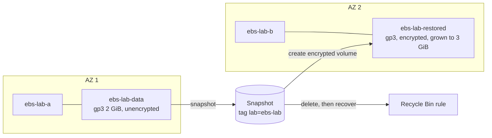

> [!COST]
> Two `t3.micro` instances cost about USD 0.0104 per hour each and each public IPv4 address USD 0.005
> per hour. EBS gp3 storage is USD 0.08 per GB-month (the two 8 GiB root volumes and two 2-3 GiB data
> volumes come to well under a cent per hour) and snapshot storage USD 0.05 per GB-month for the data
> actually stored. Volumes and snapshots keep billing after the instances are gone, so finish the
> **Cleanup** section. Prices are for us-east-1, checked October 2026.

You will play out the classic EBS story from the lesson: a volume lives in one AZ, a snapshot is how
its data travels, encryption is added on the way, and snapshots can be protected against deletion.



## Prerequisites

- An AWS account with permissions for EC2, EBS and Recycle Bin (for example the `AmazonEC2FullAccess` managed policy plus `rbin:*` actions, or an administrator role).
- A Region with a **default VPC**. The steps use `us-east-1`; any Region works.
- For the CLI tabs: AWS CLI v2 configured (or AWS CloudShell) and a Bash shell. Keep one terminal open for the whole lab; later commands reuse shell variables. Start with `export AWS_DEFAULT_REGION=us-east-1`.
- A browser for EC2 Instance Connect (no key pair is needed).

## Steps

### Step 1: Create a security group for EC2 Instance Connect

The console's EC2 Instance Connect sends SSH from an AWS-managed IP range, published as a prefix list.
Allowing only that prefix list is safer than opening SSH to the world.

:::console
1. Open the **EC2** console and choose **Security Groups** under **Network & Security**, then **Create security group**.
2. **Security group name**: `ebs-lab-sg`; **Description**: `EBS lab - SSH from EC2 Instance Connect`; keep the default **VPC**.
3. Under **Inbound rules** choose **Add rule**. **Type**: **SSH**. **Source**: **Custom**, then type `ec2-instance-connect` in the search box and pick the prefix list `com.amazonaws.us-east-1.ec2-instance-connect` (your Region's name appears in it).
4. Choose **Create security group**.
:::

:::cli
```bash
export AWS_DEFAULT_REGION=us-east-1
VPC_ID=$(aws ec2 describe-vpcs --filters Name=is-default,Values=true \
  --query 'Vpcs[0].VpcId' --output text)
SG_ID=$(aws ec2 create-security-group --group-name ebs-lab-sg \
  --description "EBS lab - SSH from EC2 Instance Connect" --vpc-id "$VPC_ID" \
  --query GroupId --output text)
PL_ID=$(aws ec2 describe-managed-prefix-lists \
  --filters Name=prefix-list-name,Values=com.amazonaws.$AWS_DEFAULT_REGION.ec2-instance-connect \
  --query 'PrefixLists[0].PrefixListId' --output text)
aws ec2 authorize-security-group-ingress --group-id "$SG_ID" \
  --ip-permissions "IpProtocol=tcp,FromPort=22,ToPort=22,PrefixListIds=[{PrefixListId=$PL_ID}]"
echo "SG: $SG_ID  prefix list: $PL_ID"
```
:::

> [!CHECK]
> `ebs-lab-sg` has one inbound rule: SSH (22) whose source is a prefix list ID (`pl-...`), not `0.0.0.0/0`.

### Step 2: Launch two instances in different Availability Zones

:::console
1. Choose **Instances** → **Launch instances**.
2. **Name**: `ebs-lab-a`. Under **Application and OS Images (Amazon Machine Image)** keep **Amazon Linux 2023**. **Instance type**: **t3.micro**.
3. **Key pair (login)**: **Proceed without a key pair (not recommended)**. EC2 Instance Connect pushes a temporary key for you.
4. Under **Network settings** choose **Edit**: keep the default VPC, choose a **Subnet** in the first AZ (for example `us-east-1a`), keep **Auto-assign public IP** on **Enable**, choose **Select existing security group** and pick `ebs-lab-sg`.
5. Leave **Configure storage** at the default 8 GiB gp3 root volume and choose **Launch instance**.
6. Repeat for `ebs-lab-b`, choosing a **Subnet** in a **different** AZ (for example `us-east-1b`).
7. `t3.micro` is not offered in every AZ. If a launch fails with a message that the instance type is not supported in that Availability Zone, launch again with a subnet in another AZ.
:::

:::cli
```bash
AMI=$(aws ssm get-parameters \
  --names /aws/service/ami-amazon-linux-latest/al2023-ami-kernel-default-x86_64 \
  --query 'Parameters[0].Value' --output text)
# t3.micro is not offered in every AZ, so pick two default-subnet AZs that have it.
AZS=$(aws ec2 describe-instance-type-offerings --location-type availability-zone \
  --filters Name=instance-type,Values=t3.micro \
  --query 'InstanceTypeOfferings[].Location' --output text | tr '\t' ',')
read AZ_A AZ_B <<< "$(aws ec2 describe-subnets \
  --filters Name=vpc-id,Values=$VPC_ID Name=default-for-az,Values=true \
            Name=availability-zone,Values="$AZS" \
  --query 'sort_by(Subnets,&AvailabilityZone)[0:2].AvailabilityZone' --output text)"
SUBNET_A=$(aws ec2 describe-subnets --filters Name=vpc-id,Values=$VPC_ID \
  Name=availability-zone,Values=$AZ_A Name=default-for-az,Values=true \
  --query 'Subnets[0].SubnetId' --output text)
SUBNET_B=$(aws ec2 describe-subnets --filters Name=vpc-id,Values=$VPC_ID \
  Name=availability-zone,Values=$AZ_B Name=default-for-az,Values=true \
  --query 'Subnets[0].SubnetId' --output text)

INST_A=$(aws ec2 run-instances --image-id "$AMI" --instance-type t3.micro \
  --subnet-id "$SUBNET_A" --security-group-ids "$SG_ID" --associate-public-ip-address \
  --tag-specifications 'ResourceType=instance,Tags=[{Key=Name,Value=ebs-lab-a}]' \
  --query 'Instances[0].InstanceId' --output text)
INST_B=$(aws ec2 run-instances --image-id "$AMI" --instance-type t3.micro \
  --subnet-id "$SUBNET_B" --security-group-ids "$SG_ID" --associate-public-ip-address \
  --tag-specifications 'ResourceType=instance,Tags=[{Key=Name,Value=ebs-lab-b}]' \
  --query 'Instances[0].InstanceId' --output text)
aws ec2 wait instance-running --instance-ids "$INST_A" "$INST_B"
echo "A: $INST_A in $AZ_A   B: $INST_B in $AZ_B"
```
:::

> [!CHECK]
> Both instances are **Running** in different AZs. Select `ebs-lab-a`, open the **Storage** tab and
> scroll right: the root volume shows **Delete on termination: Yes**.

### Step 3: Create a gp3 data volume and attach it

:::console
1. Choose **Volumes** (under **Elastic Block Store**) → **Create volume**.
2. **Volume type**: **General Purpose SSD (gp3)**; **Size**: `2`; keep **IOPS** `3000` and **Throughput** `125`.
3. **Availability Zone**: the AZ of `ebs-lab-a`. **Snapshot ID**: keep **Don't create volume from a snapshot**.
4. Leave encryption cleared (if your account has encryption by default, it is forced on; that is fine).
5. Under **Tags** add `Name` = `ebs-lab-data` and `lab` = `ebs-lab`, then choose **Create volume**.
6. When the state is **Available**, select the volume → **Actions** → **Attach volume**. Open the **Instance** list: only `ebs-lab-a` appears, because `ebs-lab-b` is in another AZ. Choose `ebs-lab-a`, keep the suggested **Device name** (for example `/dev/sdf`) and choose **Attach volume**.
:::

:::cli
```bash
VOL_A=$(aws ec2 create-volume --volume-type gp3 --size 2 --availability-zone "$AZ_A" \
  --tag-specifications 'ResourceType=volume,Tags=[{Key=Name,Value=ebs-lab-data},{Key=lab,Value=ebs-lab}]' \
  --query VolumeId --output text)
aws ec2 wait volume-available --volume-ids "$VOL_A"

# Try the wrong AZ first: this fails because the volume and instance are in different AZs.
aws ec2 attach-volume --volume-id "$VOL_A" --instance-id "$INST_B" --device /dev/sdf

# Now the right one.
aws ec2 attach-volume --volume-id "$VOL_A" --instance-id "$INST_A" --device /dev/sdf
```
:::

> [!CHECK]
> The cross-AZ attach attempt returns an error saying the volume and instance are not in the same
> Availability Zone. The volume state then changes to **In-use** attached to `ebs-lab-a`.

### Step 4: Format, mount and write data on instance A

:::console
1. Select `ebs-lab-a` → **Connect** → **EC2 Instance Connect** tab → **Connect using a Public IP**, keep **Username** `ec2-user`, choose **Connect**.
2. In the browser terminal run the commands below. On Nitro instances such as t3, the volume attached as `/dev/sdf` appears as an NVMe device, usually `/dev/nvme1n1`; use `lsblk` to find the 2 GiB disk with no mount point.
:::

```bash
lsblk
sudo file -s /dev/nvme1n1          # "data" means there is no file system yet
sudo mkfs -t xfs /dev/nvme1n1      # only on a NEW, empty volume
sudo mkdir /data
sudo mount /dev/nvme1n1 /data
echo "Written on $(hostname) at $(date -u)" | sudo tee /data/hello.txt
sync
df -hT /data
```

> [!CHECK]
> `df -hT /data` shows an `xfs` file system of about 2 GiB mounted on `/data`, and
> `cat /data/hello.txt` prints your line.

### Step 5: Take a snapshot

:::console
1. Choose **Snapshots** → **Create snapshot**. **Resource type**: **Volume**. **Volume ID**: `ebs-lab-data`.
2. **Description**: `ebs-lab snapshot 1`. Under **Tags** add `lab` = `ebs-lab`. Choose **Create snapshot**.
3. Wait for **Snapshot status** to show **Completed** (a minute or two).
:::

:::cli
```bash
SNAP_1=$(aws ec2 create-snapshot --volume-id "$VOL_A" --description "ebs-lab snapshot 1" \
  --tag-specifications 'ResourceType=snapshot,Tags=[{Key=lab,Value=ebs-lab}]' \
  --query SnapshotId --output text)
aws ec2 wait snapshot-completed --snapshot-ids "$SNAP_1"
aws ec2 describe-snapshots --snapshot-ids "$SNAP_1" \
  --query 'Snapshots[0].{State:State,VolumeSizeGiB:VolumeSize,FullSizeBytes:FullSnapshotSizeInBytes}'
```
:::

> [!CHECK]
> The snapshot is **Completed**. Its volume size says 2 GiB, but the full snapshot size is only a few
> MB: snapshots store written blocks, not the provisioned size. The volume stayed attached and mounted
> the whole time.

### Step 6: Protect snapshots with Recycle Bin, then undo a deletion

:::console
1. Open the **Recycle Bin** console (search for "Recycle Bin"). In the navigation pane choose **Retention rules** → **Create retention rule**.
2. **Retention rule name**: `ebs-lab-rule`. **Resource type**: **EBS snapshots**.
3. **Select the resources to retain**: **Retain resources that have specific tags**; **Resource tags**: key `lab`, value `ebs-lab`.
4. **Retention period**: `1` day. Leave the rule unlocked (only Region-level rules can be locked, so a tag-level rule like this one has no lock to set). Choose **Create retention rule** and wait a few seconds until the rule is available.
5. Back in the EC2 console, choose **Snapshots**, select `ebs-lab snapshot 1` → **Actions** → **Delete snapshot**, type `delete` and choose **Delete**.
6. In the Recycle Bin console choose **Recycle Bin**: the snapshot is listed. Select it, choose **Recover**, then **Recover** again.
:::

:::cli
```bash
RULE_ID=$(aws rbin create-rule \
  --retention-period RetentionPeriodValue=1,RetentionPeriodUnit=DAYS \
  --resource-type EBS_SNAPSHOT --description "ebs-lab rule" \
  --resource-tags ResourceTagKey=lab,ResourceTagValue=ebs-lab \
  --query Identifier --output text)
sleep 30   # give the new rule a moment to become active

aws ec2 delete-snapshot --snapshot-id "$SNAP_1"
aws ec2 list-snapshots-in-recycle-bin --snapshot-ids "$SNAP_1"
aws ec2 restore-snapshot-from-recycle-bin --snapshot-id "$SNAP_1"
aws ec2 wait snapshot-completed --snapshot-ids "$SNAP_1"
```
:::

> [!CHECK]
> After the delete, the snapshot disappears from **Snapshots** but appears in **Recycle Bin** with an
> expiry time one day later. After **Recover** it is back in **Snapshots** with the same ID and
> **Completed** status.

### Step 7: Restore the data in the other AZ as an encrypted volume

This is the lesson's "move to another AZ" and "encrypt an unencrypted volume" recipes in one go.

:::console
1. Choose **Volumes** → **Create volume**. **Volume type**: **gp3**; **Size**: `2`.
2. **Availability Zone**: the AZ of `ebs-lab-b`. **Snapshot ID**: select `ebs-lab snapshot 1`. Leave **Volume initialization rate** empty.
3. In the encryption setting, turn encryption on for this volume and keep the default KMS key (`aws/ebs`). If your account has encryption by default, it is already on and cannot be cleared.
4. Add tags `Name` = `ebs-lab-restored` and `lab` = `ebs-lab`, choose **Create volume**.
5. When it is **Available**: **Actions** → **Attach volume** → **Instance** `ebs-lab-b` → **Attach volume**.
6. Connect to `ebs-lab-b` with **EC2 Instance Connect** and run the commands below. Do **not** run `mkfs`: the volume already holds your file system.
:::

:::cli
```bash
VOL_B=$(aws ec2 create-volume --snapshot-id "$SNAP_1" --volume-type gp3 \
  --availability-zone "$AZ_B" --encrypted \
  --tag-specifications 'ResourceType=volume,Tags=[{Key=Name,Value=ebs-lab-restored},{Key=lab,Value=ebs-lab}]' \
  --query VolumeId --output text)
aws ec2 wait volume-available --volume-ids "$VOL_B"
aws ec2 attach-volume --volume-id "$VOL_B" --instance-id "$INST_B" --device /dev/sdf
aws ec2 describe-volumes --volume-ids "$VOL_A" "$VOL_B" \
  --query 'Volumes[].{Id:VolumeId,AZ:AvailabilityZone,Encrypted:Encrypted,Size:Size}' --output table
```
:::

On `ebs-lab-b`:

```bash
lsblk
sudo file -s /dev/nvme1n1          # shows an XFS file system this time
sudo mkdir /data
sudo mount /dev/nvme1n1 /data
cat /data/hello.txt
```

> [!CHECK]
> `cat` prints the line written on `ebs-lab-a`, including its host name. The volume list shows
> `ebs-lab-data` as not encrypted in AZ 1 and `ebs-lab-restored` as **Encrypted** in AZ 2 (if your
> account has encryption by default, both are encrypted).

### Step 8: Grow the restored volume online with Elastic Volumes

:::console
1. Choose **Volumes**, select `ebs-lab-restored` → **Actions** → **Modify volume**.
2. Change **Size** to `3` and choose **Modify**, then **Modify** again to confirm.
3. Wait until the modification state shows **optimizing** or **completed** (the size is usable once it reaches **optimizing**).
4. On `ebs-lab-b`, extend the file system and check its size with the commands below.
:::

:::cli
```bash
aws ec2 modify-volume --volume-id "$VOL_B" --size 3
aws ec2 describe-volumes-modifications --volume-ids "$VOL_B" \
  --query 'VolumesModifications[0].{State:ModificationState,Progress:Progress,Target:TargetSize}'
```
:::

On `ebs-lab-b`:

```bash
df -hT /data                 # still about 2 GiB
sudo xfs_growfs -d /data     # extend XFS to fill the larger volume
df -hT /data                 # now about 3 GiB
```

> [!CHECK]
> The volume grew without detaching it or stopping the instance, and the file system grew only after
> `xfs_growfs`. A modification cannot shrink a volume; try entering `1` in **Modify volume** and the
> console refuses.

## Cleanup

Delete in this order. Deleting the Recycle Bin rule **before** the snapshot matters: otherwise the
snapshot goes to the Recycle Bin and keeps billing for its retention day.

- [ ] **Terminate both instances.** Console: **Instances** → select `ebs-lab-a` and `ebs-lab-b` → **Instance state** → **Terminate (delete) instance** → **Terminate (delete)**. CLI: `aws ec2 terminate-instances --instance-ids "$INST_A" "$INST_B" && aws ec2 wait instance-terminated --instance-ids "$INST_A" "$INST_B"`. Their root volumes are deleted automatically.
- [ ] **Delete the two data volumes.** Notice in **Volumes** that `ebs-lab-data` and `ebs-lab-restored` survived termination and are now **Available** (attached after launch, so not deleted on termination). Console: select each volume → **Actions** → **Delete volume**, type `delete` and choose **Delete**. CLI: `aws ec2 delete-volume --volume-id "$VOL_A" && aws ec2 delete-volume --volume-id "$VOL_B"`.
- [ ] **Delete the Recycle Bin retention rule.** Console: **Recycle Bin** → **Retention rules** → select `ebs-lab-rule` → **Actions** → **Delete retention rule** → confirm. CLI: `aws rbin delete-rule --identifier "$RULE_ID"`. Wait a minute before the next item so the deleted rule no longer applies.
- [ ] **Delete the snapshot.** Console: **Snapshots** → select `ebs-lab snapshot 1` → **Actions** → **Delete snapshot**, type `delete` and choose **Delete**. CLI: `aws ec2 delete-snapshot --snapshot-id "$SNAP_1"`.
- [ ] **Delete the security group.** Console: **Security Groups** → `ebs-lab-sg` → **Actions** → **Delete security groups**. CLI: `aws ec2 delete-security-group --group-id "$SG_ID"` (works once the instances are terminated).
- [ ] **Final check.** In the Region you used: **Instances** shows no running `ebs-lab` instances, **Volumes** and **Snapshots** (filter **Owned by me**) show nothing tagged `lab=ebs-lab`, and **Recycle Bin** is empty. If a snapshot did land in the Recycle Bin, it is deleted permanently when its one-day retention ends.

## Progress checklist

- [ ] Step 1: Security group with SSH from the EC2 Instance Connect prefix list
- [ ] Step 2: Two instances running in different AZs
- [ ] Step 3: gp3 volume created and attached; cross-AZ attach refused
- [ ] Step 4: Volume formatted, mounted and written on instance A
- [ ] Step 5: Snapshot completed while the volume stayed mounted
- [ ] Step 6: Snapshot deleted and recovered from the Recycle Bin
- [ ] Step 7: Data read back from an encrypted volume in the second AZ
- [ ] Step 8: Volume grown online and file system extended
- [ ] Cleanup done and final check passed
