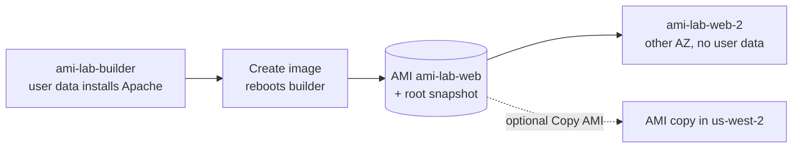

> [!COST]
> Each `t3.micro` costs about USD 0.0104 per hour and each public IPv4 address USD 0.005 per hour. The
> AMI is backed by an EBS snapshot billed at USD 0.05 per GB-month for the data stored (about 2 GB for
> Amazon Linux plus Apache). The optional cross-Region copy adds inter-Region data transfer (about
> USD 0.02 per GB) and a second snapshot. Deregistering an AMI does **not** delete its snapshots unless
> you tick **Delete associated snapshots**. Prices are for us-east-1, checked October 2026.



## Prerequisites

- An AWS account with permissions for EC2 (for example the `AmazonEC2FullAccess` managed policy).
- A Region with a **default VPC**; the steps use `us-east-1`, and `us-west-2` for the optional copy.
- For the CLI tabs: AWS CLI v2 configured (or AWS CloudShell) and a Bash shell; start with `export AWS_DEFAULT_REGION=us-east-1` and keep the same terminal open.
- A web browser.

## Steps

### Step 1: Create a security group that allows HTTP

:::console
1. In the **EC2** console choose **Security Groups** → **Create security group**.
2. **Security group name**: `ami-lab-sg`; **Description**: `AMI lab - HTTP from anywhere`; default **VPC**.
3. **Inbound rules** → **Add rule**: **Type** **HTTP**, **Source** **Anywhere-IPv4**. Choose **Create security group**.
:::

:::cli
```bash
export AWS_DEFAULT_REGION=us-east-1
VPC_ID=$(aws ec2 describe-vpcs --filters Name=is-default,Values=true \
  --query 'Vpcs[0].VpcId' --output text)
SG_ID=$(aws ec2 create-security-group --group-name ami-lab-sg \
  --description "AMI lab - HTTP from anywhere" --vpc-id "$VPC_ID" \
  --query GroupId --output text)
aws ec2 authorize-security-group-ingress --group-id "$SG_ID" \
  --protocol tcp --port 80 --cidr 0.0.0.0/0
```
:::

> [!CHECK]
> `ami-lab-sg` has one inbound rule: HTTP, TCP 80, source `0.0.0.0/0`. There is no SSH rule because
> this lab never logs in to the instances.

### Step 2: Launch and configure the builder instance

The user data script installs Apache and writes a page stamped with the build time. Because the page is
written once, at build time, any instance launched later from the AMI will show the **same** timestamp:
that is how you will know the software came from the image and not from a new script run.

```bash
#!/bin/bash
dnf install -y httpd
echo "<h1>Baked into a custom AMI at $(date -u)</h1>" > /var/www/html/index.html
systemctl enable --now httpd
```

:::console
1. Choose **Instances** → **Launch instances**. **Name**: `ami-lab-builder`. Keep **Amazon Linux 2023**; **Instance type** **t3.micro**.
2. **Key pair (login)**: **Proceed without a key pair (not recommended)**.
3. **Network settings** → **Edit**: a **Subnet** in the first AZ (for example `us-east-1a`), **Auto-assign public IP** **Enable**, **Select existing security group** → `ami-lab-sg`.
4. Expand **Advanced details**, paste the script into **User data**, then choose **Launch instance**. If the launch fails because `t3.micro` is not supported in that Availability Zone, launch again with a subnet in another AZ.
:::

:::cli
```bash
# Save the script above as builder.sh first.
AMI_BASE=$(aws ssm get-parameters \
  --names /aws/service/ami-amazon-linux-latest/al2023-ami-kernel-default-x86_64 \
  --query 'Parameters[0].Value' --output text)
# t3.micro is not offered in every AZ, so pick two default-subnet AZs that have it.
AZS=$(aws ec2 describe-instance-type-offerings --location-type availability-zone \
  --filters Name=instance-type,Values=t3.micro \
  --query 'InstanceTypeOfferings[].Location' --output text | tr '\t' ',')
read AZ_A AZ_B <<< "$(aws ec2 describe-subnets \
  --filters Name=vpc-id,Values=$VPC_ID Name=default-for-az,Values=true \
            Name=availability-zone,Values="$AZS" \
  --query 'sort_by(Subnets,&AvailabilityZone)[0:2].AvailabilityZone' --output text)"
SUBNET_A=$(aws ec2 describe-subnets --filters Name=vpc-id,Values=$VPC_ID \
  Name=availability-zone,Values=$AZ_A Name=default-for-az,Values=true \
  --query 'Subnets[0].SubnetId' --output text)
SUBNET_B=$(aws ec2 describe-subnets --filters Name=vpc-id,Values=$VPC_ID \
  Name=availability-zone,Values=$AZ_B Name=default-for-az,Values=true \
  --query 'Subnets[0].SubnetId' --output text)

BUILDER=$(aws ec2 run-instances --image-id "$AMI_BASE" --instance-type t3.micro \
  --subnet-id "$SUBNET_A" --security-group-ids "$SG_ID" --associate-public-ip-address \
  --user-data file://builder.sh \
  --tag-specifications 'ResourceType=instance,Tags=[{Key=Name,Value=ami-lab-builder}]' \
  --query 'Instances[0].InstanceId' --output text)
aws ec2 wait instance-status-ok --instance-ids "$BUILDER"
aws ec2 describe-instances --instance-ids "$BUILDER" \
  --query 'Reservations[0].Instances[0].PublicIpAddress' --output text
```
:::

> [!CHECK]
> After two or three minutes, browsing to `http://<public-IP>` of `ami-lab-builder` shows
> "Baked into a custom AMI at ..." with a UTC time. Note that time.

### Step 3: Create the AMI

:::console
1. Select `ami-lab-builder` → **Actions** → **Image and templates** → **Create image**.
2. **Image name**: `ami-lab-web`; **Image description**: `Apache web server baked in`.
3. Keep **Reboot instance** selected so the snapshot is taken with data at rest.
4. Look at **Instance volumes**: the root volume will become a snapshot. Choose **Create image**.
5. Choose **AMIs** (filter **Owned by me**) and wait until the status changes from **Pending** to **Available**.
6. Choose **Snapshots** (filter **Owned by me**): a new snapshot's description reads `Created by CreateImage(...) for ami-...`.
:::

:::cli
```bash
AMI_ID=$(aws ec2 create-image --instance-id "$BUILDER" --name ami-lab-web \
  --description "Apache web server baked in" --query ImageId --output text)
aws ec2 wait image-available --image-ids "$AMI_ID"
aws ec2 describe-images --image-ids "$AMI_ID" \
  --query 'Images[0].BlockDeviceMappings[].Ebs.SnapshotId' --output text
```
:::

> [!CHECK]
> The AMI is **Available** and its block device mapping points to one snapshot. The builder instance
> rebooted during image creation (its web page came back by itself, because Apache is enabled).

### Step 4: Launch a web server from your AMI in another AZ, with no user data

:::console
1. Choose **Launch instances**. **Name**: `ami-lab-web-2`.
2. Under **Application and OS Images (Amazon Machine Image)** choose **My AMIs** → **Owned by me** and select `ami-lab-web`.
3. **Instance type** **t3.micro**; **Key pair** **Proceed without a key pair (not recommended)**.
4. **Network settings** → **Edit**: a **Subnet** in a **different** AZ (for example `us-east-1b`), **Auto-assign public IP** **Enable**, security group `ami-lab-sg`.
5. Leave **User data** empty and choose **Launch instance**.
:::

:::cli
```bash
WEB2=$(aws ec2 run-instances --image-id "$AMI_ID" --instance-type t3.micro \
  --subnet-id "$SUBNET_B" --security-group-ids "$SG_ID" --associate-public-ip-address \
  --tag-specifications 'ResourceType=instance,Tags=[{Key=Name,Value=ami-lab-web-2}]' \
  --query 'Instances[0].InstanceId' --output text)
aws ec2 wait instance-status-ok --instance-ids "$WEB2"
aws ec2 describe-instances --instance-ids "$WEB2" \
  --query 'Reservations[0].Instances[0].[Placement.AvailabilityZone,PublicIpAddress]' --output text
```
:::

> [!CHECK]
> `http://<public-IP>` of `ami-lab-web-2` serves the page immediately, with **exactly the same
> timestamp** as the builder. Nothing was installed at boot: Apache and the page came from the AMI, and
> the AMI worked in a different AZ of the same Region.

### Step 5 (optional): Copy the AMI to another Region

:::console
1. Choose **AMIs**, select `ami-lab-web` → **Actions** → **Copy AMI**.
2. **AMI copy name**: `ami-lab-web-copy`; **Destination Region**: **US West (Oregon) us-west-2**. Leave **Enable time-based copy** cleared (time-based copies cost extra). Optionally tick **Encrypt EBS snapshots of AMI copy**.
3. Choose **Copy AMI**. Switch the console to **us-west-2** and open **AMIs** to watch the copy go from **Pending** to **Available**.
:::

:::cli
```bash
COPY_ID=$(aws ec2 copy-image --source-image-id "$AMI_ID" --source-region us-east-1 \
  --name ami-lab-web-copy --region us-west-2 --query ImageId --output text)
aws ec2 wait image-available --image-ids "$COPY_ID" --region us-west-2
echo "Copy in us-west-2: $COPY_ID"
```
:::

> [!CHECK]
> The copy has a **different AMI ID** in us-west-2 and its own snapshot there. AMIs are Region-scoped:
> the original ID does not exist in us-west-2.

## Cleanup

- [ ] **Terminate both instances.** Console: **Instances** → select `ami-lab-builder` and `ami-lab-web-2` → **Instance state** → **Terminate (delete) instance** → **Terminate (delete)**. CLI: `aws ec2 terminate-instances --instance-ids "$BUILDER" "$WEB2" && aws ec2 wait instance-terminated --instance-ids "$BUILDER" "$WEB2"`.
- [ ] **Deregister the AMI and delete its snapshot (us-east-1).** Console: **AMIs** → select `ami-lab-web` → **Actions** → **Deregister AMI** → tick **Delete associated snapshots** → **Deregister AMI**. CLI: `aws ec2 deregister-image --image-id "$AMI_ID" --delete-associated-snapshots`.
- [ ] **(If you did Step 5) Deregister the copy and delete its snapshot (us-west-2).** Console: switch to **us-west-2** → **AMIs** → `ami-lab-web-copy` → **Actions** → **Deregister AMI** → tick **Delete associated snapshots** → **Deregister AMI**. CLI: `aws ec2 deregister-image --image-id "$COPY_ID" --delete-associated-snapshots --region us-west-2`.
- [ ] **Delete the security group.** Console: **Security Groups** → `ami-lab-sg` → **Actions** → **Delete security groups**. CLI: `aws ec2 delete-security-group --group-id "$SG_ID"`.
- [ ] **Final check.** In us-east-1 (and us-west-2 if used): no running `ami-lab` instances, no AMIs under **Owned by me**, and no snapshots whose description starts with `Created by CreateImage` for this lab. If a snapshot remains (for example because a Recycle Bin rule kept it), delete it from **Snapshots**.

## Progress checklist

- [ ] Step 1: HTTP security group created
- [ ] Step 2: Builder instance serving the timestamped page
- [ ] Step 3: AMI available and backed by a snapshot
- [ ] Step 4: Second instance in another AZ serving the same page without user data
- [ ] Step 5 (optional): AMI copied to us-west-2
- [ ] Cleanup done and final check passed
