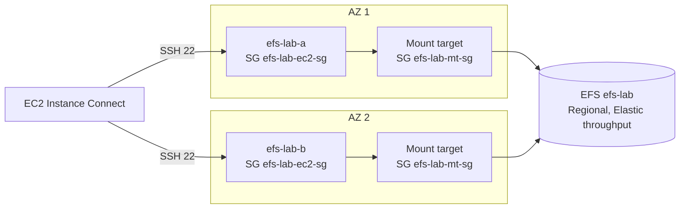

> [!COST]
> Two `t3.micro` instances cost about USD 0.0104 per hour each and each public IPv4 address USD 0.005
> per hour. EFS Standard storage is USD 0.30 per GB-month and Elastic throughput USD 0.03 per GB read
> and USD 0.06 per GB written, so a few test files cost almost nothing. Mount targets are free. If you
> leave **automatic backups** on, AWS Backup also stores (and bills) recovery points. Prices are for
> us-east-1, checked October 2026.



## Prerequisites

- An AWS account with permissions for EC2 and Amazon EFS (for example `AmazonEC2FullAccess` plus `AmazonElasticFileSystemFullAccess`).
- A Region with a **default VPC**; the steps use `us-east-1`.
- For the CLI tabs: AWS CLI v2 configured (or AWS CloudShell) and a Bash shell; start with `export AWS_DEFAULT_REGION=us-east-1` and keep the same terminal open.
- A browser for EC2 Instance Connect.

## Steps

### Step 1: Create the two security groups

The instances get SSH from EC2 Instance Connect only. The mount targets accept NFS (TCP 2049) only from
the instances' security group: a chain that keeps the file system unreachable from anything else.

:::console
1. In the **EC2** console choose **Security Groups** → **Create security group**. **Name**: `efs-lab-ec2-sg`; **Description**: `EFS lab instances`; default **VPC**.
2. **Inbound rules** → **Add rule**: **Type** **SSH**, **Source** **Custom**, and pick the prefix list `com.amazonaws.us-east-1.ec2-instance-connect` (your Region's name). Choose **Create security group**.
3. Create a second group. **Name**: `efs-lab-mt-sg`; **Description**: `EFS lab mount targets`; default **VPC**.
4. **Inbound rules** → **Add rule**: **Type** **NFS** (TCP 2049), **Source** **Custom**, and pick `efs-lab-ec2-sg` from the list. Choose **Create security group**.
:::

:::cli
```bash
export AWS_DEFAULT_REGION=us-east-1
VPC_ID=$(aws ec2 describe-vpcs --filters Name=is-default,Values=true \
  --query 'Vpcs[0].VpcId' --output text)
EC2_SG=$(aws ec2 create-security-group --group-name efs-lab-ec2-sg \
  --description "EFS lab instances" --vpc-id "$VPC_ID" --query GroupId --output text)
PL_ID=$(aws ec2 describe-managed-prefix-lists \
  --filters Name=prefix-list-name,Values=com.amazonaws.$AWS_DEFAULT_REGION.ec2-instance-connect \
  --query 'PrefixLists[0].PrefixListId' --output text)
aws ec2 authorize-security-group-ingress --group-id "$EC2_SG" \
  --ip-permissions "IpProtocol=tcp,FromPort=22,ToPort=22,PrefixListIds=[{PrefixListId=$PL_ID}]"

MT_SG=$(aws ec2 create-security-group --group-name efs-lab-mt-sg \
  --description "EFS lab mount targets" --vpc-id "$VPC_ID" --query GroupId --output text)
aws ec2 authorize-security-group-ingress --group-id "$MT_SG" \
  --protocol tcp --port 2049 --source-group "$EC2_SG"
```
:::

> [!CHECK]
> `efs-lab-mt-sg` has a single inbound rule: NFS, TCP 2049, source `efs-lab-ec2-sg` (a security group
> ID, not an IP range).

### Step 2: Create the EFS file system and its mount targets

:::console
1. Open the **Amazon EFS** console and choose **Create file system**, then **Customize**.
2. **File system settings**, **General**: **Name** `efs-lab`; **File system type** **Regional**. File systems created in the console start with automatic backups turned on; step 8 turns them off for this test.
3. Keep **Lifecycle management** at its defaults (into IA after 30 days, into Archive after 90 days, back to Standard: None) and keep encryption of data at rest enabled with `aws/elasticfilesystem`.
4. **Performance settings**: **Throughput mode** **Elastic**; leave **Performance mode** at **General Purpose**. Choose **Next**.
5. **Network access**: keep the default **Virtual Private Cloud (VPC)**. For each **Mount target**, remove the default security group and choose `efs-lab-mt-sg`. Keep at least the two AZs you will use for the instances (keeping all is fine, mount targets are free). Choose **Next**.
6. **File system policy**: leave empty, choose **Next**, review, and choose **Create file system**.
7. Open `efs-lab` and wait until the mount targets on the **Network** tab show **Available**. Note the **File system ID** (`fs-...`).
8. Still on `efs-lab`, choose **Edit** in the **General** panel, clear **Enable automatic backups** and choose **Save changes**. Otherwise AWS Backup keeps (and bills) a daily recovery point of this test file system.
:::

:::cli
```bash
# CLI-created Regional file systems have automatic backups off unless you pass --backup.
FS_ID=$(aws efs create-file-system --creation-token "efs-lab-$(date +%s)" \
  --encrypted --performance-mode generalPurpose --throughput-mode elastic \
  --tags Key=Name,Value=efs-lab --query FileSystemId --output text)
until [ "$(aws efs describe-file-systems --file-system-id "$FS_ID" \
  --query 'FileSystems[0].LifeCycleState' --output text)" = "available" ]; do sleep 5; done

aws efs put-lifecycle-configuration --file-system-id "$FS_ID" \
  --lifecycle-policies '[{"TransitionToIA":"AFTER_30_DAYS"},{"TransitionToArchive":"AFTER_90_DAYS"}]'

# t3.micro is not offered in every AZ, so pick two default-subnet AZs that have it.
AZS=$(aws ec2 describe-instance-type-offerings --location-type availability-zone \
  --filters Name=instance-type,Values=t3.micro \
  --query 'InstanceTypeOfferings[].Location' --output text | tr '\t' ',')
read AZ_A AZ_B <<< "$(aws ec2 describe-subnets \
  --filters Name=vpc-id,Values=$VPC_ID Name=default-for-az,Values=true \
            Name=availability-zone,Values="$AZS" \
  --query 'sort_by(Subnets,&AvailabilityZone)[0:2].AvailabilityZone' --output text)"
SUBNET_A=$(aws ec2 describe-subnets --filters Name=vpc-id,Values=$VPC_ID \
  Name=availability-zone,Values=$AZ_A Name=default-for-az,Values=true \
  --query 'Subnets[0].SubnetId' --output text)
SUBNET_B=$(aws ec2 describe-subnets --filters Name=vpc-id,Values=$VPC_ID \
  Name=availability-zone,Values=$AZ_B Name=default-for-az,Values=true \
  --query 'Subnets[0].SubnetId' --output text)

aws efs create-mount-target --file-system-id "$FS_ID" --subnet-id "$SUBNET_A" --security-groups "$MT_SG"
aws efs create-mount-target --file-system-id "$FS_ID" --subnet-id "$SUBNET_B" --security-groups "$MT_SG"
aws efs describe-mount-targets --file-system-id "$FS_ID" \
  --query 'MountTargets[].{AZ:AvailabilityZoneName,IP:IpAddress,State:LifeCycleState}' --output table
echo "File system: $FS_ID"
```
:::

> [!CHECK]
> The file system is **Available**, its **Throughput mode** is **Elastic** and **Performance mode**
> **General Purpose**, automatic backups are off in the **General** panel, and the **Network** tab
> lists one mount target per AZ, each with its own private IP address and the security group
> `efs-lab-mt-sg`.

### Step 3: Launch two Linux instances in different AZs

The user data installs the EFS mount helper (`amazon-efs-utils`).

```bash
#!/bin/bash
dnf install -y amazon-efs-utils
mkdir -p /mnt/efs
```

:::console
1. Choose **Instances** → **Launch instances**. **Name** `efs-lab-a`; **Amazon Linux 2023**; **t3.micro**; **Proceed without a key pair (not recommended)**.
2. **Network settings** → **Edit**: a **Subnet** in the first AZ that has a mount target, **Auto-assign public IP** **Enable**, **Select existing security group** → `efs-lab-ec2-sg`.
3. Expand **Advanced details** and paste the script into **User data**. Choose **Launch instance**.
4. Repeat for `efs-lab-b` with a **Subnet** in the second AZ.
5. `t3.micro` is not offered in every AZ. If a launch fails for that reason, pick another AZ that also has a mount target (or add a mount target there on the file system's **Network** tab).
:::

:::cli
```bash
# Save the script above as efs-client.sh first.
AMI=$(aws ssm get-parameters \
  --names /aws/service/ami-amazon-linux-latest/al2023-ami-kernel-default-x86_64 \
  --query 'Parameters[0].Value' --output text)
INST_A=$(aws ec2 run-instances --image-id "$AMI" --instance-type t3.micro \
  --subnet-id "$SUBNET_A" --security-group-ids "$EC2_SG" --associate-public-ip-address \
  --user-data file://efs-client.sh \
  --tag-specifications 'ResourceType=instance,Tags=[{Key=Name,Value=efs-lab-a}]' \
  --query 'Instances[0].InstanceId' --output text)
INST_B=$(aws ec2 run-instances --image-id "$AMI" --instance-type t3.micro \
  --subnet-id "$SUBNET_B" --security-group-ids "$EC2_SG" --associate-public-ip-address \
  --user-data file://efs-client.sh \
  --tag-specifications 'ResourceType=instance,Tags=[{Key=Name,Value=efs-lab-b}]' \
  --query 'Instances[0].InstanceId' --output text)
aws ec2 wait instance-status-ok --instance-ids "$INST_A" "$INST_B"
```
:::

> [!CHECK]
> Both instances are **Running** with **2/2 checks passed**, each in a different AZ that has a mount
> target, and both use only the `efs-lab-ec2-sg` security group.

### Step 4: Mount the file system on instance A and write a file

:::console
1. Select `efs-lab-a` → **Connect** → **EC2 Instance Connect** → **Connect using a Public IP** → **Connect**.
2. Run the commands below, replacing `fs-0123456789abcdef0` with your file system ID. The EFS console's **Attach** button shows the same mount command ready to copy.
:::

```bash
rpm -q amazon-efs-utils                       # confirms the user data finished
sudo mount -t efs -o tls fs-0123456789abcdef0:/ /mnt/efs
df -hT /mnt/efs
echo "Hello from $(hostname)" | sudo tee /mnt/efs/shared.txt
ls -l /mnt/efs
```

> [!CHECK]
> `df -hT` lists the file system with type `nfs4` mounted on `/mnt/efs`, and its size shows as a huge
> number (8 EiB): EFS has no fixed capacity, it grows as you write.

### Step 5: Mount the same file system on instance B and collaborate

Connect to `efs-lab-b` with **EC2 Instance Connect** and run:

```bash
sudo mount -t efs -o tls fs-0123456789abcdef0:/ /mnt/efs
cat /mnt/efs/shared.txt
echo "Reply from $(hostname)" | sudo tee -a /mnt/efs/shared.txt
```

Then go back to the `efs-lab-a` terminal and run `cat /mnt/efs/shared.txt` again.

> [!CHECK]
> Instance B reads the line written by instance A in another AZ, and instance A then sees B's reply.
> Two instances, two AZs, one file system: this is what EBS (one AZ, one instance) cannot do.

### Step 6: Look at the file system from the console

:::console
1. In the **Amazon EFS** console open `efs-lab`.
2. On the details page, note the metered size, the lifecycle settings, the throughput and performance modes, and the encryption status.
3. Choose the **Monitoring** tab to see throughput and client connection graphs (data can take a few minutes to appear).
4. Choose **Attach** to see the mount commands for the mount helper and for a plain NFS client, by DNS name or by mount target IP.
:::

:::cli
```bash
aws efs describe-file-systems --file-system-id "$FS_ID" \
  --query 'FileSystems[0].{Size:SizeInBytes,Throughput:ThroughputMode,Performance:PerformanceMode,Encrypted:Encrypted,MountTargets:NumberOfMountTargets}'
aws efs describe-lifecycle-configuration --file-system-id "$FS_ID"
```
:::

> [!CHECK]
> The lifecycle configuration lists transitions to IA after 30 days and to Archive after 90 days. The
> metered size is tiny, so the storage bill for this lab is effectively zero.

## Cleanup

Order matters: the mount target security group references the instance security group, and mount
targets must be gone before their security group can be deleted.

- [ ] **Unmount (optional) and terminate both instances.** On each instance you may run `sudo umount /mnt/efs`. Console: **Instances** → select `efs-lab-a` and `efs-lab-b` → **Instance state** → **Terminate (delete) instance** → **Terminate (delete)**. CLI: `aws ec2 terminate-instances --instance-ids "$INST_A" "$INST_B" && aws ec2 wait instance-terminated --instance-ids "$INST_A" "$INST_B"`.
- [ ] **Delete the file system and its mount targets.** Console: **Amazon EFS** → **File systems** → select `efs-lab` → **Delete**, enter the file system ID and choose **Confirm** (the console deletes the mount targets first). CLI: delete each mount target, wait, then the file system:
  `for MT in $(aws efs describe-mount-targets --file-system-id "$FS_ID" --query 'MountTargets[].MountTargetId' --output text); do aws efs delete-mount-target --mount-target-id "$MT"; done`, then wait until `aws efs describe-mount-targets --file-system-id "$FS_ID"` returns an empty list, then `aws efs delete-file-system --file-system-id "$FS_ID"`.
- [ ] **Delete the mount target security group.** Console: **Security Groups** → `efs-lab-mt-sg` → **Actions** → **Delete security groups** (retry after a minute if its network interfaces are still being removed). CLI: `aws ec2 delete-security-group --group-id "$MT_SG"`.
- [ ] **Delete the instance security group.** Console: **Security Groups** → `efs-lab-ec2-sg` → **Actions** → **Delete security groups**. CLI: `aws ec2 delete-security-group --group-id "$EC2_SG"`.
- [ ] **(Only if a backup ran before you turned automatic backups off) Delete the EFS recovery points.** Console: **AWS Backup** → **Backup vaults** → `aws/efs/automatic-backup-vault`, select the recovery points that belong to `efs-lab` and delete them. The default access policy of this vault denies deleting recovery points, so edit that policy first; recovery points you leave expire after the default 35-day retention.
- [ ] **Final check.** The **Amazon EFS** console lists no `efs-lab` file system, no `efs-lab` instances are running, both security groups are gone, and **Billing and Cost Management** → **Bills** shows no new EFS storage after the next day.

## Progress checklist

- [ ] Step 1: Instance and mount target security groups chained on port 2049
- [ ] Step 2: Regional EFS file system with mount targets in two AZs and automatic backups off
- [ ] Step 3: Two instances launched in different AZs with the EFS mount helper
- [ ] Step 4: File system mounted over TLS on instance A and a file written
- [ ] Step 5: Instance B read and appended to the same file
- [ ] Step 6: Metered size, modes and lifecycle reviewed
- [ ] Cleanup done and final check passed
