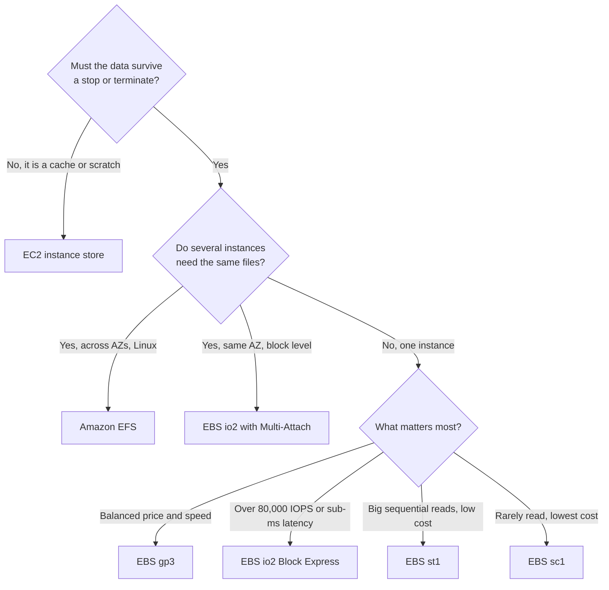
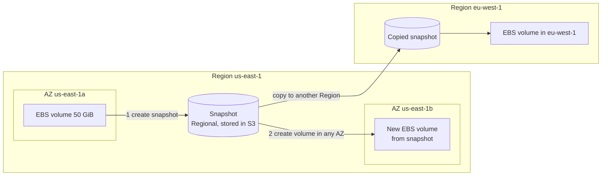
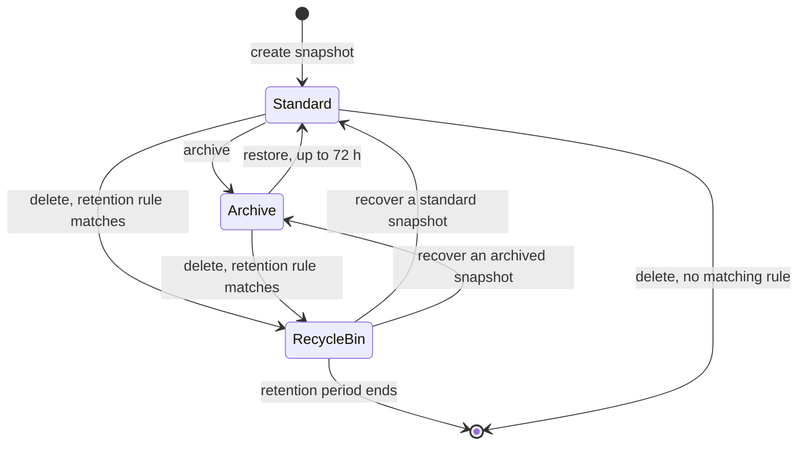
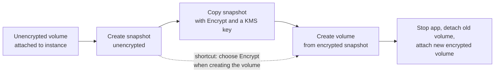
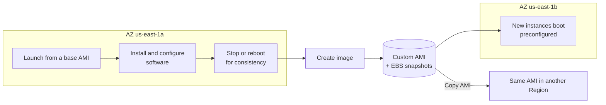
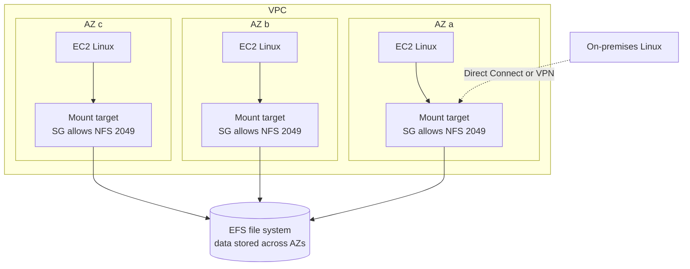

# EC2 Instance Storage

## Summary

An EC2 instance needs somewhere to keep its operating system and data, and AWS gives you three very
different places to put it. **Amazon EBS** volumes are durable network disks that live in one
Availability Zone and attach to one instance at a time; you back them up with **snapshots** and bake
whole servers into **AMIs**. **EC2 instance store** is a set of disks physically inside the host: the
fastest option, but everything on it disappears when the instance stops. **Amazon EFS** is a managed
NFS file system that hundreds of Linux instances in several AZs can mount at once and that grows on its
own. On the exam you choose between them by asking: does the data have to survive the instance? Does
more than one instance (or AZ) need it at the same time? How much IOPS or throughput is required, and
what is the cheapest option that still meets those needs?

## Key concepts

- **EBS volume**: a network-attached block device locked to **one AZ**, normally attached to **one instance**; data outlives the instance.
- **Provisioned billing**: you pay for the GiB (and, for gp3/io1/io2, the extra IOPS/throughput) you provision, used or not.
- **Delete on termination**: on by default for the root volume, off by default for volumes you attach later.
- **Volume types**: **gp3/gp2** general purpose SSD, **io2 Block Express/io1** provisioned IOPS SSD, **st1** throughput HDD, **sc1** cold HDD; only SSD types can boot.
- **gp3 decouples performance from size**; **gp2** gives 3 IOPS per GiB, so speed grows only with size.
- **Multi-Attach**: one **io1/io2** volume shared by up to **16 Nitro instances in the same AZ**, with a cluster-aware file system.
- **Snapshot**: incremental, point-in-time backup stored by AWS in S3; the way to move a volume to another AZ or Region.
- **Snapshot extras**: **Archive tier** (up to 75% cheaper, restore within 72 h), **Recycle Bin** (undo deletes), **Fast Snapshot Restore** (no first-read latency, expensive).
- **EBS encryption**: KMS-backed AES-256 covering data at rest, data in transit to the instance, snapshots and volumes made from them.
- **Encrypting an existing volume**: snapshot → encrypted copy (or encrypted restore) → new volume → swap.
- **AMI**: a Region-scoped template (OS + software + block device mapping); public, your own, Marketplace or shared.
- **Instance store**: physically attached, very high IOPS, **lost on stop, hibernate or terminate**; for caches and scratch data.
- **EFS**: managed NFS (v4.0/4.1) for **Linux**, mounted through one **mount target per AZ** guarded by a security group; pay per GB used.
- **EFS modes**: General Purpose performance mode plus **Elastic** (default), Provisioned or Bursting throughput.
- **EFS storage classes**: Standard, Infrequent Access and Archive moved by **lifecycle policies**; **Regional** or **One Zone** file systems.

## The three storage options at a glance

Before the details, here is the map. Keep it in mind while reading: almost every storage question in
this domain is "which of these three, and with which setting?".

| Question | Amazon EBS | EC2 instance store | Amazon EFS |
|---|---|---|---|
| What is it? | Network block device | Disks inside the physical host | Managed network file system (NFS) |
| Survives stop / terminate? | Yes (unless deleted on termination) | **No**: erased on stop, hibernate, terminate | Yes, independent of any instance |
| Who can use it at once? | One instance (io1/io2 Multi-Attach: up to 16, same AZ) | Only the instance it belongs to | Thousands of clients across AZs, plus on-premises over VPN / Direct Connect |
| Scope | One Availability Zone | One host | Region (Regional type) or one AZ (One Zone type) |
| Capacity | You provision a size, can grow it | Fixed by instance type and size | Grows and shrinks automatically |
| Performance | Up to 256,000 IOPS per volume (io2 Block Express) | Millions of IOPS on storage optimized types | Scales with Elastic throughput; ~1 ms read latency |
| OS support | Linux and Windows | Linux and Windows | Linux (and macOS); **not Windows** |
| Billing | Provisioned GiB (+ IOPS / throughput) | Included in the instance price | GiB actually stored (+ throughput mode and access charges) |
| Typical use | Boot volumes, databases, anything one server owns | Caches, buffers, scratch, replicated data | Shared content, home directories, WordPress, CMS |

## Amazon EBS volumes

### What an EBS volume is

An Elastic Block Store volume behaves like a hard drive, but it is not inside the server. It sits on
storage servers in the same Availability Zone and talks to the instance over the network. A handy mental
picture is a USB drive plugged in over the network: you can unplug it from one instance and plug it into
another in seconds, and whatever you wrote stays on it.

That design has consequences you must know cold:

- **It is AZ-bound.** A volume created in `us-east-1a` can only attach to instances in `us-east-1a`.
  To get the data into `us-east-1b` you take a **snapshot** and create a new volume from it there.
- **One instance at a time** is the normal rule. The exception is Multi-Attach on io1/io2 (below).
  An instance, on the other hand, can have many volumes attached.
- **Network latency exists.** It is small (single-digit milliseconds for gp3, under 500 microseconds
  on average for io2 Block Express), but local instance store is faster still.
- **Data persists independently of the instance.** Stop the instance, and the volume keeps its data.
  Terminate it, and the volume survives unless its delete-on-termination flag is set.
- **You pay for what you provision**, not for what you fill. A 100 GiB gp3 volume holding 2 GiB of
  files is billed as 100 GiB. Unattached volumes keep billing too, which is a classic source of waste.
- **You can grow it later.** With *Elastic Volumes* you can increase the size, change the type (for
  example gp2 to gp3) or adjust IOPS and throughput while the volume stays attached. You cannot shrink
  a volume, and after growing it you must extend the file system inside the OS.

> [!UPDATED] Elastic Volumes can now be modified up to four times per 24 hours
> Since January 2026 a volume can be modified up to **four times in a rolling 24-hour window** (each
> change must finish before the next starts). Older material describes a single change followed by a
> six-hour wait.

> [!EXAMPLE] A typical layout
> In `us-east-1a`, a web server boots from a 10 GiB gp3 root volume and has a 100 GiB gp3 data volume.
> A second instance in the same AZ uses a 50 GiB volume. In `us-east-1b`, another instance has its own
> 50 GiB and 10 GiB volumes, and a spare 10 GiB volume sits **unattached**: it still costs money every
> month even though nothing uses it.

### Delete on termination

Every EBS volume in an instance's block device mapping carries a `DeleteOnTermination` flag that decides
what happens to it when the instance is terminated.

| Volume | How it was attached | Default on termination |
|---|---|---|
| Root volume | At launch (console or CLI) | **Deleted** |
| Data volume | At launch, from the console | Kept |
| Data volume | At launch, from the CLI / API | Deleted |
| Any volume | Attached after launch | **Kept** |

The setting can be changed at launch (**Configure storage** → **Advanced** → **Delete on termination**)
or on a running instance with `aws ec2 modify-instance-attribute --block-device-mappings`. A common use
case is turning it off for the root volume so you can inspect or reuse the disk of a terminated server.

> [!UPDATED] The data-volume default depends on how it was attached
> The simple rule "root deleted, other volumes kept" is true for volumes added after launch or through
> the console. The EC2 docs list one exception: a data volume added at launch through the CLI or API is
> deleted by default. The AMI's block device mapping can also set the value, so check the **Storage**
> tab of the instance (column **Delete on termination**) to be sure.

## EBS volume types

Volumes are described by three numbers: **size** (GiB), **IOPS** (input/output operations per second,
what small random reads and writes need) and **throughput** (MiB/s, what large sequential transfers
need). SSD types are tuned for IOPS; HDD types are tuned for throughput.

| Type | Media | Size | Max IOPS per volume | Max throughput | Boot volume | Multi-Attach | Price (us-east-1, per GB-month) |
|---|---|---|---|---|---|---|---|
| **gp3** | SSD | 1 GiB – 64 TiB {{updated: Was 16 TiB until September 2025}} | 80,000 {{updated: Was 16,000}} (3,000 included) | 2,000 MiB/s {{updated: Was 1,000 MiB/s}} (125 included) | Yes | No | USD 0.08 + extra IOPS and throughput |
| **gp2** | SSD | 1 GiB – 16 TiB | 16,000 (3 per GiB, min 100) | 250 MiB/s | Yes | No | USD 0.10 |
| **io2 Block Express** | SSD | 4 GiB – 64 TiB | 256,000 (up to 1,000 per GiB) | 4,000 MiB/s | Yes | **Yes** | USD 0.125 + per provisioned IOPS (tiered) |
| **io1** | SSD | 4 GiB – 16 TiB | 64,000 (up to 50 per GiB) | 1,000 MiB/s | Yes | **Yes** | USD 0.125 + USD 0.065 per IOPS |
| **st1** | HDD | 125 GiB – 16 TiB | 500 | 500 MiB/s | **No** | No | USD 0.045 |
| **sc1** | HDD | 125 GiB – 16 TiB | 250 | 250 MiB/s | **No** | No | USD 0.015 |

Durability is 99.8–99.9% per year for every type except io2 Block Express, which is designed for
99.999%. The highest io1/io2 IOPS figures need a **Nitro-based** instance; older instance types top out
at 32,000 IOPS per volume.

> [!UPDATED] gp3 limits raised (September 2025)
> gp3 volumes now scale to **64 TiB, 80,000 IOPS and 2,000 MiB/s** per volume (previously 16 TiB,
> 16,000 IOPS and 1,000 MiB/s). IOPS can be added at up to 500 per GiB (so 80,000 needs at least
> 160 GiB) and throughput at 0.25 MiB/s per provisioned IOPS. Exam questions written before the change
> may still use "more than 16,000 IOPS → Provisioned IOPS" as their signal; today the cut-over is
> 80,000 IOPS or a need for io2's latency and durability.

### General Purpose SSD: gp3 and gp2

These are the default choice for boot volumes, development and test environments, virtual desktops and
small or medium databases.

- **gp3** gives every volume a baseline of 3,000 IOPS and 125 MiB/s whatever its size, and you can buy
  more IOPS and throughput *independently* of capacity. It is about 20% cheaper per GiB than gp2, never
  relies on burst credits and is the console default for new volumes.
- **gp2** ties performance to size: 3 IOPS per GiB, with a floor of 100 IOPS and a ceiling of 16,000.
  Volumes smaller than 1 TiB can **burst** to 3,000 IOPS by spending I/O credits (watch the
  `BurstBalance` CloudWatch metric). Once credits run out, the volume falls back to its baseline.

> [!EXAMPLE] Why gp2 punishes small, busy volumes
> A 100 GiB gp2 volume has a baseline of 300 IOPS and can burst to 3,000 for a while. To get a steady
> 3,000 IOPS you would need 1,000 GiB of gp2, and 16,000 IOPS needs 5,334 GiB. A 100 GiB **gp3** volume
> gets 3,000 IOPS and 125 MiB/s on day one, and you can provision up to 50,000 IOPS on it (500 per GiB)
> without buying a single extra GiB. Migrating gp2 to gp3 is an online Elastic Volumes change.

### Provisioned IOPS SSD: io2 Block Express and io1

Choose these for business-critical databases that need **sustained** IOPS, very low and consistent
latency, or more performance than gp3 can give (Oracle, SAP HANA, SQL Server, large PostgreSQL).

- **io2 Block Express**: up to 64 TiB, 256,000 IOPS (ratio up to 1,000 IOPS per GiB) and 4,000 MiB/s,
  average latency under 500 microseconds and 99.999% durability. It is the only type built for
  "sub-millisecond" requirements.
- **io1**: the older generation, up to 16 TiB and 64,000 IOPS at no more than 50 IOPS per GiB (a 100 GiB
  io1 volume tops out at 5,000 IOPS). AWS recommends io2 for better durability at a lower cost.
- With both, IOPS are set separately from size, and you pay for the IOPS you provision.

> [!UPDATED] Every io2 volume is now Block Express
> Since 30 April 2025, all new and existing io2 volumes run on the Block Express architecture, so "io2"
> and "io2 Block Express" mean the same thing.

### Hard disk drives: st1 and sc1

HDD volumes are cheap per GiB and good at reading or writing large blocks in sequence, but poor at small
random I/O. **Neither can be a boot volume**, and both start at 125 GiB.

- **st1 (Throughput Optimized HDD)**: frequently accessed, throughput-heavy data such as big data jobs,
  data warehouses, log processing and streaming. Up to 500 MiB/s and 500 IOPS (1 MiB I/Os).
- **sc1 (Cold HDD)**: data you seldom touch, where the lowest storage price wins. Up to 250 MiB/s and
  250 IOPS.

> [!TIP] When in doubt, read the volume types page
> The numbers change (gp3 doubled its throughput limit in 2025). The authoritative table is the
> *Amazon EBS volume types* page in the EBS User Guide; check it before sizing a real system.

## EBS Multi-Attach

Normally a volume belongs to one instance. **Multi-Attach** lets a single **io1 or io2** volume attach to
**up to 16 Nitro-based instances in the same AZ**, each with full read and write access.

- **Why**: higher availability for **clustered applications** that already coordinate their own writes,
  for example a Linux cluster (Teradata is the usual textbook example) where a standby node can take
  over the shared disk instantly.
- **The catch**: the volume does nothing to stop two nodes overwriting each other. The application must
  manage concurrent writes (io1/io2 support I/O fencing with NVMe reservations), and you need a
  **cluster-aware file system**. Standard file systems such as XFS and EXT4 are not designed for this.
- **Limits**: same AZ only; not available for boot volumes; cannot be switched on in the launch wizard;
  Windows instances support it only with io2.

> [!WARNING] Multi-Attach is not a file share
> If several servers simply need to read and write the same files, Multi-Attach with XFS will corrupt
> data. Use **Amazon EFS** (Linux) or **Amazon FSx** instead.

## EBS snapshots

### How snapshots work

A snapshot is a point-in-time backup of a volume. Key behaviours:

- **Incremental.** The first snapshot copies every written block; later ones store only blocks that
  changed. You pay for the data stored (USD 0.05 per GB-month in us-east-1), not for the volume size.
  A 200 GiB volume holding 50 GiB of data gives a 50 GiB first snapshot.
- **Stored by AWS in S3**, in buckets you cannot see, and replicated across the AZs of the Region. That
  is why a snapshot is not tied to an AZ.
- **Taken while the volume is attached.** You do not have to detach the volume, but a snapshot only
  contains what has reached the disk; data still cached by the application or OS is missed. For a clean
  copy, pause writes (or unmount the volume) while the snapshot starts; for a root volume, AWS
  recommends stopping the instance first. Many teams schedule snapshots outside peak hours.
- **Copyable** to the same Region (for example to encrypt it), to another Region (for disaster recovery
  or expansion) and shareable with other accounts. A cross-Region copy is a full copy the first time.
- **Automatable** with **Amazon Data Lifecycle Manager** or **AWS Backup**; AWS does not back up your
  volumes for you.

> [!NOTE] Volume copies are a new same-AZ shortcut
> EBS can now make a crash-consistent **volume copy** directly from a volume (`aws ec2 copy-volumes`),
> handy for cloning production data into a test environment. The copy must be in the **same AZ** as the
> source, so snapshots remain the way to move data to another AZ or Region.

### Snapshot features you must recognise

| Feature | What it does | Numbers that matter | Typical scenario |
|---|---|---|---|
| **EBS Snapshots Archive** | Moves a snapshot to a low-cost archive tier as a full snapshot | Up to 75% cheaper (USD 0.0125 vs 0.05 per GB-month, plus USD 0.03 per GB restored); minimum 90 days; restore can take up to 72 hours {{updated: Docs now say up to 72 hours, not a 24–72 hour window}} | Month-end, year-end or compliance snapshots you keep for years and rarely restore |
| **Recycle Bin** | Retention rules keep deleted resources recoverable for a while | Snapshots and EBS-backed AMIs: 1–365 days; EBS volumes: 1–7 days {{updated: Recycle Bin now also protects EBS volumes and AMIs}} | Protect against accidental or malicious deletion |
| **Fast Snapshot Restore (FSR)** | Volumes created from the snapshot are fully initialized at creation, so no first-read penalty | Enabled per snapshot **per AZ**; about USD 0.75 per hour each (≈ USD 540 per month); 5 snapshots per Region by default | Restoring a large database or booting many instances from one image with full performance immediately |
| **Provisioned Rate for Volume Initialization** | Downloads snapshot blocks at a rate you choose | 100–300 MiB/s, charged per GiB of snapshot data | Predictable "ready by" time for restored volumes, cheaper than FSR |
| **Snapshot lock** | Makes a snapshot undeletable (WORM) for a set period | Governance or compliance mode | Ransomware protection, regulated retention |

Why does FSR exist? A volume created from a normal snapshot is usable at once, but its blocks are pulled
from S3 the first time each one is read, so early reads are slow. Without FSR you can pre-read every block
yourself (`dd` or `fio`) or, now, pay for a provisioned initialization rate.

A snapshot deleted from the archive tier goes to the Recycle Bin like any other (if a rule matches), but
recovering it puts it back in the **archive** tier: you still have to restore it to the standard tier
before you can create a volume from it.

## EBS encryption

### What encryption covers

When a volume is encrypted:

- data **at rest** inside the volume is encrypted;
- data **in transit** between the instance and the volume is encrypted;
- every **snapshot** of the volume is encrypted, and so is every **volume created from** those snapshots.

It is transparent: the Nitro hardware encrypts and decrypts, applications change nothing and the latency
impact is minimal. Keys come from **AWS KMS**: each volume gets an AES-256 data key protected by either
the AWS managed key `aws/ebs` (the default) or a customer managed key that you can rotate, disable and
share. Every current instance type supports EBS encryption.

Rules worth memorising:

- You **cannot decrypt** an encrypted volume or snapshot, and you cannot change the key of an existing
  volume or snapshot (you can pick a new key when you **copy** a snapshot).
- **Encryption by default** is a per-Region account setting (EC2 console → **Settings** → **Data
  protection and security** → **EBS encryption**). It affects new volumes and snapshot copies only.
- Encrypted snapshots cannot be made public. To share one with another account, it must use a
  **customer managed key** and you must share that key too; snapshots encrypted with `aws/ebs` cannot be
  shared.
- If the KMS key is disabled, attached volumes keep working, but the next attach fails.

### Encrypting a volume that is not encrypted

There is no "encrypt" button on an existing volume. You re-create it:

1. Take a snapshot of the volume (it is unencrypted).
2. Copy the snapshot and tick **Encrypt** (choose a KMS key). The copy is encrypted.
3. Create a volume from the encrypted snapshot, in the AZ of the instance. It is encrypted automatically.
4. Detach the old volume and attach the new one (for a root volume, stop the instance first).

You can also skip step 2 by enabling encryption when you create the volume straight from the
unencrypted snapshot; both routes end in the same place. The exam usually describes the four-step
version.

## Amazon Machine Images (AMIs)

### What an AMI is

An **AMI** is the template EC2 uses to launch an instance: the operating system, any software and
configuration you added, plus a **block device mapping** that says which volumes to create (for an
EBS-backed AMI, those volumes come from snapshots). Building your own AMI means instances boot already
configured, which is much faster than installing everything with user data at every launch, and it
guarantees every server is identical.

| Source | Who builds and maintains it | Example |
|---|---|---|
| AWS-provided (Quick Start) | AWS | Amazon Linux 2023, Windows Server, Ubuntu |
| Your own | You | A hardened web server image with your agent and app preinstalled |
| AWS Marketplace | A vendor, sometimes for an hourly fee | A firewall appliance or a licensed database |
| Shared / community | Another account | An image a partner team shares with your account |

AMIs are **Region-scoped**. To launch the same image in another Region, **copy** it there (the copy
creates new snapshots in the target Region; launch permissions are not copied). You can also share an
AMI with specific accounts.

### Building a custom AMI

1. Launch an instance from a base AMI and customise it.
2. Make sure it is consistent. By default **Create image** reboots the instance so the snapshots are taken
   with data at rest; clearing **Reboot instance** avoids downtime but AWS no longer guarantees file
   system integrity.
3. Create the image. EC2 snapshots the root volume and every attached EBS volume and registers the AMI.
4. Launch new instances from the AMI, in any AZ of the Region.

You pay for the snapshots behind an AMI until you deregister it **and** delete them; the console's
**Deregister AMI** dialog now offers **Delete associated snapshots** to do both at once.

> [!NOTE] Instance store data is never captured
> An EBS-backed AMI does not contain anything that was on the instance's instance store volumes.
> Instances launched from it get fresh, empty instance store disks.

## EC2 instance store

Some instance types come with disks that are **physically attached to the host** the instance runs on.
These *instance store* volumes give far higher I/O than a network volume. For scale: the largest io2
Block Express volume offers 256,000 IOPS, while an `i7i.48xlarge` or `i8g.48xlarge` delivers around
**7.2 million random-read IOPS** from its local NVMe SSDs (an `i3.16xlarge` gives about 3.3 million).

The catch is that the storage is **ephemeral**:

| Event | Instance store data |
|---|---|
| Reboot (from AWS or the OS) | Persists |
| Stop, hibernate, terminate | **Lost** (every block is erased) |
| Instance type changed | Lost |
| Underlying disk fails | Data on that disk is lost |
| EBS-backed AMI created | Not included in the image |

Other properties: the number and size of disks is fixed by the instance type (look for a **d** in the
name, such as `m8id`, `c8id` or `r8id`, or the storage optimized `i` and `d` families); the disks can
only be added at launch and cannot be detached or moved to another instance; there is no extra charge
because they are part of the instance price. Backups and replication are **your job**.

Use instance store for buffers, caches, scratch space, temporary files, and data that is already
replicated across a fleet (for example nodes of a distributed database or a Hadoop cluster). Never use it
as the only copy of anything you cannot lose.

> [!UPDATED] Newer storage optimized families
> Current storage optimized families include I4i, I7i, I7ie, I8g and I8ge, with up to about 7.2 million
> random-read IOPS per instance on the largest sizes. The older I3 and I3en families are still listed
> but are no longer the high-water mark.

## Amazon EFS

### What EFS is

**Amazon Elastic File System** is a fully managed, serverless NFS file system. You do not choose a size:
it grows to petabytes as you add files and shrinks as you delete them, and you pay for the storage you
actually use. Many clients mount it at the same time, so it is the natural answer when a fleet of Linux
servers needs one shared copy of the same files.

- Protocol: **NFS v4.1 and v4.0**; clients are **Linux** (and macOS). EFS is **not supported on
  Windows** instances (use Amazon FSx for Windows File Server there).
- POSIX file system with standard permissions, close-to-open consistency and file locking.
- Works with EC2, ECS, EKS, Fargate and Lambda, and with on-premises Linux servers over Direct Connect or
  Site-to-Site VPN.
- Access is controlled by **security groups** on the mount targets (inbound NFS, TCP **2049**), plus
  optional IAM authorization and access points.
- **Encryption at rest** with KMS is chosen at creation (on by default in the console, cannot be changed
  later); **encryption in transit** is enabled by mounting with TLS (the EFS mount helper's `-o tls`).
- Typical uses: web serving and content management (the classic is a WordPress fleet sharing
  `wp-content`), shared home directories, data sharing between jobs, dev tooling.

You create **one mount target per AZ** (a network interface with an IP address in one subnet of that
AZ). Instances mount the file system's DNS name, which resolves to the mount target in their own AZ, so
traffic stays local and avoids cross-AZ charges.

### Performance and throughput modes

| Setting | Options | When to use |
|---|---|---|
| **Performance mode** (fixed at creation) | **General Purpose** (default, lowest latency) | Virtually always: web serving, CMS, home directories |
| | **Max I/O** (previous generation) | Legacy highly parallel workloads that tolerate higher latency; not available with Elastic throughput or One Zone |
| **Throughput mode** (changeable) | **Elastic** (default) | Spiky or unpredictable workloads; scales automatically and you pay per GB read and written |
| | **Provisioned** | Known, steady throughput needs higher than your storage size would give, e.g. 1 GiB/s on 1 TiB of data |
| | **Bursting** | Throughput that grows with stored data: 50 MiB/s baseline per TiB in Standard, bursting to 100 MiB/s per TiB (minimum 100 MiB/s burst) |

EFS supports thousands of concurrent clients. With Elastic throughput a Regional file system can drive
roughly **20–60 GiB/s of reads and 1–5 GiB/s of writes**, depending on the Region, with about 1 ms read
latency in Standard storage.

> [!UPDATED] Elastic throughput is the default and much faster
> The console now creates file systems with **Elastic** throughput by default, and its ceiling has grown
> to about 20–60 GiB/s read and 1–5 GiB/s write per file system (Region dependent), far above the
> 3 GiB/s read / 1 GiB/s write quoted in older material. AWS now labels **Max I/O** a previous
> generation mode and recommends General Purpose for every file system.

### Storage classes, lifecycle and file system types

| Storage class | For | Price (us-east-1, GB-month) | Notes |
|---|---|---|---|
| **EFS Standard** | Frequently used files | USD 0.30 | SSD, lowest latency (first-byte reads around 1 ms) |
| **EFS Infrequent Access (IA)** | Files read a few times a quarter | USD 0.016 with Elastic throughput (USD 0.025 with Provisioned or Bursting) | Reads cost USD 0.01 per GB; first-byte latency in the tens of ms; 128 KiB minimum billable file size |
| **EFS Archive** | Files read a few times a year or less | USD 0.008 (half the IA rate) | Needs Elastic throughput; reads cost USD 0.03 per GB; 128 KiB minimum billable file size; 90-day minimum storage duration |

**Lifecycle policies** move files between classes based on when they were last accessed. In the console
the defaults are: into IA after **30 days**, into Archive after **90 days**, and back to Standard
**never** (you can choose *On first access* for latency-sensitive data). Metadata always stays in
Standard.

You also choose the **file system type**:

- **Regional** (recommended for production): data stored redundantly across multiple AZs; survives the
  loss of an AZ.
- **One Zone**: data stored in a single AZ at roughly half the price (USD 0.16 per GB-month for One Zone
  storage, USD 0.0133 for One Zone-IA). Good for development, test or easily re-creatable data. Automatic
  backups with AWS Backup are on by default for One Zone however you create it (console, CLI or API);
  Regional file systems get them by default only when created in the console. It works with IA
  (*One Zone-IA*).

> [!EXAMPLE] How big the savings get
> 1 TB of files kept in Regional Standard costs about USD 300 per month. If 80% of those files go
> untouched for a month and move to IA, the bill drops to roughly 200 GB × 0.30 + 800 GB × 0.016 ≈
> USD 73 per month, plus small read charges. Data that can live in One Zone-IA costs about 95% less than
> Regional Standard.

> [!NOTE] EFS costs more per GB than EBS, but bills differently
> Standard storage is about three times the price of gp2 per GB (nearly four times gp3). EFS can still
> be cheaper overall because you pay only for bytes stored, not for a provisioned size, and lifecycle
> tiering pushes cold data down to cents per GB.

## EBS vs EFS vs instance store: choosing in a scenario

| Scenario in the question | Best fit | Why |
|---|---|---|
| Boot volume for a typical web server | EBS gp3 | Durable, cheap SSD, boots, independent IOPS |
| Single-instance relational database needing 120,000 IOPS and sub-millisecond latency | EBS io2 Block Express | Only volume type above 80,000 IOPS with consistent sub-ms latency |
| Clustered Linux application on several instances in one AZ sharing a block device | EBS io2 with Multi-Attach | Up to 16 Nitro instances, same AZ, cluster-aware file system |
| Log processing or a data warehouse reading large files sequentially, cost sensitive | EBS st1 | High throughput per dollar |
| Large archive that is rarely read and must be cheapest | EBS sc1 | Lowest price per GiB of any volume |
| Temporary cache or scratch data where losing it on stop is fine, maximum IOPS | Instance store | Physically attached disks, millions of IOPS, no extra cost |
| WordPress fleet across three AZs sharing uploaded media | Amazon EFS (Regional) | Many Linux clients, multi-AZ, elastic size |
| Shared files for Windows servers | Not EFS: Amazon FSx for Windows File Server | EFS does not support Windows |
| Copy a server's data into another AZ | EBS snapshot, then create volume | Volumes cannot cross AZs |
| Launch identical, preconfigured servers quickly | Custom AMI | Software baked in, faster boot than user data |

## Exam tips

> [!EXAM] "Another AZ" or "another Region" for an EBS volume
> Volumes never move. The answer is always snapshot → create volume (another AZ) or snapshot → copy
> snapshot → create volume (another Region). For whole servers, copy the AMI.

> [!EXAM] Shared file system for Linux across AZs
> "Many EC2 instances", "shared", "concurrently", "across Availability Zones", "POSIX", "NFS" or
> "WordPress content" → **Amazon EFS**. Add "infrequently accessed" → EFS lifecycle to IA or Archive.
> Add "Windows" → FSx for Windows, not EFS.

> [!EXAM] Highest IOPS and lowest latency
> "Highest possible I/O performance" with data that may be lost or is replicated → **instance store**.
> "Highest performance that must persist" or "more than 80,000 IOPS / sub-millisecond latency" →
> **io2 Block Express**. "Balance of price and performance" → **gp3**.

- "Throughput-intensive, big data, log processing, cheap" → **st1**; "cold, lowest cost" → **sc1**; neither can boot.
- "Increase IOPS without increasing volume size" → **gp3** (or io1/io2), never gp2.
- "Encrypt an existing unencrypted EBS volume" → snapshot, encrypted copy, new volume, swap.
- "All new volumes must be encrypted" → turn on **EBS encryption by default** in every Region you use.
- "Root volume must survive termination" → set **Delete on termination** to No.
- "Recover accidentally deleted snapshots / AMIs" → **Recycle Bin** retention rule.
- "Keep yearly snapshots for 7 years as cheaply as possible" → **EBS Snapshots Archive**.
- "Volumes restored from snapshots must deliver full performance immediately" → **Fast Snapshot Restore**.
- "Reduce boot and configuration time for an Auto Scaling group" → **custom AMI** (golden image).
- "Several instances in one AZ attach the same io2 volume" → **Multi-Attach** (max 16, cluster-aware FS).
- "EFS file system for dev/test at lowest cost" → **One Zone** (optionally One Zone-IA).

## Common traps

> [!TRAP] Treating instance store like a disk you can keep
> Instance store survives a reboot but not a stop, hibernate or termination, and it is not included in
> an AMI or snapshot. Answers that "stop the instance to change its type" while keeping instance store
> data are wrong.

> [!TRAP] Multi-Attach as a shared file system
> Multi-Attach works only for io1/io2, only in one AZ, only up to 16 instances, and only with a
> cluster-aware file system. It is not a replacement for EFS when the requirement is "share files".

> [!TRAP] Using st1 or sc1 for the root volume
> HDD volumes cannot be boot volumes. If a cheap boot disk is required, the answer is gp3.

- **Thinking an EBS volume can attach to an instance in another AZ.** It cannot, even in the same Region.
- **Choosing gp2 for "more IOPS on a small volume".** gp2 IOPS only grow with size; gp3 decouples them.
- **Mounting EFS on Windows.** Not supported; FSx for Windows File Server is the Windows file share.
- **Forgetting that unattached volumes and orphan snapshots keep billing.** Deregistering an AMI does not delete its snapshots unless you ask it to.
- **Assuming deleting a volume deletes its snapshots, or that deleting one snapshot breaks the others.** Snapshots are independent of the volume, and incremental chains stay restorable.
- **Expecting to remove encryption.** Once encrypted, volumes, snapshots and their copies stay encrypted.
- **Picking Max I/O for "high performance" EFS.** Max I/O is the previous generation with higher latency; General Purpose with Elastic throughput is the modern answer.
- **Expecting an archived snapshot to restore in minutes.** Archive restores can take up to 72 hours and must finish before you can create a volume.
