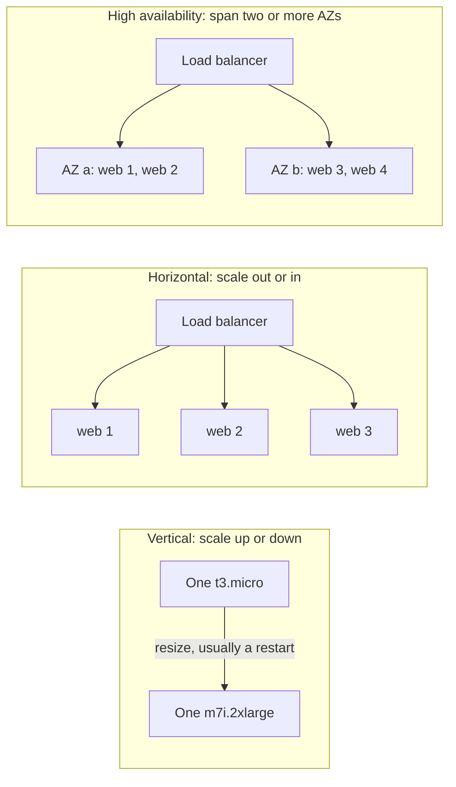
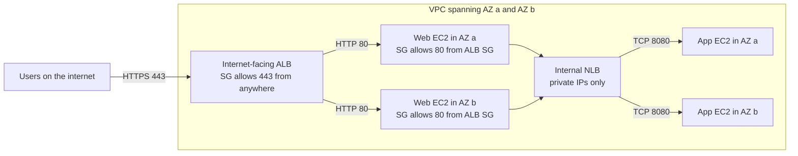
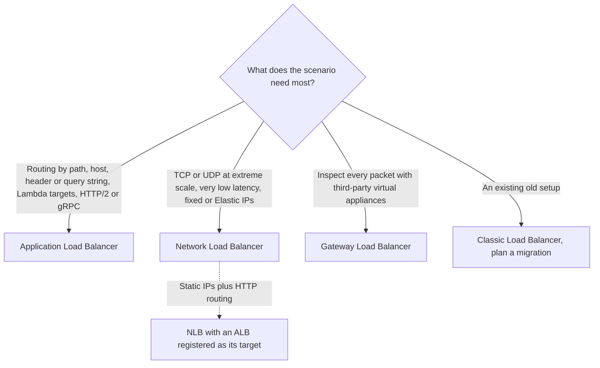
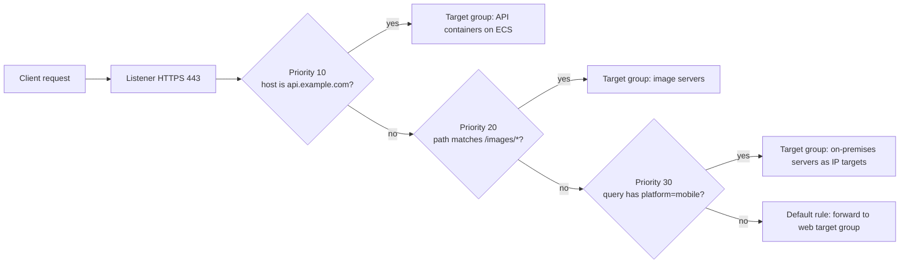
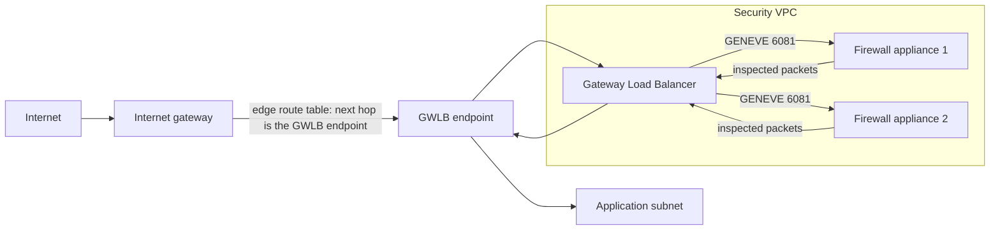
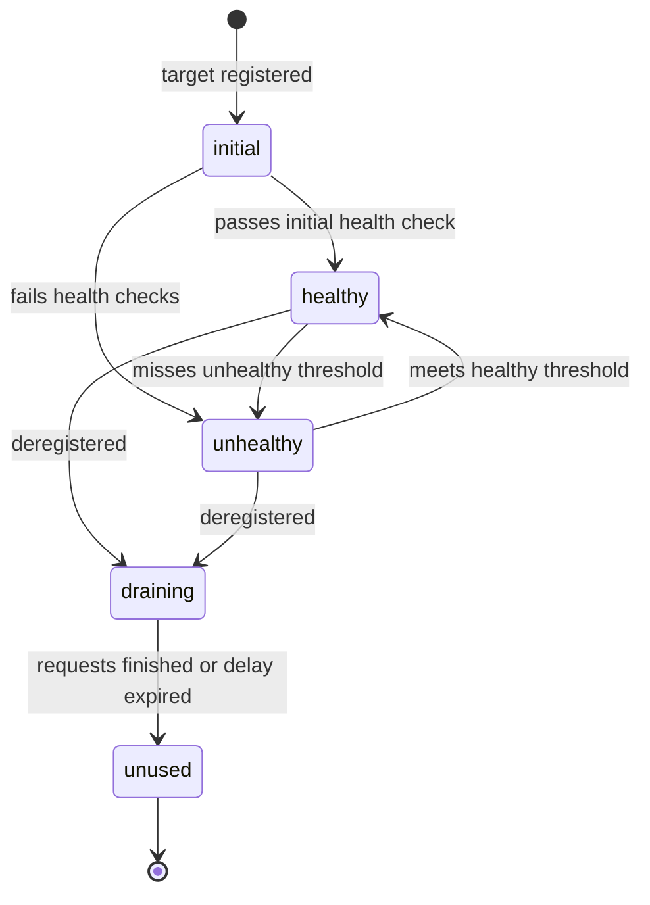

# Elastic Load Balancing

## Summary

Elastic Load Balancing (ELB) puts one stable, managed front door in front of a fleet of servers, containers, Lambda functions or appliances. It spreads requests across healthy targets in several Availability Zones, stops sending traffic to targets that fail health checks, terminates TLS, and gives your app one DNS name. Pick the **Application Load Balancer** for HTTP/HTTPS traffic that needs smart routing (paths, hostnames, headers), the **Network Load Balancer** for raw TCP/UDP/TLS at very high scale or when clients need fixed IP addresses, the **Gateway Load Balancer** to push all traffic through third-party firewalls or inspection appliances, and treat the **Classic Load Balancer** as legacy you migrate away from. Load balancers are the building block that turns "several EC2 instances" into a scalable, highly available application, and they pair with Auto Scaling groups (next lesson).

## Key concepts

- **Vertical scaling** (scale up/down) means a bigger or smaller instance; **horizontal scaling** (scale out/in) means more or fewer instances behind a load balancer.
- **High availability** means running the same workload in at least two Availability Zones so that losing one data center does not take the app down.
- A **listener** (protocol + port) receives connections; **rules** decide where requests go; a **target group** is the set of targets plus its **health check**.
- **ALB** = layer 7 (HTTP, HTTPS, HTTP/2, WebSocket, gRPC); routes by path, host, header, method, query string or source IP; targets are instances, private IPs or Lambda functions.
- **NLB** = layer 4 (TCP, UDP, TLS and now QUIC); millions of requests per second, one static IP per AZ, optional Elastic IPs; can forward to an ALB.
- **GWLB** = layer 3; a transparent bump-in-the-wire that load balances IP packets to security appliances using **GENEVE on port 6081**.
- **Security group chaining**: the instances allow traffic only from the load balancer's security group, not from the internet.
- **X-Forwarded-For** (plus **-Proto** and **-Port**) carries the real client IP to targets behind an ALB; an NLB can preserve the client IP natively.
- **Sticky sessions** pin a client to one target using cookies (ALB/CLB) or source IP (NLB); they can unbalance load.
- **Cross-zone load balancing** spreads traffic over all targets in all AZs: on for ALB (free; can only be turned off per target group), off by default for NLB/GWLB (inter-AZ data billed when on).
- **SNI** lets one ALB or NLB listener serve many TLS certificates (one per hostname); the CLB cannot do this.
- **Deregistration delay** (ALB/NLB/GWLB) / **connection draining** (CLB) lets in-flight requests finish before a target leaves; default 300 seconds.
- Load balancers can be **internet-facing** (public node IPs) or **internal** (private IPs only); both reach targets over private IPs.

## Scalability and high availability

Before load balancers make sense, you need three words straight. They often appear together in exam questions but mean different things.

**Scalability** is the ability of a system to cope with more load by adapting. There are two directions:

- **Vertical scaling (scale up / scale down)**: replace a machine with a more powerful (or smaller) one. Your app moves from a `t3.micro` to an `m7i.2xlarge`. Nothing about the app's architecture changes, which is why this is common for systems that are hard to distribute, such as a relational database on Amazon RDS or a cache node on ElastiCache. The catch: there is always a ceiling (the largest instance size) and a resize usually means a restart.
- **Horizontal scaling (scale out / scale in)**, also called **elasticity**: add or remove copies of the app. Instead of one big web server you run four small ones. This requires the app to be distributed (ideally stateless), which modern web apps usually are. EC2 makes it easy because new instances take minutes and you pay per second.

**High availability (HA)** is about surviving failure rather than handling load: run the workload in **at least two Availability Zones** so the loss of one data center leaves the other serving. HA can be **passive** (a standby copy waits, such as an RDS Multi-AZ standby) or **active** (every copy serves traffic, as with a horizontally scaled web fleet spread across AZs).

> [!EXAMPLE] A help desk as an analogy
> One overloaded support agent can be replaced by a more experienced, faster agent (vertical). Or you can hire five more agents and share calls between them (horizontal). If all of them sit in one office and that building loses power, nobody answers; put half of them in a second city and you have high availability.

> [!UPDATED] Biggest instance sizes have grown
> The slides quote a range from `t2.nano` (1 vCPU, 0.5 GiB) up to `u-12tb1.metal` (448 vCPUs, about 12 TiB). AWS ended sales of the U-1 High Memory instances (9/12/18/24 TB) on 20 June 2025 and now points to U7i: `u7in-32tb.224xlarge` has 896 vCPUs and 32 TiB of memory, and `u7inh-32tb.480xlarge` has 1,920 vCPUs. The lesson is unchanged: vertical scaling has a hard ceiling.

| | Vertical scaling | Horizontal scaling | High availability |
|---|---|---|---|
| What changes | Instance size | Number of instances | Number of AZs used |
| EC2 tooling | Stop, change instance type, start | Auto Scaling group + load balancer | Multi-AZ Auto Scaling group + multi-AZ load balancer |
| Typical fit | Databases, legacy monoliths | Stateless web and API tiers | Anything that must survive an AZ outage |
| Limit | Largest instance type | Practically none (quotas) | Number of AZs in the Region |
| Terms | Scale up / down | Scale out / in, elasticity | Active-active or active-passive |

## What a load balancer does

A load balancer is a server (in ELB's case, a managed fleet of nodes) that receives client traffic and forwards it to several servers behind it. With one in place you get:

- **One entry point**: clients use a single DNS name, for example `demo-alb-123456.us-east-1.elb.amazonaws.com`, instead of tracking individual server IPs.
- **Load spreading** across many downstream targets.
- **Failure handling**: unhealthy targets are taken out of rotation automatically, and put back when they recover.
- **TLS termination**: the load balancer holds the certificate and decrypts HTTPS, so your servers do not have to.
- **Session stickiness** with cookies when an app still keeps state locally.
- **Multi-AZ availability** and a clean split between public traffic (hitting the load balancer) and private traffic (load balancer to targets).

### Why a managed Elastic Load Balancer

You could run HAProxy or NGINX on your own EC2 instances, and the raw compute would cost less. But then patching, scaling, failover and monitoring of the proxies are your job. An ELB is managed: AWS runs, upgrades and scales the nodes, backs Multi-AZ load balancers with a 99.99% monthly uptime SLA, and exposes a deliberately small set of settings. It also plugs into the rest of AWS: EC2 and Auto Scaling groups, Amazon ECS and EKS, AWS Certificate Manager (ACM), CloudWatch metrics, Route 53 alias records, AWS WAF and AWS Global Accelerator.

> [!NOTE] DNS behind the scenes
> When you enable an AZ, ELB creates a load balancer node there. The load balancer's DNS name resolves to the IPs of those nodes with a 60-second TTL, so AWS can swap node IPs as the load balancer scales. That is why you point Route 53 at an ALB with an **alias** record and never hard-code ALB IP addresses.

### Health checks

Health checks are how the load balancer knows which targets can take traffic. Each **target group** defines a protocol, port and (for HTTP/HTTPS) a path, such as `HTTP` on port `80` with path `/health`. Every interval the load balancer probes each target; a target that fails a set number of checks in a row becomes `unhealthy` and stops receiving requests. When it passes enough checks in a row, it comes back.

| Setting | ALB default | NLB default | Allowed range |
|---|---|---|---|
| Protocol | HTTP (HTTP or HTTPS) | TCP (TCP, HTTP or HTTPS) | n/a |
| Path | `/` | `/` (HTTP/HTTPS checks only) | any valid URI |
| Interval | 30 s (35 s for Lambda) | 30 s | 5–300 s |
| Timeout | 5 s (30 s for Lambda) | 6 s for HTTP, 10 s for TCP/HTTPS | 2–120 s |
| Healthy threshold | 5 checks | 5 checks | 2–10 |
| Unhealthy threshold | 2 checks | 2 checks | 2–10 |
| Success codes | `200` | `200-399` | ALB 200–499, NLB 200–599 |

> [!TIP] Make the health check meaningful
> A good `/health` endpoint checks what the app really needs (for example, that it can reach its database) and answers quickly. A check that only proves the web server process is alive will keep sending users to an instance whose app is broken.

> [!NOTE] What if every target fails?
> If all targets in a target group are unhealthy at the same time, ALB and NLB **fail open**: they send traffic to all of them anyway, on the theory that a degraded answer beats none. Newer **target group health** settings let you set a minimum healthy count or percentage, below which an AZ is removed from DNS (DNS failover) or traffic spreads to all targets in that AZ (routing failover).

The slides describe "anything other than 200 is unhealthy" {{updated: success codes are configurable on both ALB and NLB, and NLB HTTP checks default to 200-399}}. That is the ALB default, but the success codes are configurable (for example `200-299`, or `200,302`), and NLB HTTP checks default to the wider `200-399`.

### Internet-facing or internal

Every ELB has a **scheme**:

- **Internet-facing**: nodes get public IPs and the DNS name resolves publicly. Use it for anything users reach from the internet.
- **Internal**: nodes have only private IPs (the DNS name still resolves publicly, but to private addresses). Use it between tiers inside a VPC, or for apps reached over VPN/Direct Connect.

Both kinds talk to targets over **private IPs**, so your instances never need public IPs to sit behind a load balancer.

## The four load balancer types

AWS offers four managed load balancers. The three current-generation ones (ALB, NLB, GWLB) use the `elbv2` API; the Classic Load Balancer uses the older `elb` API.

| | Application LB | Network LB | Gateway LB | Classic LB |
|---|---|---|---|---|
| Generation, launched | v2, 2016 | v2, 2017 | 2020 | v1, 2009 (previous generation) |
| OSI layer | 7 (application) | 4 (transport) | 3 (network) | 4 and 7 |
| Listener protocols | HTTP, HTTPS; also HTTP/2, WebSocket, gRPC | TCP, UDP, TCP_UDP, TLS, QUIC, TCP_QUIC {{updated: QUIC and TCP_QUIC listeners are newer than the slides, which list only TCP, TLS and UDP}} | All IP packets, sent to appliances over GENEVE port 6081 | HTTP, HTTPS, TCP, SSL |
| Target types | Instance, IP (private), Lambda | Instance, IP (private), ALB | Instance, IP (private) | Instances |
| Fixed IP addresses | No, DNS name only | One static IP per AZ, optional Elastic IP | No (reached via GWLB endpoints) | No |
| Security groups | Yes | Yes, only if attached at creation {{updated: NLBs gained security group support; you must attach at least one at creation to be able to change them later}} | No | Yes |
| Multiple certificates (SNI) | Yes | Yes, on TLS listeners | Not applicable | No |
| Stickiness | Cookies | Source IP | Flow stickiness (5-, 3- or 2-tuple) | Cookies |
| Pick it for | Websites, APIs, microservices, containers | Gaming, IoT, VoIP, trading, static IPs, PrivateLink services | Firewalls, IDS/IPS, deep packet inspection | Nothing new; migrate |

> [!UPDATED] Classic Load Balancer is officially previous generation
> AWS documentation labels the CLB as the previous generation and recommends migrating to an ALB or NLB. It still works and can still be created, but new features land only on the v2 load balancers.

## Security groups with load balancers

The standard pattern is **two security groups chained by reference**:

| Security group | Inbound rule | Source |
|---|---|---|
| Load balancer SG | TCP 80 (HTTP) and TCP 443 (HTTPS) | `0.0.0.0/0` (anyone on the internet) |
| Application (instance) SG | TCP 80, or whatever port the target group uses | The **load balancer's security group ID**, not an IP range |

Because the instance SG names the load balancer SG as its source, only traffic that came through the load balancer gets in. Someone who finds an instance's public IP and tries to reach it directly is blocked. Remember that the health check port must also be allowed from the load balancer SG.

> [!WARNING] Do not open instances to the world "just to test"
> Opening port 80 on the instances to `0.0.0.0/0` lets users bypass the load balancer, its TLS, its WAF rules and its logging. Keep the source as the load balancer security group.

## Application Load Balancer

The ALB is the load balancer you will meet most. It works at layer 7, which means it reads each HTTP request and can make decisions based on its content.

**Main features**

- Balances across many applications on many machines (several **target groups**) and across many applications on the **same** machine, for example several containers on one ECS host each listening on a different port. ECS registers each task's dynamic host port with the target group for you.
- Supports **HTTP/2** (on HTTPS listeners) and **WebSocket** on the front end, and can speak HTTP/1.1, HTTP/2 or **gRPC** to targets.
- Can **redirect** (for example HTTP to HTTPS), return a **fixed response**, or **authenticate** users with Amazon Cognito or any OpenID Connect provider before forwarding.
- Requires at least **two Availability Zones**.
- One ALB with rules replaces what used to take one Classic Load Balancer per application.

### Listeners, rules and target groups

A listener checks for connections on a protocol and port, such as `HTTPS:443`. Each listener has an ordered list of **rules**. A rule has a **priority** (1 to 50,000, lowest evaluated first), up to five match evaluations as **conditions**, and **actions**. The **default rule** has no conditions, always runs last and cannot be removed.

| Condition type | Routes on | Example |
|---|---|---|
| `path-pattern` | URL path (not the query string) | `/api/*` to the API target group |
| `host-header` | Hostname in the request | `shop.example.com` and `blog.example.com` on one ALB |
| `http-header` | Any request header | `User-Agent` contains `*Mobile*` |
| `http-request-method` | GET, POST, custom methods | Send `POST` uploads to a separate fleet |
| `query-string` | Key/value pairs in the query string | `?platform=mobile` to a mobile backend |
| `source-ip` | Client IP in CIDR form | Office range `203.0.113.0/24` to an admin app |

| Action | What it does |
|---|---|
| `forward` | Sends to one target group, or to several with **weights** (0–999), useful for blue/green and canary releases |
| `redirect` | Returns HTTP 301 (permanent) or 302 (temporary); HTTP to HTTPS is the classic use |
| `fixed-response` | Returns your own status code and body, for example a 503 maintenance page |
| `authenticate-cognito` / `authenticate-oidc` | Logs users in before routing (HTTPS listeners only) |
| `jwt-validation` | Checks JWT access tokens on HTTPS listeners {{updated: JWT verification is a newer ALB action than the slides}} |

Rules can also carry **transforms** that rewrite the host header or the URL path and query before forwarding {{updated: host header and URL rewrite transforms are newer than the slides}}.

### Target groups and target types

| Target type | What you register | Notes |
|---|---|---|
| `instance` | EC2 instance IDs | Often managed by an Auto Scaling group, which registers new instances automatically |
| `ip` | Private IP addresses | VPC subnets, peered VPCs, or on-premises servers over Direct Connect or Site-to-Site VPN; must come from the target group VPC's subnets, RFC 1918 or 100.64.0.0/10, never publicly routable IPs |
| `lambda` | One Lambda function | The ALB turns the HTTP request into a JSON event and the function's response back into HTTP |

ECS tasks register as `ip` (awsvpc networking) or `instance` targets, managed by ECS. Health checks are configured **per target group**, and one ALB can route to many target groups (up to 100 per ALB, five per forward action).

ALB routing inside a target group is **round robin** by default. You can switch to **least outstanding requests** (good when requests vary a lot in cost) or **weighted random** (the only algorithm that supports optional automatic anomaly mitigation, and it cannot be combined with sticky sessions). **Slow start** (30–900 seconds) ramps traffic gradually onto newly registered targets so they can warm caches first; it works only with round robin.

### Seeing the real client IP

An ALB terminates the client's connection and opens a new one to the target, so the target sees the **ALB's private IP** as the source. The ALB therefore adds headers:

- `X-Forwarded-For`: the client's IP address (appended to any existing list)
- `X-Forwarded-Proto`: `http` or `https`, the protocol the client used
- `X-Forwarded-Port`: the port the client connected to

Example: a browser at `198.51.100.24` calls the ALB over HTTPS. The instance logs a source of `10.0.1.57` (an ALB node), but the request carries `X-Forwarded-For: 198.51.100.24` and `X-Forwarded-Proto: https`. Configure your web server's log format to record that header.

> [!NOTE] X-Forwarded-For processing modes
> An ALB attribute controls the header: **append** (default) adds the client IP, **preserve** passes it unchanged, **remove** strips it. An optional setting also appends the client port.

## Network Load Balancer

The NLB works at layer 4: it forwards TCP and UDP flows (and TLS, which it can terminate) without reading HTTP. That simplicity buys raw performance.

- Handles **millions of requests per second** with very low latency, and scales for sudden spikes.
- Gets **one static IP address per enabled AZ**, and for internet-facing NLBs you can assign **one Elastic IP per AZ** at creation. Clients and partner firewalls can allow-list those fixed IPs, which never change for the life of the NLB.
- **Preserves the client's source IP** for instance targets by default, so targets see the real caller. For IP targets with TCP/TLS, preservation is off by default and can be turned on, or you can use **Proxy Protocol v2**.
- Targets: EC2 **instances**, private **IP addresses** (including on-premises), or an **Application Load Balancer**.
- Health checks can use **TCP, HTTP or HTTPS**.
- Underpins **AWS PrivateLink** endpoint services: you expose a service privately to other VPCs through an NLB.
- **Security groups** are optional but must be attached at creation; an NLB created without one can never get one. (QUIC and TCP_QUIC listeners are the exception: they require an NLB with no security groups.)
- Needs at least one AZ (use two or more for HA).

Each TCP connection is pinned to one target for its lifetime, chosen with a flow hash (protocol, source and destination IP and port, TCP sequence number).

> [!EXAMPLE] Static IPs and smart routing together
> A payments partner will only allow-list two fixed IP addresses, but your app needs ALB path routing and WAF. Register the ALB as the target of an NLB: the NLB supplies the static (or Elastic) IPs and passes traffic to the ALB, which does the HTTP routing. AWS Global Accelerator is the other common answer when you need fixed anycast IPs in front of an ALB.

> [!TIP] UDP and QUIC health checks
> There is no UDP or QUIC health check. For a UDP or QUIC service, point a TCP, HTTP or HTTPS health check at a port where a small helper reports whether the real service is working.

## Gateway Load Balancer

The GWLB solves a different problem: "every packet entering or leaving this VPC must pass through our firewall vendor's appliances, and that fleet must scale and survive failures."

- Operates at **layer 3**: it sees whole **IP packets** on all ports, not HTTP requests.
- Acts as a **transparent network gateway** (one entry and exit point that does not change source or destination addresses) **and** a load balancer that spreads flows across the appliance fleet.
- Talks to appliances using the **GENEVE** encapsulation protocol on **port 6081**.
- Targets: EC2 **instances** or private **IP addresses** running the appliance software: next-generation firewalls, IDS/IPS products, deep packet inspection engines or tools that rewrite payloads.
- Applications reach it through **Gateway Load Balancer endpoints** (a type of VPC endpoint); you send traffic there by editing **route tables**.
- Keeps each flow on the same appliance (5-tuple by default, or 3-tuple / 2-tuple).

> [!EXAM] GENEVE and 6081
> If a question mentions third-party virtual appliances, inspecting all traffic, or the GENEVE protocol on port 6081, the answer is the Gateway Load Balancer.

## Classic Load Balancer

The CLB is the original (v1) load balancer. Know it well enough to recognise it and to know why you would replace it.

- Supports TCP and SSL at layer 4, and HTTP and HTTPS at layer 7; its health checks can probe over TCP, SSL, HTTP or HTTPS.
- Has a fixed DNS name like `my-clb-1234567890.us-east-1.elb.amazonaws.com`.
- Registers instances directly; there are no target groups or content-based rules, so each application needed its own CLB.
- Supports only **one certificate per HTTPS listener** and no SNI.
- Uses **connection draining** (the v2 name is deregistration delay).

## Sticky sessions (session affinity)

Stickiness makes the load balancer send the same client to the same target, so an app that keeps the shopping cart or login session in local memory keeps working. It is available on ALB, NLB and CLB.

| Load balancer | How it sticks | Cookie or key |
|---|---|---|
| ALB, duration-based | The ALB generates a cookie; you choose how long it lasts (1 second to 7 days, default 1 day) | `AWSALB` (plus `AWSALBCORS` for cross-origin requests) |
| ALB, application-based | Your target sets its own cookie (name configured per target group); the ALB adds its own cookie to track the target | Your cookie, e.g. `SESSIONID`, plus `AWSALBAPP` |
| ALB, weighted target groups | Target-group-level stickiness keeps a client on the same target group in a weighted forward | `AWSALBTG` |
| CLB | Load balancer generated or application controlled | `AWSELB` |
| NLB | Source IP affinity (not for TLS or QUIC listeners) | Client source IP |

Rules to remember:

- Custom application cookie names must not be `AWSALB`, `AWSALBAPP` or `AWSALBTG`; those are reserved for the load balancer.
- Stickiness can **unbalance** the fleet: a few heavy users, or many clients behind one corporate NAT (one source IP for the NLB), can pile onto a single target.
- If the sticky target becomes unhealthy or is deregistered, the client is moved to a healthy target and loses any state held only in that server's memory.
- ALB stickiness is not supported when cross-zone load balancing is turned off for the target group.

> [!TIP] The better long-term fix
> Stickiness treats the symptom. Making the web tier stateless, with sessions stored in ElastiCache or DynamoDB, lets any instance serve any request, so scale-in and failures do not log users out.

## Cross-zone load balancing

Clients resolve the load balancer's DNS name and get one node IP per AZ, so each AZ's node receives roughly an equal share of traffic regardless of how many targets sit behind it. Cross-zone load balancing decides what each node does with its share:

- **On**: every node spreads its traffic across **all** registered targets in **all** enabled AZs.
- **Off**: every node spreads its traffic only across targets **in its own AZ**.

Worked example with 1 target in AZ a and 4 targets in AZ b (each node gets 50% of requests):

| | Target in AZ a | Each target in AZ b |
|---|---|---|
| Cross-zone **on** | 20% | 20% |
| Cross-zone **off** | 50% | 12.5% |

With it off, the lone AZ a instance does four times the work of each AZ b instance. Keeping AZs balanced (an Auto Scaling group does this for you) or turning cross-zone on avoids the hot spot.

| Load balancer | Default | Where you change it | Inter-AZ data charge when on |
|---|---|---|---|
| ALB | Always on at load balancer level | Can be turned off per target group | No |
| NLB | Off | Load balancer level, overridable per target group | Yes, regional data transfer is billed |
| GWLB | Off | Load balancer level | Yes |
| CLB | On when created in the console, off when created with the API or CLI {{updated: the slides say CLB cross-zone is disabled by default; AWS docs say the console pre-selects it while the API/CLI leave it off}} | Load balancer attribute | No |

> [!NOTE] Why anyone turns it off
> Keeping traffic inside an AZ creates zonal failure domains (a problem in one AZ cannot spill into the others), slightly reduces latency, and on NLB avoids inter-AZ data charges. The price is that each AZ must be sized for its own share of traffic.

## SSL/TLS, certificates and SNI

**SSL** (Secure Sockets Layer) and its successor **TLS** (Transport Layer Security) encrypt traffic in flight between client and server. Almost everything today uses TLS, but people still say "SSL certificate". Public certificates are issued by a **certificate authority** (CA), such as DigiCert, GlobalSign, Let's Encrypt or Amazon Trust Services, and they expire, so they must be renewed.

### Certificates on a load balancer

- An HTTPS listener (ALB) or TLS listener (NLB) uses an **X.509 server certificate**.
- Manage certificates with **AWS Certificate Manager (ACM)**, which issues public certificates at no charge for use with ELB and renews them automatically. You can also import your own certificate into ACM, or upload one to IAM.
- Every secure listener needs exactly one **default certificate**, plus an optional **certificate list** for extra domains (up to 25 per ALB or NLB by default, adjustable).
- A **security policy** decides which TLS versions and ciphers are accepted. Choose an older policy only when legacy clients cannot negotiate modern TLS.
- The common pattern is **TLS termination**: HTTPS from the user to the load balancer, then HTTP over the private VPC network to the instances. If compliance demands encryption all the way, the target group can use HTTPS too (the ALB does not validate target certificates, so self-signed ones work), or an NLB can pass TCP straight through so the instances terminate TLS themselves.

> [!UPDATED] Certificate lifetimes and default TLS policy
> Since 18 February 2026, ACM public certificates are valid for 198 days (previously 395) to meet the CA/Browser Forum's 200-day limit; ACM still renews them automatically. For new HTTPS listeners, the console's default security policy is now `ELBSecurityPolicy-TLS13-1-2-Res-PQ-2025-09` (TLS 1.2/1.3 with hybrid post-quantum key exchange), while the CLI, CloudFormation and CDK still default to `ELBSecurityPolicy-2016-08`.

### Server Name Indication (SNI)

Before SNI, one IP address and port could present only one certificate, so hosting `shop.example.com` and `www.mycorp.com` securely meant two load balancers (or one certificate listing every name). **SNI** fixes this: the client names the hostname it wants inside the first TLS handshake message, and the server picks the matching certificate. If nothing matches, the load balancer presents the default certificate.

- Works on **ALB** and **NLB**, and on **CloudFront**.
- Does **not** work on the **CLB**: there you need one CLB per certificate, or a single certificate with all names as Subject Alternative Names (or a wildcard).
- Combine SNI with ALB host-header rules: one HTTPS listener, many certificates, each hostname routed to its own target group.

| Load balancer | Certificates per secure listener | How several domains are served |
|---|---|---|
| CLB | One | Several CLBs, or a SAN/wildcard certificate |
| ALB | Default + certificate list | SNI selects the right certificate |
| NLB | Default + certificate list (TLS listeners) | SNI selects the right certificate |

## Deregistration delay (connection draining)

When a target is deregistered (an Auto Scaling scale-in, a deployment, or you removing it by hand), you do not want to cut off requests it is still working on. The load balancer therefore:

1. Stops sending **new** requests to that target straight away (state `draining`).
2. Lets **in-flight** requests finish, for up to the configured time.
3. Marks the target `unused` and completes the deregistration.

| Name | Load balancers | Range | Default |
|---|---|---|---|
| Deregistration delay | ALB, NLB, GWLB | 0–3600 seconds (0 disables it) | 300 seconds |
| Connection draining | CLB | 1–3600 seconds, or disabled | 300 seconds |

Set it **low** (for example 10–30 seconds) when requests are short, so deployments and scale-in are quick. Set it **higher** for long uploads, downloads or report generation. An Auto Scaling group waits for draining to finish before terminating the instance.

## Pricing at a glance

ELB is billed per hour that the load balancer exists plus a capacity unit for the traffic it handles. Prices for US East (N. Virginia), checked October 2026:

| Load balancer | Per hour | Per capacity unit-hour |
|---|---|---|
| ALB | USD 0.0225 | USD 0.008 per LCU |
| NLB | USD 0.0225 | USD 0.006 per NLCU |
| GWLB | USD 0.0125 per AZ | USD 0.004 per GLCU |
| CLB | USD 0.025 | USD 0.008 per GB processed |

An ALB LCU is the highest of four measures: 25 new connections per second, 3,000 active connections per minute, 1 GB per hour processed for EC2/IP targets (0.4 GB for Lambda), or 1,000 rule evaluations per second (the first 10 rules are free). Each public IPv4 address on an internet-facing load balancer also costs USD 0.005 per hour.

> [!NOTE] Free Tier
> Accounts created before 15 July 2025 on the legacy 12-month Free Tier get 750 hours per month shared between ALB and CLB, plus 15 ALB LCUs and 15 GB of CLB processing. Accounts created on or after that date pay for ELB from their Free Tier credits instead.

## Exam tips

> [!EXAM] Match the keyword to the load balancer
> "Route by URL path or hostname", "microservices", "containers on one host with dynamic ports", "Lambda behind HTTP", "redirect HTTP to HTTPS" → **ALB**. "TCP/UDP", "millions of requests per second", "ultra-low latency", "static IP" or "Elastic IP for allow-listing", "PrivateLink" → **NLB**. "Third-party firewall / IDS / IPS appliances", "GENEVE", "port 6081" → **GWLB**.

> [!EXAM] Client IP behind a load balancer
> The app logs show the load balancer's IP instead of users' IPs: with an ALB, read the **X-Forwarded-For** header. With an NLB, client IP preservation (or Proxy Protocol v2) already gives the real IP.

> [!EXAM] Users keep losing their session
> Users are logged out or lose carts when requests hit different instances: enable **sticky sessions**, or better, store session state in **ElastiCache** or **DynamoDB** so instances are stateless.

> [!EXAM] Many HTTPS domains on one load balancer
> Several websites with their own certificates behind one load balancer → **ALB (or NLB) with SNI** and multiple certificates from **ACM**. If the question insists on a CLB, you would need one CLB per certificate.

> [!EXAM] Lock instances down to the load balancer
> "Instances should only accept traffic from the load balancer" → the instance security group allows the app port with the **load balancer's security group** as the source.

> [!EXAM] Uneven load across AZs
> One AZ's instances are overloaded while another's are idle, with NLB or GWLB → turn on **cross-zone load balancing** (and expect inter-AZ data charges), or balance instance counts across AZs.

- "Deployments drop in-flight requests" → tune **deregistration delay** (connection draining on CLB).
- "Requests are long uploads and get cut off at scale-in" → **increase** the deregistration delay; "deployments take too long because instances wait 5 minutes" → **decrease** it.
- "Need the security of fixed IPs plus layer 7 features" → **NLB in front of an ALB**, or **Global Accelerator** in front of the ALB.
- "Targets on premises" → ALB or NLB **IP target type** over Direct Connect or VPN, using private IPs.

## Common traps

> [!TRAP] "The ALB has a static IP"
> It does not. ALB node IPs change as it scales; use the DNS name (Route 53 alias). Static and Elastic IPs belong to the NLB.

> [!TRAP] Confusing vertical and horizontal scaling
> Moving from `t3.large` to `m7i.4xlarge` is vertical (scale up), not elasticity. Adding instances behind a load balancer is horizontal (scale out). High availability is about spanning AZs, not about size.

> [!TRAP] Choosing the CLB for multiple certificates
> The CLB has no SNI. Any answer that relies on one CLB serving several certificates is wrong.

> [!TRAP] Opening instances to 0.0.0.0/0
> An answer that allows HTTP from anywhere on the instance security group "so the load balancer can reach it" weakens security. Reference the load balancer's security group instead.

> [!TRAP] Expecting sticky sessions to fix scaling
> Stickiness keeps sessions alive but tends to unbalance load and still loses sessions when an instance dies. External session storage is the scalable answer.

> [!TRAP] Assuming cross-zone is free everywhere
> It is free (and always on) for ALB, but on NLB and GWLB it is off by default and inter-AZ data is billed when you enable it.

> [!TRAP] Thinking an NLB can route by URL path
> NLBs do not read HTTP, so they cannot route by path, host or header. That is the ALB's job.

> [!TRAP] Public IPs as targets
> IP targets must be private addresses (RFC 1918 or 100.64.0.0/10). You cannot register an internet IP address as a load balancer target.
