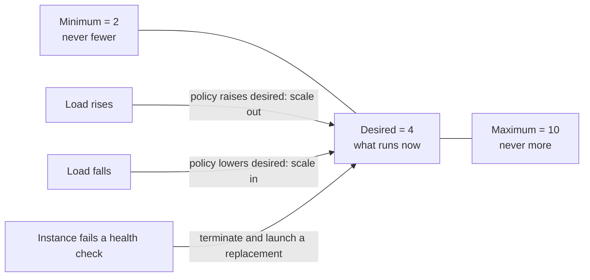
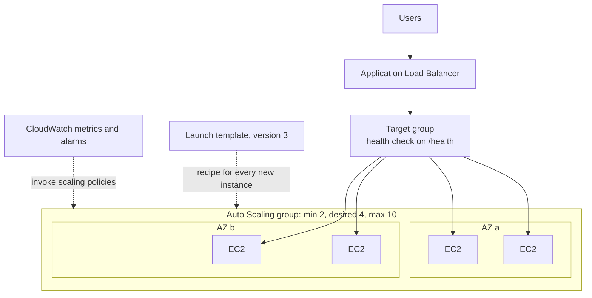
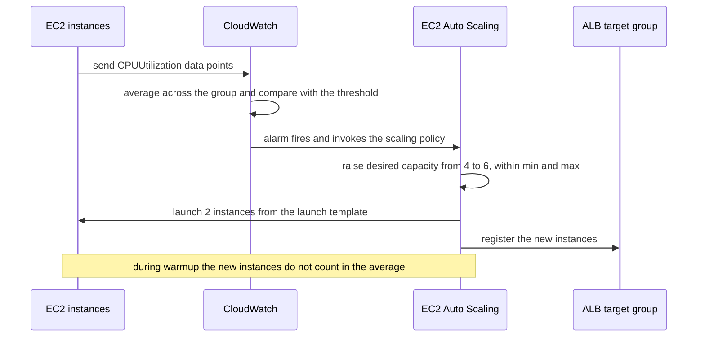
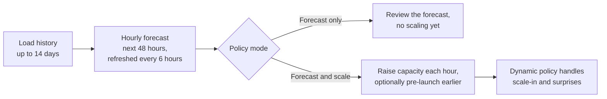
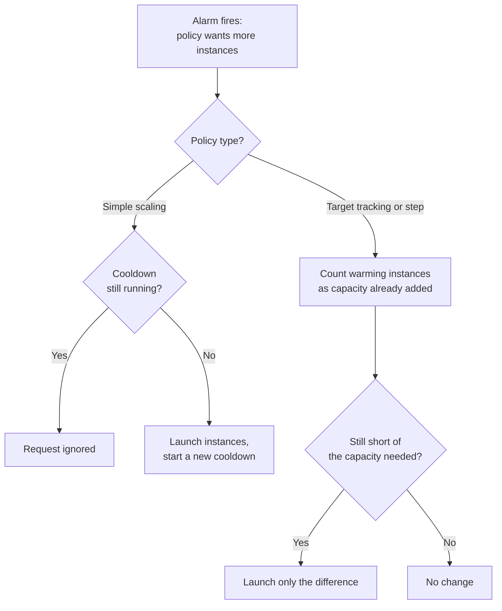
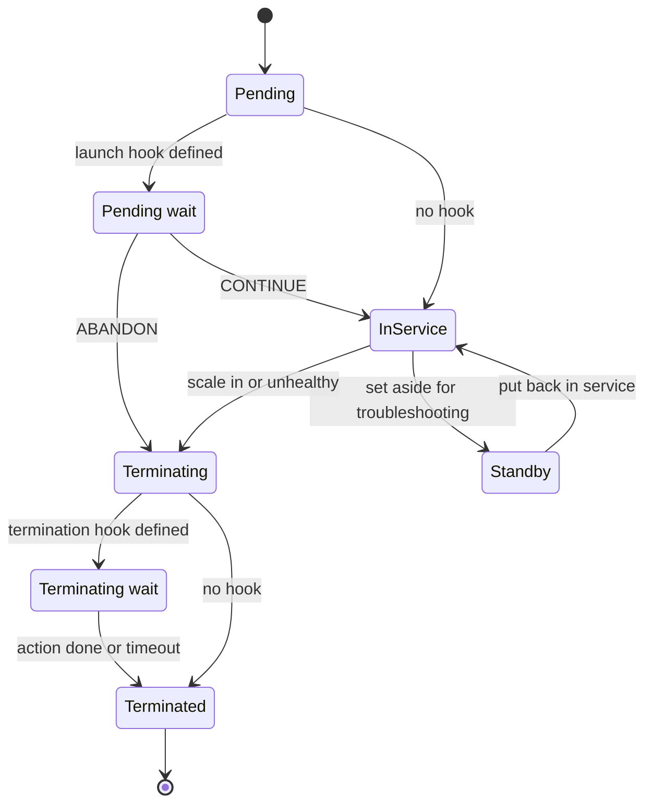

# Auto Scaling Groups

## Summary

An Auto Scaling group (ASG) turns a few hand-launched servers into a fleet that sizes and repairs itself. You describe what each instance looks like (a **launch template**), where instances may run (subnets in one or more Availability Zones of one Region) and how many you accept (**minimum, desired, maximum**). Amazon EC2 Auto Scaling then keeps that many healthy instances running, registers them with your load balancer, replaces any that fail, and grows or shrinks the group with **scaling policies** driven by CloudWatch metrics, a schedule or a forecast. Use an ASG whenever an EC2 workload must survive the loss of an instance or an AZ, follow changing demand without paying for idle peak capacity, or simply come back on its own when a server dies. The service is free; you pay for the instances, volumes and alarms it uses.

## Key concepts

- **Auto Scaling group**: EC2 instances managed as one unit, in **one Region**, spread over several **Availability Zones**.
- **Minimum / desired / maximum**: the floor, the number running right now, and the ceiling.
- **Scale out / scale in**: add instances when load rises, remove them when it falls.
- **Launch template**: the versioned recipe for new instances; **launch configurations** are the legacy, read-only predecessor.
- **Self-healing**: instances that stop running or fail a health check are replaced to restore the desired capacity.
- **Health checks**: EC2 status checks always count; **Elastic Load Balancing**, EBS and VPC Lattice checks only when turned on, custom checks through the API; a **grace period** protects booting instances.
- **Target tracking**: pick a metric and a target value (e.g. 50% CPU); AWS creates and tunes the alarms, like a thermostat.
- **Step and simple scaling**: your own alarms trigger set adjustments; step sizes the reaction to the breach, simple waits out a cooldown.
- **Scheduled scaling**: change min, desired or max at a known time, once or on a cron schedule.
- **Predictive scaling**: learns daily and weekly cycles and adds capacity before the load arrives.
- **Good scaling metrics** fall as instances are added: `ASGAverageCPUUtilization`, `ALBRequestCountPerTarget`, network in/out, or a custom per-instance metric such as SQS backlog per instance.
- **Cooldown vs warmup**: the 300-second default cooldown only gates simple scaling; target tracking and step scaling use **instance warmup**.
- **Default termination policy**: balance AZs first, then remove the instance with the oldest configuration.
- **Lifecycle hooks, warm pools, instance refresh**: pause instances for custom actions, keep pre-initialized instances ready, roll out a new template version.

## What an Auto Scaling group does

Traffic is never flat. A concert-ticket site may need three servers at 4 a.m. and thirty when a big tour goes on sale at 10:00. Size the fleet for the peak and you pay for twenty-seven idle servers most of the day; size it for the average and the site falls over when it matters most. Because EC2 instances start in minutes and bill per second, the better answer is a fleet that changes size with the load (**elasticity**). An ASG has four jobs:

1. **Respect the limits**: never fewer than the minimum, never more than the maximum.
2. **Follow demand**: scaling policies raise the desired capacity when load climbs and lower it when load drops.
3. **Heal**: if an instance is terminated, stops, or fails a health check, launch a replacement.
4. **Work with a load balancer**: register new instances in the target group and deregister (drain) instances before removing them, so users only ever see the load balancer's DNS name.

> [!NOTE] What it costs
> EC2 Auto Scaling has no charge of its own. The bill comes from what the group launches: instances, EBS volumes, public IPv4 addresses, CloudWatch alarms and detailed monitoring.

### Minimum, desired and maximum capacity

Every group must satisfy **minimum ≤ desired ≤ maximum**.

| Setting | Meaning | Changed by | Example: min 2, desired 4, max 10 |
|---|---|---|---|
| **Minimum** | Floor; the group never shrinks below it | You, scheduled actions | Even at 4 a.m. two instances run, one per AZ |
| **Desired** | The number the group tries to run now | You, scaling policies, scheduled actions | 4 now; a policy may raise it to 7 at lunchtime |
| **Maximum** | Ceiling; scale-out stops here, which also caps the bill | You, scheduled actions | Never more than 10, whatever the load |

- When desired already equals the maximum, nothing can scale out until you raise the maximum. The API rejects a desired value outside the range; the console raises the maximum for you if you type a larger desired value.
- **min = desired = max** gives a fixed-size fleet that still heals. With all three at 1 the instance always comes back, but that is **not** high availability: nothing serves while the replacement boots.
- For high availability, keep at least one instance in each of two or more AZs.

## Auto Scaling groups behind a load balancer

You connect a group to a load balancer by **attaching a target group** (ALB, NLB or GWLB) or a Classic Load Balancer. From then on the group registers every instance it launches and, before terminating one, deregisters it and waits for the deregistration delay so in-flight requests finish. Instances are spread evenly across the selected AZs, and the load balancer spreads requests across them.

### Health checks and self-healing

Instances start out `Healthy`. When a health check source reports a problem, the group marks the instance `Unhealthy`, terminates it and launches a replacement.

| Health check source | On by default? | Marks an instance unhealthy when… |
|---|---|---|
| **EC2 status checks and scheduled events** | Yes, cannot be turned off | It is no longer `running` (stopped, stopping, terminated), a status check stays `impaired`, or AWS schedules a retirement |
| **Elastic Load Balancing** | No, turn it on | The target group health check fails |
| **Amazon EBS** {{updated: Newer than the slides; detects attached volumes that are unreachable or fail I/O checks}} | No | An attached volume is unreachable or fails I/O checks |
| **VPC Lattice** | No | A VPC Lattice target group reports it unhealthy |
| **Custom** | Through the API | Your monitoring calls `set-instance-health` |

> [!EXAMPLE] Why you turn on ELB health checks
> Apache crashes on one instance but the VM is fine, so EC2 status checks pass. The ALB sees the failing `/health` check and stops routing to it, yet the broken instance stays in the group indefinitely. With **Elastic Load Balancing health checks** turned on for the ASG, the group replaces it on its next health check.

> [!UPDATED] Application status checks (August 2026)
> EC2 can now probe an HTTP or HTTPS port and path on each instance every 60 seconds (**application status checks**, configured in EC2). If the check reports `impaired` for an instance in an Auto Scaling group, the group replaces it with no extra group configuration.

The **health check grace period** is how long the group ignores failed health checks after an instance enters `InService`, so a server still running its user data is not killed. Defaults: **300 seconds** in the console, **0** with the CLI or SDKs. An instance that stops running is replaced immediately, grace period or not.

> [!WARNING] Replacements start from scratch
> A replacement is built fresh from the launch template: Elastic IPs and extra EBS volumes do not move to it, and the old root volume is deleted with the instance (the default for root volumes). Keep instances **stateless** (sessions in ElastiCache or DynamoDB, files in S3 or EFS, data in RDS).

## Launch templates

A launch template is the "launch instance" wizard saved as a reusable, versioned document. Per-instance settings live in the template; fleet settings live on the group.

| In the launch template (each instance) | On the Auto Scaling group (the fleet) |
|---|---|
| AMI, instance type (or vCPU and memory attributes) | VPC and subnets, which set the AZs |
| Key pair, security groups, IAM instance profile | Minimum, desired, maximum |
| User data script | Target groups, health check types, grace period |
| EBS volumes, public IP setting, detailed monitoring, tags | Scaling policies, scheduled actions, termination policy, lifecycle hooks |

A subnet in the template is ignored; the group's subnet list wins. Editing a template creates a new **version**, and the group can follow the default, the latest or a fixed version. New versions apply only to instances launched afterwards; running instances keep the old configuration until replaced (see **instance refresh** below).

| | Launch template | Launch configuration (legacy) |
|---|---|---|
| Changes | New version, history, easy rollback | Cannot be edited; create a new one and switch |
| Several instance types, On-Demand + Spot mix | Yes | No |
| Instance types released after 1 January 2023 | Yes | No |
| Usable outside Auto Scaling (EC2 launches, EC2 Fleet) | Yes | No |

> [!UPDATED] Launch configurations are now blocked for new accounts
> The slides call launch configurations deprecated. Today: no instance types newer than **1 January 2023** are supported; accounts created on or after **1 June 2023** cannot create them in the console; accounts created on or after **1 October 2024** cannot create them by any method (console, API, CLI or CloudFormation). AWS asks everyone to migrate to launch templates.

## Scaling with CloudWatch alarms

Dynamic scaling is a feedback loop. EC2 publishes instance metrics such as `CPUUtilization` to CloudWatch with an `AutoScalingGroupName` dimension, so CloudWatch can compute a group-wide value such as **average CPU across the ASG**. An alarm compares it with a threshold; when the alarm fires it invokes a **scaling policy**, which changes the desired capacity, and the group launches or terminates instances to match.

- **Granularity**: EC2 sends instance metrics every 5 minutes by default. For scaling on EC2 metrics AWS recommends **detailed monitoring** (1-minute data, extra charge) so policies react sooner. ALB metrics are already per minute.
- **Memory is invisible** to CloudWatch by default. To scale on memory, publish it with the **CloudWatch agent** and use that custom metric.

## Scaling policy types

| Policy | How it decides | Best for | Watch out for |
|---|---|---|---|
| **Target tracking** | Keeps one metric near a target; AWS manages the alarms | Most web and API fleets ("CPU about 50%", "about 1,000 requests per instance per minute") | Metric must fall as instances are added; never edit its alarms; scale-in is gradual |
| **Step scaling** | Your alarm; bigger breach, bigger adjustment | Stronger reaction to bigger spikes, or a custom scale-in rule | You maintain the alarms; leave a gap between thresholds to avoid flapping |
| **Simple scaling** | Your alarm; one adjustment, then a cooldown | Legacy setups | Ignores alarms during the cooldown; AWS advises against it |
| **Scheduled** | Sets min/desired/max at a time or on a cron schedule | Known events: a Friday sale, office hours | Blind to surprises; pair with a dynamic policy |
| **Predictive** | Forecasts the next 48 hours from recent history | Daily or weekly cycles, slow-starting instances | Needs 24 hours of data; never scales in |
| **Manual** | You set desired (or min/max) | One-off changes, tests | Not automatic |

Target tracking, step and simple scaling are called **dynamic scaling** because they react to live metrics.

### Target tracking

Like a thermostat, you set the value you want, not the rules for reaching it. Choose a metric and a target (say 40% average CPU); EC2 Auto Scaling creates a scale-out alarm and a scale-in alarm and works out how many instances to add or remove.

> [!EXAMPLE] Requests per instance
> A policy keeps `ALBRequestCountPerTarget` at **1,000 requests per instance per minute**. A promotion lifts traffic to 9,000 requests per minute, so the group heads for 9 instances (when the maths gives a fraction such as 8.4, it adds the extra instance rather than run short). When traffic falls to 3,000 per minute it scales in, more slowly, toward 3, and it skips a scale-in that would push the metric back above the target.

- **Leave its alarms alone**: they belong to the policy, and editing them breaks scaling.
- **Scale-in is cautious** to protect availability; you can **disable the scale-in part** and handle it another way.
- **Several target tracking policies** (each on a different metric) can coexist: the group scales out if *any* wants more and scales in only when *all* agree.
- A metric that reports real zeros, such as requests per target, can take a group with minimum 0 down to zero instances.

### Step scaling and simple scaling

With step scaling you create the alarm yourself and define **step adjustments**, bands with their own reaction. For an alarm "average CPU above 60%":

| CPU when the alarm fires | Adjustment |
|---|---|
| 60% to below 70% | Add 1 instance |
| 70% to below 85% | Add 3 instances |
| 85% and above | Add 5 instances |

A separate scale-in policy might remove 1 instance below 30%. The wide gap is deliberate: thresholds that sit too close make the group **flap** between adding and removing instances. Adjustments use an **adjustment type**: `ChangeInCapacity` (add or remove a number: +3 on 10 gives 13), `ExactCapacity` (set a value: 6 gives 6) or `PercentChangeInCapacity` (+20% on 10 gives 12, optionally with a minimum step `MinAdjustmentMagnitude`).

**Simple scaling** is the original version: one alarm, one adjustment, then a **cooldown** during which further simple scaling is ignored. Step scaling keeps reacting while the alarm stays in breach, so AWS recommends target tracking first, step second, and simple scaling only for legacy setups.

### Scheduled scaling

When you know when load changes, schedule it. A **scheduled action** sets a new desired capacity and optionally a new minimum and maximum, **once** or **repeatedly** with a cron expression (minute, hour, day of month, month, day of week).

> [!EXAMPLE] A weekly flash sale
> A grocer's sale starts every Friday at 17:00 Paris time. Action one, cron `0 17 * * 5` in time zone `Europe/Paris`, sets min and desired to 10; action two, cron `0 1 * * 6`, sets them back to 2. Meanwhile target tracking can still go above 10 (up to the maximum) if the sale is busier than expected.

Schedules run in **UTC** unless you pick an IANA time zone (which also follows daylight saving time). A group holds up to **125** scheduled actions, each with a unique start time, and an action can start up to about two minutes late. Afterwards dynamic policies keep working inside the new limits, so raising the **minimum** is the reliable way to guarantee capacity for an event.

### Predictive scaling

Predictive scaling writes the schedule for you: it studies a load metric's history, finds the daily and weekly rhythm, and adds capacity **before** the expected rise.

| Fact | Value |
|---|---|
| History needed for a first forecast | 24 hours (two weeks gives better forecasts) |
| History analysed | Up to 14 days |
| Forecast | Hourly capacity for the next 48 hours, refreshed every 6 hours |
| Modes | Starts in **forecast only** (no scaling, for review), then **forecast and scale** |
| Timing | At the start of each hour, or earlier with **pre-launch** (`SchedulingBufferTime`) |
| Scale-in | Never on its own; pair with a dynamic policy |
| Maximum capacity | Respected unless **Max capacity behavior** lets the forecast raise it |

Typical fits: an internal application busy from 8:00 to 18:00 on weekdays, or instances that need ten minutes to become useful, so reacting after the spike is always too late.

When several policies are active, each computes the capacity it wants and the group uses the **largest**: if target tracking wants 10 and predictive wants 8, the group runs 10. Scheduled actions instead move the minimum and maximum that every policy must respect.

## Choosing a good scaling metric

Target tracking assumes that adding instances pushes the metric down in proportion. Average CPU does: double the instances and each works about half as hard. A metric that does not move when you add instances cannot steer the group.

| Metric | Predefined name | Use it when | Example target |
|---|---|---|---|
| Average CPU of the group | `ASGAverageCPUUtilization` | CPU-bound application servers | 40–60% |
| Requests per instance | `ALBRequestCountPerTarget` | Web or API fleets behind an ALB | 1,000 per instance per minute |
| Average network traffic | `ASGAverageNetworkIn` / `ASGAverageNetworkOut` | Network-bound streaming, transfer or proxy fleets | Bytes per instance |
| Custom metric | Your metric, or CloudWatch metric math | Queue backlog per instance, sessions, memory from the CloudWatch agent | 60 messages per instance |

Poor choices for target tracking: the load balancer's total `RequestCount` (it measures demand, not how busy each instance is), **latency** (rises with load but not proportionally) and the raw SQS queue length `ApproximateNumberOfMessagesVisible`.

> [!EXAMPLE] Scaling queue workers on backlog per instance
> Each job takes 0.5 seconds and the business accepts a 30-second wait, so one instance can carry an **acceptable backlog** of 30 / 0.5 = **60 messages**. With 3,000 messages queued and 10 instances running, the backlog is 300 per instance; target tracking with a target of 60 heads for 3,000 / 60 = 50 instances (capped by the maximum). Build the per-instance value with metric math (queue length divided by `GroupInServiceInstances`, which needs group metrics collection turned on) rather than publishing your own metric.

> [!UPDATED] Faster reactions with high-resolution metrics
> Target tracking can now use **high-resolution custom metrics** with a period as short as **10 seconds**, useful for very spiky APIs. Predefined EC2 metrics stay at 1 or 5 minutes, so for 10-second CPU you publish it yourself (for example with the CloudWatch agent). High-resolution alarms are priced differently from standard ones.

## Cooldowns and instance warmup

Right after a scaling action the metrics do not yet reflect the new capacity: new instances are still booting, often with a burst of CPU while they install software. Two mechanisms stop the group overreacting.

- **Cooldown (simple scaling only).** After a simple scaling policy acts, further simple scaling is ignored until the cooldown ends. The **default cooldown is 300 seconds**; the CLI can set another value at creation, the console only after the group exists, and a single policy can override it (often shorter for scale-in, since terminating is quick).
- **Instance warmup (target tracking and step scaling).** Each new instance is left out of the group's aggregated metrics for a warmup period. Meanwhile the policy may still scale out but counts warming instances as capacity already on its way, and scale-in waits until they finish. Set it once as the group's **default instance warmup**: it is **not enabled by default**, AWS strongly recommends it, and 300 seconds is a sensible starting point. If unset, these policies fall back to the default cooldown value.

> [!UPDATED] The 300-second cooldown no longer applies to every scaling action
> The slides describe the default cooldown as pausing all launches and terminations after any scaling activity. Current AWS documentation limits it to **simple scaling policies**: target tracking and step scaling can scale out again at once and use **instance warmup**; scheduled actions and unhealthy-instance replacement ignore it; manual changes ignore it unless you ask the CLI to honour it.

The quicker an instance can serve traffic, the shorter the warmup and the faster the group tracks demand:

- **Golden AMI**: bake updates, packages and the application into a custom AMI instead of installing them in user data; an instance ready in 90 seconds instead of 7 minutes allows a much shorter warmup.
- **Launch lifecycle hook**: keep the instance out of service until its bootstrap reports success.
- **Warm pool**: keep pre-initialized, stopped instances ready for applications with very long first boots.

## Features that often decide exam answers

### AZ balance and which instance is terminated

Each launch goes to the AZ with the fewest instances. If an AZ fails, the group launches replacements in the others; when it recovers the group rebalances, launching new instances **before** terminating old ones. To make that possible a group at its maximum may briefly exceed it (by 10% or one instance, whichever is greater) unless an instance maintenance policy sets other limits.

> [!UPDATED] Availability Zone distribution strategies
> You now choose what happens when launches fail in one AZ: **Balanced best effort** (default) launches in another healthy AZ; **Balanced only** keeps retrying the same AZ to stay balanced (useful for quorum systems); **Reservations then balanced** (June 2026) fills the group's Capacity Reservations first.

On scale-in, the **default termination policy** picks:

1. The AZ with the **most instances** that are not scale-in protected (balance comes first).
2. Within it, an instance with an **outdated configuration**: from a launch configuration, then a different launch template, then the **oldest version** of the current template.
3. Then the instance **closest to its next billing hour** (a tie-breaker that matters little now that most EC2 usage bills per second), then one at random.

In a mixed instances group (see below) it first decides whether to remove Spot or On-Demand capacity to keep the configured split, and prefers instances that bring the group back in line with its allocation strategy, before looking at configuration age.

> [!EXAMPLE] Who gets terminated?
> AZ a runs three instances (two from template version 1, one from version 2) and AZ b runs two. Scale-in picks AZ a (more instances), then one of its version 1 instances.

Alternatives include `OldestInstance`, `NewestInstance`, `OldestLaunchTemplate`, `AllocationStrategy` and custom policies written as Lambda functions. **Instance scale-in protection** keeps a chosen instance (one running a long job, say) from being picked. Unhealthy instances skip the termination policy and are simply replaced.

### Lifecycle hooks

A lifecycle hook pauses an instance at launch (`Pending:Wait`) or termination (`Terminating:Wait`) until you call `complete-lifecycle-action` with `CONTINUE` or `ABANDON`, or the timeout expires.

- **On launch**: install or configure software, then let the instance join the load balancer only when ready.
- **On termination**: copy logs to S3, take a final backup, deregister from external systems.
- Default timeout **1 hour**; absolute limit **48 hours or 100 times the heartbeat timeout**, whichever is smaller. When a launch hook times out, the hook's default result applies (`ABANDON` unless you chose `CONTINUE`), and an abandoned launch is terminated and replaced. Termination hooks are best effort: on timeout or `ABANDON` the instance is terminated anyway.
- Events go to **Amazon EventBridge** (and on to Lambda, SNS, SQS); the CLI and SDKs can also notify SNS or SQS directly.

### Warm pools, instance refresh and maintenance policy

- **Warm pool**: pre-initialized instances beside the group for apps with very long first boots. Keep them **Stopped** (pay only for EBS and attached Elastic IPs), **Hibernated** (RAM saved to EBS) or **Running** (costly, discouraged). Needs EBS root volumes; no Spot in mixed instances groups. An empty pool means a normal (cold) launch.
- **Instance refresh**: replaces running instances in a rolling way after you point the group at a new template version (new AMI, user data or instance type). Default minimum healthy **90%**; optional checkpoints, skip matching and automatic rollback on a CloudWatch alarm.
- **Instance maintenance policy**: minimum and maximum healthy percentages used whenever instances are replaced, for example **launch before terminating** for a small group that must not drop below its desired capacity.
- **Maximum instance lifetime**: replaces any instance that has been in service longer than a set time (at least **86,400 seconds**, one day), for example to meet a "no server older than 30 days" compliance rule; replacements come from the current launch template.

### Mixed instances: several types, On-Demand and Spot

A **mixed instances policy** lets one group use several instance types (named, or chosen by vCPU and memory attributes) and both purchase options. Set an **On-Demand base capacity** and the **On-Demand percentage above base**; the rest is Spot. AWS recommends the **price-capacity-optimized** Spot allocation strategy, and **Capacity Rebalancing** replaces Spot Instances at elevated risk of interruption. Reserved Instance and Savings Plans discounts still apply to matching On-Demand usage.

> [!EXAMPLE] A cost-optimized web tier
> Base of 2 On-Demand instances, then 25% On-Demand and 75% Spot above it, across `m6i.large`, `m7i.large` and `m6a.large`. Two On-Demand servers are always there; most burst capacity is discounted Spot, and an interrupted Spot Instance is simply replaced.

### Monitoring, standby and deletion protection

- **SNS notifications** for launches, terminations and failures, plus **EventBridge** events for automation. **Group metrics** such as `GroupDesiredCapacity` and `GroupInServiceInstances` are free at 1-minute granularity once enabled.
- **Standby** takes an instance out of service, and out of health checks, for troubleshooting without terminating it.
- **Suspending processes** pauses one part of the group's automation while you investigate, for example `ReplaceUnhealthy` (stop replacing failed instances), `AZRebalance`, `AlarmNotification` (ignore scaling alarms) or `ScheduledActions`.
- {{updated: Added January 2026}} **Deletion protection**: *None* (default), *Prevent force deletion* or *Prevent all deletion*, to stop a production group and its instances being deleted by mistake.

### EC2 Auto Scaling vs Application Auto Scaling

EC2 Auto Scaling manages EC2 instances in Auto Scaling groups. **Application Auto Scaling** offers the same policy types for other services: ECS service task counts, DynamoDB tables, Aurora replicas, Lambda provisioned concurrency, ElastiCache, EMR, Spot Fleet and more. Scaling ECS tasks or DynamoDB throughput is never an Auto Scaling group answer.

## Exam tips

> [!EXAM] Thermostat wording means target tracking
> "Keep average CPU at around 50%" or "keep requests per instance stable" with the least effort points to **target tracking** on `ASGAverageCPUUtilization` or `ALBRequestCountPerTarget`.

> [!EXAM] Calendar wording means scheduled scaling
> A known event ("every Monday at 9:00", "sale starts Friday at 17:00") points to a **scheduled action**, often raising the **minimum** for the event.

> [!EXAM] Recurring pattern plus slow boot means predictive scaling
> Daily or weekly cycles, capacity needed *before* users arrive, no hand-maintained schedules: **predictive scaling** plus a dynamic policy for scale-in.

> [!EXAM] Instance running but app broken
> The ALB marks an instance unhealthy but the ASG never replaces it: turn on **Elastic Load Balancing health checks** for the group.

- "New instances are replaced in a loop while still bootstrapping" → longer **health check grace period** or a **launch lifecycle hook**.
- "Scale out faster" → **golden AMI**, right-sized warmup, **warm pool**, **detailed monitoring** for EC2 metrics.
- "Workers process an SQS queue" → target tracking on **backlog per instance**.
- "Scale on memory" → **CloudWatch agent** custom metric.
- "Save logs before an instance terminates" → **termination lifecycle hook**.
- "Roll a new AMI across the fleet" → new **launch template version** + **instance refresh**.
- "No instance may run longer than N days" → **maximum instance lifetime**.
- "Troubleshoot an instance without the group replacing it" → **Standby**, or suspend the `ReplaceUnhealthy` process.
- "Cheapest fleet for a stateless, fault-tolerant app" → **mixed instances policy** with Spot above an On-Demand base.
- "Which instance terminates first?" → AZ with the most instances, then the **oldest template or configuration**.
- "Highly available EC2 web tier" → ASG across **at least two AZs** behind a load balancer.

## Common traps

> [!TRAP] An ASG is not multi-Region
> A group spans AZs in **one Region**. Surviving a Regional outage needs a second group and load balancer in another Region, with Route 53 or Global Accelerator in front.

> [!TRAP] Load balancer health checks are not used by default
> Attaching a target group does **not** make the ASG act on its health checks; only EC2 status checks count until you turn on Elastic Load Balancing health checks.

> [!TRAP] The default cooldown is not a universal pause
> The 300-second default cooldown gates only **simple scaling**. Target tracking and step scaling use instance warmup, and unhealthy-instance replacement never waits.

> [!TRAP] Total requests and latency are poor target tracking metrics
> The load balancer's `RequestCount` and response time do not fall in proportion as instances are added. Use `ALBRequestCountPerTarget`.

- **Predictive scaling never scales in**; without a dynamic policy its extra capacity stays.
- **Editing target tracking alarms** breaks the policy; change the policy instead.
- **Launch configurations cannot be edited**, so "modify the launch configuration" is wrong; create a new launch template version.
- **A new template version does not touch running instances** until they are replaced (instance refresh).
- **Desired already at the maximum** blocks scale-out; raise the maximum.
- **Min = max = 1** heals but is not highly available.
- **Stopping an instance** in a group gets it replaced; use Standby to take it aside.
- **Elastic IPs and extra EBS volumes** do not follow a replaced instance.
- **ECS tasks, DynamoDB and Aurora replicas** scale with Application Auto Scaling, not an ASG.
