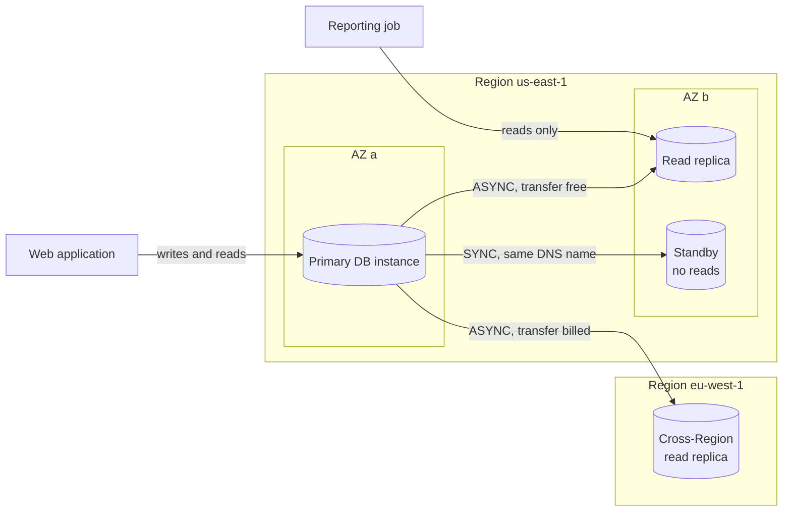
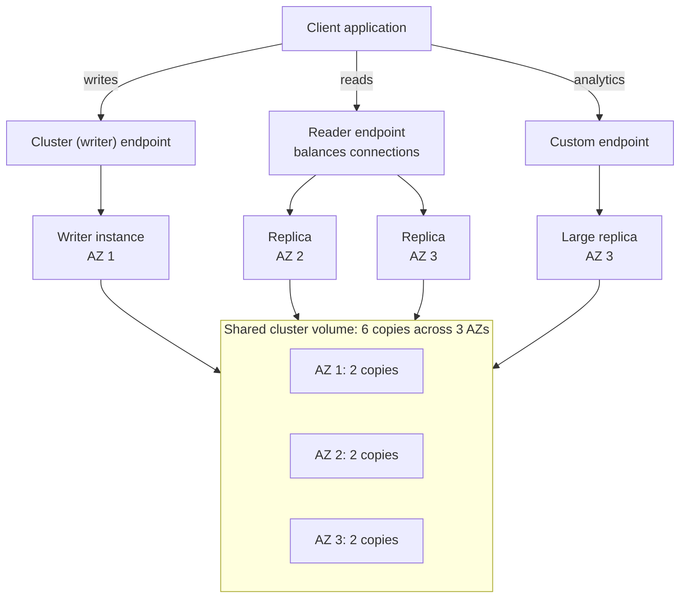
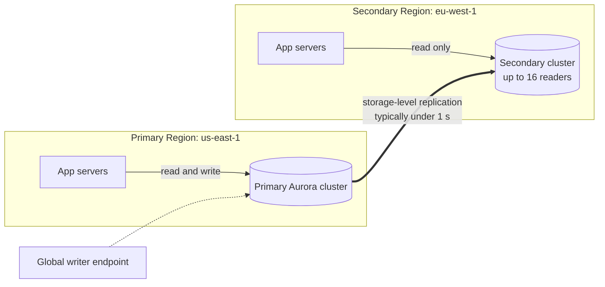
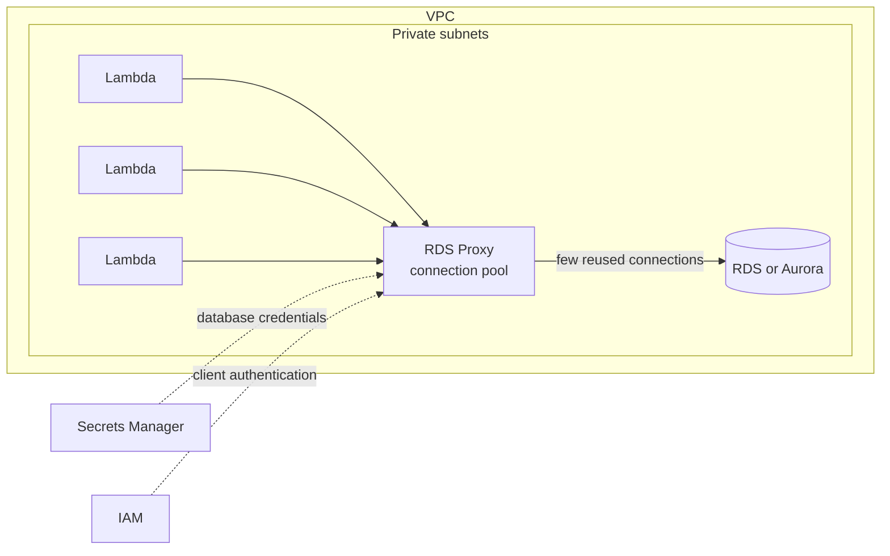
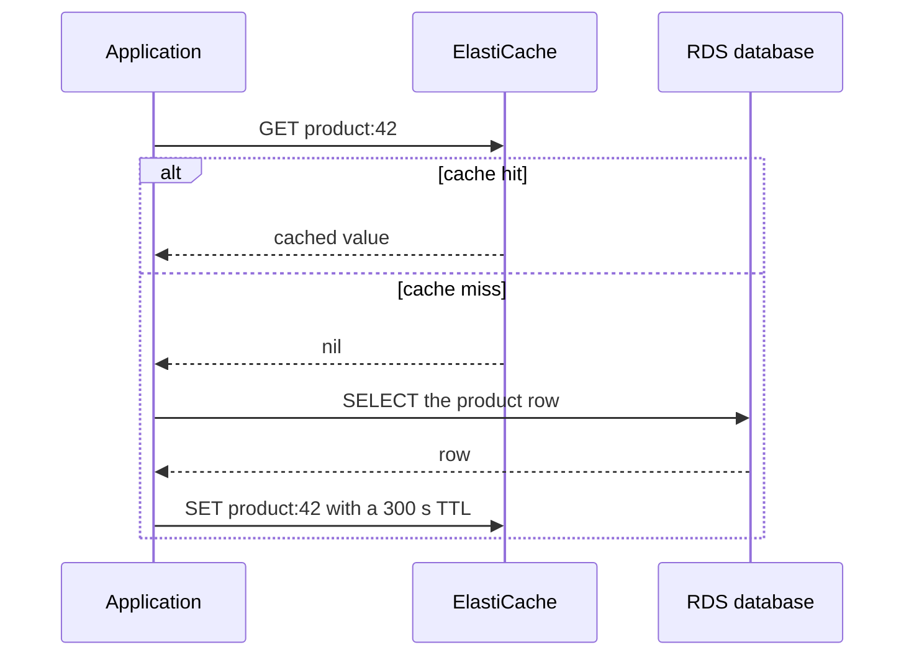
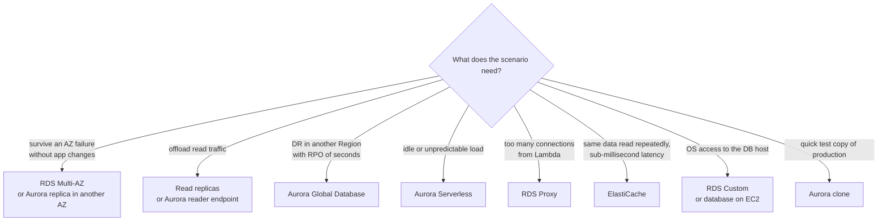

# RDS, Aurora & ElastiCache

## Summary

Amazon RDS runs a relational database engine for you (MySQL, PostgreSQL, MariaDB, Oracle, SQL Server or Db2), so you stop babysitting installs, OS patches, backups and failover and spend your time on schemas and queries. Amazon Aurora is AWS's own cloud-native engine, compatible with MySQL and PostgreSQL, that splits compute from a shared, self-healing storage volume kept in six copies across three Availability Zones; on top of that it adds fast failover, up to 15 low-lag replicas, serverless scaling, cross-Region Global Database, instant clones and backtracking. Amazon ElastiCache puts an in-memory Valkey, Redis OSS or Memcached cache in front of those databases to cut latency and database load, and gives your web tier a shared place to keep session state so the servers themselves stay stateless. On the exam, reach for **Multi-AZ** when the requirement is availability, **read replicas** when it is read scaling, **Aurora Global Database** for cross-Region disaster recovery with a tiny RPO, **RDS Proxy** for connection storms (typically from Lambda), and **ElastiCache** whenever the same data is read again and again.

## Key concepts

- **Amazon RDS** is a managed relational database service: AWS handles the host, OS, engine installation, patching, backups and failover; you cannot SSH to the host (the exception is **RDS Custom**).
- **Storage autoscaling** grows RDS storage when free space falls to 10% or less, up to a **maximum storage threshold** you choose; allocated storage never shrinks.
- **Read replicas** (up to 15 per source) use **asynchronous** replication, so their reads are eventually consistent; in-Region replication traffic is free, cross-Region traffic is billed; any replica can be **promoted** to a standalone database.
- A **Multi-AZ DB instance** deployment keeps one **synchronous** standby in another AZ behind the same DNS name; failover is automatic (typically 60–120 seconds) and the standby serves **no reads**.
- A **Multi-AZ DB cluster** deployment has one writer plus two **readable** standbys in three AZs (semisynchronous), with failover typically under 35 seconds.
- **Aurora storage** keeps **6 copies across 3 AZs**: writes need 4 copies, reads need 3; the volume grows on its own to 128 or 256 TiB depending on engine version.
- An Aurora cluster has one writer and up to **15 Aurora Replicas**; failover to a replica usually completes in under 60 seconds and often under 30.
- **Aurora endpoints**: the **cluster (writer)** endpoint for writes, the **reader** endpoint that spreads connections over replicas, **custom** endpoints for chosen subsets, and a **global writer** endpoint for Global Database.
- **Aurora Serverless** sizes each instance in ACUs (about 2 GiB of memory each) between a minimum (as low as 0, which pauses it) and 256, billed per second.
- **Aurora Global Database**: one read/write primary Region plus up to **10** read-only secondary Regions, typical replication lag under 1 second, up to 16 readers per secondary.
- **Backups**: automated backups allow **point-in-time restore** within a **1–35 day** window (RDS may set 0 to switch them off, Aurora may not); manual snapshots last until you delete them; **every restore creates a new database**.
- **Aurora cloning** uses copy-on-write to give you a full test copy of production in minutes without copying the data first.
- **Encryption at rest** with KMS must be chosen when the database is created; to encrypt an existing unencrypted database, snapshot it, copy the snapshot with encryption on, and restore from the copy.
- **RDS Proxy** pools and reuses database connections, shortens failover by up to 66%, can enforce IAM authentication, and is reachable only from inside the VPC.
- **ElastiCache** is a managed in-memory store; it only helps if the application is changed to use it (lazy loading or write-through, TTLs, invalidation). **Valkey / Redis OSS** adds replication, failover, backups and rich types such as sorted sets; **Memcached** is multi-threaded and sharded but has no replication or persistence.

## Amazon RDS: managed relational databases

RDS stands for Relational Database Service. It gives you a database server whose engine speaks SQL, but you never see or manage the machine underneath. You pick an engine, an instance class (CPU and memory) and storage, and RDS builds the instance inside your VPC and hands you a DNS endpoint to connect to.

| Engine | Typical reason to choose it |
|---|---|
| MySQL | The most widely used open-source engine; huge ecosystem (WordPress, LAMP stacks) |
| PostgreSQL | Feature-rich open source; extensions for geospatial, JSON and vector search |
| MariaDB | Community fork of MySQL |
| Oracle Database | Moving existing Oracle applications; license included or bring your own |
| Microsoft SQL Server | .NET and Windows applications |
| IBM Db2 | Enterprise applications built on Db2 |
| Aurora (MySQL- or PostgreSQL-compatible) | AWS-built engine with distributed storage; covered later in this lesson |

### Why RDS instead of running the database on EC2

You *can* install MySQL on an EC2 instance yourself, and sometimes you must (exotic versions, full root access). But then every operational job is yours. RDS takes most of them away:

| Task | Database on EC2 | Amazon RDS | RDS Custom |
|---|---|---|---|
| Hardware, power, networking | AWS | AWS | AWS |
| OS installation and patching | You | AWS | Mostly you (you choose patches) |
| Database software install and patching | You | AWS | Shared |
| Backups and point-in-time restore | You write the scripts | AWS, automated | AWS, automated |
| High availability and failover | You build it | AWS (Multi-AZ) | AWS |
| Scaling the instance size | You | AWS (modify the instance class) | Shared |
| SSH / OS-level access | Yes | **No** | Yes |
| Schema design, query tuning | You | You | You |

What you get with RDS, in practice:

- Automatic provisioning and OS/engine patching inside a **maintenance window** you choose.
- **Automated backups** with **point-in-time restore**, plus manual snapshots.
- **Monitoring** in the console and CloudWatch (and deeper views with Performance Insights / CloudWatch Database Insights).
- **Read replicas** to scale reads and **Multi-AZ** for availability.
- Vertical scaling (change the instance class) and horizontal read scaling (add replicas).
- Storage on **Amazon EBS** volumes: General Purpose SSD (gp3, gp2) or Provisioned IOPS SSD (io1, io2).

The price of all this convenience: no SSH, no root, and only the engine versions and parameters RDS supports.

> [!UPDATED] Magnetic storage and the Free Tier
> Magnetic RDS storage is deprecated and no longer offered for new instances, and from 1 July 2026 snapshots can no longer be restored to it. The RDS Free Tier covers Single-AZ db.t3.micro instances (MariaDB, MySQL, PostgreSQL or SQL Server Express) and db.t4g.micro instances (the same engines except SQL Server Express). Accounts created after mid-July 2025 use the credit-based Free plan instead of 750 free hours a month, and on that plan Aurora is limited to small Aurora PostgreSQL clusters made with the express configuration.

### Storage autoscaling

Running out of disk is one of the classic ways a database goes down. With **storage autoscaling** turned on, RDS watches free space and grows the volume for you, with no downtime, up to a ceiling called the **maximum storage threshold** (the console suggests 1,000 GiB). It works with every RDS engine and is ideal for workloads whose growth you can't predict, such as a new mobile game that suddenly goes viral.

RDS starts a storage increase when all of these are true:

1. Free space is at or below **10%** of allocated storage.
2. The low-space condition has lasted at least **5 minutes**.
3. The previous storage change has finished optimizing, and there have been **fewer than four** storage changes in the last 24 hours.

Each increase adds the largest of: 10 GiB, 10% of current storage, or the growth RDS predicts for the next 7 hours. Storage only ever grows; to shrink it you must migrate to a new, smaller instance (for example with a blue/green deployment).

> [!UPDATED] Third trigger condition changed
> The course slides say at least 6 hours must pass between automatic increases. Current documentation instead requires the previous change to finish storage optimization and caps autoscaling at four modifications per 24 hours.

> [!TIP]
> Set the maximum storage threshold at least 26% above your current allocation. RDS accepts anything 10% higher, but a smaller gap triggers "approaching maximum" event notifications almost immediately.

## Read replicas and Multi-AZ

These two features are the most-tested RDS topic. They look similar (both make a second copy of your database) but solve different problems.



### Read replicas: scale your reads

A read replica is a read-only copy of a DB instance. RDS takes a snapshot of the source, builds the replica from it, and then streams every change to it **asynchronously** using the engine's own replication.

- **Up to 15 replicas** per source instance (RDS for Oracle allows 15 but AWS recommends staying at 5 or fewer to limit lag).
- A replica can live in the **same AZ**, **another AZ**, or **another Region**.
- Because replication is asynchronous, a replica can be slightly behind: reads are **eventually consistent**. A user who saves a profile and immediately reloads it from a replica may briefly see the old version.
- Each replica has **its own endpoint**. RDS does not load-balance across them, so the application must send read traffic to the replica endpoints (unlike Aurora, which offers a single reader endpoint).
- Replicas accept only reads (`SELECT`). Statements that change data (`INSERT`, `UPDATE`, `DELETE`) must go to the primary. A MySQL or MariaDB replica can be made writable, but that is rarely what you want.
- A replica can be **promoted** to a standalone, writable DB instance. Replication stops for good, which makes promotion a simple disaster recovery or "split off a copy" tool.
- Automated backups must be enabled on the source (retention of 1 day or more).
- RDS does **not** add or remove replicas automatically; Aurora can.
- Replicas are billed as normal DB instances. **Replication traffic inside one Region is free**, even between AZs; **cross-Region replication is charged** for data transfer.
- A replica can itself be **Multi-AZ**, which gives the replica its own standby for DR.

> [!EXAMPLE] Reporting without hurting production
> An online shop's MySQL database handles orders all day. Finance wants heavy reports every morning. Instead of running them on the primary, you create a read replica and point the reporting tool at the replica endpoint. The reports can scan millions of rows without slowing down checkout, because the primary only has to ship its change log to the replica.

### Multi-AZ DB instance: survive an AZ failure

With a **Multi-AZ DB instance** deployment, RDS keeps a **standby** copy in a different AZ and replicates to it **synchronously**: a write is not acknowledged until both copies have it, so no committed data is lost on failover.

- The application uses **one DNS endpoint**. On failover, RDS flips that DNS record to the standby; applications just reconnect, with no code or configuration change.
- Failover is **automatic** when the AZ, the primary host, its network or its storage fails, during some OS patching, when you change the instance class, or when you choose **Reboot with failover**. It typically takes **60–120 seconds**.
- The standby **cannot serve reads**. Multi-AZ is for availability, not for scaling.
- Synchronous replication adds a little write latency, but backups are taken from the standby, so the primary does not freeze I/O during backups (MySQL, MariaDB, Oracle, PostgreSQL).
- A read replica can also be configured as Multi-AZ.

> [!TIP]
> Applications that cache DNS for a long time (some Java runtimes cache forever) keep connecting to the old primary after failover. Keep the DNS TTL in your client at 60 seconds or less, or put RDS Proxy in front.

### Multi-AZ DB cluster: two readable standbys

> [!UPDATED] Multi-AZ DB clusters are not in the slides
> RDS now offers a second Multi-AZ style for MySQL and PostgreSQL: a **Multi-AZ DB cluster** with one writer and two reader instances in three AZs. Replication is **semisynchronous** (a commit needs acknowledgement from at least one reader), the readers serve read traffic through a reader endpoint, write latency is lower than with a Multi-AZ DB instance, and failover typically completes in **under 35 seconds**. It requires specific instance classes with local NVMe storage (for example db.m6gd or db.r6gd). Do not confuse it with an Aurora cluster.

### From Single-AZ to Multi-AZ

You can convert a running Single-AZ instance to Multi-AZ at any time with **Actions → Convert to Multi-AZ deployment** (or by modifying the instance). There is **no downtime**. Behind the scenes RDS:

1. Takes a snapshot of the primary's EBS volumes.
2. Builds the standby's volumes from that snapshot in another AZ (they finish loading in the background).
3. Turns on synchronous replication between primary and standby.

Expect some extra latency while the new volumes warm up, so do it in a quiet period.

### Read replica vs Multi-AZ at a glance

| | Read replica | Multi-AZ DB instance | Multi-AZ DB cluster |
|---|---|---|---|
| Main goal | Scale reads, reporting, DR copy | High availability | High availability plus some read scaling |
| Replication | Asynchronous | Synchronous | Semisynchronous |
| Copy serves reads? | Yes | **No** | Yes (two readers) |
| Where | Same AZ, other AZ or other Region | Another AZ, same Region | Three AZs, same Region |
| Failover | Manual promotion | Automatic, typically 60–120 s | Automatic, typically under 35 s |
| Endpoint | One per replica (app must use it) | One endpoint, unchanged after failover | Writer and reader endpoints |
| How many | Up to 15 per source | 1 standby | 2 readers |

## RDS Custom

Standard RDS hides the operating system. Some packaged or legacy applications need things RDS forbids: installing an OS-level agent, applying a custom database patch, changing file systems, or enabling a native feature that needs high privileges. **RDS Custom** keeps RDS automation (backups, point-in-time restore, monitoring, host replacement) but gives you **administrator access to the OS and the database**, through SSH or **AWS Systems Manager Session Manager**.

- Supported engines: **Oracle Database** and **Microsoft SQL Server** only.
- Before customizing, **pause RDS Custom automation** (the slides call this disabling automation mode) for 60 to 1,440 minutes so RDS does not treat your changes as a failure, and take a DB snapshot first so you can roll back.
- If a change pushes the instance outside the **support perimeter**, RDS marks it `unsupported-configuration` until you fix it.

| Need | Pick |
|---|---|
| Fully managed database and OS | Amazon RDS |
| Managed database, but you need OS and DB admin access (Oracle or SQL Server) | RDS Custom |
| Full control of everything, any engine or version | Self-managed database on EC2 |

> [!UPDATED] RDS Custom for Oracle is being retired
> AWS ends support for RDS Custom for Oracle on **31 March 2027** and recommends migrating to self-managed Oracle on EC2 (for example with RMAN duplication or Data Guard). RDS Custom for SQL Server is not affected.

## Amazon Aurora

Aurora is a relational engine that AWS built for the cloud. It is proprietary (not open source) but **wire-compatible with MySQL and PostgreSQL**, so existing drivers, tools and most application code work unchanged. AWS markets it as several times faster than stock MySQL and PostgreSQL on the same hardware, with storage that grows automatically and replicas that lag only milliseconds behind.

> [!UPDATED] Performance claim
> The slides quote roughly 5x MySQL and 3x PostgreSQL throughput. AWS's current feature page claims **up to 6x** the throughput of stock MySQL and PostgreSQL on similar hardware (SysBench). Treat any number as marketing; the exam point is "Aurora is faster and more available, at a higher price".

Everything you get from RDS is there too: automatic failover, continuous backups, network isolation inside your VPC with KMS encryption, the usual compliance programs, compute you can resize with a few clicks, monitoring in CloudWatch, and maintenance in a window you pick. Minor engine patches can use **zero-downtime patching (ZDP)**, which tries, on a best-effort basis, to keep client sessions connected while the engine restarts. Backtrack, covered below, rewinds a cluster without any restore.

Aurora instances cost more per hour than the same instance class on RDS, but AWS publishes no fixed premium {{updated: the slides quote a flat 20%; actual prices vary by engine, instance class, Region and storage configuration}}. In us-east-1 on-demand prices (October 2026), Aurora Standard instances of current classes cost roughly 12–21% more than RDS for MySQL or PostgreSQL: a db.r6g.large is USD 0.26 per hour on Aurora MySQL against USD 0.215 on RDS for MySQL. Aurora I/O-Optimized instances cost another 30% on top of Aurora Standard. Even so, Aurora usually needs fewer replicas and less over-provisioning, so it can be cheaper overall. Storage is billed per GB actually used, and you choose between **Aurora Standard** (pay per I/O request) and **Aurora I/O-Optimized** (no I/O charges, higher storage and instance price; AWS suggests it once I/O is 25% or more of your Aurora bill).

### Storage: one volume, six copies, three AZs

The key idea: in Aurora, compute and storage are separate. All instances in a cluster read from and write to the same **cluster volume**.

- The volume keeps **6 copies of every piece of data spread over 3 AZs** (two per AZ), whether you run one instance or sixteen.
- Writes use a quorum of **4 of 6** copies, so Aurora keeps writing even if 2 copies are lost; reads need **3 of 6**, so it keeps reading even if 3 copies are lost.
- Storage is **self-healing**: blocks and disks are scanned continuously and bad ones are repaired from peer copies. Data is striped across hundreds of storage nodes.
- The volume **grows automatically** in **10 GB** units: it is made of 10 GB logical blocks called **protection groups**, and Aurora adds blocks as your data grows, up to **256 TiB** on recent versions or **128 TiB** on older ones, and shrinks again when you drop tables.

> [!UPDATED] Maximum volume size depends on version
> 256 TiB applies to Aurora MySQL 3.10 or later and Aurora PostgreSQL 15.13, 16.9, 17.5 or later. Earlier versions stop at 128 TiB.



### Writer, replicas and failover

- One instance is the **writer** (primary). Up to **15 Aurora Replicas** (readers) handle read-only queries and are the failover targets.
- Because replicas read the same volume, there is very little to replicate and **replica lag is usually far below 100 milliseconds**.
- If the writer fails, Aurora **promotes a replica**. Service is typically back in **under 60 seconds and often under 30**. You control the order with **promotion tiers** 0 (highest priority) to 15; ties go to the largest instance.
- With no replicas, Aurora must create a new writer, which typically takes **under 10 minutes**. For production, always run at least one replica in a different AZ.
- **Aurora Auto Scaling** adds or removes replicas (0–15) with a target-tracking policy on the readers' average CPU or average connections. New replicas join the reader endpoint automatically and get promotion tier 15.

> [!UPDATED] Lag and failover numbers
> The slides say replica lag is under 10 ms and failover under 30 seconds. Current documentation says lag is usually much less than 100 ms and failover is typically under 60 seconds, often under 30.

### Endpoints

Aurora gives you stable DNS names so applications never need to know which instance is currently the writer.

| Endpoint | Points to | Use it for |
|---|---|---|
| Cluster (writer) endpoint | Whichever instance is the writer right now | All writes and DDL; survives failover |
| Reader endpoint | All Aurora Replicas, balancing **connections** (not individual queries) | Read-only traffic |
| Custom endpoint (5 per cluster by default, adjustable) | A subset of instances that you choose | For example, analytics on two larger replicas |
| Instance endpoint | One specific instance | Diagnostics and tuning only |
| Global writer endpoint | Writer of the current primary cluster of a Global Database | Writes that keep working after a cross-Region switchover |

Once you define custom endpoints, you usually stop using the generic reader endpoint for those workloads, because it would also send connections to the special instances.

### Aurora Serverless

Aurora Serverless removes instance sizing. Instead of choosing db.r6g.large, you choose a **capacity range** in **Aurora capacity units (ACUs)**; each ACU is roughly 2 GiB of memory with matching CPU and networking. Each serverless instance in the cluster scales within that range, in steps as small as 0.5 ACU, while connections and transactions stay open; readers in promotion tiers 0–1 never shrink below the writer's current size, so they are always ready to take over. Clients connect through the same endpoints as always; you pay per second for the ACUs actually used.

- Good for: development and test databases, infrequent or intermittent use, unpredictable spikes, multi-tenant fleets with one cluster per customer, and new applications whose size is unknown.
- With a **minimum of 0 ACUs**, an idle instance **pauses** after a timeout you set (5 minutes to 1 day) and you pay only for storage. The first connection wakes it in about 15 seconds (longer after a day asleep).
- Serverless and provisioned instances can be mixed in the same cluster, for example a large provisioned writer with serverless readers.
- Less ideal for: steady, predictable 24/7 load (provisioned instances with reservations are cheaper) and applications that cannot tolerate a slow first connection when auto-pause is on.

> [!UPDATED] Aurora Serverless v1 is gone; v2 can scale to zero
> Aurora Serverless v1 reached end of life on 31 March 2025; remaining v1 clusters were migrated. What the slides call Serverless is now simply "Aurora serverless" (formerly Serverless v2, instance class `db.serverless`) with a range of **0 to 256 ACUs**. Scaling to zero (auto-pause) needs Aurora MySQL 3.08+ or Aurora PostgreSQL 13.15/14.12/15.7/16.3+.

### Going global: cross-Region replicas vs Global Database

For disaster recovery in another Region or for low-latency reads near users abroad, Aurora has two options:

- **Cross-Region read replicas** (Aurora MySQL only, using binary log replication, up to 5 per cluster, each in a different Region). Simple to set up and useful for DR, but engine-level replication with more lag.
- **Aurora Global Database** (recommended, MySQL and PostgreSQL). Replication happens at the **storage layer** on dedicated infrastructure, so it barely affects the primary.



Global Database numbers to remember:

- **1 primary Region** (read/write) and **up to 10 secondary Regions** (read-only).
- **Replication lag typically under 1 second**; secondary clusters can have **up to 16** reader instances.
- Applications in each Region read locally, which cuts latency for global users. Optional **write forwarding** lets a secondary pass writes to the primary.
- **Switchover** (planned, for example Regional rotation): Aurora waits for the secondary to catch up, so **RPO is 0**. **Failover** (unplanned outage): promotes a secondary immediately and may lose the last seconds of writes; RPO is typically seconds.
- RTO: AWS markets recovery in **under 1 minute**.
- Not everything carries over: Backtrack can't be used on a global database, and secondary clusters don't support Aurora Auto Scaling.

> [!UPDATED] Global Database details
> The documentation now separates **switchover** (formerly "managed planned failover", no data loss, typically under 30 seconds on recent engine versions) from **failover** (allows data loss), and adds a **global writer endpoint** so applications don't change connection strings after promotion. While the product page still promises recovery in under a minute, the user guide describes RTO for an unplanned failover as "in the order of minutes".

### Aurora Machine Learning

Aurora can call AWS machine learning services **from SQL**, so application developers can add predictions without ML expertise or data pipelines. A query passes rows (for example a customer's profile and purchase history) to a model and gets the prediction back in the result set.

- **Amazon SageMaker AI**: any model you train and host (fraud detection, product recommendations, ad targeting).
- **Amazon Comprehend**: sentiment analysis and other text insights, with very little setup.
- **Amazon Bedrock**: generative AI foundation models. {{updated: Bedrock support is newer than the slides, which list only SageMaker and Comprehend}}

### Babelfish for Aurora PostgreSQL

Babelfish lets an Aurora PostgreSQL cluster understand **Microsoft SQL Server's T-SQL dialect** and its **TDS wire protocol** (a second listener, port 1433 by default). Applications written for SQL Server keep using their SQL Server client drivers and need few or no code changes after you move the data (typically with AWS SCT and AWS DMS). The same database stays reachable through the normal PostgreSQL port. Exam signal: "migrate from SQL Server to an open-source-compatible engine with minimal application changes".

### RDS vs Aurora

| | Amazon RDS (MySQL/PostgreSQL) | Amazon Aurora |
|---|---|---|
| Storage | EBS volumes per instance; autoscaling up to a threshold you set | Shared 6-copy, 3-AZ cluster volume; grows and shrinks automatically |
| Read scaling | Up to 15 read replicas, each with its own endpoint | Up to 15 Aurora Replicas behind one reader endpoint; replica auto scaling |
| Replica lag | Seconds possible (engine replication) | Usually far under 100 ms |
| HA | Multi-AZ instance or Multi-AZ cluster | Any replica in another AZ is a failover target |
| Cross-Region | Cross-Region read replicas | Global Database (up to 10 secondaries) |
| Serverless option | No | Aurora Serverless (0–256 ACUs) |
| Extras | Wider engine choice (Oracle, SQL Server, Db2, MariaDB) | Cloning, backtrack (MySQL), Babelfish, Aurora ML |
| Price | Lower per instance-hour | Higher per instance-hour, often fewer instances needed |

## Backups, restores and cloning

### Automated backups and manual snapshots

| | Amazon RDS (DB instance) | Amazon Aurora |
|---|---|---|
| Automated backups | Daily snapshot in the backup window plus transaction logs uploaded to S3 every 5 minutes | Continuous and incremental, no performance impact |
| Retention | **0–35 days**; 0 turns automated backups off (console default 7, CLI default 1) | **1–35 days**; cannot be turned off (default 1) |
| Point-in-time restore | Any moment in the window, up to the latest restorable time (about 5 minutes ago) | Same |
| Manual snapshots | Taken when you ask; kept until you delete them (100 per Region by default) | Cluster snapshots; same behavior |
| When you delete the DB | Automated backups go too unless you choose to retain them; manual snapshots stay | Similar |

> [!TIP] A stopped database still costs money
> You can stop an RDS instance for at most **7 days**; after that RDS starts it again automatically so it does not miss maintenance. While stopped you still pay for storage, backups and, for a publicly accessible instance, its public IPv4 address. An instance that has a read replica, or is one, can't be stopped at all. For a database you need only now and then, take a snapshot, delete the instance, and restore it when needed.

### Restore options

- Restoring an automated backup or snapshot **always creates a new DB instance or cluster** with a new endpoint. Plan to repoint the application or a DNS name.
- **Restore RDS for MySQL from S3**: back up the on-premises MySQL database with **Percona XtraBackup**, upload the files to an S3 bucket in the same Region, and use **Restore from S3** to create a new RDS for MySQL instance.
- **Restore an Aurora MySQL cluster from S3**: same idea, also with a Percona XtraBackup backup, creating a new Aurora MySQL cluster.

> [!UPDATED] XtraBackup applies to RDS for MySQL too
> The slides mention Percona XtraBackup only for the Aurora import. The RDS for MySQL documentation also requires backups made with Percona XtraBackup; the source cannot be MySQL 5.5/5.6 or an encrypted database.

### Cloning, backtrack and point-in-time restore

| Feature | What happens | Speed | Engines | Typical use |
|---|---|---|---|---|
| Point-in-time restore / snapshot restore | A new database is built from backup data | Minutes to hours, depending on size | RDS and Aurora | Recover from corruption; make a copy at a past moment |
| Aurora cloning | A new cluster initially shares the source's data pages (copy-on-write) | Fast; extra storage only for changed pages | Aurora | Staging or test copy of production |
| Aurora Backtrack | The same cluster is rewound in place, up to 72 hours | Minutes | Aurora MySQL only; must be turned on when the cluster is created or restored from a snapshot | Undo a mistaken `DELETE` quickly |

How cloning works: at first, the clone points to exactly the same storage pages as the source, so nothing is copied. When either side changes a page, Aurora writes a new version of that page for that side only. A clone of a 5 TB production database is ready in minutes and costs almost nothing until the copies diverge, and heavy testing on the clone never touches production. Limits: clones stay in the same Region; up to 15 copy-on-write clones per source, after which new clones are full copies.

## Security for RDS and Aurora

- **Encryption at rest** uses AWS KMS (the AWS managed key or your own customer managed key) and covers the storage, logs, automated backups, snapshots and replicas. You must enable it **when you create** the database, and you can never turn it off.
- **Replicas follow the source**: an unencrypted primary cannot have encrypted replicas, and vice versa. A cross-Region replica uses a KMS key from its own Region.
- **To encrypt an existing unencrypted database**:
  1. Take a snapshot of the unencrypted database.
  2. Copy the snapshot and enable encryption on the copy.
  3. Restore a new database from the encrypted snapshot.
  4. Move the application to the new endpoint and delete the old database.
- **Encryption in transit**: RDS and Aurora support TLS out of the box; clients should use the AWS-provided root certificates to verify the server.
- **Authentication**: the classic master user and password (which RDS can store and rotate in Secrets Manager), **IAM database authentication** for MySQL, MariaDB and PostgreSQL (a signed token valid for 15 minutes replaces the password and requires TLS), or Kerberos through AWS Managed Microsoft AD.
- **Network**: put databases in private subnets, set public access to No, and allow the database port only from the application's **security group**.
- **No SSH** to RDS or Aurora hosts (only RDS Custom allows it).
- **Auditing**: enable audit, error, general or slow query logs and export them to **CloudWatch Logs** for long retention and searching; CloudTrail records the RDS API calls.

## Amazon RDS Proxy

Opening a database connection is expensive (TLS handshake, authentication, memory per connection). Serverless applications make it worse: a burst of 1,000 Lambda invocations can open 1,000 connections and exhaust the database. **RDS Proxy** sits between the application and the database and fixes this.



- **Fully managed, serverless, scales automatically and runs across multiple AZs**.
- **Pools and multiplexes** connections: many client connections share a few database connections, reused after each transaction. Excess requests are queued or throttled instead of crashing the database, which reduces CPU and memory pressure and "too many connections" errors.
- **Faster failover**: the proxy keeps client connections open and sends traffic to the new primary itself, ignoring DNS caches, cutting failover time by **up to 66%**.
- Supports **RDS for MySQL, PostgreSQL, MariaDB and SQL Server**, and **Aurora MySQL and PostgreSQL** (not RDS for Oracle or Db2).
- **Security**: you can require **IAM authentication** for clients, while the proxy logs in to the database with credentials stored in **AWS Secrets Manager**.
- **Never publicly accessible**: the proxy must be in the same VPC as the database, so clients must reach it from inside the VPC (or over private connectivity).
- Most applications only need to change the hostname to the proxy endpoint.

> [!UPDATED] End-to-end IAM authentication
> RDS Proxy can now also use **end-to-end IAM authentication**, where the proxy authenticates to the database with IAM too, so no database credentials need to be kept in Secrets Manager (not available for RDS for SQL Server).

## Amazon ElastiCache

### What a cache is for

ElastiCache is to in-memory key-value stores what RDS is to relational databases: AWS runs the servers, patches the OS and engine, configures and monitors the cache, replaces failed nodes and takes backups. Because data lives in RAM, reads come back in microseconds to a millisecond, far faster than a disk-based database.

Use it to:

- **Take load off a database** for read-heavy workloads (the same product page, user profile or leaderboard read thousands of times).
- **Make applications stateless** by storing user sessions in the cache instead of on each web server.
- Hold short-lived data such as rate-limit counters or shopping carts.

The catch: a cache is not transparent. The application must be **changed** to read from and write to it, and you must decide how stale data is allowed to get.

> [!UPDATED] Engines and deployment options
> The slides list Redis and Memcached. ElastiCache now supports **Valkey** (an open-source fork of Redis that works with existing Redis clients), **Redis OSS** (the new name for "ElastiCache for Redis") and **Memcached**. You can create a **serverless cache** (no nodes to size; billed per GB stored and per ElastiCache Processing Unit) or a **node-based cluster** where you choose node types and counts. Serverless Valkey 9.0+ caches can even have a **public endpoint** that requires IAM authentication and TLS 1.3.

| | Serverless cache | Node-based cluster |
|---|---|---|
| Capacity planning | None; scales memory, compute and network automatically | You pick node type, number of shards and replicas |
| Availability | Highly available across AZs by default | Single-AZ or Multi-AZ, your choice |
| Billing | Data stored (GB-hours) + processing units | Per node-hour |
| Good for | Spiky or unknown load, quick start | Steady load, fine-grained control, reserved nodes |

### Caching patterns



| Pattern | How it works | Pros | Cons |
|---|---|---|---|
| **Lazy loading** (cache-aside) | Read the cache; on a miss read the database and then store the result in the cache | Only data that is actually requested gets cached; a cache failure is not fatal | First read of each item is slow (miss penalty: three round trips); cached data can go **stale** |
| **Write-through** | Every time the app writes to the database, it also writes the new value to the cache | Cached data is never stale | Every write does two writes; the cache fills with data nobody may read; new items are missing until written |
| **TTL (time to live)** | Each key expires after a set time | Bounds staleness and frees memory automatically | Too short means more misses, too long means staler data |
| **Session store** | The app keeps session data in the cache with a TTL | Any web server can serve any user | Session data must fit the cache's memory |

Most real systems combine them: lazy loading plus write-through for data that changes, and a TTL on everything as a safety net. Deciding when cached data is no longer valid (**cache invalidation**) is famously one of the hardest problems in software, so design it deliberately: a well-known programmer joke names it as one of only two truly hard things, next to naming.

> [!EXAMPLE] Keeping users logged in behind a load balancer
> A user logs in and the ALB sends the request to web server A, which writes the session (user ID, cart) to ElastiCache under a session key with a 30-minute TTL. The next request lands on web server B, which reads the same key from the cache and finds the user already logged in. No sticky sessions are needed, and servers can be added or terminated freely.

### Valkey / Redis OSS vs Memcached

| Feature | Valkey or Redis OSS | Memcached |
|---|---|---|
| Replication and high availability | Yes: read replicas, **Multi-AZ with automatic failover** | **No** replication |
| Data partitioning (sharding) | Yes, with cluster mode enabled | Yes, across multiple nodes |
| Persistence and backup/restore | Backups and restore; node-based Valkey 9.0+ clusters (cluster mode enabled) can add a durable Multi-AZ transaction log | Not persistent; backup/restore only for **serverless** Memcached |
| Data types | Strings, hashes, lists, **sets and sorted sets**, bitmaps, HyperLogLog, geospatial indexes | Simple strings/objects |
| Pub/Sub, geospatial | Yes | No |
| Threading | Single-threaded command execution (Valkey adds I/O threads) | **Multi-threaded** |
| Pick it when | You need HA, durability, rich data structures, leaderboards, pub/sub | You need the simplest cache, large multi-core nodes, easy scale out and in, data you can lose |

> [!UPDATED] AOF persistence is no longer the durability story
> The slides credit Redis with durability through AOF (append-only file) persistence. ElastiCache does not support AOF on Valkey or on Redis OSS 2.8.22 and later; AWS recommends Multi-AZ with replicas instead. Node-based Valkey 9.0+ clusters with cluster mode enabled can turn on **durability**, which writes to a Multi-AZ transactional log: synchronous writes for zero data loss at single-digit millisecond write latency, or asynchronous writes that keep microsecond latency but can lose up to about 10 seconds of data in a failure.

### Cache security

- **Network**: caches live in your VPC (unless you chose a public serverless endpoint); allow only the application's security group. Ports: 6379 for Valkey/Redis OSS (serverless also uses 6380 for reads from replicas), 11211 for Memcached (serverless also 11212).
- **Encryption**: in transit with TLS and at rest. Serverless caches always require TLS.
- **IAM policies** control the ElastiCache **API** (who can create, modify or delete caches). They do not let anyone read data, except through IAM authentication below.
- **Valkey / Redis OSS authentication**:
  - **IAM authentication** (Valkey 7.2+, Redis OSS 7.0+): clients present a 15-minute IAM token instead of a password; TLS required.
  - **Role-based access control (RBAC)**: users with passwords and per-user command permissions, grouped into user groups; required for serverless caches.
  - **AUTH token** (legacy, node-based only): a single password/token of 16–128 characters set on the cluster, an extra layer on top of security groups; requires in-transit encryption.
- **Memcached**: ElastiCache gives Memcached no built-in authentication {{updated: the slides mention SASL-based authentication; current ElastiCache documentation does not offer it and says Memcached has no built-in authentication}}. Protect it with the network instead (a dedicated security group that admits only the application's security group) and turn on in-transit encryption, available from Memcached 1.6.12.

### Use case: real-time leaderboards

Game leaderboards need a ranking that updates instantly as millions of scores change, which is expensive in SQL (`ORDER BY` on every request). Valkey and Redis OSS **sorted sets** keep members unique and always ordered by score: each new score is inserted at its correct rank in logarithmic time.

```text
ZADD leaderboard 1500 "alice" 1320 "bob" 1710 "carol"
ZINCRBY leaderboard 250 "bob"
ZREVRANGE leaderboard 0 2 WITHSCORES
ZREVRANK leaderboard "alice"
```

Line by line: add three players with their scores, give bob 250 more points (he now has 1570), list the top three from highest score down, and ask for alice's rank (ranks start at 0, so carol is 0, bob 1 and alice 2).

## Choosing the right option



## Exam tips

> [!EXAM] Availability vs scaling
> "Automatic failover", "survive an AZ outage", "no manual intervention", "same connection string" → **Multi-AZ**. "Read-heavy", "reporting queries slow down production", "analytics on a copy" → **read replicas** (or Aurora Replicas via the reader endpoint).

> [!EXAM] Disaster recovery across Regions
> "RPO of about 1 second", "RTO under a minute", "global users need low-latency reads" → **Aurora Global Database**. "Cheapest cross-Region DR copy for RDS" → **cross-Region read replica** (promote it in a disaster).

> [!EXAM] Connections and Lambda
> "Lambda functions exhaust database connections", "too many connections", "reduce failover time without code changes", "enforce IAM auth to the database" → **RDS Proxy**.

> [!EXAM] Unpredictable or intermittent database load
> "Infrequent, intermittent or unpredictable workload", "no capacity planning", "pay only when used", "dev database idle at night" → **Aurora Serverless** (minimum 0 ACUs to pause).

> [!EXAM] Encryption
> "Encrypt an existing unencrypted RDS database" → **snapshot → copy snapshot with encryption → restore**. You cannot simply modify the instance to enable encryption.

> [!EXAM] Fast copies of production
> "Create a staging/test database from production quickly, without impacting production, at low cost" → **Aurora cloning**. "Undo an accidental delete in minutes without restoring" → **Aurora Backtrack** (Aurora MySQL).

> [!EXAM] Caching signals
> "Reduce read load on the database", "microsecond latency", "frequently accessed data" → **ElastiCache**. "Store user sessions so the app is stateless" → **ElastiCache** (or DynamoDB). "Real-time leaderboard / ranking" → **Valkey or Redis OSS sorted sets**. "Cache must be highly available, replicated and backed up" → **Valkey/Redis OSS, not Memcached**. "Multi-threaded, simple, can lose data" → **Memcached**.

- "SQL Server application to Aurora with minimal code changes" → **Babelfish for Aurora PostgreSQL**.
- "ML predictions from SQL queries" → **Aurora Machine Learning** (SageMaker AI, Comprehend, Bedrock).
- "Install custom software on the database host" (Oracle or SQL Server) → **RDS Custom**.
- "Storage keeps filling up unpredictably" → **RDS storage autoscaling** (set a maximum threshold).
- "Analytics on specific, larger Aurora replicas" → **Aurora custom endpoint**.
- "Migrate an on-premises MySQL backup into AWS" → **Percona XtraBackup files in S3, then restore from S3**.

## Common traps

> [!TRAP] Multi-AZ standby for reads
> The standby of a Multi-AZ DB instance deployment **cannot** serve read traffic. If a question asks to scale reads, Multi-AZ alone is wrong; add read replicas (or use a Multi-AZ DB cluster or Aurora).

> [!TRAP] Read replicas as automatic HA
> RDS read replicas do **not** fail over automatically; promotion is manual and asynchronous replication may lose recent writes. Aurora Replicas, by contrast, are automatic failover targets.

> [!TRAP] Cross-AZ replica costs
> In-Region replication to a read replica in another AZ is **free**; only **cross-Region** replication incurs data transfer charges. Don't pick "keep replicas in the same AZ to save money".

> [!TRAP] Modifying a DB to add encryption
> There is no "enable encryption" switch on an existing instance, and you cannot create an encrypted replica of an unencrypted database. The answer is always the snapshot-copy-restore route.

> [!TRAP] Restoring in place
> Restoring a snapshot or point-in-time backup never overwrites the existing database; it creates a **new** one with a new endpoint. Only Aurora Backtrack rewinds a cluster in place.

> [!TRAP] Stopping instead of deleting
> A stopped RDS instance restarts by itself after 7 days and still bills storage. For long idle periods, snapshot and delete instead.

> [!TRAP] Disabling Aurora backups
> RDS lets you set backup retention to 0; Aurora does not (minimum 1 day). An answer that "turns off Aurora automated backups to save cost" is wrong.

> [!TRAP] RDS Proxy from the internet
> RDS Proxy is never publicly accessible. A client outside the VPC (for example a laptop) cannot use it without VPN or Direct Connect.

> [!TRAP] Memcached for high availability
> Memcached has no replication or failover; losing a node loses its data. Any requirement for HA, persistence, backups or sorted sets points to Valkey or Redis OSS.

> [!TRAP] IAM policies and cache data
> IAM policies on ElastiCache govern API calls (create, delete, modify). Data access is controlled by security groups plus engine authentication (IAM auth, RBAC users or an AUTH token).
