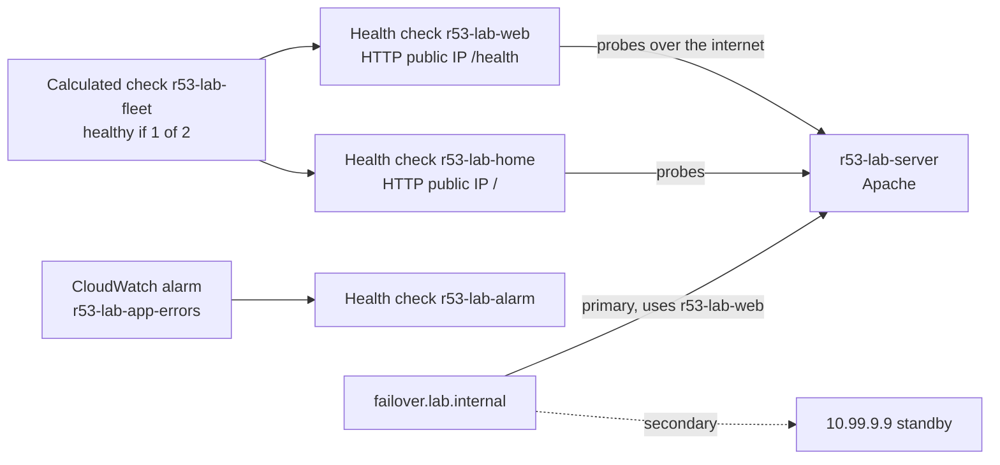

> [!COST]
> The EC2 instance (`t3.micro`, about USD 0.0104 per hour, or `t2.micro` if you followed the legacy Free Tier note in lab 01) and its public IPv4 address (USD 0.005 per hour) keep running from lab 01 unless Free Tier credits or the legacy Free Tier cover them. Route 53 lets you create up to 50 health checks for AWS endpoints in your own account for free; otherwise basic health checks cost USD 0.50 per month each, prorated, and optional features (HTTPS, string matching, fast interval, latency graphs) cost extra, so this lab does not enable any of them. The CloudWatch alarm and custom metric fit within Always Free (10 alarms, 10 custom metrics). Run **Cleanup** at the end: a forgotten instance costs roughly USD 11 per month and forgotten health checks keep billing even when disabled.

This lab continues lab 01: it reuses the instance `r53-lab-server` (Apache with a `/health` page), the security group `r53-lab-sg` and the private hosted zone `lab.internal`.



## Prerequisites

- Lab 01 completed up to Step 8 and **not** cleaned up: instance `r53-lab-server` running, security group `r53-lab-sg`, private hosted zone `lab.internal`.
- Permissions for EC2, Route 53 and CloudWatch (for example `AmazonEC2FullAccess`, `AmazonRoute53FullAccess` and `CloudWatchFullAccess`).
- The same Region as lab 01 (`us-east-1` in the examples).
- For the CLI tabs: a Bash shell with AWS CLI v2 (CloudShell works). If you opened a new shell since lab 01, restore the variables first:

```bash
REGION=us-east-1
INSTANCE_ID=$(aws ec2 describe-instances --region "$REGION" \
  --filters Name=tag:Name,Values=r53-lab-server Name=instance-state-name,Values=running \
  --query 'Reservations[0].Instances[0].InstanceId' --output text)
SG_ID=$(aws ec2 describe-security-groups --region "$REGION" --filters Name=group-name,Values=r53-lab-sg \
  --query 'SecurityGroups[0].GroupId' --output text)
ZONE_ID=$(aws route53 list-hosted-zones-by-name --dns-name lab.internal \
  --query 'HostedZones[0].Id' --output text | cut -d/ -f3)
PRIVATE_IP=$(aws ec2 describe-instances --region "$REGION" --instance-ids "$INSTANCE_ID" \
  --query 'Reservations[0].Instances[0].PrivateIpAddress' --output text)
echo "$INSTANCE_ID $SG_ID $ZONE_ID $PRIVATE_IP"
```

## Steps

### Step 1: Let the Route 53 health checkers reach the web server

Health checkers send requests from AWS's public address ranges, so the security group must allow them. Instead of copying ranges from `ip-ranges.json`, reference the AWS-managed prefix list.

:::console
1. In the **EC2** console open **Security Groups**, select `r53-lab-sg`, open the **Inbound rules** tab and choose **Edit inbound rules**.
2. Choose **Add rule**, set **Type** to **HTTP**, keep **Source** as **Custom**, and in the search box choose `com.amazonaws.us-east-1.route53-healthchecks`.
3. Choose **Save rules**.
:::

:::cli
```bash
HC_PL=$(aws ec2 describe-managed-prefix-lists --region "$REGION" \
  --filters Name=prefix-list-name,Values=com.amazonaws.$REGION.route53-healthchecks \
  --query 'PrefixLists[0].PrefixListId' --output text)
aws ec2 authorize-security-group-ingress --region "$REGION" --group-id "$SG_ID" \
  --ip-permissions "IpProtocol=tcp,FromPort=80,ToPort=80,PrefixListIds=[{PrefixListId=$HC_PL}]"
```
:::

Connect to the instance with **EC2 Instance Connect** (as in lab 01) and confirm the page answers locally:

```bash
curl -s -o /dev/null -w '%{http_code}\n' http://localhost/health
```

> [!CHECK]
> `curl` prints `200`. The security group now has two inbound rules, each with a prefix list (`pl-...`) as its source. The prefix list counts as 25 entries towards the security group's rule quota.

### Step 2: Create an endpoint health check

Health checks must target a **public** address, so use the instance's public IPv4 address (in production you would use an Elastic IP or, better, a load balancer).

:::console
1. In the EC2 console, note the instance's **Public IPv4 address**.
2. Open the **Route 53** console, choose **Health checks** in the navigation pane, then **Create health check**.
3. **Name**: `r53-lab-web`. **What to monitor**: **Endpoint**. **Specify endpoint by**: **IP address**.
4. Choose protocol **HTTP**, enter the public IP address, port `80` and path `/health`.
5. Under the advanced configuration, keep **Request interval** at the standard 30 seconds and **Failure threshold** at `3`. Leave string matching and latency graphs off (they cost extra).
6. Under **Get notified when health check fails**, set **Create alarm** to **No**.
7. Choose **Create health check**.
:::

:::cli
```bash
PUBLIC_IP=$(aws ec2 describe-instances --region "$REGION" --instance-ids "$INSTANCE_ID" \
  --query 'Reservations[0].Instances[0].PublicIpAddress' --output text)

HC_WEB=$(aws route53 create-health-check --caller-reference "r53-lab-web-$(date +%s)" \
  --health-check-config "IPAddress=$PUBLIC_IP,Port=80,Type=HTTP,ResourcePath=/health,RequestInterval=30,FailureThreshold=3" \
  --query 'HealthCheck.Id' --output text)
aws route53 change-tags-for-resource --resource-type healthcheck --resource-id "$HC_WEB" \
  --add-tags Key=Name,Value=r53-lab-web

# Wait a minute or two, then look at what each checker Region reports:
aws route53 get-health-check-status --health-check-id "$HC_WEB" \
  --query 'HealthCheckObservations[].[Region,StatusReport.Status]' --output table
```
:::

> [!CHECK]
> Within about two minutes the **Status** column shows **Healthy**. On the health check's **Health checkers** tab (or in the CLI table) you see results from checkers in several Regions, each reporting an HTTP 200 success. If every checker reports a timeout, recheck the Step 1 security group rule.

### Step 3: Create failover records

`failover.lab.internal` answers with the instance while `r53-lab-web` is healthy, and with a standby address otherwise. Keep the TTL short (30 seconds) so resolvers notice the switch quickly.

:::console
1. Open the `lab.internal` hosted zone and choose **Create record**.
2. **Record name** `failover`, type **A**, **Value** = the instance's **private** IP, **TTL** `30`, **Routing policy** **Failover**, **Failover record type** **Primary**, **Health check** `r53-lab-web`, **Record ID** `primary`.
3. Choose **Add another record**: **Record name** `failover`, type **A**, **Value** `10.99.9.9`, **TTL** `30`, **Failover**, **Failover record type** **Secondary**, no health check, **Record ID** `secondary`.
4. Choose **Create records**.
:::

:::cli
```bash
cat > failover.json <<EOF
{"Changes":[
 {"Action":"CREATE","ResourceRecordSet":{"Name":"failover.lab.internal","Type":"A","SetIdentifier":"primary","Failover":"PRIMARY","TTL":30,"HealthCheckId":"$HC_WEB","ResourceRecords":[{"Value":"$PRIVATE_IP"}]}},
 {"Action":"CREATE","ResourceRecordSet":{"Name":"failover.lab.internal","Type":"A","SetIdentifier":"secondary","Failover":"SECONDARY","TTL":30,"ResourceRecords":[{"Value":"10.99.9.9"}]}}
]}
EOF
aws route53 change-resource-record-sets --hosted-zone-id "$ZONE_ID" --change-batch file://failover.json
```
:::

On the instance: `dig +short failover.lab.internal`

> [!CHECK]
> The answer is the instance's private IP: the primary is healthy. Note that the health check probes the public IP while the record returns the private IP; Route 53 never checks the record value itself, only the health check you attach.

### Step 4: Break the server and watch DNS fail over

On the instance, stop the web server and poll the name every 15 seconds:

```bash
sudo systemctl stop httpd
for i in $(seq 1 16); do echo "$(date +%T) $(dig +short failover.lab.internal)"; sleep 15; done
```

While that runs, refresh **Health checks** in the Route 53 console. When the answer has switched, start Apache again and watch it switch back:

```bash
sudo systemctl start httpd
for i in $(seq 1 16); do echo "$(date +%T) $(dig +short failover.lab.internal)"; sleep 15; done
```

> [!CHECK]
> After roughly one and a half to three minutes (three failed checks at 30-second intervals, plus aggregation and the 30-second TTL), `r53-lab-web` turns **Unhealthy** and the answer changes to `10.99.9.9`. A similar delay after restarting Apache, the health check returns to **Healthy** and the answer goes back to the private IP. This delay is why exam answers that need sub-minute failover use a load balancer or Global Accelerator rather than DNS alone.

### Step 5: Combine checks with a calculated health check

Create a second endpoint check on the home page, then a parent check that stays healthy while at least one child is healthy, the pattern for patching one server without triggering a failover.

:::console
1. **Create health check**: **Name** `r53-lab-home`, **Endpoint**, **IP address**, protocol **HTTP**, the same public IP, port `80`, path `/`. Standard interval, threshold 3, **Create alarm** **No**. Choose **Create health check**.
2. **Create health check** again: **Name** `r53-lab-fleet`, **What to monitor**: **Status of other health checks (calculated health check)**.
3. Under **Health checks to monitor**, add `r53-lab-web` and `r53-lab-home`.
4. Under **Report healthy when**, choose **at least 1 of 2 selected health checks are healthy**. **Create alarm** **No**. Choose **Create health check**.
:::

:::cli
```bash
HC_HOME=$(aws route53 create-health-check --caller-reference "r53-lab-home-$(date +%s)" \
  --health-check-config "IPAddress=$PUBLIC_IP,Port=80,Type=HTTP,ResourcePath=/,RequestInterval=30,FailureThreshold=3" \
  --query 'HealthCheck.Id' --output text)
aws route53 change-tags-for-resource --resource-type healthcheck --resource-id "$HC_HOME" \
  --add-tags Key=Name,Value=r53-lab-home

HC_FLEET=$(aws route53 create-health-check --caller-reference "r53-lab-fleet-$(date +%s)" \
  --health-check-config "{\"Type\":\"CALCULATED\",\"HealthThreshold\":1,\"ChildHealthChecks\":[\"$HC_WEB\",\"$HC_HOME\"]}" \
  --query 'HealthCheck.Id' --output text)
aws route53 change-tags-for-resource --resource-type healthcheck --resource-id "$HC_FLEET" \
  --add-tags Key=Name,Value=r53-lab-fleet
```
:::

On the instance, make only the `/health` page disappear (Apache then answers 404 for it), wait about three minutes, check the console, then put it back:

```bash
sudo mv /var/www/html/health /tmp/health
sleep 180
sudo mv /tmp/health /var/www/html/health
```

> [!CHECK]
> While `/health` is missing, `r53-lab-web` turns **Unhealthy** (404 is not 2xx or 3xx) but `r53-lab-home` stays **Healthy**, so the calculated check `r53-lab-fleet` stays **Healthy**. `failover.lab.internal` also flips to `10.99.9.9` for a while, because its primary uses `r53-lab-web` directly: in a real design you would attach the calculated check to the record instead. Everything returns to **Healthy** a few minutes after the file is restored.

### Step 6: Health-check a CloudWatch alarm (the private-resource pattern)

For resources that health checkers cannot reach, Route 53 can watch a CloudWatch alarm instead. Here a custom metric stands in for an application's error count.

1. Publish a first data point so the metric exists (CloudShell or any configured shell):

```bash
aws cloudwatch put-metric-data --region "$REGION" --namespace R53Lab --metric-name AppErrors --value 0
```

2. Create the alarm.

:::console
1. Open the **CloudWatch** console in the same Region, choose **Alarms** → **All alarms** → **Create alarm** → **Select metric**.
2. Choose the **R53Lab** namespace, then the metric group without dimensions, and select **AppErrors**. On the **Graphed metrics** tab set **Statistic** to **Sum** and **Period** to **1 minute**. Choose **Select metric**.
3. Under **Conditions**, keep **Static**, choose **Greater/Equal**, and enter `1`. Under **Additional configuration**, keep **Datapoints to alarm** at **1 out of 1** (Route 53 does not support M-out-of-N alarms) and set **Missing data treatment** to treat missing data as good (not breaching).
4. Choose **Next**, remove the default notification with **Remove**, choose **Next**, name the alarm `r53-lab-app-errors`, choose **Next**, then **Create alarm**.
:::

:::cli
```bash
aws cloudwatch put-metric-alarm --region "$REGION" --alarm-name r53-lab-app-errors \
  --namespace R53Lab --metric-name AppErrors --statistic Sum --period 60 \
  --evaluation-periods 1 --datapoints-to-alarm 1 --threshold 1 \
  --comparison-operator GreaterThanOrEqualToThreshold --treat-missing-data notBreaching
```
:::

3. Create the health check that watches the alarm.

:::console
1. In **Route 53** → **Health checks** choose **Create health check**. **Name** `r53-lab-alarm`, **What to monitor**: **State of CloudWatch alarm data stream**.
2. Under **CloudWatch alarm**, choose your Region and `r53-lab-app-errors` (use the refresh button if it is not listed yet).
3. Set **Health check status** (used when CloudWatch has insufficient data) to **Healthy**. **Create alarm** **No**. Choose **Create health check**.
:::

:::cli
```bash
HC_ALARM=$(aws route53 create-health-check --caller-reference "r53-lab-alarm-$(date +%s)" \
  --health-check-config "{\"Type\":\"CLOUDWATCH_METRIC\",\"AlarmIdentifier\":{\"Region\":\"$REGION\",\"Name\":\"r53-lab-app-errors\"},\"InsufficientDataHealthStatus\":\"Healthy\"}" \
  --query 'HealthCheck.Id' --output text)
aws route53 change-tags-for-resource --resource-type healthcheck --resource-id "$HC_ALARM" \
  --add-tags Key=Name,Value=r53-lab-alarm
```
:::

4. Simulate application errors for five minutes:

```bash
for i in 1 2 3 4 5; do
  aws cloudwatch put-metric-data --region "$REGION" --namespace R53Lab --metric-name AppErrors --value 5
  sleep 60
done
```

> [!CHECK]
> Within a few minutes the alarm `r53-lab-app-errors` goes to **In alarm** and the health check `r53-lab-alarm` turns **Unhealthy**, without Route 53 ever contacting a server. A few minutes after the loop ends, the alarm returns to **OK** and the health check to **Healthy**. Attached to a failover primary record, this check would move traffic based on a metric from a private subnet.

## Cleanup

Delete in this order. Records go first: Route 53 does not stop you from deleting a health check that a record still uses, but the record's behaviour then becomes unpredictable, so AWS recommends removing the association first. The calculated check goes before its children for the same reason. This removes everything from labs 01 and 02.

- [ ] **All records you created in `lab.internal`** (everything except NS and SOA, including the two `failover` records): select the rows (hold **Ctrl** or **Shift**), choose **Delete** and confirm. CLI (needs `jq`, preinstalled in CloudShell):

  ```bash
  aws route53 list-resource-record-sets --hosted-zone-id "$ZONE_ID" \
    --query "ResourceRecordSets[?Type!='NS' && Type!='SOA']" --output json > rrsets.json
  jq '{Changes: [sort_by(.AliasTarget == null)[] | {Action: "DELETE", ResourceRecordSet: .}]}' \
    rrsets.json > delete.json
  aws route53 change-resource-record-sets --hosted-zone-id "$ZONE_ID" --change-batch file://delete.json
  ```
- [ ] **Calculated health check `r53-lab-fleet`**: **Health checks** → choose its linked ID → **Delete**, enter `confirm` and choose **Delete**. CLI: `aws route53 delete-health-check --health-check-id "$HC_FLEET"`
- [ ] **Health checks `r53-lab-web`, `r53-lab-home` and `r53-lab-alarm`**: delete each the same way. CLI: `for h in "$HC_WEB" "$HC_HOME" "$HC_ALARM"; do aws route53 delete-health-check --health-check-id "$h"; done`
- [ ] **CloudWatch alarm `r53-lab-app-errors`**: **CloudWatch** → **Alarms** → select → **Actions** → **Delete**. CLI: `aws cloudwatch delete-alarms --region "$REGION" --alarm-names r53-lab-app-errors`
- [ ] **Custom metric `R53Lab/AppErrors`**: metrics cannot be deleted; it stops costing anything once you stop publishing and drops out of the console after about two weeks without data. Nothing to do.
- [ ] **Hosted zone `lab.internal`**: **Hosted zones** → choose its row → **Delete**, type the confirmation key, **Delete**. CLI: `aws route53 delete-hosted-zone --id "$ZONE_ID"`
- [ ] **EC2 instance `r53-lab-server`**: **Instances** → select → **Instance state** → **Terminate (delete) instance**. CLI: `aws ec2 terminate-instances --region "$REGION" --instance-ids "$INSTANCE_ID"` then `aws ec2 wait instance-terminated --region "$REGION" --instance-ids "$INSTANCE_ID"`
- [ ] **Security group `r53-lab-sg`** (after the instance is gone): **Security Groups** → select → **Actions** → **Delete security groups**. CLI: `aws ec2 delete-security-group --region "$REGION" --group-id "$SG_ID"`
- [ ] **Local files**: `rm -f *.json user-data.sh` in your shell.
- [ ] **Final check**: Route 53 shows no health checks and no `lab.internal` zone, CloudWatch shows no `r53-lab-app-errors` alarm, EC2 shows no running instances in the Region, and **Billing and Cost Management** → **Bills** shows only the expected few cents a day later.

## Progress checklist

- [ ] Step 1: Security group allows HTTP from the Route 53 health checker prefix list
- [ ] Step 2: Endpoint health check `r53-lab-web` is Healthy from several checker Regions
- [ ] Step 3: Primary and secondary failover records answer with the instance
- [ ] Step 4: Stopping Apache failed DNS over to the secondary, restarting failed it back
- [ ] Step 5: Calculated health check stayed Healthy while one child failed
- [ ] Step 6: Alarm-based health check turned Unhealthy from a CloudWatch metric alone
- [ ] Cleanup done for labs 01 and 02
