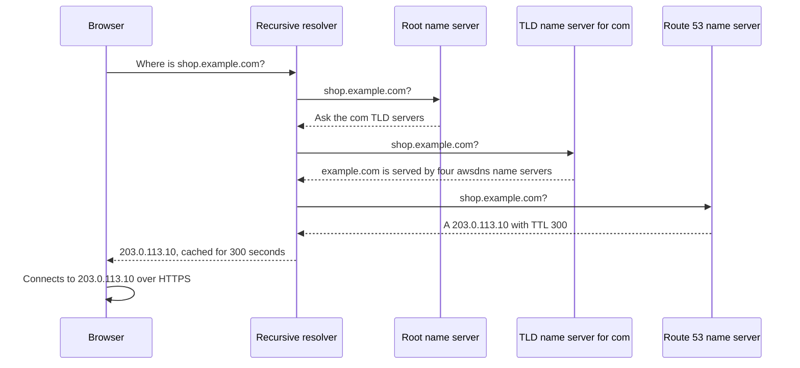
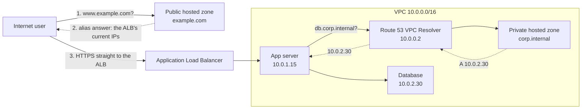
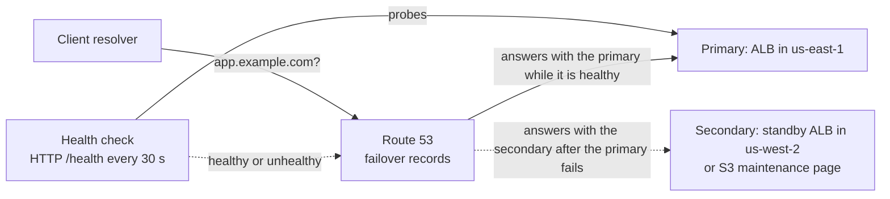
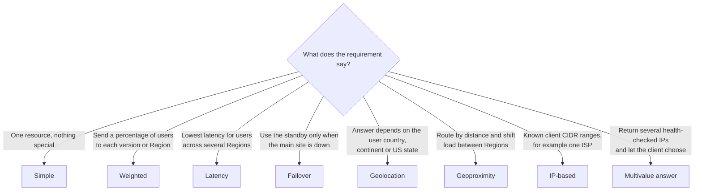
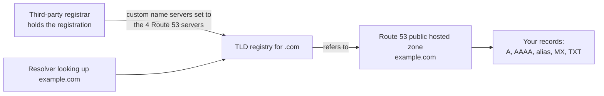
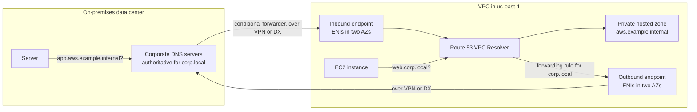

# Route 53

## Summary

Amazon Route 53 is AWS's managed DNS service. It answers DNS questions for the domains you host in it (public names on the internet and private names inside your VPCs), it can sell and renew domain names as a registrar, and it can watch the health of your endpoints so that its answers steer users away from anything that is down. On top of plain DNS it adds **alias records** (free, apex-friendly pointers to AWS resources) and eight **routing policies** that decide which answer each user gets: by weight, latency, location, client IP, health or a mix. Pick Route 53 whenever a question involves a domain name, DNS failover between Regions, sending users to the closest or fastest Region, gradually shifting traffic to a new version, or resolving names between a VPC and an on-premises network (the job of **Route 53 VPC Resolver** and its inbound and outbound endpoints).

## Key concepts

- **DNS** turns names such as `shop.example.com` into IP addresses; resolvers **cache** each answer for the record's **TTL**.
- Route 53 is an **authoritative** DNS service (you own and edit the records), a **domain registrar**, and a **health-checking** service in one.
- A **hosted zone** holds the records for one domain: **public** zones answer the internet, **private** zones answer only inside associated VPCs.
- Each hosted zone costs **USD 0.50 per month** (first 25 zones); a zone deleted within 12 hours is not charged.
- Must-know record types: **A** (IPv4), **AAAA** (IPv6), **CNAME** (name to name) and **NS** (which name servers serve the zone).
- A **CNAME cannot sit at the zone apex** (`example.com`); an **alias** record can, and alias queries to AWS resources are **free**.
- Alias targets include ELB load balancers, CloudFront, API Gateway, Elastic Beanstalk, S3 website endpoints, VPC interface endpoints, Global Accelerator and records in the same zone, but **never an EC2 instance's DNS name**.
- **Routing policies** decide which answer to give: simple, weighted, latency, failover, geolocation, geoproximity, IP-based and multivalue answer.
- **Health checks** come in three kinds: endpoint, **calculated** (combines other checks) and **CloudWatch alarm** (the way to watch private resources).
- An endpoint is healthy when **more than 18%** of Route 53 health checkers see it as healthy; HTTP checks need a **2xx or 3xx** response.
- **Failover** routing is active-passive; every other policy with health checks gives active-active failover.
- **Registrar and DNS service are separate jobs**: buy the name anywhere, then point its NS records at a Route 53 hosted zone.
- **Route 53 VPC Resolver** (formerly Route 53 Resolver) answers DNS inside every VPC; **inbound endpoints** let on-premises DNS query AWS, **outbound endpoints** plus forwarding rules let AWS query on-premises DNS.

## DNS in a nutshell

Computers connect to IP addresses; people remember names. The **Domain Name System** is the global, distributed phone book that bridges the two. When you type `shop.example.com`, something has to find out that it currently lives at, say, `203.0.113.10`. DNS is hierarchical: nobody stores the whole internet's records in one place, and each level only knows who to ask next.

### Anatomy of a domain name

Take the URL `https://api.shop.example.com.` and read it right to left:

| Part | Example | What it means | Who runs it |
|---|---|---|---|
| Root | the final `.` (usually invisible) | Top of the tree | Root server operators, coordinated by IANA (part of ICANN) |
| Top-level domain (TLD) | `.com`, `.org`, `.gov`, `.uk`, `.in` | Generic or country-code namespace | A registry per TLD, under ICANN policy |
| Second-level domain (SLD) | `example.com` | The name you register and pay for each year | You, through a registrar such as Route 53 or GoDaddy |
| Subdomain | `shop.example.com`, `api.shop.example.com` | Any label you add under your domain | You, by creating records |
| Fully qualified domain name (FQDN) | `api.shop.example.com.` | The complete name, ending at the root | |
| URL | `https://api.shop.example.com/cart` | Protocol + FQDN + path; DNS only cares about the FQDN | |

### DNS vocabulary

| Term | Meaning |
|---|---|
| **Domain registrar** | The company you rent a domain name from, yearly (Amazon Registrar, GoDaddy, Gandi...). |
| **DNS record** | One entry in a zone: a name, a type (A, AAAA, CNAME, MX...), a value and a TTL. |
| **Zone file / hosted zone** | All the records for one domain. Route 53 calls it a hosted zone. |
| **Name server** | A server that answers DNS queries. **Authoritative** name servers hold the real records for a zone; **recursive** (non-authoritative) resolvers look answers up on behalf of clients and cache them. |
| **TTL (time to live)** | How many seconds a resolver may cache an answer before asking again. |

### How a lookup travels

Your laptop asks a **recursive resolver** (run by your ISP, your company, a public service, or, inside a VPC, Route 53 VPC Resolver). On a cold cache the resolver walks down the tree. Each answer is cached for its TTL, so the next user of the same resolver gets an instant reply.

> [!EXAMPLE] Why TTL matters during an outage
> Your record for `shop.example.com` has a TTL of 86,400 seconds (one day). At 09:00 you change it to point at a standby server. A resolver that cached the old answer at 08:59 keeps handing out the old IP until 08:59 the next day. With a TTL of 60 seconds, almost every user would follow the change within a minute.

## Amazon Route 53 at a glance

Route 53 is a **global** service (you do not pick a Region for hosted zones) that plays several roles:

- **Authoritative DNS**: you create and change the records; Route 53's name servers answer for them worldwide.
- **Domain registrar**: register new names, transfer existing ones in, renew automatically. A hosted zone is created for you when you register a domain.
- **Health checks and DNS failover**: monitor endpoints and leave unhealthy ones out of answers.
- **Smart routing**: weighted, latency, geolocation, geoproximity, IP-based, failover and multivalue answers, plus the **Traffic Flow** visual editor for complex trees of policies.
- **VPC Resolver**: the recursive resolver built into every VPC, with endpoints for hybrid DNS.

The name is a nod to **port 53**, the standard DNS port (UDP and TCP).

> [!NOTE] The 100% availability SLA
> Route 53 is famous for a 100% availability commitment: in commercial Regions, AWS gives service credits for any month in which a hosted zone's uptime falls below 100% (a hosted zone counts as unavailable in a minute when all four of its name servers fail to answer). In AWS GovCloud (US) the top tier is 99.995%. The exam phrase "the only AWS service with a 100% SLA" still points to Route 53.

> [!UPDATED] Control-plane recovery outside us-east-1
> Since November 2025, public hosted zones can use **accelerated recovery**, an opt-in setting you turn on per zone: if AWS services in US East (N. Virginia) are impaired, you can still change DNS records, with a target recovery time of 60 minutes and no extra charge. DNS *answers* were never tied to one Region; this protects your ability to *edit* records.

## Records

A record (Route 53 also says *resource record set*) tells Route 53 how to answer for one name. Every record has:

- **Record name**: the domain or subdomain, such as `example.com` or `api.example.com`. It must end with the zone's name.
- **Record type**: A, AAAA, CNAME, MX and so on.
- **Value**: an IP address, another name, a mail server... depending on the type.
- **Routing policy**: how Route 53 chooses an answer when several records share a name and type.
- **TTL**: how long resolvers cache the answer (not set on alias records).

### Record types

| Type | Maps a name to... | Example value | Exam weight |
|---|---|---|---|
| **A** | An IPv4 address | `203.0.113.10` | Must know |
| **AAAA** | An IPv6 address | `2001:db8::10` | Must know |
| **CNAME** | Another hostname, which must itself resolve to A/AAAA records | `shop.example.net` | Must know |
| **NS** | The name servers that are authoritative for the zone or a delegated subdomain | `ns-1234.awsdns-12.org` | Must know |
| **MX** | Mail servers, with a priority | `10 mail.example.com` | Good to know |
| **TXT** | Free text, often for domain verification and SPF email policy | `"v=spf1 include:amazonses.com -all"` | Good to know |
| **CAA** | Which certificate authorities may issue certificates for the domain | `0 issue "amazon.com"` | Good to know |
| SOA, PTR, SRV, NAPTR, DS, SPF | Zone metadata, reverse lookups, service location, DNSSEC delegation, legacy SPF | | Rarely tested |

> [!UPDATED] Four newer record types
> Since the slides were made, Route 53 has added **HTTPS** and **SVCB** (service binding: tell clients about HTTP/2, HTTP/3 and alternative endpoints in one lookup), **TLSA** (DANE certificate pinning) and **SSHFP** (SSH host key fingerprints). TLSA and SSHFP are only trustworthy with DNSSEC. They are unlikely to be exam answers but you will see them in the console's type list.

Two CNAME rules cost exam points:

1. **No CNAME at the zone apex.** The apex is the zone's own name (`example.com` in the `example.com` zone). The DNS standard forbids a CNAME there because the apex must also hold the NS and SOA records. You can create `www.example.com CNAME ...` but not `example.com CNAME ...`.
2. **A CNAME must be alone.** If `www.example.com` is a CNAME, no other record of any type can use the name `www.example.com`.

### TTL: caching versus agility

| | High TTL, e.g. 86,400 s (24 h) | Low TTL, e.g. 60 s |
|---|---|---|
| Queries reaching Route 53 | Few, so a smaller bill | Many, so a bigger bill (you pay per query) |
| Speed for users | Mostly served from resolver caches | More lookups go all the way to Route 53 |
| When you change a record | Old answers can linger for up to a day | Changes reach users within about a minute |
| Good for | Stable records that rarely change (MX, NS) | Records behind health checks, migrations, blue/green cutovers |

AWS recommends a TTL of **60 seconds or less** for records that use health checks, so clients notice failovers quickly. A common migration trick: lower the TTL a day or two *before* a change, make the change, then raise the TTL again. Every record needs a TTL **except alias records**, which use the TTL of their target (for example 60 seconds for an ELB load balancer). Route 53 itself applies record changes to all its name servers usually within 60 seconds; the TTL is about how long *other* resolvers keep old answers.

## Hosted zones

A hosted zone is the container of records for one domain and its subdomains. When you create one, Route 53 adds an **NS** record (four name servers, each on a different TLD such as `.com`, `.net`, `.org` and `.co.uk`) and an **SOA** record. Leave those two alone.

| | Public hosted zone | Private hosted zone |
|---|---|---|
| Answers queries from | Anyone on the internet | Only resources in the VPCs you associate (or on-premises clients via a Resolver inbound endpoint) |
| Typical names | `example.com`, `api.example.com` | `corp.internal`, `db.example.internal`, or even `example.com` (split view) |
| Requirements | A domain you are allowed to administer; delegate to its name servers | VPC attributes `enableDnsHostnames` and `enableDnsSupport` set to `true` |
| Routing policies | All eight | All except IP-based |
| Health checks | Endpoint checks work directly | Health checkers live on the internet and cannot reach private IPs, so use CloudWatch alarm health checks |
| Price | USD 0.50 per zone per month (first 25), USD 0.10 after that | Same |

A few facts about private hosted zones that show up in scenarios:

- One private zone can be associated with **many VPCs**, including VPCs in other accounts (authorize in the zone's account, then associate from the VPC's account through the CLI or API). For very large estates, **Route 53 Profiles** bundle private zones, Resolver rules and DNS Firewall rule groups and share them through AWS RAM.
- **Split-view (split-horizon) DNS**: create a public and a private zone with the same name. Inside the VPC the private zone wins, so `intranet.example.com` can resolve to a private IP internally while the public zone serves the website to everyone else. If the private zone has no matching record, the VPC gets NXDOMAIN; it does not fall back to the public zone.
- If you run your own DNS servers on EC2, forward private names to the VPC's **+2 address** (for `10.0.0.0/16` that is `10.0.0.2`).

> [!TIP] What else you pay for
> Standard queries cost USD 0.40 per million (first billion per month); latency-based USD 0.60, geolocation and geoproximity USD 0.70, and IP-based USD 0.80 per million. Queries to alias records that point at AWS resources are free. The default quota is 500 hosted zones per account and 10,000 records per zone, both raisable.

## CNAME versus alias records

AWS resources such as load balancers and CloudFront distributions give you an AWS-owned hostname, like `demo-alb-1234.us-east-2.elb.amazonaws.com`, whose IP addresses change over time. You want users to type `myapp.example.com` instead. Both a CNAME and an alias can do that, but they behave differently.

| | CNAME | Alias (Route 53 extension) |
|---|---|---|
| Points to | Any hostname, anywhere (`app.example.com` to `app.other-provider.net`) | Selected AWS resources, or another record in the same hosted zone |
| Zone apex (`example.com`) | Not allowed | Allowed |
| What clients see | A CNAME, then a second lookup | An ordinary A or AAAA answer with the target's current IPs |
| TTL | You set it | You cannot set it; Route 53 uses the target's TTL |
| Query charge | Charged (and counted twice if the target is also in Route 53) | Free for AWS resource targets |
| Health awareness | None | **Evaluate target health** can drop an unhealthy target (useful for ELB) |
| Tracks IP changes | Through the second lookup | Automatically |

Alias record targets you should recognise:

- Elastic Load Balancing load balancers (ALB, NLB, CLB)
- CloudFront distributions
- API Gateway custom domain names (Regional and edge-optimized)
- Elastic Beanstalk environments
- S3 buckets configured as **static website** endpoints (the bucket name must equal the record name)
- VPC interface endpoints
- Global Accelerator accelerators
- Another record of the same type in the same hosted zone

**You cannot create an alias to an EC2 instance's public DNS name.** For a single EC2 instance, use an A record with an Elastic IP, or better, put the instance behind a load balancer and alias to that.

> [!UPDATED] More alias targets
> The current Route 53 documentation also lists **App Runner services**, **OpenSearch Service custom domains** and **AppSync custom domain names** as alias targets, in addition to the eight on the slides.

> [!EXAMPLE] Pointing a naked domain at a load balancer
> A startup owns `example.com` and runs its site behind an ALB. Users type both `example.com` and `www.example.com`. Create an **alias A record** for `example.com` targeting the ALB (a CNAME is impossible at the apex), and either another alias for `www` or a CNAME `www.example.com` to `example.com`. Queries to the alias are free, and if the ALB's IPs change, answers follow automatically.

## Routing policies

"Routing" here is a slightly misleading word. Route 53 never sits in the data path; it only decides **which answer to return** to a DNS query. After that, the client connects directly to the IP it was given. A load balancer, by contrast, receives every request.

| Policy | How Route 53 picks the answer | Health checks | Private zones | Typical use |
|---|---|---|---|---|
| **Simple** | Returns the single record; if it holds several values, returns all of them in random order | No | Yes | One web server, one load balancer |
| **Weighted** | Each record gets a share proportional to its weight | Yes | Yes | Canary releases, blue/green, splitting across Regions |
| **Latency** | Record in the AWS Region with the lowest measured latency to the user | Yes | Yes | Global apps where speed matters most |
| **Failover** | Primary while healthy, secondary otherwise | Yes (essential on the primary) | Yes | Active-passive disaster recovery |
| **Geolocation** | Record matching the user's continent, country or US state | Yes | Yes | Localised content, legal or licensing restrictions |
| **Geoproximity** | Nearest resource by distance, adjustable with a bias | Yes | Yes | Shift traffic between Regions by geography |
| **IP-based** | Record mapped to the CIDR block the query comes from | Yes | **No** | Route specific ISPs or networks to chosen endpoints |
| **Multivalue answer** | Up to 8 healthy records, chosen at random | Yes | Yes | Simple client-side load sharing with health checks |

For every policy except simple, you create **several records with the same name and type**, each with a unique **Record ID** (the API calls it `SetIdentifier`).

### Simple

The default. One record, usually one value. You *can* put several IP addresses in one simple record; Route 53 then returns them all and the client picks one, but none of them are health-checked. With an alias simple record you can name only one AWS resource. Simple records cannot use health checks.

### Weighted

Give each record a weight from **0 to 255**. Each record's share of answers is its weight divided by the sum of all weights in the group, so weights do not need to add up to 100.

> [!EXAMPLE] A 70/20/10 split
> Three records for `api.example.com` have weights 70, 20 and 10 (sum 100), so they receive about 70%, 20% and 10% of DNS answers. With weights 7, 2 and 1 the split is identical. To send a new version 1/256 of traffic, use weights 1 and 255.

- Set a record's weight to **0** to stop sending it traffic. If **all** weights are 0, Route 53 answers with all records equally.
- With health checks, Route 53 first considers healthy non-zero records; zero-weight records are used only when every non-zero record is unhealthy (a cheap active-passive trick).
- Typical uses: testing a new application version on a small slice of users, or balancing between Regions in fixed proportions.

### Latency-based

You tag each record with the **AWS Region** of its resource, and Route 53 answers with the Region that has the lowest latency to the user. The measurements are AWS's own data on latency between user networks and AWS Regions, collected over time, so the winner can change from week to week. A user in Germany might be sent to `us-east-1` instead of a nearer-looking Region if that is what the data shows. Combine with health checks and Route 53 picks the next-lowest-latency healthy Region when the best one fails. In a private hosted zone, the "user" is the Region of the VPC the query comes from.

### Failover (active-passive)

Create exactly one **Primary** and one **Secondary** record with the same name. Route 53 answers with the primary while its health check is healthy and switches to the secondary when it is not. Treat the primary's health check as mandatory (or, for an alias primary, **Evaluate target health**): without one, Route 53 considers the primary always healthy and never fails over. The secondary may have a health check too. A classic pattern: primary = ALB in your main Region, secondary = an S3 static website with a "we'll be right back" page, or a warm standby stack in another Region.

### Geolocation

Answers depend on **where the user is**, not on network speed. You define records for a **continent**, a **country** or a **US state**; when locations overlap, the most specific one wins (a record for Canada beats a record for North America for a user in Toronto). Always add a **Default** location record: some IP addresses cannot be mapped to a place, and without a default those users get no answer at all.

Use it for website localisation (French users get the French site), content restricted by distribution rights, or predictable load splitting where each country always lands on the same endpoint. Health checks work here too.

### Geoproximity

Route 53 sends users to the **geographically nearest** resource, and you can stretch or shrink each resource's catchment area with a **bias**:

- Bias **+1 to +99** expands the area (more traffic to that resource).
- Bias **-1 to -99** shrinks it (less traffic).
- Route 53 compares a *biased distance*: actual distance multiplied by (1 − bias/100). With bias +50, a server 150 km away is treated as 75 km away and can beat one that is really 100 km away.

Each record's location is an **AWS Region** (or Local Zone group) for AWS resources, or a **latitude and longitude** for anything else, such as your own data center.

> [!EXAMPLE] Moving the dividing line
> Resources in `us-west-1` and `us-east-1` both have bias 0, so users split roughly along the halfway point across the United States. Raise `us-east-1` to bias +50 and its area grows westward: users in the middle of the country now get the East Coast endpoint.

> [!UPDATED] Geoproximity no longer requires Traffic Flow
> The slides say you must use Route 53 Traffic Flow for geoproximity. Since January 2024 it is a normal routing policy you can pick when creating a record in the console, CLI or API, in public and private hosted zones. Traffic Flow still offers the interactive map for visualising bias.

### IP-based

You know your clients' networks better than any geo database: perhaps a big ISP's subscribers should go to the endpoint that peers directly with it. Upload **CIDR blocks** grouped into named **locations** inside a **CIDR collection**, then create IP-based records that point each location at an endpoint.

| CIDR collection `customers` | | Record for `example.com` |
|---|---|---|
| Location `isp-alpha` | `203.0.113.0/24` | answers `198.51.100.10` |
| Location `isp-beta` | `192.0.2.0/24` | answers `198.51.100.20` |
| Default location `*` | everything else | answers `198.51.100.30` |

A user at `203.0.113.56` gets `198.51.100.10`. Use cases: optimising performance or network transit costs per ISP, or overriding geolocation where you know better. IPv4 blocks can be /1 to /24 and IPv6 blocks /1 to /48. IP-based routing is not available in private hosted zones.

### Multivalue answer

Create one record per resource (each optionally with a health check). Route 53 returns **up to eight healthy** values per query, randomly chosen, and different resolvers get different mixes. If a server dies after a client cached the list, the client can simply try another IP. Records without a health check always count as healthy; if every record is unhealthy, Route 53 returns up to eight of them anyway.

The difference from a simple record with several values is the health checks. The difference from a load balancer is everything else: no connection-level balancing, no TLS termination, no sticky sessions. **Multivalue is not a substitute for an ELB.**

### Choosing a policy

> [!NOTE] Traffic Flow
> For complex setups (say, geolocation first, then latency within each continent, then failover to a backup) you can nest records using alias records, or build the tree in **Traffic Flow**, a visual editor that saves versioned **traffic policies**. Each policy record you attach to a domain name costs USD 50 per month, so it is meant for large deployments.

## Health checks

Health checks give Route 53 a reason to change its answers. They are what make automated DNS failover work, and they publish their status to CloudWatch so you can alarm on them.

| Type | What it watches | Typical use |
|---|---|---|
| **Endpoint** | An IP address or domain name, over HTTP, HTTPS or TCP | Public web servers, load balancers, on-premises servers reachable from the internet |
| **Calculated** | The status of other health checks, combined with AND, OR or "at least N of M" (NOT by inverting a child) | One status for a fleet; maintenance without false alarms |
| **CloudWatch alarm** | The data stream behind a CloudWatch alarm | Private resources, or anything measurable: DynamoDB throttles, RDS metrics, custom app metrics |

### Endpoint health checks: the numbers

| Setting | Value |
|---|---|
| Who checks | Health checkers in eight AWS Regions by default (you can pick your own list, minimum three). AWS publishes no checker count, but at the 30 s interval an endpoint gets a check about every 2 s on average, which works out to roughly 15 checkers, as the slides say |
| Interval | **30 s** (standard) or **10 s** (fast, extra cost); cannot be changed later |
| Failure threshold | **3** consecutive results by default (1 to 10) to flip between healthy and unhealthy |
| Healthy when | **More than 18%** of health checkers report healthy |
| HTTP/HTTPS pass criteria | TCP connection within 4 s, then a **2xx or 3xx** status within 2 s |
| TCP pass criteria | Connection established within 10 s |
| String matching | The text must appear in the **first 5,120 bytes** of the response body (search string up to 255 characters) |
| Endpoint addresses | Public only: private, local and non-routable IPs are rejected |
| HTTPS checks | Do not validate the certificate (an expired certificate still passes) |

Because the checkers come from the internet, your security groups, NACLs and firewalls must let them in.

> [!UPDATED] A managed prefix list for health checkers
> The slides tell you to allow the Route 53 health checker ranges from `ip-ranges.json`. That still works, but now you can reference the AWS-managed prefix list `com.amazonaws.<region>.route53-healthchecks` (and an `ipv6` variant) in a security group rule; AWS keeps it up to date. It counts as 25 entries against the security group's rule quota.

### Calculated health checks

A parent health check combines up to 255 or 256 child checks (AWS pages disagree on the exact limit, see the note below). You choose: healthy when **all** children are healthy (AND), when **one or more** are (OR), or when **at least N** are. There is no separate NOT operator: to get NOT, turn on **Invert health check status** for a child, which flips that child's result before the parent counts it. A calculated check cannot monitor other calculated checks.

> [!VERIFY] 255 or 256 child health checks
> Checked on 2026-10-04, AWS's own pages still give two numbers. The [HealthCheckConfig API reference](https://docs.aws.amazon.com/Route53/latest/APIReference/API_HealthCheckConfig.html) caps `ChildHealthChecks` at 256 entries (and `HealthThreshold` at 256), and the [console guide for calculated checks](https://docs.aws.amazon.com/Route53/latest/DeveloperGuide/health-checks-creating-values.html) says you can add up to 256. The [Route 53 quotas page](https://docs.aws.amazon.com/Route53/latest/DeveloperGuide/DNSLimitations.html) and [How Route 53 determines whether a health check is healthy](https://docs.aws.amazon.com/Route53/latest/DeveloperGuide/dns-failover-determining-health-of-endpoints.html) say 255. Which one the service enforces is not stated. For the exam the exact figure is unlikely to matter; for a real design, plan for at most 255 children and test a 256th with `aws route53 create-health-check` before relying on it.

> [!EXAMPLE] Patching without paging anyone
> Three web servers each have an endpoint check. A calculated check says "healthy when at least 2 of 3 are healthy", and only the calculated check has an alarm. You can now take one server down for patching without failing over or waking the on-call engineer.

### Health checks for private resources

Route 53 health checkers live outside your VPC, so they cannot reach a private subnet or an on-premises server without a public IP. The workaround: publish a **CloudWatch metric** that reflects the resource's health (a built-in metric or a custom one), create a **CloudWatch alarm** on it, and create a health check that monitors the alarm. Route 53 watches the alarm's data stream directly and flips the health check when the metric crosses the alarm's threshold. You choose what the health check reports when there is not enough data: healthy, unhealthy or last known status. The alarm must be in the same account and use a standard-resolution metric with a simple statistic (Average, Sum, Minimum, Maximum or SampleCount); metric math and "M out of N" alarms are not supported.

### Using health checks with records

- Associate a health check with **each** record in a weighted, latency, geolocation, geoproximity, IP-based, multivalue or failover group. Route 53 leaves unhealthy records out of answers (active-active failover); with the failover policy it switches to the secondary (active-passive).
- For alias records to ELB, set **Evaluate target health** instead of creating a health check; Route 53 then uses the load balancer's own view of its targets.
- A record **without** a health check always counts as healthy. If **every** record in a group is unhealthy, Route 53 fails open and treats them all as healthy rather than returning nothing; with failover records, if both primary and secondary are unhealthy, it returns the primary.
- **Disabling** a health check makes Route 53 treat it as always healthy; **inverting** it flips the status (handy for forcing a failover test). You keep paying for disabled checks.
- Health checks for AWS endpoints in your own account: up to 50 are free, then USD 0.50 per month each (non-AWS endpoints USD 0.75); calculated and CloudWatch alarm checks are billed like AWS-endpoint checks; HTTPS, string matching, fast interval and latency graphs cost extra per feature. Prices are prorated.

## Domain registrar versus DNS service

Buying a domain and hosting its DNS are **two separate services** that often come bundled:

- The **registrar** (Amazon Registrar, GoDaddy, Namecheap...) rents you the name, usually yearly, and tells the TLD registry which name servers are authoritative for it.
- The **DNS service** hosts the records and answers queries.

Registrars normally throw in basic DNS, but you can use any DNS service you like. Registering through Route 53 is convenient (the hosted zone is created automatically), and domain registrations and renewals are not refundable. The default quota is 20 registered domains per account.

To keep a domain at a third-party registrar but serve its DNS from Route 53:

1. Create a **public hosted zone** in Route 53 with the domain's name.
2. Copy the four name servers from the zone's NS record.
3. At the registrar, replace the domain's name servers with those four (often labelled "custom name servers").

For a live domain, first copy all existing records into Route 53, lower the NS record TTL (AWS suggests 60 to 900 seconds) and wait out the old TTL (often two days) before switching, so you can roll back quickly.

> [!TIP] Delegating just a subdomain
> You do not have to move a whole domain. To let Route 53 serve `aws.example.com` while the rest stays elsewhere, create a hosted zone for `aws.example.com` and add an NS record for `aws` in the parent zone listing Route 53's four name servers. The same trick delegates subdomains between two Route 53 zones, for example one per team account.

## Hybrid DNS with Route 53 VPC Resolver

Every VPC gets a recursive resolver at the **VPC CIDR base + 2** address (and at `169.254.169.253`). It automatically answers:

- AWS-provided private names for EC2 instances, such as `ip-10-0-1-15.ec2.internal`
- Records in **private hosted zones** associated with the VPC
- Everything else, by recursively querying public DNS on the internet

**Hybrid DNS** means names resolve in both directions between a VPC and another network: a peered VPC, or an on-premises data center connected through **AWS Site-to-Site VPN** or **AWS Direct Connect**. The resolver is Regional, and you connect it to other networks with **Resolver endpoints**, which are elastic network interfaces in your subnets.

| | Inbound endpoint | Outbound endpoint |
|---|---|---|
| Direction | On-premises (or another VPC) **to** AWS | AWS **to** on-premises (or another VPC) |
| Who sends queries to it | Your on-premises DNS servers, through conditional forwarders | VPC Resolver, when a **forwarding rule** matches |
| What gets resolved | Private hosted zone records and EC2 names in AWS | Names hosted by your corporate DNS, such as `corp.local` |
| You configure | Endpoint IPs; forwarders on your DNS servers pointing to them | Endpoint plus Resolver rules (domain name and target DNS server IPs), associated with VPCs |
| Security group | Inbound TCP and UDP 53 (443 for DNS over HTTPS) | Outbound TCP and UDP 53 to your DNS servers |

Details worth knowing:

- Each endpoint needs at least **two IP addresses**, ideally in two Availability Zones; every IP is an ENI billed at **USD 0.125 per hour** (so roughly USD 180 per month for a minimal endpoint). Each IP handles up to about 10,000 queries per second.
- **Forwarding rules** send a domain (and its subdomains) to the IPs you list; **system rules** carve out subdomains that VPC Resolver should keep answering itself; the most specific matching rule wins. A forwarding rule beats a private hosted zone with the same name. Rules can be shared across accounts with **AWS RAM**.
- Do not forward on-premises queries straight to the VPC's +2 address; AWS says that is unsupported. Use an inbound endpoint.
- Inbound endpoints can accept **DNS over HTTPS** (DoH, including a FIPS variant) in addition to standard DNS (Do53).

> [!UPDATED] Renamed: Route 53 VPC Resolver, plus a new Global Resolver
> The slides call it "Route 53 Resolver". AWS renamed it **Route 53 VPC Resolver** when it introduced **Route 53 Global Resolver** (preview November 2025, generally available March 2026): an internet-reachable anycast resolver that lets authorized clients anywhere (offices, remote laptops) resolve public names and your private hosted zones, with DNS filtering and query logging. Exam questions written before the rename will still say "Route 53 Resolver" and mean the VPC resolver and its endpoints.

> [!NOTE] Related features you may meet later
> **Route 53 Resolver DNS Firewall** blocks queries to malicious or unwanted domains from your VPCs, **Resolver query logging** records every DNS query from a VPC, and **DNSSEC signing** protects public zones against spoofed answers. They come back in the security sections.

## Exam tips

> [!EXAM] Zone apex to an AWS resource
> "Point `example.com` (the root, naked or apex domain) at a load balancer, CloudFront distribution or S3 website" → an **alias** A/AAAA record. A CNAME is never valid at the apex.

> [!EXAM] Cheapest way to map names to AWS resources
> Alias queries to AWS resources are free and track IP changes automatically, so alias beats CNAME whenever the target is a supported AWS resource.

> [!EXAM] Read the routing keyword
> "Lowest latency / best performance for global users" → **latency**. "Users in country X must see Y / content restricted by country" → **geolocation**. "Send 10% of traffic to the new version" → **weighted**. "Standby Region only when the primary fails" → **failover** with a health check. "Shift traffic toward one Region by geography" → **geoproximity** with a bias. "Route a specific ISP's customers by IP range" → **IP-based**. "Return several healthy IPs, client-side" → **multivalue answer**.

> [!EXAM] Health checks for private resources
> A health check on an instance in a private subnet or on-premises without a public IP → create a **CloudWatch metric and alarm**, then a Route 53 health check on the alarm.

> [!EXAM] Hybrid DNS direction
> On-premises servers must resolve names in a private hosted zone → **inbound** Resolver endpoint. EC2 instances must resolve names hosted on corporate DNS servers → **outbound** endpoint plus a **forwarding rule**. Both directions → both endpoints.

> [!EXAM] Domain bought elsewhere
> "The company registered its domain with a third-party registrar and wants to use Route 53" → create a public hosted zone and update the **NS records at the registrar** to the hosted zone's four name servers. No transfer is required.

> [!EXAM] Changes are slow to take effect
> Users still reach the old IP after a DNS change → resolvers are caching the old answer for the record's **TTL**. Lower the TTL ahead of planned changes.

## Common traps

> [!TRAP] Thinking DNS routing moves traffic
> Route 53 only answers queries. It cannot balance individual requests or connections, keep sessions sticky, or terminate TLS. When the question needs request-level distribution across instances, the answer is a load balancer; Route 53 sits in front of it.

> [!TRAP] Multivalue answer as a load balancer
> Multivalue answer returns up to eight healthy IPs, but the client picks one and keeps using it until its cache expires. It is not a replacement for ELB, even though it uses health checks.

> [!TRAP] Confusing latency with geolocation
> Latency routing follows measured network latency and can send a German user to the United States. Geolocation follows the user's location regardless of speed, and needs a **default** record or unmatched users get no answer.

> [!TRAP] Alias to an EC2 instance
> You cannot create an alias to an EC2 instance's public DNS name. Use an A record (ideally with an Elastic IP) or put a load balancer in front and alias to it.

> [!TRAP] Health checks on simple records
> The simple routing policy does not support health checks, even with several values in the record. If the question needs health-checked answers, pick multivalue, weighted, failover or another policy.

> [!TRAP] Expecting health checkers to reach private IPs
> Endpoint health checks come from public Route 53 health checkers and refuse private IP addresses. Private resources need the CloudWatch alarm approach, and public endpoints need firewall rules that let the checkers in.

> [!TRAP] Mixing up registrar and DNS host
> Transferring a domain's registration is not required to use Route 53 for DNS, and creating a hosted zone does nothing until the registrar's NS records point to it.

> [!TRAP] IP-based routing in a private zone
> Private hosted zones support every policy except IP-based. Latency and geolocation in a private zone use the Region of the VPC that sent the query.
