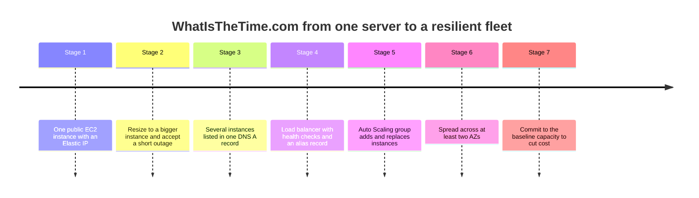
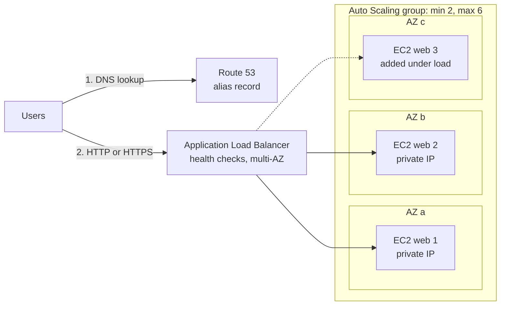
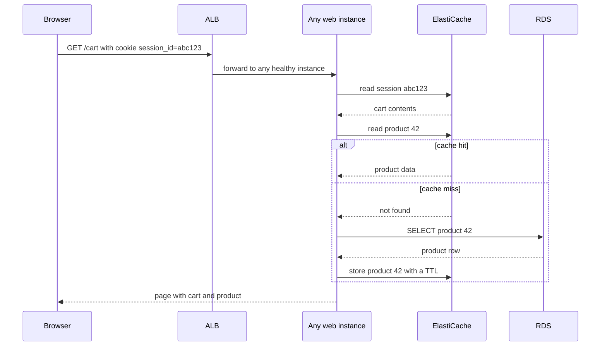
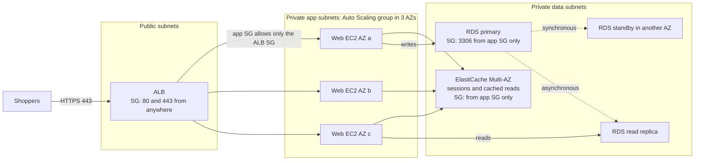
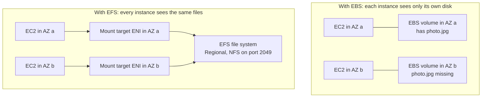
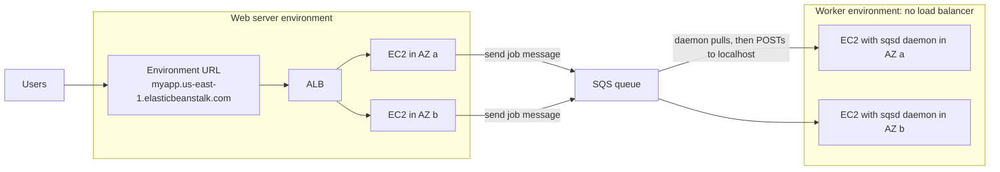

# Classic Solutions Architecture

## Summary

This lesson puts the building blocks from earlier sections (EC2, Elastic IPs, Route 53, load balancers, Auto Scaling groups, RDS, Aurora, ElastiCache, EBS and EFS) together the way a solutions architect does: start with the simplest thing that works, find what breaks, and fix one problem at a time. Three case studies carry the story: **WhatIsTheTime.com** (a stateless web app), **MyClothes.com** (a stateful shop with a cart and customer records) and **MyWordPress.com** (a site whose servers must share uploaded files). You then see how to launch whole stacks quickly with golden AMIs, user data and snapshots, and finish with **AWS Elastic Beanstalk**, the managed service that builds this standard architecture for you so developers only bring their code. On the exam these patterns appear as "which change fixes this symptom" questions, so focus on why each component is added.

## Key concepts

- **Stateless** tiers keep no user data on the instance, so any instance can serve any request and you can add or remove instances freely.
- An **Elastic IP** gives one instance a fixed public IPv4 address, but it does not scale past one instance (default quota: 5 per Region).
- DNS **A records** with a long **TTL** keep pointing clients at instances that no longer exist; an **ELB** plus a Route 53 **alias record** removes that problem.
- **Health checks** take broken instances out of rotation; an **Auto Scaling group** replaces them and follows the load.
- **Multi-AZ** (at least two Availability Zones for the ELB, the Auto Scaling group and the database) is what survives a data center failure.
- **Reserve the baseline**: the minimum capacity that always runs is the part worth covering with Reserved Instances or Savings Plans.
- **Session state** options: sticky sessions, client-side cookies, or (best) a server-side store in **ElastiCache** or **DynamoDB** keyed by a session ID.
- **Read scaling**: RDS **read replicas** or a **cache with lazy loading**; **Multi-AZ** standbys are for availability, not for reads.
- **Security group chaining**: ALB open to the internet, app tier open only to the ALB's group, data tier open only to the app tier's group.
- **EBS** volumes belong to one AZ and normally one instance; **EFS** is a shared NFS file system reachable from every AZ through mount targets.
- **Golden AMI** (pre-installed software) plus **user data** (last-minute configuration) plus **snapshot restores** (pre-loaded databases and disks) make new stacks start fast.
- **Elastic Beanstalk** is free: you pay only for the EC2, ELB, RDS and other resources it creates, and you keep full control of their configuration.
- Beanstalk building blocks: **application**, **application version**, **environment** (runs one version at a time), **web server tier** or **worker tier** (pulls jobs from SQS).
- Beanstalk **environment types**: **single instance** (one EC2 with an Elastic IP, for dev) or **load balanced** (ALB + Auto Scaling group across AZs, for production).

## The solutions architect mindset

Every case study below follows the same loop. Build the simplest design that meets today's requirement, then ask four questions: What happens when traffic grows? What happens when an instance or an AZ fails? Who can reach each component? What does it cost? Each answer adds exactly one component. That is also how SAA-C03 scenario questions are written: they describe a symptom (users see errors after a deployment, the database is overloaded by reads, uploaded images disappear) and the right option is the one component that removes that symptom with the least effort or cost.

| Requirement word in a question | What it usually points to |
|---|---|
| "survive the failure of an AZ" | Multi-AZ ELB, Auto Scaling group across AZs, Multi-AZ database |
| "users lose their session / cart" | Server-side session store (ElastiCache or DynamoDB) or, as a quick fix, sticky sessions |
| "database overloaded by reads" | Read replicas or a cache in front of the database |
| "only the web tier may reach the database" | Security group rule that references the web tier's security group |
| "files must be visible to all instances" | Amazon EFS (or S3), not EBS |
| "new instances take too long to be ready" | Golden AMI, fewer steps in user data, snapshot restores |
| "developers just want to deploy code" | AWS Elastic Beanstalk |

## Case study 1: WhatIsTheTime.com (a stateless web app)

The app answers a single question: what time is it? It needs no database and stores nothing about the user, which makes it **stateless**. The business is happy to start tiny and tolerate downtime, but wants to be able to grow both vertically and horizontally, eventually with no downtime at all.

### Stages 1 and 2: one server, then a bigger server

Start with one small public EC2 instance (say a `t3.micro`). Its public IPv4 address would change every time the instance is stopped and started, so you attach an **Elastic IP**: a static public address that stays with your account and can be moved to another instance if this one dies. Users (or a DNS record) point at that address.

Traffic grows, so you **scale vertically**: stop the instance, change it to a larger type, start it again. The Elastic IP keeps the address stable, but every resize means **downtime**, and there is always a largest instance size you cannot go beyond.

> [!UPDATED] Elastic IPs are no longer free while attached
> The slides treat the Elastic IP as a free convenience. Since February 2024 AWS charges for every public IPv4 address, in use or idle: USD 0.005 per hour in us-east-1, about USD 3.60 a month per address, including Elastic IPs attached to running instances. The default quota is still five Elastic IPs per Region.

### Stage 3: several servers behind DNS (and why it breaks)

To scale horizontally you launch more instances. Elastic IPs do not scale (each instance would need its own, and you only get five by default), so you drop them and instead put every instance's public IP into one Route 53 **A record** for `api.whatisthetime.com`. Route 53 returns all the addresses and clients pick one.

The weak point is the record's **TTL**. If the TTL is one hour, a client that resolved the name keeps using the same IP for up to an hour. When you terminate an instance (to scale in, or because it failed), clients that cached its address get errors until their cache expires, and you have to edit the DNS record by hand every time the fleet changes.

### Stage 4: a load balancer with health checks

The fix is an **Elastic Load Balancer** (an ALB for HTTP). The instances move to **private** IPs, the load balancer becomes the only public entry point, and the DNS name is now a Route 53 **alias record** pointing at the load balancer. Alias records cannot have a TTL set by you; Route 53 follows the load balancer's own addresses as they change, and alias queries to AWS resources are free. The load balancer runs **health checks** and stops routing to an instance that fails them, so users no longer hit dead servers. Security groups are tightened: the instances accept HTTP only from the load balancer's security group.

### Stages 5 to 7: Auto Scaling, multi-AZ and reserved capacity

Adding and removing instances by hand is still manual work. An **Auto Scaling group** launches instances from a launch template, registers them with the load balancer, replaces unhealthy ones and follows a scaling policy. Next, a single AZ is a single point of failure, so both the ELB and the Auto Scaling group are spread over **two or three AZs**. Finally, cost: if the group's minimum is 2 (one per AZ), those two instances run 24/7. That predictable baseline is exactly what a commitment discount is for, while the burst capacity above it stays On-Demand (or Spot, if the app tolerates interruptions).

> [!UPDATED] Reserve capacity with Savings Plans as well as Reserved Instances
> The slides say "minimum capacity = reserved instances". Reserved Instances still exist, but you would now compare them with Savings Plans: an **EC2 Instance Savings Plan** gives up to 72% off for one instance family in one Region (like a Standard RI), and a **Compute Savings Plan** gives up to 66% off and also applies across instance families, Regions, Fargate and Lambda (like a Convertible RI, without manual exchanges). Both use one- or three-year terms.

| Stage | What was added | Problem it solved | Problem it left |
|---|---|---|---|
| 1 | Public EC2 + Elastic IP | Stable address for one server | Single server, single AZ |
| 2 | Bigger instance type | More capacity | Downtime on each resize, hard ceiling |
| 3 | More instances in a DNS A record | Horizontal capacity | Stale IPs cached for the TTL, manual DNS edits |
| 4 | ELB + health checks + alias record + private instances | One endpoint, dead instances skipped | Fleet still managed by hand |
| 5 | Auto Scaling group | Automatic replace and resize | Still one AZ |
| 6 | Multi-AZ ELB and Auto Scaling group | Survives an AZ outage | Pays On-Demand for the always-on baseline |
| 7 | Reserved Instances or Savings Plans for the minimum | Lower cost | (none for this app) |

> [!NOTE] The instance family in the diagrams
> The slides draw `m5` instances. Nothing in these designs depends on the family: any current-generation general purpose type works, and Auto Scaling groups can mix several types.

## Case study 2: MyClothes.com (a stateful web app)

MyClothes.com sells clothes online to hundreds of simultaneous users. It has a **shopping cart**, and customers' details (name, delivery address) must be stored permanently. The team wants to keep horizontal scaling and keep the web tier as stateless as possible, without anyone losing their cart. Start from the end state of case study 1: Route 53, a multi-AZ ALB and an Auto Scaling group across three AZs.

### Where should the shopping cart live?

The naive version keeps the cart in the memory of the instance that served the first request. The next request may land on a different instance, and the cart appears empty. Here are the options, from quickest fix to best design:

| Option | How it works | Pros | Cons |
|---|---|---|---|
| **Sticky sessions** (session affinity) | The ALB sets a cookie (`AWSALB`, or your app's own cookie) and keeps sending that client to the same instance | One checkbox on the target group, no code change | Uneven load; if that instance is terminated or fails, the cart is lost |
| **Client-side cookies** | The whole cart is stored in a browser cookie and sent with every request | Web tier becomes truly stateless | Bigger requests; users can tamper with cookies so the server must validate them; browsers only guarantee about 4 KB per cookie |
| **Server-side session store** | The browser keeps only a `session_id` cookie; the cart lives in **ElastiCache** (or **DynamoDB**) under that ID | Stateless web tier, small requests, survives instance loss, shared by every instance | One more service to run and pay for |

The server-side store is the answer AWS exam questions want for "users must not lose their session when instances scale in or fail". ElastiCache (Valkey, Redis OSS or Memcached) gives sub-millisecond reads; DynamoDB is the serverless alternative, and its **TTL** feature can delete expired sessions automatically without consuming write capacity.

> [!UPDATED] ElastiCache engines and formats
> When the slides were made, ElastiCache meant Redis or Memcached. Today it offers **Valkey**, **Redis OSS** and **Memcached**, either as **ElastiCache Serverless** (no nodes to size, highly available by default) or as node-based clusters where you pick node types and Multi-AZ placement.

### Customer data in RDS, and scaling the reads

Names, addresses and orders are durable relational data, so they go into **Amazon RDS** (for example MySQL). As the shop grows, most database traffic is reads (browsing products), and there are two classic ways to relieve the primary:

- **Read replicas**: RDS copies changes **asynchronously** to read-only instances (up to 15 for MySQL, MariaDB and PostgreSQL). The app sends writes to the primary endpoint and reads to the replicas. Replicas can lag slightly behind.
- **Cache with lazy loading**: the app asks ElastiCache first. On a **cache hit** it returns immediately; on a **miss** it queries RDS, writes the result into the cache with a TTL, and returns it. Only data that is actually requested gets cached. The cost is a slower first request (three round trips) and possibly stale data until the TTL expires. A **write-through** strategy (update the cache every time you write to the database) keeps it fresh at the cost of caching data nobody reads.

### Surviving disasters and locking it down

To survive an AZ failure, turn on **RDS Multi-AZ** (a synchronous standby in another AZ that takes over automatically) and run the cache Multi-AZ: a Valkey or Redis OSS cluster with replicas in other AZs and automatic failover, or an ElastiCache Serverless cache. (Memcached does not replicate, so a lost node simply means cache misses until it refills.) Remember that a classic Multi-AZ standby serves **no** reads; it exists only for failover.

> [!UPDATED] RDS Multi-AZ now has two flavours
> Besides the classic **Multi-AZ DB instance** deployment (one standby that does not serve reads), RDS offers a **Multi-AZ DB cluster** deployment with two standbys in three AZs that can also serve read traffic.

Security groups chain the tiers together so each layer accepts traffic only from the layer in front of it:

| Security group | Inbound rule | Source |
|---|---|---|
| ALB | HTTP 80 and HTTPS 443 | `0.0.0.0/0` (the internet) |
| Web/app instances | HTTP 80 (or the app port) | The **ALB's security group** |
| ElastiCache | 6379 (Valkey/Redis OSS) or 11211 (Memcached) | The **app instances' security group** |
| RDS | 3306 (MySQL) | The **app instances' security group** |

## Case study 3: MyWordPress.com (shared files)

The goal is a fully scalable WordPress site. Blog posts and user accounts live in a MySQL database, and the site must store and correctly display pictures that authors upload.

### The database: RDS Multi-AZ, then Aurora

The first version uses **RDS for MySQL with Multi-AZ**. To grow, the slides switch to **Aurora MySQL**: MySQL-compatible, with a shared cluster volume that Aurora replicates across three AZs automatically (you pay for one copy), up to **15 Aurora Replicas** that share the same storage volume (replica lag usually well under 100 ms), a reader endpoint that spreads read traffic, and automatic promotion of a replica if the writer fails. Fewer moving parts to configure than RDS replicas plus a separate standby.

### The uploads: EBS versus EFS

With **one** instance, saving uploads to its **EBS** volume works fine. With an Auto Scaling group across AZs it breaks: an author uploads `photo.jpg` through the instance in AZ a, it is written to that instance's EBS volume, and the next reader lands on the instance in AZ b, whose volume has no such file. EBS volumes live in one AZ and attach to one instance (Multi-Attach exists only for `io1`/`io2` in the same AZ, needs a cluster-aware file system, and is not a fix for this).

**Amazon EFS** solves it. It is a managed NFS file system; you create a **mount target** (an ENI with a private IP) in each AZ, and every instance mounts the same file system over NFS (port 2049). An upload written in AZ a is immediately readable in AZ b. A Regional EFS file system stores data redundantly across AZs, so it also survives an AZ loss.

| | EBS volume | EFS file system |
|---|---|---|
| Access | One instance (Multi-Attach: `io1`/`io2`, same AZ, up to 16 Nitro instances) | Many instances at once from every AZ, Linux only |
| Scope | One AZ | Regional (all AZs) or One Zone |
| Protocol | Block device | NFS v4.0/4.1 through mount targets |
| Capacity | Provisioned size, you pay for what you provision | Grows and shrinks automatically, pay per GB stored |
| Fits | Boot disks, single-instance apps, databases on EC2 | Shared content, web uploads, home directories |

> [!TIP] Even better for media: Amazon S3
> The slides stop at EFS, which is the right answer when the application expects a file system path. If you can change the code, storing uploads in **S3** (often behind CloudFront) is cheaper per GB and removes the file system entirely. Watch which constraint the question gives you.

## Instantiating applications quickly

A full stack (instances, disks, database) can take a long time to become useful: installing packages, loading initial or recovery data, configuring, starting the app. The cloud lets you move most of that work to before launch time.

| Technique | Applies to | What it speeds up | Trade-off |
|---|---|---|---|
| **Golden AMI** | EC2 | OS packages, runtime and app already installed, so boot to ready takes seconds | You must rebuild and patch the image regularly |
| **User data** | EC2 | Dynamic settings at first boot (environment name, config files, secrets lookup) | Runs at the first boot of every new instance, adding boot time; 16 KB limit; not rerun on reboots by default |
| **Hybrid** | EC2 | Bake the slow, stable parts into the AMI and do the small, per-environment parts in user data; Elastic Beanstalk works this way | Two things to maintain |
| **Restore an RDS snapshot** | RDS | New DB instance already has schemas and data | Creates a **new** instance with a new endpoint; data loads lazily in the background |
| **Restore an EBS snapshot** | EBS | New volume already formatted and filled | Blocks are fetched from S3 on first access unless you pre-initialize |

A good golden AMI pipeline is automated: **EC2 Image Builder** (no charge beyond the resources it uses) builds the image from a recipe, runs tests, patches on a schedule and copies the AMI to other Regions and accounts. User data scripts run as root and their output lands in `/var/log/cloud-init-output.log` on Amazon Linux, which is where to look when an instance boots but the app is not ready.

> [!UPDATED] Faster snapshot restores
> Restored EBS volumes still pull blocks from S3 lazily, so first reads are slow. Besides **fast snapshot restore** (volumes fully initialized at creation) and reading every block with `fio` or `dd`, you can now set a **Provisioned Rate for Volume Initialization** of 100 to 300 MiB/s when creating a volume from a snapshot, which makes the time to full performance predictable for an extra per-GiB fee.

## The typical three-tier web architecture

The patterns above combine into the standard design you should be able to draw from memory:

- **Public subnets**: only the load balancer (and NAT gateways, covered in the VPC section). Route 53 points at the load balancer with an alias record.
- **Private subnets**: the application instances in an Auto Scaling group spread across AZs. They have no public IPs.
- **Data subnets** (also private): RDS for read/write data and ElastiCache for sessions and cached reads, each in Multi-AZ mode.

Each tier only talks to its neighbours, enforced by security groups that reference each other. Scale the web tier horizontally, the cache by adding replicas or shards, and the database with replicas or Aurora.

## AWS Elastic Beanstalk

### The problem it solves

Developers on AWS keep rebuilding the same thing: a load balancer, an Auto Scaling group, security groups, maybe a database, a deployment process and monitoring, and they must do it consistently across dev, test and prod. Most of them only want their code to run. **Elastic Beanstalk** is a managed, developer-focused way to deploy web applications that builds that standard architecture from EC2, Auto Scaling, ELB, RDS, CloudWatch and S3, using CloudFormation under the hood.

| Elastic Beanstalk handles | You handle |
|---|---|
| Capacity provisioning, Auto Scaling group and load balancer | The application code |
| Instance configuration and the platform software stack (OS, runtime, web server) | Choosing settings: instance types, scaling limits, deployment policy, VPC |
| Health monitoring, logs, managed platform updates | Data stored outside the environment (databases you want to keep) |

The service itself has **no extra charge**: you pay for the EC2 instances, load balancer, storage and any database it creates. Unlike a fully opaque PaaS, every resource lives in your account and you can still change its configuration.

### Components

- **Application**: the container for everything below (versions, environments, saved configurations).
- **Application version**: one labelled, uploaded build of your code (a ZIP or WAR source bundle stored in S3). An application can keep many versions.
- **Environment**: the set of AWS resources running **one** application version at a time. You typically run several (`myapp-dev`, `myapp-prod`), each with its own URL such as `myapp-prod.us-east-1.elasticbeanstalk.com`.
- **Environment tier**: **web server** (serves HTTP) or **worker** (processes jobs from an SQS queue); chosen at creation and cannot be changed later.
- **Environment configuration** and **saved configuration**: the settings of one environment, and a reusable template of settings (called a configuration template in the API).
- **Platform**: the combination of OS, language runtime, web or application server and Beanstalk agents your code runs on.

The lifecycle is simple: create the application, upload a version, launch an environment with it, then keep managing the environment. Releasing new code means uploading another version and deploying it to an environment; you can also redeploy an older version to roll back.

### Supported platforms

Today's managed platforms are **Docker**, **ECS** (Docker containers managed by the ECS agent on Amazon Linux), **Go**, **Java SE** (Corretto), **Tomcat**, **.NET Core on Linux**, **.NET on Windows Server** (IIS), **Node.js**, **PHP**, **Python** and **Ruby**. If your language is not listed, package it in a Docker container.

> [!UPDATED] The platform list has changed since the slides
> The slides list Packer Builder, single-container Docker, multi-container Docker and Preconfigured Docker. Elastic Beanstalk retired all Amazon Linux AMI (AL1) branches on 18 July 2022, which removed **custom platforms built with Packer**, **multi-container Docker** (replaced by the **ECS** platform) and **Preconfigured Docker (GlassFish)**; single-container Docker is now simply the **Docker** platform. Amazon Linux 2 reached end of life on 30 June 2026 and the last AL2 branches retired on 6 August 2026, so every current Linux platform runs on **Amazon Linux 2023**. The .NET on Windows Server platform does not support worker environments.

### Web server tier versus worker tier

A **web server environment** has a URL (a CNAME under `elasticbeanstalk.com`), a load balancer (when load balanced) and an Auto Scaling group of instances behind it. A **worker environment** has **no load balancer**: Beanstalk creates (or uses your) **SQS queue**, and a daemon on each instance pulls messages and HTTP POSTs each one to your app on `localhost`. A `200 OK` deletes the message; failures are retried and eventually land in a dead-letter queue. A `cron.yaml` file in the source bundle can schedule periodic jobs. The classic pattern: the web tier answers users fast and drops slow jobs (image resizing, emails, report generation) into the queue for the worker tier.

| | Web server tier | Worker tier |
|---|---|---|
| Entry point | Environment URL, load balancer (or Elastic IP if single instance) | SQS queue, no public URL |
| Typical work | Short HTTP requests | Long or heavy background jobs, scheduled tasks |
| Scaling signal | Load on the web instances | Ideally queue depth (needs your own CloudWatch alarm and scaling policy) |
| Extras | HTTPS on the load balancer | Dead-letter queue, `cron.yaml` periodic tasks |

> [!UPDATED] How a worker tier actually scales
> The slides say worker environments scale on the number of SQS messages. That is the right design goal, but it is not automatic: Beanstalk's default scaling trigger uses average **NetworkOut** per instance (scale out above 6 MB, in below 2 MB over five minutes), and the worker documentation describes CPU-based thresholds. The built-in trigger can only watch instance and load balancer metrics, so to scale on queue depth you add your own CloudWatch alarm on the queue's `ApproximateNumberOfMessagesVisible` metric with a scaling policy for the environment's Auto Scaling group (for example as resources in an `.ebextensions` configuration file).

### Environment types (the slides' "deployment modes")

| | Single instance | Load balanced (high availability) |
|---|---|---|
| What you get | One EC2 instance with an **Elastic IP**, in one AZ; Auto Scaling group fixed at 1 | **ALB** (default in the console) in front of an Auto Scaling group across two or more AZs |
| Database (optional) | One RDS instance | RDS with a Multi-AZ standby |
| Good for | Development, testing, very low traffic | Production |
| Cost | Lowest: one instance and one public IPv4 address | Load balancer hourly charge plus several instances |

You can switch an environment between the two types later (Configuration, then **Instance traffic and scaling**), but the load balancer **type** (ALB, NLB or the legacy CLB, which the console wizard no longer offers for new environments) can only be chosen when the environment is created. Console presets cover the common cases: **Single instance**, **High availability**, Spot-based variants of both, and **Custom configuration**.

### Deploying new versions

Beyond the slide range, but frequently tested, Beanstalk offers several deployment policies:

| Policy | How it works | Downtime | Extra cost | Rollback |
|---|---|---|---|---|
| **All at once** (default) | New version on every instance simultaneously | Yes, briefly | None | Redeploy the old version |
| **Rolling** | Batch by batch; each batch leaves service while it updates | No, but reduced capacity | None | Redeploy |
| **Rolling with additional batch** | Launches an extra batch first so capacity stays full | No | Small, temporary | Redeploy |
| **Immutable** | A full new set of instances in a temporary Auto Scaling group, swapped in only when healthy | No | Double capacity during the deploy | Fast: terminate the new instances |
| **Traffic splitting** | Like immutable, but sends a percentage of traffic to the new version for an evaluation period (canary); needs an ALB | No | Double capacity during the deploy | Fast and automatic |
| **Blue/green** (not a policy) | Deploy to a cloned environment, test, then **Swap environment URLs** (CNAME swap) | No | A whole second environment | Swap back |

For blue/green, keep the old environment until DNS caches have expired, and make sure the database lives **outside** the environments so both can use it.

### Databases and Beanstalk

Beanstalk can create an RDS database **coupled** to the environment and pass connection details to the app as environment properties (`RDS_HOSTNAME`, `RDS_PORT`, `RDS_USERNAME` and so on). That is convenient for testing, but a coupled database follows the environment's lifecycle: when you terminate the environment, the **database deletion policy** (Delete, Snapshot or Retain) decides its fate. For production, the Beanstalk documentation steers you towards a database that lives outside the environment (created separately, or decoupled with the Retain policy); blue/green deployments in fact require the environment to run independently of the production database, and environment rebuilds then never put the data at risk.

### Beanstalk Cluster mode

> [!UPDATED] New: Beanstalk Cluster mode (September 2026)
> On 17 September 2026 AWS added **Cluster mode**. The classic EC2-based model is now called **Beanstalk Standard**. A Beanstalk Cluster environment runs your app as container replicas on an **Amazon EKS** cluster that Beanstalk creates and operates (nodes from EKS Auto Mode), and several environments that use the same subnets share that cluster to lower per-app cost. You supply source code, a Dockerfile or an ECR image; there is no platform or AMI to choose; scaling is by replica counts; deployments are rolling or all at once; CNAME-swap blue/green still works. There is no extra Beanstalk charge, but EKS and EKS Auto Mode charges apply. The SAA-C03 exam guide predates this, so expect questions about the EC2-based model.

### When to pick Elastic Beanstalk

Pick it when a team wants to deploy a standard web app or API (or a queue worker) quickly, on familiar runtimes, without designing the infrastructure, while keeping access to the underlying resources. Look elsewhere when the question asks for full infrastructure as code of arbitrary resources (**CloudFormation**), containers orchestrated in detail (**ECS** or **EKS**), or event-driven functions with no servers at all (**Lambda**).

## Exam tips

> [!EXAM] Users get errors after instances are replaced
> "Clients keep calling an IP that no longer exists" or "DNS changes take an hour to apply" → stop publishing instance IPs in A records; put the instances behind an **ELB** and use a Route 53 **alias** record.

> [!EXAM] Keep the session when instances come and go
> "Users must not lose their shopping cart or login when the Auto Scaling group scales in" → store sessions in **ElastiCache** or **DynamoDB** (server-side session store). Sticky sessions keep users on one instance but still lose the session if it is terminated.

> [!EXAM] Read-heavy database
> "The RDS primary is overloaded by read queries" → **read replicas** (change the app to use their endpoints) or **ElastiCache** in front of RDS. A Multi-AZ standby is not an answer for reads.

> [!EXAM] Shared files across AZs
> "Uploaded images are missing on some instances" or "several instances in different AZs need the same files" → **Amazon EFS** mounted on every instance (or S3 if the code can change). EBS is AZ-bound.

> [!EXAM] Least-privilege network access
> "Only the application servers should reach the database" → the database security group allows its port with the **application instances' security group** as the source, not a CIDR.

- "Instances take 20 minutes to install software before serving traffic" → **golden AMI** (built with EC2 Image Builder) and keep only dynamic settings in **user data**.
- "Recreate a database with existing data quickly" → **restore from an RDS snapshot** (new instance, new endpoint).
- "Deploy a web app without managing infrastructure, keep control of the instances" → **Elastic Beanstalk**.
- "Long-running background jobs in a Beanstalk app" → a **worker environment** fed by **SQS**.
- "Cheap dev environment in Beanstalk" → **single instance**; "production" → **load balanced** across AZs.
- "Zero-downtime release with instant rollback in Beanstalk" → **immutable**, **traffic splitting**, or **blue/green with a CNAME swap**.
- "Reduce cost of the always-on minimum capacity" → **Reserved Instances** or **Savings Plans** for the baseline, On-Demand or Spot above it.

## Common traps

> [!TRAP] An Elastic IP as a scaling tool
> One Elastic IP maps to one instance, and you get five per Region by default. It gives a fixed address, not scalability or load balancing. Answers that add Elastic IPs to every instance in a growing fleet are wrong.

> [!TRAP] Sticky sessions as the "scalable" answer
> Stickiness is a quick fix, not the best practice: it can overload some instances and still loses the session when its instance dies. If an option offers an external session store, prefer it.

> [!TRAP] Putting the whole cart in a cookie
> It makes the web tier stateless, but cookies are limited to about 4 KB, travel with every request and can be modified by the user, so they must be validated server-side. It is rarely the best answer for sensitive or large state.

> [!TRAP] Multi-AZ for read scaling
> A classic RDS Multi-AZ standby only takes over on failure and serves no queries. Read scaling means read replicas (or Aurora Replicas, or a cache).

> [!TRAP] EBS for shared uploads
> A volume belongs to one AZ, and Multi-Attach is only for `io1`/`io2` volumes in the same AZ with a cluster-aware file system. For files shared by a multi-AZ web tier, choose EFS (or S3).

> [!TRAP] Restoring a snapshot "into" the existing database
> An RDS snapshot always restores to a **new** DB instance with a new endpoint; you then repoint the application.

> [!TRAP] Thinking Elastic Beanstalk has a fee or hides the resources
> Beanstalk itself is free, and the EC2 instances, load balancer and database it creates are ordinary resources in your account that you pay for and can inspect.

> [!TRAP] Keeping production data in a coupled Beanstalk database
> If the environment is terminated with the Delete policy, the database goes with it, and blue/green swaps do not carry a coupled database across. Use a decoupled or externally created RDS instance for production.

> [!TRAP] Expecting a load balancer in a worker environment
> Worker environments have no load balancer and no public URL; they read from an SQS queue. Also, the environment tier cannot be changed after creation.
