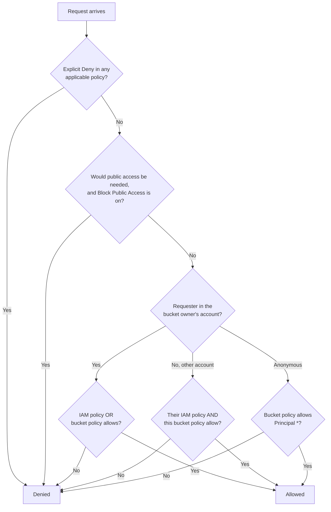
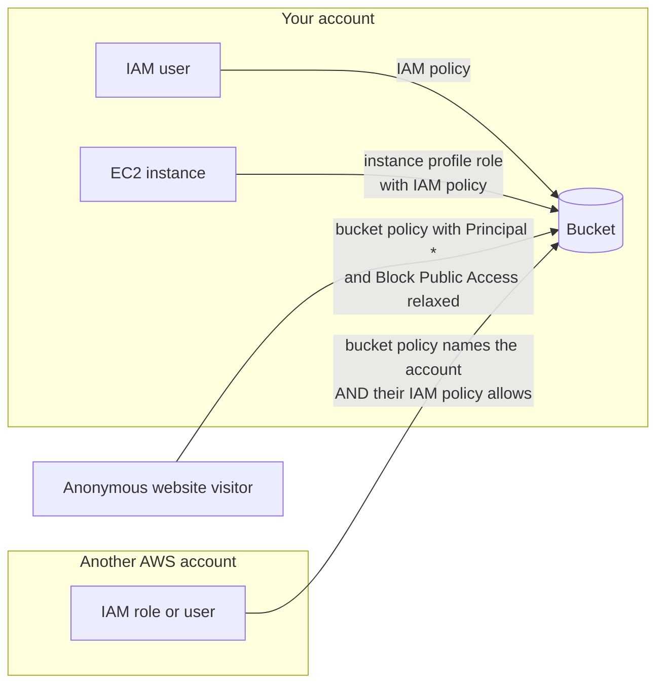
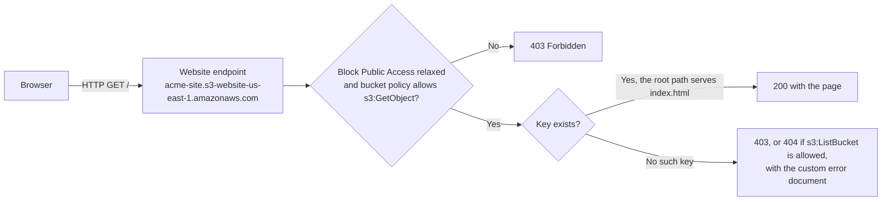
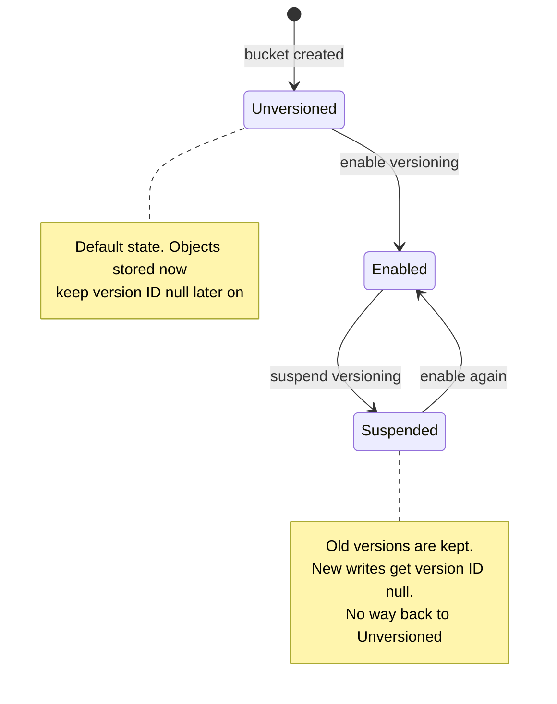
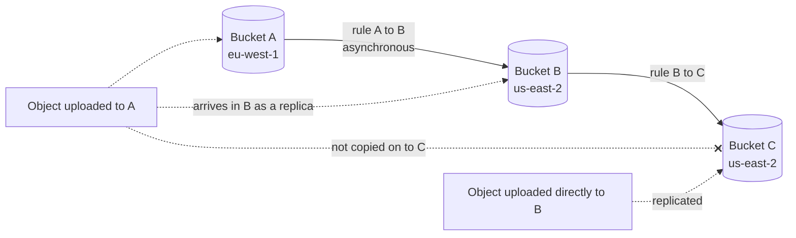
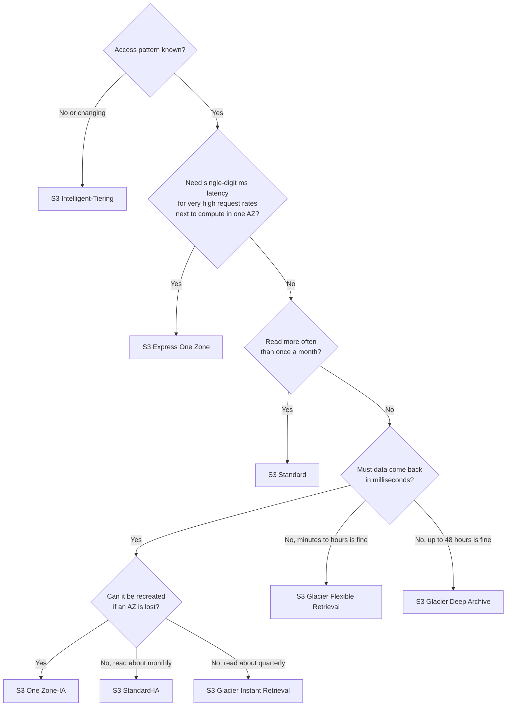

# Amazon S3 Fundamentals

## Summary

Amazon Simple Storage Service (S3) is AWS's object store: you put files (objects) into containers (buckets) and reach them over HTTPS from anywhere, with practically no limit on how much you store. It is the default answer whenever a scenario needs durable storage for backups, media, logs, data lake files, software downloads or a static website, and it is the integration point for dozens of other AWS services. This lesson covers how buckets and object keys work, who can read or write them (IAM policies, bucket policies, Block Public Access), static website hosting, versioning, cross-Region and same-Region replication, and the storage classes you pick from to trade access speed and availability against price. Pick S3 when data is written as whole files and read by many clients; pick EBS or EFS instead when an application needs a mounted disk or a shared POSIX file system.

## Key concepts

- **Bucket**: a named container created in **one Region**; general purpose bucket names are unique across all accounts in the partition, unless you use the new **account regional namespace**.
- **Object key**: the full name of an object, for example `reports/2026/q3.pdf`; the "folders" in the console are only **prefixes** in the key.
- **Object size**: up to **50 TB** per object; one `PUT` handles at most **5 GB**, so larger files need **multipart upload** (recommended from about 100 MB).
- **Metadata and tags**: user metadata (`x-amz-meta-*`, 2 KB) is fixed at upload; up to **10 tags** per object drive lifecycle rules, replication filters and access conditions.
- **Access control**: **IAM policies** say what a user or role may do; **bucket policies** say who may use a bucket, including other accounts and anonymous users; **ACLs are disabled by default**.
- **Evaluation rule**: an **explicit deny always wins**; in the same account one allow (IAM or bucket policy) is enough; **cross-account access needs both**.
- **Block Public Access**: four switches, on by default, that override any policy or ACL that would make data public; settable per bucket, account, access point or whole organization.
- **Static website hosting**: serves `index.html` and an error page from a bucket over **HTTP only**; a **403** means public read is not allowed yet.
- **Versioning**: keeps every version of a key; a delete adds a **delete marker**; once enabled it can only be **suspended**, never turned off.
- **Replication (CRR / SRR)**: asynchronous copying of **new** objects to another bucket, in another or the same Region; needs versioning on both sides and an IAM role; no chaining.
- **Durability vs availability**: every class is designed for **11 nines** of durability; availability ranges from 99.99% (Standard) down to 99.5% (One Zone-IA).
- **Storage classes**: from hot to cold, Express One Zone, Standard, Standard-IA and One Zone-IA, the three Glacier classes (Instant, Flexible, Deep Archive), plus self-managing Intelligent-Tiering; each has its own minimum duration, minimum billable size and retrieval fee.
- **S3 Express One Zone**: single-AZ **directory buckets** with single-digit millisecond latency for request-heavy workloads such as ML training; cheaper requests, pricier storage.

## What S3 is and where it fits

S3 stores data as **objects** (bytes plus descriptive metadata) addressed by a bucket name and a key. There is no capacity to provision: you pay for what you store, the requests you make, retrievals from the colder classes and data that leaves AWS. Because it is cheap, durable and reachable from anywhere, it sits underneath many solutions:

| Use case | Concrete example | Why S3 fits |
|---|---|---|
| Backup and disaster recovery | Nightly database dumps copied to a bucket in a second Region | 11 nines durability, replication, cheap cold classes |
| Archiving | Seven years of trade records kept for regulators | Glacier classes cost a fraction of a cent per GB-month |
| Hybrid cloud storage | On-premises file servers tiering old files to the cloud | Storage Gateway and DataSync write straight into S3 |
| Media and application hosting | Product photos and videos for an e-commerce site | Any number of clients can read in parallel; CloudFront can cache it |
| Data lakes and analytics | Clickstream files queried with Athena, EMR or Redshift Spectrum | Analytics services read S3 directly without loading data first |
| Software delivery | Installers and patches downloaded by customers | Large files, global reach, pre-signed URLs for controlled access |
| Static websites | A marketing site of HTML, CSS and JavaScript | No servers to run; website endpoint or CloudFront in front |

S3 is not a disk. It has no partial in-place edits: changing one byte means uploading the object again. If an application needs block storage for one instance, that is EBS; if many Linux instances need a shared file system with file locking, that is EFS.

| Need | Service | Access model |
|---|---|---|
| Boot volume or database disk for one EC2 instance | Amazon EBS | Block device in one AZ |
| Shared POSIX file system for many instances | Amazon EFS | NFS mount across AZs |
| Files written whole and read by many clients over HTTP | Amazon S3 | REST API, SDK, CLI, console |

> [!NOTE] Consistency
> S3 gives strong read-after-write consistency for all objects in all Regions: as soon as a `PUT` or `DELETE` succeeds, the next read or list reflects it. Older study material may still describe "eventual consistency for overwrites", which no longer applies.

## Buckets

A **bucket** is the top-level container. Two facts confuse newcomers:

1. **Buckets live in a Region.** The console shows all your buckets in one global list, which makes S3 look global, but each bucket is created in exactly one Region and its data stays there unless you copy or replicate it. Choose the Region for latency, cost and data-residency reasons. The name and Region cannot be changed later.
2. **Names are global (by default).** A general purpose bucket name must be unique across every AWS account in the partition (`aws`, `aws-cn`, `aws-us-gov`, `aws-eusc`). If someone already owns `photos`, you cannot have it. A deleted name may be claimed by another account later, which is a reason not to delete buckets whose names are hard-coded in clients.

> [!UPDATED] Account regional namespace (March 2026)
> Since 12 March 2026 you can create general purpose buckets in your own **account regional namespace**, where only your account can ever create names. The name must follow `<your-prefix>-<12-digit account ID>-<region code>-an`, for example `invoices-111122223333-eu-west-1-an`. This lets you use the same predictable prefix in every Region without fearing name collisions or bucket squatting. You request it at creation (`--bucket-namespace account-regional` in the CLI); the buckets behave exactly like other general purpose buckets. SCPs and IAM policies can force teams to use it.

### Naming rules

| Rule | Allowed example | Rejected example |
|---|---|---|
| 3 to 63 characters | `acme-logs` | `ab` |
| Lowercase letters, digits, hyphens and periods only | `acme-logs-2026` | `Acme_Logs` (uppercase, underscore) |
| Starts and ends with a letter or digit | `logs1` | `-logs`, `logs-` |
| No two periods in a row, not shaped like an IP address | `www.example.com` | `example..com`, `192.168.5.4` |
| Reserved prefixes `xn--`, `sthree-`, `amzn-s3-demo-` are not allowed | `xyz-data` | `xn--data` |
| Reserved suffixes are not allowed: `-s3alias` (access point aliases), `--ol-s3`, `.mrap`, `--x-s3` (directory buckets), `--table-s3` (table buckets) | `data-alias` | `data-s3alias` |
| `-an` at the end only for account regional namespace buckets | `app-111122223333-us-east-1-an` | `myapp-an` in the global namespace |

Periods are legal but best avoided except for website buckets named after a domain: virtual-hosted HTTPS certificates do not match dotted names, and S3 Transfer Acceleration refuses them.

> [!UPDATED] More buckets per account
> An account can now create up to **10,000 general purpose buckets** by default (adjustable through Service Quotas), and any number of objects per bucket. Older material quotes a limit of 100 buckets. Directory buckets for Express One Zone have a separate default quota of 100.

## Objects and keys

Every object has:

- a **key**: its full name inside the bucket;
- a **value**: the bytes themselves, from 0 bytes up to 50 TB;
- **metadata**: name-value pairs set by S3 (size, `Last-Modified`, `ETag`, storage class) or by you;
- **tags**: up to 10 key-value pairs for classification;
- a **version ID** when versioning is on (otherwise the version ID is `null`).

### Keys, prefixes and the folder illusion

S3 has a flat namespace. Take the URI `s3://acme-media/videos/2026/launch.mp4`:

| Part | Value | Notes |
|---|---|---|
| Bucket | `acme-media` | Lives in one Region |
| Key | `videos/2026/launch.mp4` | The whole string after the bucket name |
| Prefix | `videos/2026/` | Everything up to the last slash; drawn as folders in the console |
| Object name | `launch.mp4` | The part after the last slash |

The console lets you "create a folder", but behind the scenes it only writes keys that contain slashes. There is no directory object to rename or move; "renaming a folder" means copying every object to a new key and deleting the old ones.

Prefixes still matter: lifecycle rules, replication rules, event notifications and IAM conditions can all target a prefix such as `logs/`, and S3 scales request rates per prefix (covered in the advanced lesson).

### Sizes and multipart upload

| Operation | Limit |
|---|---|
| Largest object | 50 TB (exactly 10,000 parts x 5 GiB = 48.8 TiB) |
| Single `PUT` request | 5 GB |
| Upload in the S3 console | 160 GB |
| Multipart upload | Recommended from about 100 MB; required above 5 GB |
| Part size | 5 MiB to 5 GiB (the last part can be smaller) |
| Parts per upload | 10,000 |

Multipart upload splits a file into parts that upload in parallel and independently; a failed part is retried alone instead of restarting a 40 GB upload. The AWS CLI (`aws s3 cp`) and SDK transfer managers switch to multipart automatically.

> [!UPDATED] Maximum object size is now 50 TB
> S3 raised the maximum object size from the long-standing 5 TB to 50 TB. The slides already show 50 TB; questions written against older material may still say 5 TB. The 5 GB single-`PUT` ceiling is unchanged.

### Metadata, tags and annotations

- **User-defined metadata** is sent as `x-amz-meta-<name>` headers at upload, is limited to 2 KB, and cannot be edited afterwards; the console's "edit metadata" actually copies the object.
- **System metadata** includes `Content-Type`, `Cache-Control`, the storage class and the encryption setting. Some of these you control (for example `Content-Type: text/html` matters for websites).
- **Object tags** (up to 10 per object, keys up to 128 and values up to 256 Unicode characters, case-sensitive) can be changed at any time. They are the hook for fine-grained rules: "transition objects tagged `Department=Finance` to Glacier after 90 days", "only let the analytics role read objects tagged `Classification=Public`", or "replicate only objects tagged `Replicate=yes`".

> [!UPDATED] Object annotations
> S3 now also offers **annotations**: named payloads of up to 1 MiB of UTF-8 text (up to 1,000 per object version) that you attach to an existing object without rewriting it, intended for things like AI-generated labels or processing records. Live replication copies them along with the object. They are new and unlikely to be tested yet, but explain why the docs now list three kinds of custom metadata.

## Securing buckets and objects

By default every bucket and object is **private**: only the owning account can use it, and only if its IAM principals have permissions. You open access in three places.

| Mechanism | Attached to | Answers the question | Typical use |
|---|---|---|---|
| IAM identity policy | User, group or role | "What may this principal do in AWS?" | Developers, applications, EC2 instance roles in your account |
| Bucket policy | The bucket (resource-based, up to 20 KB of JSON) | "Who may do what to this bucket and its objects?" | Public read for a website, cross-account sharing, enforcing conditions such as TLS or encryption |
| Access control lists (ACLs) | Bucket or individual object | Legacy per-object grants | Rarely needed; disabled by default |

> [!UPDATED] ACLs are disabled by default
> The slides describe ACLs as something that "can be disabled". Today every new bucket is created with **Object Ownership = Bucket owner enforced**: ACLs are switched off, the bucket owner owns every object, and access is decided by policies only. You can still turn ACLs back on (Bucket owner preferred or Object writer), but AWS recommends keeping them off unless you truly need per-object grants.

### How S3 decides



In words: an explicit `Deny` anywhere ends the discussion. Within one account, an `Allow` in **either** the principal's IAM policy **or** the bucket policy is enough. For a principal in **another account**, both sides must agree: the other account's administrator grants the permission in IAM, and your bucket policy names that account or role. Service control policies and resource control policies from AWS Organizations can also cap what is allowed.

### Bucket policies

A bucket policy is JSON with the same grammar as IAM policies, plus a `Principal`:

- **Effect**: `Allow` or `Deny`.
- **Principal**: who it applies to: `"*"` (anyone, including anonymous users), an account (`arn:aws:iam::111122223333:root`), a role or a service.
- **Action**: API operations such as `s3:GetObject` or `s3:PutObject`.
- **Resource**: the bucket ARN (`arn:aws:s3:::acme-site`) for bucket-level actions like `s3:ListBucket`, or the objects ARN (`arn:aws:s3:::acme-site/*`) for object actions.
- **Condition** (optional): for example `aws:SecureTransport`, `aws:SourceIp`, `aws:PrincipalOrgID` or `s3:x-amz-server-side-encryption`.

This policy lets anyone on the internet read objects, which is what a public website bucket needs:

```json
{
  "Version": "2012-10-17",
  "Statement": [
    {
      "Sid": "AllowPublicRead",
      "Effect": "Allow",
      "Principal": "*",
      "Action": "s3:GetObject",
      "Resource": "arn:aws:s3:::acme-site/*"
    }
  ]
}
```

And this one refuses any upload that does not ask for SSE-KMS encryption, a classic way to "force encryption at upload":

```json
{
  "Version": "2012-10-17",
  "Statement": [
    {
      "Sid": "DenyUploadsWithoutKms",
      "Effect": "Deny",
      "Principal": "*",
      "Action": "s3:PutObject",
      "Resource": "arn:aws:s3:::acme-finance/*",
      "Condition": {
        "StringNotEquals": { "s3:x-amz-server-side-encryption": "aws:kms" }
      }
    }
  ]
}
```

> [!NOTE] Encryption is on by default
> Since 5 January 2023 S3 encrypts every new object with S3 managed keys (SSE-S3) at no cost, so data is never stored unencrypted. A deny policy like the one above is now about requiring a *specific* method (SSE-KMS with your keys). Encryption options are covered in the S3 Security lesson.

### Four access patterns to recognise



| Scenario | Correct mechanism | Common wrong answer |
|---|---|---|
| A developer in your account needs to upload | IAM policy on the user or their group | Making the bucket public |
| An app on EC2 reads configuration files | IAM **role** attached through an instance profile | Storing access keys on the instance |
| Anyone on the internet should see website images | Bucket policy allowing `s3:GetObject` to `"*"`, with Block Public Access relaxed for that bucket | Object ACLs on each file |
| A partner account must read reports | Bucket policy naming the partner account or role, plus an IAM policy in the partner account | Creating IAM users for the partner in your account |

## Block Public Access

Misconfigured public buckets caused many data leaks, so S3 added **Block Public Access** (BPA): guard rails that sit above policies and ACLs. Even if someone attaches a policy with `"Principal": "*"`, BPA can stop it from taking effect. New buckets, access points and objects start with public access blocked.

There are four independent settings:

| Setting | What it does |
|---|---|
| `BlockPublicAcls` | Rejects new requests that would set a public ACL on a bucket or object |
| `IgnorePublicAcls` | Makes S3 ignore every public ACL that already exists |
| `BlockPublicPolicy` | Rejects a new bucket or access point policy that would grant public access |
| `RestrictPublicBuckets` | If a public policy exists anyway, limits access to AWS service principals and users in the owner's account (blocks anonymous and cross-account use through it) |

The settings can be applied at several levels, and S3 always enforces the **most restrictive combination**:

- **Organization**: an AWS Organizations S3 policy turns all four on (all or nothing) for chosen accounts and overrides their account setting.
- **Account**: applies to every current and future bucket and access point in the account, in all Regions.
- **Bucket** and **access point**: individual overrides, only ever tightening what the account allows.

> [!UPDATED] Organization-level Block Public Access
> The slides mention bucket and account levels. AWS Organizations can now enforce Block Public Access centrally through an S3 policy, so a member account's own settings cannot weaken it.

> [!TIP] Leave it on unless you mean it
> If a bucket should never be public, keep all four settings on at the account level. For a public website, the safer modern design is to keep BPA fully on and serve the bucket through **CloudFront with origin access control (OAC)**, which adds HTTPS and caching. Turning BPA off is mainly for the plain S3 website endpoint.

## Static website hosting

S3 can serve a static site (HTML, CSS, JavaScript, images; no server-side code) directly from a bucket. You enable **Static website hosting** on the bucket, name an index document (usually `index.html`) and optionally an error document (for example `404.html`) and redirect rules. S3 then answers on a Region-specific **website endpoint**, which uses one of two shapes depending on the Region:

- `http://<bucket>.s3-website-<region>.amazonaws.com` (dash), used by older Regions such as `us-east-1`, `us-west-2` and `eu-west-1`;
- `http://<bucket>.s3-website.<region>.amazonaws.com` (dot), used by Regions such as `us-east-2`, `eu-central-1` and `ap-south-1`.



The website endpoint differs from the normal REST endpoint (`https://<bucket>.s3.<region>.amazonaws.com/<key>`):

| | REST API endpoint | Website endpoint |
|---|---|---|
| Content | Private or public | Public-read content only |
| Protocol | HTTPS and HTTP | **HTTP only** |
| Request to the bucket root | Lists keys (if allowed) | Returns the index document |
| Errors | XML error body | HTML page, or your error document |
| Redirects | Not supported | Object-level and bucket-level redirects |
| Methods | All operations | `GET` and `HEAD` on objects only |

> [!EXAMPLE] The 403 that every learner hits
> You upload `index.html`, enable website hosting and open the endpoint: **403 Forbidden**. Website hosting does not make anything public. You must (1) relax the bucket's Block Public Access settings that concern policies (and confirm the account-level settings allow it), then (2) add a bucket policy that allows `s3:GetObject` on `arn:aws:s3:::<bucket>/*`. Once the site works, a request for a key that does not exist (remember keys are case-sensitive: `Index.html` is not `index.html`) gets your error document. S3 only answers **404** for a missing key when the caller may also list the bucket (`s3:ListBucket`); otherwise it answers **403**, so anonymous visitors cannot probe which keys exist. AWS's troubleshooting guidance for website endpoints puts it as "the Access Denied error masks a 404". Do not grant public `s3:ListBucket` just to get 404s: it lets anyone list every key in the bucket.

> [!UPDATED] HTTPS for S3-hosted sites
> Website endpoints still do not support HTTPS. AWS now recommends **AWS Amplify Hosting** (which deploys content from a bucket to a CloudFront-backed CDN with an HTTPS URL) or putting **Amazon CloudFront** in front of the bucket. For a custom domain, Route 53 can point an alias record at the website endpoint (the bucket name must then match the domain) or at CloudFront. A Requester Pays bucket cannot be served through the website endpoint at all.

## Versioning

With **S3 Versioning** turned on, writing to an existing key creates a new version instead of replacing the object, and every version gets a unique version ID. That protects against two everyday accidents: overwriting a file with a bad copy, and deleting it.

- **Overwrite**: the new upload becomes the *current* version; the previous one becomes *noncurrent* but stays retrievable by its version ID.
- **Delete without a version ID**: S3 does not remove data. It adds a **delete marker** as the current version, so normal `GET` and list calls behave as if the object were gone. Deleting that marker brings the object back.
- **Delete with a version ID**: permanently removes that specific version. This is the only true deletion, and it is what MFA Delete (S3 Security lesson) can protect.



Things to remember:

- Versioning is a **bucket-level** switch. Once enabled, the bucket can never go back to "unversioned"; it can only be **suspended**. Suspending stops new versions from accumulating but deletes nothing.
- Objects already in the bucket when you enable versioning keep the version ID `null` until they are next overwritten.
- **Every version is a full copy and is billed in full.** A 1 GB file overwritten 30 times costs 31 GB of storage. Pair versioning with lifecycle rules that expire or archive noncurrent versions (next lesson).
- The first time you enable versioning, the change can take up to 15 minutes to reach the whole of S3, and AWS recommends waiting that long before the first `PUT` or `DELETE` (reads of brand-new objects can briefly return 404 in that window).
- Versioning is a prerequisite for **replication** and for **S3 Object Lock**.

> [!TIP] Best practice
> Enable versioning on any bucket that holds data you cannot recreate. It is cheap insurance against application bugs, ransomware that overwrites files and the classic `aws s3 rm --recursive` on the wrong bucket.

## Replication: CRR and SRR

**Live replication** copies objects from a source bucket to one or more destination buckets automatically and **asynchronously** (seconds to minutes, larger objects longer). It comes in two flavours that work the same way and differ only in where the destination is:

| | Cross-Region Replication (CRR) | Same-Region Replication (SRR) |
|---|---|---|
| Destination | Bucket in a different Region | Bucket in the same Region |
| Typical reasons | Compliance copies far away, lower latency for users in another geography, analytics clusters in two Regions, Regional disaster recovery | Aggregate logs from many buckets or accounts into one, live copy from production to a test account, keep data in-country but in separate accounts |
| Data transfer | Inter-Region transfer billed per GB | No data transfer charge |

Requirements and behaviour:

- **Versioning must be enabled on the source and every destination.**
- S3 needs an **IAM role** it can assume to read from the source and write to the destination (the console can create it for you).
- Buckets can belong to **different accounts**; the destination owner then adds a bucket policy that lets the source account replicate in, and can take ownership of the replicas.
- You can filter by prefix or tag, and store replicas in a different storage class (for example straight into Glacier Deep Archive for a compliance copy).
- **S3 Replication Time Control (RTC)** is an extra-cost option backed by an SLA: 99.99% of new objects replicated within **15 minutes**.

What is and is not copied matters on the exam:

- **Only new objects** written after the rule is created replicate. To copy existing objects, or retry objects whose status is `FAILED`, run **S3 Batch Replication** (an on-demand job).
- **Delete markers** are replicated only if you turn on **delete marker replication** for the rule.
- **Deleting a specific version ID is never replicated**, so a malicious or mistaken permanent delete in the source cannot wipe the copy.
- **No chaining**: replicas are not replicated again by the destination bucket's own rules.
- Lifecycle actions, bucket-level settings, and objects already sitting in Glacier Flexible Retrieval, Glacier Deep Archive or Intelligent-Tiering's two archive tiers are not replicated (restore and copy them first).



If you need A's data in C, add C as another destination on A (a source can have many destinations), or run Batch Replication on B. For active-active designs you can also replicate in both directions with **replica modification sync**.

## Storage classes

### Durability versus availability

- **Durability** is the chance that an object is *lost*. Every S3 storage class is designed for **99.999999999%** (11 nines) per year. Back-of-the-envelope: with 10 million objects you would expect to lose about one object every 10,000 years. Classes that use at least three AZs are designed to survive the loss of an entire AZ.
- **Availability** is the chance that a request *succeeds right now*, and it varies by class. S3 Standard is designed for 99.99%, which allows roughly 53 minutes of unavailability a year. The SLA (what AWS credits you for) is lower than the design target.

A useful mental model: durability is "will my data still exist?", availability is "can I read it at this moment?".

> [!UPDATED] How AWS describes S3 Standard resilience
> The slides say S3 Standard sustains two concurrent facility failures. Current AWS documentation phrases it as storing data on multiple devices across at least three AZs and being designed to keep data through the loss of an entire AZ. The exam idea is the same: Standard, Standard-IA, Intelligent-Tiering and the Glacier classes survive an AZ outage; the One Zone classes do not.

### The classes one by one

**S3 Standard** is the default for frequently accessed data: millisecond latency, high throughput, no minimum duration and no retrieval fee. Use it for active content, mobile and gaming assets, analytics working sets and content distribution.

**S3 Standard-Infrequent Access (Standard-IA)** has the same speed and multi-AZ resilience but about half the storage price, in exchange for a per-GB **retrieval fee**, a **30-day minimum** storage charge and a **128 KB minimum billable size**. Use it for backups and disaster recovery copies you rarely read but need instantly.

**S3 One Zone-Infrequent Access (One Zone-IA)** keeps data in a **single AZ**, so it is cheaper still (USD 0.01 per GB-month in us-east-1) and designed for 99.5% availability. Durability is still 11 nines against device failure, but if that AZ is destroyed the data is gone. Use it only for data you can recreate (and objects of at least 128 KB): resized images, transcoded media, secondary copies of on-premises backups, or CRR replicas.

**S3 Glacier Instant Retrieval** is archive storage that still returns data in milliseconds. It suits data read about **once a quarter** (medical images, news archives, user photo libraries). Minimum duration **90 days**, minimum billable size 128 KB, and a higher retrieval fee than Standard-IA.

**S3 Glacier Flexible Retrieval** (formerly called S3 Glacier) holds data you read once or twice a year. Objects are archived: you first **restore** a temporary copy, choosing a speed. Minimum duration **90 days**; each object also carries 40 KB of extra billed metadata.

**S3 Glacier Deep Archive** is the cheapest storage in AWS (about USD 0.00099 per GB-month, roughly USD 1 per TB-month in us-east-1) for data kept for years for compliance and read less than once a year. Minimum duration **180 days**, restores take hours.

| Restore tier | Glacier Flexible Retrieval | Glacier Deep Archive |
|---|---|---|
| Expedited | Typically 1 to 5 minutes (not guaranteed without provisioned capacity) | Not available |
| Standard | Typically 3 to 5 hours | Typically within 12 hours |
| Bulk | Typically 5 to 12 hours, **free** | Typically within 48 hours, low cost |

> [!UPDATED] Standalone Amazon Glacier service closed to new customers
> The original vault-based **Amazon Glacier** service (separate API, not S3 buckets) no longer accepts new customers; existing data stays available. AWS recommends the S3 Glacier storage classes inside S3 for all new archives. When an exam answer says "Glacier" today it means these S3 storage classes.

**S3 Intelligent-Tiering** is for data whose access pattern is unknown or changes. For a small monitoring fee per object it watches access and moves each object between tiers on its own, with **no retrieval fees** and no minimum storage duration:

| Tier | When objects move there | Access |
|---|---|---|
| Frequent Access | On upload (default) and whenever accessed again | Milliseconds |
| Infrequent Access | After 30 consecutive days without access | Milliseconds |
| Archive Instant Access | After 90 consecutive days without access | Milliseconds |
| Archive Access (optional, you activate it) | After 90 to 730 days without access, as you configure | Restore needed, hours |
| Deep Archive Access (optional) | After 180 to 730 days without access | Restore needed, within 12 hours |

The monitoring fee is USD 0.0025 per 1,000 objects per month (us-east-1). Objects smaller than 128 KB are not monitored and always stay in Frequent Access, so Intelligent-Tiering does little for millions of tiny files.

### Comparison

All figures are design targets or US East (N. Virginia) prices taken from AWS documentation and the AWS Price List in September 2026.

| Class | AZs | Designed availability / SLA | Min duration | Min billable size | First byte | Storage per GB-month | Retrieval fee |
|---|---|---|---|---|---|---|---|
| Standard | 3+ | 99.99% / 99.9% | None | None | ms | $0.023 (first 50 TB) | None |
| Intelligent-Tiering | 3+ | 99.9% / 99% | None | None (under 128 KB not tiered) | ms (archive tiers: hours) | $0.023 down to $0.00099 by tier, plus monitoring | None |
| Standard-IA | 3+ | 99.9% / 99% | 30 days | 128 KB | ms | $0.0125 | $0.01 per GB |
| One Zone-IA | 1 | 99.5% / 99% | 30 days | 128 KB | ms | $0.01 | $0.01 per GB |
| Glacier Instant Retrieval | 3+ | 99.9% / 99% | 90 days | 128 KB | ms | $0.004 | $0.03 per GB |
| Glacier Flexible Retrieval | 3+ | 99.99% / 99.9% after restore | 90 days | 40 KB overhead per object | Minutes to hours | $0.0036 | Expedited $0.03, Standard $0.01, Bulk free per GB |
| Glacier Deep Archive | 3+ | 99.99% / 99.9% after restore | 180 days | 40 KB overhead per object | Hours | $0.00099 | Standard $0.02, Bulk $0.0025 per GB |
| Express One Zone | 1 (you choose it) | 99.95% / 99.9% | None | None | Single-digit ms | $0.11 | Small per-GB upload and retrieval charges |

Request prices also climb as classes get colder. In us-east-1, 1,000 `PUT` requests cost USD 0.005 in Standard, USD 0.01 in Standard-IA and One Zone-IA, USD 0.02 in Glacier Instant Retrieval, USD 0.03 in Glacier Flexible Retrieval and USD 0.05 in Deep Archive; 1,000 `GET` requests cost USD 0.0004 in Standard and USD 0.01 in Glacier Instant Retrieval. Restores from Glacier Flexible Retrieval cost USD 10 per 1,000 requests for Expedited and USD 0.05 per 1,000 for Standard; Deep Archive charges USD 0.10 (Standard) or USD 0.025 (Bulk) per 1,000. These request prices match the slides.

> [!EXAMPLE] Why minimums matter
> A team moves 2 million log files of 20 KB each into Standard-IA to save money. Each file is billed as 128 KB, so they now pay for about 256 GB instead of 40 GB, at roughly half the per-GB price: a bill more than three times higher than in Standard. Small objects and short-lived data belong in Standard (or Intelligent-Tiering, which simply leaves sub-128 KB objects in its Frequent tier).

### Choosing a class



You set the class per object at upload (for example `aws s3 cp file s3://bucket/ --storage-class STANDARD_IA`), change it later by copying the object onto itself with a new class, or let **S3 Lifecycle** rules transition objects as they age (next lesson). **Reduced Redundancy Storage** still exists in the API but AWS advises against it: it is less durable and costs more than Standard.

### S3 Express One Zone

**S3 Express One Zone** is a high-performance class for request-hungry, latency-sensitive workloads such as ML training, interactive analytics, HPC, financial modelling and media rendering.

- Objects live in a **directory bucket** that you create in a specific Availability Zone (or Local Zone). Its name ends with the zone ID and `--x-s3`, for example `training-data--use1-az4--x-s3`, and is unique within that zone.
- You place EC2, EKS or ECS compute in the **same AZ**, so requests do not cross AZ boundaries; instances in a VPC can reach the bucket through a gateway VPC endpoint at no extra cost.
- AWS quotes **consistent single-digit millisecond** latency, data access up to **10x faster** than S3 Standard and request costs up to **80% lower**. Each directory bucket handles 200,000 reads and 100,000 writes per second by default and can be raised to 2 million reads and 200,000 writes per second.
- Designed for 11 nines durability **within one AZ** and 99.95% availability. Losing the AZ means losing access, and potentially data, so keep a durable copy elsewhere if the data matters.
- Authentication uses short-lived sessions (`CreateSession`) handled by the SDKs; ACLs are not supported, Block Public Access is always on, and some general purpose bucket features (for example server access logs) are not available.
- Integrates well with Amazon SageMaker AI training, Athena, EMR, Glue and Mountpoint for Amazon S3.

> [!UPDATED] Express One Zone performance and price
> The slides list "hundreds of thousands of requests per second" and "50% lower costs". The Express One Zone documentation and product page now quote request costs **up to 80% lower** than Standard (the general storage class overview page still repeats the old 50% figure) and up to 2 million reads per second per directory bucket on request. Storage itself is **more expensive** than Standard (USD 0.11 versus 0.023 per GB-month in us-east-1), so Express saves money only when request charges and compute time dominate.

## Exam tips

> [!EXAM] Region versus global name
> "S3 is a global service" is a distractor. Buckets are created in one Region; only general purpose bucket **names** are global (unless created in the account regional namespace). Choose the bucket's Region for latency, cost and data residency.

> [!EXAM] Uploading big files
> "Upload a 20 GB file" or "improve upload speed and resilience for large objects" → **multipart upload** (required above 5 GB, recommended above about 100 MB). Maximum object size is now 50 TB.

> [!EXAM] Granting access
> EC2 instance needs S3 access → **IAM role** (instance profile), never stored access keys. Another AWS account needs access → **bucket policy** naming that account (plus IAM permissions on their side). Public website → bucket policy allowing `s3:GetObject` to `"*"` with Block Public Access relaxed, or better, CloudFront with OAC.

- "Prevent any bucket in the company from ever being made public" → **Block Public Access at the account level**, or an Organizations S3 policy for all accounts.
- "Static site returns 403 Forbidden" → Block Public Access still on or missing public-read bucket policy. "Site needs HTTPS" → CloudFront (or Amplify Hosting) in front of S3.
- "Recover from accidental overwrites or deletes" → **enable versioning**; deleted objects come back by removing the delete marker.
- "Replicate to another Region for compliance or lower latency" → **CRR**. "Combine logs from several accounts into one bucket in the same Region" → **SRR**.
- "Existing objects are not in the destination after enabling replication" → expected; use **S3 Batch Replication**.
- "Replication with a predictable 15-minute target" → **S3 Replication Time Control**.
- "Data accessed rarely but needed in milliseconds" → Standard-IA (monthly) or Glacier Instant Retrieval (quarterly). "Recreatable data, cheapest instant access" → One Zone-IA.
- "Unknown or changing access patterns, no retrieval fees, no ops effort" → **Intelligent-Tiering**.
- "Archive for 7 to 10 years, retrieval within 48 hours acceptable, lowest cost" → **Glacier Deep Archive** (Bulk). "Retrieval in a few minutes occasionally" → **Glacier Flexible Retrieval** with Expedited.
- "Single-digit millisecond latency for ML training data next to compute" → **S3 Express One Zone** in a directory bucket in the same AZ.

## Common traps

> [!TRAP] Folders are real
> Prefixes only look like directories. There is nothing to rename atomically, and permissions or rules on "a folder" are really conditions on a key prefix.

> [!TRAP] Website hosting makes the bucket public
> Enabling static website hosting changes nothing about permissions. Without a public-read bucket policy (and Block Public Access relaxed) the endpoint returns 403. The website endpoint is also HTTP-only.

> [!TRAP] Same-account and cross-account rules are the same
> In one account an allow in the IAM policy *or* the bucket policy suffices. Cross-account, both the requester's IAM policy *and* the bucket policy must allow it, and any explicit deny beats every allow.

- **"Suspending versioning deletes old versions."** It keeps them all, a versioned bucket never returns to unversioned, and every version is billed as a full object.
- **"Replication copies everything, including deletes."** Only new objects replicate by default, delete markers only if enabled, version-specific deletes never, replicas are not chained, and versioning is required on both buckets.
- **"One Zone-IA is less durable."** It has the same 11 nines design against device failure; the risk is losing the whole AZ, and its availability is lower (99.5%).
- **"Standard-IA is always cheaper than Standard."** Not for small objects (128 KB minimum), data deleted within 30 days, or data read often (retrieval fees).
- **"Glacier Flexible Retrieval and Deep Archive are instant."** They need a restore first. Only Glacier Instant Retrieval (and Intelligent-Tiering's instant tiers) answer in milliseconds.
- **"Express One Zone is cheaper storage."** Its requests are cheaper but storage costs several times more than Standard, and it lives in one AZ.
- **"ACLs are the way to share objects."** New buckets have ACLs disabled; use bucket policies, access points or pre-signed URLs.
