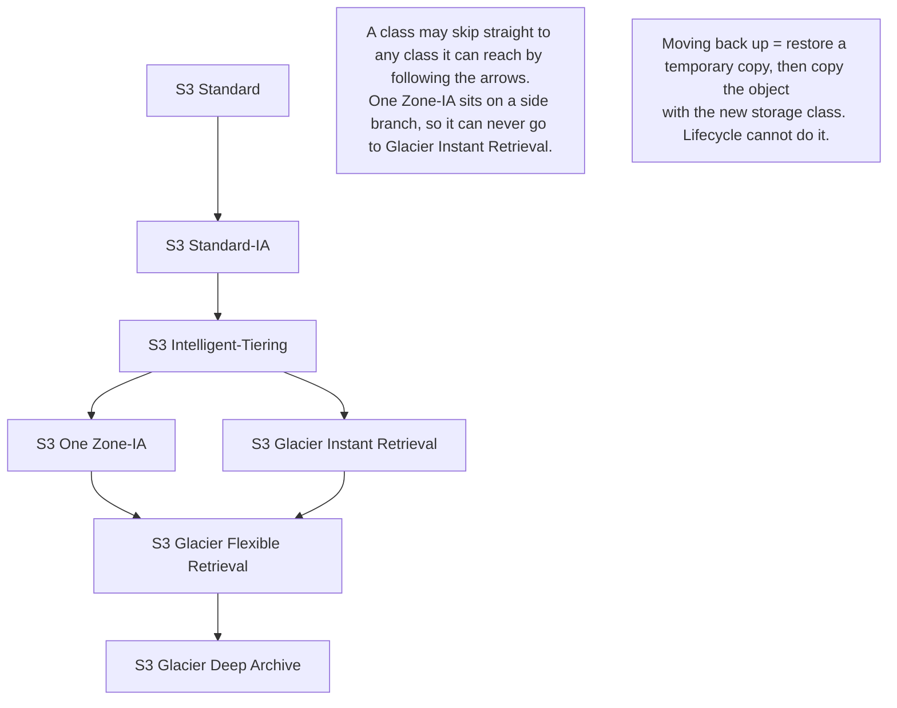
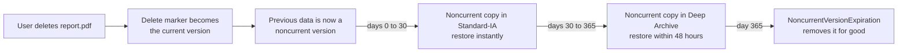
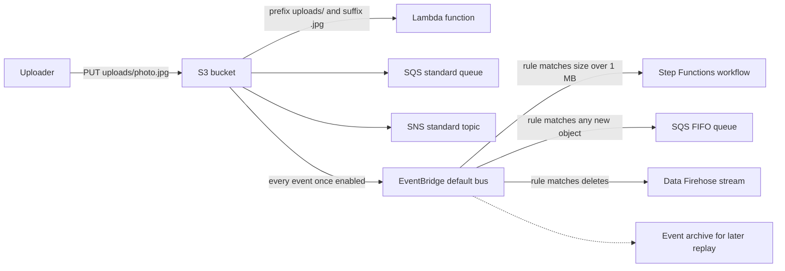
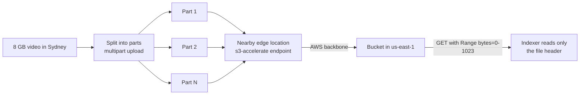
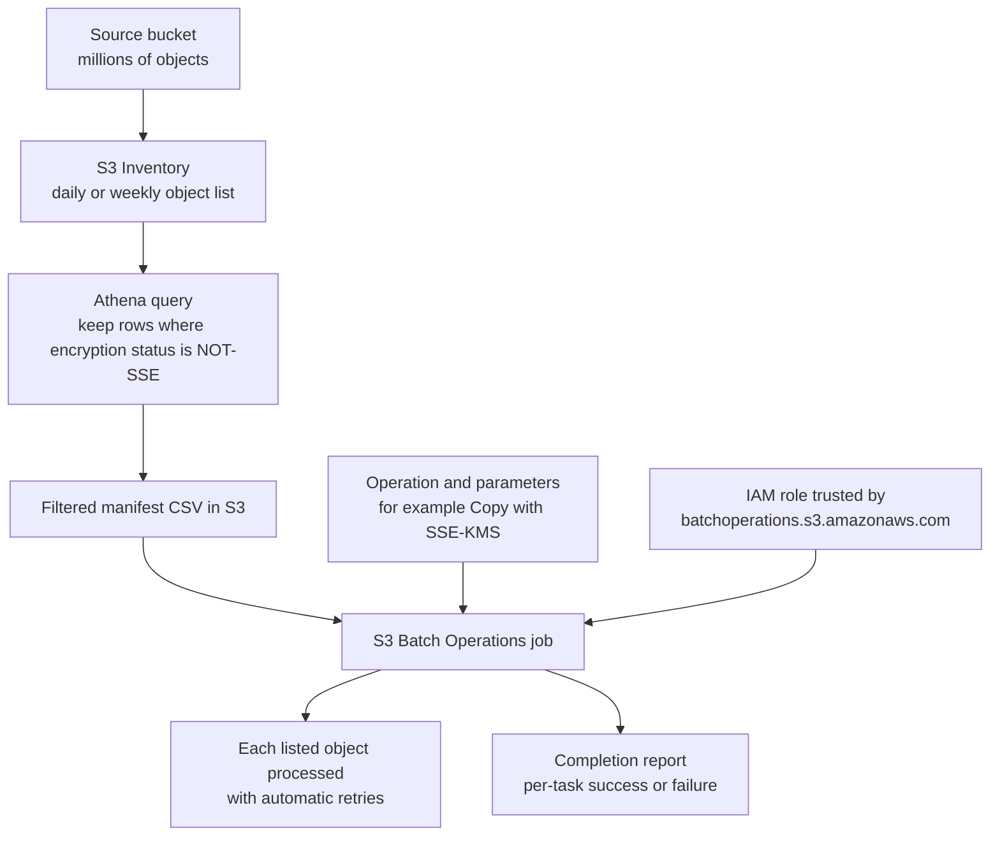
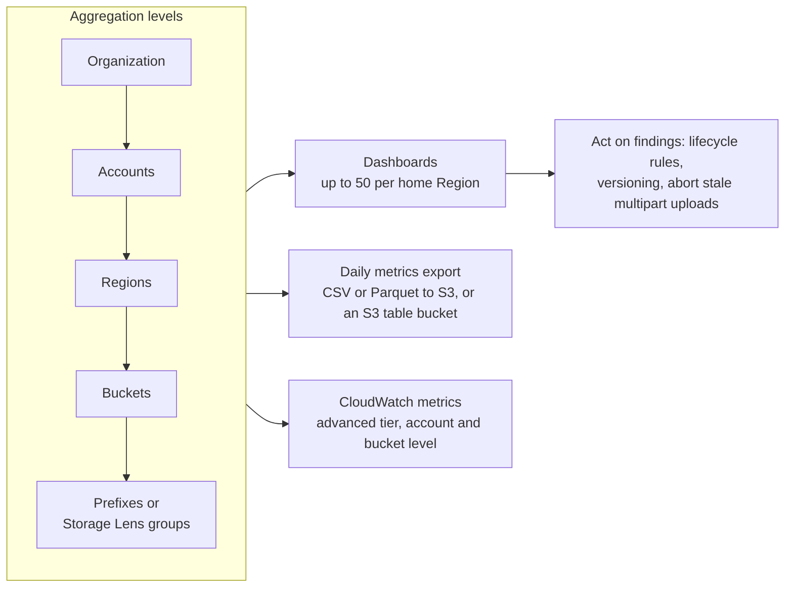

# Amazon S3 Advanced

## Summary

Once data lives in Amazon S3, the next questions are about running it well: paying less as objects age, letting other people pay for their own downloads, reacting automatically when files arrive, moving big files quickly, fixing millions of objects at once and seeing what is going on across every bucket you own. This lesson covers the S3 features that answer those questions: **S3 Lifecycle** rules and **Storage Class Analysis** for cost, **Requester Pays** for shared datasets, **event notifications** (directly to SNS, SQS and Lambda, or through **EventBridge**) for automation, request-rate limits, **multipart upload**, **Transfer Acceleration** and **byte-range fetches** for speed, **S3 Batch Operations** for bulk changes and **S3 Storage Lens** for organization-wide visibility. On the exam they appear as "most cost-effective", "least operational overhead" and "fastest upload" scenarios.

## Key concepts

- **Lifecycle transitions** move objects down a one-way "waterfall" to colder, cheaper storage classes; going back up needs a restore plus a copy, never a lifecycle rule.
- **Lifecycle expiration** deletes objects (or adds a delete marker in a versioned bucket); separate actions handle **noncurrent versions**, **expired delete markers** and **incomplete multipart uploads**.
- Rules can target a **prefix**, **object tags**, an **object size** range, or a combination joined with AND.
- **Storage Class Analysis** watches access patterns and recommends when to move data from **S3 Standard to S3 Standard-IA** (nothing else).
- **Requester Pays**: the bucket owner still pays for storage, the authenticated requester pays for requests and data downloaded; anonymous access is not allowed.
- **Event notifications** send object events to **SNS standard topics**, **SQS standard queues**, **Lambda** or **EventBridge**; S3 needs permission through the destination's **resource-based policy**.
- **EventBridge** receives every event from the bucket and adds rich JSON filtering, many more targets (including SQS FIFO), archive and replay.
- Each **prefix** supports at least **3,500 writes** (PUT/COPY/POST/DELETE) and **5,500 reads** (GET/HEAD) per second, and a bucket can have unlimited prefixes.
- **Multipart upload** is recommended from about **100 MB** and required above **5 GB**; parts upload in parallel and retry independently.
- **Transfer Acceleration** sends uploads and downloads through the nearest **CloudFront edge location** and then over the AWS backbone to the bucket's Region.
- **Byte-range fetches** download parts of an object in parallel or read just the bytes you need.
- **S3 Batch Operations** runs one operation (copy, tag, restore, invoke Lambda...) on a list of objects with retries, progress tracking and a completion report.
- **S3 Storage Lens** aggregates usage and activity metrics from organization down to prefix; free metrics can be queried for **14 days**, advanced metrics for **15 months**.

## Moving objects between storage classes

The previous lesson introduced the storage classes. In practice, data gets colder over time: an invoice is read a lot in its first week, occasionally for a few months, and almost never after a year. Paying S3 Standard prices for that invoice forever wastes money, so S3 lets you **transition** objects to cheaper classes as they age.

Transitions follow a **waterfall**: an object can move to any class it can reach by following the arrows below, but never back up through a lifecycle rule.

| From | Lifecycle can transition to |
|---|---|
| S3 Standard | Standard-IA, Intelligent-Tiering, One Zone-IA, Glacier Instant Retrieval, Glacier Flexible Retrieval, Glacier Deep Archive |
| S3 Standard-IA | Intelligent-Tiering, One Zone-IA, Glacier Instant Retrieval, Glacier Flexible Retrieval, Glacier Deep Archive |
| S3 Intelligent-Tiering | One Zone-IA, Glacier Instant Retrieval, Glacier Flexible Retrieval, Glacier Deep Archive (options shrink as the object sinks into its archive tiers) |
| S3 One Zone-IA | Glacier Flexible Retrieval, Glacier Deep Archive |
| S3 Glacier Instant Retrieval | Glacier Flexible Retrieval, Glacier Deep Archive |
| S3 Glacier Flexible Retrieval | Glacier Deep Archive |
| S3 Glacier Deep Archive | Nothing (it is the bottom of the waterfall) |

Rules of thumb for choosing the target:

- Read about once a month but still needs millisecond access → **Standard-IA** (or **One Zone-IA** if the data can be recreated, because it lives in a single AZ).
- Read about once a quarter with millisecond access → **Glacier Instant Retrieval**.
- Archive where minutes to hours is acceptable → **Glacier Flexible Retrieval** (Expedited 1–5 minutes, Standard 3–5 hours, Bulk 5–12 hours).
- Archive where up to 12 hours (Standard) or 48 hours (Bulk) is acceptable → **Glacier Deep Archive**, the cheapest class.
- Access pattern unknown or changing → put the data in **Intelligent-Tiering** and let S3 move it between tiers per object.

Transitions are not free, so lifecycle math has to include the per-object costs:

| Class you move into | Minimum storage duration | Minimum billable size or overhead |
|---|---|---|
| Standard-IA / One Zone-IA | 30 days | 128 KB |
| Glacier Instant Retrieval | 90 days | 128 KB |
| Glacier Flexible Retrieval | 90 days | 40 KB of metadata per object (8 KB at Standard rates, 32 KB at Glacier rates) |
| Glacier Deep Archive | 180 days | 40 KB of metadata per object, as above |
| Intelligent-Tiering | None | Monthly monitoring fee per object; objects under 128 KB are not monitored and stay in Frequent Access |

Each transition is also billed as a request (per 1,000 objects), which is why millions of tiny objects can cost more to move than they save.

> [!UPDATED] Small objects are no longer transitioned by default
> Since September 2024, lifecycle rules skip objects smaller than **128 KB** unless the rule sets its own object size filter (`ObjectSizeGreaterThan` or `ObjectSizeLessThan`). Before that change, small objects could still go to Glacier Flexible Retrieval and Deep Archive. Configurations created before September 2024 keep the old behavior until you edit them.

> [!UPDATED] The 30-day wait before Standard-IA and One Zone-IA is gone
> For years a lifecycle rule could not move objects into Standard-IA or One Zone-IA until they were at least 30 days old (or 30 days noncurrent). Since **16 July 2026** you can transition to either class from **day 0** (the API now accepts `Days: 0`, and the lifecycle constraints page no longer lists a 30-day rule for current or noncurrent versions). The 30-day *minimum storage charge* of those classes still applies, so moving data that will be deleted next week is still a bad deal.

## S3 Lifecycle rules

A **lifecycle configuration** is a set of up to **1,000 rules** attached to one bucket. Each rule has an ID, a status (Enabled or Disabled), a **filter** that picks the objects, and one or more **actions** with a number of days (or a fixed date).

### Actions

| Action | What it does | Notes |
|---|---|---|
| Transition (current versions) | Moves objects to another class N days after creation | In a versioned bucket it applies to the current version only |
| Expiration (current versions) | Deletes objects N days after creation | Unversioned bucket: object is gone for good. Versioned bucket: S3 adds a delete marker and the old data becomes a noncurrent version |
| NoncurrentVersionTransition | Moves old versions N days after they stopped being current | Optional `NewerNoncurrentVersions` (1–100) keeps the newest few versions out of the transition |
| NoncurrentVersionExpiration | Permanently deletes old versions N days after they became noncurrent | Same optional "keep the newest N versions" setting |
| ExpiredObjectDeleteMarker | Removes delete markers that no longer hide any version | Cannot be used in a rule filtered by tags |
| AbortIncompleteMultipartUpload | Cleans up multipart uploads that were started but never completed after N days | Cannot be used in a rule filtered by tags; plain expiration does **not** remove these parts |

### Filters

- **Prefix**, for example `logs/` or `mp3/`: the rule touches only keys that start with that string.
- **Object tags**, for example `Department=Finance`: every listed tag must match.
- **Object size**: a minimum, a maximum, or a range in bytes (both limits are exclusive).
- Several conditions are combined with a logical **AND**. To treat `projectA/` and `projectB/` differently, write two rules.
- An empty filter means "every object in the bucket" (the console asks you to acknowledge this).

### How timing and billing work

- Ages are counted from the object's creation (last-modified) time, then rounded **up to the next midnight UTC**. An object created at 10:30 on 1 March with a 3-day rule becomes eligible at 00:00 UTC on 5 March.
- New rules apply to **existing objects too**: adding "expire after 30 days" today queues every object older than 30 days for deletion.
- Actions run **asynchronously**. A transition or deletion may happen days after the rule is satisfied, but **billing changes as soon as the rule is satisfied** (you stop paying for an expired object, and you start paying the Glacier rate for a transitioning one). Transitions into Intelligent-Tiering are the exception: billing changes only after the move.
- When rules collide on the same day: permanent deletion beats transition, transition beats creating a delete marker, and Glacier Flexible Retrieval beats Standard-IA or One Zone-IA.
- A single rule cannot schedule a second transition before the first class's minimum duration ends (for example, Glacier Instant Retrieval on day 4 and Deep Archive on day 20 is rejected; day 94 or later works).

> [!EXAMPLE] Scenario 1: originals and disposable previews
> A dating app stores each uploaded profile photo in S3, and an EC2 worker creates preview images of a few hundred KB from it. Previews can be regenerated from the original at any time and are only needed for 60 days. Originals must open instantly for 60 days; after that a wait of up to 6 hours is fine.
>
> - **Originals**: store in **S3 Standard**, with a lifecycle rule on their prefix that transitions them to **Glacier Flexible Retrieval** after 60 days (Standard retrievals finish in 3–5 hours, inside the 6-hour budget).
> - **Previews**: store in **S3 One Zone-IA** (cheaper, and losing an AZ only means regenerating them), with a lifecycle rule on their prefix that **expires** them after 60 days.
>
> Deep Archive would be cheaper for the originals but its Standard retrievals can take up to 12 hours, which breaks the 6-hour requirement.

> [!EXAMPLE] Scenario 2: recoverable deletes
> Company policy: a deleted file must be restorable at once for 30 days (this rarely happens), and restorable within 2 days for up to a year.
>
> 1. **Enable versioning**, so a delete only adds a delete marker and the data survives as a noncurrent version.
> 2. Add a **NoncurrentVersionTransition** to **Standard-IA** (instant access, cheaper than Standard for rarely read data).
> 3. Add a second NoncurrentVersionTransition to **Glacier Deep Archive** after 30 days noncurrent (Bulk restores finish within 48 hours).
> 4. Add a **NoncurrentVersionExpiration** at 365 days so the old copies eventually disappear.

To restore during the first 30 days you copy the noncurrent version over the object (or delete the delete marker); after that you first restore it from Deep Archive.

## Storage Class Analysis

Choosing "60 days" or "90 days" for a transition is often a guess. **S3 analytics – Storage Class Analysis** replaces the guess with data:

- You enable it for a whole bucket or for filters (a prefix, tags, or both; up to **1,000 filters per bucket**), and each filter gets its own analysis.
- It groups objects by **age** (0–14 days, 15–29, 30–44 ... 730+ days) and measures how much of each age group is still being retrieved.
- It only advises on **S3 Standard → S3 Standard-IA**. It does not give recommendations for One Zone-IA or the Glacier classes, and it only considers Standard objects larger than 128 KB.
- First charts appear in the console after **24–48 hours**, but a reliable recommendation typically needs **30 days or more** of observation. Results refresh **daily**.
- You can export a daily **CSV** report to a bucket in the same Region (it can belong to another account) and open it in a spreadsheet or Amazon Quick.
- It is billed per million objects monitored per month.

It is the natural first step before writing (or tuning) lifecycle rules. Do not confuse it with neighbours that sound similar:

| Tool | Question it answers |
|---|---|
| Storage Class Analysis | "After how many days do objects under this prefix stop being read, so I can move them to Standard-IA?" |
| S3 Intelligent-Tiering | "I don't want to decide at all; move each object automatically for a small monitoring fee." |
| S3 Storage Lens | "Across all my accounts and buckets, where is storage growing, and which buckets break best practices?" |
| S3 Inventory | "Give me a daily or weekly list of every object and its metadata (size, class, encryption...)." |

## Requester Pays buckets

Normally the **bucket owner pays everything**: storage, requests and data transfer out. That becomes a problem when you publish a large dataset (genomes, satellite imagery, a web crawl) that other organizations download heavily.

With **Requester Pays** enabled on the bucket:

| Cost | Normal bucket | Requester Pays bucket |
|---|---|---|
| Storage | Owner | Owner |
| Requests (GET, LIST...) | Owner | Requester |
| Data transfer out | Owner | Requester |

How it works and what to remember:

- Requesters must be **authenticated AWS identities** so AWS knows whom to bill. **Anonymous access is turned off** for the bucket.
- Each request must acknowledge the charge with the `x-amz-request-payer: requester` header (or `--request-payer requester` in the CLI). Without it, S3 answers **403 Access Denied**. The bucket owner's own requests do not need the header.
- Failed requests: a 403 is billed to the owner only when the request comes from inside the owner's own account or AWS organization; outsiders' denied requests are not charged to the owner. {{updated: AWS stopped billing bucket owners for unauthorized requests from outside their account or organization; the slides predate this.}}
- If the requester **assumes an IAM role**, the account that owns the role pays. So for real cost transfer, grant access to principals in the consumers' accounts (through the bucket policy) rather than handing out a role in your own account.
- Owners should think twice about long-lived **presigned URLs** on a Requester Pays bucket: requests made with them are billed to the owner whose credentials signed them.
- For restores from the Glacier classes, the requester pays for the request but the **owner pays the retrieval charges**.
- Requester Pays is a bucket-level switch (not per object), and a Requester Pays bucket cannot be the target of server access logging.

## S3 Event Notifications

S3 can announce what happens to objects so other services react in near real time. The classic example: a user uploads `photo.jpg`, S3 emits an `s3:ObjectCreated:Put` event, a Lambda function creates the thumbnail.

### What can trigger a notification

| Event family | Example event types | Typical use |
|---|---|---|
| Object created | `s3:ObjectCreated:*`, `:Put`, `:Post`, `:Copy`, `:CompleteMultipartUpload` | Thumbnails, virus scanning, indexing, ETL triggers |
| Object removed | `s3:ObjectRemoved:Delete`, `:DeleteMarkerCreated` | Keep a search index or database in sync |
| Restore | `s3:ObjectRestore:Post`, `:Completed`, `:Delete` | Tell a user their archived file is ready |
| Replication | `s3:Replication:OperationFailedReplication`, `:OperationMissedThreshold`... | Alert when replication fails or misses the 15-minute RTC threshold |
| Lifecycle | `s3:LifecycleExpiration:*`, `s3:LifecycleTransition` | Audit what lifecycle deleted or moved |
| Other | `s3:IntelligentTiering`, `s3:ObjectTagging:*`, `s3:ObjectAnnotation:*`, `s3:ObjectAcl:Put`, `s3:ObjectRetention:Put` | Compliance and governance workflows |

Each notification configuration has **one destination** and can be narrowed with a **prefix** and/or **suffix** filter, for example prefix `uploads/` and suffix `.jpg` (no `*` wildcards). Two configurations for the same event type cannot have overlapping filters, for example a catch-all rule plus an `images/` rule; overlapping prefixes are allowed only when their suffixes cannot both match the same key, such as `.jpg` and `.png`.

> [!UPDATED] Not unlimited, and more event types
> A bucket supports up to **100 event notification configurations** (a fixed quota). The event list has also grown beyond create/remove/restore/replication: lifecycle expiration and transition, Intelligent-Tiering archiving, tagging, object annotations, ACL changes and Object Lock retention changes can all trigger notifications.

### Destinations and permissions

The four destinations are **SNS standard topics**, **SQS standard queues**, **Lambda functions** and **EventBridge**. The topic, queue or function must be in the **same Region** as the bucket.

S3 does not use an IAM role to deliver notifications. Instead, the destination must trust S3 through its **resource-based policy**:

- **SQS**: the queue access policy allows principal `s3.amazonaws.com` to call `sqs:SendMessage`, ideally limited with `aws:SourceArn` (the bucket ARN) and `aws:SourceAccount`.
- **SNS**: the topic access policy allows `s3.amazonaws.com` to call `sns:Publish`, with the same conditions.
- **Lambda**: the function's resource policy allows `s3.amazonaws.com` to call `lambda:InvokeFunction` (the S3 console adds this for you).
- If the queue or topic uses a **customer managed KMS key**, its key policy must also let S3 use `kms:GenerateDataKey` and `kms:Decrypt`.

If the permission is missing, saving the notification fails with a "Unable to validate the following destination configurations" error. When it works, S3 sends an `s3:TestEvent` to the destination.

Delivery behaviour worth knowing:

- Notifications are delivered **at least once**: duplicates can happen, so consumers should be idempotent.
- They are **not guaranteed to arrive in order**.
- Most arrive within seconds, though some take a minute or more.
- A notification message can be up to 64 KB.
- If a Lambda triggered by uploads writes its output back into the same bucket and prefix, it triggers itself in a loop. Use a separate bucket, or separate input and output prefixes.
- Native notifications cannot target **SQS FIFO queues** or **SNS FIFO topics**.
- There is no extra S3 charge for notifications; you pay for the SNS, SQS or Lambda usage.

### Amazon EventBridge integration

Turning on **Send notifications to Amazon EventBridge for all events in this bucket** makes S3 send **every** supported event (Object Created, Object Deleted, Object Restore Initiated/Completed/Expired, Object Storage Class Changed, Object Tags Added and more) to the account's default event bus. You then write **rules** that pick the events you care about.

| | Native event notifications | Through EventBridge |
|---|---|---|
| Filtering | Key prefix and suffix only | JSON event patterns on any field: object size, key, requester, source IP, reason, with prefix, suffix, numeric and anything-but matching |
| Destinations | SNS standard, SQS standard, Lambda | Many AWS targets (Step Functions, Kinesis Data Streams, Data Firehose, SQS including FIFO, SNS, Lambda, ECS tasks, API Gateway, CodePipeline...), HTTP API destinations and other event buses; up to 5 targets per rule |
| Fan-out | One destination per configuration (use SNS to fan out) | Many rules can match the same event |
| Extra features | None | Archive and replay, configurable retries (default 24 hours / 185 attempts), dead-letter queues, cross-account and cross-Region buses |
| Setup | Destination resource policy | One bucket toggle (takes about 5 minutes to apply), then rules and target permissions |

> [!UPDATED] More EventBridge targets than the slides list
> The slides mention "over 18" services. The EventBridge documentation now lists more than 25 AWS service targets plus API destinations and other event buses, and SQS FIFO and fair queues are supported targets.

> [!UPDATED] S3 events in EventBridge are billed per event
> On the [EventBridge pricing page](https://aws.amazon.com/eventbridge/pricing/), S3 events sent to the default bus count as **opt-in data events**, and their ingestion costs the same as custom events: USD 1.00 per million in us-east-1 when checked (October 2026). Delivery to a target in the same account is free; sending them on to another event bus or to a target in another account is billed per million as well. AWS's launch post adds that S3 only sends, and you only pay for, events that match one of your rules. The page's "billed at the source" footnote covers a different case: S3 events forwarded from the default bus to the new enhanced custom event buses do not pay a second ingress fee there. The S3 pricing page has no separate line for this, so estimate at volume as EventBridge ingestion plus the targets' own charges.

## S3 performance

### Baseline: request rates per prefix

S3 scales automatically. For each **prefix** in a bucket, an application can achieve at least:

- **3,500** PUT/COPY/POST/DELETE requests per second, and
- **5,500** GET/HEAD requests per second.

A **prefix** is the part of the key between the bucket name and the object name. There is **no limit on the number of prefixes**, so throughput grows by spreading keys across more prefixes and reading them in parallel.

| Object key | Prefix |
|---|---|
| `sales/2026/q1/report.csv` | `sales/2026/q1/` |
| `sales/2026/q2/report.csv` | `sales/2026/q2/` |
| `img/a/cat.png` | `img/a/` |
| `img/b/dog.png` | `img/b/` |

Reading evenly from those four prefixes allows at least 4 × 5,500 = **22,000 GET/HEAD per second**; ten prefixes would allow 55,000. Scaling up to a new rate is gradual: while S3 adapts you may briefly see **HTTP 503 Slow Down** errors, which the AWS SDKs retry automatically. Typical latency for small objects (or time to first byte for large ones) is roughly **100–200 ms**.

> [!NOTE] When 100–200 ms is too slow
> For single-digit-millisecond access inside one AZ, AWS offers **S3 Express One Zone** (directory buckets). For hot objects read again and again, put **CloudFront** or **ElastiCache** in front of S3. Keep compute in the **same Region** as the bucket to cut latency and transfer cost. If objects are encrypted with SSE-KMS, remember that KMS request quotas can become the bottleneck before S3 does.

### Multipart upload

Multipart upload splits one object into parts that upload independently, in any order and in parallel, and S3 assembles them when you complete the upload.

- **Recommended** for objects of about **100 MB** and larger; **required** above **5 GB**, the maximum size of a single PUT.
- Parts are **5 MiB to 5 GiB** each (the last part can be smaller), numbered 1 to **10,000**.
- A failed part is simply retried; the rest of the upload is untouched. You can also pause and resume, or start uploading before you know the final size.
- The AWS CLI (`aws s3 cp`) and SDK transfer managers switch to multipart automatically (the CLI default threshold is 8 MB).
- Parts of an upload that is never completed or aborted **stay in the bucket and are billed**. A lifecycle rule with **AbortIncompleteMultipartUpload** (for example after 7 days) prevents this silent cost.

> [!UPDATED] Maximum object size is now 50 TB
> Since **2 December 2025** a single S3 object can be up to **50 TB** (48.8 TiB), ten times the old 5 TB limit, in all storage classes and with all S3 features. The 5 GB single-PUT limit and the 160 GB console upload limit did not change; anything larger must use multipart upload.

### S3 Transfer Acceleration

When users far from the bucket's Region upload (or download) large files, most of the time is lost on the long public-internet path. **Transfer Acceleration** lets the client send data to the **nearest CloudFront edge location**, which forwards it to the bucket over the optimized AWS network.

- Enable it per bucket, then use the special endpoint `bucketname.s3-accelerate.amazonaws.com` (or `bucketname.s3-accelerate.dualstack.amazonaws.com` for IPv6). The normal endpoint keeps working without acceleration.
- The bucket name must be **DNS-compliant with no dots**, and requests must use virtual-hosted style. It can take up to 20 minutes after enabling before speeds improve.
- It works together with **multipart upload**: parallel parts, each taking the fast path.
- You pay a per-GB fee on top of normal transfer pricing (USD 0.04 per GB through US, Europe and Japan edges, 0.08 through other edges at the time of checking), but **only when the transfer is actually accelerated**; if S3 judges it would not be faster, there is no acceleration charge.
- The **Speed Comparison tool** shows, from your browser, how much faster accelerated uploads would be to each Region.

> [!UPDATED] Not every Region supports Transfer Acceleration
> The S3 documentation currently lists 15 Regions (for example us-east-1, us-west-2, eu-west-1, eu-central-1, ap-northeast-1, ap-southeast-2, sa-east-1) where buckets can use Transfer Acceleration. Check the list before designing around it for a newer Region.

### Byte-range fetches

A GET request can include an HTTP `Range` header (for example `bytes=0-1023`) to download only part of an object.

- **Parallel downloads**: split a 2 GB object into ranges and fetch them over several connections at once, then reassemble. Higher total throughput, and a failed range is retried on its own instead of restarting the whole download.
- **Partial reads**: fetch only the first kilobytes to read a file header, or only the slice of a log you need.
- If the object was uploaded with multipart upload, fetching in the same part sizes (or with `partNumber=N`) gives the best performance.

| Technique | Problem it solves | Direction |
|---|---|---|
| More prefixes + parallel requests | Request-rate ceiling, 503 Slow Down | Reads and writes |
| Multipart upload | Large files, unreliable networks, files over 5 GB | Upload |
| Transfer Acceleration | Long geographic distance to the bucket's Region | Upload and download |
| Byte-range fetches | Large downloads, partial reads, resilient retries | Download |
| CloudFront / ElastiCache | Repeated reads of the same hot objects | Download |

## S3 Batch Operations

Some jobs touch millions of existing objects: encrypt everything that was stored unencrypted years ago, copy a whole dataset to another account, re-tag objects for a new cost-allocation scheme, restore an archive from Glacier. Writing a script for this means handling throttling, retries, progress tracking and reporting yourself. **S3 Batch Operations** does it as a managed, serverless job.

A **job** consists of:

- a **manifest**: the list of objects (bucket, key, optional version ID). It can be a CSV file, an **S3 Inventory** report, a list that S3 generates from filters you give it (prefix, suffix, creation date, size, storage class, encryption type), or a list generated from a replication configuration;
- one **operation** with its parameters;
- an **IAM role** that the service (`batchoperations.s3.amazonaws.com`) assumes, with permission to read the manifest, perform the operation and write the report;
- an optional **completion report** (all tasks or failures only) and a **priority** relative to your other jobs.

Supported operations today: **Copy objects**, **Compute checksums**, **Delete all object tags**, **Invoke AWS Lambda function** (for any custom per-object action), **Replace all object tags**, **Replace access control list (ACL)**, **Restore objects** from the Glacier classes, **Update object encryption**, **Batch Replication** of existing objects, **Object Lock retention** and **Object Lock legal hold**.

S3 tracks progress, retries failed tasks, can notify you, and writes the completion report. A job can cover up to 4 billion objects (20 billion for several operations such as copy, tagging, Lambda and replication). Jobs created in the console wait for your confirmation before they run. Pricing is per job plus per million objects processed (USD 0.25 per job and USD 1.00 per million objects in us-east-1 at the time of checking), on top of the requests the operation makes.

> [!UPDATED] More operations and generated manifests
> Since the slides were made, Batch Operations gained **Compute checksums**, **Update object encryption**, **Batch Replication** and the Object Lock operations, and it can now **generate the object list itself** from filters, so a separate Inventory report is optional for simple selections.

> [!TIP] Restores go faster through Batch Operations
> Standard retrievals from Glacier Flexible Retrieval that are started by a Batch Operations restore job typically begin within minutes (and finish within 3–5 hours), and Batch Operations uses your account's full restore request rate. For mass restores it beats looping over `RestoreObject` yourself.

## S3 Storage Lens

**S3 Storage Lens** is the analytics dashboard for S3 as a whole. It collects daily metrics about storage **usage** and **activity**, from an entire **AWS Organization** down to accounts, Regions, storage classes, buckets, prefixes and **Storage Lens groups** (custom groupings by prefix, suffix, tags, size or age), and it flags anomalies and best-practice gaps.

Dashboards:

- Every account gets a **default dashboard** named `default-account-dashboard`, preconfigured by S3, covering the whole account across Regions and updated daily. You **cannot delete** it, but you can **disable** it (it then stops updating) or upgrade it to advanced metrics. It also feeds the **Account snapshot** on the S3 **Buckets** page.
- You can create custom dashboards scoped to Regions, buckets or accounts. For an **organization-wide** view, enable trusted access from the Organizations **management account**, then build dashboards there or from a **delegated administrator** account.
- Metrics can also be **exported daily** in CSV or Parquet to a bucket in the dashboard's home Region, or directly into the AWS-managed S3 table bucket `aws-s3` for SQL queries with Athena and other tools.

### Metric categories

| Category | Example metrics | Tier | Helps you... |
|---|---|---|---|
| Summary | `StorageBytes`, `ObjectCount` | Free | Find the fastest-growing or abandoned buckets and prefixes |
| Cost optimization | `NonCurrentVersionStorageBytes`, `IncompleteMultipartUploadStorageBytes` (older than 7 days) | Free (lifecycle rule counts are advanced) | Spot waste: forgotten versions, stale uploads, data to tier down |
| Data protection | `VersioningEnabledBucketCount`, `MFADeleteEnabledBucketCount`, `SSEKMSEnabledBucketCount` | Free (replication rule counts are advanced) | Find buckets not following protection best practices |
| Access management | `ObjectOwnershipBucketOwnerEnforcedBucketCount` | Free | See which Object Ownership setting buckets use |
| Events | `EventNotificationEnabledBucketCount` | Free | See which buckets send event notifications |
| Performance | `TransferAccelerationEnabledBucketCount` | Free (advanced performance metrics are paid) | See which buckets use Transfer Acceleration |
| Activity | `AllRequests`, `GetRequests`, `PutRequests`, `BytesDownloaded` | Advanced | Find cold data by request activity, not just age |
| Detailed status codes | `200OKStatusCount`, `403ForbiddenErrorCount`, 503 error counts | Advanced | Troubleshoot permission errors and throttling per prefix |

### Free vs advanced

| | Free metrics | Advanced metrics and recommendations |
|---|---|---|
| Cost | Included for every account | Per million objects monitored per month |
| Metrics | Usage-focused categories above | Adds activity, detailed status code, advanced cost optimization, advanced data protection and advanced performance metrics |
| Data available for queries | **14 days** | **15 months** |
| Prefix-level aggregation | No | Yes, plus an expanded prefixes report covering billions of prefixes |
| CloudWatch publishing | No | Yes, at no extra publishing charge: account- and bucket-level metrics, once a day, for alarms, metric math and anomaly detection. Prefix-level metrics stay in the dashboard and are **not** sent to CloudWatch |
| Recommendations | No | Contextual suggestions, outlier and significant-change call-outs |
| Storage Lens groups aggregation | No | Yes |

> [!UPDATED] Storage Lens has grown
> Since the slides, Storage Lens added **Storage Lens groups**, an **expanded prefixes metrics report**, **advanced performance metrics** (I/O patterns, cross-Region access), and export straight into an **S3 table bucket**. Note that the default dashboard covers your account; seeing several accounts at once needs an organization-level dashboard with trusted access.

> [!NOTE] How many free metrics?
> AWS no longer states a total, but the [Storage Lens metrics glossary](https://docs.aws.amazon.com/AmazonS3/latest/userguide/storage_lens_metrics_glossary.html) lists **28 free base metrics** (the ones with a CloudWatch and export name, such as `StorageBytes` or `EncryptedObjectCount`), which matches the slides' "around 28". The dashboard also shows percentages and averages derived from them, which brings the free rows in the glossary to 62 (counted October 2026).

## Exam tips

> [!EXAM] Lifecycle keywords
> "Objects are rarely accessed after N days", "archive after a year", "delete logs after 365 days" → **S3 Lifecycle** transition and expiration rules, scoped by **prefix** or **tags**. "Recover deleted files for X days" → **versioning** plus **noncurrent version** transitions and expiration.

> [!EXAM] Retrieval time picks the Glacier class
> Milliseconds → Glacier Instant Retrieval. Minutes to 5 hours → Glacier Flexible Retrieval. Within 12 or 48 hours and cheapest → Glacier Deep Archive. Data that can be recreated and must stay instant → One Zone-IA.

> [!EXAM] "Which day should we transition?"
> A request for data-driven advice on moving Standard data to Standard-IA → **Storage Class Analysis**. A request for automatic, per-object tiering with no rules at all → **Intelligent-Tiering**.

> [!EXAM] Sharing large datasets
> "Share a dataset with other AWS accounts without paying for their downloads" → **Requester Pays**. Remember requesters must be authenticated.

> [!EXAM] Reacting to uploads
> "Generate thumbnails / process files as soon as they land in S3" → **S3 event notification to Lambda** (or to SQS for buffering). "Filter on object size or metadata", "several destinations", "replay events", "SQS FIFO" or "Step Functions" → **EventBridge**.

> [!EXAM] Speed keywords
> "503 Slow Down" or "need more requests per second" → spread keys over more **prefixes**. "Large files", "uploads fail halfway" → **multipart upload**. "Users worldwide upload to one bucket" → **Transfer Acceleration** (often combined with multipart). "Need only part of a file" or "parallel download" → **byte-range fetches**.

> [!EXAM] Bulk changes
> "Encrypt / copy / tag / restore millions of existing objects with least effort" → **S3 Batch Operations**, with **S3 Inventory** (plus **Athena**) or a generated manifest to select the objects.

> [!EXAM] Visibility across accounts
> "Organization-wide view of S3 usage, find buckets without versioning or encryption, find incomplete multipart uploads" → **S3 Storage Lens**. "Keep metrics for over a year", "prefix-level metrics", "publish to CloudWatch" → Storage Lens **advanced metrics**.

## Common traps

> [!TRAP] Lifecycle cannot move data "up"
> No lifecycle rule moves objects from Glacier Deep Archive (or any colder class) back to Standard or Standard-IA. You must restore a temporary copy and then copy the object with the new storage class, for example with Batch Operations.

> [!TRAP] One Zone-IA is a dead end for Glacier Instant Retrieval
> From One Zone-IA, lifecycle can only go to Glacier Flexible Retrieval or Deep Archive. And One Zone-IA is never right for data you cannot recreate, because losing its AZ loses the data.

> [!TRAP] Expiration does not clean up everything
> Expiring current versions in a versioned bucket only adds delete markers; the data stays as noncurrent versions and keeps costing money until a **NoncurrentVersionExpiration** removes it. Incomplete multipart uploads need their own **AbortIncompleteMultipartUpload** action.

> [!TRAP] Transitioning tiny objects
> Moving millions of objects smaller than 128 KB costs a request per object and, in IA and Glacier Instant Retrieval, bills each as 128 KB. That is why lifecycle skips them by default. Aggregating small files first is usually cheaper.

> [!TRAP] Storage Class Analysis does not cover Glacier
> It only recommends Standard → Standard-IA timing. An answer claiming it tells you when to archive to Glacier or One Zone-IA is wrong.

> [!TRAP] Requester Pays with anonymous users
> A public website or anonymous download link cannot use Requester Pays, because S3 has no one to bill. Requesters who assume a role in the owner's account also shift the bill back to the owner.

> [!TRAP] Event notification to an SQS FIFO queue
> Native S3 notifications support only standard SQS queues and standard SNS topics. If the answer needs FIFO ordering, route through **EventBridge**. And a missing queue or topic access policy, not an IAM role on the bucket, is why S3 cannot deliver.

> [!TRAP] ObjectRemoved does not catch lifecycle deletes
> `s3:ObjectRemoved:*` fires for API deletes only. Deletions done by lifecycle rules raise `s3:LifecycleExpiration:*` events instead.

> [!TRAP] Transfer Acceleration is not a caching layer
> It speeds up long-distance transfers to and from one bucket; it does not cache content near readers (that is CloudFront) and it does not raise the per-prefix request rate (that is more prefixes).

> [!TRAP] Storage Lens prefix metrics in CloudWatch
> Advanced metrics add prefix aggregation and CloudWatch publishing, but only account- and bucket-level metrics reach CloudWatch. An answer that sets a CloudWatch alarm on one prefix's Storage Lens metric does not work; prefix detail is read in the dashboard or the metrics export.

> [!TRAP] Changing the storage class does not change performance
> Moving a hot dataset to Standard-IA or Intelligent-Tiering does not fix 503 errors; all classes share the same per-prefix request rates, and IA adds retrieval fees.
