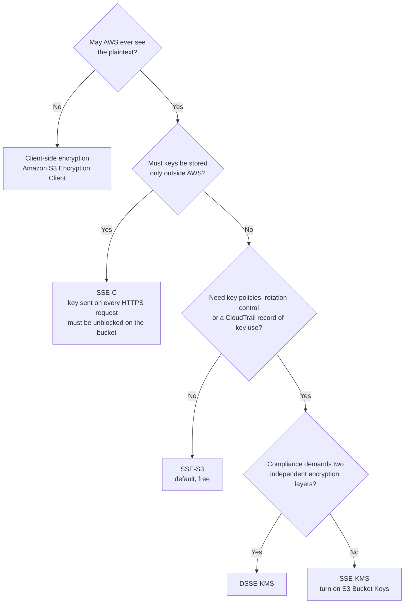
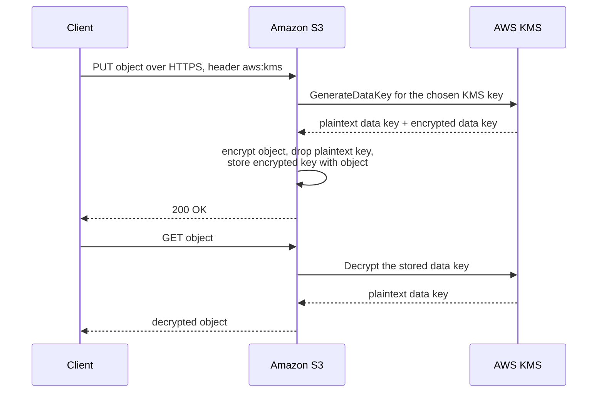
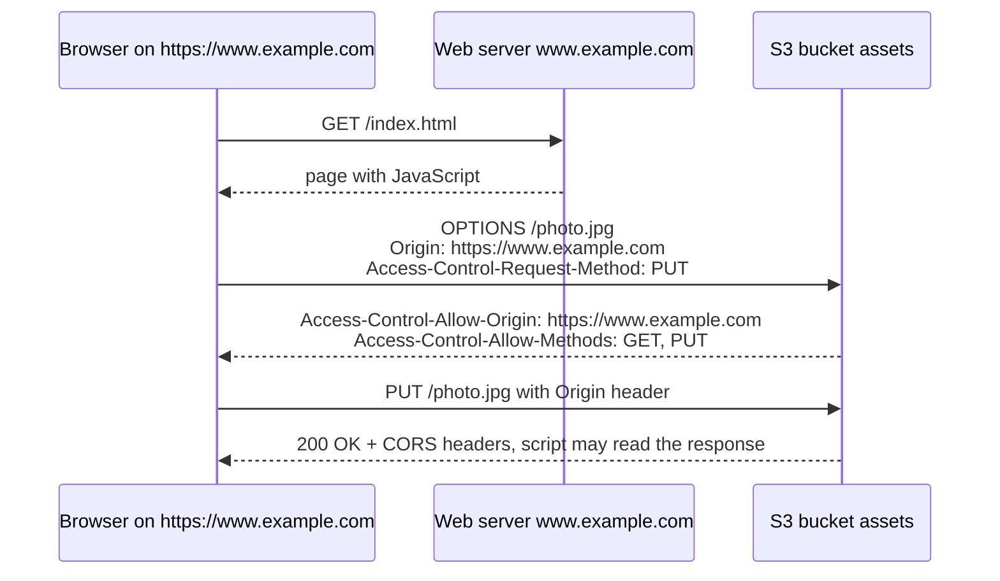
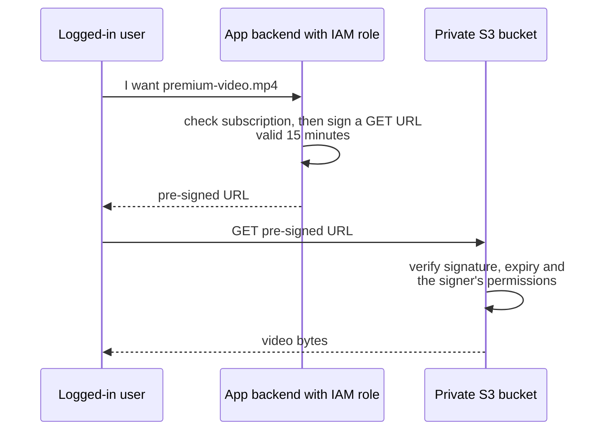
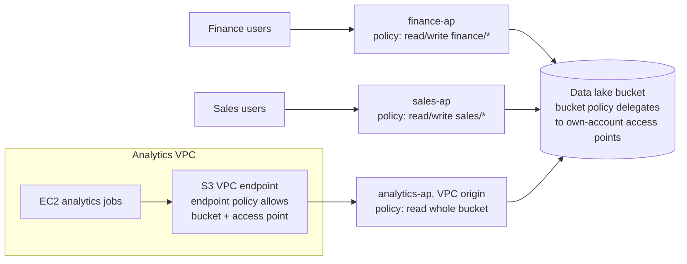
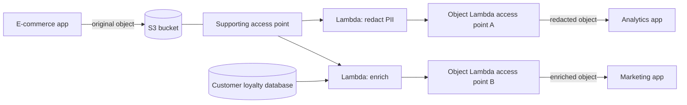

# Amazon S3 Security

## Summary

Amazon S3 gives you several independent layers of protection, and exam questions usually test whether you can pick the right layer for a requirement. **Encryption at rest** is always on (SSE-S3 by default) and can be upgraded to KMS keys when you need key control and an audit trail, or replaced by keys you manage yourself. **Encryption in transit** is enforced with a bucket policy that rejects plain HTTP. **CORS** lets a web page on one origin read objects from your bucket. **MFA Delete** and **S3 Object Lock** stop data from being destroyed, by accident or on purpose. **Server access logs** record who asked for what. **Pre-signed URLs** hand out temporary access to one object without making anything public. **Access points** split one big bucket policy into one small policy per team or per network, and **S3 Object Lambda** (now closed to new customers) rewrites objects on the way out.

## Key concepts

- **SSE-S3** is on by default for every bucket: AES-256 with keys AWS owns and manages, free, header value `AES256`.
- **SSE-KMS** uses an AWS KMS key (`aws:kms`): you control the key policy and every use shows up in **CloudTrail**, but each upload/download calls KMS and counts against the **KMS request quota**.
- **S3 Bucket Keys** cut SSE-KMS request traffic to KMS (and its cost) by up to 99%.
- **DSSE-KMS** applies two independent layers of encryption for rules that demand multi-layer encryption.
- **SSE-C**: you send your own key with every request, over HTTPS only; S3 never stores it. Since April 2026 it is **blocked by default** on new buckets.
- **Client-side encryption**: you encrypt before upload and decrypt after download; S3 only ever sees ciphertext.
- **`aws:SecureTransport`** = `false` in a Deny statement forces HTTPS; S3 checks the **bucket policy first**, and only uploads it lets through get default encryption.
- **CORS** is a browser check: the bucket being called must return `Access-Control-Allow-Origin` for the calling origin (scheme + host + port).
- **MFA Delete** needs versioning, can only be turned on by the **root user** via CLI/API, and protects permanent version deletes and versioning suspension.
- **Server access logs** delivered to S3 go to another bucket in the **same Region and account**; never log a bucket into itself (CloudWatch Logs is now a second destination).
- **Pre-signed URLs** carry the creator's permissions for a limited time: up to 12 hours from the console, up to 7 days from the CLI/SDK.
- **Object Lock** (WORM, versioning required): **compliance** mode cannot be bypassed by anyone, even root; **governance** mode can be bypassed with `s3:BypassGovernanceRetention`; **legal hold** has no end date.
- **Access points** each have their own DNS name, policy and network origin (**Internet** or **VPC**); VPC-origin access points need a VPC endpoint whose policy allows both the access point and the bucket.
- **S3 Object Lambda** puts a Lambda function between the caller and the bucket to redact, convert or enrich data on GET.

## Encryption at rest

S3 can protect stored objects in four server-side ways plus one client-side way. The question is always **who holds the key, who does the encryption work, and what you need to prove to an auditor**.

| Method | Who manages the key | Who encrypts | Request header value | Audit key use | Extra cost | Typical exam signal |
|---|---|---|---|---|---|---|
| **SSE-S3** | AWS (S3 owned keys) | S3 | `x-amz-server-side-encryption: AES256` | No | None | "Encrypt at rest, no key management" |
| **SSE-KMS** | You, in AWS KMS (AWS managed `aws/s3` or customer managed key) | S3 | `x-amz-server-side-encryption: aws:kms` (+ optional key ID) | Yes, CloudTrail | KMS requests, plus USD 1/month per customer managed key | "Control who can use the key", "audit key usage", "rotate or disable the key" |
| **DSSE-KMS** | You, in AWS KMS | S3, two layers | `x-amz-server-side-encryption: aws:kms:dsse` | Yes, CloudTrail | Higher than SSE-KMS | "Two layers of encryption required by compliance" |
| **SSE-C** | You, outside AWS | S3, with the key you send | `x-amz-server-side-encryption-customer-algorithm` + key headers, HTTPS only | No (S3 does not keep the key) | None | "Keys must stay on premises, but S3 should do the encryption" |
| **Client-side** | You | Your application, before upload | None (S3 sees an ordinary object) | Your own tooling | Your own compute | "AWS must never see plaintext" |

> [!UPDATED] Five options, not four
> The slides list four methods. AWS now documents **DSSE-KMS** (dual-layer SSE with KMS keys) as a fourth server-side option alongside SSE-S3, SSE-KMS and SSE-C, and the console offers it as a default encryption type. S3 Bucket Keys do not work with DSSE-KMS.



### SSE-S3: the default

Since 5 January 2023 every new object uploaded to S3 is encrypted with SSE-S3 unless you ask for something else. S3 creates a unique key per object, protects those keys with a root key it rotates regularly, and uses 256-bit AES (AES-GCM). It costs nothing and changes nothing for readers: anyone who is allowed to `GetObject` gets the decrypted object back.

Because it is the bucket default, you no longer have to send the `x-amz-server-side-encryption: AES256` header; you only send it when you want to be explicit or when a bucket policy demands it.

### SSE-KMS: control and audit

With SSE-KMS, S3 asks AWS KMS for the key material using **envelope encryption**:



What you gain:

- **Control**: the KMS **key policy** decides who may use the key. A user with `s3:GetObject` but without `kms:Decrypt` on the key gets `AccessDenied`. Uploads need `kms:GenerateDataKey`; downloads need `kms:Decrypt`; multipart uploads need both.
- **Audit**: every `GenerateDataKey` and `Decrypt` call is a CloudTrail event, so you can prove who touched which data and when.
- **Key lifecycle**: with a customer managed key you can rotate, disable or schedule deletion of the key.

Things to remember:

- If you send `aws:kms` without a key ID, S3 uses the AWS managed key **`aws/s3`**. Objects encrypted with `aws/s3` **cannot be shared cross-account**; use a customer managed key and grant the other account in its key policy.
- The KMS key must be a **symmetric** key in the **same Region** as the bucket.
- Every GET or PUT of a KMS-encrypted object must travel over HTTPS (TLS) **and** be signed with valid credentials (Signature Version 4) of a principal that is allowed to use the key. That is why anonymous public reads of SSE-KMS objects fail, even when a bucket policy allows them.
- Changing the bucket default to SSE-KMS does **not** re-encrypt existing objects. Copy them in place, or use **S3 Batch Operations** for millions of objects.

#### The KMS request quota

Every SSE-KMS upload triggers one `GenerateDataKey` call and every download one `Decrypt` call, on your account's behalf. These count against the shared **"Cryptographic operations (symmetric) request rate"** quota of KMS in that Region, together with every other service and application that uses KMS. Go above it and KMS throttles the requests, so uploads and downloads of KMS-encrypted objects start failing. That matters for a hot bucket serving thousands of objects per second.

| Region group | Default shared quota (symmetric crypto operations per second) |
|---|---|
| Most Regions | 10,000 |
| us-east-2, ap-southeast-1, ap-southeast-2, ap-northeast-1, eu-central-1, eu-west-2, eu-south-2 | 20,000 |
| us-east-1, us-west-2, eu-west-1 | 100,000 |

> [!UPDATED] KMS quotas are higher than the slides say
> The slides give 5,500 / 10,000 / 30,000 requests per second. The KMS quota table (checked October 2026) lists 10,000, 20,000 or 100,000 depending on the Region. All values are adjustable through the **Service Quotas** console. (One paragraph on the same KMS page still mentions 5,500 / 10,000 / 50,000; the quota table is the authoritative list.)

Ways to stay under the quota: enable **S3 Bucket Keys**, request a quota increase in Service Quotas, or use SSE-S3 for data that does not need KMS-level control.

#### S3 Bucket Keys

Without a Bucket Key, S3 calls KMS for every object. With a Bucket Key, KMS issues a short-lived **bucket-level key** that S3 keeps for a while and uses to derive per-object data keys locally. KMS request traffic (and the KMS bill) drops by **up to 99%**. Side effects worth knowing: CloudTrail shows far fewer KMS events, and the encryption context becomes the **bucket ARN** instead of the object ARN, so key policies that filter on object ARNs must be updated.

> [!EXAMPLE] A data lake that keeps getting throttled
> An analytics team stores 200 million small Parquet files under SSE-KMS with a customer managed key. Athena queries start failing with throttling errors when several jobs run together. Turning on an S3 Bucket Key (and copying the existing objects so they pick it up) removes most of the KMS calls, so the jobs stop hitting the KMS quota and the KMS request charges fall sharply.

### DSSE-KMS: two layers

Dual-layer server-side encryption applies two independent AES-256 layers: one with a data key from KMS, then a second with a separate S3-managed key. It exists for regulations that explicitly require multi-layer encryption. It is slower and costs more than SSE-KMS, and it cannot use S3 Bucket Keys. On the exam, pick it only when the question says "two layers" or "dual-layer".

### SSE-C: your key, S3's encryption

With SSE-C you keep the key (for example in an on-premises HSM) and pass it to S3 in request headers on **every** PUT and GET. S3 encrypts or decrypts the object, then forgets the key; it keeps only a salted HMAC to check that the next request uses the same key. Consequences:

- **HTTPS is mandatory.** S3 rejects SSE-C over HTTP; a key sent over HTTP should be treated as compromised.
- **Lose the key, lose the object.** You must track which key encrypted which object version.
- **No console support.** You use the CLI, SDKs or REST API.
- AWS services cannot read SSE-C objects on your behalf, and sharing is awkward because every reader needs the key.
- SSE-C cannot be a bucket's default encryption.

> [!UPDATED] SSE-C is now blocked by default
> Since April 2026, all new general purpose buckets (and existing buckets in accounts that had no SSE-C objects) reject SSE-C writes with HTTP 403 `AccessDenied`. To use SSE-C you must explicitly allow it: in the console under **Properties** → **Default encryption** → **Blocked encryption types**, or with `PutBucketEncryption` and `BlockedEncryptionTypes` set to `NONE`. Reading existing SSE-C objects still works. The concept is unchanged for the exam, but in a real bucket "just send the SSE-C headers" no longer works out of the box.

### Client-side encryption

Here your application encrypts the data before it ever leaves your machine, typically with the **Amazon S3 Encryption Client**, and decrypts it after download. The wrapping key can be a KMS key or a key you hold. S3 stores what looks like an ordinary object and plays no part in encryption, so AWS never sees plaintext. You own the whole cycle: libraries, keys, rotation and decryption.

> [!TIP] "Encrypt before sending" vs "encrypt on arrival"
> If a requirement says data must be encrypted **before** it reaches AWS, or that AWS must have no ability to decrypt it, only client-side encryption fits. SSE-C still hands the key to S3 for the duration of each request.

## Encryption in transit

S3 answers on both HTTP and HTTPS endpoints. HTTPS (TLS) protects data from eavesdropping and tampering on the way, and the AWS CLI and SDKs use it by default. S3 endpoints support TLS 1.2 and TLS 1.3. Two cases where HTTPS is not optional: **SSE-C** requests and **KMS-encrypted** objects. (S3 static website endpoints are HTTP-only; put CloudFront or AWS Amplify Hosting in front of them for HTTPS.)

To make HTTPS mandatory for everyone, add a bucket policy that **denies** any request where `aws:SecureTransport` is `false`:

```json
{
  "Version": "2012-10-17",
  "Statement": [
    {
      "Sid": "DenyPlainHttp",
      "Effect": "Deny",
      "Principal": "*",
      "Action": "s3:*",
      "Resource": [
        "arn:aws:s3:::my-bucket",
        "arn:aws:s3:::my-bucket/*"
      ],
      "Condition": { "Bool": { "aws:SecureTransport": "false" } }
    }
  ]
}
```

A Deny beats any Allow, so even a public-read grant or an admin user cannot use plain HTTP against this bucket. To require a minimum TLS version, use the S3 condition key `s3:TlsVersion` (for example deny when `NumericLessThan` `1.2`). The AWS Config managed rule `s3-bucket-ssl-requests-only` detects buckets that lack such a policy.

## Default encryption versus bucket policies

Default encryption decides what happens when an upload **does not say** how to encrypt: S3 applies the bucket default (SSE-S3 unless you changed it to SSE-KMS or DSSE-KMS). An upload that **does** carry encryption headers is encrypted the way the headers ask.

A bucket policy can go further and **refuse** uploads that do not meet a rule. Because S3 **checks the bucket policy before it applies default encryption**, a request that the policy denies never reaches the default-encryption step. Two classic "force encryption" policies:

| Goal | Deny `s3:PutObject` when… |
|---|---|
| Every object must use SSE-KMS | `StringNotEquals` `s3:x-amz-server-side-encryption` = `aws:kms` |
| Every object must use a specific KMS key | `StringNotEquals` `s3:x-amz-server-side-encryption-aws-kms-key-id` = the key ARN |
| Every object must use SSE-C | `Null` `s3:x-amz-server-side-encryption-customer-algorithm` = `true` (the header is missing) |
| Every object must use DSSE-KMS | `StringNotEquals` `s3:x-amz-server-side-encryption` = `aws:kms:dsse` |

> [!WARNING] Header-based policies can reject uploads that rely on defaults
> A policy that demands the `aws:kms` header also blocks clients that would have been encrypted correctly by a bucket default of SSE-KMS, and AWS services that write logs into the bucket without sending the header. If you only want "everything is encrypted with KMS", setting **default encryption to SSE-KMS** is usually simpler; add the Deny policy when you must reject clients that ask for something else.

## CORS: cross-origin resource sharing

An **origin** is the combination of **scheme + host + port**. `https://www.example.com` implies port 443; `http://www.example.com` implies port 80.

| URL A | URL B | Same origin? | Why |
|---|---|---|---|
| `https://example.com/app1` | `https://example.com/app2` | Yes | Only the path differs |
| `https://www.example.com` | `https://shop.example.com` | No | Different host |
| `http://example.com` | `https://example.com` | No | Different scheme (and port) |
| `https://example.com` | `https://example.com:8443` | No | Different port |

Browsers enforce a **same-origin policy**: JavaScript loaded from origin A may not read responses from origin B unless B explicitly says that A is allowed. CORS is how B says so, through response headers such as `Access-Control-Allow-Origin` and `Access-Control-Allow-Methods`. For "non-simple" requests (for example a PUT, a DELETE, or a request with custom headers) the browser first sends a **preflight** `OPTIONS` request to ask permission.



CORS is enforced **by the browser**, not by S3. A `curl` call or a server-side SDK ignores it completely, which is why the problem only shows up in web apps.

### CORS on an S3 bucket

When a page served from one place (another bucket's website endpoint, CloudFront, your own domain) loads images, fonts or JSON from a bucket with JavaScript, the **bucket that holds the resource** needs a CORS configuration. It is a JSON list of up to **100 rules**, each with:

- `AllowedOrigins`: exact origins, an origin with one `*` wildcard (such as `https://*.example.com`), or `*` for all origins.
- `AllowedMethods`: any of `GET`, `PUT`, `POST`, `DELETE`, `HEAD`.
- `AllowedHeaders`: headers the browser may send in the preflight (`*` allowed).
- `ExposeHeaders`: response headers the script may read, such as `ETag`.
- `MaxAgeSeconds`: how long the browser may cache the preflight answer.

```json
[
  {
    "AllowedOrigins": ["http://my-site-html.s3-website-us-west-2.amazonaws.com"],
    "AllowedMethods": ["GET", "HEAD"],
    "AllowedHeaders": ["*"],
    "ExposeHeaders": ["ETag"],
    "MaxAgeSeconds": 3000
  }
]
```

> [!EXAMPLE] Two buckets, one website
> Bucket `my-site-html` hosts `index.html` as a static website. The page shows `coffee.jpg`, which lives in bucket `my-site-assets`. A plain `` tag works without CORS, but the page's JavaScript `fetch()` of a JSON price list from `my-site-assets` fails with a "blocked by CORS policy" error in the browser console. Adding a CORS rule on **`my-site-assets`** that allows the origin `http://my-site-html.s3-website-us-west-2.amazonaws.com` fixes it. Configuring CORS on `my-site-html` would do nothing.

CORS does not grant access: the object still has to be readable through the bucket policy, a pre-signed URL or other permissions. It only tells the browser that the calling page may read the answer.

## MFA Delete

MFA Delete adds a second factor to the two most destructive operations on a versioned bucket. The caller must send the MFA device serial number and a current code (the `x-amz-mfa` value) together with normal credentials.

| Needs MFA when MFA Delete is on | Does not need MFA |
|---|---|
| Permanently deleting an object version (DELETE with a version ID) | Enabling versioning |
| Suspending versioning (or changing MFA Delete itself) | Listing object versions, including deleted ones |
| | Simple DELETE that only adds a delete marker |
| | Reading objects |

Rules that show up on the exam:

- **Versioning must be enabled** (MFA Delete lives in the bucket's versioning configuration).
- Only the **bucket owner's root user** can enable or disable it, and only with the **AWS CLI, SDK or REST API**. The console cannot turn it on.
- A bucket with MFA Delete cannot also have a **lifecycle configuration**.
- Any virtual (authenticator app) or hardware MFA device registered to the root user works.

> [!NOTE] MFA Delete versus Object Lock
> MFA Delete stops someone who has stolen ordinary credentials from destroying versions, but the root user with the device can still delete. When the requirement is that **nobody** can delete data for N years, use Object Lock in compliance mode instead.

## Server access logs

Server access logging records every request made to a bucket (authorized or denied, from any account) with details such as requester, operation, key, HTTP status, bytes sent, TLS version and time. Use it for security audits, to understand access patterns, or to analyze usage with **Amazon Athena**.

How it works and what to remember:

- Logging is **off by default**. You turn it on on the **source** bucket and name a **destination** bucket and optional prefix such as `logs/`.
- The destination bucket must be in the **same Region and the same AWS account** as the source.
- Delivery is **best effort**: most records arrive within a few hours, some can arrive late, twice or (rarely) not at all. Use CloudTrail data events when the audit trail must be complete and timely.
- The logging service principal `logging.s3.amazonaws.com` needs `s3:PutObject` on the destination; the console adds this bucket policy for you.
- The destination must use **SSE-S3** default encryption (not SSE-KMS), must not have **Requester Pays**, and cannot be a bucket with **Object Lock** enabled.
- Logging itself is free; you pay to store and read the log files.

> [!WARNING] Never log a bucket into itself
> If the destination is the monitored bucket, each log file written is itself a request that gets logged, which produces another log file, and so on. The bucket grows endlessly and so does the bill. Always send logs to a separate, dedicated logging bucket (one per Region is a common pattern).

> [!UPDATED] Access logs can now go to CloudWatch Logs
> The slides describe delivery to an S3 bucket only. AWS now also supports delivering server access logs to **Amazon CloudWatch Logs** in structured JSON, which allows cross-account and cross-Region aggregation, KMS encryption and queries with CloudWatch Logs Insights (CloudWatch vended-log ingestion is billed). The same-Region, same-account rule applies only to the S3-bucket destination.

## Pre-signed URLs

A pre-signed URL embeds a signature made with someone's credentials into a normal S3 URL. Whoever holds the URL can perform **that one operation on that one object** (GET to download, PUT to upload) until it expires, **with the permissions of the identity that signed it**. The bucket stays private and no bucket policy changes are needed.



| Created with | Expiration you can set | Watch out for |
|---|---|---|
| S3 console (**Object actions** → **Share with a presigned URL**) | 1 minute to 12 hours | GET only, for one object |
| AWS CLI `aws s3 presign --expires-in <seconds>` | Default 3,600 s (1 hour), maximum 604,800 s (7 days) | Download URLs only |
| AWS SDKs (GET, PUT and other methods) | Up to 7 days with IAM user keys (SigV4) | Upload URLs are generated here |
| Any tool, signed with **temporary credentials** (IAM role, EC2 instance profile, STS) | Never longer than the credentials | A URL signed by an EC2 role dies when the role session ends, even if you asked for 7 days |

Good uses:

- Let only logged-in, paying users download premium files (generate a fresh URL per request).
- Give a constantly changing list of people access without maintaining IAM users or policies.
- Let a browser or mobile app **upload directly** to one exact key in a private bucket, so files do not pass through your servers.

Points to remember:

- If the signer loses the permission (or the signing credentials are revoked), the URL stops working.
- A bucket policy Deny still applies: a URL used over HTTP is refused by an `aws:SecureTransport` policy.
- A URL is a bearer token. Anyone who gets it can use it until it expires, so keep expiry short. Bucket policies can limit how old the signature may be (`s3:signatureAge`) or from which network it may be used (`aws:SourceIp`, `aws:SourceVpce`).

> [!TIP] Pre-signed URL or CloudFront signed URL?
> For one object from one bucket, an S3 pre-signed URL is the simplest answer. When the content is served through a CloudFront distribution (caching, many files, custom domain), CloudFront signed URLs or signed cookies are the matching feature (covered in the CloudFront lesson).

## WORM storage: Glacier Vault Lock and S3 Object Lock

**WORM (write once, read many)** means data can be written and read, but not changed or deleted for a set period. Regulators such as the SEC (rule 17a-4), FINRA and CFTC require it for some records, and it is also a strong defense against ransomware.

### Glacier Vault Lock

In the original **Amazon Glacier** service (vaults and archives, a separate API from S3), you attach a **Vault Lock policy** to a vault and then lock it. Locking is a two-step process: initiating it puts the policy in an in-progress state and gives you **24 hours** to test it (if you do not complete the lock in that window, the policy is discarded and you start again); completing it makes the policy **permanent**: it can never be changed or deleted, so a rule like "deny deleting archives younger than 365 days" binds everyone forever.

> [!UPDATED] The vault-based Glacier service is closed to new customers
> The standalone, vault-based Amazon Glacier service stopped taking new customers on **15 December 2025** (the date comes from the Amazon Glacier pricing page; the developer guide states the closure without a date). Existing vaults and their data stay available with no migration required. New archival designs use the **S3 Glacier storage classes** in normal S3 buckets, protected with **S3 Object Lock**. Vault Lock may still appear in exam questions as the WORM answer for Glacier vaults.

### S3 Object Lock

Object Lock brings WORM protection to individual **object versions** in an S3 bucket. It requires **versioning** (enabled automatically when you turn Object Lock on), and once Object Lock is on for a bucket you can neither turn it off nor suspend versioning.

Each object version can carry a **retention period**, a **legal hold**, or both:

| Protection | How long | Who can remove or shorten it | Use it for |
|---|---|---|---|
| **Compliance mode** retention | Until the retain-until date | **Nobody**, including the root user. Mode cannot change and the period cannot be shortened, only extended. The only escape is closing the AWS account. | Regulatory WORM (SEC 17a-4), immutable backups |
| **Governance mode** retention | Until the retain-until date | Users with `s3:BypassGovernanceRetention` who send the `x-amz-bypass-governance-retention: true` header | Protecting data from most users while admins keep an escape hatch; testing settings before using compliance mode |
| **Legal hold** | Indefinitely, until removed | Anyone with `s3:PutObjectLegalHold` | Litigation or audit where the end date is unknown |

How it behaves in practice:

- Locks apply to **one version**. Uploading the same key again creates a **new version** (allowed); the old version stays locked.
- A simple DELETE (no version ID) still succeeds and adds a **delete marker**; the protected version is untouched. Only a DELETE that names the version ID is refused with `403 AccessDenied`.
- Retention periods can always be **extended** by anyone with `s3:PutObjectRetention`.
- A legal hold is independent of retention: if the retention period expires while a hold is on, the object stays protected until the hold is removed.
- A bucket can have a **default retention** (mode plus a number of days or years) that applies to every new version.
- Object Lock can be enabled on **existing** buckets as well as at creation time.

> [!UPDATED] Newer Object Lock features
> AWS documentation now also describes **variable retention**: instead of a fixed date you set an **event hold** with a duration, and the retain-until date is fixed only when the hold is released (for example "keep for 7 years after the contract ends"). Enabling Object Lock on an existing bucket is also supported now, whereas older material said it had to be chosen at bucket creation.

> [!EXAMPLE] Ransomware-proof backups
> A company writes nightly database backups to an S3 bucket with Object Lock in compliance mode and a default retention of 35 days. Even if an attacker steals the root credentials, they cannot delete or overwrite those backup versions until 35 days have passed.

## S3 access points

Imagine one data-lake bucket used by finance, sales and an analytics team. With a single bucket policy, every new team, prefix and condition goes into one ever-growing JSON document that only the bucket owner can edit, and one bad edit can break everyone. **Access points** solve this: each access point is a separate named endpoint attached to the bucket, with:

- its own **DNS name** and an automatically generated **alias** you can use wherever a bucket name is expected;
- its own **access point policy** (same syntax as a bucket policy, up to 20 KB);
- its own **network origin**: **Internet** or **VPC** (chosen at creation, never changeable);
- its own **Block Public Access** settings (also fixed at creation).



### How permissions combine

A request through an access point must be allowed by **both** the access point policy and the underlying bucket policy (plus the caller's IAM policy). The recommended pattern is to **delegate** control: the bucket policy allows everything that comes through access points owned by your account (condition `s3:DataAccessPointAccount` equals your account ID), and each access point policy then does the fine-grained work. Object resources in an access point policy look like `arn:aws:s3:us-west-2:111122223333:accesspoint/finance-ap/object/finance/*`.

Facts worth knowing: up to **10,000 access points per account per Region** by default (adjustable); access points serve **object operations** such as GET, PUT and LIST, not bucket configuration such as deleting the bucket or setting up replication; they work only over **HTTPS** (S3 redirects HTTP requests) with SigV4 and never allow anonymous access; they cannot be a replication destination; and SCPs can force all new access points to use a VPC origin (`s3:AccessPointNetworkOrigin`).

### VPC-origin access points

An access point with a **VPC network origin** rejects every request that does not come from the named VPC. Instances in that VPC reach it through an **S3 VPC endpoint** (gateway or interface). Three policies must all agree:

1. The **VPC endpoint policy** has to permit **both** the access point ARN and the bucket ARN.
2. The **access point policy** must allow the caller.
3. The **bucket policy** must allow the request (or delegate to access points).

> [!EXAMPLE] Private analytics access
> Data scientists' EC2 instances in a VPC with no internet gateway must read the whole data lake, while nobody outside that VPC may use the same path. Create `analytics-ap` with network origin **VPC** and a read-only policy, add a gateway endpoint for S3 to the VPC with an endpoint policy that allows the bucket and the access point, and delegate the bucket policy to access points.

> [!NOTE] Access points beyond buckets
> Access points can now also attach to Amazon FSx for NetApp ONTAP and FSx for OpenZFS volumes and to S3 recovery points in AWS Backup, so file data can be read with S3 object APIs. For the exam, the classic use remains "many teams, one bucket, separate policies".

## S3 Object Lambda

S3 Object Lambda lets one copy of data look different to different applications. You create an **Object Lambda Access Point** in front of a normal (**supporting**) access point and attach a Lambda function. When an application calls GET (or HEAD and LIST) through the Object Lambda Access Point, S3 invokes your function, which fetches the original object through the supporting access point, transforms it and returns the result. Other applications keep using the bucket or a normal access point and see the original. No second copy of the data is stored.



Typical use cases:

- **Redacting PII** (names, card numbers) for analytics or non-production environments.
- **Converting formats**, for example XML to JSON or CSV to Parquet, on the fly.
- **Resizing or watermarking images** using details of the caller, such as adding the requesting user's name.

> [!UPDATED] Object Lambda is closed to new customers
> Since 7 November 2025, S3 Object Lambda is available only to accounts that already use it and to selected AWS Partner solutions; AWS plans no new features. AWS suggests these alternatives, all reading the same S3 data: Lambda invoked through **CloudFront**, **API Gateway** or a **Lambda function URL**, the **Dynamic Image Transformation for Amazon CloudFront** solution for images, or doing the processing in the client. The exam guide may still mention Object Lambda, so know what it does, but design new systems with the alternatives.

## Exam tips

> [!EXAM] Picking the encryption method
> "Audit who used the key" or "control access to the key" → **SSE-KMS**. "No key management, cheapest" → **SSE-S3** (already the default). "Keys stay on premises, S3 does the encryption" → **SSE-C**. "AWS must never see unencrypted data" → **client-side encryption**. "Two layers of encryption" → **DSSE-KMS**.

> [!EXAM] Throttling with SSE-KMS
> Uploads or downloads of KMS-encrypted objects failing at high request rates point to the **KMS request quota**. Fixes: **S3 Bucket Keys** (also cuts KMS cost) or a quota increase through **Service Quotas**.

> [!EXAM] Force HTTPS or force encryption
> "Reject unencrypted connections" → bucket policy Deny with `aws:SecureTransport` = `false`. "Reject uploads that are not encrypted with KMS" → bucket policy Deny on the encryption header. Remember the policy is evaluated before default encryption.

> [!EXAM] CORS
> A web page on one domain cannot load data from a bucket with JavaScript → add a **CORS configuration on the bucket that holds the requested files**, allowing the page's origin (or `*`).

> [!EXAM] Protecting against deletion
> "Prevent accidental permanent deletion, require MFA" → **MFA Delete** (versioning on, root user, CLI). "No one, not even root, may delete for 7 years" → **Object Lock compliance mode**. "Protect, but let a few admins override" → **governance mode**. "Keep until the lawsuit ends" → **legal hold**. "WORM for a Glacier vault" → **Vault Lock**.

> [!EXAM] Temporary access to private objects
> "Give a user temporary access to download or upload one object without making the bucket public or creating IAM users" → **pre-signed URL**. CLI default 1 hour, maximum 7 days; console maximum 12 hours.

> [!EXAM] One bucket, many teams or networks
> "Simplify a huge bucket policy", "different permissions per department or prefix", or "access only from a VPC" → **S3 access points** (VPC origin + VPC endpoint for private access).

> [!EXAM] Same data, different views
> "Redact PII for one application while others see the original, without storing copies" → **S3 Object Lambda** (for new builds: Lambda behind CloudFront, API Gateway or a function URL).

## Common traps

> [!TRAP] Configuring CORS on the wrong bucket
> CORS rules go on the bucket that **serves the resource being requested** (the cross-origin target), not on the bucket or site that hosts the HTML page.

> [!TRAP] Logging a bucket into itself
> Choosing the monitored bucket as its own log destination creates a logging loop that grows the bucket without end. Always use a separate bucket in the same Region and account.

> [!TRAP] Thinking MFA Delete can be enabled in the console
> It cannot. Only the root user, with the CLI, SDK or API, and only on a versioned bucket. An answer that has an IAM administrator enable it in the console is wrong.

> [!TRAP] Confusing governance and compliance mode
> Governance can be bypassed by users with `s3:BypassGovernanceRetention`; compliance cannot be bypassed by anyone, including root, and its period cannot be shortened. If a question says "no user, including the root user", the answer is compliance.

> [!TRAP] Assuming locks block every delete
> Object Lock and legal holds protect **versions**. A simple DELETE still succeeds by adding a delete marker; the locked version remains and can be restored.

> [!TRAP] Expecting SSE-C to work over HTTP or in the console
> SSE-C requires HTTPS and is not supported in the console. On buckets created since April 2026 it is also blocked until you explicitly allow it.

> [!TRAP] Sharing `aws/s3`-encrypted objects with another account
> Objects encrypted with the AWS managed key `aws/s3` cannot be decrypted by other accounts. Cross-account sharing of SSE-KMS data needs a **customer managed key** whose key policy grants the other account.

> [!TRAP] Long-lived pre-signed URLs from roles
> A URL signed with temporary credentials (EC2 instance role, Lambda role, STS session) expires when those credentials expire, even if `--expires-in` was set to 7 days. For long-lived links, sign with credentials that live as long as the link, or regenerate links on demand.

> [!TRAP] Believing default encryption re-encrypts old objects
> Changing default encryption affects only new uploads. Existing objects keep their old encryption until you copy them (for example with S3 Batch Operations).
