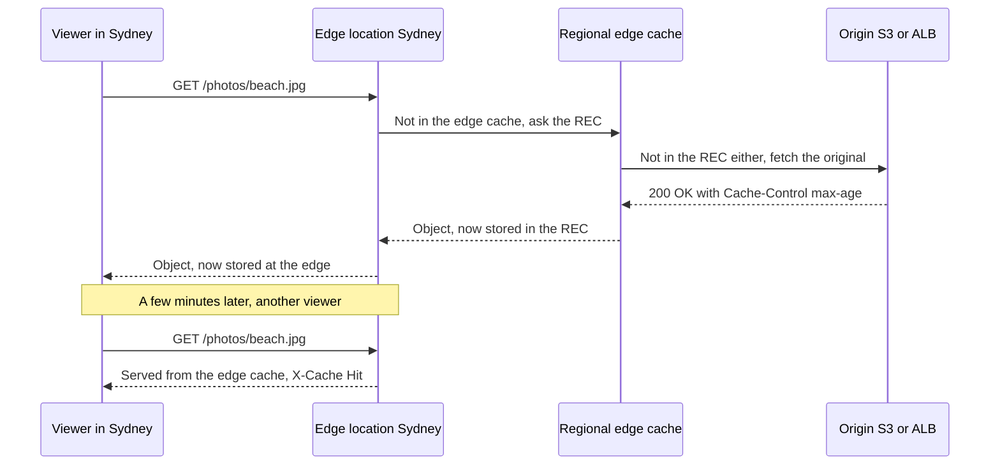
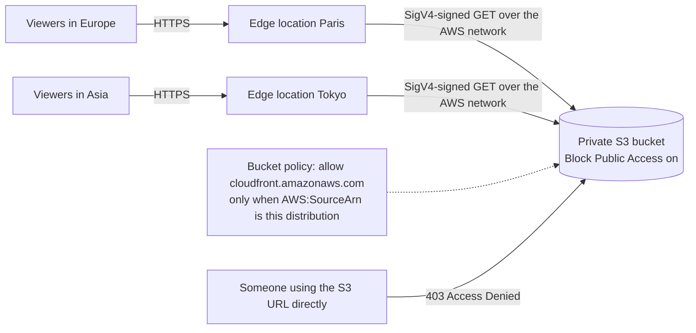
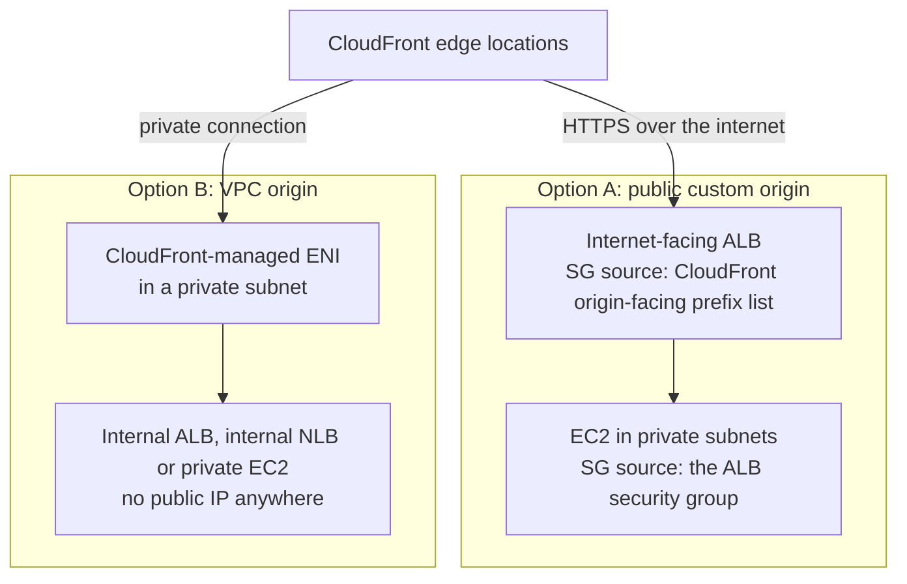
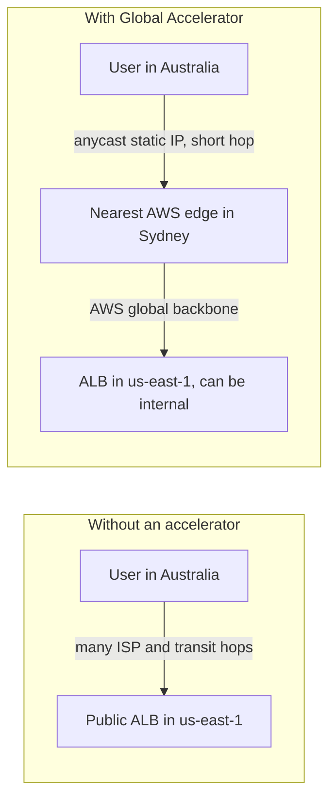
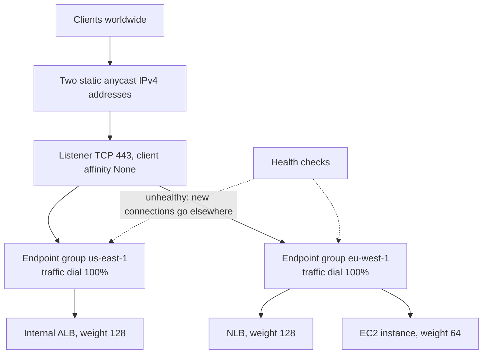
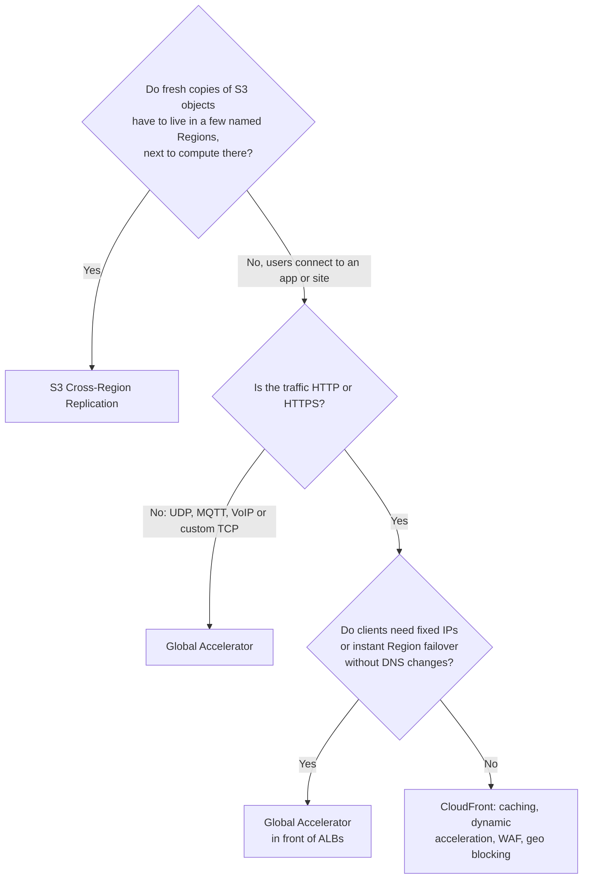

# CloudFront & Global Accelerator

## Summary

Amazon CloudFront and AWS Global Accelerator both bring users onto the AWS global network at an edge location close to them, so traffic spends less time crossing the slow, unpredictable public internet. **CloudFront** is a content delivery network (CDN): it caches copies of your files at hundreds of edge locations, fetches anything missing from an **origin** (an S3 bucket, a load balancer, EC2, a VPC origin or any HTTP server), and adds HTTPS, geo restriction, AWS WAF and DDoS protection in front of your app. Pick it for websites, images, video, downloads and HTTP APIs. **Global Accelerator** does not cache anything; it hands your application **two static anycast IP addresses** and carries each TCP or UDP connection over the AWS backbone to the closest healthy endpoint in one or more Regions. Pick it for non-HTTP protocols (gaming, IoT, VoIP), when clients need fixed IPs to allow-list, or when you want fast, DNS-free failover between Regions.

## Key concepts

- **CloudFront** is a global CDN: viewers hit the nearest of **750+ points of presence**, and cache misses go to a **regional edge cache** and then to your **origin**.
- A **distribution** is one CloudFront configuration with its own `dxxxx.cloudfront.net` domain, one or more **origins**, and **cache behaviors** that map URL paths to origins.
- **Origins**: S3 bucket, S3 static website endpoint (custom origin), public ALB/NLB/EC2 or any HTTP server (custom origin), and **VPC origins** for private ALB, NLB or EC2.
- **Origin Access Control (OAC)** lets CloudFront sign requests to a private S3 bucket; the bucket policy allows the `cloudfront.amazonaws.com` principal for one distribution ARN. **OAI** is the legacy predecessor.
- Public custom origins should accept traffic only from CloudFront, using the **CloudFront managed prefix list** in the security group (plus a secret custom header for an ALB).
- Objects stay cached for a **TTL** (24 hours by default) set by cache policies and `Cache-Control` headers; an **invalidation** evicts them early (first 1,000 paths per month free).
- **Geo restriction** allows or blocks whole countries for the entire distribution; blocked viewers get **HTTP 403**.
- CloudFront suits content that must be fast **everywhere**; **S3 Cross-Region Replication** suits fresh copies of objects in **a few chosen Regions**.
- **Anycast** means many servers announce the same IP and the network delivers each client to the nearest; **unicast** means one IP, one server.
- **Global Accelerator** gives **2 static anycast IPv4 addresses** (4 with dual-stack), terminates TCP at the edge, and routes to endpoints: ALB, NLB, EC2 or Elastic IP, public or private.
- Global Accelerator runs **health checks** and moves new connections to a healthy Region without any DNS change, so client DNS caches never matter.
- **Traffic dials** (per Region) and **endpoint weights** (per endpoint) shape traffic for blue/green and A/B testing.
- Both services sit behind **AWS Shield Standard** automatically; CloudFront also integrates with **AWS WAF**.
- Rule of thumb: **cacheable or HTTP content → CloudFront**; **TCP/UDP, static IPs or deterministic regional failover → Global Accelerator**.

## Why the edge matters

Imagine a web app running behind a public Application Load Balancer in `us-east-1`. A user in Sydney opens it. Their packets leave the home router, pass through their ISP, cross several transit providers and an undersea cable, and finally reach Virginia. Each network hop adds delay and a chance of congestion or packet loss, and none of it is under your control. A TLS handshake needs several round trips before the first byte of the page arrives, so a 200 ms round trip can easily become a one-second wait.

AWS runs its own private backbone that links its Regions and hundreds of edge locations worldwide. Both services in this lesson use the same trick: **get the user onto that backbone as close to them as possible**, then either answer from a cache at the edge (CloudFront) or ride the backbone to your application (Global Accelerator). The difference is what happens at the edge.

| | Without an edge service | With CloudFront | With Global Accelerator |
|---|---|---|---|
| Where the user connects | Your ALB in one Region | Nearest CloudFront edge | Nearest AWS edge, via anycast IP |
| Path to your app | Public internet all the way | AWS network, only on a cache miss | AWS network for every packet |
| Caching | None | Yes, at edge and regional caches | None |
| Protocols | Whatever the app speaks | HTTP, HTTPS, WebSocket, gRPC | Any TCP or UDP |
| Entry address | Load balancer DNS name | `dxxxx.cloudfront.net` or your domain | 2 static IPs plus a DNS name |

## Amazon CloudFront

### How a request flows

CloudFront has three layers:

1. **Points of presence (POPs)**, also called edge locations. CloudFront advertises more than 750 of them in over 100 cities across 50+ countries, plus more than 1,140 embedded POPs inside ISP networks. DNS steers each viewer to the POP with the lowest latency.
2. **Regional edge caches (RECs)**, currently 15 worldwide. They sit between the POPs and your origin and have much larger caches, so content that is no longer popular enough to stay in a POP is still close by.
3. **Your origin**, where the original copy lives.

On a **cache hit** the POP answers immediately. On a **miss** the POP asks its regional edge cache; if that also misses, CloudFront fetches from the origin, streams the response to the viewer as soon as the first bytes arrive, and stores a copy at both layers for the next viewer. Some requests skip the regional layer: dynamic (uncacheable) requests and the write-style methods `PUT`, `POST`, `PATCH`, `OPTIONS` and `DELETE` go straight from the POP to the origin, and so does a request whose best regional edge cache sits in the same AWS Region as its S3 bucket origin.

> [!UPDATED] Size of the edge network
> The slides describe "hundreds" of points of presence. CloudFront's feature page now lists 750+ POPs in 100+ cities across 50+ countries, 15 regional edge caches and 1,140+ embedded POPs. The exact numbers grow every year; the exam only needs "a large global edge network".

### What CloudFront gives you besides speed

- **Lower origin load and cost**: every cache hit is a request your servers never see. Data transfer from AWS origins (S3, ALB, API Gateway and so on) to CloudFront is free, and at higher volumes CloudFront's per-GB price is lower than serving the same bytes straight from S3.
- **HTTPS everywhere**: a free default certificate for `*.cloudfront.net`, or your own domain with a certificate from AWS Certificate Manager. The certificate for viewers must live in **`us-east-1` (N. Virginia)**, whatever Region your origin is in.
- **Security at the edge**: AWS Shield Standard protects every distribution against common network and transport layer DDoS attacks at no extra charge, and you can attach an AWS WAF web ACL to filter layer 7 requests before they reach your origin.
- **Edge logic**: CloudFront Functions and Lambda@Edge run code at the edge (covered in the serverless lesson).

### Distributions, origins and cache behaviors

A **distribution** is the unit you create and pay for. It has:

- a domain name such as `d111111abcdef8.cloudfront.net`, plus optional **alternate domain names** (`www.example.com`), which you point at CloudFront with a Route 53 alias record or a CNAME;
- one or more **origins** (up to 100 by default);
- a **default cache behavior** and optional extra behaviors, each matching a path pattern such as `/api/*` or `/images/*` and saying which origin to use, which HTTP methods to allow, whether to force HTTPS, and which **cache policy** (TTLs and cache key) to apply.

A typical setup routes `/api/*` to an ALB with caching disabled and everything else to an S3 bucket with long TTLs. You can also group two origins into an **origin group** so CloudFront fails over to a secondary origin when the primary returns errors.

## CloudFront origins

### Amazon S3 bucket as the origin

The most common pattern: static files (HTML, CSS, JavaScript, images, video, software downloads) live in a regular S3 bucket and CloudFront caches them at the edge. The bucket stays **private** with Block Public Access turned on, and only CloudFront can read it.

That trust is set up with **Origin Access Control (OAC)**:

1. CloudFront signs every request it sends to the bucket with SigV4 (choose **Sign requests (recommended)**).
2. The **bucket policy** allows the service principal `cloudfront.amazonaws.com` to call `s3:GetObject` (and `s3:PutObject` if you want uploads), but only when the condition `AWS:SourceArn` equals your distribution's ARN.
3. Anyone who tries the S3 URL directly gets `403 Access Denied`.

OAC replaced the older **origin access identity (OAI)**. Prefer OAC because it works with buckets in every Region (including opt-in Regions), supports **SSE-KMS** encrypted objects (add a statement to the KMS key policy for the same principal), and supports `PUT` and `DELETE`, which makes **uploads through CloudFront** possible: a mobile app can send files to the nearest edge, and CloudFront forwards them to S3 over the AWS network.

> [!EXAMPLE] A photo-sharing site
> Thumbnails and full-size images live in `photos-prod` in `eu-west-1`. A CloudFront distribution with OAC serves them worldwide; a viewer in São Paulo gets them from a nearby edge after the first request warms the cache. The bucket itself has no public access at all, so a leaked S3 URL is useless.

> [!NOTE] S3 origins and the console
> When you create a distribution in the console and pick an Amazon S3 origin with the recommended settings, CloudFront creates the OAC and writes the bucket policy for you. With the CLI or CloudFormation you create both yourself.

### S3 static website endpoint as the origin

If the bucket is configured for **static website hosting**, you can point CloudFront at the website endpoint (`bucket-name.s3-website-region.amazonaws.com`) instead. CloudFront then treats it as a **custom HTTP origin**, which gives you S3 website features such as index documents in subfolders and redirect rules. The catch: **OAC and OAI cannot be used** with a website endpoint, the connection from CloudFront to the bucket is HTTP only, and the bucket content must be publicly readable. Use the regular bucket endpoint with OAC when the requirement is "keep the bucket private".

### Custom origins over the public internet: ALB, EC2 or any HTTP server

Anything that speaks HTTP or HTTPS and has a public DNS name can be an origin: an internet-facing ALB, an EC2 instance with a public IP, API Gateway, a Lambda function URL, or a server in your own data center. CloudFront connects to it over the internet, so you have to make sure **only CloudFront** can reach it:

- **EC2 directly as the origin**: the instance needs a public IP, and its security group should allow HTTP/HTTPS only from CloudFront's origin-facing servers.
- **ALB as the origin**: the ALB must be **internet-facing**; its security group allows only CloudFront's origin-facing servers, and the EC2 instances behind it can stay in private subnets, allowing traffic only from the ALB's security group (security group chaining).
- For an ALB, also have CloudFront add a **secret custom header** (for example `X-Origin-Verify: <random value>`) and make the ALB listener forward only requests that carry it, returning `403` for everything else. Use HTTPS between CloudFront and the ALB so the header cannot be sniffed, and rotate the value periodically.

> [!UPDATED] Use the managed prefix list instead of copying IP ranges
> The slides point to a web page listing CloudFront's IP ranges. Today you reference the AWS-managed prefix list `com.amazonaws.global.cloudfront.origin-facing` (and `com.amazonaws.global.ipv6.cloudfront.origin-facing` for IPv6) as the source of a security group rule. AWS keeps it current, so you never maintain IP lists by hand. Note that this prefix list counts as many entries against your security group rule quota.

### VPC origins: private ALB, NLB or EC2

Since late 2024 CloudFront can reach applications that have **no public exposure at all**. You create a **VPC origin** that points at an internal ALB, an internal NLB or an EC2 instance in a private subnet. CloudFront places a service-managed network interface in that subnet and talks to the origin over a private path, so the origin needs no public IP, no internet-facing load balancer and no custom-header trick. CloudFront becomes the only way in.

Things worth knowing about VPC origins (checked against the current developer guide):

- The VPC still needs an **internet gateway** attached (it signals that the VPC accepts internet-originated traffic), but routes do not change, and the subnet needs at least one free IPv4 address for CloudFront's interface.
- Supported targets are ALBs, NLBs and EC2 instances. **Gateway Load Balancers** and **NLBs with TLS listeners** are not supported, and an NLB must have a security group.
- The origin's security group should allow either the CloudFront managed prefix list or the service-managed security group `CloudFront-VPCOrigins-Service-SG` (the tighter choice, because only your distributions use it).
- gRPC and origin-facing Lambda@Edge triggers are not supported on VPC origins, and VPC origins can be shared across accounts with AWS RAM.
- VPC origins carry no additional charge beyond normal CloudFront pricing.

> [!UPDATED] VPC origins are the new default answer for private apps
> Older material (and older exam questions) say an ALB origin "must be public". That is still true for a plain custom origin, but VPC origins now let CloudFront serve an **internal** ALB, NLB or EC2 instance directly. When a scenario says "the load balancer must not be reachable from the internet", VPC origins are the cleanest fit.

### Choosing an origin

| Origin | Typical content | How you keep it locked down | Watch out for |
|---|---|---|---|
| S3 bucket (REST endpoint) | Static assets, media, downloads, uploads | OAC plus a bucket policy scoped to the distribution ARN | Use OAC, not OAI, for SSE-KMS and new Regions |
| S3 static website endpoint | Static sites needing S3 redirects or subfolder index pages | Cannot use OAC; bucket must be public (custom header or Referer checks only) | HTTP only between CloudFront and S3 |
| Internet-facing ALB or NLB | Dynamic web apps and APIs | Managed prefix list in the SG, secret custom header, HTTPS | Origin cert must be in the ALB's Region |
| EC2 with a public IP | Single-server apps | Managed prefix list in the SG | No load balancing or failover without more work |
| VPC origin | Internal ALB, internal NLB or private EC2 | Nothing public to protect; SG allows CloudFront only | No GWLB, no NLB TLS listeners, IGW must be attached |
| Any other HTTP server | On-premises or another cloud | Firewall rules, custom header, HTTPS | Must be publicly resolvable and reachable |

## Caching, TTLs and invalidations

### How long objects stay cached

CloudFront keeps each object for its **time to live (TTL)** and only then checks the origin again (a `304 Not Modified` reply keeps the cached copy; `200` brings a new version). The TTL comes from two places:

- **Your origin's headers**: `Cache-Control: max-age=3600` (or `s-maxage`, which applies only to shared caches like CloudFront), or an `Expires` date.
- **The cache policy** on the cache behavior, which sets a minimum, default and maximum TTL. CloudFront clamps the origin's value between the minimum and maximum, and uses the default when the origin sends no caching header.

| Setting | Value in the managed **CachingOptimized** policy | Meaning |
|---|---|---|
| Minimum TTL | 1 second | Floor, even if the origin says `no-cache` |
| Default TTL | 86,400 seconds (24 hours) | Used when the origin sends no `Cache-Control` or `Expires` |
| Maximum TTL | 31,536,000 seconds (365 days) | Ceiling on what the origin can ask for |
| **CachingDisabled** | 0 / 0 / 0 | For dynamic paths such as `/api/*` |

So by default a changed file can stay stale at the edge for up to a day. Popular objects stay; rarely requested ones may be evicted earlier to make room.

### Invalidations

When you update a file at the origin, CloudFront does not notice. Viewers keep getting the cached copy until its TTL runs out. To force a refresh you create an **invalidation**: a list of paths that every edge location and regional edge cache must drop, so the next request goes back to the origin.

- Paths are case sensitive and relative to the distribution, for example `/index.html`.
- A `*` wildcard is allowed **only as the last character**: `/images/*` clears a folder and everything below it, and `/*` clears the whole distribution.
- **Pricing**: the first **1,000 invalidation paths per month** (across all distributions in the account) are free; after that each path costs **USD 0.005**. A wildcard path counts as **one** path, even if it removes thousands of files.
- You cannot cancel an invalidation once it is submitted.

> [!EXAMPLE] A deploy that goes wrong without an invalidation
> At 10:00 you upload a fixed `index.html` to S3. Edges that cached the old page at 09:00 keep serving it until 09:00 the next day, because the default TTL is 24 hours. Submitting an invalidation for `/index.html` at 10:01 makes every edge and regional cache drop it, so the next request from each location fetches the fixed page from S3.

**Invalidation or versioned file names?** AWS recommends versioned names (`app.3f9c2.js`, `logo-v2.png`) for files that change often. The new name is a new cache key, so it is picked up instantly, it also bypasses browser and corporate proxy caches that an invalidation cannot reach, it makes rollback trivial, and it never costs invalidation fees. Keep invalidations for files whose names must stay fixed, such as `index.html`, or for emergencies.

| | Invalidation | Versioned file names |
|---|---|---|
| Speed | Usually minutes to propagate | Immediate (new URL) |
| Browser and proxy caches | Not cleared | Bypassed |
| Cost | Free up to 1,000 paths a month, then USD 0.005 per path | Free |
| Best for | Fixed names (`index.html`), emergencies | Frequently changing CSS, JS, images |

> [!UPDATED] Invalidation limits and tag-based invalidation
> The CloudFront quotas page now expresses invalidation limits as rates: up to **150 paths or tags per second** and **one wildcard invalidation per second**, with no cap on how many files one wildcard or tag can clear. CloudFront has also added **tag-based invalidation**: you opt a distribution in by naming a response header in its cache tag settings, the origin returns that header listing cache tags for each object (for example `product:12345, brand:acme`), and an invalidation of `#brand:acme` clears every object carrying that tag. Each tag counts as one path for billing. The slides cover only path invalidation, which remains the exam focus.

## Geo restriction

**Geo restriction** (geo blocking) controls which countries can download content from a distribution. You choose one of two lists:

- **Allow list**: only viewers in the listed countries are served.
- **Block list**: viewers in the listed countries are refused; everyone else is served.

CloudFront maps the viewer's IP address to a country with a third-party GeoIP database (MaxMind, according to the API reference); AWS reports about 99.8% accuracy overall. A refused viewer receives **HTTP 403 Forbidden**, which you can replace with a custom error page. If the country cannot be determined, CloudFront serves the content.

Typical drivers are **licensing and copyright** (a streaming service only holds rights for Canada and the US), sanctions and export rules, or regulatory limits on where data may be offered.

Two limits matter for scenario questions:

- It is **country level only**, and it applies to the **whole distribution**. For "block only `/premium/*` in country X" or city-level rules, use a separate distribution, an AWS WAF geo match rule, or your own logic with a third-party geolocation service plus CloudFront signed URLs.
- It is not an identity control: a VPN user can appear to be in another country.

> [!EXAMPLE] A sports streaming service
> A broadcaster owns rights to show a league only in the United Kingdom and Ireland. It configures an **allow list** with `GB` and `IE`. A viewer in France gets a 403 page explaining the content is unavailable in their region; viewers in London stream normally from the nearest edge.

## Pricing at a glance

CloudFront has two pricing models:

- **Pay-as-you-go**: per GB transferred out (varies by geography), per 10,000 requests, plus optional features. The **Always Free** tier covers **1 TB of data transfer out, 10 million HTTP/HTTPS requests and 2 million CloudFront Functions invocations every month**. A **price class** lets you trade reach for cost: **Price Class All** uses every edge; **Price Class 200** drops the two most expensive areas (currently South America, and Australia with New Zealand) but keeps Asia, India, Africa and the Middle East; **Price Class 100** uses only the cheapest areas (the United States, Mexico and Canada, plus Europe, Israel and Türkiye). Viewers outside the chosen class are still served, just from a farther edge.
- **Flat-rate plans**: bundles of CloudFront, AWS WAF, DDoS protection, Route 53 DNS, CloudWatch Logs ingestion, a TLS certificate, edge compute and S3 storage credits for one monthly price with no overage charges.

| Plan | Monthly price | Requests allowance | Data transfer allowance |
|---|---|---|---|
| Free | USD 0 | 1 million | 100 GB |
| Pro | USD 15 | 10 million | 50 TB |
| Business | USD 200 | 125 million | 50 TB |
| Premium | USD 1,000 (configurable higher) | 500 million | 50 TB |

> [!UPDATED] Flat-rate pricing plans are new
> The slides predate CloudFront's flat-rate plans. Each plan covers one distribution, allowances are soft (traffic may be slowed, never billed extra, if you stay far above them), and some features are excluded (for example multi-tenant distributions, continuous deployment, real-time logs and Anycast static IPs). A distribution on a plan must have a WAF web ACL and cannot be deleted until the plan is cancelled. For exam purposes, pay-as-you-go pricing concepts (data transfer, requests, price classes, free invalidation allowance) are what matter.

## CloudFront versus S3 Cross-Region Replication

Both put copies of S3 data closer to users, but they solve different problems.

| | CloudFront | S3 Cross-Region Replication (CRR) |
|---|---|---|
| Where copies live | Hundreds of edge caches worldwide, automatically | Full buckets in the Regions you choose, one rule per destination |
| Freshness | Cached copy until the TTL expires or you invalidate | Asynchronous copy of new and updated objects, usually within minutes but with no time guarantee; add S3 Replication Time Control for 99.99% within 15 minutes, SLA-backed |
| What users access | The CDN URL; works for any viewer anywhere | The replica bucket in a specific Region |
| Best for | Static or rarely changing content needed everywhere | Frequently changing objects needed with low latency in a few specific Regions, compliance copies, compute in those Regions |
| Requirements | A distribution | Versioning on both buckets, an IAM role, replication rules |

> [!EXAMPLE] Picking between them
> A game studio publishes a 4 GB patch once a month to players worldwide: **CloudFront** (cache once per edge, serve millions of downloads). An analytics team in Frankfurt and Singapore processes sensor files that land every few seconds in a bucket in `us-east-1`, and each team's EMR cluster must read fresh files from its own Region: **CRR** to buckets in `eu-central-1` and `ap-southeast-1`.

## AWS Global Accelerator

### Unicast versus anycast

Normal internet addressing is **unicast**: one IP address belongs to one server, and every client in the world is routed to that one machine, however far away it is. With **anycast**, many servers in different places announce the **same** IP address, and internet routing (BGP) delivers each client's packets to the topologically nearest one.

| | Unicast | Anycast |
|---|---|---|
| IP to server mapping | One IP, one location | One IP, many locations |
| Which server answers | Always the same one | The nearest one to the client |
| Example | Your EC2 instance's public IP | Global Accelerator static IPs, many DNS root servers |

### How Global Accelerator works

When you create a **standard accelerator**, AWS assigns it **two static IPv4 addresses** from the Amazon pool (or from your own range with BYOIP), plus a DNS name like `a1234567890abcdef.awsglobalaccelerator.com`. A **dual-stack** accelerator gets four addresses: two IPv4 and two IPv6. Both IPs are announced by anycast from the AWS edge network, which gives clients two independent entry points.

1. A client connects to one of the static IPs. Anycast brings its packets into the **nearest AWS edge location**, usually just a few hops away.
2. The edge **terminates the TCP connection** (shortening the handshake for the client) and opens a new one across the **AWS global network**.
3. A **listener** (ports and protocol, TCP or UDP) passes the connection to an **endpoint group** in the best Region, chosen by client location, endpoint health, traffic dials and weights.
4. An **endpoint** in that group receives it: an ALB (internet-facing or internal), an NLB (internet-facing or internal), an EC2 instance or an Elastic IP address.

Because the IP addresses never change, Global Accelerator removes several headaches at once:

- **No DNS caching problem**: with Route 53 failover, clients may keep using a cached, dead IP until the TTL expires. With Global Accelerator the client keeps the same IP and the edge simply sends new connections elsewhere.
- **Allow-listing**: a customer's firewall only needs two IPs, no matter how many load balancers or Regions sit behind them.
- **Private endpoints**: endpoints can be internal ALBs or EC2 instances in private subnets (the VPC needs an internet gateway attached), so nothing in your VPC has to face the internet.
- **DDoS protection**: the static IPs are protected by AWS Shield Standard automatically.

### Health checks, failover and traffic control

- **Health checks**: for EC2 and Elastic IP endpoints, you set the protocol (TCP by default, or HTTP/HTTPS with a path), port, interval (**10 or 30 seconds**, default 30) and threshold (default **3** consecutive checks). For ALB and NLB endpoints, Global Accelerator uses the load balancer's own target health: an ALB counts as healthy when each target group has at least one healthy target. If **no** endpoint is healthy, Global Accelerator sends traffic to all of them (fail open).
- **Failover**: once an endpoint is unhealthy, new connections go to the next closest healthy endpoint or Region. This is why Global Accelerator fits disaster recovery: no DNS records to change and no client cache to wait out.
- **Traffic dial** (per endpoint group, 0–100%, default 100%): limits how much of the traffic already headed for a Region it accepts; the rest spills to other Regions. Dial a Region to 0 to drain it for maintenance or a blue/green cutover.
- **Endpoint weights** (per endpoint, 0–255, default 128): split traffic inside a group, for example 90/10 for a canary or A/B test.
- **Client affinity**: `None` (default) spreads connections; `Source IP` keeps a client on the same endpoint for stateful apps.
- **Client IP preservation**: ALB, EC2 and NLB endpoints with security groups can see the real client IP; Elastic IP endpoints and NLBs without security groups cannot.

> [!UPDATED] How fast is failover?
> The slides say failover takes "less than 1 minute". The current developer guide does not quote a fixed time; it says Global Accelerator reacts instantly once an endpoint is found unhealthy and re-routes new connections. Detection time depends on the health checks: with 10-second checks and a threshold of 3, an EC2 endpoint is marked unhealthy after about 30 seconds; with the defaults (30 seconds, 3 checks) it takes about 90 seconds. Connections that are already established keep going to the old endpoint until they have been idle for the timeout (340 seconds for TCP, 30 seconds for UDP); only new connections are re-routed straight away.

> [!NOTE] Custom routing accelerators
> Besides the standard type, a **custom routing accelerator** maps each client deterministically to a specific EC2 instance and port in a VPC subnet, using your own application logic. It is built for multiplayer game sessions and VoIP media servers. It has no health checks or failover, because you choose the destination yourself.

### Pricing

- A fixed **USD 0.025 per hour** for each accelerator, for every full or partial hour it exists (enabled or disabled), until you delete it.
- **Data Transfer-Premium (DT-Premium)**: a per-GB fee on traffic in the dominant direction, which depends on the source Region and destination edge (for example about USD 0.015 per GB from North America to Europe), on top of normal data transfer charges.
- The static IPv4 addresses are billed as **in-use public IPv4 addresses** (USD 0.005 per hour each), so two more cents an hour for a standard accelerator.
- There is no free tier for Global Accelerator.

> [!WARNING] The static IPs die with the accelerator
> Disabling an accelerator keeps its IP addresses (and keeps the hourly fee running). **Deleting** it releases them for good, and anyone who allow-listed them must update their firewalls. Protect production accelerators against accidental deletion with IAM policies, for example tag-based permissions.

## Global Accelerator versus CloudFront

They look alike because both use the AWS edge network and both come with AWS Shield, but they behave very differently.

| | CloudFront | Global Accelerator |
|---|---|---|
| What it is | Content delivery network | Network-layer accelerator (anycast proxy) |
| Caching | Yes, content is served from the edge | No, every packet goes to your endpoint |
| Protocols | HTTP and HTTPS (also WebSocket and gRPC) | Any TCP or UDP |
| Entry point | DNS name (`dxxxx.cloudfront.net` or your domain), IPs vary | 2 static anycast IPs (4 with dual-stack) |
| Content types | Cacheable static content and dynamic HTTP (API acceleration, dynamic sites) | Gaming (UDP), IoT (MQTT), VoIP, any TCP/UDP service, and HTTP apps that need fixed IPs |
| Multi-Region | Origin groups for origin failover; cached objects can still be served during short origin outages | Native: endpoint groups per Region with health checks, traffic dials and weights |
| Failover | Origin failover on error responses | Deterministic, health-based regional failover with no DNS change |
| Endpoints / origins | S3, ALB, NLB, EC2, VPC origins, API Gateway, Lambda URLs, any HTTP server | ALB, NLB, EC2, Elastic IP |
| Edge features | WAF, geo restriction, signed URLs, edge functions, compression | Client affinity, client IP preservation |

> [!UPDATED] CloudFront can now offer static IPs too
> CloudFront **Anycast static IPs** let you request a dedicated list of 21 static IPs (or 3 for pointing an apex domain with A records) for allow-listing or zero-rating deals with mobile carriers. The list is approved by CloudFront support, costs extra per IP per hour and requires the "Use all edge locations" price class. On the exam, "static IP addresses" plus "TCP/UDP" or "fast regional failover" still points to **Global Accelerator**; CloudFront static IPs only fit when the workload is clearly HTTP content delivery.

## Exam tips

> [!EXAM] Static content, global users, less load on the origin
> "Users around the world", "static assets", "reduce latency", "offload the origin" → **CloudFront** in front of S3 (or the ALB). Add "keep the bucket private" → **OAC** plus a bucket policy that allows `cloudfront.amazonaws.com` for that distribution ARN.

> [!EXAM] The S3 bucket must not be accessible directly
> Choose **CloudFront with Origin Access Control**. If an answer offers OAI, it still works for simple cases, but OAC is the current recommendation and the only option for SSE-KMS objects, `PUT`/`DELETE` uploads and newer Regions.

> [!EXAM] Updated files are not showing up
> Users still see the old version after a deploy → the object is cached until its **TTL** expires. Create a **CloudFront invalidation** (`/index.html`, `/images/*` or `/*`), or better, use **versioned file names** for assets that change often.

> [!EXAM] Content licensed only for some countries
> "Copyright", "licensing", "must not be available in country X" → **CloudFront geo restriction** with an allow list or block list. Blocked viewers get HTTP 403.

> [!EXAM] ALB or EC2 must only accept traffic from CloudFront
> Security group sourced from the **CloudFront managed prefix list**, plus a secret **custom origin header** checked by an ALB listener rule. If the requirement is "the ALB must not be internet-facing", choose **CloudFront VPC origins** with an internal ALB.

> [!EXAM] Global Accelerator signals
> "UDP", "gaming", "IoT", "MQTT", "VoIP", "two static IP addresses to allow-list", "deterministic or fast regional failover", "avoid DNS caching issues", "blue/green across Regions by percentage" → **Global Accelerator**.

> [!EXAM] Dynamic content in a few Regions versus everywhere
> Content needed everywhere and tolerant of TTL-based staleness → **CloudFront**. Frequently updated objects needed with low latency in two or three named Regions → **S3 Cross-Region Replication**.

## Common traps

> [!TRAP] Using the S3 website endpoint with OAC
> OAC (and OAI) only work with the bucket's REST endpoint. A website endpoint is a custom origin, needs public objects and talks HTTP to CloudFront. If the scenario requires a private bucket, do not pick "enable static website hosting".

> [!TRAP] Thinking Global Accelerator caches content
> Global Accelerator only proxies connections over the AWS network; every request still reaches your endpoint. For caching, the answer is CloudFront.

> [!TRAP] Expecting geo restriction per path or per city
> CloudFront's built-in geo restriction is country level and applies to the entire distribution. Finer rules need AWS WAF geo match rules, a separate distribution, or a third-party geolocation service with signed URLs.

> [!TRAP] Assuming an invalidation is free and instant at any scale
> Only the first 1,000 paths per month are free; each extra path costs USD 0.005 (a wildcard counts as one). Invalidations also cannot clear browser caches. Versioned file names are cheaper and more reliable for frequent deploys.

> [!TRAP] Putting an internal ALB behind CloudFront as a plain custom origin
> A custom origin is reached over the internet, so the ALB must be internet-facing. An internal ALB works only as a **VPC origin**.

> [!TRAP] Choosing Route 53 latency routing when the question stresses failover speed or fixed IPs
> DNS-based routing depends on clients honouring TTLs and still exposes changing load balancer IPs. When the requirement says static IPs or failover without waiting for DNS, Global Accelerator is the better fit.

> [!TRAP] Requesting the CloudFront certificate in the origin's Region
> Certificates for viewer HTTPS on CloudFront must be in ACM in **us-east-1**, even if every other resource lives in Frankfurt. A certificate for the ALB origin itself stays in the ALB's Region.
