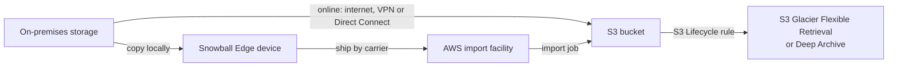
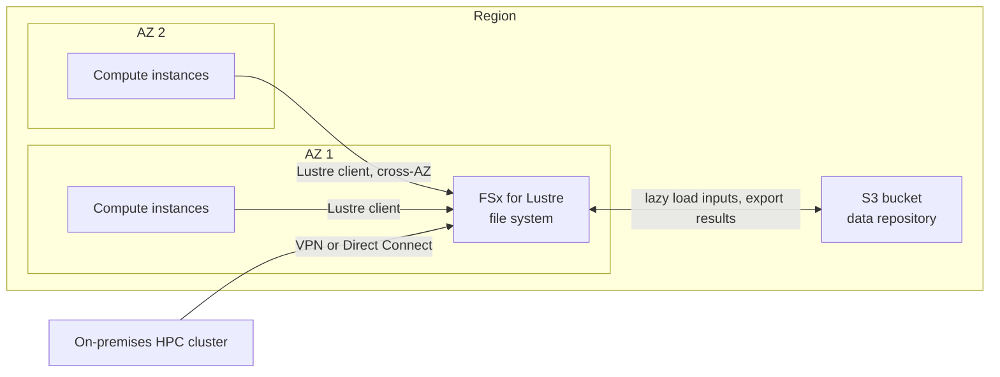
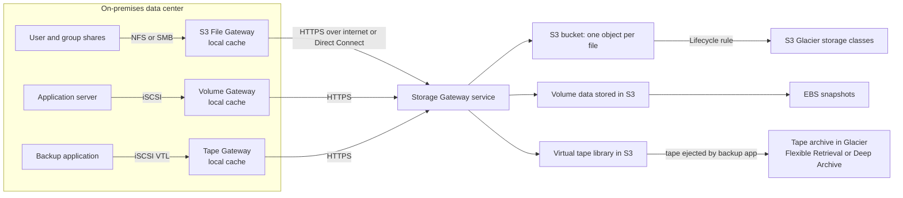
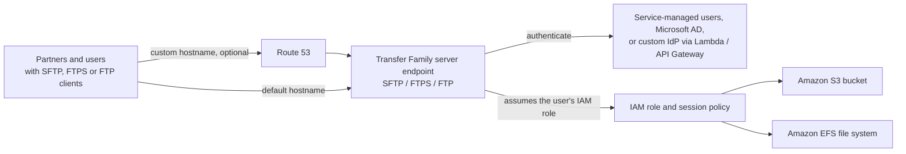
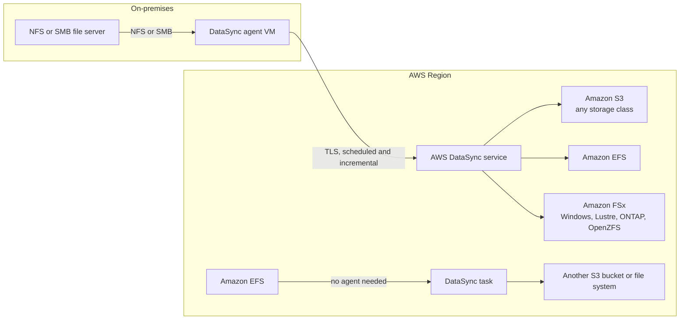
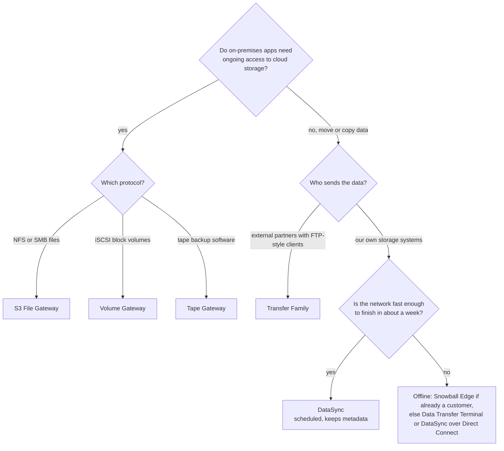

# AWS Storage Extras

## Summary

This lesson covers the storage and data-movement services that sit around S3, EBS and EFS. **Amazon FSx** gives you fully managed versions of four well-known file systems (Windows File Server, Lustre, NetApp ONTAP, OpenZFS) when EFS is not the right fit. **AWS Storage Gateway** lets servers in your own data center use S3-backed storage through ordinary file, block and tape protocols. **AWS Transfer Family** puts a managed SFTP, FTPS or FTP endpoint in front of S3 or EFS so partners can keep their existing file transfer tools. **AWS DataSync** copies large datasets online, on a schedule, between on-premises storage, other clouds and AWS storage services. **AWS Snowball Edge** moved data offline on rugged shipped devices and ran compute at disconnected sites; it is still in the exam guide but no longer sold to new customers, so you also need to know its successors. Exam questions in this area are almost always "pick the right service": match the protocol, the location of the data and the amount of data to the service built for it.

## Key concepts

- **Snowball Edge** = a shipped, encrypted device for offline transfer into or out of S3 and for **edge computing** (EC2-compatible instances, Lambda) at sites with poor connectivity; closed to new customers since **7 November 2025**.
- Rule of thumb: if a network transfer would take **more than about a week**, an offline or dedicated-link option is worth considering.
- Snowball data lands in **S3**; to archive it, add an **S3 Lifecycle rule** that transitions it to a Glacier storage class (no direct import into Glacier).
- **FSx for Windows File Server** = SMB + NTFS + **Active Directory**, Multi-AZ option, DFS Namespaces; Linux clients can mount it too.
- **FSx for Lustre** = parallel file system for **HPC and ML**, linked to an **S3 bucket** (read S3 objects as files, write results back); **Scratch** (temporary, not replicated) vs **Persistent** (replicated, long-lived).
- **FSx for NetApp ONTAP** = the broadest protocol support (**NFS, SMB, iSCSI, NVMe**), snapshots, instant clones, dedup and compression; for lifting NetApp or mixed-OS NAS workloads.
- **FSx for OpenZFS** = managed ZFS over **NFS**, very high IOPS, snapshots and instant clones; for lifting ZFS or Linux NAS workloads.
- **Storage Gateway** bridges on-premises apps to AWS storage: **S3 File Gateway** (NFS/SMB to S3), **Volume Gateway** (iSCSI block, cached or stored, backed by EBS snapshots), **Tape Gateway** (virtual tape library to S3 and Glacier).
- A gateway runs as a **VM on-premises** (VMware, Hyper-V, KVM, Nutanix) or as an **EC2 instance**, and keeps a **local cache** of recent data.
- **Transfer Family** = managed **SFTP / FTPS / FTP** (plus AS2 and browser web apps) into **S3 or EFS**; plain FTP only inside a VPC; users from the service itself, Active Directory or a custom identity provider.
- **DataSync** = online, scheduled, incremental copies that **preserve metadata and permissions**; needs an **agent** for on-premises NFS/SMB/HDFS, no agent between AWS services.
- Storage Gateway is for **ongoing hybrid access**; DataSync is for **moving or replicating data**; Transfer Family is for **external users with FTP-style clients**.

## Moving data offline: AWS Snowball Edge

### Why ship data instead of sending it

Moving data over a network sounds easy until you do the arithmetic. The time a transfer takes is roughly the amount of data divided by the bandwidth you can actually use. Real links rarely run at full speed for days: you share the line with other traffic, connections drop, and many sites pay per gigabyte or have a slow uplink.

A handy estimate: at about 80% utilization, a **1 Gbps** link moves roughly **8.6 TB per day**. A 100 Mbps link moves about a tenth of that, and a 10 Gbps link about ten times as much.

| Data to move | 100 Mbps link | 1 Gbps link | 10 Gbps link |
|---|---|---|---|
| 5 TB | about 6 days | about 14 hours | about 1.5 hours |
| 50 TB | about 2 months | about 6 days | about 14 hours |
| 500 TB | about 1.6 years | about 2 months | about 6 days |

> [!EXAMPLE] A video archive leaving a studio
> A studio has 400 TB of footage and a 500 Mbps internet line it cannot saturate during working hours. Even at a steady 400 Mbps that is about 4.3 TB per day, so roughly three months of transfer, with the office internet degraded the whole time. This is the classic case for moving the data physically or over a temporary dedicated link.

**AWS Snowball Edge** solved this by mailing you a rugged, tamper-resistant device. You copied data onto it locally (over NFS or an S3-compatible endpoint), shipped it back, and AWS loaded it into your S3 bucket. Export jobs ran the other way. Data on the device is always encrypted, and the device's E Ink label turns into the return shipping label when the job is ready.

### Device options

| Option | vCPUs | Usable memory | Storage | Typical use |
|---|---|---|---|---|
| Snowball Edge **Storage Optimized** | 104 | 416 GB | 210 TB NVMe | Bulk data migration, local storage |
| Snowball Edge **Compute Optimized** | 104 | 416 GB | 28 TB NVMe | Edge computing: machine learning inference, video transcoding, pre-processing sensor data |

Both have network ports up to 100 Gbit/s, and you can cluster **3 to 16** devices for local durability. You manage them with the Snowball Edge client or the **AWS OpsHub** desktop app.

> [!UPDATED] The Snow Family is closed to new customers
> AWS discontinued **Snowcone** and the older Snowball Edge models (80 TB Storage Optimized, 52-vCPU and GPU Compute Optimized) on 12 November 2024, and since **7 November 2025** Snowball Edge is offered **only to existing customers**: AWS no longer sells any Snow Family device to new accounts. AWS points new customers to **AWS DataSync** (optionally over a temporary **Direct Connect** hosted connection) for online transfers, **AWS Data Transfer Terminal** for physical uploads, and **AWS Outposts** for edge computing. Snowball Edge remains in the SAA-C03 in-scope service list, so expect to see it in questions.

> [!UPDATED] Snowmobile was shut down on 14 March 2024
> The 100 PB **Snowmobile** truck that older material mentions no longer exists as a service: AWS's [list of services in full shutdown](https://docs.aws.amazon.com/general/latest/gr/full_shutdown_services.html) gives **14 March 2024** as its end-of-support date (an earlier version of this note cited press reports of April 2024). If an old question offers Snowmobile, recognise it as the former answer for exabyte-scale offline transfers.

### Edge computing

"Edge" here means a place where data is produced but cloud connectivity is poor or absent: a ship, a truck, a mine, a remote oil rig, a field hospital. A Snowball Edge on site could run **EC2-compatible instances** (from your own AMIs), **Amazon EKS Anywhere** clusters, and **Lambda functions** (through IoT Greengrass), so you could filter, compress, transcode or run ML inference on data where it was created and later ship or sync the results. The Compute Optimized model is the one positioned for this. On the current generation both models have the same 104 vCPUs and 416 GB of memory; the Compute Optimized device dedicates its 28 TB of NVMe to compute instances and is rated for warmer sites (up to 45 °C operating, versus 30 °C for Storage Optimized).

> [!NOTE] What replaces Snowball Edge for edge computing
> **AWS Outposts** (2U servers or 42U racks) brings EC2 and other AWS services into your own site, managed by AWS, and can keep operating for up to 7 days without a connection to the Region. It is a long-term installation rather than a device you ship back.

### Getting Snowball data into Glacier

A Snowball import job writes to an **S3 bucket**. There is no option to land data directly in an archive tier. To archive it, add an **S3 Lifecycle rule** on the bucket that transitions the objects to **S3 Glacier Flexible Retrieval** or **S3 Glacier Deep Archive** (for example after 0 or 1 day).

### Successors for offline and large transfers

| Need | Recommended today | Notes |
|---|---|---|
| Large online migration | **DataSync** | One task can fill a 10 Gbps link; pair with a temporary **Direct Connect** hosted connection for speed and stability |
| Physical upload of data on your own drives | **AWS Data Transfer Terminal** | Reserve a slot at an AWS facility, bring your devices, upload at high speed; currently for Enterprise Support customers |
| Compute at a remote or disconnected site | **AWS Outposts** | AWS-managed servers or racks on your premises |
| Existing Snowball Edge customer | **Snowball Edge** | Still available to accounts that already use it |

## Amazon FSx: managed third-party file systems

EFS is a great default shared file system for Linux, but many workloads expect a specific file system: Windows shares with Active Directory permissions, a Lustre cluster for HPC, a NetApp filer, or a ZFS server. **Amazon FSx** runs those file systems for you: AWS provisions the servers and disks, patches the software, replaces failed hardware and takes backups, while you keep the native features and protocols.

### FSx for Windows File Server

A fully managed Windows file server built on Windows Server.

- **Protocol and semantics**: SMB (versions 2.0 to 3.1.1) with NTFS features: **Windows ACLs**, user quotas, shadow copies, data deduplication.
- **Identity**: joins your **Microsoft Active Directory** (AWS Managed Microsoft AD or your self-managed AD) for authentication.
- **Clients**: Windows instances, **Linux instances** (SMB clients can mount it), Amazon WorkSpaces, WorkSpaces Applications {{updated: formerly AppStream 2.0}} and VMware Cloud on AWS; on-premises servers over **Site-to-Site VPN or Direct Connect**.
- **DFS Namespaces**: group several file systems under one namespace so users see one tree even when your data outgrows a single file system.
- **Storage types**: **SSD** for latency-sensitive work (databases, media processing, analytics) and **HDD** for broad, cheaper workloads (home directories, departmental shares, content management).
- **Availability**: **Single-AZ** or **Multi-AZ** (a standby file server in a second AZ with automatic failover).
- **Backups**: automatic daily backups (incremental, file-system consistent via VSS) are on by default, kept up to 90 days, plus manual backups.

> [!UPDATED] Per-file-system limits
> One file system holds up to **64 TiB**, with up to **12,288 MBps** of throughput capacity and **400,000** SSD IOPS from disk (in-memory caching can serve millions of network IOPS). Those top figures apply only in the larger Regions (for example us-east-1, us-west-2, eu-west-1); elsewhere a file system tops out around 2 GBps and 80,000 IOPS. The slides' "hundreds of petabytes" figure comes from combining many file systems with DFS Namespaces, not from a single file system.

> [!EXAMPLE] Lift and shift a Windows file server
> A company runs a .NET line-of-business app whose servers read and write `\\fileserver\share` and rely on NTFS permissions tied to AD groups. Moving the share to FSx for Windows File Server, joined to the same domain, keeps the paths, ACLs and group permissions working without code changes. Turn on Multi-AZ for high availability.

### FSx for Lustre

**Lustre** (from "Linux" + "cluster") is a parallel, distributed file system used by supercomputers. It spreads each file across many storage servers so thousands of compute nodes can read and write at the same time.

- **Use cases**: machine learning training, HPC, video rendering and processing, financial modeling, electronic design automation, genomics.
- **Performance**: sub-millisecond latency, millions of IOPS and up to multiple TB/s of throughput {{updated: AWS now quotes up to multiple TBps; the slides said hundreds of GB/s}}.
- **Clients**: Linux only (the open-source Lustre client), from EC2, ECS and EKS; on-premises servers can reach it over VPN or Direct Connect.
- **S3 integration** (the exam favorite): link a file system to an **S3 bucket** (a data repository). Objects appear as files; data is loaded lazily the first time it is read, and you can **export results back to S3**. Your durable copy stays cheap in S3 while the hot working set sits on a fast file system.
- **Storage classes**: **SSD** for low-latency, IOPS-heavy, small random file access; **HDD** (Persistent 1 only) for throughput-heavy, large sequential access; **Intelligent-Tiering** for elastic, automatically tiered storage {{updated: Intelligent-Tiering is a newer storage class, not in the slides}}.

**Deployment types**

| | Scratch | Persistent |
|---|---|---|
| Purpose | Temporary storage, short processing jobs, lowest cost | Long-term storage and long-running or sensitive workloads |
| Replication | None: if a file server fails, data on it is lost | Replicated within the AZ (SSD and HDD); Intelligent-Tiering replicates across AZs |
| Failure handling | Failed servers are not replaced; clients get I/O errors for that data | Failed servers replaced automatically within minutes |
| Throughput | 200 MBps per TiB baseline, bursts up to 6x | 12 to 1,000 MBps per TiB, chosen per file system (HDD at the low end, Persistent 2 SSD at the top); Intelligent-Tiering is provisioned in 4,000 MBps steps instead |
| Typical example | A weekend batch job reading input from S3 and writing results back to S3 | An ML team's shared training dataset used every day |

### FSx for NetApp ONTAP

A managed **NetApp ONTAP** file system, the same software that runs on NetApp storage arrays.

- **Protocols**: **NFS, SMB, iSCSI and NVMe** {{updated: NVMe block access is newer than the slides}}, so one file system can serve Linux, Windows and macOS clients and block workloads together.
- **Clients**: EC2, ECS, EKS, VMware Cloud on AWS, Amazon WorkSpaces, WorkSpaces Applications and on-premises servers.
- **Data management**: snapshots, **SnapMirror** replication (including cross-Region disaster recovery), **FlexClone** point-in-time instant clones (great for spinning up a test copy of production data), compression, deduplication and compaction, SnapLock WORM.
- **Elastic tiering**: data you have not touched moves automatically from SSD to a lower-cost, elastic **capacity pool** that grows and shrinks with your data.
- **Availability**: Single-AZ or Multi-AZ.

Pick ONTAP to **move existing NetApp or multi-protocol NAS workloads** to AWS, or when you need the widest client compatibility.

### FSx for OpenZFS

A managed **OpenZFS** file system.

- **Protocol**: **NFS v3, v4.0, v4.1 and v4.2**; accessible from Linux, Windows and macOS clients and containers in AWS or on-premises.
- **Performance**: up to about **2 million IOPS** with latencies of a few hundred microseconds {{updated: the slides quoted 1,000,000 IOPS under 0.5 ms}}.
- **Data management**: compression, near-instant snapshots and instant clones.
- **Availability**: Single-AZ (non-HA), Single-AZ (HA) and Multi-AZ (HA) {{updated: HA and Multi-AZ options and an Intelligent-Tiering storage class are newer than the slides}}.
- Newer extra: **S3 Access Points** can be attached to OpenZFS volumes so S3-based tools can read and write the same data.

Pick OpenZFS to **move ZFS or Linux NFS file servers** to AWS without changing applications, when you need very high IOPS at low latency.

### Choosing an FSx type

| Need in the question | Pick |
|---|---|
| Windows shares, SMB, NTFS ACLs, Active Directory | FSx for Windows File Server |
| HPC, ML training, "parallel", "Linux cluster", process data from S3 at high speed | FSx for Lustre |
| NFS + SMB + iSCSI from one system, NetApp migration, broadest OS compatibility | FSx for NetApp ONTAP |
| Migrate a ZFS server, NFS with very high IOPS and instant clones | FSx for OpenZFS |
| Simple, elastic shared POSIX storage for Linux, no special file system needed | Amazon EFS (not FSx) |

## Hybrid cloud storage with AWS Storage Gateway

### Why hybrid storage exists

Many companies keep part of their infrastructure on-premises for a long time: a migration takes years, regulations require local copies, latency-sensitive apps must stay near users, or the IT strategy simply says so. These servers still want cheap, durable, unlimited cloud storage. The problem is that **S3 speaks an HTTP object API**, while on-premises apps speak file protocols (NFS, SMB), block protocols (iSCSI) or tape. **AWS Storage Gateway** translates between the two.

First, a reminder of the three storage types on AWS:

| Type | What you get | AWS services |
|---|---|---|
| **Block** | A raw disk the OS formats and mounts | Amazon EBS, EC2 instance store |
| **File** | A shared directory tree over a network protocol | Amazon EFS, Amazon FSx |
| **Object** | Whole objects addressed by key over HTTP | Amazon S3, S3 Glacier storage classes |

Storage Gateway is a **bridge between on-premises data and cloud storage**. Typical use cases are disaster recovery, backup and restore, tiered storage (keep hot data local and cold data in AWS), and giving on-premises users low-latency access to data that lives in AWS through a local cache.

### S3 File Gateway

- Exposes an **S3 bucket** as an **NFS (v3, v4.1) or SMB (v2, v3) file share** to on-premises servers.
- Each file becomes an ordinary **S3 object**, so cloud apps (Athena, Lambda, analytics) can use the same data directly.
- The **most recently used data is cached** locally on the gateway; writes go to the cache first and are uploaded to S3 asynchronously over HTTPS.
- New objects can be written as **S3 Standard, Standard-IA, One Zone-IA or Intelligent-Tiering**. To archive, use an **S3 Lifecycle rule** to transition objects to S3 Glacier Flexible Retrieval or Deep Archive (files archived this way must be restored before the share can read or update them).
- Access to the bucket is through an **IAM role attached to each file share** {{updated: the role is set per file share; the slides say per gateway}}.
- SMB shares can authenticate users against **Microsoft Active Directory**.

> [!WARNING] Glacier Instant Retrieval and archive tiers behind a file share
> S3 File Gateway does not support the **S3 Glacier Instant Retrieval** storage class, and AWS warns against the optional Archive tiers of Intelligent-Tiering behind a file share: reads of archived objects time out or fail until they are restored, and bulk file operations can trigger high retrieval charges.

> [!TIP] Changes made directly in S3
> If another application writes objects straight into the bucket, the gateway does not see them until its cache is refreshed. Use the **RefreshCache** API (or an automated cache refresh interval on the share) so on-premises users see the new files.

### Volume Gateway

- Presents **block storage volumes over iSCSI** to on-premises application servers; the data is stored durably in S3 (managed by the service, not visible as objects in your bucket).
- Point-in-time backups are taken as **Amazon EBS snapshots**, which you can restore to an on-premises gateway volume or to an EBS volume for EC2 (useful for disaster recovery in AWS).

| Mode | Where the full dataset lives | Local copy | Choose when |
|---|---|---|---|
| **Cached volumes** | S3 | Only frequently accessed data, cached | You want to stop buying local primary storage but keep low latency for hot data. Up to 32 TiB per volume, 32 volumes per gateway |
| **Stored volumes** | On-premises | The entire dataset | Every read must be local and fast; AWS holds asynchronous snapshot backups. Up to 16 TiB per volume, 32 volumes per gateway |

### Tape Gateway

Some companies still back up to **physical tape libraries**, and their backup software and procedures are built around tapes. **Tape Gateway** lets them keep the same software and processes but write to a **virtual tape library (VTL)** in AWS instead.

- The gateway presents a **media changer and tape drives over iSCSI**, so leading backup applications see it as a normal tape library.
- Active virtual tapes (100 GiB to 15 TiB each, up to 1,500 tapes per gateway) are stored in **S3**.
- When the backup software **ejects** a tape, it moves to the **archive** in **S3 Glacier Flexible Retrieval or S3 Glacier Deep Archive** (no limit on archived tapes). Retrieving an archived tape takes hours.

### Deployment and connectivity

- The gateway software runs on-premises as a **VM** on VMware ESXi, Microsoft Hyper-V, Linux KVM or Nutanix AHV {{updated: Nutanix AHV support is newer than the slides}}, or in AWS as an **EC2 instance** (handy for disaster recovery or testing).
- It talks to AWS over **HTTPS** (encrypted in transit) across the internet, a VPN, or **Direct Connect**, optionally through a VPC endpoint.
- Every gateway type keeps a **local cache** on its own disks; Volume and Tape Gateways also use an upload buffer.

> [!UPDATED] FSx File Gateway and the hardware appliance
> **Amazon FSx File Gateway** (a local cache in front of FSx for Windows File Server shares) is **no longer available to new customers**; AWS now suggests accessing FSx for Windows File Server directly over VPN or Direct Connect. The **Storage Gateway Hardware Appliance** (a 1U server with the gateway preinstalled) has not been sold since **12 May 2025**; existing appliances are supported until May 2028.

## AWS Transfer Family

Many businesses exchange files with partners, banks, suppliers or customers using **FTP-family protocols**, often with scripts that have run for decades: nightly ERP or CRM exports, invoices, published datasets that subscribers download. Running your own SFTP server means patching, scaling, high availability and user management. **AWS Transfer Family** replaces that server with a managed endpoint that stores files directly in **Amazon S3 or Amazon EFS**.

- **Protocols**: **SFTP** (over SSH), **FTPS** (FTP over TLS, needs a certificate from ACM), **FTP** (unencrypted), plus **AS2** for business-to-business exchange and browser-based **Transfer Family web apps** {{updated: AS2 and web apps are not in the slides}}.
- **Plain FTP is internal only**: an FTP-enabled server must use a **VPC-hosted endpoint with internal access**; for transfers across the internet use SFTP or FTPS.
- **Managed and highly available**: runs across up to 3 AZs on an auto-scaling fleet; no servers to patch.
- **Identity**: **service-managed** users (SSH keys stored in the service, SFTP only), **AWS Directory Service for Microsoft AD**, or a **custom identity provider** through a Lambda function or API Gateway (to plug in LDAP, Okta, Amazon Cognito, Entra ID and so on).
- **Authorization**: each user maps to an **IAM role** (plus optional session policy) that decides which bucket or file system paths they can touch; a home directory can be locked down so users cannot see outside it.
- **Hostname**: you get `server-id.server.transfer.region.amazonaws.com`, or a **custom hostname** using a **Route 53** alias or your own DNS.
- **Automation**: managed workflows can copy, tag, scan or decrypt files after upload.
- **Pricing**: you pay **per protocol enabled, per hour** (USD 0.30 per hour in us-east-1) **plus per GB** uploaded or downloaded (USD 0.04 per GB). A **stopped server keeps billing**; only deleting it stops the charge.

> [!EXAMPLE] Replacing a partner SFTP server
> A retailer receives nightly inventory files from 200 suppliers by SFTP on an aging Linux server. Moving to a Transfer Family SFTP server with the same hostname (via a Route 53 alias) lets suppliers keep their scripts and keys. Files land in S3, where an S3 Event Notification triggers a Lambda function to load them into the inventory system.

## AWS DataSync

**AWS DataSync** is an online data movement service for copying large amounts of file or object data **to, from and between** storage systems.

- **Sources and destinations**:
  - On-premises or self-managed: **NFS, SMB, HDFS, and S3-compatible object storage**.
  - Other clouds: Google Cloud Storage, Azure Blob Storage and Azure Files, and many S3-compatible clouds.
  - AWS: **Amazon S3 (any storage class, including Glacier Flexible Retrieval and Deep Archive)**, **Amazon EFS**, and all four **FSx** file systems.
- **Agent**: on-premises and self-managed sources need a **DataSync agent** (a VM you deploy near the storage, or an EC2 instance). Transfers **between AWS storage services need no agent**.
- **Task modes**: **Enhanced** mode lists, transfers and verifies in parallel with virtually unlimited file counts. It covers S3, EFS and FSx for Lustre (no agent), NFS, SMB and HDFS (with an Enhanced mode agent), and other clouds' object storage, which it can copy to S3 **without an agent** {{updated: Enhanced mode and agentless cross-cloud copies are newer than the slides}}. **Basic** mode supports every location type (it is required for FSx for Windows File Server, for example) but has file-count quotas. The mode cannot be changed after the task is created.
- **Metadata preserved**: POSIX permissions, ownership and timestamps (NFS), Windows ACLs (SMB, FSx for Windows, ONTAP), and object tags.
- **Scheduling**: run once or on a schedule (hourly, daily, weekly, chosen days, or a custom cron or rate expression) with a **minimum interval of 1 hour**; each run copies only what changed by default.
- **Performance and control**: one task can fully use a **10 Gbps** link; set a **bandwidth limit** so business traffic is not starved. Data is encrypted in transit with **TLS** and integrity-checked.
- **Pricing**: per GB copied (USD 0.0125 per GB in Basic mode, USD 0.015 per GB plus USD 0.55 per task execution in Enhanced mode, us-east-1), plus the usual charges of the storage services involved.

> [!EXAMPLE] Nightly replication of a lab's instrument data
> A research lab's instruments write 2 TB per day to an on-premises NFS server. A DataSync agent VM plus a daily task copies only the new files to S3 Intelligent-Tiering every night, keeping POSIX permissions, with a bandwidth limit during working hours. Scientists then analyse the data in AWS.

### Picking a transfer or hybrid service

| Requirement in the question | Service |
|---|---|
| On-premises apps need ongoing NFS/SMB access to data stored in S3, with local caching | Storage Gateway: S3 File Gateway |
| On-premises iSCSI volumes backed up to AWS as EBS snapshots | Storage Gateway: Volume Gateway |
| Replace a physical tape library, keep the backup software | Storage Gateway: Tape Gateway |
| One-time or scheduled bulk copy that keeps file metadata, on-premises or other cloud to AWS, or AWS to AWS | DataSync |
| External partners upload or download with SFTP, FTPS or FTP clients | Transfer Family |
| Petabytes, poor or no connectivity, ship the data | Snowball Edge (existing customers); Data Transfer Terminal or DataSync over Direct Connect otherwise |
| Compute at a disconnected edge site | Snowball Edge Compute Optimized (existing customers); AWS Outposts otherwise |

## Storage comparison: choosing the right service

The course ends this part with a recap of every storage option. Use it as a lookup table when a question describes a workload.

| Service | Kind | One-line role | Clue words in questions |
|---|---|---|---|
| Amazon S3 | Object | Durable, unlimited object storage over HTTP | static website, data lake, any amount of objects |
| S3 Glacier storage classes | Object (archive) | Cheap long-term archive with retrieval times from milliseconds to hours | compliance archive, retain 7 years, rarely accessed |
| Amazon EBS | Block (network) | A network disk for one EC2 instance at a time (Multi-Attach for some io1/io2 cases) | boot volume, database on EC2, snapshot |
| EC2 instance store | Block (physical) | Very high IOPS local disks that vanish when the instance stops | scratch, cache, buffer, highest IOPS |
| Amazon EFS | File (NFS) | Elastic shared POSIX file system for Linux across AZs | shared content for many Linux instances |
| FSx for Windows File Server | File (SMB) | Managed Windows shares with AD and NTFS | Windows, SMB, Active Directory, DFS |
| FSx for Lustre | File (parallel) | HPC and ML file system linked to S3 | HPC, ML training, parallel, sub-millisecond, S3 dataset |
| FSx for NetApp ONTAP | File and block | Multi-protocol NAS with NetApp features | NetApp, NFS + SMB + iSCSI, broad OS compatibility, clones |
| FSx for OpenZFS | File (NFS) | Managed ZFS with very high IOPS | ZFS migration, snapshots, instant clones |
| Storage Gateway | Hybrid | On-premises access to S3 and EBS snapshots via file, volume and tape interfaces | on-premises, hybrid, local cache, tape library |
| Transfer Family | Transfer | Managed SFTP / FTPS / FTP into S3 or EFS | partners, FTP, SFTP, legacy file exchange |
| DataSync | Transfer | Scheduled online copies keeping metadata | migrate NAS, replicate, schedule, preserve permissions |
| Snowball Edge (Snow Family) | Offline transfer and edge | Ship data on devices; compute at disconnected sites | petabytes, limited bandwidth, no connectivity |
| Databases (RDS, DynamoDB and others) | Structured data | Indexed, queryable data for specific workloads | queries, transactions, key-value lookups |

## Exam tips

> [!EXAM] Huge dataset, slow or costly network
> "Hundreds of terabytes or petabytes", "limited bandwidth", "the transfer would take months" point to an **offline transfer**. In exam questions that is **Snowball Edge (Storage Optimized)**. If the question stresses ongoing, repeatable or scheduled copies over an existing link, the answer is **DataSync** instead.

> [!EXAM] Archive straight from Snowball
> "Import data with Snowball and store it in Glacier at the lowest cost" means: import into an **S3 bucket**, then an **S3 Lifecycle rule** transitions it to **Glacier Flexible Retrieval or Deep Archive**.

> [!EXAM] Processing at a remote site
> A ship, truck, mine or oil rig that must **process data locally** with little or no connectivity points to **Snowball Edge Compute Optimized** (running EC2 instances or Lambda functions). For a permanent on-premises AWS footprint, the answer is **Outposts**.

> [!EXAM] Match the file system to the keyword
> **Windows / SMB / Active Directory / NTFS ACLs** → FSx for Windows File Server. **HPC / ML / "parallel" / process S3 data at high speed** → FSx for Lustre. **NetApp / NFS + SMB + iSCSI / widest compatibility** → FSx for ONTAP. **ZFS** → FSx for OpenZFS. **Linux shared POSIX, no special needs** → EFS.

> [!EXAM] Lustre scratch vs persistent
> "Temporary", "short-term processing", "cost-optimized" → **Scratch**. "Long-term", "sensitive data", "must survive a server failure" → **Persistent**.

> [!EXAM] Storage Gateway signals
> **On-premises** servers that must keep using **NFS/SMB** while data lives in **S3** → **S3 File Gateway**. **iSCSI** block storage with backups as **EBS snapshots** → **Volume Gateway** (cached if most data can live in AWS, stored if the whole dataset must stay local). **Tape backups** without changing backup software → **Tape Gateway**.

> [!EXAM] SFTP into S3
> "Partners upload files by SFTP and the company does not want to manage servers" → **Transfer Family** with an S3 domain. Authentication against the corporate **Active Directory** or an external IdP such as Okta is supported.

> [!EXAM] Keep permissions while migrating
> "Migrate an NFS or SMB share to EFS / FSx / S3 and **preserve file permissions and metadata**" or "**schedule** a recurring sync" → **DataSync** (agent on-premises).

## Common traps

> [!TRAP] Snowball does not import into Glacier
> An answer like "create a Snowball job that imports directly into S3 Glacier Deep Archive" is wrong. Imports land in S3; use a lifecycle rule to archive.

> [!TRAP] Storage Gateway is not a migration tool
> Storage Gateway gives **continuing hybrid access** through a local cache. If the goal is a one-time move or periodic copy of a NAS to AWS, **DataSync** is the better fit (and Snowball Edge when the network is too slow).

> [!TRAP] DataSync vs Transfer Family
> DataSync copies data between storage systems you control. It is not a server that outside users log in to. If external parties connect with SFTP clients, the answer is **Transfer Family**.

> [!TRAP] Choosing EFS for Windows
> EFS is NFS-only and built for Linux. Windows servers that need SMB shares and AD permissions need **FSx for Windows File Server**.

> [!TRAP] Scratch Lustre for important data
> Scratch file systems are not replicated and failed servers are not replaced. Data that must survive belongs on a **Persistent** file system (and in S3).

> [!TRAP] Cached vs stored volumes
> **Cached** volumes keep the full dataset in AWS with only hot data local; **stored** volumes keep the full dataset on-premises with snapshots in AWS. Swapping the two is a classic distractor.

> [!TRAP] Public FTP endpoints
> Transfer Family allows plain **FTP only on an internal VPC endpoint**. "Expose an FTP endpoint to the internet" is not possible; use SFTP or FTPS.

> [!TRAP] Stopping a Transfer Family server to save money
> A stopped server still accrues the hourly endpoint charge. Delete servers you no longer need.

> [!TRAP] Assuming every transfer needs an agent
> DataSync needs an agent for on-premises and self-managed storage. Copies between AWS services (S3, EFS, FSx) need **no agent**.
