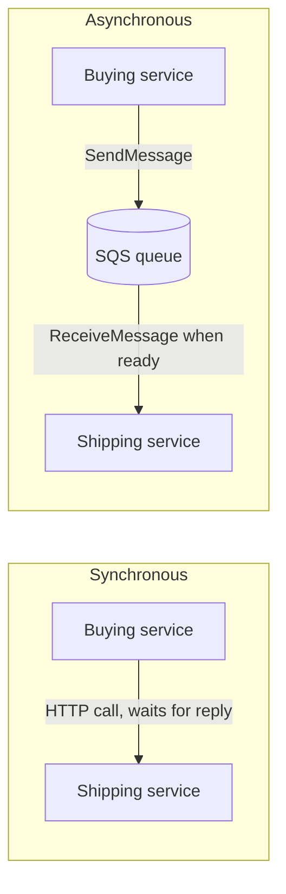
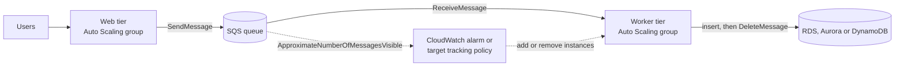
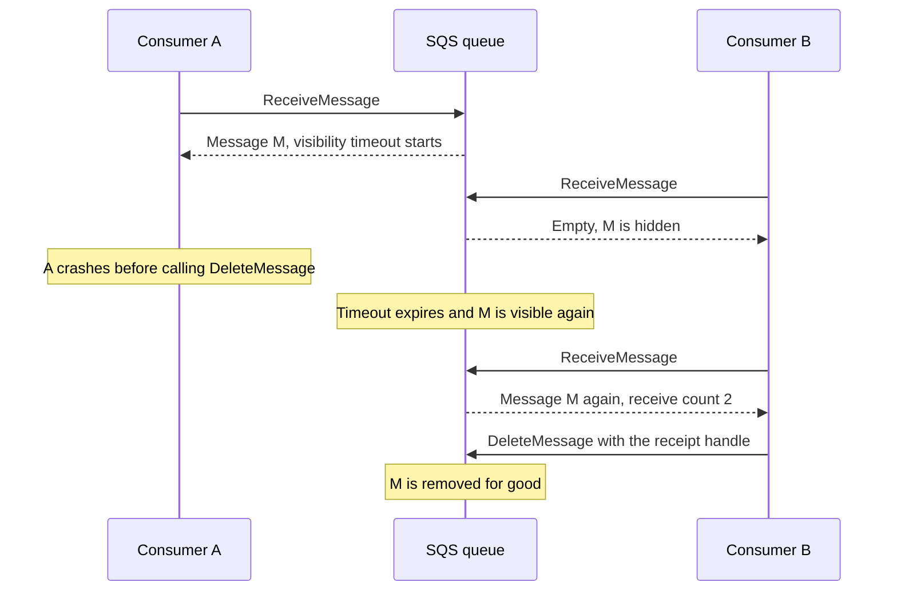
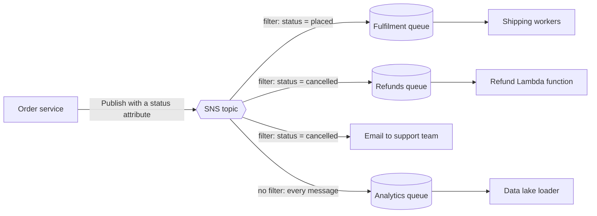
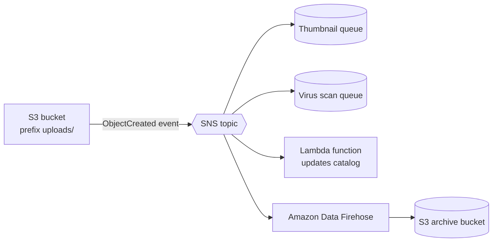
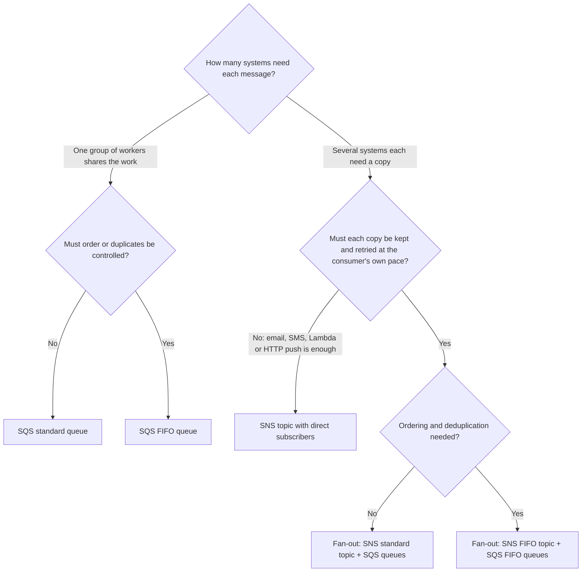

# Decoupling with SQS & SNS

## Summary

Amazon SQS and Amazon SNS let the parts of an application exchange information without waiting on each other. **SQS** is a managed message queue: producers drop work items in, consumers pull them out at their own pace, so a sudden spike becomes a longer queue instead of an outage. **SNS** is a managed publish/subscribe service: a producer publishes once to a topic and SNS pushes a copy to every subscriber (queues, Lambda functions, Firehose streams, HTTP endpoints, email, SMS, mobile apps). Combine the two in the **fan-out** pattern when several independent systems each need every event and none of them may lose one. Choose the **FIFO** flavour of either service when strict order and duplicate removal matter more than raw throughput, and the **standard** flavour for everything else. Kinesis, the third decoupling model, follows in the next lesson.

## Key concepts

- **Synchronous** calls tie a caller to the service it calls; **asynchronous** messaging through a queue or topic lets each side scale, deploy and fail independently.
- **SQS standard queue**: nearly unlimited throughput, **at-least-once** delivery (rare duplicates) and **best-effort ordering**.
- An SQS message holds up to **1 MiB**, is kept **4 days by default** (configurable from 1 minute to 14 days) and stays in the queue until a consumer **deletes** it.
- Consumers **poll** with `ReceiveMessage` (up to **10** messages per call), process the work, then call `DeleteMessage`.
- **Visibility timeout** (default **30 seconds**, maximum **12 hours**) hides a received message from other consumers; if it is not deleted in time it reappears and can be processed twice.
- **Long polling** (`WaitTimeSeconds` of 1 to 20 seconds) makes a receive call wait for messages, which cuts empty responses, cost and latency.
- A **dead-letter queue** (DLQ) catches messages that failed `maxReceiveCount` times so they stop blocking the main queue.
- **SQS FIFO**: strict order per **message group ID** and duplicates dropped within a **5-minute** window using a **deduplication ID** or a hash of the body; 300 API calls per second per action, 3,000 messages per second with batching, more in high throughput mode.
- Workers on EC2 scale with an **Auto Scaling group** driven by queue depth, ideally as **backlog per instance**.
- An **SNS topic** delivers each published message to all its subscribers: up to **12,500,000** subscriptions per standard topic and **100,000** standard topics per account.
- **Fan-out** = one SNS topic with several SQS queues subscribed; every queue's **access policy** must allow `sns.amazonaws.com` to call `sqs:SendMessage`.
- **SNS FIFO topics** add ordering and deduplication but deliver only to SQS queues (FIFO or standard).
- A **subscription filter policy** (JSON) delivers only matching messages to that subscriber; a subscription without one receives everything.
- Security for both services: **HTTPS** in transit, server-side encryption at rest (SQS-managed keys by default for new SQS queues, optional **KMS** keys for both), **IAM policies** for your own principals and **resource-based access policies** for other accounts and AWS services.

## Synchronous vs asynchronous communication

When one service calls another directly, for example the buying service sends an HTTP request to the shipping service and waits for the answer, the two are **coupled**. If shipping is slow, buying is slow. If shipping is down, orders fail. Both must be sized for the same peak at the same moment.

Asynchronous communication puts a managed middleman between them. The buying service writes a message such as "order 1036 is ready to ship" and immediately carries on. The shipping service reads the message whenever it has capacity. Each side can now be scaled, deployed, patched or even stopped for a while without breaking the other.

> [!EXAMPLE] The video encoding spike
> A video platform usually receives about 10 uploads an hour, then a celebrity shares a link and 1,000 uploads arrive within ten minutes. With direct calls, the upload API waits on the overloaded encoders and starts timing out. With a queue in between, every upload is accepted at once, the queue grows to 1,000 messages and a fleet of encoder instances scales out and works through the backlog.



AWS offers three decoupling models in this part of the course. All are fully managed and scale independently of the application that uses them.

| Model | Service | How consumers get data | Typical use |
|---|---|---|---|
| Queue | Amazon SQS | Consumers pull messages; each message is handled by one consumer, then deleted | Distributing work, buffering, background jobs |
| Publish/subscribe | Amazon SNS | SNS pushes a copy of every message to every subscriber | Notifications, broadcasting one event to many systems |
| Real-time stream | Amazon Kinesis Data Streams | Consumers read an ordered stream that can be replayed | Clickstreams, IoT telemetry, analytics (next lesson) |

## Amazon SQS: the queue model

SQS has been generally available since July 2006, which makes it one of the first AWS services. It needs no servers, no capacity planning and no patching: you create a queue and start calling its API.

### How a message flows

1. **Produce.** Any application with the SDK or CLI calls `SendMessage` (or `SendMessageBatch` for up to 10 at once). A message has a text body (JSON, XML or plain text) and up to 10 optional **message attributes** for metadata. An order message might carry an order ID, a customer ID and a priority attribute.
2. **Store.** SQS stores the message redundantly across several Availability Zones before it acknowledges the send. The message stays there until a consumer deletes it or the retention period runs out.
3. **Consume.** Consumers, which can be EC2 instances, containers, on-premises servers or Lambda functions, call `ReceiveMessage` and get up to 10 messages per call. Nothing is pushed to them; they ask.
4. **Process and delete.** The consumer does the work (for example inserts the order into an RDS database) and then calls `DeleteMessage` with the message's **receipt handle**. A message that is never deleted comes back later, so a crash does not lose work.

Many consumers can poll the same queue in parallel. Each receive call returns different messages, so adding consumers increases processing throughput (horizontal scaling). Because a standard queue may deliver a message more than once and does not promise order, consumer code should be **idempotent**: processing the same message twice must cause no harm (check whether order 1036 was already shipped before shipping it).

### Standard queue numbers to know

| Property | Value | Notes |
|---|---|---|
| Throughput | Nearly unlimited API calls per second, per action | No need to pre-provision anything |
| Messages stored (backlog) | Unlimited | Subject to the retention period |
| In-flight messages | About 120,000 per queue | Received but not yet deleted |
| Message size | 1 byte to 1 MiB (1,048,576 bytes) | Larger payloads: Extended Client Library stores the body in S3 (up to 2 GB) and sends a pointer |
| Retention | Default 4 days, minimum 60 seconds, maximum 14 days | Expired messages are deleted automatically |
| Messages per batch | Up to 10 per send, receive or delete call | Batching cuts the number of billed requests |
| Delivery | At least once | Occasional duplicates |
| Ordering | Best effort | Messages can arrive out of order |
| Latency | Tens to low hundreds of milliseconds per send, receive or delete call {{updated: The slides quote under 10 ms; the SQS FAQ (checked 2026-10) gives typical latencies in the tens or low hundreds of milliseconds}} | Fine for background work; not a substitute for a synchronous call when a user waits on the answer |

> [!UPDATED] Maximum message size is now 1 MiB
> Many older practice questions and blog posts still say 256 KB. SQS raised the limit to 1 MiB for both standard and FIFO queues in August 2025, and the course slides already show the new value. Billing counts every 64 KB chunk of payload as one request, so sending one 1 MiB message is billed as 16 requests.

### Pattern: scale consumers with an Auto Scaling group

When the consumers are EC2 instances, put them in an **Auto Scaling group** and scale on how much work is waiting. SQS publishes queue metrics to CloudWatch; the most useful one is `ApproximateNumberOfMessagesVisible` (messages waiting to be received). A CloudWatch alarm on that metric can trigger a scaling policy that adds instances when the backlog grows and removes them when it shrinks.

The queue length alone does not tell you how many instances you need: 1,000 messages that take 0.1 seconds each are a small job, while 1,000 messages that take a minute each are a big one. AWS therefore recommends a **target tracking** policy on **backlog per instance** = visible messages ÷ instances in service, with the target set to *acceptable latency ÷ average processing time per message*.

> [!EXAMPLE] Working out the target
> Ten worker instances face 1,500 visible messages. Each message takes 0.1 seconds to process and the business accepts at most 10 seconds of queue delay. Acceptable backlog per instance = 10 ÷ 0.1 = **100**. The current backlog per instance is 1,500 ÷ 10 = 150, so target tracking scales the group out to 15 instances.

> [!UPDATED] Metric name and recommended scaling method
> The slides label the queue-length metric `ApproximateNumberOfMessages`, which is the name of the queue *attribute*. The CloudWatch *metric* is `ApproximateNumberOfMessagesVisible`. The EC2 Auto Scaling guide now recommends target tracking on backlog per instance built with CloudWatch **metric math**, so you no longer need to publish a custom metric yourself.

A message that a worker was processing when its instance was terminated simply becomes visible again and another worker picks it up. For long jobs you can turn on **instance scale-in protection** while a worker is busy so Auto Scaling does not terminate it mid-task.

### Pattern: decouple application tiers

A front-end web tier accepts requests and sends a message for each heavy job (encode this video, generate this report) to a queue. A separate back-end tier, in its own Auto Scaling group, receives and processes the jobs. The front end stays fast because it never waits for the heavy work, and each tier scales on its own signal: the web tier on CPU or request count, the processing tier on queue backlog. A queue can absorb practically unlimited bursts, so neither tier needs to be sized for the other's peak.

### Pattern: buffer writes to a database

Imagine an app that writes every transaction straight into Amazon RDS, Aurora or DynamoDB. During a flash sale the database cannot keep up, write requests time out and **transactions are lost**. Put SQS in between: the app enqueues each transaction (which almost never fails), and a pool of workers dequeues messages, inserts them into the database and deletes each message only **after** the insert succeeds. If the database slows down, messages just wait longer in the queue. This works when the user does not need the write confirmed instantly ("Thanks, your order has been received").



## Message visibility timeout

When a consumer receives a message, SQS does not delete it; it hides it from every other consumer for the **visibility timeout** (default **30 seconds**, range 0 seconds to 12 hours). The consumer is expected to finish and delete the message within that window. If it does not, because it crashed, hung or was simply too slow, the message becomes visible again and the next `ReceiveMessage` call (from any consumer) gets it. This is how SQS guarantees that work is not lost, and also why a message can be processed twice.



Choosing the value is a trade-off:

| Setting | What goes wrong |
|---|---|
| Too short (seconds) for the real processing time | The message reappears while the first consumer is still working, a second consumer picks it up and the work is done **twice** |
| Too long (hours) | When a consumer crashes, the message stays hidden until the timeout ends, so the retry is **delayed** by hours |
| Matched to the typical processing time | Duplicates are rare and failed work is retried promptly |

A consumer that needs more time for a particular message can call **`ChangeMessageVisibility`** to extend the timeout for just that message (a "heartbeat"), without changing the queue default. Setting it to 0 releases the message immediately for someone else. Extensions cannot go beyond **12 hours counted from the first receive**; work longer than that should be split up or orchestrated with Step Functions.

## Short polling vs long polling

| | Short polling (default) | Long polling |
|---|---|---|
| How it works | Queries a sample of SQS servers and answers at once, even if nothing was found | Queries all servers and holds the request open until at least one message arrives or the wait time ends |
| Empty responses | Frequent, including "false empty" answers when messages exist on servers not sampled | Rare |
| API calls and cost | More calls, more requests billed | Fewer calls, lower cost |
| Latency to see a new message | Depends on how often you poll | A waiting request returns as soon as a message lands |
| How to enable | `ReceiveMessageWaitTimeSeconds` = 0 on the queue and no `WaitTimeSeconds` on the call | Queue attribute **Receive message wait time** of 1 to 20 seconds, or `WaitTimeSeconds` on each `ReceiveMessage` call |

The maximum wait is **20 seconds**, and 20 is the usual recommendation. Long polling is almost always preferable; the main reason to keep short polling is a single thread that must poll several queues and cannot block on one.

## Dead-letter queues and delay queues

These two features are not in this slide range, but they appear regularly in SAA-C03 questions about failed or delayed processing.

**Dead-letter queue (DLQ).** Some messages can never be processed, for example an order with a malformed date. Without protection such a "poison pill" is received, fails, reappears and fails again until its retention expires. A **redrive policy** on the source queue sets **`maxReceiveCount`** (the console calls it **Maximum receives**, 1 to 1,000). After a message has been received that many times without being deleted, SQS moves it to the DLQ, where you can inspect it, alarm on it and fix the bug.

- The DLQ must be the **same type** (FIFO source needs a FIFO DLQ) and in the **same account and Region** as the source queue.
- For a standard queue a message keeps its **original enqueue timestamp** when it moves, so give the DLQ a **longer retention** than the source (for example 14 days) or messages may expire soon after arriving.
- After the fix, **DLQ redrive** (console **Start DLQ redrive**, API `StartMessageMoveTask`) moves the messages back to the source queue or another queue of the same type.
- Think twice before adding a DLQ to a FIFO queue whose consumers depend on the exact sequence: moving one message aside breaks the order for the rest of its group.

**Delay queue.** Setting **Delivery delay** (`DelaySeconds`, 0 to **15 minutes**) hides every new message for that long *before* its first delivery, which is the opposite end of the lifecycle from the visibility timeout. Standard queues also accept a per-message timer that overrides the queue value; FIFO queues support only the queue-level delay. For scheduling beyond 15 minutes, AWS points to EventBridge Scheduler.

## SQS FIFO queues

A **FIFO** (first in, first out) queue guarantees that messages are received in exactly the order they were sent and that duplicates are not introduced. You choose the type when you create the queue and cannot change it later; a FIFO queue's name must end in **`.fifo`**.

| | Standard queue | FIFO queue |
|---|---|---|
| Ordering | Best effort | Strict, within each message group |
| Delivery | At least once, rare duplicates | Exactly-once processing: duplicates removed for 5 minutes |
| Throughput | Nearly unlimited | 300 API calls per second per action, or 3,000 messages per second with batches of 10; high throughput mode raises this |
| Required send parameters | Body only | Body + **message group ID**, plus a deduplication ID unless content-based deduplication is on |
| Per-message delay timers | Supported | Not supported (queue-level delay only) |
| Name | Any valid name | Must end in `.fifo` |
| Typical use | Image processing, background jobs, buffering writes | Order processing, bank transactions, commands that must run in sequence |

**Message group ID** (mandatory). Ordering is guaranteed *within* a group, and different groups are processed in parallel. Use a group per customer, per account or per device: all of customer A's events stay in sequence while customer B's are handled at the same time by another consumer. While one message of a group is in flight, the next message of that same group is held back until the first is deleted or its visibility timeout expires. One single group therefore means one message at a time, so many distinct group IDs give more parallelism.

**Deduplication.** If a producer retries a send (for example after a network timeout) within the **5-minute deduplication interval**, SQS accepts the retry but does not add a second copy. It recognises duplicates in one of two ways:

- an explicit **`MessageDeduplicationId`** that you set per message (such as `order-1036-created`), or
- **content-based deduplication**, a queue setting that makes SQS compute a SHA-256 hash of the message **body** (attributes are ignored) and use it as the ID.

> [!UPDATED] FIFO throughput limits are much higher in high throughput mode
> The slides give 300 messages per second, or 3,000 with batching. Those remain the defaults per API action (`SendMessage`, `ReceiveMessage`, `DeleteMessage`). With **Enable high throughput FIFO**, the limits become Region dependent: up to 70,000 transactions per second without batching (700,000 messages per second with batches of 10) in US East (N. Virginia), US West (Oregon) and Europe (Ireland), intermediate values in several other large Regions, and a default of 2,400 transactions per second in all remaining Regions. High throughput needs many distinct message group IDs to pay off. FIFO queues also now allow about 120,000 in-flight messages.

> [!UPDATED] Fair queues for multi-tenant standard queues
> Since July 2025 a standard queue accepts an optional `MessageGroupId` as a tenant label. When one tenant floods the queue, SQS favours other tenants' messages so their wait time stays low ("noisy neighbour" protection). On a standard queue this ID does **not** enforce ordering; it only marks the tenant.

## SQS security

| Layer | Option | What it means |
|---|---|---|
| In transit | HTTPS endpoints | The SQS API is called over TLS |
| At rest | **SSE-SQS** | Keys owned and managed by SQS; the default for new queues |
| At rest | **SSE-KMS** | AWS KMS key: the AWS managed key `alias/aws/sqs` or your own customer managed key (KMS charges apply) |
| Client side | Your own encryption | The producer encrypts before sending and the consumer decrypts; SQS never sees plaintext |
| Who can call the API | **IAM policies** | Attached to your users and roles: who may send, receive, delete, manage |
| Who else can use this queue | **SQS access policy** | A resource-based JSON policy on the queue, similar to an S3 bucket policy |

Use an **SQS access policy** when the caller is not an IAM principal in your account: another AWS account that needs to poll or send, or an AWS service that delivers messages for you, such as an SNS topic, S3 event notifications or EventBridge. Restrict such statements with the `aws:SourceArn` or `aws:SourceAccount` condition so only your topic or bucket can write.

> [!UPDATED] New queues are encrypted at rest by default
> The slides list at-rest encryption with KMS keys as an option. Since late 2022 (the developer guide dates the change 17 August 2022; AWS announced it on 4 October 2022) a queue created over HTTPS without encryption settings gets server-side encryption with SQS-managed keys (SSE-SQS) at no extra cost. You can still turn encryption off, so do not assume an old or script-created queue is encrypted. Choose SSE-KMS instead when you need your own key, key policies or CloudTrail records of key use.

> [!WARNING] Encrypted queues and AWS service publishers
> If a queue uses SSE-KMS and receives messages from SNS, S3 event notifications or EventBridge, use a **customer managed** KMS key whose key policy lets that service principal call `kms:GenerateDataKey` and `kms:Decrypt`. The policy of the AWS managed key `alias/aws/sqs` cannot be edited, so with that key those deliveries fail.

## Amazon SNS: publish/subscribe

Suppose the buying service must tell four systems about every new order: the email notifier, the fraud check, the shipping service and an analytics queue. With direct integration it needs four connections, four retry strategies and a code change every time a fifth system appears. With **SNS** it publishes once to a **topic** and any number of **subscriptions** receive a copy. Adding a new consumer means adding a subscription; the producer is untouched.

- The producer only knows the topic. Each subscriber receives **every** message published to it unless the subscription has a **filter policy**.
- SNS **pushes** messages to subscribers and retries failed deliveries; it does not keep messages for later reading the way a queue does (FIFO topics add an optional archive, see below).
- SNS stores copies of each published message across several Availability Zones before acknowledging the publish.

### Subscriber types

| Protocol | Delivers to | Notes |
|---|---|---|
| `sqs` | Amazon SQS queue | Basis of the fan-out pattern; the queue keeps messages durably |
| `lambda` | AWS Lambda function | SNS invokes the function asynchronously |
| `firehose` | Amazon Data Firehose stream | Then on to S3, Redshift, OpenSearch, Splunk and others; needs a subscription role |
| `http` / `https` | Your web endpoint | Must confirm the subscription; retries follow a delivery policy |
| `email` / `email-json` | Email addresses | Recipient confirms by clicking a link |
| `sms` | Mobile phone numbers | Text messages; spending limits apply |
| `application` | Mobile push endpoint | Through Apple, Google Firebase, Amazon and other push services |

> [!UPDATED] Kinesis Data Firehose is now Amazon Data Firehose
> The slides show the old name. AWS renamed the service to **Amazon Data Firehose** on 9 February 2024; APIs, CLI commands and IAM actions did not change, and SNS can still deliver to it directly.

### Limits worth remembering

| Resource | Standard topic | FIFO topic |
|---|---|---|
| Topics per account | 100,000 | 1,000 |
| Subscriptions per topic | 12,500,000 | 100 |
| Maximum message size | 256 KiB by default, configurable up to 1 MiB | Same |
| Filter policies | 200 per topic, 10,000 per account | Same |

> [!UPDATED] SNS messages can now be up to 1 MiB
> Since 18 September 2026 a topic has a **Maximum message size** setting (`MaximumMessageSize`) that accepts values up to 1,024 KiB. Every topic still defaults to 256 KiB. A topic set above 256 KiB may only have SQS, Lambda and Data Firehose subscriptions, and at most 100 of them. For anything larger, the SNS Extended Client Library stores the payload in S3 (up to 2 GB).

### Who publishes to SNS

Your own code publishes with the SDK, and many AWS services publish to SNS natively, which makes SNS the usual "notify a human or another system" hub:

- **CloudWatch alarms** changing state (the classic "email me when CPU is high")
- **S3 event notifications** (object created or deleted)
- **EC2 Auto Scaling** notifications (instance launched or terminated)
- **Lambda** functions, from their own code or as the destination of an asynchronous invocation
- **CloudFormation** stack events, **AWS Budgets** threshold alerts, **RDS** and **DMS** events, **DynamoDB** and many more

### Two ways to publish

- **Topic publish.** Create a topic, create one or more subscriptions, then call `Publish` against the topic ARN. This is what you use for system-to-system messaging.
- **Direct publish to a mobile endpoint.** For push notifications, create a **platform application** with your push-service credentials, create a **platform endpoint** for each device token, then publish to that endpoint ARN. SNS supports Apple Push Notification service (APNs), Firebase Cloud Messaging (FCM), Amazon Device Messaging (ADM), Baidu Cloud Push and Windows push services.

> [!UPDATED] Google GCM is now Firebase Cloud Messaging
> The slides list Google GCM. Google replaced GCM with **Firebase Cloud Messaging (FCM)**, and FCM is the Google option the SNS documentation lists today.

### SNS security

SNS mirrors SQS: the API is reached over **HTTPS**, topics can use **server-side encryption with KMS keys** (optional, not on by default), and producers can encrypt client-side. **IAM policies** control what your own principals may do, and an **SNS access policy** on the topic grants other accounts permission to publish or subscribe, or lets AWS services such as S3 publish to it. As with SQS, an encrypted topic that receives events from CloudWatch, S3 or other AWS services needs a customer managed KMS key whose policy allows that service.

## Fan-out: SNS + SQS

**Fan-out** combines the two services: publish once to an SNS topic and subscribe one SQS queue per consuming application. SNS copies each message into every queue, and each application reads its own queue at its own pace.

Why not let each application subscribe directly (for example with HTTP)? Because the queue adds what push delivery lacks:

- **Durability.** If the fraud service is down for an hour, its messages wait in its queue instead of being retried and eventually dropped.
- **Independent processing.** Each consumer gets its own visibility timeout, retries, DLQ, delay and scaling.
- **No lost data and loose coupling.** New queues can be subscribed later without touching the producer.
- **Cross-Region and cross-account delivery.** An SNS topic can deliver to SQS queues (and Lambda functions) in other Regions and other accounts.

The one setup step people forget: each queue's **access policy** must allow the topic to send. Subscribing from the SQS console (**Actions** → **Subscribe to Amazon SNS topic**) adds this statement for you; with the CLI or infrastructure as code you add it yourself:

```json
{
  "Effect": "Allow",
  "Principal": { "Service": "sns.amazonaws.com" },
  "Action": "sqs:SendMessage",
  "Resource": "arn:aws:sqs:us-east-1:111122223333:fraud-queue",
  "Condition": { "ArnEquals": { "aws:SourceArn": "arn:aws:sns:us-east-1:111122223333:orders-topic" } }
}
```

By default each queue receives the message wrapped in an SNS JSON envelope (type, message ID, topic ARN, timestamp, signature and the original message). Enable **raw message delivery** on an SQS, HTTP/S or Firehose subscription to deliver only the original body.



### Application: one S3 event, many consumers

An S3 bucket's notification configuration cannot hold two rules with the **same event type and overlapping prefixes or suffixes**. For example you cannot send `ObjectCreated` events for `images/` to queue A *and* to queue B. If several consumers need the same event, point the single S3 rule at an **SNS topic** and subscribe all the consumers (queues, Lambda functions) to it.

> [!NOTE] EventBridge is the other answer
> S3 can also send all of its events to Amazon EventBridge, where many rules can match the same event and route it to many targets. Both designs are valid; questions that mention SNS and SQS explicitly expect the fan-out answer. EventBridge is covered in the monitoring lesson.

### Application: archive every message to S3 through Data Firehose

SNS can deliver to **Amazon Data Firehose**, so you can subscribe a Firehose stream to a topic and have every message batched and written to S3 (or Redshift, OpenSearch, Splunk, a custom HTTP endpoint and other Firehose destinations). This gives you a cheap permanent record of everything published, for compliance or analytics, without writing any consumer code.



## SNS FIFO topics

An **SNS FIFO topic** (name ending in `.fifo`) brings the FIFO guarantees to pub/sub:

- **Ordering** per **message group ID**, exactly as in SQS FIFO.
- **Deduplication** with a **deduplication ID** or **content-based deduplication**, using the same 5-minute window.
- Subscribers can only be **SQS queues, FIFO or standard**. Email, SMS, HTTP/S and mobile endpoints cannot subscribe because they cannot preserve order; Lambda functions are reached through a subscribed queue.
- Optional **message archiving and replay**: the topic can keep messages for a period you set so a subscriber can replay them later.

Combine an SNS FIFO topic with **SQS FIFO queues** when you need **fan-out, ordering and deduplication together**, for example price updates that every downstream system must apply in exactly the order they were published. Subscribing standard queues to a FIFO topic is allowed and cheaper when a particular consumer does not care about order. The reverse does not work: an SQS FIFO queue cannot subscribe to a **standard** SNS topic, so ordered fan-out always starts with a FIFO topic.

> [!UPDATED] SNS FIFO throughput is no longer capped at SQS FIFO levels
> The slides say FIFO topics have the same limited throughput as SQS FIFO. Today a FIFO topic allows 300 messages per second **per message group** and, by default, 3,000 messages per second (or 20 MB per second) per topic. Since January 2025 you can set the topic attribute `FifoThroughputScope` to `MessageGroup` (high throughput mode, which cannot be reverted). Deduplication then applies per message group and the topic can use the account's full regional publish quota, for example 30,000 messages per second in US East (N. Virginia).

## SNS message filtering

A **filter policy** is a JSON document attached to a **subscription** (not to the topic). SNS compares each published message against it and delivers the message to that subscriber only if it matches. A subscription without a filter policy receives every message.

For example, the refunds queue's subscription might carry:

```json
{
  "status": ["cancelled"],
  "amount": [{ "numeric": [">", 0] }]
}
```

- Different keys are combined with **AND**; values inside one array are alternatives (**OR**): `"status": ["cancelled", "declined"]` matches either.
- Operators include exact match, `anything-but`, `prefix`, `suffix`, `equals-ignore-case`, numeric ranges, IP address ranges and `exists`.
- By default the policy is evaluated against **message attributes**. Set the subscription's **filter policy scope** to `MessageBody` to filter on fields inside a JSON message body instead.
- New or changed filter policies can take **up to 15 minutes** to take full effect.

> [!UPDATED] Filtering on the message body
> The slides describe filter policies on message attributes only. SNS can also filter on the content of the message itself when the subscription's `FilterPolicyScope` is set to `MessageBody` and the payload is well-formed JSON.

Filtering keeps routing logic out of consumers: instead of every queue receiving every order and discarding most of them, the placed-orders queue receives only placed orders. You pay for and process less.

## Choosing the right option



| Need | Best fit | Why |
|---|---|---|
| Spread jobs over a pool of workers, survive spikes | SQS standard | Pull model, unlimited buffering, workers scale on backlog |
| Process banking or order events strictly in sequence, no duplicates | SQS FIFO | Ordering per message group and 5-minute deduplication |
| Alert people by email or SMS, invoke Lambda on an event | SNS | Push delivery to many endpoint types |
| Several independent systems each need every event, none may miss one | SNS + SQS fan-out | Each system gets its own durable queue |
| The same, but order and deduplication matter | SNS FIFO + SQS FIFO | Fan-out with FIFO guarantees end to end |
| Many consumers must replay an ordered stream in real time | Kinesis Data Streams | Covered in the next lesson |

## Exam tips

> [!EXAM] Decouple, buffer, absorb spikes
> "Decouple the application tiers", "handle sudden spikes without losing requests", "the database cannot keep up with writes" → put an **SQS queue** between the producer and the slow component, and scale the consumers.

> [!EXAM] Scale workers on the queue
> EC2 workers that process queue messages should be in an **Auto Scaling group** scaling on queue depth (**ApproximateNumberOfMessagesVisible** or, better, **backlog per instance** with target tracking), not on CPU alone.

> [!EXAM] Messages processed twice
> "Some messages are processed more than once" with standard SQS → the **visibility timeout is shorter than the processing time**; raise it or have the consumer call **ChangeMessageVisibility**. If duplicates must never happen, use a **FIFO queue** plus idempotent consumers.

> [!EXAM] Too many empty responses, high SQS bill
> "Reduce the number of empty ReceiveMessage responses" or "reduce SQS API cost" → enable **long polling** (`WaitTimeSeconds` up to **20** seconds).

> [!EXAM] Order matters
> "Messages must be processed in the order they were sent" or "no duplicates" → **SQS FIFO**, with a **message group ID** per entity (customer, account, device) so different entities still run in parallel. If throughput must exceed 300 messages per second, mention **batching** or **high throughput mode**.

> [!EXAM] One event, many consumers
> "Send the same message to multiple services", "add consumers later without changing the producer", "several SQS queues need the same S3 event" → **SNS fan-out to SQS queues**. Add **filter policies** when each consumer needs only some messages.

> [!EXAM] Poison messages
> "A few malformed messages keep failing and reappearing" → configure a **dead-letter queue** with a sensible `maxReceiveCount`, alarm on it, and redrive after the fix.

> [!EXAM] Cross-account or AWS service access
> "Another account must send to our queue" or "S3/SNS must deliver to the queue" → edit the **SQS access policy** (resource-based), not just IAM. For a KMS-encrypted queue or topic, also allow the service in a **customer managed key** policy.

> [!EXAM] Numbers that show up
> SQS retention **4 days default / 14 days max**; message **1 MiB**; visibility **30 s default / 12 h max**; long polling **up to 20 s**; up to **10** messages per batch; delay **up to 15 min**; FIFO **300 / 3,000 per second** and **5-minute** dedup; SNS **12,500,000** subscriptions per topic and **100,000** topics.

## Common traps

> [!TRAP] SNS does not store messages for later
> If a subscriber is unreachable, SNS retries according to a delivery policy and then **discards** the message unless the subscription has its own dead-letter queue. The retry window depends on the endpoint: SQS and Lambda get up to 100,015 attempts over 23 days, email, SMS and mobile push 50 attempts over 6 hours, and an HTTP/S retry policy can never span more than 3,600 seconds. When a consumer must be able to catch up after an outage, put an **SQS queue** behind the topic.

> [!TRAP] Forgetting to delete the message
> Receiving a message does not remove it. A consumer that never calls `DeleteMessage` will see the same message again after every visibility timeout, and eventually it lands in the DLQ or expires.

> [!TRAP] Visibility timeout vs delay queue vs retention
> The **visibility timeout** hides a message *after* it is received; **delivery delay** hides it *before* its first delivery; **retention** is how long an unprocessed message survives. Questions mix these up on purpose.

> [!TRAP] Converting a standard queue to FIFO
> You cannot change a queue's type. Create a new queue whose name ends in `.fifo` and move the producers and consumers to it.

> [!TRAP] SNS FIFO subscribers
> An SNS FIFO topic cannot deliver to email, SMS, HTTP/S or mobile endpoints, and Lambda is reached through a subscribed queue. If the scenario needs ordered fan-out to Lambda, the answer is SNS FIFO → SQS FIFO → Lambda. An answer that puts SQS FIFO queues behind a *standard* topic is wrong twice: the topic keeps no order, and FIFO queues cannot subscribe to it.

> [!TRAP] Fan-out silently not delivering
> A subscription can show as confirmed while nothing reaches the queue, because the **queue access policy** does not allow `sns.amazonaws.com` to send (or a KMS key policy blocks it). Check the queue policy and key policy first.

> [!TRAP] Filter policy on the wrong object
> Filter policies belong to **subscriptions**, not to topics or queues. A subscription with no filter policy receives every message, including ones other subscribers filtered out.

> [!TRAP] "Exactly once" does not mean "never reprocessed"
> FIFO prevents duplicates from being *added* within 5 minutes, but a consumer that misses its visibility timeout can still receive the same message again. Consumers should stay idempotent.
