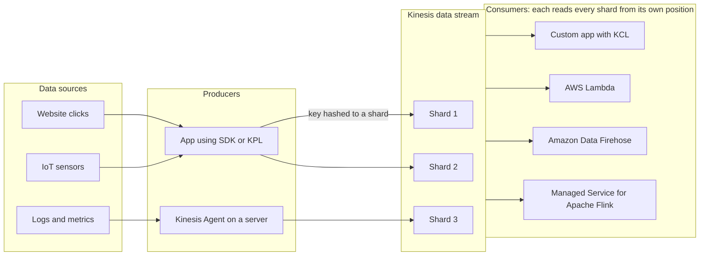
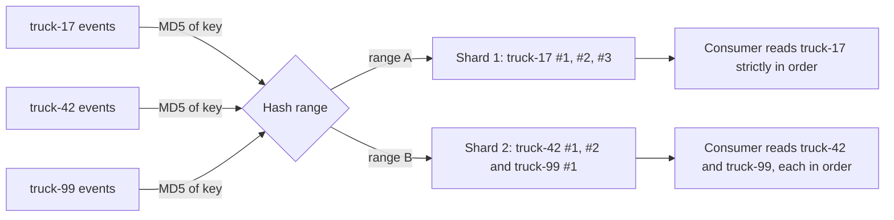
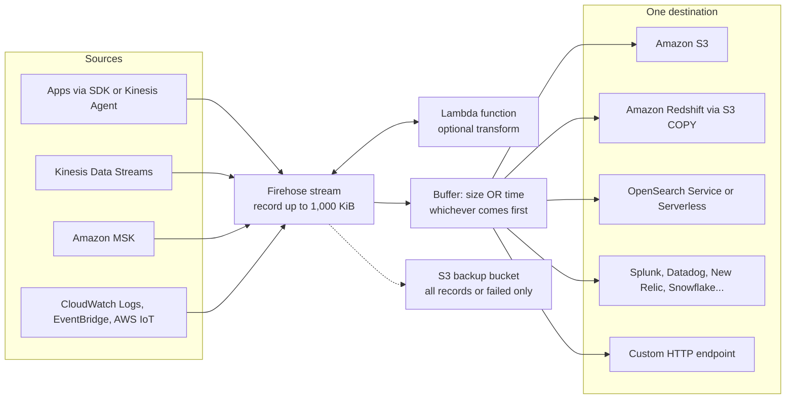
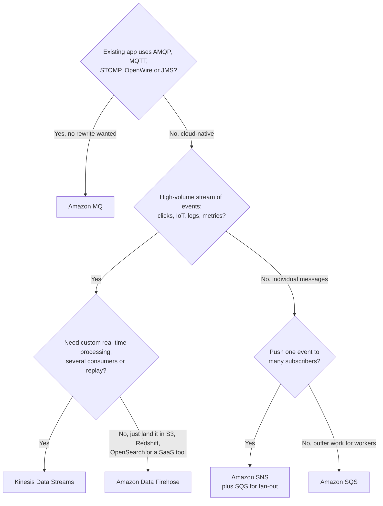
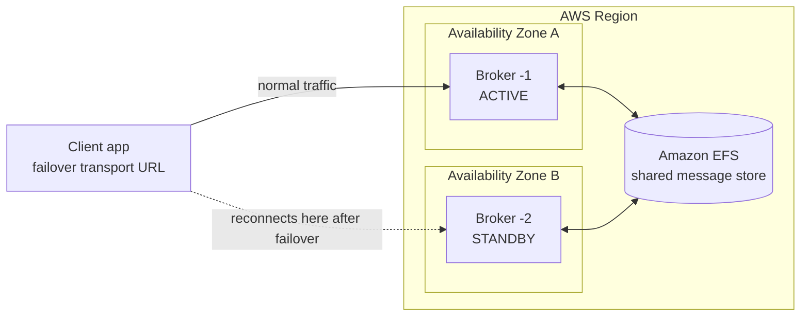

# Streaming with Kinesis & Amazon MQ

## Summary

This lesson finishes the integration and messaging toolbox. **Amazon Kinesis Data Streams** is a durable, ordered log for real-time data: many producers append small records (clicks, IoT readings, logs), several independent consumers read them within milliseconds, and the records stay available for replay for anywhere from 1 to 365 days. **Amazon Data Firehose** is the no-code delivery pipe: it accepts streaming data, buffers it for seconds to minutes, optionally transforms or converts it, and writes batches into Amazon S3, Amazon Redshift, Amazon OpenSearch Service or a third-party tool such as Splunk or Datadog. **Amazon MQ** is different again: a managed Apache ActiveMQ or RabbitMQ broker for existing applications that already speak open protocols (AMQP, MQTT, STOMP, OpenWire, WebSocket) and cannot be rewritten for SQS and SNS. Pick Kinesis Data Streams when you need real-time processing, ordering per key, several consumers or replay; Firehose when the goal is simply "land this stream in a data store" with no code; SQS or SNS for cloud-native decoupling; and Amazon MQ for lift-and-shift of broker-based apps.

## Key concepts

- A **Kinesis data stream** is made of **shards**; each shard is an ordered sequence of **records** (partition key + sequence number + data blob).
- The **partition key** is hashed to choose a shard, so records with the same key are stored, and read, **in order**.
- Records are **immutable** and stay for the **retention period** (24 hours by default, up to **365 days**); reading does not delete them, so consumers can **replay**.
- A provisioned shard takes **1 MB/s or 1,000 records/s in** and gives **2 MB/s out** (shared by all standard consumers).
- **Capacity modes**: **Provisioned** (you pick and pay per shard-hour), **On-demand Standard** (auto-scales, pay per stream-hour plus GB), **On-demand Advantage** (account-level, no per-stream fee, discounted GB, minimum commitment).
- **Enhanced fan-out** gives each registered consumer its own **2 MB/s per shard**, pushed over HTTP/2 with about 70 ms latency.
- **KPL** helps producers batch and retry; **KCL** helps consumers share shards and checkpoint progress (in DynamoDB).
- **Amazon Data Firehose** (formerly Kinesis Data Firehose) is **serverless, auto-scaling and near real-time**: it buffers by **size or time**, then writes batches.
- Firehose can **transform with Lambda**, **convert JSON to Parquet or ORC**, compress, and back up all or failed records to S3; it **stores nothing** and **cannot replay**.
- **SQS** = consumers pull and delete messages; **SNS** = push copies to many subscribers, no persistence; **Kinesis** = ordered, replayable stream for real-time big data.
- **Amazon MQ** = managed **ActiveMQ** or **RabbitMQ** for apps using **open protocols**; it runs on broker instances, so it scales less than SQS/SNS.
- Amazon MQ **high availability**: ActiveMQ **active/standby** across two AZs on shared **Amazon EFS**; RabbitMQ **three-node cluster** across AZs.

## Streams versus queues

The previous lesson covered queues (SQS) and pub/sub topics (SNS). Both treat a message as a unit of work: once it has been handled, it is gone. A **stream** behaves more like an append-only log file. Producers keep adding records at the end; each consumer keeps its own bookmark and reads forward at its own pace; nothing is removed when it is read, only when it ages out.

That design is what makes streaming fit "big data in motion": website clickstreams, telemetry from thousands of IoT sensors, application logs and metrics, financial ticks, game events. Several teams can process the same flow differently (a fraud detector in real time, an archiver once a minute, a data scientist replaying last week) without stepping on each other.

> [!EXAMPLE] One stream, three uses
> A ride-hailing app sends every GPS ping from every car into one data stream. A Lambda function updates the live map within a second, a Managed Service for Apache Flink application computes surge pricing per city every 30 seconds, and a Firehose stream writes all pings to S3 as compressed files for later analysis with Athena. If the surge-pricing code has a bug, the team fixes it and replays the last 24 hours from the stream.

## Amazon Kinesis Data Streams

### Producers, shards and consumers

- **Producers** put records with the `PutRecord` or `PutRecords` API (up to 500 records per batch call). Typical producers are applications using the AWS SDK, the **Kinesis Producer Library (KPL)**, or the **Kinesis Agent**, a small agent that tails log files on Linux servers and ships new lines to Kinesis.
- The **stream** is a set of **shards**. Each shard is a fixed slice of capacity and an ordered sequence of records. More shards means more throughput (and, in provisioned mode, more cost).
- **Consumers** read records. Common ones are custom applications built with the **Kinesis Client Library (KCL)** on EC2 or containers, **AWS Lambda** (an event source mapping polls the shards and invokes your function with batches), **Amazon Data Firehose** (delivery to storage) and **Amazon Managed Service for Apache Flink** (stateful stream analytics with SQL, Java or Python).

> [!NOTE] Kinesis Data Analytics is now Managed Service for Apache Flink
> Older material calls the analytics consumer "Kinesis Data Analytics". AWS renamed the Flink flavour to Amazon Managed Service for Apache Flink and discontinued the SQL flavour (no new apps from 15 October 2025, remaining apps deleted on 27 January 2026). If an answer offers "Kinesis Data Analytics for SQL", treat it as legacy.

### Records, partition keys and ordering

A **record** has three parts:

| Part | Who sets it | What it is for |
|---|---|---|
| Partition key | Producer | A string (up to 256 characters) that Kinesis hashes with MD5 to pick the shard |
| Sequence number | Kinesis | Unique, increasing position of the record inside its shard |
| Data blob | Producer | Your payload, any bytes; Kinesis never inspects or changes it |

Because the shard is chosen from the key, **every record with the same partition key lands in the same shard, in the order it was written**. That is the Kinesis ordering guarantee: order **per partition key (per shard)**, not across the whole stream.

> [!EXAMPLE] Choosing a partition key
> A delivery company streams GPS positions from 5,000 trucks and needs each truck's positions processed in order. Use the **truck ID** as the partition key: plenty of distinct values spread the load over all shards, and each truck's events stay ordered. Using the **country** as the key would push almost everything into one or two "hot" shards, which then throttle with `ProvisionedThroughputExceededException` while other shards sit idle.

### Size limits, retention and replay

| Property | Value | Notes |
|---|---|---|
| Write capacity per shard | 1 MB/s **or** 1,000 records/s | Whichever is hit first; includes partition keys |
| Read capacity per shard (standard consumers) | 2 MB/s, 5 `GetRecords` calls/s | Shared by every standard consumer of that shard |
| Record payload | 1 MiB by default, configurable up to 10 MiB {{updated: Per-stream maximum record size became configurable up to 10 MiB in October 2025; the default stays 1 MiB}} | Large records are meant to be occasional |
| Retention | 24 hours default, 365 days (8,760 hours) maximum | Longer than 24 hours costs extra |
| Deleting a record | Not possible | Records expire only when retention passes |

> [!UPDATED] Record size: 10 MiB is a ceiling you opt into
> The slides list 10 MiB as the record size. Since October 2025 a stream's maximum record size can be raised from the default 1 MiB up to 10 MiB (console, CLI or the `UpdateMaxRecordSize` API), and `PutRecords` requests can carry up to 10 MiB. Shard throughput did not change (still 1 MB/s in), so Kinesis absorbs occasional large records with burst capacity but is still designed for a high volume of small records.

Retention gives you **replay**. A consumer chooses where to start reading with a shard iterator type: `TRIM_HORIZON` (oldest record still kept), `LATEST` (only new records), `AT_TIMESTAMP`, or `AT_SEQUENCE_NUMBER` / `AFTER_SEQUENCE_NUMBER`. After a bug fix you can point a consumer back at yesterday and reprocess. Retention also means **you cannot delete individual records**, which matters for data that must be erased on request: keep personal data out of the payload, or keep the retention short.

### Security

- **In transit**: the Kinesis endpoints use HTTPS (TLS).
- **At rest**: server-side encryption with an AWS KMS key, either the AWS managed key for Kinesis or a customer managed key; producers and consumers need permission to use the key. Turning encryption on only protects records written afterwards.
- **Client-side encryption** is possible but you build and manage it yourself.
- **Access control** with IAM policies (and resource policies for cross-account access); **interface VPC endpoints** (PrivateLink) keep traffic from a VPC off the internet.

### Producer and consumer libraries

| Tool | Side | What it does for you |
|---|---|---|
| AWS SDK (`PutRecord`, `PutRecords`, `GetRecords`) | Both | Plain API calls; you handle batching, retries and shard tracking |
| Kinesis Producer Library (KPL) | Producer | Batches and aggregates many small user records into fewer Kinesis records, retries automatically |
| Kinesis Agent | Producer | Watches log files on a server and sends new lines to Kinesis Data Streams or Firehose |
| Kinesis Client Library (KCL) | Consumer | Spreads shards across a fleet of workers, follows shard splits and merges, and stores checkpoints in DynamoDB tables so a restarted worker resumes where it left off |
| Lambda event source mapping | Consumer | AWS polls shards for you and invokes your function with batches of records |

### Shared throughput versus enhanced fan-out

By default all consumers of a shard **share** its 2 MB/s read budget and **pull** with `GetRecords`. That is fine for one or two consumers, but each extra consumer slows the others. **Enhanced fan-out (EFO)** gives every registered consumer its **own 2 MB/s per shard**, and Kinesis **pushes** records over an HTTP/2 connection (`SubscribeToShard`).

| | Shared throughput (default) | Enhanced fan-out |
|---|---|---|
| Delivery model | Pull with `GetRecords` | Push with `SubscribeToShard` (HTTP/2) |
| Read throughput | 2 MB/s per shard, split among all consumers | 2 MB/s per shard **per consumer** |
| Typical latency | About 200 ms with one consumer, rising toward 1 s with five | About 70 ms regardless of consumer count |
| Consumer limit | Practical limit of a few (5 read calls per second per shard) | 20 registered consumers per stream (50 with On-demand Advantage) |
| Extra cost | None | Provisioned: per consumer-shard-hour plus per GB retrieved. On-demand Standard: a higher per-GB read rate. On-demand Advantage: same rate as standard reads |

> [!TIP] When to turn on enhanced fan-out
> Use EFO when **several applications** read the same stream, or when **latency** matters (for example a real-time bidding or alerting app). Stay with shared throughput for one or two consumers that can tolerate a few hundred milliseconds, because it costs nothing extra.

## Capacity modes

| | Provisioned | On-demand Standard | On-demand Advantage {{updated: New account-level mode added after the slides}} |
|---|---|---|---|
| You manage | Number of shards (split, merge or `UpdateShardCount`) | Nothing | Nothing (optional "warm throughput") |
| Starting capacity | Shard count × 1 MB/s in, 2 MB/s out | 4 MB/s or 4,000 records/s write, 8 MB/s read | Same as Standard, plus warm throughput you set ahead of a peak |
| Scaling | Manual (or your own automation) | Automatic, up to **double the peak of the last 30 days** without throttling | Automatic, same rules |
| Ceiling | No upper limit (account shard quota) | 10 GB/s write in us-east-1, us-west-2 and eu-west-1; 200 MB/s elsewhere unless raised | Same as Standard |
| Billing | Per shard-hour + per million PUT payload units (25 KB each) | Per stream-hour + per GB written + per GB read | No per-stream fee; per GB written and read at least 60% cheaper; commits the account to 25 MiB/s ingest and retrieval |
| Best for | Predictable, steady traffic you can forecast | Spiky, new or unknown traffic | Accounts with many on-demand streams, steady large volume or many EFO consumers |

You can switch a stream between provisioned and on-demand **twice per 24 hours** without downtime.

> [!UPDATED] On-demand Advantage changes the on-demand price model
> The slides describe on-demand as "pay per stream per hour plus data in/out". That is still true for **On-demand Standard** (us-east-1: USD 0.04 per stream-hour, USD 0.08 per GB in, USD 0.04 per GB out). The newer **On-demand Advantage** setting removes the per-stream fee, cuts the per-GB rates (USD 0.032 in, USD 0.016 out in us-east-1), charges enhanced fan-out reads at the same rate as standard reads, allows 50 EFO consumers and lets you pre-warm capacity, in exchange for a minimum of 25 MiB/s of ingest and retrieval across all on-demand streams of the account in that Region. Provisioned is still USD 0.015 per shard-hour in us-east-1.

> [!EXAMPLE] Sizing a provisioned stream
> A game sends 3,000 events per second, each about 0.5 KB, read by two standard consumers.
> - Bytes in: 3,000 × 0.5 KB ≈ 1.5 MB/s, which needs **2 shards**.
> - Records in: 3,000 records/s at 1,000 per shard needs **3 shards**.
> - Bytes out: 1.5 MB/s × 2 consumers = 3 MB/s, which needs 2 shards at 2 MB/s each.
> The largest answer wins: **3 shards**. Notice that many tiny records can make the record-count limit, not the byte limit, the deciding factor. If the traffic were unpredictable, on-demand would avoid this calculation entirely.

## Amazon Data Firehose

### How a Firehose stream works

Firehose (renamed from Kinesis Data Firehose; the resource is now called a **Firehose stream** instead of a delivery stream) is the managed "loader" of the family. You do not write consumer code, choose servers or pick shards. You create a Firehose stream, point producers at it, and it delivers to the destination you chose.

Key properties:

- **Fully managed and serverless**: capacity scales automatically; when Kinesis Data Streams is the source there is no Firehose throughput limit to manage.
- **Near real-time**: data waits in a buffer until it reaches a size or an age, then is written as one object or batch.
- **Pay for what you ingest**: in us-east-1 about USD 0.029 per GB for the first 500 TB a month, with each record rounded up to 5 KB, plus optional features (format conversion, dynamic partitioning, VPC delivery).
- **No storage of its own**: if a Direct PUT destination is down, Firehose keeps retrying for up to 24 hours; with a Kinesis source, unread data simply waits in the stream. Firehose has **no replay**.
- **Record size**: up to 1,000 KiB per record.
- **Any payload format**: records can be JSON, CSV, Avro, Parquet, plain text or binary. Firehose delivers the bytes unchanged unless you add a Lambda transform, format conversion or compression.

### Sources and destinations

| Sources | Destinations |
|---|---|
| **Direct PUT**: your apps (SDK `PutRecord` / `PutRecordBatch`), Kinesis Agent, and many AWS services that write directly, such as CloudWatch Logs subscriptions, EventBridge, AWS IoT rules, SNS, AWS WAF logs | **AWS**: Amazon S3, Amazon Redshift (staged in S3, then loaded with `COPY`), Amazon OpenSearch Service, OpenSearch Serverless, Apache Iceberg Tables |
| **Amazon Kinesis Data Streams** (Firehose reads from the stream's latest position) | **Partners**: Splunk, Datadog, New Relic, MongoDB, Dynatrace, Elastic, Sumo Logic, Snowflake, Coralogix and others |
| **Amazon MSK** (Kafka topics) | **Custom HTTP endpoint** you own |

> [!UPDATED] More sources and destinations than the slides show
> The slide diagram lists S3, Redshift, OpenSearch, a few partners and HTTP endpoints. The current service also accepts **Amazon MSK** as a source and adds **OpenSearch Serverless**, **Apache Iceberg Tables** and **Snowflake** (plus more partners) as destinations. The exam idea is unchanged: Firehose is the answer for "load streaming data into a store or tool without writing code".

### Buffering

Firehose collects incoming records in memory and flushes when the **buffer size** or the **buffer interval** is reached, whichever happens first.

| Destination | Buffer size (default) | Buffer interval (default) |
|---|---|---|
| Amazon S3, Redshift, Iceberg Tables | 1–128 MiB (5 MiB) | 0–900 s (300 s) |
| OpenSearch Service / Serverless | 1–100 MiB (5 MiB) | 0–900 s (300 s) |
| Splunk | 1–5 MiB (5 MiB) | 0–60 s (60 s) |
| HTTP endpoint | 1–64 MiB (5 MiB) | 0–900 s (60 s) |

> [!UPDATED] Zero buffering
> The minimum buffer interval used to be 60 seconds, which is where Firehose's "near real-time, about a minute" reputation comes from. Today the interval can be set as low as **0 seconds**, and Firehose then delivers within a few seconds (not for the S3 backup copy or dynamic partitioning, and intervals under 60 seconds raise S3 PUT costs). For the exam, Firehose is still "near real-time" and Kinesis Data Streams is "real-time".

> [!EXAMPLE] Reading the buffer settings
> With a 5 MiB / 300 s buffer, a stream receiving 1 MiB per minute flushes every 5 minutes (the size is reached at the same moment as the interval). A stream receiving 10 MiB per minute flushes about every 30 seconds, because the 5 MiB size fills before 300 seconds pass. Bigger buffers mean fewer, larger S3 objects (cheaper to query); smaller buffers mean fresher data.

### Transform, convert, compress

- **Lambda transformation**: Firehose batches records (0.2–3 MB, default 1 MB), invokes your Lambda function synchronously (up to 5 minutes, 6 MB payload limit), and delivers what the function returns. Typical jobs: CSV to JSON, enrich with a lookup, drop or mask fields. Blueprints exist for common cases.
- **Record format conversion**: Firehose can turn **JSON** into columnar **Apache Parquet** or **Apache ORC** before writing to S3, using a table schema stored in the **AWS Glue Data Catalog**. Other formats (CSV, logs) must first be turned into JSON with Lambda. Columnar files make Athena and Redshift Spectrum queries faster and cheaper.
- **Compression** for S3: GZIP, Snappy, Zip or Hadoop-compatible Snappy (only GZIP works when loading Redshift).
- **Dynamic partitioning** writes records to S3 prefixes built from fields inside the data (for example `customer_id=123/`), which keeps later queries cheap.
- **Backup**: send **all** source records, or **only failed** ones, to an S3 bucket.
- **Encryption** of delivered S3 objects with SSE-KMS.

## Data Streams or Firehose: which one?

| | Kinesis Data Streams | Amazon Data Firehose |
|---|---|---|
| Job | Collect and hold a real-time stream for your own processing | Deliver a stream into a destination |
| Code | You write (or configure) producers and consumers | None for consumption; just configuration |
| Latency | Real-time (about 70–200 ms) | Near real-time (buffer of 0–900 s) |
| Capacity | Provisioned shards or on-demand | Fully automatic |
| Storage | Yes, 1 to 365 days | No |
| Replay | Yes | No |
| Consumers | Many, independent | One destination per Firehose stream |
| Ordering | Per partition key | Not a feature you design around |

They are complementary: a very common pattern is **producers → Kinesis Data Streams → (Lambda / Flink for real-time) + Firehose → S3** for the archive.

> [!UPDATED] Kinesis Data Streams can now deliver to S3 itself
> Since August 2026, an **on-demand** data stream can deliver its records directly to a general purpose S3 bucket (raw format) or to Apache Iceberg "streaming tables" on Amazon S3 Tables, with a configurable freshness of 5–15 minutes and no consumer code. The slides predate this. Firehose remains the broader tool (Lambda transforms, Redshift, OpenSearch, partner and HTTP destinations, Direct PUT sources), and exam questions written for SAA-C03 still expect **Firehose** for "load into S3/Redshift/OpenSearch with no code".

## SQS vs SNS vs Kinesis

All three move data between components, but they behave very differently.

| | Amazon SQS | Amazon SNS | Kinesis Data Streams |
|---|---|---|---|
| Model | Queue: consumers **pull** | Pub/sub: SNS **pushes** to subscribers | Stream: consumers **pull** (standard) or receive a **push** (enhanced fan-out) |
| After delivery | Message **deleted** once processed | Not stored; a message that cannot be delivered is lost (unless a DLQ is set up). FIFO topics can optionally archive messages for replay | **Kept** until retention expires; **replayable** |
| Consumers | Any number of workers sharing the work | Up to 12,500,000 subscriptions per standard topic; 100,000 standard topics per account | Several independent apps, each reading everything |
| Throughput setup | None | None | Provisioned shards or on-demand |
| Ordering | Only with **FIFO** queues | Only with **FIFO** topics (which feed SQS FIFO queues) | Per partition key, at shard level |
| Message size | 1 MiB {{updated: SQS maximum message size is now 1 MiB, up from the long-standing 256 KiB}} | 256 KiB | 1 MiB default, up to 10 MiB |
| Extras | Per-message delay (up to 15 minutes), DLQs, visibility timeout | Message filtering, fan-out to SQS | Real-time analytics and ETL, 1–365 days retention |
| Think of it as | A to-do list shared by workers | A loudspeaker announcement | A recording everyone can rewind |

## Amazon MQ

### Why it exists

SQS and SNS are AWS-native services with AWS APIs. Many applications written before (or outside) the cloud talk to a **message broker** through **open, standard protocols**: **AMQP**, **MQTT** (common for IoT devices), **STOMP**, **OpenWire** (ActiveMQ's native protocol, used by JMS clients) and **WebSocket**. Moving such an app to AWS and rewriting all messaging code for SQS/SNS can be expensive and risky. **Amazon MQ** gives you a **managed broker** that speaks those protocols, so the application only needs a new connection URL.

Amazon MQ runs the open-source engines **Apache ActiveMQ Classic** and **RabbitMQ**. AWS provisions the broker instances, patches them in your maintenance window, upgrades engine versions, stores messages durably and publishes metrics to CloudWatch. Like a classic broker it offers both **queues** (point-to-point, comparable to SQS) and **topics** (publish/subscribe, comparable to SNS).

> [!WARNING] A broker is a server, not a serverless service
> Amazon MQ runs on broker **instances** (for example `mq.t3.micro` for evaluation, `mq.m5` for production ActiveMQ, `mq.m5` or `mq.m7g` for production RabbitMQ) inside your VPC. It does not scale anywhere near as far as SQS or SNS, you pay per broker-hour whether or not messages flow, and you size it yourself. Choose it for **protocol compatibility**, not for massive scale.

### Engines and deployment options

| | Amazon MQ for ActiveMQ | Amazon MQ for RabbitMQ |
|---|---|---|
| Protocols | OpenWire, AMQP, STOMP, MQTT, WebSocket (plus JMS / NMS client APIs) | AMQP 0-9-1 |
| Single-instance | One broker in one AZ, storage on EFS or EBS | One broker in one AZ behind a Network Load Balancer, EBS storage |
| High availability | **Active/standby**: two brokers in two AZs sharing **Amazon EFS** storage | **Cluster**: three nodes in three AZs behind an NLB, data replicated across nodes |
| Storage choice | EFS (durability-optimized, replicated across AZs) or EBS (throughput-optimized, single AZ, `mq.m5` only, not for active/standby) | EBS |
| Current engine versions | 5.19 (recommended) and 5.18 {{updated: ActiveMQ 5.15, 5.16 and 5.17 have reached end of support on Amazon MQ}} | 4.3 and 4.2 (on `mq.m7g`), 3.13 {{updated: RabbitMQ 4 is supported on mq.m7g and makes quorum queues the default queue type}} |

How active/standby failover works: only one broker accepts connections at a time. Both read and write the same message store on Amazon EFS, which is itself replicated across AZs. If the active broker fails, or during maintenance and reboots, the standby takes over after a short pause. Amazon MQ gives you two endpoints per protocol (suffixes `-1` and `-2`); clients list both in a **failover** connection string so they reconnect automatically.

> [!UPDATED] Newer Amazon MQ capabilities
> Beyond what the slides show, Amazon MQ now offers **cross-Region data replication** for ActiveMQ (an asynchronous replica broker in another Region that you can promote), **quorum queues** for RabbitMQ (replicated across AZs, the default queue type on RabbitMQ 4), and `t2.micro` / `mq.m4.large` brokers can no longer be created (since March 2025).

### Amazon MQ vs SQS and SNS

| Question | SQS / SNS | Amazon MQ |
|---|---|---|
| Protocol | AWS API over HTTPS | Open standards (AMQP, MQTT, STOMP, OpenWire, WebSocket) |
| Infrastructure | Serverless, nothing to size | Broker instances you choose and pay for hourly |
| Scale | Nearly unlimited | Limited by broker size |
| HA | Built in across AZs | Choose active/standby (ActiveMQ) or cluster (RabbitMQ) |
| Best fit | New, cloud-native designs | Migrating existing broker-based apps without code changes |
| Pricing example (us-east-1) | Per request | `mq.t3.micro` single-instance about USD 0.027 per hour, plus storage (EFS about USD 0.30, EBS about USD 0.10 per GB-month) |

## Exam tips

> [!EXAM] Real-time, ordered, replay, several consumers
> "Process clickstream / IoT / log data in **real time**", "**multiple applications** consume the same data", "**reprocess** or **replay** data", "keep data for **days**" → **Kinesis Data Streams**.

> [!EXAM] Load streaming data with no code
> "Deliver streaming data into **S3, Redshift, OpenSearch, Splunk or Datadog**", "**near real-time**", "**fully managed**, least operational overhead", "convert to **Parquet**" → **Amazon Data Firehose**.

> [!EXAM] Ordering per entity
> "Events for each device/user/order must be processed in order" with Kinesis → use that ID as the **partition key**. With SQS the equivalent is a **FIFO queue** with that ID as the message group ID.

> [!EXAM] Throttling on a stream
> `ProvisionedThroughputExceededException` on writes → add shards (or switch to on-demand) and pick a **higher-cardinality partition key** to remove hot shards; use batching/retries (KPL). Many consumers fighting over reads → **enhanced fan-out**.

> [!EXAM] Unpredictable traffic
> "Traffic is spiky / unknown, don't want to manage capacity" → **on-demand** mode. "Steady, well-known throughput, lowest cost" → **provisioned**.

> [!EXAM] Migration with open protocols
> "On-premises app uses **MQTT / AMQP / STOMP / OpenWire / JMS** with ActiveMQ or RabbitMQ; migrate **without rewriting** messaging code" → **Amazon MQ**. Add "highly available" → active/standby (ActiveMQ) or cluster (RabbitMQ) across AZs.

- "Encrypt the stream at rest" → server-side encryption with **KMS**; in flight it is already HTTPS.
- "Transform records before they land in S3" (CSV to JSON, mask fields) → Firehose + **Lambda** transformation.
- "Keep failed deliveries" → Firehose **S3 backup** for failed records.
- "Sub-second analytics with SQL or Java over a stream" → **Managed Service for Apache Flink** reading from Kinesis Data Streams (or MSK).

## Common traps

> [!TRAP] Firehose is not real-time storage
> Firehose buffers and writes; it cannot store data, cannot replay, and does not support multiple independent consumers. If the question needs replay or several consumers, the answer is Kinesis Data Streams (possibly with Firehose behind it).

> [!TRAP] Reading from Kinesis does not delete data
> Unlike SQS, consuming a record leaves it in the stream until retention expires, and you cannot delete a single record. Questions about "delete each message after processing" point to SQS.

> [!TRAP] Ordering is per shard, not global
> Kinesis guarantees order only for records with the same partition key. A random partition key spreads load but destroys per-entity ordering; a single constant key keeps global order but limits the stream to one shard's throughput.

> [!TRAP] More consumers do not get more read capacity by themselves
> Standard consumers share 2 MB/s per shard. Adding a third and fourth consumer slows everyone down unless you add shards or use enhanced fan-out.

> [!TRAP] Amazon MQ for scale
> Amazon MQ is the wrong answer for "millions of messages per second with no capacity planning". It is chosen for **protocol compatibility**; SQS/SNS/Kinesis scale further with less management.

> [!TRAP] SNS keeps nothing
> SNS does not persist messages; if a subscriber is unavailable and retries run out, the message is gone (unless you add a dead-letter queue or put SQS behind SNS). Do not pick SNS alone when messages must be kept for later processing. The one exception is the optional archive-and-replay feature of SNS **FIFO** topics, which is not a substitute for a queue or a stream.

- "Kinesis Data Analytics for SQL" in an answer is a legacy name; the current service is **Managed Service for Apache Flink**.
- Firehose writing to **Redshift** goes through an intermediate **S3** bucket and a `COPY` command; it does not insert row by row.
- Firehose converts only **JSON** to Parquet/ORC natively; CSV needs a Lambda step first.
