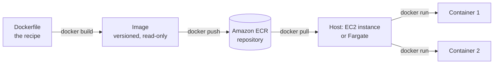
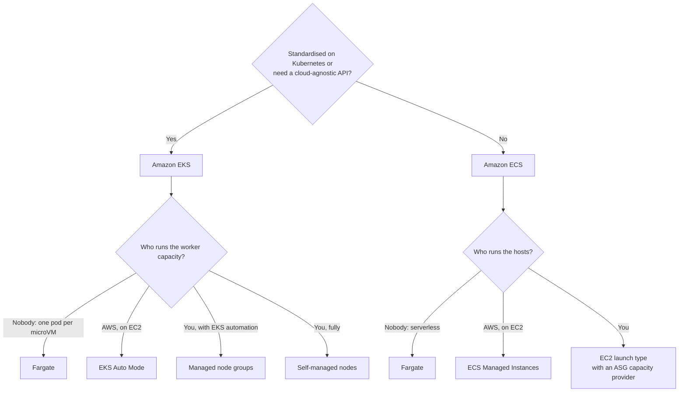
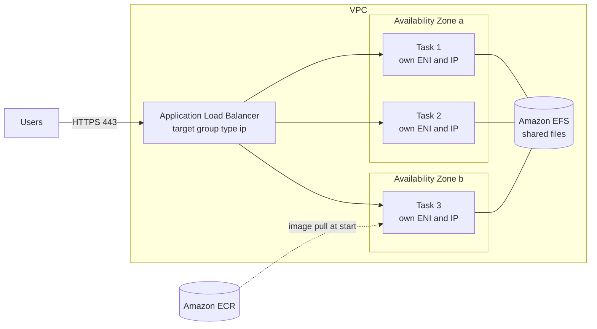
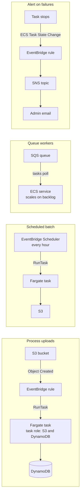
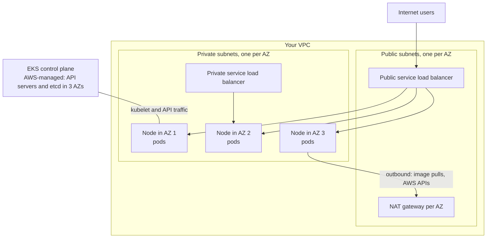

# Containers on AWS

## Summary

A container packages an application together with everything it needs (runtime, libraries, configuration) so it behaves the same on a laptop, an EC2 instance or a serverless host. AWS gives you a registry and two orchestrators. **Amazon ECR** stores your container images. **Amazon ECS** is the AWS-native orchestrator: simple, deeply integrated with ALB, IAM, CloudWatch and EventBridge. **Amazon EKS** is managed Kubernetes for teams that already use Kubernetes or need a cloud-agnostic API. Both can run containers on EC2 instances you manage, on EC2 capacity that AWS manages for you (ECS Managed Instances, EKS Auto Mode), or on **AWS Fargate**, where there are no servers to see at all. On the exam, pick ECS for "least operational overhead, AWS-native", EKS for "already on Kubernetes / portable", Fargate for "no servers to manage", ECR for "store and scan images", and EFS when tasks in several AZs need shared persistent files.

## Key concepts

- A **Docker image** is a read-only, versioned package built from a **Dockerfile**; a **container** is a running instance of an image.
- Containers share the host's operating system kernel, so one server runs many of them; **virtual machines** each carry a full guest OS on a hypervisor.
- **Amazon ECR** is a private (and public) image registry backed by S3, controlled by IAM, with vulnerability scanning, lifecycle policies, tag immutability and replication.
- **ECS building blocks**: a **cluster** runs **tasks** created from a **task definition** (the JSON blueprint); a **service** keeps the desired number of tasks running and registers them with a load balancer.
- **ECS capacity**: **EC2 launch type** (you run the instances and the ECS agent), **Fargate** (serverless, pay per task vCPU and memory), **ECS Managed Instances** (EC2 that AWS provisions and patches), **External** (ECS Anywhere).
- **Three ECS IAM roles**: the **container instance role** (EC2 instance profile for the agent), the **task execution role** (pull images, write logs, read secrets) and the **task role** (what your application code may call).
- **ALB** is the default load balancer for ECS services (path routing, dynamic host ports); **NLB** for extreme throughput, static IPs or PrivateLink; Fargate needs **IP target groups**.
- **Amazon EFS** gives tasks in every AZ the same persistent files, on EC2 and Fargate; **EBS** volumes can attach to individual tasks.
- **ECS Service Auto Scaling** (via Application Auto Scaling) changes the **task count**; **capacity providers** linked to an Auto Scaling group add **EC2 instances** when tasks have nowhere to run.
- **EventBridge** can start tasks on events or schedules and can react to ECS task state changes (for example, alert on stopped tasks).
- **Amazon EKS** runs the Kubernetes control plane for you; worker capacity comes from **managed node groups**, **self-managed nodes**, **Fargate** or **EKS Auto Mode**.
- EKS storage goes through a **StorageClass** and a **CSI driver** (EBS, EFS, FSx for Lustre, FSx for NetApp ONTAP and more); **only EFS works with EKS on Fargate**.
- An EKS cluster lives in **one Region**; multi-Region means one cluster per Region.

## Docker and containers

Docker is a platform for packaging and running applications in containers. You describe the application once in a text file called a **Dockerfile** (start from this base image, copy my code, install these packages, run this command). `docker build` turns that recipe into an **image**. Anyone with access to the image can `docker run` it and get an identical **container**, whatever the language, framework or host.

Why teams adopt containers:

- **Consistency**: the same image runs in development, test and production, so "works on my machine" problems disappear.
- **Density**: a container is just an isolated process, so a single EC2 instance can host many of them.
- **Speed**: containers start in seconds, which suits scaling out quickly.
- **Portability**: any language, any Linux (or Windows) workload, any host that has a container runtime.
- **Typical uses**: breaking a monolith into **microservices**, and **lift-and-shift** of on-premises apps into AWS without rewriting them.

> [!EXAMPLE] One server, six containers
> An `m7i.large` EC2 instance runs three containers of a Java order service, two containers of a Node.js web front end and one MySQL container for a test environment. Each container has its own file system and dependencies (Java 21 for one, Node 22 for another), yet they share the instance's kernel, CPU and memory. With virtual machines you would need six guest operating systems to get the same isolation.

### Containers compared with virtual machines

Docker is sometimes called a virtualization technology, but it virtualizes at a different layer. A hypervisor slices hardware into virtual machines, and every VM boots its own guest OS. Containers sit on top of one host OS and share its kernel through the container runtime (the Docker daemon or containerd).

| | Virtual machines | Containers |
|---|---|---|
| What is isolated | Whole machine, including its own OS kernel | A process with its own file system, network and limits |
| Layer below | Hypervisor on the hardware | Container runtime on the host OS (for example an EC2 instance) |
| Size | Gigabytes (full OS) | Megabytes to a few hundred MB |
| Start time | Minutes | Seconds |
| Density | A handful per host | Many per host, since resources are shared |
| Isolation strength | Strong (separate kernels) | Weaker on a shared host; Fargate adds a VM boundary per task |
| AWS example | EC2 instance | ECS task or EKS pod |

### Where images are stored

Images live in a **registry**, organised into **repositories** (one per application, holding many tagged versions).

| Registry | Visibility | Use it for |
|---|---|---|
| **Docker Hub** (`hub.docker.com`) | Mostly public | Official base images for operating systems and runtimes such as Ubuntu, Python or MySQL |
| **Amazon ECR private** | Private to your account (shareable with IAM and repository policies) | Your own application images, close to ECS, EKS and Lambda |
| **Amazon ECR Public** (gallery at `gallery.ecr.aws`) | Public | Publishing images to the world, or pulling public images (including Docker official images mirrored under `public.ecr.aws/docker/library/`) without Docker Hub's anonymous rate limits |

## The AWS container landscape

Running one container by hand is easy; running hundreds across several AZs, restarting failed ones, rolling out new versions and wiring them to load balancers is the job of an **orchestrator**. AWS offers these building blocks:

| Service | What it is | Pick it when |
|---|---|---|
| **Amazon ECS** | AWS's own container orchestrator | You want the simplest, most AWS-integrated option and no Kubernetes |
| **Amazon EKS** | Managed Kubernetes (open-source API) | You already run Kubernetes, want portability across clouds, or need the Kubernetes ecosystem |
| **AWS Fargate** | Serverless compute for containers, used by ECS and EKS | You do not want to provision, patch or scale any instances |
| **Amazon ECR** | Container image registry | You need to store, scan and version images |
| **ECS Managed Instances** | EC2 capacity for ECS that AWS provisions, patches and scales | You need specific EC2 features (GPUs, instance families, privileged capabilities) without running the fleet yourself |
| **ECS Express Mode** | One call that builds a Fargate service with ALB, HTTPS, auto scaling and a URL | A web app or API needs to be online fast with production defaults |
| **ECS Anywhere / EKS Anywhere** | Containers on your own servers | Workloads must stay on premises or at the edge |

> [!UPDATED] App Runner is closed to new customers; ECS Express Mode replaces it
> AWS App Runner stopped accepting new customers on 30 April 2026. Existing customers can keep using it, but no new features are planned. AWS points to **Amazon ECS Express Mode** (launched 21 November 2025) as the successor: you supply a container image, a task execution role and an infrastructure role, and ECS builds a Fargate service with an Application Load Balancer (shared by up to 25 Express services), HTTPS, auto scaling and a ready-to-use URL. Express Mode has no extra charge; you pay for the Fargate, ALB and CloudWatch resources it creates.

## Amazon ECS fundamentals

### The building blocks

| Term | Meaning | Example |
|---|---|---|
| **Cluster** | A logical group of capacity where tasks run | `prod-cluster` in `eu-west-1` |
| **Task definition** | Versioned JSON blueprint: image, CPU and memory, ports, environment, IAM roles, log settings, volumes | `orders-api:7` (revision 7) |
| **Task** | One running copy of a task definition (one or more containers that start together) | A task with an app container plus a log-router sidecar |
| **Service** | Keeps N tasks running, replaces failed ones, rolls out new revisions, registers tasks with a load balancer | `orders-api` service, desired count 4 |
| **Standalone task** | A task started once (by you, a schedule or an event) that ends when its work is done | A nightly report job |
| **Container agent** | Software on each EC2 container instance that registers it with the cluster and starts or stops containers on request | Comes pre-installed on the ECS-optimized AMI |

In plain words: "launching Docker containers on AWS" in ECS means **launching tasks into a cluster**. ECS decides where each task goes, starts it and watches it; you decide what capacity the cluster uses.

### Capacity options

| | EC2 launch type | Fargate | ECS Managed Instances | External (ECS Anywhere) |
|---|---|---|---|---|
| Who provisions and patches hosts | You (Auto Scaling group, AMI updates) | AWS; you never see hosts | AWS (Bottlerocket, replaced at most every 14 days) | You, on your own hardware |
| Billing | EC2 instances (whether full or empty); no ECS fee | Per task: vCPU and GB per second, 1-minute minimum | The EC2 instances AWS launches plus a per-instance management fee | USD 0.01025 per registered instance-hour |
| Instance choice, GPUs | Any EC2 type, custom AMIs | No GPUs; fixed CPU/memory combinations | Any suitable EC2 type, GPUs, Spot; no custom AMIs, no SSH | Your servers |
| Task isolation | Tasks share the instance | Each task in its own isolated environment | Several tasks per instance by default | Tasks share the server |
| Scaling the hosts | Capacity provider + ASG | Nothing to scale | Automatic | Manual |
| Typical fit | Steady, dense workloads; special AMIs or daemons | Spiky or small workloads, fastest start | Fargate-like simplicity with EC2 choice | Data that must stay on premises |

On the **EC2 launch type** each instance must run the **ECS container agent** to join the cluster; ECS then starts and stops containers on it. You still own patching, right-sizing and scaling of that fleet. With **Fargate** you write a task definition with the CPU and memory you need, and AWS finds the capacity: to scale, you simply run more tasks.

> [!UPDATED] A third capacity option: ECS Managed Instances
> The slides cover only the EC2 and Fargate launch types. Since late 2025 ECS also offers **Managed Instances**: AWS picks cost-optimized EC2 instances (or the attributes you specify), places several tasks per instance, patches them and starts draining each instance once it is 14 days old, so tasks that must run longer than 14 days do not fit. It supports GPUs, Spot and Capacity Reservations, but not custom AMIs or SSH. You pay for the EC2 instances plus a per-instance management fee (about USD 0.037 per hour for a `c6a.2xlarge`), and Savings Plans apply to the EC2 part. In the console and API it is used through a **capacity provider**, not a launch type.

### Fargate facts worth memorising

- Each task gets its own **elastic network interface** and private IP (`awsvpc` network mode), so security groups apply **per task**.
- Task sizes run from **0.25 vCPU with 0.5 GB** up to **16 vCPU with 120 GB**, plus a newer **32 vCPU** option with up to 244 GB (Linux, platform version 1.4.0 or later).
- **Ephemeral storage**: 20 GiB by default, expandable to **200 GiB**, encrypted.
- **Pricing (us-east-1, Linux/x86)**: about USD 0.0405 per vCPU-hour and USD 0.0044 per GB-hour, billed per second with a 1-minute minimum; ARM (Graviton) is about 20% cheaper.
- **Fargate Spot** runs interruption-tolerant tasks at up to **70% off**; AWS reclaims capacity with a **two-minute warning** (a SIGTERM to the task and an EventBridge event). EKS does not support Fargate Spot.

> [!EXAMPLE] Cost of a small Fargate service
> Two tasks of 0.25 vCPU and 0.5 GB running all month (about 730 hours): 2 × (0.25 × 0.0405 + 0.5 × 0.0044) × 730 ≈ USD 18, before the load balancer and data transfer.

## IAM roles for ECS

Permissions in ECS are split between the **infrastructure** that runs your tasks and the **application** inside them. Mixing them up is a common exam distractor.

| Role | Who uses it | Typical permissions | Where it is set |
|---|---|---|---|
| **Container instance role** (EC2 instance profile) | The ECS agent and Docker daemon on each EC2 container instance | Register with the cluster (`ecs:*` agent calls), pull from ECR, write to CloudWatch Logs; managed policy `AmazonEC2ContainerServiceforEC2Role` | Launch template of the instances (EC2 launch type only) |
| **Task execution role** | The ECS or Fargate agent, while preparing a task | Pull private ECR images, send `awslogs` output to CloudWatch Logs, fetch values from Secrets Manager or SSM Parameter Store; managed policy `AmazonECSTaskExecutionRolePolicy` | `executionRoleArn` in the task definition |
| **Task role** | Your application code inside the containers | Whatever the app needs: read an S3 bucket, write a DynamoDB table | `taskRoleArn` in the task definition |

> [!EXAMPLE] Least privilege per service
> Two services share one cluster. Service A resizes images, so its task role allows `s3:GetObject` and `s3:PutObject` on one bucket. Service B records orders, so its task role allows `dynamodb:PutItem` on one table. Neither task can touch the other's data, even when both run on the same EC2 instance, because each task receives its own temporary credentials.

> [!UPDATED] Image pulls, logs and secrets now belong to the task execution role
> The slides attribute pulling images, sending logs and reading secrets to the EC2 instance profile. That still works for the EC2 launch type, but current AWS guidance gives these jobs to the **task execution role**. For tasks on Fargate, Managed Instances and external instances, AWS documents the execution role as the role that pulls private ECR images and sends `awslogs` output (on Fargate there is no instance profile at all). Secrets Manager and Parameter Store references in a task definition always go through the execution role.

> [!WARNING] Containers on a shared host are not a hard security boundary
> On the EC2 launch type, Managed Instances and ECS Anywhere, a compromised container could reach the instance metadata service and other tasks' credentials unless you block it. Use Fargate (or Managed Instances set to run one task per instance) when workloads need strong isolation from each other.

## Load balancing ECS services

An ECS service can register its tasks with an Elastic Load Balancing target group. When tasks start, stop or fail health checks, ECS updates the targets automatically.

| Load balancer | Use with ECS when | Notes |
|---|---|---|
| **Application Load Balancer** | Almost always: HTTP, HTTPS, gRPC, WebSocket | Path- and host-based rules let many services share one ALB; **dynamic host port mapping** lets several copies of a task run on one EC2 instance |
| **Network Load Balancer** | Very high throughput or low latency TCP/UDP, static IPs, or exposing the service through **AWS PrivateLink** | Layer 4 only |
| **Gateway Load Balancer** | Routing traffic through virtual security appliances | Rare in ECS designs |
| **Classic Load Balancer** | Avoid | Legacy, no Fargate support, no advanced routing |

How the ports work:

- **Fargate (awsvpc mode)**: every task has its own IP, so the target group uses **target type `ip`** and the container port (for example 80) directly. Allow the ALB's security group on the task security group.
- **EC2 launch type with bridge mode**: set the host port to 0, and each task gets a random **dynamic host port**. The ALB (target type `instance`) tracks the port of every task, so the instance security group must allow the **ALB security group on the ephemeral port range**, not just port 80.

> [!UPDATED] Load balancer support has moved on
> The slides list ALB, NLB and a discouraged Classic Load Balancer. Current ECS documentation lists **ALB, NLB and Gateway Load Balancer** (for Fargate and Managed Instances services as well) and no longer mentions the Classic Load Balancer. AWS still recommends the ALB unless you need an NLB- or GWLB-only feature.

## Storage for containers

A container's own file system disappears when the task stops. When data must outlive a task, or be shared between tasks, attach a volume.

| Option | ECS capacity | Persistence and sharing | Use for |
|---|---|---|---|
| **Amazon EFS** | EC2, Fargate, Managed Instances (Linux) | Persistent; shared by tasks in **every AZ** | Shared content, uploads, CMS files, ML data read by many tasks |
| **Amazon EBS** (attached per task) | EC2, Fargate, Managed Instances | One volume per task; ephemeral when attached to service tasks, can persist for standalone tasks | Data-heavy single tasks: ETL scratch space, databases in containers |
| **Bind mounts / Fargate ephemeral storage** | All | Lives and dies with the task; shared between containers of the same task | Scratch files, sidecar handoffs |
| **Docker volumes** | EC2 only | Can outlive the task on that instance (or use a third-party volume driver) | Data kept on one container instance |
| **FSx for Windows File Server** | EC2 (Windows) | Persistent SMB share | Windows and .NET apps |
| **FSx for NetApp ONTAP** | EC2 (native mount) | Persistent NFS/SMB | Enterprise NAS features |
| **Amazon S3 Files** | Fargate, Managed Instances, EC2 | Persistent; an S3 bucket mounted as NFS | Analytics and ML jobs that want file access to S3 data |

**Fargate + EFS** is the classic fully serverless answer for persistent, multi-AZ shared storage: no servers for the compute and no capacity planning for the file system. Fargate needs platform version 1.4.0 or later for EFS, and you can use EFS access points and the task role to restrict each application to its own directory.

> [!UPDATED] "S3 cannot be mounted" is no longer true
> The slides say Amazon S3 cannot be mounted as a file system. **Amazon S3 Files**, announced in April 2026, exposes an S3 bucket as an NFS file system (port 2049, mount targets in your VPC) to EC2, Lambda, EKS and ECS; ECS added support for the EC2 compute type in September 2026, after Fargate and Managed Instances. Exam questions written before 2026 still expect **EFS** as the answer for shared, persistent container storage, so read the options carefully. ECS can also attach **EBS volumes** to individual tasks, which the slides do not mention.

## Scaling ECS

There are two separate things to scale, and the exam likes to test that you know the difference.

### Service auto scaling: how many tasks

**ECS Service Auto Scaling** raises or lowers a service's **desired task count**. Under the hood it uses **Application Auto Scaling** (the same service that scales DynamoDB capacity and other non-EC2 resources).

Predefined metrics:

- **ECSServiceAverageCPUUtilization**: average CPU across the service's tasks.
- **ECSServiceAverageMemoryUtilization**: average memory, useful for memory-bound apps.
- **ALBRequestCountPerTarget**: requests per task, reported by the ALB.

Policy types:

| Policy | Behaviour | Example |
|---|---|---|
| **Target tracking** | Keeps a metric near a target, like a thermostat; easiest to set up | Keep average CPU at 60% |
| **Step scaling** | Adds or removes tasks in steps based on how far a CloudWatch alarm is breached | +2 tasks above 70% CPU, +5 above 90% |
| **Scheduled scaling** | Changes min/max capacity at set times for predictable patterns | Minimum 10 tasks every weekday 08:00–18:00 |
| **Predictive scaling** | Learns daily and weekly patterns from history and scales ahead of time | A retail site with a regular evening peak |

> [!UPDATED] Predictive scaling and queue-based scaling for ECS
> The slides list target tracking, step and scheduled scaling. ECS services now also support **predictive scaling**, and AWS documents a pattern for scaling worker services on an **SQS backlog per task** custom metric.

### Cluster capacity: how many EC2 instances

On **Fargate** there is nothing more to do: more tasks simply means more Fargate capacity. On the **EC2 launch type**, new tasks need free CPU and memory on some instance. Two ways to provide it:

- **Auto Scaling group scaling on its own metric** (for example instance CPU). Simple, but it does not know about tasks that cannot be placed.
- **ECS capacity provider with managed scaling** (recommended). The capacity provider is linked to an Auto Scaling group; when tasks are waiting in the `PROVISIONING` state for lack of CPU or memory, ECS scales the group out, and it scales in idle instances later (with managed instance draining so running tasks finish cleanly).

```mermaid
%% caption: Two layers of scaling for an ECS service on the EC2 launch type
flowchart TD
  M["CloudWatch metric<br/>ECSServiceAverageCPUUtilization"] --> AL["CloudWatch alarm<br/>created by target tracking"]
  AL --> AAS["Application Auto Scaling<br/>desired count 2 to 3"]
  AAS --> SVC["ECS service launches task 3"]
  SVC --> Q{"Free CPU and memory<br/>on an instance?"}
  Q -->|Yes| RUN["Task 3 running"]
  Q -->|"No: task waits in PROVISIONING"| CP["Capacity provider<br/>managed scaling"]
  CP --> ASG["Auto Scaling group<br/>adds an EC2 instance"]
  ASG --> RUN
  FG["On Fargate the second layer<br/>does not exist"] -.-> SVC
```

| | ECS Service Auto Scaling | Cluster capacity scaling |
|---|---|---|
| Scales | Number of tasks | Number of EC2 instances |
| Engine | Application Auto Scaling | EC2 Auto Scaling (driven by a capacity provider) |
| Needed on Fargate? | Yes | No |
| Typical trigger | CPU, memory, ALB requests per target, schedule | Tasks that cannot be placed |

A capacity provider strategy can also mix **FARGATE** and **FARGATE_SPOT**, for example a **base** of 2 tasks on regular Fargate and the rest split by **weight** (1:3) onto Fargate Spot to cut cost while keeping a guaranteed minimum.

## Event-driven ECS patterns

ECS works well with EventBridge in both directions: EventBridge can **start** tasks, and ECS **emits** events about tasks, services and container instances.

1. **Process uploads**: a client uploads an object to S3, the bucket sends the event to EventBridge, and a rule runs a Fargate task that reads the object and writes results to DynamoDB. The **task role** grants exactly those S3 and DynamoDB permissions.
2. **Scheduled batch**: every hour, a schedule starts a Fargate task that processes files in S3, then the task exits and billing stops.
3. **Queue workers**: an ECS service polls an SQS queue; service auto scaling adds tasks as the backlog grows and removes them when the queue drains.
4. **Alert on failures**: when a task stops (for example its essential container exits), ECS sends an **ECS Task State Change** event; an EventBridge rule matching `lastStatus = STOPPED` notifies an SNS topic that emails the administrators.

> [!UPDATED] Use EventBridge Scheduler for scheduled tasks
> The slides show an EventBridge scheduled rule. AWS now documents **EventBridge Scheduler** for running ECS tasks on a schedule: it supports rate, cron (in any time zone) and one-time schedules, retries with a dead-letter queue, and is more scalable than scheduled rules. The ECS console can create scheduled tasks, but the Scheduler console offers more options.

## Amazon ECR

Amazon ECR is AWS's managed registry for Docker and OCI images (and other OCI artifacts such as Helm charts).

- **Private and public**: each account has a private registry (`<account>.dkr.ecr.<region>.amazonaws.com`) and can publish to ECR Public (`public.ecr.aws/<alias>`, browsable at `gallery.ecr.aws`).
- **Storage**: images are stored in Amazon S3 behind the scenes, so they are durable and highly available, and encrypted at rest with AES-256 or AWS KMS.
- **Access control with IAM**: identity policies plus optional repository policies (for cross-account sharing). Docker itself cannot use IAM, so you run `aws ecr get-login-password | docker login ...` to get a token valid for **12 hours**. An "access denied" error when a task pulls an image means a **policy** problem, usually on the task execution role or instance role.
- **Integration**: ECS, EKS, Lambda and App Runner pull from ECR natively; transfer between ECR and services in the **same Region is free**.
- **Image scanning**: **basic scanning** (on by default for every private registry, with manual scans unless you add scan-on-push filters; OS vulnerabilities; at most one scan per image per 24 hours; no extra charge) or **enhanced scanning** with **Amazon Inspector** (continuous; OS and programming-language packages; findings sent to EventBridge).
- **Lifecycle policies**: rules such as "keep only the last 10 images tagged `prod`" or "expire untagged images after 7 days"; evaluated within 24 hours; preview before applying.
- **Tag immutability**: blocks overwriting an existing tag (for example `v1.4.2`) so a deployed version cannot silently change.
- **Replication**: cross-Region and cross-account, configured per registry, for multi-Region deployments and disaster recovery.
- **Pull through cache**: cache images from Docker Hub, ECR Public, Quay, GitHub and others in your private registry, which avoids upstream rate limits and keeps pulls inside AWS.

> [!UPDATED] ECR features added since the slides
> ECR now has an **archival storage class** (lifecycle rules can archive rarely used images; restores take up to about 20 minutes), **managed signing** of images on push, **repository creation templates** and **tag-immutability exclusions**. Basic scanning uses AWS-native scanning technology rather than the older open-source Clair engine.

| Pricing item (ECR private) | Value |
|---|---|
| Storage | USD 0.10 per GB-month |
| Free Tier | Private storage: 500 MB per month for 12 months, but only on the legacy Free Tier (accounts created before 15 July 2025); accounts on the credit-based Free plan get only Always Free offers, so their private storage is paid from Free Tier credits {{updated: AWS billing docs state that Free plan accounts have only Always Free offers active, so the 12-month 500 MB ECR offer does not apply to them}}. Public repositories: 50 GB per month always free |
| Data transfer to ECS, EKS, EC2, Lambda in the same Region | Free |

## Amazon EKS

### Kubernetes and EKS in one paragraph

**Kubernetes** is an open-source system that deploys, scales and heals containerized applications. It has a **control plane** (API server, scheduler, etcd database) and **worker nodes** that run **pods** (one or more containers). **Amazon EKS** runs the control plane for you: each cluster gets at least two API server instances and three etcd instances spread over **three AZs**, patched and replaced by AWS. You bring or choose the worker capacity. Because the Kubernetes API is the same on any cloud or on premises, EKS is the natural choice when a company already uses Kubernetes elsewhere and wants to migrate without rewriting manifests and tooling.

| | Amazon ECS | Amazon EKS |
|---|---|---|
| API | AWS-specific (task definitions, services) | Standard Kubernetes (Deployments, Services, kubectl, Helm) |
| Control plane cost | No charge | USD 0.10 per cluster-hour (standard support); USD 0.60 in extended support |
| Learning curve | Low | Higher; large ecosystem |
| Portability | AWS only (plus ECS Anywhere) | Any conformant Kubernetes, any cloud or on premises |
| Serverless option | Fargate | Fargate (one pod per microVM) |
| Best signal in a question | "Least operational overhead", "AWS-native" | "Already using Kubernetes", "cloud-agnostic", "open source" |

### Architecture

A typical EKS layout spreads **worker nodes across private subnets in three AZs**, inside an Auto Scaling group. Public subnets hold **NAT gateways** (so nodes can pull images and call AWS APIs) and **public service load balancers** that Kubernetes creates for internet-facing services; **private service load balancers** serve internal consumers. The control plane sits in an AWS-managed account and talks to your nodes through network interfaces in your VPC.

Operational notes from the slides that still hold:

- **One cluster per Region**: an EKS cluster does not span Regions, so a multi-Region design deploys a cluster in each Region (often with Route 53 or Global Accelerator in front).
- **Observability**: collect metrics and logs with **CloudWatch Container Insights** (which also works for ECS and for Fargate).

> [!UPDATED] Container Insights has new flavours
> CloudWatch now offers **Container Insights with enhanced observability** (recommended when you create an ECS cluster, and available for EKS) and an **OpenTelemetry-based** Container Insights for EKS that supports PromQL queries.

### Node types

| Node type | Who manages the EC2 instances | Spot | Notes |
|---|---|---|---|
| **Managed node groups** | EKS creates and updates the nodes in an ASG that EKS manages; you trigger AMI and version updates | Yes (On-Demand or Spot per node group) | No extra charge; nodes drained automatically during updates |
| **Self-managed nodes** | You create the ASG and register nodes (for example with the **EKS-optimized AMI**) | Yes | Most control (custom AMIs, Outposts, Local Zones), most work |
| **AWS Fargate** | Nobody; each pod gets its own microVM | No (EKS does not support Fargate Spot) | Pods matched by **Fargate profiles**; no DaemonSets, no GPUs, private subnets only, EFS only for storage |
| **EKS Auto Mode** | AWS: picks instances, scales with Karpenter, patches, replaces nodes within 21 days | Yes, through custom NodePools | Extra management fee per instance on top of EC2; also manages load balancers, EBS storage and pod networking |
| **EKS Hybrid Nodes** | You, on your own servers; control plane stays in the AWS Region | Not applicable | Charged per vCPU-hour |

> [!UPDATED] EKS Auto Mode and Hybrid Nodes
> The slides list three node types. **EKS Auto Mode** (December 2024) lets AWS run the worker nodes too: it chooses EC2 instances, scales them with Karpenter, applies patches, and replaces every node after at most 21 days. **EKS Hybrid Nodes** let on-premises machines join a cluster whose control plane runs in AWS.

### Data volumes

Kubernetes pods request storage through a **PersistentVolumeClaim**; the cluster satisfies it using a **StorageClass** manifest that names a **Container Storage Interface (CSI) driver**. AWS-supported CSI drivers include:

| CSI driver | Storage type | Works with EKS on Fargate? |
|---|---|---|
| **Amazon EBS** | Block, one AZ, one pod at a time | No |
| **Amazon EFS** | Shared NFS file system across AZs | **Yes** (static provisioning only) |
| **Amazon FSx for Lustre** | High-performance parallel file system (HPC, ML) | No |
| **Amazon FSx for NetApp ONTAP** | Enterprise NAS (NFS/SMB, snapshots, cloning) | No |
| FSx for OpenZFS, Amazon File Cache, Mountpoint for Amazon S3, Amazon S3 Files | File access to these services | No |

> [!UPDATED] More EKS storage drivers
> Besides the four drivers in the slides, EKS now documents CSI drivers for **FSx for OpenZFS**, **Amazon File Cache**, **Mountpoint for Amazon S3** and **Amazon S3 Files** (through the EFS CSI driver), plus EC2 instance store volumes. EKS Auto Mode includes EBS block storage as a built-in capability.

## Containers outside the AWS Region and other options

The SAA-C03 exam guide lists three hybrid container services that the slides do not cover:

- **Amazon ECS Anywhere**: install the ECS and SSM agents on your own Linux servers or VMs and register them as **external instances** (launch type `EXTERNAL`). ECS orchestrates tasks there, but there is **no load balancer integration**, no `awsvpc` networking and no EFS. Good for jobs that process local data and send results outbound.
- **Amazon EKS Anywhere**: software to create and operate Kubernetes clusters on your own infrastructure (VMware vSphere, bare metal, Nutanix, Apache CloudStack, AWS Snow). **You** manage the control plane; it can run fully air-gapped. Support comes from an optional Enterprise Subscription.
- **Amazon EKS Distro**: the same Kubernetes distribution that EKS uses, packaged for you to run with your own tooling; not covered by AWS Support plans.

> [!UPDATED] ECS Anywhere is Linux-only now
> AWS deprecated Windows support for ECS Anywhere and, from 7 August 2026, supports only recent Linux distributions (Amazon Linux 2023, Ubuntu 20/22/24 and RHEL 9).

## Exam tips

> [!EXAM] ECS or EKS?
> "The company already runs Kubernetes on premises / wants to avoid vendor lock-in" → **EKS**. "Least operational overhead", "AWS-native orchestration", "no Kubernetes expertise" → **ECS**.

> [!EXAM] No servers to manage
> "Run containers without provisioning or managing EC2 instances" → **Fargate** (with ECS or EKS). If the question also says GPUs or a specific instance family with minimal management, consider **ECS Managed Instances** or **EKS Auto Mode**.

> [!EXAM] Shared storage across AZs for containers
> "Tasks in multiple AZs need the same persistent files" or "serverless and persistent" → **Amazon EFS** mounted into ECS tasks (Fargate + EFS). EBS is single-AZ and per task.

> [!EXAM] Which IAM role?
> "Application in the container needs to read S3 / write DynamoDB" → **task role**, one per service for least privilege. "Task cannot pull the image or write logs" → **task execution role** (or the instance profile on the EC2 launch type).

- "Scale the number of tasks on CPU, memory or requests per target" → **ECS Service Auto Scaling** (Application Auto Scaling) with **target tracking**.
- "Tasks stuck in PROVISIONING / not enough EC2 capacity in the cluster" → **capacity provider with managed scaling** on the Auto Scaling group.
- "Run a container every night / every hour" → **EventBridge (Scheduler) runs an ECS task** on Fargate; you pay only while it runs.
- "Process each S3 upload with a container" → **S3 event → EventBridge rule → RunTask**.
- "Be notified when tasks stop unexpectedly" → **EventBridge rule on ECS Task State Change → SNS**.
- "Store and scan container images", "find CVEs in images" → **ECR** with scan on push, or **enhanced scanning with Amazon Inspector** for continuous scans.
- "Keep the image repository from growing forever" → **ECR lifecycle policy**.
- "Images needed in a second Region for DR" → **ECR cross-Region replication**.
- "Expose a containerized service privately to other VPCs or accounts" → **NLB + AWS PrivateLink**.
- "Fault-tolerant container batch at lowest cost" → **Fargate Spot** (ECS) or Spot node groups (EKS).
- "EKS pods on Fargate need persistent storage" → **EFS** (the only option).
- "Kubernetes on premises, air-gapped, customer-managed" → **EKS Anywhere**; "run ECS tasks on on-premises servers" → **ECS Anywhere**.

## Common traps

> [!TRAP] ECS Service Auto Scaling is not EC2 Auto Scaling
> Service auto scaling changes the **task** count. On the EC2 launch type it does not add instances; you need an Auto Scaling group, ideally driven by a **capacity provider**. On Fargate there are no instances to scale.

> [!TRAP] Putting application permissions on the instance profile
> Granting S3 or DynamoDB access through the EC2 instance profile gives it to **every** task on that instance. Use a **task role** per service. And on Fargate there is no instance profile at all.

> [!TRAP] Mounting S3 as the "shared file system" answer
> Older questions treat S3 as object storage that cannot be mounted; the expected answer for shared container files is **EFS**. S3 Files (2026) changes the technology, but not the answer key of existing questions. Also, EBS cannot be shared across AZs.

> [!TRAP] Choosing the Classic Load Balancer or instance targets for Fargate
> Fargate tasks use the `awsvpc` mode, so target groups must use target type **ip**. The Classic Load Balancer does not work with Fargate and lacks path-based routing.

> [!TRAP] Forgetting the security group for dynamic ports
> With the EC2 launch type and dynamic host port mapping, allowing only port 80 on the instances breaks health checks. Allow the **ALB security group on the ephemeral port range** on the instances.

- **EKS on Fargate supports EBS**: false. Only EFS (static provisioning), and pods on Fargate run only in private subnets.
- **One EKS cluster can span Regions**: false. Deploy one cluster per Region.
- **ECR access errors are network problems**: usually they are IAM; check the role that pulls the image (execution role or instance profile). In private subnets without NAT, add ECR interface endpoints and an S3 gateway endpoint.
- **Fargate Spot is guaranteed capacity**: false. Tasks can be interrupted with two minutes' notice and Spot capacity can be temporarily unavailable; keep a base on regular Fargate.
- **App Runner as the default answer for new projects**: App Runner closed to new customers in April 2026; in current AWS guidance the simple "just deploy my container" option is **ECS Express Mode**.
- **ECS Anywhere tasks behind an ALB**: not supported; external instances have no service load balancing.
