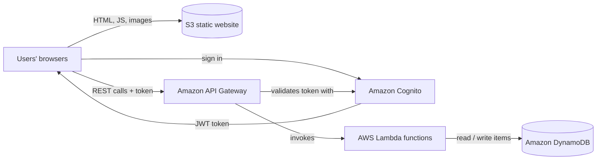
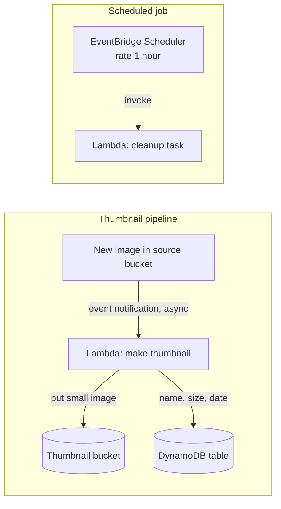
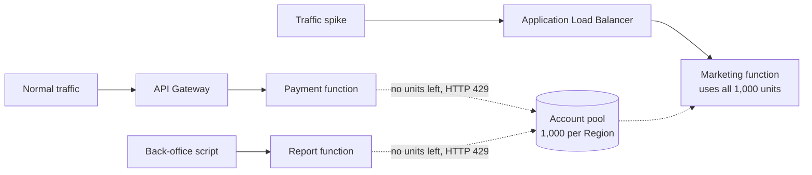
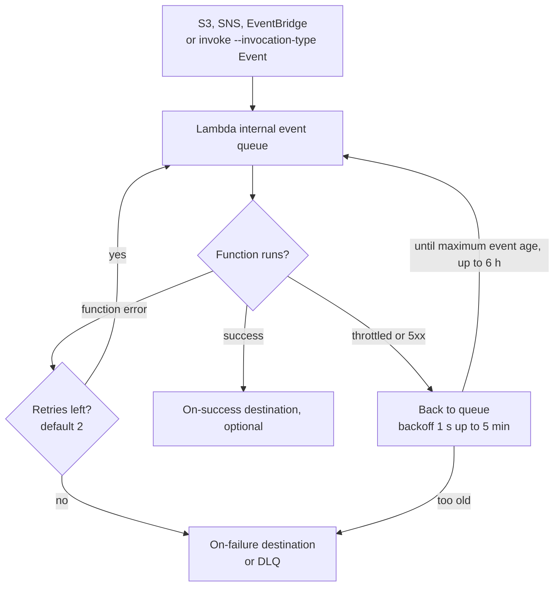
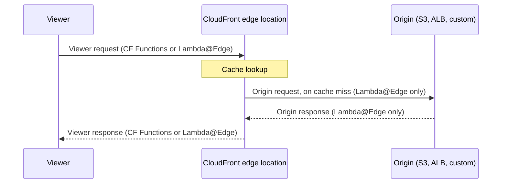
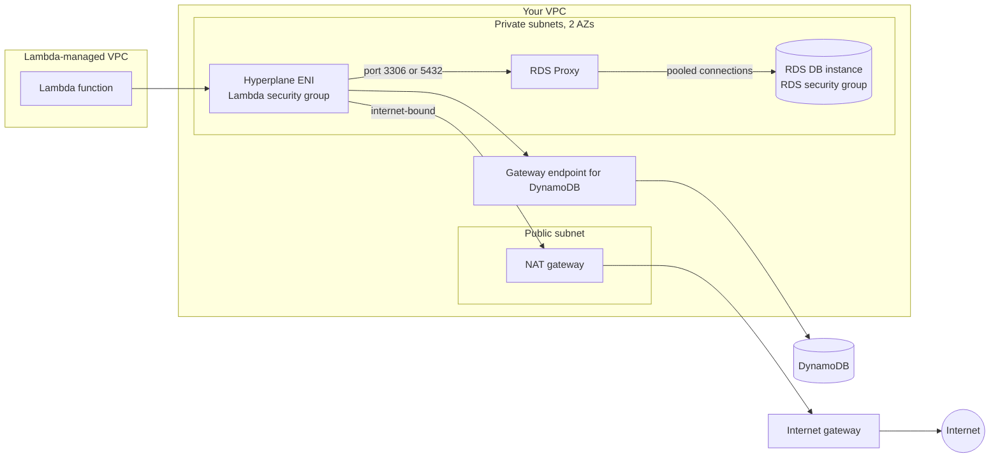

# Serverless & AWS Lambda

## Summary

Serverless means you hand AWS the job of running, patching and scaling the machines, and you pay only while your code or data is actually being used. **AWS Lambda** is the flagship: you upload a function, connect it to an event source (an S3 upload, an API call, a queue, a schedule) and Lambda runs as many copies as the traffic needs, for at most 15 minutes per invocation. Pick Lambda for short, event-driven or spiky work where you want zero idle cost and no servers to manage; pick EC2, ECS or Fargate for long-running processes, steady heavy load or arbitrary containers. This lesson also covers the controls the exam loves (concurrency, throttling, cold starts, provisioned concurrency, SnapStart), code that runs at CloudFront edge locations (**CloudFront Functions** and **Lambda@Edge**), and how Lambda talks to relational databases (VPC access, **RDS Proxy**, invoking Lambda from inside RDS, RDS event notifications).

## Key concepts

- **Serverless** = no servers for you to provision, patch or scale; billing follows usage. It began with functions (FaaS) and now covers managed databases, queues, storage and containers too.
- **Lambda** runs a function per event, scales automatically and stops after at most **900 seconds (15 minutes)**.
- **Pricing**: per request (**USD 0.20 per million**) plus duration in **GB-seconds**, billed per **1 ms**; the Always Free tier gives **1 million requests and 400,000 GB-seconds** each month.
- **Memory** is the only size knob: **128 MB to 10,240 MB** in 1 MB steps; CPU and network grow with it.
- **Concurrency** = requests in flight at the same moment; the default pool is **1,000 per Region per account** (a soft limit).
- **Reserved concurrency** both guarantees and caps a function's share of the pool; **0** switches the function off.
- Over the limit, a call is **throttled**: synchronous callers get **HTTP 429**, asynchronous events are retried for up to **6 hours** and then go to a **DLQ or on-failure destination**.
- A **cold start** is the time to create a new execution environment and run your init code; **provisioned concurrency** removes it for a cost, **SnapStart** shrinks it for Java, Python and .NET.
- **CloudFront Functions**: tiny JavaScript, viewer request/response only, sub-millisecond, millions of requests per second, cheapest.
- **Lambda@Edge**: Node.js or Python, all four CloudFront triggers, network and body access, authored in **us-east-1** and replicated.
- By default a function runs **outside your VPC**; attach it to **private subnets + security groups** (via Hyperplane ENIs) to reach RDS, ElastiCache or internal load balancers.
- **RDS Proxy** pools database connections so thousands of Lambda copies do not exhaust the database; it is reachable only from inside the VPC.
- **RDS for PostgreSQL, Aurora PostgreSQL and Aurora MySQL** can call Lambda from SQL, which reacts to **data** changes; **RDS event notifications** report **infrastructure** events (instance stopped, snapshot taken) through SNS or EventBridge.

## What serverless means

"Serverless" does not mean the servers have disappeared. They exist, but they belong to AWS: you never choose an instance type, apply an OS patch, size a fleet or pay for a machine that sits idle at 3 a.m. You deploy code or configuration, and the service handles capacity.

The term started with **Function as a Service (FaaS)**, which AWS Lambda popularised in 2014. Today AWS applies the word to any managed service where capacity is invisible and billing follows usage. On the exam, "serverless" in a requirement usually rules out answers that involve EC2 instances you manage.

| Need | Serverless AWS option | Covered in |
|---|---|---|
| Run code on events | AWS Lambda | This lesson |
| Run containers without managing hosts | AWS Fargate (with ECS or EKS) | Containers lesson |
| Key-value / document database | Amazon DynamoDB | Next lesson |
| Relational database that scales its capacity | Aurora Serverless | Databases lessons |
| Publish a REST, HTTP or WebSocket API | Amazon API Gateway | Next lesson |
| Sign-up, sign-in and user tokens | Amazon Cognito | Next lesson |
| Orchestrate multi-step workflows | AWS Step Functions | Next lesson |
| Store static files and websites | Amazon S3 | S3 lessons |
| Queue and fan-out messaging | Amazon SQS, Amazon SNS | Messaging lesson |
| Load streaming data into storage | Amazon Data Firehose (formerly Kinesis Data Firehose) | Streaming lesson |

A typical fully serverless web application puts these pieces together. Nothing in the picture is a server you patch.

## AWS Lambda versus Amazon EC2

| | Amazon EC2 | AWS Lambda |
|---|---|---|
| What you manage | Virtual servers: OS, patches, scaling, capacity | Only your code and its configuration |
| Main limit | RAM and vCPUs of the instance type | Run time (15 minutes max per invocation) and memory (up to 10,240 MB) |
| When it runs | Continuously, until you stop it | Only when an event arrives |
| Scaling | You add or remove instances (or configure Auto Scaling) | Automatic, one execution environment per concurrent request |
| Billing | Per second while the instance runs, busy or idle | Per request plus per millisecond of execution |
| Good fit | Long jobs, steady heavy load, custom OS needs, stateful servers | Short event-driven tasks, spiky or unpredictable traffic, glue between services |

> [!EXAMPLE] Same job, two designs
> A company resizes product photos. About 2,000 images arrive per day, mostly during office hours. An EC2 instance would run 24 hours a day and still need scaling for the Monday-morning peak. A Lambda function triggered by each upload runs for roughly a second per image, scales to the peak on its own and costs almost nothing at night.

## How Lambda runs your code

You write a **handler**, the function Lambda calls for each event. When the first request arrives, Lambda creates an **execution environment** (a lightweight, isolated micro-VM), downloads your code, starts the runtime and runs any code outside the handler (imports, SDK clients, database connections). That is the **Init** phase. Then it runs the handler (**Invoke**). After the response, the environment is frozen and kept for a while; the next request reuses it (a **warm start**) and skips Init. Each environment handles one request at a time, so 50 simultaneous requests need 50 environments.

Practical consequences:

- Put expensive setup (SDK clients, connection pools, config downloads) **outside the handler** so warm invocations reuse it.
- The **`/tmp`** folder (512 MB by default, configurable up to 10,240 MB) survives between warm invocations of the same environment, which makes it a handy cache, but never a database: environments are recycled every few hours.
- Functions must be **stateless**: keep sessions and data in DynamoDB, S3, ElastiCache or a database.

### Three ways a function is invoked

How an event reaches Lambda decides who retries on failure and what a throttle looks like.

| Invocation model | Typical sources | Who waits / retries | On throttle |
|---|---|---|---|
| **Synchronous** (request/response) | API Gateway, Application Load Balancer, Cognito triggers, SDK/CLI `invoke` | The caller waits for the result and must retry itself | Caller receives HTTP 429 `TooManyRequestsException` |
| **Asynchronous** (event) | S3 event notifications, SNS, EventBridge, EventBridge Scheduler, SDK/CLI with `--invocation-type Event` | Lambda queues the event, answers 202 at once and retries for you | Event goes back in Lambda's internal queue and is retried for up to 6 hours |
| **Event source mapping** (polling) | SQS, Kinesis Data Streams, DynamoDB Streams, Amazon MQ, Amazon MSK / Kafka, DocumentDB | Lambda's pollers read batches and retry per the source's rules | Pollers slow down; records stay in the queue or stream |

### Languages and packaging

| Option | What it covers | Notes |
|---|---|---|
| Managed runtimes | Node.js, Python, Java, .NET (C# and PowerShell), Ruby | AWS patches the runtime; both x86_64 and arm64 (Graviton) are available |
| OS-only runtime (`provided.al2023`) | Go, Rust, or any language through a custom runtime | You ship a compiled binary or your own runtime using the **Runtime API** |
| Container image | Any of the above, packaged as an image up to **10 GB** in Amazon ECR | The image must implement the Lambda Runtime API (AWS base images and runtime interface clients do this for you) |

> [!UPDATED] The Go runtime moved to the OS-only runtime
> The dedicated `go1.x` runtime was retired in January 2024. Go (like Rust) now runs on the OS-only runtime `provided.al2023`, so "custom runtime" is the current answer for those languages. PowerShell is supported through the .NET tooling rather than as its own runtime.

> [!TIP] Lambda container image or Fargate?
> A Lambda container image is still a Lambda function: 15-minute limit, event-driven, must speak the Runtime API. If the question describes an arbitrary Docker image that runs a long-lived web server or worker, ECS or EKS on Fargate is the better fit.

### Integrations and two classic patterns

Lambda connects to most of AWS. The ones that appear again and again in exam questions are API Gateway, Application Load Balancer, S3, DynamoDB Streams, SQS, SNS, Kinesis, EventBridge, Cognito, CloudFront (Lambda@Edge) and CloudWatch Logs (every function writes its logs there).

**Serverless thumbnail generation.** An image lands in a bucket; S3 invokes a function asynchronously; the function writes a small version to a second bucket (or a separate prefix) and records the image name, size and creation date in DynamoDB so the website can list it.

**Serverless cron job.** A schedule fires every hour and invokes a function that, for example, deletes expired records or emails a daily report. No instance sits idle between runs.

> [!WARNING] Recursive loops
> If the function writes its output into the **same** bucket and prefix that triggers it, every thumbnail triggers another invocation and the bill climbs fast. Use a separate bucket, or a prefix/suffix filter on the event notification.

> [!UPDATED] Use EventBridge Scheduler for new schedules
> The slides show a CloudWatch Events / EventBridge scheduled rule. EventBridge now labels scheduled rules as a legacy feature and recommends **EventBridge Scheduler**, which adds time zones, one-time schedules, flexible windows and retries. Its free tier covers 14 million invocations per month. Older exam questions may still say "CloudWatch Events rule"; both answers describe the same serverless cron idea.

## Pricing

Lambda charges for two things:

| Charge | Price (US East, x86) | Always Free each month |
|---|---|---|
| Requests | USD 0.20 per 1 million (USD 0.0000002 each) | First 1,000,000 requests |
| Duration | USD 0.0000166667 per GB-second, rounded up to the next 1 ms | First 400,000 GB-seconds |

A **GB-second** is one second of run time with 1 GB of memory configured. 400,000 GB-seconds therefore equals 400,000 seconds at 1 GB, or 3,200,000 seconds at 128 MB (0.125 GB). Arm (Graviton) functions cost less per GB-second (USD 0.0000133334 in the first tier), and the Free Tier applies to both.

> [!UPDATED] One dollar buys about 60,000 GB-seconds, not 600,000
> The slide says USD 1.00 pays for 600,000 GB-seconds. At USD 0.0000166667 per GB-second, one dollar actually covers roughly 60,000 GB-seconds. The free allowance (400,000 GB-seconds) is unchanged.

> [!EXAMPLE] Two monthly bills
> **Small API**: 512 MB, 3 million invocations, 200 ms each. Compute = 3,000,000 × 0.2 s × 0.5 GB = 300,000 GB-s, inside the free 400,000. Requests = 2 million billable × USD 0.20 = **USD 0.40 per month**.
>
> **Busy worker**: 1 GB, 10 million invocations, 500 ms each. Compute = 5,000,000 GB-s − 400,000 free = 4,600,000 × USD 0.0000166667 ≈ USD 76.67. Requests = 9 million × USD 0.20 = USD 1.80. Total ≈ **USD 78.47 per month**.

Other line items you may meet: extra ephemeral storage above 512 MB, provisioned concurrency (charged for every hour it is configured, even if idle), SnapStart caching for Python and .NET, and data transfer.

> [!UPDATED] The Init phase is now billed everywhere
> Since 1 August 2025, Lambda bills the Init phase for every configuration, including ZIP-packaged functions on managed runtimes, which used to get it for free. For most workloads the change is tiny because cold starts happen on well under 1% of invocations, but heavy initialisation code now shows up on the bill.

## Limits to know

These are per Region. Most cannot be raised; concurrency can.

| Limit | Value |
|---|---|
| Memory | 128 MB to 10,240 MB, in 1 MB steps (one full vCPU at 1,769 MB) |
| Timeout | Up to 900 seconds (15 minutes); the default is 3 seconds |
| Environment variables | 4 KB in total per function |
| `/tmp` ephemeral storage | 512 MB to 10,240 MB |
| Concurrent executions | 1,000 per Region by default, raisable to tens of thousands |
| Scaling rate | Each function can add up to 1,000 execution environments every 10 seconds |
| ZIP deployment package | 50 MB zipped when uploaded directly (larger through S3); 250 MB unzipped including layers |
| Container image | 10 GB uncompressed |
| Layers | 5 per function |
| Invocation payload | 6 MB request and 6 MB response for synchronous calls; 1 MB for asynchronous events {{updated: asynchronous payloads were limited to 256 KB for years; the quota page now lists 1 MB}} |

> [!NOTE] Brand-new accounts start lower
> AWS documents that new accounts receive reduced concurrency and memory quotas that rise automatically with usage. If a lab cannot reserve concurrency or set 10 GB of memory, check **Service Quotas** before assuming you did something wrong.

> [!TIP] Need more than 15 minutes?
> Split the job into steps orchestrated by **Step Functions**, process records in batches from **SQS**, or move the work to **ECS/Fargate**, **AWS Batch** or EC2. Very large files can be staged in `/tmp` (up to 10 GB) or on Amazon EFS mounted into the function.

## Concurrency and throttling

**Concurrency** is the number of requests a function is serving at the same instant. A quick estimate:

`concurrency = requests per second × average duration in seconds`

So 100 requests per second at 500 ms each needs about 50 concurrent environments; 5,000 requests per second at 200 ms needs 1,000.

All functions in an account and Region share one pool, **1,000 by default**. For synchronous calls Lambda also caps each execution environment at 10 requests per second, so the request rate can never exceed ten times your concurrency. That ceiling only matters for very short functions; asynchronous calls are limited by concurrency alone.

### Reserved concurrency

Setting **reserved concurrency** on a function does two things at once:

- **Guarantee**: that many units are set aside for this function; no other function can use them.
- **Cap**: the function can never scale beyond that number; extra requests are throttled.

It costs nothing. You can reserve up to the account limit minus 100, because Lambda always keeps 100 units for functions without a reservation. Setting it to **0** throttles every invocation, an emergency off switch.

> [!EXAMPLE] The noisy neighbour
> A marketing site behind an Application Load Balancer suddenly receives a flood of traffic and its function scales to all 1,000 units. At the same moment the payment API behind API Gateway and a back-office script calling the SDK cannot get a single environment and are throttled. Reserving, say, 200 units for the payment function protects it, and capping the marketing function at 600 stops it from starving everyone else.

### What a throttle looks like

- **Synchronous** callers (API Gateway, ALB, SDK) receive a `TooManyRequestsException` (HTTP **429**). API Gateway passes an error to the client; your client code should retry with backoff.
- **Asynchronous** events go back into Lambda's internal queue. For throttles (429) and system errors (5xx), Lambda keeps retrying for **up to 6 hours**, with gaps that grow exponentially from **1 second to a maximum of 5 minutes**.
- **Event source mappings** (SQS, Kinesis, DynamoDB Streams) slow their polling; the records wait safely in the source.

If you need more than 1,000, request a quota increase through **Service Quotas** (the slides say "open a support ticket"; Service Quotas is the current self-service path).

### Asynchronous invocations: retries, DLQs and destinations

For asynchronous events, Lambda owns the retry logic:

1. If the **function itself returns an error** (exception, timeout), Lambda retries **twice by default**, waiting about 1 minute before the second attempt and 2 minutes before the third. You can set **Retry attempts** from 0 to 2.
2. If the event cannot even start because of **throttling or a system error**, Lambda retries with backoff until the **Maximum age of event** is reached (up to 6 hours, the default).
3. When retries run out or the event gets too old, Lambda discards it unless you have configured somewhere to keep it.

| Option | Targets | What it receives | Scope |
|---|---|---|---|
| **On-failure destination** (recommended) | SQS standard queue, SNS standard topic, another Lambda function, EventBridge event bus, S3 bucket | A JSON record with the original event **and** the error details, attempt count and reason | Function, version or alias |
| **On-success destination** | SQS, SNS, Lambda, EventBridge | The event plus the function's response | Function, version or alias |
| **Dead-letter queue (DLQ)** | SQS standard queue or SNS standard topic | Only the original event (error code in message attributes) | Whole function only |

> [!TIP] Make async handlers idempotent
> Lambda's internal queue is eventually consistent, so the same event can occasionally arrive twice even without errors. Write handlers so that processing an event twice has the same effect as once, for example a DynamoDB conditional write keyed on the event ID.

> [!NOTE] SQS as a trigger is different
> When SQS triggers Lambda through an event source mapping, failures are handled by the **queue's own redrive policy and DLQ**, not by the function's asynchronous settings. Configure the DLQ on the SQS queue.

## Cold starts, provisioned concurrency and SnapStart

A **cold start** happens whenever Lambda must build a new environment: the first request after a deployment, after a period of no traffic, or when scaling out. Its length depends on package size, runtime and how much work your init code does. AWS reports that cold starts usually affect under 1% of invocations and last from under 100 ms to over a second. That is fine for background jobs, but noticeable for a user waiting on an API.

The Init phase normally has a 10-second limit. Lambda also used to suffer slow cold starts for functions attached to a VPC; since the 2019 move to shared **Hyperplane ENIs** that penalty is largely gone, so "put it in a VPC" is no longer a cold-start problem.

### Provisioned concurrency

**Provisioned concurrency** asks Lambda to create and initialise a fixed number of environments **before** requests arrive and keep them warm. Requests served by them see no cold start (AWS targets double-digit millisecond response). Key facts:

- It is set on a **published version or an alias**, never on `$LATEST`.
- Traffic above the provisioned amount spills over to normal on-demand environments (with cold starts), as long as concurrency is available.
- **Application Auto Scaling** can adjust it on a **schedule** (for example, warm 500 environments at 08:00 on weekdays) or with **target tracking** on utilisation.
- It is **billed** for as long as it is configured, plus duration at a lower rate.

### Lambda SnapStart

**SnapStart** attacks the cold start differently. When you publish a version, Lambda runs Init once, takes an encrypted **snapshot of the memory and disk state** of the initialised environment (a Firecracker micro-VM snapshot) and caches it. New environments are then **restored from the snapshot** instead of initialising from scratch, which can turn multi-second Java start-ups into sub-second ones.

| Fact | Detail |
|---|---|
| Runtimes | Java 11 and later, Python 3.12 and later, .NET 8 and later |
| Where it applies | Published versions and aliases only, not `$LATEST` |
| Not compatible with | Provisioned concurrency, Amazon EFS, ephemeral storage above 512 MB |
| Code caveat | Anything unique created during Init (random seeds, IDs, credentials, open connections) is copied into every restored environment, so regenerate it after restore |
| Cost | No extra charge for **Java**; **Python and .NET** pay a snapshot caching charge (minimum 3 hours per version) and a restore charge |

> [!UPDATED] SnapStart is free only for Java
> The slides describe SnapStart as free for Java, Python and .NET. Current AWS pricing charges Python and .NET functions for snapshot caching and restoration; only the Java managed runtimes have no extra cost.

| Cold-start remedy | How it works | Cost | Pick it when |
|---|---|---|---|
| Lean init code and smaller package | Less to download and run during Init | None | Always the first step |
| More memory | More CPU makes Init and Invoke faster | Higher per-ms price, often shorter duration | CPU-bound init (for example JVM start-up) |
| SnapStart | Restore from a cached snapshot | Free for Java; caching + restore fees for Python/.NET | Java, Python or .NET functions with heavy init and no need for provisioned concurrency |
| Provisioned concurrency | Environments pre-initialised and kept warm | Hourly charge while configured | Strict, predictable latency for user-facing APIs; known peak hours |

## Customization at the edge

Some logic is best run right next to the user, before a request travels to your origin: rewriting a URL, adding security headers, checking a token, choosing which version of a page to show. CloudFront offers two serverless **edge function** options that you attach to a distribution's cache behaviours. Both are deployed globally, need no servers and charge only for use.

Common uses (all of which appear in exam scenarios): adding security and privacy headers, generating dynamic responses at the edge, SEO-friendly redirects and URL rewrites, routing requests to different origins or data centres, blocking bots, transforming images on the fly, A/B testing, authenticating and authorising users, prioritising certain users, and collecting tracking and analytics data.

CloudFront can run code at four points of a request:

### CloudFront Functions

- Lightweight **JavaScript** functions, managed entirely inside CloudFront (write, test and publish in the CloudFront console).
- Run on **viewer request** (after CloudFront receives the request) and **viewer response** (before CloudFront returns the answer).
- Sub-millisecond start-up and run time, scaling to **millions of requests per second**.
- No network calls, no file system, no access to the request body; can read and change URL, headers, cookies and query strings, and can read data from **CloudFront KeyValueStore**.
- Cheapest option: **USD 0.10 per million** invocations, with **2 million invocations per month** included in the CloudFront Always Free tier.

### Lambda@Edge

- Regular Lambda functions written in **Node.js or Python**, created in **US East (N. Virginia) us-east-1** as a **numbered version**; CloudFront replicates them to its locations.
- Can run on **all four** events: viewer request, origin request, origin response, viewer response.
- Up to **10,000 requests per second per Region**; has network access (call other AWS services or external APIs), file system access and can read the request body.
- Billed per request (**USD 0.60 per million**) plus duration; **no free tier**.
- Does not support VPC access, layers, environment variables, arm64, container images or provisioned concurrency.

| | CloudFront Functions | Lambda@Edge |
|---|---|---|
| Languages | JavaScript | Node.js, Python |
| CloudFront events | Viewer request, viewer response | Viewer request/response and origin request/response |
| Scale | Millions of requests per second | Up to 10,000 requests per second per Region |
| Max run time | Sub-millisecond | Up to 30 seconds {{updated: the slides list 5-10 seconds; CloudFront now documents up to 30 seconds for viewer and origin events}} |
| Max memory | 2 MB | 128 MB for viewer events; origin events can use the normal Lambda maximum of 10,240 MB |
| Code package | 10 KB | 50 MB {{updated: the slides show 1 MB for viewer triggers; current CloudFront docs list 50 MB for all event types}} |
| Network, file system, request body | No | Yes |
| Build and test entirely in CloudFront | Yes | No (built in Lambda, us-east-1) |
| Price | USD 0.10 per million, 2 million free per month | USD 0.60 per million plus GB-second duration, no free tier |

| Choose CloudFront Functions for | Choose Lambda@Edge for |
|---|---|
| Normalising the cache key (lower-casing paths, keeping only useful query strings) to raise the cache hit ratio | Logic that needs several milliseconds or more |
| Adding, changing or removing HTTP headers on requests or responses | Adjustable memory and CPU |
| URL rewrites and redirects | Third-party libraries or the AWS SDK (for example, reading DynamoDB) |
| Validating a signed token such as a JWT and allowing or denying the request | Calling external services over the network |
| Simple A/B routing based on a cookie | Reading or changing the request body, or using the file system |

> [!EXAM] Edge function signals
> "Simple header or URL manipulation at very high volume, lowest cost, sub-millisecond" → **CloudFront Functions**. "Needs the AWS SDK, a network call, the request body, origin-side triggers or more memory" → **Lambda@Edge**.

## Lambda networking: default versus inside your VPC

By default every function runs in a VPC that **AWS owns and manages**, not in yours. From there it can reach the public internet and public AWS endpoints (DynamoDB, S3, SQS and so on), but it **cannot** reach private resources in your VPC: an RDS database in a private subnet, an ElastiCache cluster or an internal load balancer.

To reach them, configure the function with **your VPC ID, one or more subnets (normally private, in several AZs) and security groups**. Lambda then creates a **Hyperplane elastic network interface (ENI)** in those subnets and routes the function's traffic through it. ENIs are shared by all functions that use the same subnet and security group combination, so scaling does not consume one ENI per invocation.

- The execution role needs permission to manage ENIs; the AWS managed policy **AWSLambdaVPCAccessExecutionRole** provides it (the console adds it for you).
- Security groups do the access control: the RDS security group should allow the database port **from the Lambda security group**.
- Once attached, the function can reach **only what the VPC can reach**. Even in a public subnet it gets **no public IP**, so for internet access put it in private subnets with a route to a **NAT gateway**; for AWS services, a **VPC endpoint** (gateway endpoint for S3 and DynamoDB, interface endpoints for others) avoids the NAT gateway entirely.

## Lambda and relational databases: RDS Proxy

Lambda scales by adding environments, and each environment that opens its own database connection adds one more connection. A burst to 1,000 concurrent invocations can mean 1,000 connections, far beyond what a modest RDS instance accepts, and opening TLS connections is expensive for the database's CPU and memory.

**Amazon RDS Proxy** sits between the functions and the database:

- **Scalability**: it keeps a pool of database connections and shares them among many clients; requests that cannot be served at once are queued or throttled rather than crashing the database.
- **Availability**: during a failover it reconnects to the standby while keeping client connections open, cutting failover time by **up to 66%** for RDS and Aurora.
- **Security**: it can require **IAM authentication** from clients and keeps the real database credentials in **AWS Secrets Manager**, so no password lives in function code.
- It is **never publicly accessible**: it lives in the database's VPC, so the Lambda function **must be attached to that VPC** to use it.
- Supports Aurora MySQL, Aurora PostgreSQL, RDS for MySQL, RDS for PostgreSQL, RDS for MariaDB and RDS for SQL Server.

> [!EXAM] Too many connections from Lambda
> "Lambda functions exhaust database connections during traffic spikes" or "TooManyConnections errors" → put **RDS Proxy** in front of the database (and keep the function in the VPC). Raising the instance size is a weaker answer; reserved concurrency is a complementary brake.

## Invoking Lambda from inside the database

Some engines can call a Lambda function directly from SQL, so the database itself reacts to **data** changes. Example: when a row is inserted into the `users` table, a trigger calls a function that sends a welcome email through Amazon SES.

- Supported on **RDS for PostgreSQL** and **Aurora PostgreSQL** (the `aws_lambda` extension, synchronous or asynchronous) and **Aurora MySQL** (native functions `lambda_sync` and `lambda_async`).
- **Network**: the DB instance must be able to reach the Lambda service endpoint: a public instance with an outbound rule, or a private one through a **NAT gateway** or a **VPC interface endpoint for Lambda**.
- **Permissions**: create an IAM role trusted by `rds.amazonaws.com` with `lambda:InvokeFunction` on the function, and associate it with the DB instance or cluster (for the PostgreSQL engines the association uses the feature name `Lambda`).

> [!UPDATED] Aurora PostgreSQL is supported too
> The slides list RDS for PostgreSQL and Aurora MySQL. AWS documentation also describes invoking Lambda from Aurora PostgreSQL (11.9 and later) with the same `aws_lambda` extension. The permission model in the docs is an IAM role associated with the DB instance or cluster.

## RDS event notifications

RDS can also tell you about events that happen **to the database resources**, not to the rows inside them: an instance was created, stopped, started, failed over, ran out of storage, a snapshot finished, a parameter group changed.

- Subscribe by **source type**: instances, snapshots, parameter groups, security groups, proxies (RDS Proxy) and custom engine versions, then pick event categories such as availability, backup, failover or configuration change.
- Delivery is **near real time** but can take **up to 5 minutes**, and order is not guaranteed.
- Notifications go to an **SNS topic** (then to email, SMS, SQS, Lambda, HTTP) or you can match the same events with **EventBridge** rules and route them to any EventBridge target.

| | Lambda invoked from the database | RDS event notifications |
|---|---|---|
| What triggers it | Your SQL (trigger or query) on **data** changes | RDS itself, on **infrastructure** events |
| Contains your data? | Yes, whatever the SQL passes | No, only resource and event details |
| Engines | RDS for PostgreSQL, Aurora PostgreSQL, Aurora MySQL | All RDS and Aurora engines |
| Delivery path | Direct call to Lambda | SNS topic or EventBridge |
| Example | New customer row → welcome email | Instance failed over → page the on-call engineer |

> [!NOTE] Newer Lambda options you may see in the console
> Since the slides were written AWS added **Lambda Managed Instances** (run functions on EC2 instances in your account, billed at EC2 prices plus a 15% management fee, with several requests per environment and, for asynchronous and most event-source-mapping invocations, timeouts of up to 90 minutes) and **Lambda durable functions** (checkpointed workflows that can pause and resume for up to a year, written in normal code). They are not SAA-C03 staples yet; the classic 15-minute, one-request-per-environment model is what exam questions assume.

## Exam tips

> [!EXAM] Serverless keywords
> "No servers to manage", "pay only when code runs", "event-driven", "spiky traffic" → **Lambda** (often with API Gateway, S3, DynamoDB, SQS or SNS). "Runs for hours", "long-running process", "arbitrary Docker image" → ECS/Fargate, AWS Batch or EC2.

> [!EXAM] Fifteen minutes is the wall
> Any job described as taking longer than 15 minutes rules out a single Lambda invocation. Break it into steps with Step Functions or move it to Fargate/Batch.

> [!EXAM] Cold starts and latency
> "Predictable low latency", "first request is slow", "must respond in milliseconds at 9 a.m. every day" → **provisioned concurrency** (with Application Auto Scaling scheduled scaling). "Java function with slow start-up, keep costs down" → **SnapStart**.

> [!EXAM] Protect one function, limit another
> "Critical function must always be able to run" or "a function overwhelms a downstream database" → **reserved concurrency**. "Stop a function immediately" → set reserved concurrency to **0**.

> [!EXAM] Failed asynchronous events
> "Capture events that failed after retries, with error details" → **on-failure destination** (SQS, SNS, Lambda, EventBridge or S3). DLQ (SQS/SNS) also works but carries less information.

> [!EXAM] Lambda and RDS
> "Lambda must reach a private RDS database" → attach the function to the **VPC (private subnets + security group)**. "Too many connections" → **RDS Proxy**. "Lambda in VPC also needs internet" → **NAT gateway** in a public subnet.

> [!EXAM] Database-driven reactions
> "React to new rows / data changes from inside the database" → **invoke Lambda from RDS for PostgreSQL or Aurora**. "Notify when the DB instance is stopped, rebooted or a snapshot completes" → **RDS event notifications** to SNS or EventBridge.

## Common traps

> [!TRAP] Lambda in a public subnet does not get internet access
> Attaching a function to a public subnet gives it no public IP. Internet access requires private subnets routed to a NAT gateway; AWS services can be reached through VPC endpoints instead.

> [!TRAP] Reserved is not provisioned
> Reserved concurrency only guarantees and caps capacity; it does **not** pre-warm anything and does not remove cold starts. Provisioned concurrency pre-warms and costs money. Reserved concurrency is free.

> [!TRAP] Provisioned concurrency on $LATEST
> Provisioned concurrency (and SnapStart) work only on published versions or aliases. If callers invoke `$LATEST`, they get cold starts despite the setting.

> [!TRAP] More memory is not just more RAM
> Raising memory also raises CPU and network share, so a CPU-bound function can finish faster and cost the same or less. Do not dismiss "increase memory" as a performance answer.

> [!TRAP] Synchronous throttles are not retried for you
> Only asynchronous events get Lambda's automatic retries for up to 6 hours. An API Gateway or SDK caller that receives a 429 must retry on its own.

> [!TRAP] CloudFront Functions cannot do everything
> They cannot call the network, read the request body or run on origin events. If the scenario needs any of these, the answer is Lambda@Edge, which must be created in us-east-1.

> [!TRAP] RDS Proxy is not public
> A function outside the VPC cannot use RDS Proxy. "Make the proxy publicly accessible" is never a valid option.

> [!TRAP] RDS event notifications do not carry data
> They report what happened to the instance or snapshot, never which rows changed. To react to data, invoke Lambda from the database (or use change data capture tools such as DMS).
