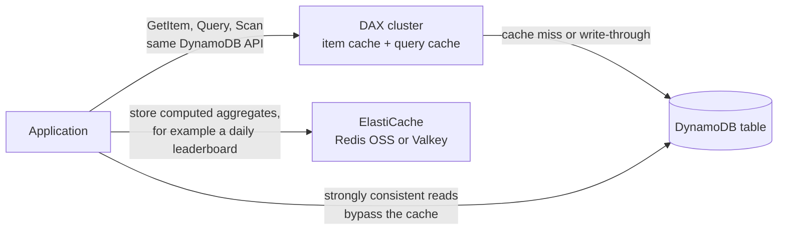
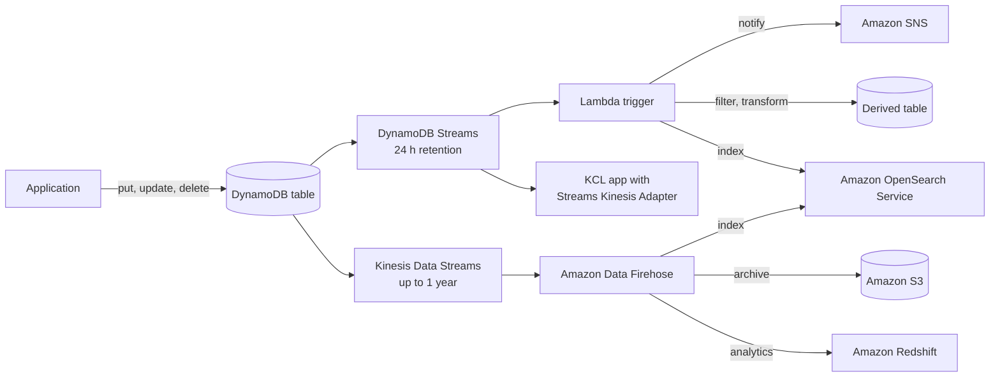
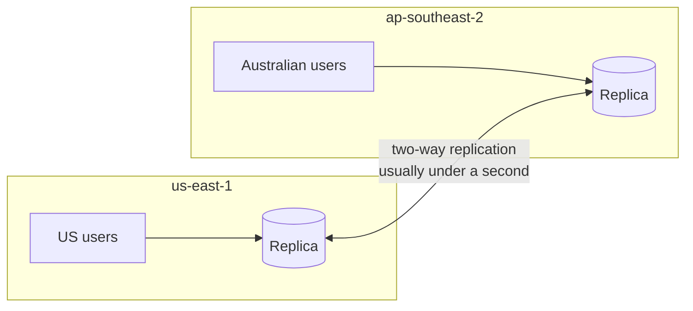
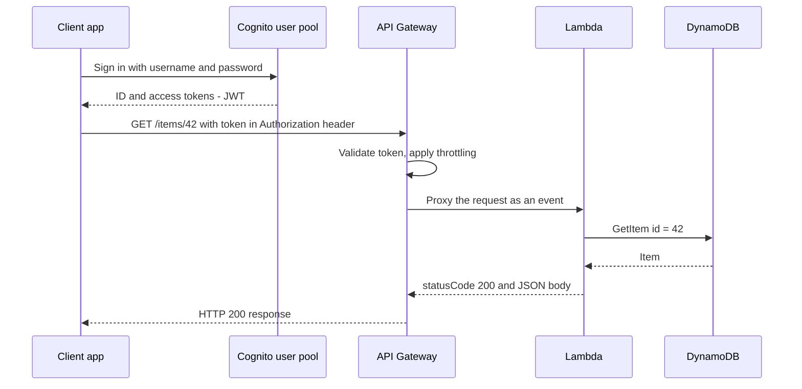
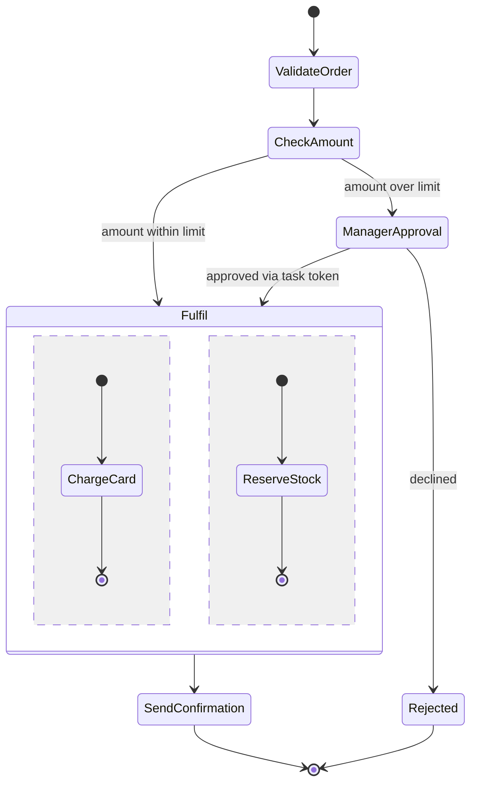
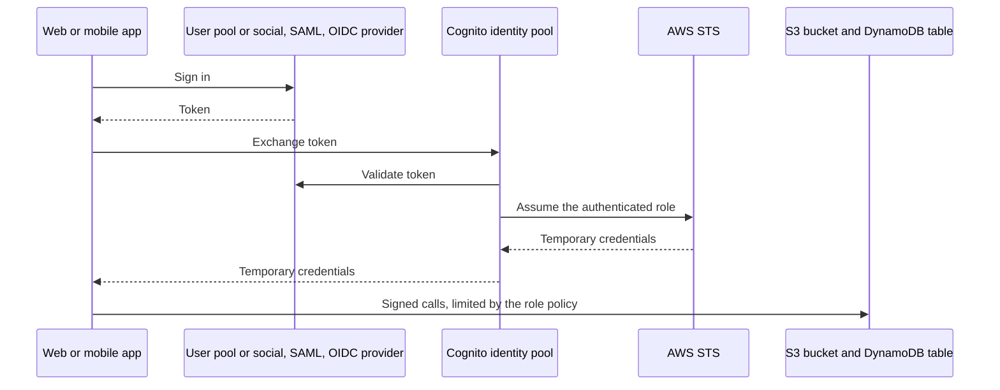

# DynamoDB, API Gateway, Step Functions & Cognito

## Summary

These four services are the rest of the classic serverless toolkit that sits around AWS Lambda. **Amazon DynamoDB** is a fully managed NoSQL key-value and document database that answers in single-digit milliseconds at almost any scale, with add-ons for caching (DAX), change streams, multi-Region replication (global tables), automatic expiry (TTL) and backups. **Amazon API Gateway** puts a managed, secured, throttled HTTPS or WebSocket front door in front of Lambda functions, HTTP backends or other AWS services. **AWS Step Functions** chains Lambda functions and AWS service calls into visual workflows with branching, retries, parallel steps and human approval. **Amazon Cognito** gives the end users of a web or mobile app an identity: user pools handle sign-up and sign-in and issue tokens, identity pools swap those tokens for temporary AWS credentials. Pick them when the question says "serverless", "no servers to manage", "scales automatically", "mobile users" or "millions of requests".

## Key concepts

- **DynamoDB** stores **items** (up to **400 KB** each) in **tables**; the **primary key** (partition key, optionally plus sort key) is fixed at creation and every other attribute is schemaless.
- **Capacity modes**: **on-demand** (pay per request, no planning, now the default and recommended mode) or **provisioned** (pay per hour for RCUs/WCUs you set, optional auto scaling, cheapest for steady, predictable load).
- **1 RCU** = one strongly consistent read (or two eventually consistent reads) per second of up to 4 KB; **1 WCU** = one write per second of up to 1 KB.
- **DAX** is a write-through, API-compatible in-memory cache for DynamoDB with **microsecond** reads; items and query results expire after **5 minutes** by default.
- **DynamoDB Streams** keeps an ordered log of item changes for **24 hours** (at most 2 readers per shard); **Kinesis Data Streams for DynamoDB** keeps them up to **1 year** with more consumers.
- **Global tables** replicate a table **active-active** across Regions; every replica accepts reads and writes. Default mode is eventually consistent (last writer wins); **MRSC** adds multi-Region strong consistency and an RPO of zero.
- **TTL** deletes items after an epoch-seconds timestamp, at no write cost, usually within a few days of expiry.
- **PITR** gives continuous backups with per-second restore points over a configurable **1 to 35 days**; **on-demand backups** last until you delete them; every restore creates a **new table**.
- **Export to S3** (needs PITR, no read capacity used) and **import from S3** (CSV, DynamoDB JSON or Ion, into a new table, no write capacity used).
- **API Gateway** integrates with **Lambda**, **HTTP** endpoints and **AWS service APIs**, and adds auth, throttling, API keys, caching, stages and request transformation.
- **Endpoint types**: **edge-optimized** (through CloudFront edge locations, ACM certificate in **us-east-1**), **Regional** (certificate in the API's Region) and **private** (only through an interface VPC endpoint plus a resource policy).
- **API Gateway auth**: **IAM** (internal callers), **Cognito user pool** authorizer (external app users), **Lambda authorizer** (your own logic, formerly "custom authorizer").
- **Step Functions** runs **state machines**: **Standard** workflows (up to 1 year, exactly-once, human approval with task tokens) and **Express** workflows (up to 5 minutes, high volume).
- **Cognito user pools** = sign-in directory issuing JWTs (works with API Gateway and ALB); **Cognito identity pools** = temporary AWS credentials (authenticated or guest) for direct access to S3, DynamoDB and so on.
- **Row-level security**: an IAM policy with `dynamodb:LeadingKeys` set to `${cognito-identity.amazonaws.com:sub}` limits each app user to the items whose partition key is their own identity ID.

## Amazon DynamoDB fundamentals

DynamoDB is a serverless, NoSQL database. There are no instances to choose and no patching or maintenance windows; AWS replicates every table across several Availability Zones in the Region. It is built for very large, simple access patterns: millions of requests per second, trillions of items and hundreds of terabytes, all with consistent single-digit millisecond latency. Access is controlled entirely with IAM. It is not a relational database: there are no joins and no SQL engine doing ad-hoc analytics, although it does support ACID **transactions** (all-or-nothing groups of up to 100 actions across one or more tables in the same Region).

### Tables, items and the primary key

A **table** holds an unlimited number of **items** (the equivalent of rows). Each item is a set of **attributes** (the equivalent of columns). The only attributes every item must have are the ones that form the **primary key**, which you choose when you create the table and cannot change afterwards. You have two options:

| Primary key type | Made of | Uniqueness rule | Good for |
|---|---|---|---|
| Simple | Partition key only | Each partition key value appears once | Look-ups by one ID, for example `SessionId` or `ProductId` |
| Composite | Partition key + sort key | The *combination* must be unique; many items can share a partition key | One-to-many data, for example all orders of one customer sorted by date |

DynamoDB hashes the partition key to decide where the item is stored, so pick a key with many distinct values that spreads traffic evenly (a customer ID is good; a "country" attribute with three values is not).

> [!EXAMPLE] A customer orders table
> An online bookstore stores orders in a table `CustomerOrders` with partition key `CustomerId` and sort key `OrderDate`. Customer `c-1042` has three orders, so three items share `CustomerId = c-1042` and are kept in date order. One item also carries a `GiftMessage` attribute and another a `Coupon` attribute; the third has neither. Nothing had to be declared in advance: new attributes can appear in new items at any time, and missing attributes are simply absent. Fetching "the last five orders of c-1042" is one efficient **Query** on the partition key with the sort key in descending order.

**Query** reads only the items that share one partition key value (optionally filtered by a sort key condition), so it is fast and cheap. **Scan** reads the whole table and filters afterwards, so it consumes capacity for every item it touches. If you need to look items up by another attribute, you add a secondary index (up to 20 global secondary indexes per table by default; local secondary indexes, at most 5, must be defined when the table is created). Indexes are not covered in these slides but explain why good key design matters.

### Data types and the item size limit

| Category | Types | Example value |
|---|---|---|
| Scalar | String, Number, Binary, Boolean, Null | `"Paperback"`, `24.99`, `true` |
| Document | List, Map (nest up to 32 levels) | `["red", "blue"]`, `{"city": "Lyon", "zip": "69001"}` |
| Set | String set, Number set, Binary set | `{"fiction", "award-winner"}` |

Key attributes must be String, Number or Binary. The whole item, attribute names included, must fit in **400 KB**. Larger objects (images, PDFs) belong in S3, with the S3 key stored in the DynamoDB item.

## Capacity modes: on-demand vs provisioned

The capacity mode decides how throughput is managed and billed. You can switch a table from provisioned to on-demand up to four times in a rolling 24 hours and from on-demand back to provisioned at any time.

| | On-demand | Provisioned |
|---|---|---|
| How you size it | Nothing to size; scales with traffic | You set read capacity units (RCU) and write capacity units (WCU) per second |
| Billing | Per read request unit and write request unit actually used | Per RCU/WCU-hour provisioned, used or not |
| Scaling | Instantly absorbs up to double the previous peak; growing beyond that faster than within 30 minutes can throttle | Optional auto scaling (target tracking, AWS recommends about 70 % utilization); requests above capacity are throttled |
| Cost control | Optional per-table maximum throughput | Fixed ceiling; reserved capacity and Savings Plans for discounts |
| Best for | New or unknown workloads, spiky or idle traffic, most serverless apps | Steady, forecastable traffic with high utilization |
| Free tier (Always Free) | Requests not included; the 25 GB of free storage per Region still applies | 25 RCU + 25 WCU per Region, plus the same 25 GB of storage |

> [!UPDATED] On-demand is now the default and recommended mode
> The slides list provisioned as the default and describe on-demand as much more expensive. Since 1 November 2024 AWS has cut on-demand throughput prices by 50 % and now documents on-demand as the default and recommended mode for most workloads. On-demand still costs more per request than a well-utilized provisioned table, so steady high-volume tables can be cheaper on provisioned capacity with auto scaling. In us-east-1 on-demand is USD 0.625 per million write units and USD 0.125 per million read units (Standard table class). Since December 2025, Database Savings Plans also cover DynamoDB throughput.

### Working out capacity units

| Operation | Unit size | Rule |
|---|---|---|
| Strongly consistent read | 4 KB | 1 RCU per 4 KB, rounded up |
| Eventually consistent read (the default) | 4 KB | Half of the above |
| Transactional read | 4 KB | Double the strongly consistent cost |
| Standard write | 1 KB | 1 WCU per 1 KB, rounded up |
| Transactional write | 1 KB | Double the standard cost |

> [!EXAMPLE] Sizing a provisioned table
> An app reads 10 items per second, each 6 KB, with strong consistency: 6 / 4 = 1.5, rounded up to 2 RCU per read, so 20 RCU. With eventually consistent reads it needs only 10 RCU. It also writes 10 items per second of 2.5 KB: 2.5 rounds up to 3 WCU per write, so 30 WCU. In on-demand mode the same arithmetic gives the number of request units you pay for, but you never configure it.

### Table classes

Every table also has a **table class**. **DynamoDB Standard** (the default) has the cheapest throughput. **DynamoDB Standard-Infrequent Access (Standard-IA)** has storage at about 60 % lower cost (USD 0.10 instead of 0.25 per GB-month in us-east-1) but higher per-request prices, and pays off when storage is the dominant cost, for example years of order history that is rarely read. Performance, durability and APIs are identical, and you can change the class at most twice in 30 days.

## DynamoDB Accelerator (DAX)

DAX is a fully managed, highly available in-memory cache built specifically for DynamoDB. It runs as a cluster inside your VPC: one primary node and up to 10 read replicas (AWS recommends at least three nodes in different AZs for production). Your application swaps the DynamoDB client for the DAX client and keeps calling the same `GetItem`, `Query`, `Scan` and `PutItem` APIs, so no application logic changes.

- **Reads**: eventually consistent `GetItem` and `BatchGetItem` results go to the **item cache**; `Query` and `Scan` results go to the **query cache**. Both default to a **5-minute TTL** and evict least-recently-used entries when full. Cache hits return in **microseconds** instead of milliseconds.
- **Writes** are **write-through**: DAX writes to the table first, then updates the cache.
- **Strongly consistent reads** bypass the cache and go straight to DynamoDB, so DAX does not help them.

DAX shines for read-heavy or bursty workloads and "hot keys", for example one product page hammered during a flash sale. It is a poor fit for write-heavy tables, applications that need strongly consistent reads, or traffic with few repeated reads (AWS suggests cache hit rates above 90 %).



| | DAX | Amazon ElastiCache |
|---|---|---|
| What it caches | DynamoDB items and Query/Scan results, automatically | Anything your code puts there |
| Code changes | Swap in the DAX client, same API calls | Cache-aside logic written by you |
| Typical use | Microsecond reads of DynamoDB data | Aggregation results, sessions, data from many sources |

> [!TIP]
> The two are complementary. If an application computes an expensive aggregate from DynamoDB data (top 100 scores this week), store the *result* in ElastiCache; let DAX handle the individual item and query reads.

## Change data capture: DynamoDB Streams and Kinesis

Every create, update and delete in a table can be captured as a change record in near real time. Typical uses: send a welcome email when a user item is created, update real-time usage dashboards, copy data into a derived or aggregated table, index items in OpenSearch for full-text search, archive changes to S3, or replicate data in custom ways.

DynamoDB offers two streaming targets, and you can enable both on the same table:

| | DynamoDB Streams | Kinesis Data Streams for DynamoDB |
|---|---|---|
| Retention | 24 hours, fixed | Up to 1 year (Kinesis retention setting) |
| Consumers | Up to 2 simultaneous readers per shard (1 recommended for global tables) | Up to 5 per shard, or 20 with enhanced fan-out |
| Ordering and duplicates | Exactly once, in order per item | Duplicates possible; use the record timestamp to order |
| Processing options | Lambda triggers, or the DynamoDB Streams Kinesis Adapter with the KCL | Lambda, Amazon Data Firehose, Managed Service for Apache Flink, AWS Glue streaming ETL |
| Cost | Reads made by Lambda triggers are not charged (except on Lambda Managed Instances); 2.5 million other stream reads per month in the Free Tier | Normal Kinesis Data Streams charges plus DynamoDB change-capture units |

For DynamoDB Streams you choose what each record contains (the **stream view type**): keys only, the new image, the old image, or both images.



> [!UPDATED] Kinesis service names
> The slides use older names. Kinesis Data Analytics is now **Amazon Managed Service for Apache Flink** (renamed in 2023) and Kinesis Data Firehose is now **Amazon Data Firehose** (renamed in February 2024). The current DynamoDB documentation lists these new names as the processing options for Kinesis Data Streams.

## Global tables

A **global table** is a set of replica tables, one per chosen Region, that DynamoDB keeps in sync. Every replica can serve both reads and writes (**active-active**), so users in Sydney and Virginia each get local, low-latency access, and if one Region has trouble the application can shift traffic to another. Global tables carry a 99.999 % availability SLA, compared with 99.99 % for a single-Region table.



| | Multi-Region eventual consistency (MREC, default) | Multi-Region strong consistency (MRSC) |
|---|---|---|
| Replication | Asynchronous, typically within a second | Synchronous to at least one other Region before the write returns |
| Conflicts | Last writer wins, per item | Conflicting concurrent writes fail and can be retried |
| Strongly consistent reads | Latest only if last written in the same Region | Always the latest version, in any replica |
| RPO | Equal to replication delay (seconds) | Zero |
| Layout | Any number of Regions; add or remove replicas later | Exactly three Regions (three replicas, or two replicas plus a witness), table must be empty to convert |
| Limits | Supports TTL, transactions (atomic only in the Region where they run) | No TTL, no transactions, no LSIs, selected Regions only |

> [!UPDATED] Global tables changes since the slides
> The slides say you must enable DynamoDB Streams first. With the current version (2019.11.21) DynamoDB turns Streams on automatically for eventually consistent replicas and you cannot turn them off; MRSC replicas replicate without Streams, so Streams stay off unless you turn them on yourself. MRSC itself, multi-account global tables and a price cut on replicated writes (up to 67 % for on-demand, November 2024) are all newer than the slides.

## Time to Live (TTL)

TTL lets each item carry its own expiry time. You enable TTL on the table and name one attribute (for example `ExpiresAt`); in each item you store a **Number** holding the expiry time in **Unix epoch seconds**. A background process finds expired items and deletes them, typically **within a few days** of the timestamp, and those deletions **consume no write capacity**.

> [!EXAMPLE] Web sessions that clean themselves up
> A login service writes a session item with `ExpiresAt = now + 86,400` (24 hours). Users who log out early simply abandon the item. Without TTL, the table would grow forever or need a nightly scan-and-delete job paying for every write. With TTL, expired sessions disappear for free. Because deletion can lag, the app also adds a filter (`ExpiresAt > :now`) so it never treats a stale session as valid.

Other uses: keep only recent data to cut storage cost, or delete personal data after a retention period required by regulation. TTL deletions appear in DynamoDB Streams marked as service deletions, so a Lambda function can archive expired items to S3 before they are gone. In a global table the delete is free in the Region where it happens but replicated deletes in other Regions are billed as replicated writes.

## Backups, restores and S3 integration

| | Point-in-time recovery (PITR) | On-demand backup |
|---|---|---|
| What it is | Continuous, incremental backups you switch on per table | A full snapshot you take (or schedule with AWS Backup) |
| Restore point | Any second within the recovery period, up to about 5 minutes ago | The moment the backup was taken |
| Retention | Rolling window of 1 to 35 days (default 35) | Until you delete it, even after the table is deleted |
| Performance impact | None | None |
| Restore result | Always a **new table** (same or another Region) | Always a **new table** |
| Cost basis | Table size per GB-month (USD 0.20 in us-east-1) | Backup size per GB-month (USD 0.10 in us-east-1) |

On-demand backups can be created directly in DynamoDB or managed by **AWS Backup**, which adds backup plans and schedules, lifecycle rules to move backups to cold storage, **cross-Region and cross-account copies**, Vault Lock (write-once-read-many), tags and audit reports.

> [!UPDATED] PITR recovery period is now configurable
> The slides describe a fixed 35-day window. You can now set the PITR recovery period to any value from 1 to 35 days; the price stays the same because PITR is billed on table size. Deleting a table that has PITR on also creates a free system backup kept for 35 days.

### Export to and import from Amazon S3

- **Export to S3** requires PITR and can target any point inside the PITR window. Exports run in the background, use **no read capacity** and do not affect table performance. Output is DynamoDB JSON or Amazon Ion. Besides full exports there are **incremental exports** (only the changes over a period of 15 minutes to 24 hours) and filtered exports. Use it to query DynamoDB data with **Athena**, keep audit snapshots, or run ETL in S3 before loading data back.
- **Import from S3** reads CSV, DynamoDB JSON or Ion files (optionally GZIP or ZSTD compressed) and always creates a **new table**; you cannot import into an existing table. It uses **no write capacity**, and parsing errors are logged to **CloudWatch Logs**.

## Amazon API Gateway

API Gateway is a managed service for publishing APIs. Combined with Lambda and DynamoDB it gives a complete backend with no servers at all: the client calls an HTTPS endpoint, API Gateway proxies the request to a Lambda function, and the function performs create, read, update and delete operations on a table.



Beyond simple proxying, API Gateway provides:

- **WebSocket APIs** for two-way, real-time messaging (chat, live dashboards).
- **Stages** (dev, test, prod) and **versioning** (v1, v2) so several versions run side by side.
- **Security**: authentication and authorization (below), resource policies and, for REST APIs, AWS WAF.
- **API keys, usage plans and throttling** to give partners quotas and protect backends.
- **OpenAPI (Swagger) import and export** to define APIs from a specification, plus generated client SDKs.
- **Request validation and transformation** of requests and responses (mapping templates).
- **Response caching** on REST API stages: default TTL **300 seconds**, maximum **3,600 seconds**, billed per hour by cache size (not Free Tier).

### API types

The slides do not split API Gateway into its three API products, but questions often hinge on the difference.

| | REST API | HTTP API | WebSocket API |
|---|---|---|---|
| Purpose | Full-featured request/response APIs | Lower-cost, simpler request/response APIs | Persistent two-way connections |
| Endpoint types | Edge-optimized, Regional, private | Regional only | Regional |
| Auth | IAM, Cognito user pools, Lambda authorizer, resource policies | IAM, JWT authorizer (works with Cognito), Lambda authorizer | IAM, Lambda authorizer |
| Extras | API keys, usage plans, per-client throttling, caching, request validation, AWS WAF, canary deployments | Automatic deployments, simpler setup | Route by message content |
| Price in us-east-1 | USD 3.50 per million calls (first tier) | USD 1.00 per million calls (first tier) | USD 1.00 per million messages + connection minutes |

### Integration types

| Integration | What API Gateway calls | Why put API Gateway in front |
|---|---|---|
| Lambda function | Invokes a function (Lambda proxy integration passes the whole request) | The easiest way to build a REST API backed by code |
| HTTP | Any HTTP endpoint: an on-premises service, an ALB, a third-party API | Add rate limiting, caching, user authentication and API keys to an existing backend |
| AWS service | Any AWS API action, for example `SendMessage` on SQS or `StartExecution` on Step Functions | Expose an AWS action publicly with authentication and throttling, without writing a Lambda function |
| Mock | Nothing; API Gateway answers itself | Testing and CORS preflight responses |

> [!EXAMPLE] Ingesting JSON from devices without servers
> Thousands of sensors post small JSON documents over HTTPS. An API Gateway method with an AWS service integration calls Kinesis Data Streams `PutRecord` directly; Amazon Data Firehose reads the stream and writes batched JSON files to S3. There is no Lambda function and no instance anywhere in the path, and API Gateway still authenticates and throttles the devices.

### Endpoint types

| Endpoint type | How traffic flows | Choose it when | ACM certificate for a custom domain |
|---|---|---|---|
| Edge-optimized | Clients connect to the nearest CloudFront point of presence, which forwards to the API in its one home Region | Clients are spread around the world (REST APIs only) | Must be in **us-east-1** |
| Regional | Clients connect straight to the Region | Clients are in the same Region, or you want your own CloudFront distribution with full control of caching | Must be in the **same Region as the API** |
| Private | Reachable only from a VPC through an **interface VPC endpoint** (an ENI, powered by PrivateLink); on-premises via Direct Connect or VPN into that VPC | Internal APIs that must never be public | Private custom domains use their own setup |

A private API also needs a **resource policy** that allows the VPC or VPC endpoint (for example with an `aws:SourceVpce` condition).

> [!UPDATED] Console default endpoint type
> The slides call edge-optimized the default. The API Gateway documentation still describes edge-optimized as the default for REST APIs created through the API, but the current console tutorial keeps the preselected endpoint type as **Regional**. Check the endpoint type explicitly when you create an API.

### Security and custom domains

- **IAM authorization**: callers sign requests with AWS credentials (Signature Version 4). Best for internal applications, other AWS accounts or services, and users who already hold AWS credentials (including credentials from a Cognito identity pool).
- **Cognito user pool authorizer**: the client signs in to a user pool and sends the ID or access token in the `Authorization` header; API Gateway validates it. Best for external users of web and mobile apps.
- **Lambda authorizer** (formerly called a custom authorizer): API Gateway calls your function with a bearer token (for example an OAuth or third-party JWT) or request parameters; the function returns an IAM policy, which API Gateway can cache.

For a friendly HTTPS name such as `api.example.com`, create a **custom domain name** with a certificate from **AWS Certificate Manager**: in **us-east-1** for an edge-optimized endpoint, in the API's own Region for a Regional endpoint. Then point DNS at it with a Route 53 alias record (or a CNAME).

### Limits worth remembering

| Limit | Value | Exam relevance |
|---|---|---|
| Integration timeout (REST) | 50 ms to **29 seconds** by default | Long-running jobs should go asynchronous (SQS, Step Functions) |
| Payload size | **10 MB** | Upload large files straight to S3 with pre-signed URLs instead |
| Account throttle | **10,000 requests per second** per Region, burst up to 5,000 (lower in some newer Regions) | Raise through Service Quotas; per-client limits through usage plans |
| Cache TTL | Default 300 s, maximum 3,600 s | Caching is per stage, GET methods by default |

> [!UPDATED] Integration timeout can now exceed 29 seconds
> For Regional and private REST APIs you can now request a higher integration timeout than 29 seconds through Service Quotas, possibly in exchange for a lower Region-level throttle quota. Edge-optimized APIs keep the 29-second maximum.

## AWS Step Functions

Step Functions coordinates the steps of an application as a **state machine** that you design visually in **Workflow Studio** or write in JSON (Amazon States Language). Each step is a **state**:

| State type | Does |
|---|---|
| Task | Runs work: invokes Lambda, or calls one of over 220 AWS services directly (SDK integrations), for example DynamoDB `PutItem`, SQS `SendMessage`, ECS `RunTask`, Glue jobs, Athena queries, API Gateway endpoints |
| Choice | Branches on the input (if / else) |
| Parallel | Runs branches at the same time and waits for all |
| Map | Runs the same steps for every item in a list (Distributed Map handles very large datasets in S3) |
| Wait | Pauses for a time or until a timestamp |
| Pass, Succeed, Fail | Shape data, end successfully, end with an error |

Every Task can declare **Retry** rules (with backoff) and **Catch** handlers, so error handling lives in the workflow instead of in every function. Workers outside AWS, such as on-premises servers, can take part through **activities**. For **human approval**, a task can pause with the **wait-for-callback** pattern: Step Functions hands out a **task token** (for example in an email sent through SNS) and resumes only when someone's approval calls back with that token. Use cases: order fulfillment, payment and refund flows, data-processing and ML pipelines, and any business process with several steps.



| | Standard workflow (default) | Express workflow |
|---|---|---|
| Maximum duration | 1 year | 5 minutes |
| Execution model | Exactly-once | At-least-once (asynchronous) or at-most-once (synchronous) |
| Default throttling (us-east-1, us-west-2, eu-west-1) | StartExecution refills at 300 per second (burst 1,300); 5,000 state transitions per second; soft quotas, lower in other Regions | StartExecution refills at 6,000 per second; no state transition limit |
| History | Visual execution history kept 90 days | Sent to CloudWatch Logs |
| Callback (task token) and `.sync` jobs | Supported | Not supported |
| Pricing | Per state transition (4,000 free per month, Always Free) | Per execution, duration and memory |
| Best for | Long-running, auditable, non-idempotent business processes, human approval | High-volume event processing, IoT ingestion, synchronous microservice orchestration |

> [!NOTE] Newer features
> Workflows can now use **JSONata** expressions and workflow **variables** (since November 2024) instead of the older JSONPath input and output fields. The exam focuses on when to use Step Functions, not on the definition syntax.

## Amazon Cognito

Cognito gives the **end users of your application** (not your employees or administrators) an identity. It has two independent parts that are often used together.

| | Cognito user pools | Cognito identity pools |
|---|---|---|
| Answers | Who is this user? (authentication) | What AWS resources may this user reach? (authorization) |
| Produces | JSON Web Tokens: ID, access and refresh tokens | Temporary AWS credentials from AWS STS |
| Users come from | Its own user directory, or federation with Google, Facebook, Apple, Amazon, SAML 2.0 and OIDC providers | A user pool, social providers, SAML or OIDC, developer-authenticated identities, or no login at all (guest access) |
| Typical consumer | API Gateway, an ALB or your own backend checks the token | The app calls S3, DynamoDB and other services directly with the credentials |

### User pools: sign-in for your app

A user pool is a serverless user database for web and mobile apps. It provides sign-up and sign-in with a username or email plus password, password reset, email and phone number verification, **MFA** (SMS, authenticator apps, and email codes on the Essentials and Plus plans), passkeys and passwordless sign-in (Essentials and Plus), and federation so people can sign in with an existing social or corporate identity. Cognito hosts ready-made sign-in pages (managed login) or you build your own UI on the user pool API.

User pools plug directly into two AWS services:

- **API Gateway**: a Cognito user pool authorizer (REST) or JWT authorizer (HTTP) checks the token the client sends, before the backend runs.
- **Application Load Balancer**: a listener rule with an `authenticate-cognito` action (HTTPS listeners only) redirects unauthenticated users to the Cognito sign-in page, then forwards authenticated requests to the target group with the user's claims in `x-amzn-oidc-*` headers. The targets (EC2, ECS, Lambda) never handle login code.

> [!UPDATED] User pool feature plans
> Since November 2024 user pools have three feature plans: **Lite** (basic sign-in, classic hosted UI), **Essentials** (default for new pools: managed login, passkeys, email MFA, access-token customization) and **Plus** (adds threat protection such as compromised-password and risky sign-in detection). Lite and Essentials include 10,000 monthly active users free, indefinitely; identity pools are free.

### Identity pools: temporary AWS credentials

An identity pool (also called federated identities) maps a signed-in user, or an anonymous guest, to an **IAM role** and returns short-lived credentials for it. You configure a default role for **authenticated** users and another, more restrictive, role for **guest** (unauthenticated) users, and you can choose roles per user based on token claims or user pool group membership. The permissions live in IAM policies on those roles, and **policy variables** let one policy give every user access to only their own data.



### Row-level security in DynamoDB

The identity pool assigns each user a stable identity ID, available in IAM policies as `${cognito-identity.amazonaws.com:sub}`. If the table's partition key holds that ID, a single policy on the authenticated role restricts every user to their own items:

```json
{
  "Version": "2012-10-17",
  "Statement": [
    {
      "Sid": "OwnNotesOnly",
      "Effect": "Allow",
      "Action": ["dynamodb:GetItem", "dynamodb:Query", "dynamodb:PutItem", "dynamodb:UpdateItem", "dynamodb:DeleteItem"],
      "Resource": "arn:aws:dynamodb:eu-west-1:111122223333:table/UserNotes",
      "Condition": {
        "ForAllValues:StringEquals": {
          "dynamodb:LeadingKeys": ["${cognito-identity.amazonaws.com:sub}"]
        }
      }
    }
  ]
}
```

`dynamodb:LeadingKeys` is the partition key value of the items a request touches. Note that `Scan` is deliberately left out, because a scan reads every partition regardless of the condition. The same variable works for S3, for example allowing `s3:GetObject` and `s3:PutObject` only under the prefix `user-uploads/${cognito-identity.amazonaws.com:sub}/`.

### Cognito or IAM?

IAM users and roles are for your own people, workloads and AWS services. Cognito is for the people who use your application. Signals for Cognito: "hundreds or millions of users", "mobile app users", "sign in with Google or Facebook", "authenticate with SAML into the app", "guest access", "users upload directly to S3".

## Exam tips

> [!EXAM] Serverless, NoSQL, millisecond latency
> "Serverless database", "key-value", "schema changes often", "millions of requests per second" or "session data" point to DynamoDB. Joins, complex SQL reporting or relational integrity point to RDS or Aurora instead.

> [!EXAM] Picking the capacity mode
> "Unpredictable", "spiky", "new application", "least operational effort" → on-demand. "Steady, predictable traffic" plus "lowest cost" → provisioned with auto scaling (and reserved capacity or Savings Plans).

> [!EXAM] DAX vs ElastiCache
> "Microsecond latency for DynamoDB reads" or "read-heavy DynamoDB with no code changes" → DAX. "Cache the results of a calculation" or "cache for several data sources" → ElastiCache.

> [!EXAM] React to table changes
> "Run code whenever an item is inserted or changed", "send a welcome email on sign-up" → DynamoDB Streams + Lambda. "Keep change records longer than 24 hours", "many consumers", "deliver changes to S3 or Redshift through Firehose" → Kinesis Data Streams for DynamoDB.

> [!EXAM] Multi-Region
> "Low-latency reads and writes in several Regions", "active-active", "Region failover for DynamoDB" → global tables. "RPO of zero" and "strongly consistent reads in every Region" → global table in MRSC mode.

> [!EXAM] Data housekeeping and recovery
> "Delete items automatically after a period", "expire sessions" → TTL. "Restore to the state of 10 minutes ago after a bad script" → PITR (restores into a new table). "Long-term retention, cross-Region or cross-account copies of backups" → AWS Backup. "Run Athena analytics without touching table capacity" → export to S3.

> [!EXAM] API Gateway endpoint and certificate
> "Global clients" → edge-optimized, certificate in us-east-1. "Only reachable from inside the VPC" → private REST API + interface VPC endpoint + resource policy. "Clients in one Region" or "own CloudFront distribution" → Regional, certificate in the same Region.

> [!EXAM] Who authenticates
> Internal callers or AWS workloads → IAM authorization. App users with sign-up/sign-in → Cognito user pools. Third-party tokens or custom logic → Lambda authorizer. App users who must call S3 or DynamoDB directly → Cognito identity pools.

> [!EXAM] Orchestration
> "Coordinate several Lambda functions with retries, branching and waiting", "human approval step", "workflow that runs for days" → Step Functions Standard. "High-volume, short event processing" → Step Functions Express.

## Common traps

> [!TRAP] DynamoDB Streams retention
> DynamoDB Streams keeps records for 24 hours and you cannot extend it. Any answer that "increases DynamoDB Streams retention to 7 days" is wrong; use Kinesis Data Streams for DynamoDB.

> [!TRAP] DAX and strong consistency
> DAX does not cache strongly consistent reads; they go straight to the table. If the requirement is strong consistency, DAX adds nothing for those reads. DAX is also not a write accelerator.

> [!TRAP] Restores do not overwrite
> PITR and on-demand backup restores always create a new table. Plan to point the application at the restored table (or copy data back); you cannot roll the original table back in place.

> [!TRAP] TTL is not instant
> Expired items can stay readable for up to a few days. If exact expiry matters, filter on the TTL attribute in queries. TTL is also not a backup or archive by itself; capture deletions through Streams if you need a copy.

> [!TRAP] Certificate in the wrong Region
> An edge-optimized custom domain needs its ACM certificate in us-east-1 even if the API lives in eu-west-1. A Regional API needs it in its own Region. Importing the certificate into "any Region" is not enough.

> [!TRAP] User pools vs identity pools
> A user pool alone does not give AWS credentials; it issues tokens. If users must call S3 or DynamoDB directly from the app, you need an identity pool (often fed by the user pool). Creating an IAM user per app user is never the right answer.

> [!TRAP] Global tables and conflicts
> In the default eventually consistent mode, simultaneous writes to the same item in two Regions are resolved by "last writer wins", and transactions are atomic only inside the Region that ran them. Do not pick global tables (MREC) for a requirement of cross-Region strong consistency.

> [!TRAP] Long requests through API Gateway
> A synchronous request that runs for minutes will hit the 29-second integration timeout of edge-optimized REST APIs (and the default for the others). The fix is an asynchronous design (return a job ID, process through SQS or Step Functions), not a bigger Lambda function.
