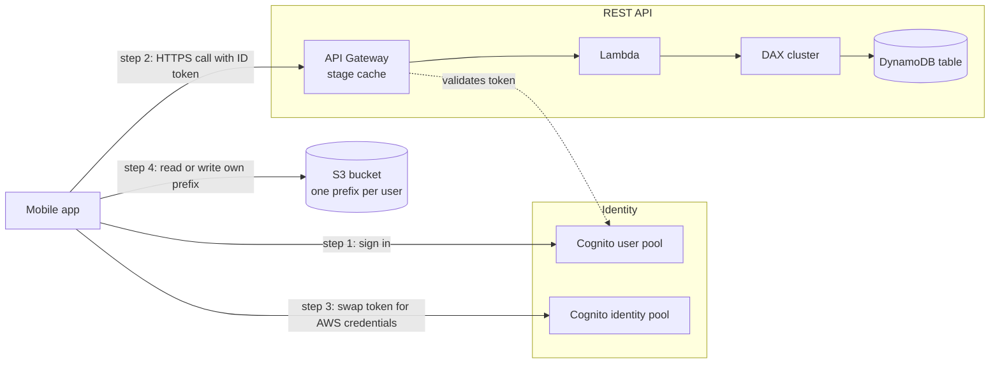
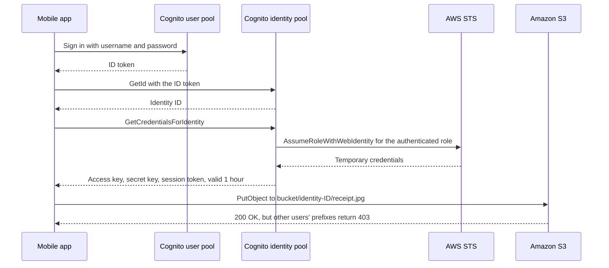
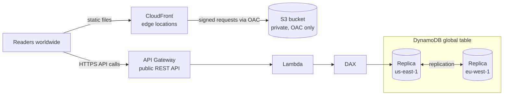
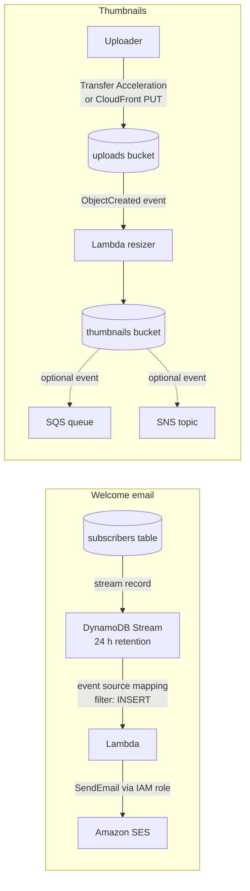
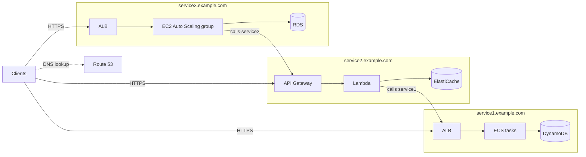
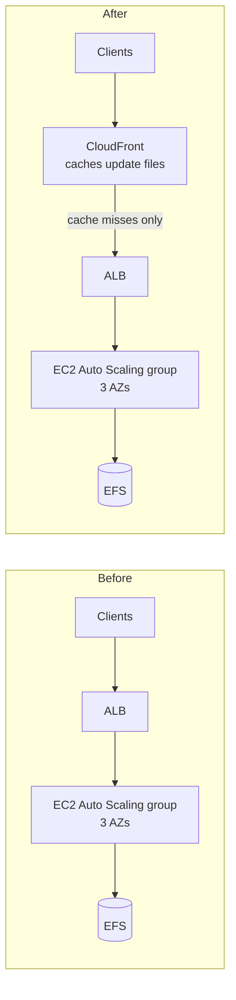

# Serverless Architectures

## Summary

This lesson puts the serverless building blocks from the previous lessons together into four complete designs, the way exam questions do. A **mobile to-do app** shows the classic serverless API (API Gateway + Lambda + DynamoDB), sign-in with **Cognito user pools**, direct and safe access to S3 with **Cognito identity pools**, and two layers of caching (**DAX** and the **API Gateway cache**). A **global blog** adds static hosting with **CloudFront + S3 (OAC)**, multi-Region data with **DynamoDB global tables**, and event-driven side jobs: a welcome email through **DynamoDB Streams → Lambda → SES** and thumbnails through **S3 event notifications**. A **microservices** design contrasts synchronous and asynchronous integration. Finally, putting **CloudFront in front of an existing EC2 fleet** shows how to cut cost for heavy static downloads without touching the application. Use these patterns whenever a question asks for "serverless", "least operational overhead", "scales automatically" or "pay only for what you use".

## Key concepts

- **Serverless REST API** = Amazon API Gateway (HTTPS endpoint) → AWS Lambda (business logic) → Amazon DynamoDB (storage); every layer scales on demand and bills per request.
- A **Cognito user pool** signs users in and issues JWTs; an API Gateway **Cognito user pool authorizer** checks the token before the request reaches Lambda.
- A **Cognito identity pool** swaps a sign-in token for **temporary AWS credentials** (valid one hour in the enhanced flow) tied to an IAM role, so a mobile app can call S3 or DynamoDB directly.
- The policy variable **`${cognito-identity.amazonaws.com:sub}`** limits each user to their own S3 prefix or their own DynamoDB partition key.
- **DAX** is an in-memory, write-through cache in front of DynamoDB (microsecond reads, default item TTL **5 minutes**) that runs inside your **VPC**.
- **API Gateway caching** (REST APIs only) stores whole responses per stage: default TTL **300 s**, maximum **3,600 s**, sizes **0.5 GB to 237 GB**, billed hourly and never Free Tier.
- **CloudFront + S3 with Origin Access Control (OAC)** serves static files worldwide while a bucket policy lets only that distribution read the bucket.
- **DynamoDB global tables** replicate a table to several Regions; every replica accepts reads and writes (multi-active), usually within a second.
- **Aurora Global Database** is the relational alternative: one writer Region, up to **10** read-only secondary Regions.
- **DynamoDB Streams** records item changes for **24 hours**; a Lambda trigger can react to them, for example by sending a welcome email through **Amazon SES**.
- **S3 event notifications** go to Lambda, SQS (standard), SNS (standard) or EventBridge; use them for thumbnail generation and other post-upload work.
- **S3 Transfer Acceleration** speeds long-distance uploads by entering the AWS network at the nearest edge location.
- Microservices talk **synchronously** (API Gateway, load balancers) or **asynchronously** (SQS, SNS, Kinesis, S3-triggered Lambda).
- Putting **CloudFront in front of an ALB** caches static downloads at the edge, so the EC2 fleet scales less and data transfer from AWS origins to CloudFront is free.

## Building blocks at a glance

Every design in this lesson is assembled from the same small set of managed services. Knowing what each one contributes makes the architectures easy to reason about.

| Need | Service | Why it fits serverless |
|---|---|---|
| Public HTTPS API | Amazon API Gateway | Managed endpoint, throttling, auth, caching, pay per call |
| Business logic | AWS Lambda | Runs code per event, scales to zero, pay per invocation and duration |
| Key-value data at any scale | Amazon DynamoDB | Serverless table, on-demand capacity, single-digit millisecond reads |
| Read cache for DynamoDB | DynamoDB Accelerator (DAX) | Drop-in cache using the same API calls |
| User sign-in | Cognito user pools | Managed user directory, issues JWTs |
| AWS credentials for app users | Cognito identity pools | Short-lived IAM credentials per user |
| Static files, global delivery | Amazon S3 + Amazon CloudFront | No servers, cached at edge locations |
| Email | Amazon SES | API-driven email sending, pay per message |
| Buffering and fan-out | Amazon SQS, Amazon SNS | Managed queue and pub/sub |

## Case 1: MyTodoList mobile app

### The requirements

A startup is building a to-do list app for phones. The brief asks for:

- a REST API reachable over **HTTPS**, built **without servers to manage**;
- sign-in through a **managed, serverless identity service**;
- each user can store attachments (photos of receipts, voice notes) in **their own area of an S3 bucket**, reached **directly from the phone**;
- users read their to-dos far more often than they write them, so the data layer must **scale and serve a high read rate cheaply**.



### The REST API layer

The phone calls an **API Gateway REST API** over HTTPS (for example `GET /todos` and `POST /todos`). API Gateway invokes a **Lambda** function, which queries a **DynamoDB** table whose partition key is the user ID. Nothing in this chain runs while nobody uses the app, and each part scales by itself when thousands of users open it at 9 a.m.

**Authentication.** Users sign up and sign in against a **Cognito user pool**, which returns JSON Web Tokens (an ID token, an access token and a refresh token). The app sends the ID token (or access token) in the `Authorization` header. A **Cognito user pool authorizer** attached to the API methods checks the token's signature and expiry; invalid or missing tokens are rejected with a 401 before Lambda is ever invoked, so no function time is spent on them and you write no auth code.

> [!NOTE] REST API or HTTP API?
> API Gateway offers two RESTful flavours. **REST APIs** support Cognito user pool authorizers, API keys and usage plans, AWS WAF, request validation, private endpoints and **response caching**. **HTTP APIs** are cheaper and simpler and validate Cognito tokens with a **JWT authorizer**, but have **no caching**, no WAF integration and no SDK generation. The design in this case study needs caching, so it uses a REST API.

### Giving users direct access to S3

Uploading a 5 MB photo through API Gateway and Lambda would waste money and hit limits (API Gateway payloads max out at 10 MB). It is better for the phone to talk to S3 directly. But you must **never** put long-term IAM access keys inside a mobile app: anyone can extract them.

The answer is a **Cognito identity pool** (also called federated identities):

1. The user signs in to the user pool and receives an ID token.
2. The app sends the token to the identity pool (`GetId`) and receives a stable **identity ID** such as `us-east-1:1a2b3c4d-...`.
3. The app calls `GetCredentialsForIdentity`. Behind the scenes the identity pool calls **AWS STS** `AssumeRoleWithWebIdentity` for the IAM role mapped to authenticated users and returns an access key, secret key and session token that expire after **one hour**.
4. The app signs S3 requests with those credentials using the AWS SDK.



The role is shared by every user, yet each user only reaches their own data thanks to an **IAM policy variable**. At request time IAM replaces `${cognito-identity.amazonaws.com:sub}` with the caller's identity ID:

```json
{
  "Version": "2012-10-17",
  "Statement": [
    {
      "Effect": "Allow",
      "Action": "s3:ListBucket",
      "Resource": "arn:aws:s3:::mytodolist-files",
      "Condition": { "StringLike": { "s3:prefix": ["${cognito-identity.amazonaws.com:sub}/*"] } }
    },
    {
      "Effect": "Allow",
      "Action": ["s3:GetObject", "s3:PutObject"],
      "Resource": "arn:aws:s3:::mytodolist-files/${cognito-identity.amazonaws.com:sub}/*"
    }
  ]
}
```

The same trick works beyond S3. With the condition key `dynamodb:LeadingKeys` set to the same variable, a user can query DynamoDB directly but only items whose partition key equals their identity ID. The same role can also allow `lambda:InvokeFunction`, so the app can call a specific function directly with its temporary credentials.

> [!TIP] Trust policy safety net
> The IAM role used by an identity pool trusts the principal `cognito-identity.amazonaws.com`, and IAM insists that the trust policy also checks the `cognito-identity.amazonaws.com:aud` condition (your identity pool ID). Add an `amr` condition of `authenticated` so guest identities can never assume the signed-in role.

### Caching reads with DAX

To-dos are read many times for each write. **DynamoDB Accelerator (DAX)** sits between Lambda and the table:

- It speaks the DynamoDB API, so the code change is limited to using the DAX client and the cluster endpoint.
- `GetItem` and `BatchGetItem` results land in the **item cache**; `Query` and `Scan` results land in the **query cache**. Both default to a **5-minute TTL**.
- Writes go **through** DAX to the table and update the item cache.
- **Strongly consistent reads skip the cache** and go straight to DynamoDB.
- A DAX cluster lives **inside a VPC**, so the Lambda function must be attached to that VPC with security group access to the cluster.

DAX takes read pressure off the table, which means fewer read capacity units (or fewer on-demand read charges) and much lower latency for popular items.

### Caching responses in API Gateway

You can also cache **complete HTTP responses** at the API layer. When caching is enabled on a REST API **stage**, API Gateway provisions a dedicated cache and answers repeated requests from it without invoking Lambda at all.

- Default TTL **300 seconds**, configurable from **0** (off) to **3,600 seconds**; can be overridden per method.
- Only `GET` methods are cached by default; cache keys can include query strings, headers or path parameters (with `status` declared as a cache key, `/todos?status=open` and `/todos?status=done` are cached separately).
- A single cached response can be at most **1 MB**; larger responses always go to the backend.
- Capacity is chosen per stage, from **0.5 GB to 237 GB**; it is **billed per hour** and is **not** covered by the Free Tier.
- Clients can force a refresh with `Cache-Control: max-age=0`, which you should protect with the `execute-api:InvalidateCache` permission; administrators can flush the whole stage cache.

| | API Gateway cache | DAX |
|---|---|---|
| What is cached | Entire HTTP responses | DynamoDB items and query results |
| Saves | Lambda invocations and everything behind them | DynamoDB read capacity and latency |
| Where it runs | Managed by API Gateway, per stage | Cluster in your VPC |
| Default TTL | 300 s (max 3,600 s) | 5 minutes |
| Works with | REST APIs only | DynamoDB only |
| Best for | Identical requests from many clients | Hot items read by your code with varied requests |

> [!EXAMPLE] Choosing between the two caches
> A public endpoint returns the same "featured lists" JSON to every user: cache it in API Gateway and Lambda barely runs. A personalised endpoint builds each response from several DynamoDB lookups: API Gateway cannot share those responses between users, but DAX still speeds every lookup.

## Case 2: MyBlog.com, a serverless website

### The requirements

- Readers come from all over the world, so the site must **scale globally**.
- Posts are **written rarely but read constantly**.
- Part of the site is **static files** (HTML, CSS, JavaScript, images); the rest comes from a **dynamic REST API**.
- **Cache wherever possible.**
- New subscribers get a **welcome email**.
- Every uploaded photo gets a **thumbnail**.



### Static content: S3 behind CloudFront

The static part of the site lives in an S3 bucket and is delivered through a **CloudFront distribution**. CloudFront caches files at hundreds of edge locations, so a reader in Sydney downloads the logo from Sydney rather than from Virginia, and the bucket sees only cache misses.

To stop readers bypassing CloudFront, keep the bucket **private** and use **Origin Access Control (OAC)**. CloudFront signs every origin request, and the bucket policy allows `s3:GetObject` only for the principal `cloudfront.amazonaws.com` **when `AWS:SourceArn` equals your distribution's ARN**. Anyone who tries the S3 URL directly gets "Access Denied".

> [!NOTE] OAC replaced OAI
> Origin Access Identity (OAI) is now legacy. OAC works with buckets in every Region (including newer opt-in Regions), objects encrypted with **SSE-KMS**, and `PUT`/`DELETE` requests through CloudFront. Neither OAC nor OAI works with an S3 **website endpoint** origin; that must be configured as a custom origin.

### A public REST API

The dynamic part (list posts, read a post, subscribe) uses the same API Gateway → Lambda → DAX → DynamoDB chain as the mobile app. **No Cognito is needed** because the API is public; you would still apply throttling, and optionally AWS WAF on the REST API.

### Going global: DynamoDB global tables

Readers in Europe calling an API and table in `us-east-1` pay a transatlantic round trip on every request. Deploying the API in several Regions and turning the table into a **DynamoDB global table** fixes that: each Region gets a full replica that accepts **both reads and writes**.

- Default mode, **multi-Region eventual consistency (MREC)**: writes replicate asynchronously, typically within a second; concurrent updates to the same item resolve with **last writer wins**. MREC uses DynamoDB Streams internally, so streams are always on for its replicas.
- **Multi-Region strong consistency (MRSC)** {{updated: Newer mode not in the slides; needs exactly three Regions (three replicas, or two replicas plus a witness) and gives an RPO of zero at the cost of higher write latency}} for the rare case where every Region must read the latest write.
- Global tables carry a 99.999% availability SLA, against 99.99% for a single-Region table.

The relational alternative is **Aurora Global Database**. Compare them by how writes work:

| | DynamoDB global tables | Aurora Global Database |
|---|---|---|
| Data model | Key-value / document (NoSQL) | Relational (MySQL or PostgreSQL compatible) |
| Writes | Every Region (multi-active) | Primary Region only (write forwarding can relay from secondaries) |
| Replication lag | Typically under 1 second (MREC) | Typically under 1 second |
| Region count | Replica in any Region where DynamoDB runs | 1 primary + up to 10 secondary Regions {{updated: Was 5 secondary Regions in older material; AWS docs now say up to 10}} |
| Serverless fit | Fully serverless, on-demand capacity | Instances or Aurora Serverless v2 capacity per cluster |
| Pick it when | Users write from many Regions; NoSQL access patterns | You need SQL and joins; writes can go to one Region |

> [!WARNING] DAX and global tables
> Writes that arrive by replication go straight into DynamoDB and **do not update DAX**. A DAX cluster in front of a replica can serve stale items until its TTL expires, so keep TTLs short where freshness matters.

### Welcome email flow: DynamoDB Streams → Lambda → SES

When a reader subscribes, the API writes an item to a `subscribers` table. Instead of making the API call an email service synchronously (slow and fragile), turn on **DynamoDB Streams** for the table. Each insert becomes a stream record (kept 24 hours), and a **Lambda trigger** (event source mapping) reads the records in batches and calls **Amazon SES** through the AWS SDK. The function's **IAM execution role** grants `ses:SendEmail`; no keys appear in code.

- Use a **Lambda event filter** (for example on `eventName` = `INSERT`) so updates and deletes do not invoke the function at all.
- A new SES account is in the **sandbox** per Region: it can send only to verified addresses, at most **200 messages per 24 hours** and **1 message per second**. Request production access before going live.
- In a global table every replica's stream sees every write, so a trigger in each Region would send the email once per Region. Attach the trigger in **one Region only**, or store the origin Region in the item and filter on it.

### Thumbnail generation flow: S3 event notifications

Readers and authors upload photos to an **uploads bucket**, either through CloudFront (OAC also allows `PUT`) or straight to S3 with **S3 Transfer Acceleration**, which carries the bytes from the nearest edge location over the AWS backbone. An **S3 event notification** for `s3:ObjectCreated:*` invokes a Lambda function that resizes the image and writes the thumbnail to a **separate thumbnails bucket**. The thumbnails bucket can in turn notify **SQS** or **SNS** so other systems (search indexing, moderation) learn about the new image.



| S3 event destination | Notes for the exam |
|---|---|
| AWS Lambda | Run code per object; same Region as the bucket |
| Amazon SQS | **Standard queues only**; FIFO queues are not supported directly |
| Amazon SNS | **Standard topics only**; fan out to many subscribers |
| Amazon EventBridge | {{updated: Fourth destination type not listed on the slide; when enabled, all bucket events go to EventBridge, where rules add filtering and many more targets, including SQS FIFO}} |

> [!WARNING] Avoid the infinite loop
> If the resizer writes thumbnails back into the bucket that triggers it, every thumbnail triggers another invocation. Use a second bucket, or limit the trigger to an `uploads/` prefix. Lambda's recursive loop detection {{updated: Lambda now detects and stops loops through S3, SQS, SNS and EventBridge custom buses after about 16 invocations in one chain; loops through DynamoDB are not detected}} is a safety net, not a design.

### What the blog design teaches

- Static and dynamic content are split: **CloudFront + S3** for files, **API Gateway + Lambda** for data.
- The API is public, so there is **no Cognito** in this design.
- **Global tables** (or Aurora Global Database for SQL) serve data close to readers.
- **Streams + Lambda** and **S3 events + Lambda** run side jobs asynchronously, so a slow email or a large image never slows the API.
- Lambda reaches SES through its **execution role**, never through stored keys.

## Case 3: A microservices architecture

### The idea

A company wants to split a monolith into **microservices** so each team can build, test and release its own service on its own schedule. Services call each other over REST, and each one can use whatever architecture suits it best. In the example below, three services sit behind their own DNS names in **Route 53**:



Each service owns its data store: one picks DynamoDB, another keeps hot data in ElastiCache, a third needs a relational RDS database. That freedom is the point of microservices.

### Synchronous vs asynchronous integration

| | Synchronous | Asynchronous |
|---|---|---|
| How it works | Caller sends a request and waits for the answer | Caller hands off a message or event and moves on |
| AWS building blocks | API Gateway, Application/Network Load Balancers | SQS queues, SNS topics, Kinesis Data Streams, S3 events invoking Lambda, EventBridge |
| Strengths | Simple request/response, immediate result | Absorbs spikes, isolates failures, lets services scale independently |
| Weaknesses | A slow or failed callee hurts the caller; both must scale together | Eventual results, more moving parts to monitor |
| Typical use | "Get the price of product 42 now" | "Order 1036 was placed; whoever cares, react" |

### The challenges, and how serverless helps

Running dozens of services brings recurring costs:

- **Setup effort per service**: every new service needs its own build, deployment, networking and monitoring scaffolding.
- **Poor utilisation**: small services on their own instances leave most CPU idle, while packing them densely is hard to get right.
- **Version sprawl**: several versions of several services often run side by side during rollouts.
- **Client integration burden**: client apps must carry code to call many separate APIs.

Serverless components soften most of these:

- **API Gateway and Lambda scale automatically and bill per request**, so an idle service costs almost nothing and there is no server density to tune.
- API Gateway **stages** and infrastructure as code make it easy to **duplicate an API** and spin up identical dev, test and prod environments.
- API Gateway can **generate client SDKs** for REST APIs (Java, JavaScript, Android, iOS Objective-C and Swift, Ruby) and import or export definitions as **OpenAPI** {{updated: The slides call this the Swagger integration; Swagger is now the OpenAPI Specification, and API Gateway exports OpenAPI 2.0 (Swagger) and 3.0. SDK generation exists for REST APIs only, not HTTP APIs}}, which reduces hand-written client code.

## Case 4: Offloading software updates with CloudFront

### The situation

An application on EC2 distributes **software updates**. It runs in an **Auto Scaling group** across three Availability Zones behind a load balancer, and the update files sit on a shared **Amazon EFS** file system. Most days are quiet. When a new version ships, millions of clients download the same files at once: the Auto Scaling group balloons, CPU is spent pushing bytes, and the data transfer bill spikes. The business wants lower cost and less CPU load **without changing the application**.

### The fix: put CloudFront in front

Create a **CloudFront distribution** whose origin is the existing load balancer and point clients (or the DNS name they use) at it. Nothing else changes.



Why this works so well:

- Update files are **static**: version 4.2.1 never changes after release, so they are ideal for long cache TTLs.
- The first requests at each edge location fetch the file from the origin; **everyone after that is served from the edge**.
- The EC2 instances are not serverless, but **CloudFront is**, and it scales for the release-day burst on its own.
- The Auto Scaling group barely grows, which **saves EC2 hours**. Data transfer from AWS origins to CloudFront is free, so the origin only pays for the occasional cache miss; the bulk of the bytes is billed at CloudFront's delivery rates (or covered by a flat-rate plan).
- Availability improves too: clients keep getting cached files even if the origin is briefly overloaded.

> [!TIP] When files can move
> If the application could change, storing the update files in **S3 behind CloudFront** would remove the EC2 fleet from the download path entirely. The exam scenario forbids code changes, so CloudFront in front of the existing load balancer is the answer.

> [!NOTE] CloudFront pricing options
> {{updated: Besides pay-as-you-go (Always Free tier of 1 TB out, 10 million requests and 2 million CloudFront Functions invocations per month), CloudFront now offers flat-rate monthly plans (Free, Pro, Business, Premium) with no overage charges}}. The exam focuses on the architecture, not the plan.

## Exam tips

> [!EXAM] Mobile users need direct, per-user access to S3 or DynamoDB
> "Each user must access only their own files, directly from the app, without embedding credentials" → **Cognito identity pool** + IAM role with `${cognito-identity.amazonaws.com:sub}` in the resource ARN (S3) or `dynamodb:LeadingKeys` (DynamoDB).

> [!EXAM] Authenticate API callers with a managed user directory
> "Only signed-in users may call the REST API" → **Cognito user pool** + **Cognito user pool authorizer** on API Gateway (or a JWT authorizer on an HTTP API).

> [!EXAM] Read-heavy DynamoDB, microsecond latency
> → **DAX**. "Reduce calls to the backend for identical API requests" → **API Gateway caching** on a REST API stage.

> [!EXAM] Global static site that must stay private at the origin
> → **CloudFront + S3 + OAC** with a bucket policy limited by `AWS:SourceArn`.

> [!EXAM] Low-latency reads and writes in several Regions, serverless
> → **DynamoDB global tables**. Relational with writes in one Region → **Aurora Global Database**.

> [!EXAM] React to new or changed DynamoDB items
> → **DynamoDB Streams + Lambda**. Send email from Lambda → **SES** with permissions in the **execution role**.

> [!EXAM] Do something after an object lands in S3
> → **S3 event notification** to Lambda (or SQS/SNS standard; EventBridge for advanced routing). Slow uploads from far away → **S3 Transfer Acceleration**.

> [!EXAM] Cut EC2 cost for heavy static downloads without app changes
> → **CloudFront in front of the existing ALB**.

- "Decouple microservices" or "absorb spikes between services" → **SQS / SNS / Kinesis** (asynchronous). "Need an immediate answer" → **API Gateway or a load balancer** (synchronous).
- "Least operational overhead" + "API" + "database" → **API Gateway + Lambda + DynamoDB**.

## Common traps

> [!TRAP] Long-term IAM keys in a mobile app
> Embedding an IAM user's access keys in the app "so it can upload to S3" is always wrong: keys can be extracted and cannot be scoped per user. Use temporary credentials from a Cognito identity pool, or pre-signed URLs generated by your backend.

> [!TRAP] Confusing user pools with identity pools
> A **user pool** authenticates people and issues JWTs. An **identity pool** exchanges a token for **AWS credentials**. Questions about calling S3 or DynamoDB directly need the identity pool; questions about protecting an API usually need the user pool.

> [!TRAP] Expecting caching on an HTTP API
> Response caching exists only on **REST APIs**. If the scenario needs API-level caching, an HTTP API answer is wrong even though it is cheaper.

> [!TRAP] DAX for strongly consistent reads
> Strongly consistent reads bypass DAX and go to DynamoDB. DAX also does not help if the bottleneck is writes, and Lambda must run in the VPC to reach it.

> [!TRAP] Aurora Global Database for multi-Region writes
> Aurora Global Database has a single writer Region. If users in several Regions must write locally with low latency, choose DynamoDB global tables.

> [!TRAP] S3 events to a FIFO queue, or to the same bucket
> S3 event notifications cannot target SQS FIFO queues or SNS FIFO topics directly (use EventBridge). Writing a function's output back to its trigger bucket without a prefix filter creates a loop.

> [!TRAP] Rewriting the app when CloudFront would do
> For static downloads served by EC2, "move to S3 and rewrite the download logic" or "use bigger instances" lose to adding CloudFront when the question says the application must not change.

> [!TRAP] Forgetting the SES sandbox
> Emails that reach only verified test addresses point to the **SES sandbox**; the fix is requesting production access, not changing IAM permissions.
