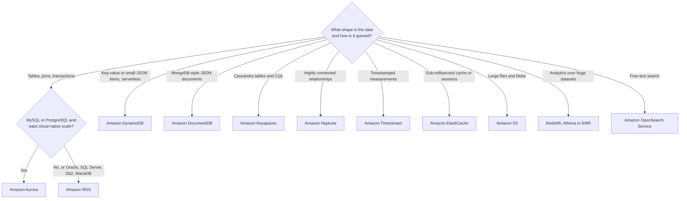
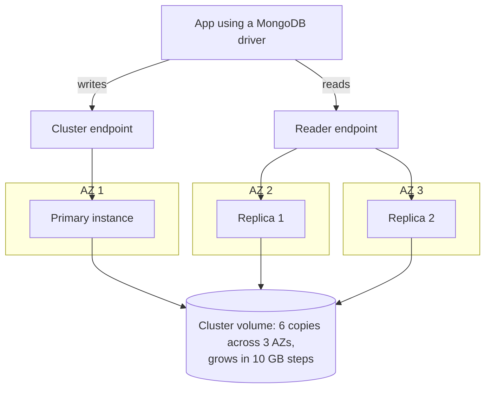
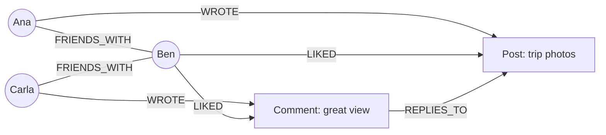
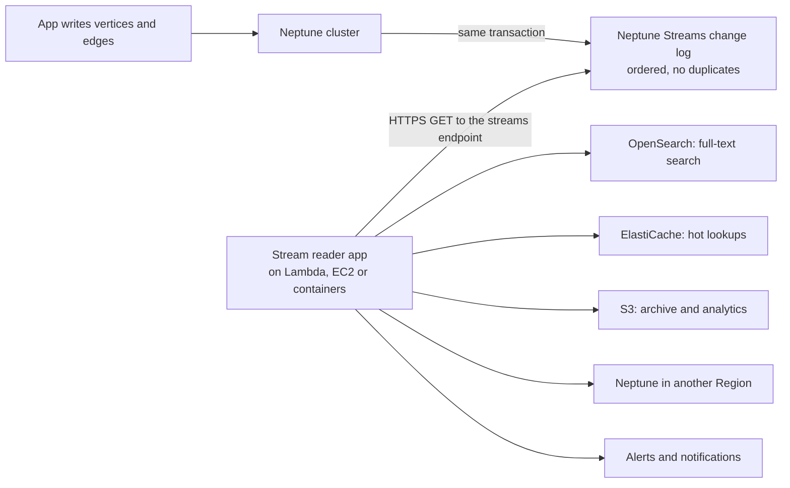
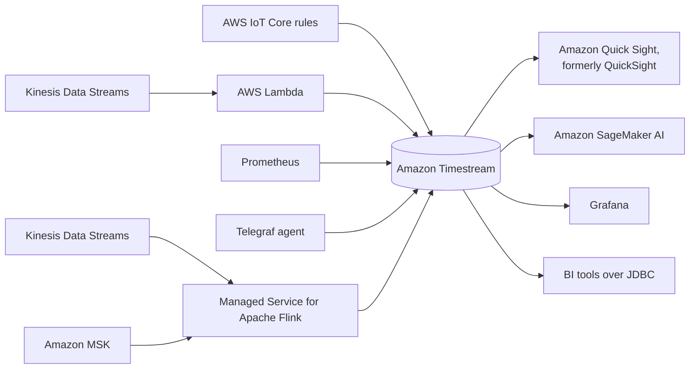

# Databases in AWS

## Summary

AWS does not offer "a database"; it offers a shelf of **purpose-built databases**, each tuned for one data shape and one access pattern. This lesson is about choosing between them. You pick **RDS or Aurora** for relational data with joins and transactions, **DynamoDB** for serverless key-value and small-document workloads at any scale, **ElastiCache** for sub-millisecond caching and sessions, **S3** for large objects, and a specialist when the data has a special shape: **DocumentDB** for MongoDB-style JSON documents, **Neptune** for highly connected graphs, **Keyspaces** for Apache Cassandra workloads, and **Timestream** for timestamped measurements. Analytics stores (Redshift, Athena, EMR, OpenSearch) are covered in the next lesson. On the exam, the winning answer is the service whose data model matches the scenario with the least operational overhead.

## Key concepts

- **Purpose-built databases**: match the engine to the data model and query pattern instead of forcing everything into one relational database.
- **OLTP vs OLAP**: many small transactions (RDS, Aurora, DynamoDB) versus big analytical scans (Redshift, Athena, EMR).
- **Relational (SQL)**: RDS for six engines, Aurora for MySQL/PostgreSQL compatibility with cloud-native storage; both are the only answers when you need **joins**.
- **Key-value / document NoSQL**: DynamoDB (serverless, items up to 400 KB), DocumentDB (MongoDB API), ElastiCache (in-memory).
- **Wide-column**: **Amazon Keyspaces** runs Cassandra Query Language (**CQL**) workloads serverlessly.
- **Graph**: **Amazon Neptune** stores vertices and edges and queries them with Gremlin, openCypher or SPARQL.
- **Neptune Streams**: an ordered, duplicate-free change log of the graph, read over an HTTPS REST API.
- **Time series**: **Amazon Timestream**; for new customers this now means **Timestream for InfluxDB**, because Timestream for LiveAnalytics closed to new customers on 20 June 2025.
- **Ledger**: Amazon QLDB reached **end of support on 31 July 2025**; AWS points ledger workloads to Aurora PostgreSQL.
- **Aurora-style architecture**: compute instances share one storage volume with **6 copies across 3 AZs**; DocumentDB and Neptune use the same design with up to **15 read replicas**.
- **35 days**: the maximum point-in-time recovery window for RDS, Aurora, DynamoDB, DocumentDB and Keyspaces.
- **Serverless options**: DynamoDB, Keyspaces, Timestream for LiveAnalytics and ElastiCache Serverless have no instances; Aurora, DocumentDB and Neptune have serverless capacity modes measured in capacity units.

## Choosing the right database

Before naming a service, an architect asks questions about the workload. Exam scenarios are written so that two or three of these answers point to exactly one service.

| Question | Why it matters | Example signal in a question |
|---|---|---|
| Is the workload read-heavy, write-heavy or balanced? Does it spike? | Read-heavy loads want caches and replicas; spiky loads want serverless or on-demand capacity | "traffic is unpredictable", "10x during flash sales" |
| How much data, how fast does it grow, how big is each record, how long is it kept? | Tiny items at huge scale suit DynamoDB; multi-GB files belong in S3; ageing data wants tiering | "items under 10 KB", "5 TB video files", "keep 7 years" |
| Is this the system of record? How durable must it be? | A cache can lose data; a source of truth cannot | "session data can be rebuilt" versus "financial records" |
| What latency and how many concurrent users? | Microseconds (DAX), sub-millisecond (ElastiCache), single-digit milliseconds (DynamoDB, Keyspaces) | "microsecond reads", "millions of users" |
| What is the data model and how will it be queried? | Joins and ad hoc SQL need relational; known access patterns suit NoSQL; relationships suit graphs | "complex joins", "friends of friends", "query by device and time range" |
| Strict schema or flexible? Reporting? Full-text search? | Fast-changing attributes suit document stores; reports suit a warehouse; search suits OpenSearch | "attributes change every sprint", "search product descriptions" |
| Are licence costs a problem? | Moving from commercial engines to Aurora or open-source engines removes licence fees | "reduce Oracle licensing costs" |

> [!EXAMPLE] Three requirements, three databases
> An online shop keeps orders, payments and stock in **Aurora PostgreSQL** because an order touches several tables in one transaction. The shopping cart and login sessions go to **DynamoDB** (or ElastiCache) because they are simple key lookups that must survive traffic spikes. The "customers who bought this also bought" feature runs on **Neptune**, because walking purchase relationships two or three hops deep is painful in SQL. One application, three purpose-built stores.

## Database families on AWS

| Family | How data is shaped and queried | AWS service | Typical use |
|---|---|---|---|
| Relational (SQL, OLTP) | Tables with a fixed schema, SQL, joins, ACID transactions | Amazon RDS, Amazon Aurora | Orders, accounts, ERP and CRM back ends |
| Key-value and document (NoSQL) | Items fetched by key; flexible attributes; no joins | Amazon DynamoDB | Serverless apps, carts, user profiles, gaming state |
| Document, MongoDB-compatible | JSON documents queried with the MongoDB API | Amazon DocumentDB | Content catalogs, MongoDB migrations |
| Wide-column | Rows grouped into partitions, queried with CQL | Amazon Keyspaces | Cassandra migrations, IoT device data at scale |
| In-memory key-value | Data held in RAM; no SQL | Amazon ElastiCache | Caching, sessions, leaderboards |
| Object store | Whole objects by key; huge sizes | Amazon S3, S3 Glacier classes | Media, backups, data lakes, archives |
| Data warehouse (OLAP) | Columnar storage, SQL over billions of rows | Amazon Redshift, Athena, EMR | BI dashboards, reporting |
| Search | Inverted indexes over JSON documents | Amazon OpenSearch Service | Full-text and fuzzy search, log analytics |
| Graph | Vertices and edges, graph traversal queries | Amazon Neptune | Social networks, fraud rings, knowledge graphs |
| Time series | Measurements keyed by time and source | Amazon Timestream | IoT telemetry, metrics, DevOps monitoring |
| Ledger | Append-only, cryptographically verifiable journal | Amazon QLDB (retired) | Historical exam answer only; see below |

> [!NOTE] OLTP versus OLAP
> **OLTP** (online transaction processing) means many short reads and writes of a few rows each: "insert this order, update that balance". **OLAP** (online analytical processing) means a few long queries that scan and aggregate millions of rows: "revenue by region for the last three years". Running heavy OLAP queries on an OLTP database slows down customers, which is why exam answers move reporting to Redshift, to Athena over S3, or at least to a read replica.

## Recap: the five core data stores

The earlier lessons covered these in depth. Here they are side by side as a decision aid, with the numbers that come up in questions.

| | RDS | Aurora | ElastiCache | DynamoDB | S3 |
|---|---|---|---|---|---|
| Model | Relational | Relational (MySQL, PostgreSQL compatible) | In-memory key-value | Key-value and document | Objects by key |
| Capacity | Pick instance class and EBS storage | Pick instances, or Aurora serverless | Pick node type, or ElastiCache Serverless | Provisioned (optional auto scaling) or on-demand | Nothing to provision |
| Scaling reads | Read replicas you add by hand (no replica auto scaling) | Up to 15 Aurora Replicas with replica auto scaling | Replicas and shards | Built in; DAX for microsecond reads | Built in |
| High availability | Multi-AZ standby or Multi-AZ DB cluster | Storage in 3 AZs by design; replicas promote | Multi-AZ with automatic failover | Multi-AZ by default; global tables | Multi-AZ by default (except One Zone classes) |
| Backups | Automated PITR up to 35 days plus manual snapshots | Same, plus cloning | Snapshots restored into a new cache (Valkey, Redis OSS, Serverless Memcached) | PITR up to 35 days plus on-demand backups | Versioning, replication |
| Pick it when | Relational app, any of six engines | Relational app wanting more performance, HA and features | Read-heavy cache or session store | Serverless app with known access patterns | Large files, static content, data lake |

### Amazon RDS

RDS runs **PostgreSQL, MySQL, MariaDB, Oracle, SQL Server and IBM Db2** for you. You still choose an instance class and an EBS storage type and size, but storage **auto scaling** can grow the volume when it fills. Availability comes from **Multi-AZ** deployments and read scaling from **read replicas**. Security layers are IAM (including **IAM database authentication**), security groups, KMS encryption at rest and TLS in transit, and passwords can live in **Secrets Manager**. Automated backups allow **point-in-time restore for up to 35 days**; manual snapshots are kept until you delete them, which suits long-term retention. Maintenance is managed but scheduled, and some patches cause downtime. **RDS Custom** (Oracle and SQL Server) gives you OS-level access when a vendor app needs it.

### Amazon Aurora

Aurora speaks the MySQL or PostgreSQL protocol but replaces the storage engine. **Compute and storage are separate**: every instance in a cluster reads one shared cluster volume that keeps **six copies of the data across three AZs**, repairs itself and grows automatically {{updated: The maximum cluster volume is now 256 TiB on recent engine versions (Aurora PostgreSQL 15.13+, 16.9+ and 17.5+, Aurora MySQL 3.10+); older versions stay at 128 TiB}}. A cluster has one writer and up to 15 readers, reached through a **writer (cluster) endpoint**, a **reader endpoint** and optional **custom endpoints**. Security, monitoring and maintenance work as in RDS.

Features worth recognising by name:

- **Backups and restores**: automated backups with PITR up to 35 days, manual snapshots, restoring always creates a new cluster, and **Backtrack** (Aurora MySQL) rewinds a cluster in place.
- **Database cloning**: a copy-on-write clone of a cluster, much faster and cheaper than restoring a snapshot, ideal for a staging copy of production.
- **Aurora serverless**: capacity measured in ACUs that scales with load, for unpredictable or intermittent workloads with no capacity planning (it can now scale to zero ACUs and pause when idle).
- **Aurora Global Database**: one primary Region and read-only secondary Regions, storage-level replication typically **under one second**, and up to **16 read replicas in each secondary Region** {{updated: Since May 2025 a global database can have up to 10 secondary Regions (previously 5)}}.
- **Aurora machine learning**: call ML services from SQL, for example sentiment analysis or fraud scores on rows {{updated: Amazon Bedrock is now supported alongside SageMaker AI and Amazon Comprehend}}.

### Amazon ElastiCache

ElastiCache is "RDS for caches": a managed in-memory store with **sub-millisecond** latency {{updated: Engines are now Valkey, Redis OSS and Memcached; Valkey is an open-source engine compatible with Redis OSS}}. You either pick a node type (for example a `cache.m6g.large`) and design the cluster, or use **ElastiCache Serverless** and let AWS size it. Valkey and Redis OSS support replicas, **cluster mode** sharding, **Multi-AZ** failover and backups; Memcached is a simple multi-threaded cache, and node-based Memcached clusters have no replication and no backups. A backup is a snapshot of the whole cache written to S3, taken on a daily schedule when automatic backups are turned on or manually on demand, and restoring it always creates a new cache {{updated: The course lists point-in-time restore for ElastiCache; AWS documents snapshot backup and restore only, with no restore to an arbitrary second. ElastiCache Serverless for Memcached can now be backed up too}}. Access is controlled with IAM, security groups, KMS, and AUTH tokens or role-based access control. The catch: the application must be changed to use it (for example the cache-aside pattern), and it has **no SQL**. Typical jobs are caching query results, holding web sessions and serving read-heavy key lookups.

### Amazon DynamoDB

DynamoDB is AWS's own **serverless NoSQL** database with **single-digit millisecond** latency. Tables use **provisioned** capacity (optionally with auto scaling) or **on-demand** capacity. Data is spread across AZs automatically, read and write capacity are independent, and **transactions** are supported. Other points:

- **DAX** is an in-memory read cache in front of a table for **microsecond** reads.
- **IAM** handles authentication and authorization; there are no database users.
- **DynamoDB Streams** (to Lambda) or **Kinesis Data Streams** capture item changes for event processing.
- **Global tables** give multi-Region, **active-active** replication {{updated: Global tables now offer multi-Region strong consistency (MRSC) as well as the default eventual consistency (MREC)}}.
- **PITR** restores to a new table from any second in the last 35 days {{updated: The recovery period is now configurable from 1 to 35 days}}; on-demand backups last until deleted.
- **Export to S3** works from any point in the PITR window **without consuming RCUs**, and **import from S3** creates a new table **without consuming WCUs**.
- With **TTL**, DynamoDB can replace ElastiCache as a session store; the flexible schema suits fast-evolving apps. Items are limited to 400 KB, so it fits small documents rather than files.

### Amazon S3 as a database

S3 is also a key-value store, where the key is the object name and the value is the object. It shines for **large objects** and is poor for millions of tiny, frequently updated records (per-request cost and latency add up). It is serverless, scales without limit, holds objects up to **50 TB**, and offers versioning, storage classes (Standard, Standard-IA, Intelligent-Tiering, Glacier classes) with lifecycle rules, replication, MFA Delete and access logs. Security uses IAM, bucket policies, ACLs, access points, CORS, Object Lock and (for Glacier vaults) Vault Lock; encryption options are SSE-S3, SSE-KMS, SSE-C, client-side and TLS in transit, with default encryption on every bucket. **S3 Batch Operations** and **S3 Inventory** handle bulk work; multipart upload and Transfer Acceleration help performance; **event notifications** reach SNS, SQS, Lambda and EventBridge.

> [!UPDATED] S3 Select and S3 Object Lambda closed to new customers
> The course lists S3 Select as a performance feature and Object Lambda as a security feature. S3 Select has not been available to new customers since 25 July 2024 (AWS suggests Athena or client-side filtering), and S3 Object Lambda has been limited to existing customers since 7 November 2025. Existing users keep them, and older exam questions may still mention them. The 50 TB object limit in the slides is itself recent: it rose from 5 TB in December 2025, so older practice material may still say 5 TB.

## Amazon DocumentDB

**Amazon DocumentDB (with MongoDB compatibility)** is to MongoDB what Aurora is to MySQL and PostgreSQL: an AWS implementation that speaks the MongoDB API, so existing MongoDB drivers, tools and code keep working, but runs on AWS's own cloud-native storage. MongoDB is a popular **document database**: each record is a JSON-like document with nested fields and arrays, documents in a collection need not share a schema, and you can index any field.

How it works, and why it feels like Aurora:

- A cluster has **one primary** (all writes) and **up to 15 replicas** (reads), with a reader endpoint that load-balances across them. If the primary fails, a replica in another AZ is promoted.
- Storage is a shared **cluster volume** with **six copies across three AZs**. It grows on its own in **10 GB increments** {{updated: The maximum is 128 TiB, or 256 TiB on engine version 8.0 and later}}; you never pre-provision disk.
- It runs only inside a **VPC**, supports encryption at rest with **KMS** (on by default for clusters created in the console, off by default from the CLI), and offers continuous backups with **PITR for up to 35 days**.
- Pricing has four parts: instance hours, I/O requests (or the I/O-Optimized storage configuration), storage, and backup storage beyond the free allowance.

| DocumentDB option | What you manage | Pick it when |
|---|---|---|
| Instance-based cluster | Instance class and count | Steady workloads; the classic, most common choice |
| Elastic cluster | Shard count and capacity; data is sharded for you | Millions of reads and writes per second or petabytes of data |
| DocumentDB serverless {{updated: Serverless instances (billed per DCU-hour, from 0.5 DCU) are a newer option than the slides}} | Minimum and maximum DCUs | Spiky, unpredictable or dev/test workloads |

> [!EXAMPLE] When DocumentDB is the answer
> A media company runs a self-managed MongoDB replica set on EC2 for its article catalog. Patching, backups and resizing disks take a day a month. The requirement is "migrate to a managed service with minimal code changes". DocumentDB fits: the app keeps its MongoDB driver and queries, storage grows by itself, and failover is automatic. DynamoDB would need the data access layer rewritten.

## Amazon Neptune

**Amazon Neptune** is a fully managed **graph database**. In a graph, entities are **vertices** (nodes) and relationships are **edges**, and both can carry properties. A social network is the classic example: users befriend users, users write posts, posts receive comments, users like posts and comments. Questions such as "which friends of my friends liked posts in my city?" are a few lines of graph query but a tangle of self-joins in SQL that gets slower with every hop.

Key facts:

- Built for **highly connected data**: it can hold **billions of relationships** and answer traversals in **milliseconds**.
- Same cluster design as Aurora: one primary plus **up to 15 read replicas** spread across AZs, a cluster volume replicated across AZs that grows to **128 TiB**, continuous backup to S3 and PITR.
- **Query languages**: it supports both graph models.

| Graph model | Query language | Typical users |
|---|---|---|
| Property graph | Apache TinkerPop **Gremlin** | Developers coming from TinkerPop, JanusGraph |
| Property graph | **openCypher** | Developers coming from Neo4j |
| RDF (W3C standard) | **SPARQL** | Knowledge graphs, linked data, ontologies |

- **Use cases**: knowledge graphs (Wikipedia-style linked facts), **fraud detection** (accounts sharing devices, cards or addresses), **recommendation engines**, social networking, network and IT security, drug discovery.
- **Options to recognise**: **Neptune Serverless** scales compute in Neptune Capacity Units; **Neptune Global Database** adds up to five read-only secondary Regions with replication typically under a second; **Neptune Analytics** is a separate in-memory engine for running graph algorithms over large graphs.
- It is **VPC-only** and requires TLS. There are no database user names or passwords: access is controlled by the network (security groups) and, optionally, IAM database authentication.

### Neptune Streams

**Neptune Streams** records every change to the graph as a log entry, written in the same transaction as the change itself. Once a transaction commits, its changes can be read straight away (readers may lag slightly behind the writer). The log is **strictly ordered**, contains **no duplicates** and misses nothing, so a consumer can rebuild the exact state of the graph. You turn it on per cluster in the DB cluster parameter group, and applications read it by calling the **streams HTTP REST endpoint** of the cluster. Entries are kept for **7 days by default** {{updated: Retention is configurable from 1 to 90 days with the neptune_streams_expiry_days parameter on engine 1.2.0.0 and later}}.

Use it to **notify** people or systems when specific changes happen (a new suspicious link between two accounts), to **keep another store in sync** with the graph (an OpenSearch index for text search, an ElastiCache copy for hot lookups, S3 for analytics), and to **replicate the graph to Neptune in another Region**. Note that there is no native trigger: Neptune Streams does not invoke Lambda for you, so the reader polls the endpoint.

## Amazon Keyspaces (for Apache Cassandra)

Cassandra, a free Apache project, is a distributed **wide-column** NoSQL database designed for huge write volumes across many nodes. Running it yourself means managing a ring of servers, repairs, compaction and upgrades. **Amazon Keyspaces** is a **serverless, Cassandra-compatible** service: you keep your CQL statements and Cassandra drivers, point them at the regional endpoint on port 9142 with TLS, and AWS runs everything else.

- **Serverless and elastic**: no nodes; tables scale up and down with traffic, and you pay for reads, writes and storage.
- **Durable**: every table is stored as **three copies across multiple AZs** in the Region.
- **CQL**: the same Cassandra Query Language, which looks like SQL but has **no joins**; you design one table per query pattern.
- **Performance**: single-digit millisecond latency while serving thousands of requests per second, with no throughput ceiling to plan around.
- **Security and recovery**: encryption at rest is always on, TLS is required, IAM controls access, and **PITR covers the last 35 days**.
- **Multi-Region replication**: optional active-active keyspaces across Regions, typically replicated in under a second.

| Capacity mode | How you pay | Pick it when |
|---|---|---|
| On-demand | Per read and write request unit actually used | New or unpredictable traffic {{updated: On-demand prices dropped by up to 56% (single-Region) in November 2024, so on-demand now competes with provisioned for most workloads}} |
| Provisioned (with auto scaling) | Per read and write capacity unit per hour | Steady, forecastable traffic |

A Cassandra **primary key** has two parts: a required **partition key** that decides where a row lives, and optional **clustering columns** that sort rows inside the partition. For a fleet of sensors, a table keyed by `device_id` with `reading_time` as a descending clustering column returns "the latest 100 readings of sensor 42" in one fast partition read. Asking for "all readings above 30 °C" across every device, on the other hand, is a full scan that CQL refuses unless you add `ALLOW FILTERING`. Keyspaces also has no `CREATE INDEX` and no materialized views, so a new access pattern usually means a second table keyed for it. That is the trade-off of all key-based NoSQL stores: very fast for the queries you designed for, poor at ad hoc ones.

Typical use cases are **IoT device data**, **time series**, messaging and activity feeds, and any **migration of an existing Cassandra cluster** that the team no longer wants to operate.

## Amazon Timestream

A **time series** is a sequence of measurements taken over time from a source: CPU usage of a server every 10 seconds, temperature from a sensor every minute, a stock price every tick. These workloads append huge volumes, almost never update, and mostly query recent data with time-window functions (averages per 5 minutes, gaps, interpolation). A relational database can store them, but it becomes slow and expensive at that scale; a purpose-built time series database is far more efficient (AWS markets Timestream as up to a thousand times faster at around a tenth of the cost of a relational database for this kind of data).

> [!UPDATED] Timestream now has two engines, and LiveAnalytics is closed to new customers
> The slides describe the original serverless engine, now called **Timestream for LiveAnalytics**. AWS closed it to new customers on **20 June 2025**; existing customers (and new users under an existing payer account) can keep using it. AWS recommends **Amazon Timestream for InfluxDB** for new workloads: managed open-source InfluxDB 2 instances, and since October 2025 also **InfluxDB 3** (Core and Enterprise editions, with data kept as Parquet in S3-based storage).

| | Timestream for LiveAnalytics | Timestream for InfluxDB |
|---|---|---|
| Availability | Existing customers only (since June 2025) | Open to everyone; the recommended choice for new projects |
| Operating model | Serverless, scales automatically | Managed instances (`db.influx.*` classes) with Multi-AZ option; InfluxDB 3 Enterprise runs multi-node clusters |
| Storage | **Memory store** for recent data, **magnetic store** for history, moved by retention policies you set | Instance storage up to 16 TiB (InfluxDB 2); S3-backed object storage (InfluxDB 3) |
| Query | SQL with built-in time series functions, scheduled queries, multi-measure records | InfluxDB APIs: Flux and InfluxQL (v2), SQL and InfluxQL (v3); Influx UI |
| Typical user | Teams that adopted it before June 2025 | Teams already using InfluxDB, Telegraf and Grafana, or new time series projects |

LiveAnalytics highlights from the course, still valid for existing users: it handles **trillions of events per day**, keeps recent data in fast memory and older data in cheaper storage while one query reads both, offers **scheduled queries** that pre-compute aggregates, stores several measures per record (**multi-measure records**), is **SQL compatible**, encrypts in transit and at rest, and replicates across at least three AZs.

Data arrives from **AWS IoT Core** rules, from **Kinesis Data Streams** through a Lambda function, from **Prometheus** and **Telegraf** collectors, or as aggregated streams from **Kinesis Data Streams or Amazon MSK** processed by **Managed Service for Apache Flink** (formerly Kinesis Data Analytics for Apache Flink). It is consumed by **QuickSight** dashboards {{updated: QuickSight now continues as Amazon Quick Sight, a feature of Amazon Quick; existing QuickSight APIs and integrations are unchanged, and exam questions may use either name}}, **SageMaker AI** models (for example anomaly detection), **Grafana** and any tool with a **JDBC** connection. Use cases: IoT applications, operational and DevOps monitoring, industrial telemetry and real-time analytics.

## Ledger databases: what happened to QLDB

A **ledger database** keeps an append-only journal where every change is recorded, nothing can be silently altered, and a cryptographic digest proves the history has not been tampered with. Amazon **Quantum Ledger Database (QLDB)** was AWS's service for this, owned by one central authority (unlike a blockchain, which is decentralised).

> [!UPDATED] Amazon QLDB has been shut down
> The course lists QLDB as the ledger database. AWS ended support for QLDB on **31 July 2025**, and it now appears on the AWS list of services in full shutdown. AWS's migration guidance points ledger-style workloads to **Aurora PostgreSQL** (using audit logging, history tables and Database Activity Streams). If an older practice question offers QLDB for "an immutable, verifiable history of every change with a central owner", recognise it as the historical answer, but do not design new systems on it.

## Putting it together: scenario cheat sheet

| Requirement in the question | Best fit |
|---|---|
| Relational data, joins, transactions, existing Oracle / SQL Server / Db2 app | Amazon RDS (RDS Custom if OS access is needed) |
| MySQL or PostgreSQL with higher performance, 15 low-lag replicas, fast failover, cross-Region reads | Amazon Aurora (Global Database for cross-Region) |
| Relational, spiky or intermittent traffic, no capacity planning | Aurora serverless |
| Serverless app, key-value access, millisecond latency at any scale | Amazon DynamoDB |
| Microsecond reads on top of DynamoDB | DynamoDB Accelerator (DAX) |
| Cache query results or store sessions, sub-millisecond | Amazon ElastiCache |
| Migrate MongoDB to a managed service with minimal code changes | Amazon DocumentDB |
| Social graph, fraud rings, recommendations, knowledge graph | Amazon Neptune |
| React to every graph change, keep a search index in sync | Neptune Streams |
| Migrate Apache Cassandra, keep CQL, no servers | Amazon Keyspaces |
| IoT or monitoring metrics over time, time-window queries | Amazon Timestream (for InfluxDB for new projects) |
| Large files, static assets, data lake | Amazon S3 |
| SQL analytics on petabytes, BI dashboards | Amazon Redshift (next lesson) |
| Full-text search over documents or logs | Amazon OpenSearch Service (next lesson) |

## Exam tips

> [!EXAM] Match the keyword to the engine
> "MongoDB" → **DocumentDB**. "Cassandra" or "CQL" → **Keyspaces**. "Graph", "relationships", "social network", "fraud ring", "knowledge graph" → **Neptune**. "Time series", "IoT telemetry", "metrics over time" → **Timestream**. "Joins" or "complex SQL" → **RDS or Aurora**. "Serverless NoSQL, key-value" → **DynamoDB**.

> [!EXAM] Compatible-with is the migration signal
> When a question says "migrate the existing X database with minimal application changes", choose the service that is compatible with X: Aurora for MySQL/PostgreSQL, DocumentDB for MongoDB, Keyspaces for Cassandra, Timestream for InfluxDB for InfluxDB, ElastiCache for Valkey/Redis OSS/Memcached.

- "Least operational overhead" plus unpredictable traffic → a **serverless** option: DynamoDB on-demand, Keyspaces on-demand, Aurora serverless, DocumentDB or Neptune serverless, ElastiCache Serverless.
- "Synchronise graph changes to OpenSearch / ElastiCache / S3" or "notify on graph changes" → **Neptune Streams**.
- "Microsecond latency" → **DAX** (DynamoDB) or an in-memory store; "sub-millisecond" → **ElastiCache**; "single-digit millisecond" → DynamoDB or Keyspaces.
- "Recover from accidental writes in the last few weeks" → **PITR**, up to **35 days** for RDS, Aurora, DynamoDB, DocumentDB and Keyspaces; longer retention → manual snapshots or AWS Backup.
- "Reduce commercial database licence costs" → move to **Aurora** or an open-source engine on RDS.
- "Read-only copies in several Regions with under-a-second lag" → **Aurora Global Database** (relational) or **DynamoDB global tables** (active-active NoSQL).

## Common traps

> [!TRAP] Picking DynamoDB for a MongoDB or Cassandra migration
> DynamoDB is a great NoSQL database, but it does not speak the MongoDB API or CQL. If the requirement stresses keeping existing code, drivers or query language, DocumentDB (MongoDB) or Keyspaces (Cassandra) is correct.

> [!TRAP] Forcing graph queries into a relational database
> "Find accounts linked through shared phone numbers up to four hops away" can be written in SQL with recursive joins, but it is slow and hard to maintain. When relationships are the point of the data, the exam expects Neptune.

> [!TRAP] Treating ElastiCache as a system of record
> A cache can lose data on node failure or eviction and has no SQL. Session data and computed results are fine there; orders and payments are not. If durability matters, the answer is a database (DynamoDB, Aurora), possibly with ElastiCache in front.

- **S3 is not a low-latency database for tiny records.** It suits big objects; millions of small, frequently updated items belong in DynamoDB.
- **Redshift is not for OLTP.** It is a columnar warehouse for analytics; transactional apps need RDS, Aurora or DynamoDB.
- **DocumentDB, Neptune and Keyspaces are not interchangeable.** Document, graph and wide-column are different data models with different query languages.
- **Neptune Streams does not trigger Lambda by itself.** A reader application must poll the streams endpoint.
- **QLDB and Timestream for LiveAnalytics** may appear in older material; know what they did, but remember QLDB is shut down and LiveAnalytics no longer accepts new customers.
- **Aurora replicas vs global secondaries**: up to 15 replicas in the primary Region, but up to 16 in each secondary Region of a global database.
