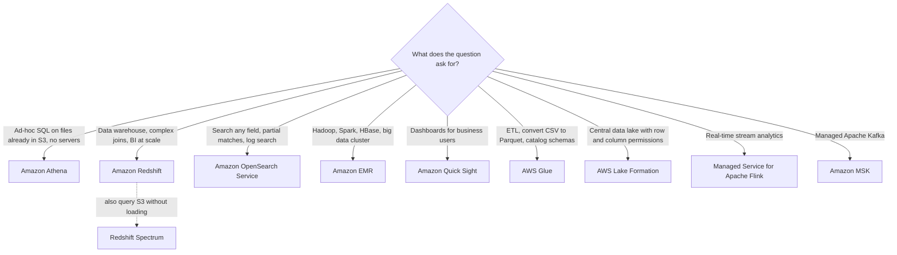
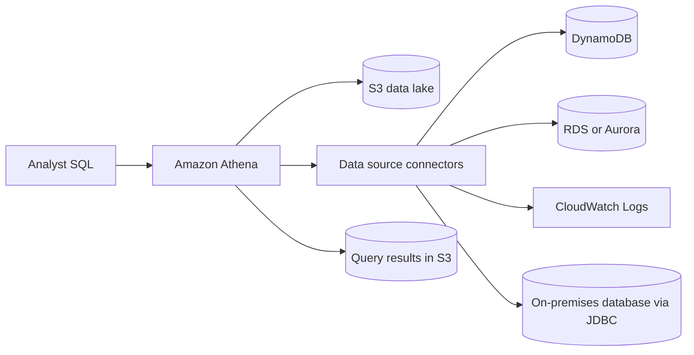
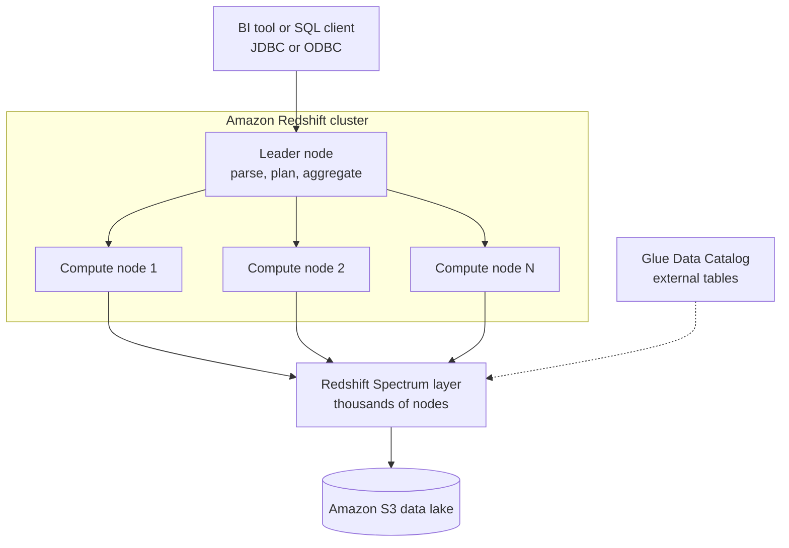
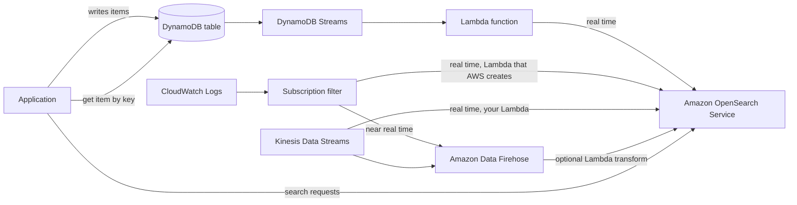
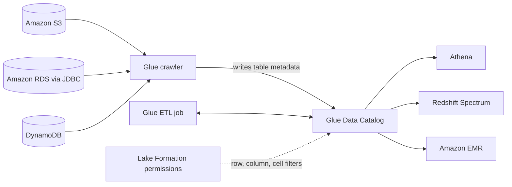
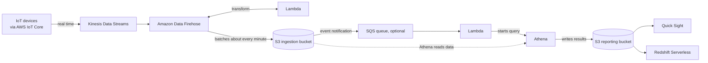

# Data & Analytics

## Summary

This lesson is a tour of the AWS analytics toolbox and, above all, of how to tell the tools apart in an exam scenario. **Amazon Athena** runs serverless SQL directly on files in Amazon S3 and bills per terabyte scanned. **Amazon Redshift** is the data warehouse: columnar, massively parallel, built for complex joins and aggregations over loaded data, with **Redshift Spectrum** to reach into S3 as well. **Amazon OpenSearch Service** gives full-text and partial-match search over any field, usually next to a primary database. **Amazon EMR** runs Hadoop and Spark clusters for big data processing. **Amazon Quick Sight** (formerly QuickSight) draws the dashboards. **AWS Glue** is serverless ETL plus the **Data Catalog** that Athena, Redshift Spectrum and EMR share, and **AWS Lake Formation** adds data lake setup and fine-grained permissions on top of it. For streams, **Amazon Managed Service for Apache Flink** processes Kinesis or Kafka data in real time, and **Amazon MSK** is managed Apache Kafka, the main alternative to Kinesis Data Streams. Pick by the question's verbs: *query files in S3* (Athena), *warehouse and BI* (Redshift), *search* (OpenSearch), *Hadoop/Spark* (EMR), *dashboards* (Quick Sight), *transform and catalog* (Glue), *govern a data lake* (Lake Formation), *stream processing* (Flink), *Kafka* (MSK).

## Key concepts

- **Athena** = serverless SQL over S3 (CSV, JSON, Parquet, ORC, Avro and more); you pay about **USD 5 per TB scanned**, so scan less.
- **Scan less** with **columnar formats** (Parquet, ORC), **compression**, **partitioning** (`year=2026/month=10/`) and fewer, larger files.
- **Athena Federated Query** uses **data source connectors** to query RDS, DynamoDB, Redshift, CloudWatch Logs, on-premises databases and more with one SQL statement.
- **Redshift** = **OLAP** data warehouse (not OLTP), **columnar** storage plus a **parallel query engine**; **provisioned** clusters or **Serverless**.
- A Redshift cluster has a **leader node** (plans queries, aggregates results) and **compute nodes** (do the work).
- Redshift **snapshots** are incremental, stored in S3, restore into a **new** cluster, and can be **copied to another Region** automatically for DR.
- Load Redshift with **large batches** (`COPY` from S3, Firehose), never row-by-row inserts; **Enhanced VPC Routing** keeps `COPY`/`UNLOAD` traffic inside your VPC.
- **Redshift Spectrum** queries S3 data **without loading it**, but needs a running Redshift cluster to start the query.
- **OpenSearch** = search any field, including partial matches; it complements a database rather than replacing it.
- **EMR** = managed Hadoop/Spark clusters on EC2; **primary**, **core** (stores HDFS data) and **task** nodes (compute only, ideal for **Spot**).
- **Quick Sight** = serverless BI dashboards; **SPICE** in-memory engine; users and groups live **inside the service**; **column-level security** in Enterprise edition.
- **Glue** = serverless ETL; **crawlers** fill the **Data Catalog**; **job bookmarks** stop reprocessing of old data.
- **Lake Formation** = build and govern a data lake on S3; **row-, column- and cell-level** permissions enforced across Athena, Redshift Spectrum, EMR, Glue and Quick Sight.
- **Managed Service for Apache Flink** reads from **Kinesis Data Streams** or **MSK**, never from Firehose.
- **MSK** = managed Kafka (brokers in your VPC across AZs, data kept as long as you configure); **MSK Serverless** removes capacity planning.

## The analytics map: which service for which job?

Analytics services overlap, so exam questions hinge on a few words. Think of data moving through four stages: it is **ingested** (Kinesis, MSK, Firehose, IoT Core), **stored** (S3 as the data lake, Redshift as the warehouse, OpenSearch as the search index), **processed** (Glue, EMR, Flink, Lambda) and finally **consumed** (Athena, Redshift SQL, Quick Sight).



| Need | Best fit | Why not the others |
|---|---|---|
| Occasional SQL over S3 logs (VPC Flow Logs, ALB logs, CloudTrail) | Athena | Nothing to provision; Redshift would sit idle most of the time |
| Hundreds of analysts running heavy joins every day | Redshift | Data is loaded, sorted and compressed on fast storage; Athena rereads files on every query |
| Join warehouse tables with years of cold data in S3 | Redshift + Spectrum | Keeps hot data in Redshift and leaves cold data in S3 |
| "Find products whose description contains *wireless*" | OpenSearch | DynamoDB and RDS can only filter efficiently on keys and indexes |
| Run existing Spark or Hive jobs | EMR (or Glue for serverless Spark ETL) | Athena is SQL only |
| Interactive dashboards with per-user security | Quick Sight | Athena and Redshift return results, not dashboards |

## Amazon Athena

### How Athena works

Athena is a **serverless, interactive query service**: you point a table definition at a prefix in S3, write standard SQL, and Athena reads the files in place. There is no cluster to size, start or stop. Tables and databases are just metadata, stored in the **AWS Glue Data Catalog**, so the same tables are visible to Glue, EMR and Redshift Spectrum.

- **Formats**: CSV, TSV, JSON, Parquet, ORC, Avro, Amazon Ion, plus log formats parsed with regex or Grok, and open table formats such as Apache Iceberg.
- **Pricing (SQL on S3)**: about **USD 5 per TB scanned** with per-query billing (rounded up to the nearest MB, with a 10 MB minimum per query), so cost is driven entirely by how many bytes each query reads. Cancelled queries are billed for the data scanned up to the cancellation; per the FAQ, failed queries are not charged. For steady, heavy use there is also **Capacity Reservations** (dedicated capacity billed per DPU-hour, USD 0.30 in the pricing examples) {{updated: Capacity Reservations are a newer alternative to per-TB billing}}.
- **Results** are written as files: traditionally to an S3 location you configure for the workgroup.
- **Typical uses**: BI and ad-hoc reporting (often with Quick Sight on top), and querying AWS logs that already land in S3, such as **VPC Flow Logs, ELB access logs, CloudTrail trails, CloudFront logs and S3 access logs**.

> [!UPDATED] Engine and results storage
> The slides describe Athena as built on Presto. **Athena engine version 3** follows both the **Trino** and Presto open-source projects (most of its function reference points to Trino). Athena can also store results for you: a workgroup set to **Athena managed** query results needs no S3 bucket, keeps results for **24 hours** at no extra cost, and then deletes them. The classic "results land in your S3 bucket" model still works and is what most exam questions assume.

**Workgroups** separate users, teams or applications. Each workgroup has its own results location and encryption settings, its own CloudWatch metrics, and optional **data usage controls** that cap how much a single query or the whole workgroup may scan, which is the standard answer to "stop analysts from running a USD 500 query by mistake".

### Making Athena faster and cheaper

Because you pay per byte scanned, every performance trick is also a cost trick.

| Technique | What it does | Example |
|---|---|---|
| **Columnar format** (Parquet or ORC) | Athena reads only the columns the query names, and file metadata lets it skip blocks | A query on 3 of 40 columns reads roughly 3/40 of the data |
| **Compression** (gzip, Snappy, zstd, bzip2, LZ4, ZLIB, LZO, DEFLATE) | Fewer bytes to fetch; you pay for compressed bytes | Pricing examples show about 3x savings from compression alone |
| **Partitioning** | Folder-style prefixes become virtual columns; a filter on them prunes whole folders | `s3://logs/app/year=2026/month=10/day=03/` and `WHERE year='2026' AND month='10'` |
| **Larger files** | Fewer objects to list and open; small-file overhead dominates for tiny files | Aim for files of at least about 128 MB rather than thousands of 1 KB objects |
| **Partition projection** | Athena computes partition locations from rules instead of looking them up in the catalog | Useful for tables with tens of thousands of date partitions |

Converting raw CSV or JSON into compressed, partitioned Parquet is usually done with **AWS Glue** ETL jobs, an Athena **CTAS** (`CREATE TABLE AS SELECT`) query, or Amazon Data Firehose's built-in format conversion when the data arrives as a stream.

> [!EXAMPLE] One question, two bills
> A table holds 1 TB of uncompressed CSV clickstream data for a year. A report for last Tuesday that touches 4 of 20 columns scans the full 1 TB in CSV: about USD 5. The same data as Snappy-compressed Parquet partitioned by day is roughly 250 GB in total, about 700 MB per day; the query reads one day's partition and only 4 of the 20 columns, roughly 140 MB, and costs well under a tenth of a cent.

### Federated Query

**Athena Federated Query** runs SQL across data that is *not* in S3: relational databases, NoSQL stores, object stores and custom sources, in AWS or on premises. It works through **data source connectors**. The classic connectors are **AWS Lambda functions** that translate Athena's requests into calls to the source (DynamoDB, CloudWatch Logs, RDS and Aurora engines, Redshift, DocumentDB, OpenSearch, HBase on EMR, Redis, JDBC databases and more). A single query can join, for example, an S3 data lake table with a DynamoDB table and an on-premises MySQL table, and the result is written to S3 like any other Athena result.



> [!UPDATED] Connectors no longer always mean Lambda
> Athena now has two connector types. **Athena data catalog connectors** still run as Lambda functions in your account (custom connectors built with the Query Federation SDK are this type). **AWS Glue Data Catalog federated connectors** use a Glue connection, support Lake Formation fine-grained permissions, and for several sources created on or after **21 April 2026** run without a Lambda function in your account. For the exam, "query RDS, DynamoDB and on-premises data together with SQL" still points to Athena Federated Query.

## Amazon Redshift

### A warehouse, not a transactional database

Redshift's SQL dialect descends from PostgreSQL, but it is built for **OLAP** (online analytical processing): scanning millions or billions of rows to compute aggregates, not for the many small reads and writes of an **OLTP** application. Two design choices make it fast:

- **Columnar storage**: each 1 MB block holds values from one column, so a query on 5 columns of a 100-column table reads about 5% of the data, and similar values compress very well.
- **Massively parallel processing (MPP)**: the work of one query is split across many nodes and slices that run at the same time.

It scales to petabytes, speaks SQL over JDBC and ODBC, and plugs into BI tools such as Quick Sight or Tableau. Compared with Athena, Redshift is the better choice for **frequent, complex queries, joins and aggregations** because the data is already loaded, compressed and organised on the cluster.

> [!UPDATED] Redshift does not use indexes
> The slides credit Redshift's speed over Athena to indexes. Redshift does not support traditional indexes at all; it gets its speed from columnar storage, compression, data distribution and **sort keys**. Each block carries min and max values, so a query filtered on the sort key (for example one month out of five years sorted by date) can skip most blocks.

### Cluster architecture: provisioned or serverless

A provisioned **cluster** has one **leader node** and one or more **compute nodes**. Clients connect to the leader, which parses the SQL, builds the execution plan, hands pieces to the compute nodes, and aggregates their partial results before returning them. You pay only for compute nodes; the leader comes free.



| | Provisioned cluster | Redshift Serverless |
|---|---|---|
| Capacity | You choose node type and count | Measured in **RPUs**; base capacity from **4** to 512 RPUs (1,024 in some Regions), default 128 |
| Scaling | Resize (elastic or classic), concurrency scaling, pause and resume | Scales automatically, with an optional AI-driven price-performance target |
| Billing | Per node-hour; **reserved nodes** (1 or 3 years) for steady use | Per RPU-hour while queries run, per-second billing with a 60-second minimum; about USD 0.375 per RPU-hour in us-east-1 |
| Best for | Predictable, always-on workloads | Spiky or intermittent workloads, getting started, dev and test |

> [!UPDATED] Node types and Serverless sizing
> Provisioned clusters now use **RG** (Graviton-based, with a built-in data lake query engine) or **RA3** nodes, both with **managed storage** that separates compute from storage and offloads to S3. DC2 nodes still exist for small datasets, and DS2 nodes are gone. Redshift Serverless can now start as small as **4 RPUs** (about USD 1.50 per hour of active compute in us-east-1), and new Serverless users may get a USD 300 trial credit valid for 90 days.

### Snapshots, Multi-AZ and disaster recovery

- **Snapshots** are point-in-time backups kept in S3 that Redshift manages. They are **incremental**: only changed data is saved.
- **Automated** snapshots run about every **8 hours or every 5 GB per node of changed data**, whichever comes first, or on a schedule you define. Retention defaults to 1 day and can be set from **1 to 35 days** (RA3 and RG cannot disable them).
- **Manual** snapshots are kept until you delete them (or for a retention period you set).
- Restoring a snapshot always creates a **new** cluster (or restores into a Serverless namespace). The cluster is usable before all data has streamed back.
- **Cross-Region snapshot copy**: configure Redshift to copy automated and manual snapshots to another Region automatically. If the primary Region fails, restore a new cluster from the copied snapshot there.
- **Multi-AZ** is available for **RA3 and RG** provisioned clusters: compute runs in two AZs behind one endpoint (billed at the regular RA3/RG hourly rates, with storage shared), and the SLA rises from 99.9% to 99.99%.

### Loading data: big batches win

Redshift is optimised for loading **large batches**. Inserting rows one at a time over JDBC is the slowest and most expensive option.

| Method | How it works | When |
|---|---|---|
| **`COPY` from S3** | Loads many files in parallel across all slices, using an IAM role attached to the cluster | The default for bulk loads; also loads from DynamoDB, EMR and remote hosts |
| **Amazon Data Firehose** | Buffers a stream into S3, then issues a `COPY` for you | Near-real-time loading of streaming data |
| **Streaming ingestion** | Redshift reads Kinesis Data Streams or MSK directly into a materialized view, with no S3 staging | Low-latency analytics on streams |
| **Zero-ETL integrations** | Managed replication from Aurora MySQL/PostgreSQL, RDS for MySQL/PostgreSQL/Oracle, DynamoDB and some SaaS apps | Analytics on operational data without building pipelines |
| **Application inserts (JDBC)** | Your code on EC2 inserts rows | Only for small volumes, and then in multi-row batches |

A `COPY` looks like this (role-based access, no keys in the SQL):

```sql
COPY customer
FROM 's3://amzn-s3-demo-bucket/customers/'
IAM_ROLE 'arn:aws:iam::111122223333:role/RedshiftLoadRole'
FORMAT AS PARQUET;
```

By default, `COPY` and `UNLOAD` traffic between the cluster and S3 goes over the internet path. **Enhanced VPC Routing** forces it through your **VPC**, so you can control it with VPC endpoints and endpoint policies, security groups, NACLs and NAT, and see it in VPC Flow Logs. It is the answer when a question says "load data from S3 into Redshift without traversing the public internet".

> [!UPDATED] Zero-ETL and streaming ingestion
> Neither appears on the slides. **Zero-ETL integrations** replicate operational databases (and DynamoDB) into Redshift continuously with no pipeline to maintain, and **streaming ingestion** lets Redshift consume Kinesis or MSK directly. Both are now common "least operational overhead" answers.

### Redshift Spectrum

**Redshift Spectrum** lets a Redshift cluster query files in S3 **without loading them**. You define **external tables** (in the Glue Data Catalog, Athena's catalog or a Hive metastore), and when a query touches them, the cluster pushes filtering and aggregation down to a **Spectrum layer** that can use thousands of nodes managed by AWS. You must **already have a Redshift cluster** to start the query, and for RA3 and DC2 clusters the cluster and the S3 bucket must be in the **same Region** {{updated: RG clusters and Redshift Serverless use their own data lake engine and can query S3 data in other Regions}}. Redshift cannot `UPDATE` or `DELETE` rows in external tables; it can only append to Parquet or text external tables with `INSERT INTO ... SELECT` {{updated: Writing to external tables with INSERT is a newer capability; older material calls Spectrum tables strictly read-only}}. Spectrum is billed per TB scanned (about USD 5), so the same Parquet and partitioning advice applies.

> [!NOTE] Spectrum on newer node types
> DC2 and RA3 clusters send data lake queries to the separate Spectrum fleet. **RG** clusters and **Redshift Serverless** run data lake queries on their own compute instead, so there is no separate per-TB Spectrum charge; you pay for the cluster or RPUs.

### Athena, Redshift or Spectrum?

| | Athena | Redshift (loaded tables) | Redshift Spectrum |
|---|---|---|---|
| Infrastructure | None (serverless) | Cluster or Serverless workgroup | Needs a Redshift cluster |
| Data location | S3 | Redshift managed storage | S3 |
| Cost model | Per TB scanned | Per node-hour or RPU-hour | Per TB scanned plus the cluster |
| Strength | Ad-hoc queries, log analysis, zero setup | Fast, complex, concurrent BI queries | Joining warehouse data with an S3 data lake |

## Amazon OpenSearch Service

**Amazon OpenSearch Service** is the successor to Amazon Elasticsearch Service (renamed in 2021; it still runs legacy Elasticsearch up to 7.10 as well as OpenSearch). Its job is **search and log analytics**. In DynamoDB you can query efficiently only by primary key or index; in OpenSearch you can search **any field**, including **partial and fuzzy matches**, rank results by relevance and build aggregations. That is why it is usually a **complement** to another database: the database stays the source of truth, and OpenSearch holds a searchable copy.

- **Two deployment modes**: **managed domains** (you pick instance types, counts, storage, Multi-AZ across two or three AZs, UltraWarm and cold tiers) or **OpenSearch Serverless** collections (search, time series or vector search) that scale in OpenSearch Compute Units.
- **Query languages**: the native JSON query DSL, plus **SQL** and **PPL** through the SQL plugin, which comes with managed domains (running OpenSearch, or Elasticsearch 6.5 and later), so nothing needs to be installed.
- **Ingestion**: Amazon Data Firehose, AWS IoT, CloudWatch Logs subscriptions, Lambda, and **OpenSearch Ingestion** (managed Data Prepper pipelines).
- **Security**: IAM, Amazon Cognito or SAML for Dashboards sign-in, fine-grained access control (index, document and field level), KMS encryption at rest, TLS in transit, VPC access.
- **Visualization**: **OpenSearch Dashboards** is included.

> [!UPDATED] SQL is built in, and ingestion got easier
> The slides say SQL is not native and needs a plugin. On OpenSearch Service domains the SQL plugin is already part of the service, so SQL and PPL queries work out of the box (OpenSearch Serverless supports a subset of plugins). **OpenSearch Ingestion** and the **DynamoDB zero-ETL integration** (an initial export to S3, then DynamoDB Streams, with no custom Lambda code) are newer, lower-effort options than the hand-built patterns below.

### Common ingestion patterns



- **DynamoDB + OpenSearch**: the app writes to DynamoDB; a stream triggers Lambda, which indexes each change in OpenSearch. Users *search* in OpenSearch, get back item IDs, then *fetch* the full items from DynamoDB.
- **CloudWatch Logs**: a subscription filter sends log events either to a Lambda function that the CloudWatch console creates for you (real time) or to Firehose (near real time, buffered).
- **Kinesis**: Kinesis Data Streams → Firehose (optionally transformed by Lambda) → OpenSearch for near real time; or Kinesis Data Streams → your Lambda → OpenSearch for real time.

## Amazon EMR

**Amazon EMR** (originally Elastic MapReduce) creates and manages **big data clusters** running Apache Hadoop and its ecosystem: **Spark, Hive, HBase, Presto, Trino, Flink**, plus table formats like Hudi and Iceberg. A cluster can have hundreds of EC2 instances; EMR handles provisioning, configuration, scaling (including **managed scaling**) and integration with **Spot Instances**. Use cases: large-scale data processing and ETL, machine learning on big datasets, web indexing, log processing.

### Node types and purchasing options

| Node type | Role | Typical purchasing |
|---|---|---|
| **Primary** node {{updated: EMR now calls the master node the primary node}} | Coordinates the cluster, tracks task status and cluster health; long-running | On-Demand (or Reserved) |
| **Core** node | Runs tasks **and stores data in HDFS**; long-running | On-Demand or Reserved; losing one loses HDFS data |
| **Task** node (optional) | Runs tasks only, stores no HDFS data | **Spot**: interruptions cost compute, not data |

- **On-Demand**: reliable, never reclaimed, highest price.
- **Reserved** (1 or 3 years): EMR uses matching reservations automatically.
- **Spot**: much cheaper but can be interrupted; perfect for task nodes. **Instance fleets** let you mix instance types and On-Demand/Spot targets per node type.
- **Long-running** clusters serve many jobs; **transient** clusters start, run their steps and **auto-terminate**, which is usually cheapest for scheduled batch jobs because data lives in S3, not on the cluster.

> [!UPDATED] Three ways to run EMR
> Besides **EMR on EC2** (the cluster model above), there is **EMR on EKS** (submit Spark jobs to an existing Kubernetes cluster) and **EMR Serverless** (run Spark or Hive jobs with no cluster to configure; workers scale per job). If a question says "Spark jobs, no cluster management", consider EMR Serverless or AWS Glue.

## Amazon Quick Sight

> [!UPDATED] QuickSight is now Amazon Quick Sight, part of Amazon Quick
> In October 2025 QuickSight became part of a wider AI workspace, now called **Amazon Quick**, which adds agents, research and automation. The BI part continues as **Amazon Quick Sight**, and the QuickSight APIs and integrations keep working. Exam questions may still say "QuickSight".

Quick Sight is a **serverless, machine-learning-powered business intelligence** service for **interactive dashboards**: business analytics, visualizations, ad-hoc analysis and insights, which you can also **embed** in your own applications.

- **Data sources**: AWS services (Athena, Redshift and Spectrum, RDS, Aurora, S3, OpenSearch, Timestream, Glue Data Catalog via Athena), SaaS apps (Salesforce, Jira, ServiceNow, GitHub, Adobe Analytics), files (CSV, TSV, JSON, Excel, and **ELF/CLF** log formats) and databases on premises or on EC2 (MySQL, PostgreSQL, SQL Server, Oracle, Teradata, Snowflake and more).
- **SPICE** (Super-fast, Parallel, In-memory Calculation Engine): data imported into a dataset is held in memory, so dashboards are fast and you don't pay a per-query source (such as Athena) every time someone opens one. SPICE capacity is per Region and can be purchased as an add-on.
- **Enterprise edition** adds **column-level security** (CLS) and row-level security, plus encryption of SPICE data at rest.
- **Users and groups** are managed **in the Quick Sight account**, not as IAM users and groups; you share assets with those users and groups.
- An **analysis** is the workspace where authors build visuals. Publishing it produces a **dashboard**: a frozen, **read-only** copy that keeps the analysis's filters, parameters, controls and sort order. Only published dashboards can be shared (analyses can be shared with co-authors too), and anyone who can open a dashboard can also see the data underneath it.
- **Pricing**: per-user subscriptions. For organisations, the **Professional** plan is USD 20 and the **Enterprise** plan USD 40 per user per month, plus a USD 250 per month infrastructure fee per account; extra SPICE capacity costs USD 0.38 per GB-month {{updated: The slides mention per-session pricing; the current Amazon Quick pricing page is built on these per-user plans, and individuals can also sign up for Free, Plus and Max plans}}.

## AWS Glue

### Serverless ETL

**AWS Glue** is a fully **serverless** data integration service: **extract** data from sources such as S3, RDS, JDBC databases and DynamoDB, **transform** it (clean, join, change types, convert formats) and **load** it into targets such as an S3 data lake or Redshift. Jobs run on a managed Apache Spark engine (or Python shell or Ray), billed per DPU-hour per second with a 1-minute minimum: USD 0.44 in us-east-1 for Spark jobs on Glue 5.1 and earlier, about 30% less on Glue 6.0. Crawlers are also billed at USD 0.44 per DPU-hour per second, but every crawler run is charged for at least 10 minutes, so a crawl that finishes in one minute still costs ten.

> [!UPDATED] Glue versions
> **Glue 6.0** (August 2026) moves to Spark 4.1 and Python 3.13, and AWS cut the price of its Spark jobs by 30% (about USD 0.31 per DPU-hour). **Glue 5.1** is still the version a job gets when it doesn't name one, and Glue 0.9, 1.0 and 2.0 reached end of life on 1 April 2026. None of this changes how exam questions use Glue.

A classic exam pattern: **convert CSV to Parquet so Athena scans less**. New CSV files land in an input bucket; an S3 event notification (or EventBridge) triggers a Lambda function that starts a Glue job; the job writes Parquet to an output bucket that Athena queries.

### Data Catalog and crawlers

The **AWS Glue Data Catalog** is the central metadata store: databases and tables that describe data location, format and schema. **Crawlers** scan data stores (S3, JDBC databases including RDS, DynamoDB and more), infer schemas and partitions, and write table definitions into the catalog. The catalog itself holds no data, only metadata. Athena, **Redshift Spectrum** and **EMR** all use it, and Glue ETL jobs read and write through it.



### Other Glue features worth recognising

| Feature | What it does | Exam signal |
|---|---|---|
| **Job bookmarks** | Remember what a job already processed (new S3 files, new JDBC rows) | "Avoid reprocessing old data on each run" |
| **Glue Studio** | Visual editor to build, run and monitor ETL jobs | "Create ETL jobs without writing code" |
| **Glue DataBrew** | Visual data preparation with hundreds of built-in transformations | "Analysts clean and normalise data with no code" |
| **Streaming ETL** | Spark Structured Streaming jobs reading Kinesis Data Streams, Apache Kafka or MSK | "Transform streaming data continuously with Glue" |
| **FindMatches** (ML transform) | Finds duplicate or near-duplicate records | "Deduplicate customer records that don't match exactly" |
| **Flex execution** | Cheaper runs on spare capacity for non-urgent jobs | "Lowest cost for jobs that can start later" |

## AWS Lake Formation

A **data lake** is one central place, usually Amazon S3, that holds all your data (structured and unstructured) for analytics. Building one by hand means collecting, cleaning, moving and cataloguing data, then securing it per table and column. **AWS Lake Formation** is a managed service, **built on top of AWS Glue**, that shortens that work to days and, above all, **centralises permissions**:

- **Blueprints** create Glue workflows (crawlers, jobs, triggers) that ingest data from JDBC databases (snapshot or incremental) and from log sources.
- Cleansing and deduplication come from Glue (including the FindMatches ML transform).
- **Fine-grained access control** at the database, table, **column, row and cell** level, granted with a simple grant/revoke model and enforced across **Athena, Redshift Spectrum, EMR, Glue and Quick Sight**.
- **LF-Tags** (tag-based access control) scale permissions to thousands of tables, and **cross-account sharing** shares tables with other accounts or organizations.
- Audit of data access through CloudTrail.

> [!EXAMPLE] Centralised permissions
> Sales data from S3, RDS and Aurora is ingested into the lake. Analysts in Quick Sight and Athena should see orders but not the `credit_card` column, and EU analysts only EU rows. Instead of writing separate S3 bucket policies, IAM policies and database grants for each tool, the data team defines one Lake Formation data filter (column exclusion plus a row filter) and every integrated engine enforces it.

## Amazon Managed Service for Apache Flink

**Apache Flink** is an open-source framework for processing data streams with low latency and state. **Amazon Managed Service for Apache Flink** (formerly *Kinesis Data Analytics for Apache Flink*) runs your Flink applications (Java, Scala, Python or SQL, with **Studio notebooks** for interactive SQL) on managed infrastructure: it provisions compute, runs work in **parallel**, **scales automatically**, and backs up application state with **checkpoints and snapshots** so a failed application restarts from its last checkpoint instead of losing state. Any Flink feature (windows, joins, stateful functions) is available.

- **Sources**: **Kinesis Data Streams** and **Amazon MSK** (or other Kafka). **It does not read from Amazon Data Firehose.** Firehose can be a *destination* (sink) of a Flink application, not a source.
- **Typical uses**: real-time dashboards and metrics, anomaly detection, streaming ETL with enrichment, sliding-window aggregations.

> [!NOTE] The SQL-only flavour is gone
> The older *Kinesis Data Analytics for SQL Applications* stopped accepting new applications in October 2025 and was removed in January 2026. If you see it as an answer option, treat it as legacy; the current service is Managed Service for Apache Flink.

## Amazon MSK (Managed Streaming for Apache Kafka)

### Kafka in one paragraph

Apache Kafka is an open-source distributed log. **Producers** (your code, or connectors pulling from IoT, databases, Kinesis and so on) **write** records to a **topic**. A topic is split into **partitions** spread over **brokers**, and each partition is **replicated** to other brokers for durability. **Consumers** **poll** the topic and process records at their own pace, then send results onward (EMR, S3, SageMaker AI, Kinesis, RDS...). Records stay for the configured retention, so consumers can replay.

### What MSK manages for you

**Amazon MSK** is fully managed Kafka and the main **alternative to Kinesis Data Streams**, especially for teams that already use Kafka APIs and tools.

- MSK **creates, updates and deletes clusters**, runs the **broker** nodes and the metadata layer, **deploys into your VPC** across **two or three AZs** (three recommended for high availability), and **recovers automatically** from common broker failures.
- Data is kept on broker storage (**EBS** for Standard brokers, with optional low-cost tiered storage) **for as long as you configure**, unlike Kinesis's maximum of 365 days.
- **MSK Serverless** runs Kafka without capacity planning: MSK provisions and scales compute and storage, and you pay for throughput. It requires IAM access control.
- **MSK Connect** runs Kafka Connect connectors; **MSK Replicator** copies topics across clusters and Regions.

> [!UPDATED] Express brokers and KRaft
> MSK Provisioned now offers **Express brokers** (storage that needs no provisioning and grows as you use it, up to 3x the throughput per broker and up to 20x faster scaling than Standard brokers, three-AZ only). Clusters on Kafka 3.7 and later can use **KRaft** mode, where metadata lives in Kafka controllers instead of separate ZooKeeper nodes, at no extra cost, and existing ZooKeeper clusters can be migrated to KRaft. Kafka 4.x itself no longer supports ZooKeeper, so the slides' "MSK creates ZooKeeper nodes for you" now applies only to ZooKeeper-mode clusters on 3.x versions.

**Consumers of MSK** include Managed Service for Apache Flink, **Glue streaming ETL jobs** (Spark Structured Streaming), **Lambda** (event source mapping), Amazon Data Firehose, Redshift streaming ingestion, and your own applications on EC2, ECS or EKS.

### Kinesis Data Streams vs Amazon MSK

| | Kinesis Data Streams | Amazon MSK |
|---|---|---|
| Model | Streams made of **shards** | Kafka **topics** made of **partitions** |
| Record size | 1 MiB by default, configurable up to **10 MiB** {{updated: Kinesis raised its per-record maximum to 10 MiB in October 2025, so larger messages alone no longer force a move to Kafka}} | About 1 MB Kafka default, raised via configuration; MSK Serverless caps messages at 8 MiB |
| Scaling | Split and merge shards, or on-demand mode | Add partitions to a topic (cannot remove them), add brokers |
| Encryption in transit | TLS | TLS, or PLAINTEXT if you allow it |
| Encryption at rest | KMS | KMS |
| Retention | 24 hours to 365 days | As long as you configure, including unlimited with tiered storage |
| API | AWS-proprietary (KPL, KCL, SDK) | Open-source Kafka APIs, existing Kafka tools |

## Putting it together: a serverless big data ingestion pipeline

Requirements that appear together in many scenarios: the pipeline must be **fully serverless**, collect data **in real time**, **transform** it, make it **queryable with SQL**, store **reports in S3**, and feed a **warehouse and dashboards**.



How each piece earns its place:

- **AWS IoT Core** collects messages from devices and can route them into Kinesis.
- **Kinesis Data Streams** captures data in real time and buffers bursts.
- **Firehose** delivers to S3 in near real time (the classic answer is "about a minute"; buffering can now go as low as zero seconds for most destinations) and can call **Lambda** to transform records on the way.
- **S3 event notifications** fire on each new object, either to **SQS** (which absorbs spikes) and then Lambda, or straight to Lambda.
- **Lambda** runs an **Athena** query; Athena is serverless SQL and writes its results to S3.
- The **reporting bucket** holds analysed data that **Quick Sight** visualises directly or that **Redshift Serverless** loads for warehouse workloads.

## Exam tips

> [!EXAM] Serverless SQL on S3
> "Analyze data in S3 with SQL, no infrastructure", "query VPC Flow Logs, ALB logs or CloudTrail logs ad hoc", "pay only for queries" → **Amazon Athena**.

> [!EXAM] Cut Athena cost
> "Athena queries are slow and expensive" → convert to **Parquet or ORC**, **compress**, **partition** by the columns you filter on, and combine small files into bigger ones. "Convert data to Parquet" → **Glue ETL job** (or Firehose format conversion for streams, or Athena CTAS).

- "Query data across RDS, DynamoDB and on-premises databases with one SQL statement" → **Athena Federated Query**.
- "Data warehouse", "OLAP", "complex joins and aggregations", "BI tools over petabytes" → **Redshift**.
- "Query S3 data from Redshift without loading it" or "join warehouse tables with data lake files" → **Redshift Spectrum**.
- "Redshift DR in another Region" → **automated cross-Region snapshot copy**, restore a new cluster in the DR Region. "Redshift survives an AZ failure" → **Multi-AZ** (RA3/RG).
- "Load S3 data into Redshift privately" → **`COPY` with Enhanced VPC Routing** (plus an S3 gateway endpoint). "Insert data efficiently" → large batches, never single-row inserts.
- "Replicate Aurora or DynamoDB into Redshift with no ETL pipeline" → **zero-ETL integration**.
- "Search by any field", "partial text match", "full-text search next to DynamoDB" → **OpenSearch** fed by DynamoDB Streams (or the zero-ETL integration).
- "Hadoop", "Spark cluster", "HBase", "migrate on-premises big data jobs" → **EMR**; cheapest compute for task nodes → **Spot**.
- "Interactive dashboards", "BI for business users", "embed analytics in an app" → **Quick Sight**; "restrict which columns a dashboard user sees" → **column-level security (Enterprise)**.
- "Crawl S3 to discover schemas", "central metadata catalog for Athena, EMR and Spectrum" → **Glue crawler + Data Catalog**. "Don't reprocess old files" → **job bookmarks**.
- "Set up a data lake quickly", "row- and column-level permissions across analytics services", "share data lake tables across accounts" → **Lake Formation**.
- "Real-time analytics on Kinesis Data Streams or MSK with SQL, Java or Python" → **Managed Service for Apache Flink**.
- "Existing Kafka applications", "open-source Kafka APIs", "keep stream data longer than 365 days" → **Amazon MSK**.

## Common traps

> [!TRAP] Redshift for OLTP
> Redshift speaks SQL and descends from PostgreSQL, but it is an analytics warehouse. A transactional app with many small reads and writes belongs on RDS, Aurora or DynamoDB.

> [!TRAP] Spectrum without a cluster
> Redshift Spectrum is a feature of Redshift: it needs a Redshift cluster (or Serverless workgroup) to run the query. "Query S3 with SQL and no infrastructure at all" is Athena.

> [!TRAP] Flink reading from Firehose
> Managed Service for Apache Flink reads from Kinesis Data Streams or Kafka/MSK. An architecture that sends Firehose output into Flink is wrong; Firehose is a delivery service, and it can be Flink's sink.

- **OpenSearch as the primary database**: it is a search index next to a source-of-truth database, not a replacement for DynamoDB or RDS.
- **Quick Sight permissions are not IAM permissions**: dashboards are shared with Quick Sight users and groups; a dashboard must be **published** before it can be shared, and its viewers can see the underlying data.
- **Core nodes on Spot**: losing a core node loses HDFS data. Put **task** nodes on Spot, keep primary and core nodes On-Demand or Reserved.
- **Restoring a Redshift snapshot** never overwrites the existing cluster; it creates a new one.
- **Glue Data Catalog stores metadata only**; the data stays in S3 or the source database.
- **Partitioning too finely** (by hour or by user ID) creates millions of tiny files and slows Athena; partition by what most queries filter on.
- **Kinesis vs MSK on message size**: the old "1 MB Kinesis limit, so choose MSK for big messages" reasoning is outdated now that Kinesis accepts records up to 10 MiB; choose MSK for Kafka compatibility, unlimited retention or partition-level control.
- **Legacy names**: "Kinesis Data Analytics" and "Amazon Elasticsearch Service" in answer options map to Managed Service for Apache Flink and Amazon OpenSearch Service.
