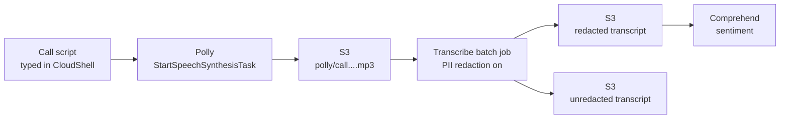

> [!COST]
> Nothing here runs by the hour. Polly bills per character synthesized, Transcribe per second of audio (no minimum) plus a per-minute add-on for PII redaction, and Comprehend per 100-character unit. Expect a few US cents at most. Accounts created on or after 15 July 2025 pay from their sign-up credits; older accounts in their first 12 months have monthly Polly and Transcribe allowances (for example 60 Transcribe minutes). The S3 bucket, the lexicon and the transcription jobs stay until you remove them in **Cleanup**.

This lab builds the "speech in, speech out" half of the AWS AI toolbox. Polly turns text into audio, Transcribe turns audio back into text, and you will see the features exam questions like to test: lexicons versus SSML, engine-specific tags, and PII redaction that cannot be combined with automatic language identification.



## Prerequisites

- An AWS account and an IAM user or role allowed to use Polly, Transcribe, Comprehend and S3 (for a sandbox: `AmazonPollyFullAccess`, `AmazonTranscribeFullAccess`, `ComprehendFullAccess` and `AmazonS3FullAccess`). Polly and Transcribe write to your bucket with **your** permissions, so the identity needs `s3:PutObject` and `s3:GetObject` on it.
- Region **US East (N. Virginia) `us-east-1`**: it offers all four Polly engines and batch PII redaction (redaction is available only in some Regions).
- **AWS CloudShell** opened in its own browser tab so that **Actions** → **Download file** is available for listening to the MP3 files on your computer. It already has AWS CLI v2 and `jq`.
- Headphones or speakers.

Set these variables in CloudShell first; every CLI tab reuses them.

```bash
REGION=${AWS_REGION:-$(aws configure get region)}
ACCOUNT_ID=$(aws sts get-caller-identity --query Account --output text)
BUCKET="speech-lab-$ACCOUNT_ID-$REGION"
echo "$REGION $BUCKET"
```

## Steps

### Step 1: Create a bucket for the audio and transcripts

:::console
1. Open the **S3** console and choose **Create bucket**.
2. Keep **General purpose**, enter a globally unique name such as `speech-lab-<account-id>-<region>`, keep **Block all public access** turned on and the other defaults, and choose **Create bucket**.
:::

:::cli
```bash
aws s3 mb "s3://$BUCKET"
aws s3 ls | grep speech-lab
```
:::

> [!CHECK]
> The bucket appears in the list. It will hold the Polly output under `polly/` and the Transcribe output under `transcribe/`.

### Step 2: Hear the difference between the standard and neural engines

:::console
1. Open the **Amazon Polly** console. The **Text-to-Speech** page opens.
2. Under **Engine**, choose **Neural**. Set **Language** to **English, US** and **Voice** to **Joanna**.
3. Replace the sample text with: `Your order has shipped and should arrive on Thursday afternoon.` and choose **Listen**.
4. Change **Engine** to **Standard**, keep the same voice and text, and choose **Listen** again.
:::

:::cli
```bash
LINE="Your order has shipped and should arrive on Thursday afternoon."
aws polly synthesize-speech --engine neural --voice-id Joanna \
  --output-format mp3 --text "$LINE" neural.mp3
aws polly synthesize-speech --engine standard --voice-id Joanna \
  --output-format mp3 --text "$LINE" standard.mp3
ls -l neural.mp3 standard.mp3
# Listen: Actions > Download file > /home/cloudshell-user/neural.mp3 (then standard.mp3)
```
:::

> [!CHECK]
> The neural version sounds smoother and more human; the standard one is more mechanical. The neural request costs four times as much per character (USD 16 versus USD 4 per million), which is the trade-off behind engine choice. Both requests returned audio immediately: `SynthesizeSpeech` is the real-time API, limited to 3,000 billed characters per request.

### Step 3: Fix pronunciation everywhere with a lexicon

A lexicon changes how a word is read in every request that references it, without touching your text. You will teach Polly a stylized brand name and an acronym.

First create the lexicon file. In CloudShell run the block below (for the console path, also download the file to your computer with **Actions** → **Download file** → `/home/cloudshell-user/labterms.pls`).

```bash
cat > labterms.pls <<'EOF'
<?xml version="1.0" encoding="UTF-8"?>
<lexicon version="1.0"
  xmlns="http://www.w3.org/2005/01/pronunciation-lexicon"
  xmlns:xsi="http://www.w3.org/2001/XMLSchema-instance"
  xsi:schemaLocation="http://www.w3.org/2005/01/pronunciation-lexicon
    http://www.w3.org/TR/2007/CR-pronunciation-lexicon-20071212/pls.xsd"
  alphabet="ipa" xml:lang="en-US">
  <lexeme>
    <grapheme>Byt3Wise</grapheme>
    <alias>Bytewise</alias>
  </lexeme>
  <lexeme>
    <grapheme>IaC</grapheme>
    <alias>infrastructure as code</alias>
  </lexeme>
</lexicon>
EOF
```

:::console
1. In the Polly console choose **Lexicons** in the navigation pane, then **Upload lexicon**.
2. Enter the name `labterms`, use **Choose a lexicon file** to select `labterms.pls`, and choose **Upload lexicon**.
3. Go back to **Text-to-Speech**, choose **Engine** **Neural** and voice **Joanna**, and enter: `Byt3Wise teaches IaC to new cloud engineers.`
4. Choose **Listen** and note how the two terms sound.
5. Expand **Additional settings**, turn on **Customize pronunciation**, choose **labterms** from the list, and choose **Listen** again.
:::

:::cli
```bash
aws polly put-lexicon --name labterms --content file://labterms.pls
aws polly list-lexicons --query 'Lexicons[].[Name,Attributes.LanguageCode,Attributes.LexemesCount]' --output table

TERMS="Byt3Wise teaches IaC to new cloud engineers."
aws polly synthesize-speech --engine neural --voice-id Joanna \
  --output-format mp3 --text "$TERMS" no-lexicon.mp3
aws polly synthesize-speech --engine neural --voice-id Joanna \
  --output-format mp3 --lexicon-names labterms --text "$TERMS" with-lexicon.mp3
```
:::

> [!CHECK]
> `list-lexicons` shows `labterms` with language `en-US` and 2 lexemes. Without the lexicon Polly stumbles over "Byt3Wise" and reads "IaC" as letters or a made-up word; with it you hear "Bytewise teaches infrastructure as code". A lexicon only applies when its `xml:lang` matches the voice's language, and a request can reference up to five lexicons.

### Step 4: Control delivery with SSML, and see that tag support depends on the engine

SSML changes delivery for one request only. The text below uses a pause, a whisper and emphasis.

:::console
1. On **Text-to-Speech**, choose **Engine** **Standard** and voice **Joanna**.
2. Turn on **SSML** and paste:
   `<speak>Welcome to the speech lab.<break time="1s"/> <amazon:effect name="whispered">This sentence is a secret.</amazon:effect> Now back to <emphasis level="strong">normal</emphasis> speech.</speak>`
3. Choose **Listen**: you hear a one-second pause, a whispered sentence and a stressed word.
4. Change **Engine** to **Neural** and choose **Listen** again.
:::

:::cli
```bash
SSML='<speak>Welcome to the speech lab.<break time="1s"/> <amazon:effect name="whispered">This sentence is a secret.</amazon:effect> Now back to <emphasis level="strong">normal</emphasis> speech.</speak>'
aws polly synthesize-speech --engine standard --voice-id Joanna --text-type ssml \
  --output-format mp3 --text "$SSML" ssml-standard.mp3 && echo "standard: OK"
aws polly synthesize-speech --engine neural --voice-id Joanna --text-type ssml \
  --output-format mp3 --text "$SSML" ssml-neural.mp3 || echo "neural: rejected"
```
:::

> [!CHECK]
> The standard engine renders all three tags. The neural request is refused with an SSML error, because whispering and emphasis are standard-only tags and Polly returns an error for unsupported tags on the standard, neural and long-form engines. On the exam, "whisper" or "breathing" points to SSML on a standard voice, and "newscaster style" to SSML on one of a few neural voices.

### Step 5: Write a fictional support call to S3 with an asynchronous synthesis task

Long or batch audio goes through `StartSpeechSynthesisTask`, which queues the job and writes the file straight to S3 (up to 100,000 billed characters per task). The script contains only made-up details: the 555-01xx phone range and the `example.com` domain are reserved for fiction.

:::console
1. On **Text-to-Speech**, turn off **SSML**, choose **Engine** **Neural** and voice **Joanna**, and paste:
   `Hello, my name is Jordan Rivera and I am calling about order number 4 7 1 9. You can reach me on 555 0142 or at jordan.rivera@example.com. The parcel should go to 100 Main Street, Anytown. Honestly, I am very disappointed that it is two weeks late.`
2. Choose **Save to S3**. In the form, enter your bucket name, enter `polly/call` as the key prefix of the output, leave the SNS topic empty, and choose **Save to S3**.
3. Choose **S3 synthesis tasks** in the navigation pane and open the linked **Task ID** when the status is **Completed**.
:::

:::cli
```bash
SCRIPT="Hello, my name is Jordan Rivera and I am calling about order number 4 7 1 9. You can reach me on 555 0142 or at jordan.rivera@example.com. The parcel should go to 100 Main Street, Anytown. Honestly, I am very disappointed that it is two weeks late."
TASK_ID=$(aws polly start-speech-synthesis-task --engine neural --voice-id Joanna \
  --output-format mp3 --output-s3-bucket-name "$BUCKET" --output-s3-key-prefix polly/call \
  --text "$SCRIPT" --query SynthesisTask.TaskId --output text)
echo "$TASK_ID"
while :; do
  STATUS=$(aws polly get-speech-synthesis-task --task-id "$TASK_ID" \
    --query SynthesisTask.TaskStatus --output text)
  echo "$STATUS"
  [ "$STATUS" = completed ] || [ "$STATUS" = failed ] && break
  sleep 3
done
OUTPUT_URI=$(aws polly get-speech-synthesis-task --task-id "$TASK_ID" \
  --query SynthesisTask.OutputUri --output text)
CALL_KEY="${OUTPUT_URI#*/$BUCKET/}"
echo "$CALL_KEY"
aws s3 ls "s3://$BUCKET/polly/"
```
:::

> [!CHECK]
> The loop prints `scheduled` or `inProgress` and then `completed`, and the bucket now holds an MP3 under `polly/` whose name ends in the task ID (the CLI prints the key as `CALL_KEY`). Nothing was streamed back to you this time: that is the difference between the asynchronous task and `SynthesizeSpeech`. In a real system you would pass an SNS topic to be told when the file is ready.

### Step 6: Transcribe the call with PII redaction

:::console
1. Open the **Amazon Transcribe** console, choose **Transcription jobs** in the navigation pane, then **Create job**.
2. On **Specify job details**, enter the name `call-redaction-console`. Under **Language settings** choose **Specific language** and **English, US**.
3. Under **Input data**, choose **Browse S3** and select the MP3 under `polly/` in your bucket.
4. Under **Output data**, keep the **Service-managed S3 bucket** so that the console can show a transcript preview. Choose **Next**.
5. On **Configure job**, turn on **PII redaction** in the **Content removal** panel, keep all PII types selected, and select **Include unredacted transcript in job output**. Choose **Create job**.
6. Wait until the status is **Complete**, then open the job and read the **Transcription preview**.
:::

:::cli
```bash
JOB=call-redaction-cli
# If you used the console in Step 5, pick up the MP3 key from the bucket
: "${CALL_KEY:=$(aws s3 ls "s3://$BUCKET/polly/" | awk 'NR==1{print "polly/"$4}')}"
aws transcribe start-transcription-job --transcription-job-name "$JOB" \
  --media MediaFileUri="s3://$BUCKET/$CALL_KEY" --language-code en-US \
  --output-bucket-name "$BUCKET" --output-key transcribe/ \
  --content-redaction RedactionType=PII,RedactionOutput=redacted_and_unredacted
while :; do
  STATUS=$(aws transcribe get-transcription-job --transcription-job-name "$JOB" \
    --query TranscriptionJob.TranscriptionJobStatus --output text)
  echo "$STATUS"
  [ "$STATUS" = COMPLETED ] || [ "$STATUS" = FAILED ] && break
  sleep 5
done
aws transcribe get-transcription-job --transcription-job-name "$JOB" \
  --query 'TranscriptionJob.{Status:TranscriptionJobStatus,Redacted:Transcript.RedactedTranscriptFileUri,Unredacted:Transcript.TranscriptFileUri}'
```
:::

> [!CHECK]
> The job completes in well under a minute for this short file. You asked for both outputs, so the job lists two transcript locations: a redacted one and an unredacted one. Leaving out `PiiEntityTypes` means every supported PII type is redacted.

### Step 7: Compare the two transcripts and score the sentiment

:::cli
```bash
INFO=$(aws transcribe get-transcription-job --transcription-job-name "$JOB")
RED_KEY=$(echo "$INFO" | jq -r '.TranscriptionJob.Transcript.RedactedTranscriptFileUri' | sed "s#.*/$BUCKET/##")
RAW_KEY=$(echo "$INFO" | jq -r '.TranscriptionJob.Transcript.TranscriptFileUri' | sed "s#.*/$BUCKET/##")
echo "--- redacted";   aws s3 cp "s3://$BUCKET/$RED_KEY" - | jq -r '.results.transcripts[0].transcript'
echo "--- unredacted"; aws s3 cp "s3://$BUCKET/$RAW_KEY" - | jq -r '.results.transcripts[0].transcript'

REDACTED_TEXT=$(aws s3 cp "s3://$BUCKET/$RED_KEY" - | jq -r '.results.transcripts[0].transcript')
aws comprehend detect-sentiment --language-code en --text "$REDACTED_TEXT"
```
:::

> [!CHECK]
> In the redacted text the name, phone number, e-mail address and street address are replaced by `[PII]`. Because the job redacts every PII type, other spans can be masked too: `DATE_TIME` covers phrases such as "two weeks" and `PIN` covers four-digit codes, so the order number may disappear as well. The unredacted file still contains everything, so in a real deployment you would lock that object down or not create it at all. Comprehend most likely rates the call **NEGATIVE** (the caller is "very disappointed"). You have just built the classic exam pipeline: Transcribe for the words, Comprehend for the meaning.

Finally, try to break a rule the exam likes to test: ask for automatic language identification and PII redaction in the same batch job.

:::cli
```bash
aws transcribe start-transcription-job --transcription-job-name call-redaction-langid \
  --media MediaFileUri="s3://$BUCKET/$CALL_KEY" --identify-language \
  --output-bucket-name "$BUCKET" --output-key transcribe/ \
  --content-redaction RedactionType=PII,RedactionOutput=redacted \
  || echo "Rejected: redaction needs a fixed language code"
```
:::

> [!CHECK]
> Expect Transcribe to refuse the request instead of starting a job, because batch redaction is not compatible with language identification. If a job named `call-redaction-langid` does appear in `aws transcribe list-transcription-jobs`, delete it in Cleanup as well.

## Cleanup

- [ ] **Transcription jobs** `call-redaction-console` and `call-redaction-cli` (and `call-redaction-langid` if it exists): in the Transcribe console choose **Transcription jobs**, select each job and choose **Delete**. The console job's transcript lives in the service-managed bucket, which you cannot open directly: once the job is deleted you can no longer download it, and AWS deletes it anyway when the job record expires after 90 days. CLI: `aws transcribe delete-transcription-job --transcription-job-name call-redaction-console` and the same for `call-redaction-cli` (and `call-redaction-langid` if it was created).
- [ ] **Polly lexicon `labterms`**: in the Polly console choose **Lexicons**, select `labterms` and choose **Delete**. CLI: `aws polly delete-lexicon --name labterms`.
- [ ] **S3 bucket `speech-lab-<account-id>-<region>` and its objects** (the Polly MP3 and the two transcripts): select the bucket, choose **Empty** and confirm, then **Delete** and type the bucket name. CLI: `aws s3 rb "s3://$BUCKET" --force`.
- [ ] **Polly synthesis task record**: nothing to delete; the task entry expires on its own about 72 hours after it was started.
- [ ] **CloudShell files**: `rm -f neural.mp3 standard.mp3 no-lexicon.mp3 with-lexicon.mp3 ssml-standard.mp3 ssml-neural.mp3 labterms.pls`.
- [ ] **Final check**: `aws transcribe list-transcription-jobs --query 'TranscriptionJobSummaries[].TranscriptionJobName'` lists none of the lab jobs, `aws polly list-lexicons` no longer shows `labterms`, `aws s3 ls | grep speech-lab` prints nothing, and a day later **Billing and Cost Management** → **Bills** shows only cents (or credits) for Polly, Transcribe and Comprehend.

## Progress checklist

- [ ] Step 1: Created the bucket
- [ ] Step 2: Compared the neural and standard engines
- [ ] Step 3: Uploaded the `labterms` lexicon and heard it fix both terms
- [ ] Step 4: Rendered SSML on a standard voice and saw the neural engine reject it
- [ ] Step 5: Wrote the call audio to S3 with an asynchronous synthesis task
- [ ] Step 6: Transcribed the call with PII redaction
- [ ] Step 7: Compared redacted and unredacted transcripts, scored sentiment and saw redaction refuse language identification
- [ ] Cleanup done
