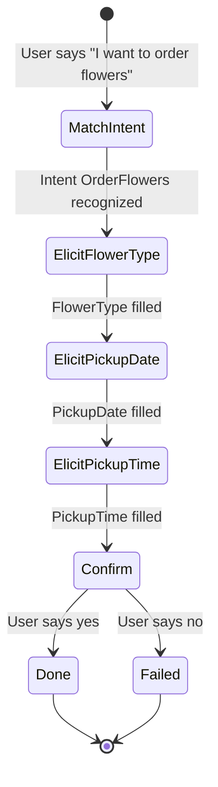

> [!COST]
> Lex bills per request: USD 0.00075 for each text request and USD 0.004 for each speech request in the request-response model. This lab sends roughly 20 to 40 text messages, a few US cents at most, paid from Free Tier credits on accounts created on or after 15 July 2025. Do not use the **Descriptive Bot Builder** or the automated chatbot designer here; the designer is billed per minute of training. Delete the bot in **Cleanup** so that nobody can keep sending it requests.

Amazon Lex is the "brain" in an automated phone or chat flow: it turns what the user says into an **intent**, collects the **slots** the intent needs, and hands the result to your code. You will build the bot only. Plugging it into Amazon Connect would also need a contact center instance and a claimed phone number (billed per day), so that part stays on paper.



## Prerequisites

- An AWS account and an IAM user or role allowed to manage Lex V2 bots and to create a service-linked role (for a sandbox: the `AmazonLexFullAccess` managed policy, plus IAM permission to delete roles for the cleanup).
- Region **US East (N. Virginia) `us-east-1`** (any Region with Lex V2 works; keep the console and CloudShell in the same one).
- **AWS CloudShell** for the CLI parts of steps 2, 4 and the cleanup.

## Steps

### Step 1: Create the bot from the OrderFlowers example

Lex examples are offered in the console only. Creating a complete bot from the CLI takes a dozen calls (bot, locale, slot types, intent, slots, build), so this step uses the console.

:::console
1. Open the **Amazon Lex** console and choose **Create bot**.
2. For **Creation method**, choose **Start with an example**, and in **Example bots** choose **OrderFlowers**.
3. Under **Bot configuration**, enter the bot name `OrderFlowersLab`.
4. Under **Permissions**, choose **Create a new role with basic Amazon Lex permissions**.
5. Under **Children's Online Privacy Protection Act (COPPA)**, choose **No** (this test bot is not aimed at children under 13).
6. Leave **Session timeout** and **Advanced settings** at their defaults and choose **Next**.
7. On the language page, keep **English (US)**, leave **Voice interaction** and **Intent classification confidence score threshold** at their defaults, and choose **Done**.
:::

> [!CHECK]
> The console opens the intent editor for the bot. In IAM a new service-linked role named `AWSServiceRoleForLexV2Bots_` followed by a random suffix now exists; Lex creates one each time you create a bot, and you will delete it in Cleanup.

### Step 2: Read the intent, its slots and the confirmation prompt

:::console
1. In the left navigation pane under **English (US)**, choose **Intents**, then **OrderFlowers**.
2. Scroll through **Sample utterances**: these phrases teach the model what the intent sounds like.
3. In **Slots**, note the three slots and their types: `FlowerType` (custom type `FlowerTypes`), `PickupDate` (`AMAZON.Date`) and `PickupTime` (`AMAZON.Time`), each with the prompt Lex uses to ask for it.
4. Look at the **Confirmation** section: the bot repeats the order and asks whether it is correct.
5. Check **Fulfillment**: no Lambda function is attached, so the bot only pretends to place the order. In a real bot a Lambda code hook would call your order system here.
:::

:::cli
```bash
BOT_ID=$(aws lexv2-models list-bots \
  --query "botSummaries[?botName=='OrderFlowersLab'].botId" --output text)
echo "$BOT_ID"
aws lexv2-models list-intents --bot-id "$BOT_ID" --bot-version DRAFT --locale-id en_US \
  --query 'intentSummaries[].[intentName,intentId]' --output table
INTENT_ID=$(aws lexv2-models list-intents --bot-id "$BOT_ID" --bot-version DRAFT --locale-id en_US \
  --query "intentSummaries[?intentName=='OrderFlowers'].intentId" --output text)
aws lexv2-models list-slots --bot-id "$BOT_ID" --bot-version DRAFT --locale-id en_US \
  --intent-id "$INTENT_ID" --query 'slotSummaries[].[slotName,slotConstraint]' --output table
```
:::

> [!CHECK]
> The intent list shows `OrderFlowers` plus the built-in `FallbackIntent`, which Lex uses when nothing matches. The slot list shows the three slots, all marked `Required`. This is the vocabulary of every Lex exam question: intent = what the user wants, slots = data the intent needs, fulfillment = the code that acts on it.

### Step 3: Build the bot and talk to it in the test window

:::console
1. Choose **Build** at the top of the page and wait for the success message (usually under a minute).
2. Choose **Test** to open the test window.
3. Type `I would like to order some flowers` and answer the prompts: `roses`, `tomorrow`, `5 pm`, then `yes` to the confirmation.
4. Start a new conversation with a phrase that is **not** in the sample utterances, for example `Could I get a bunch of tulips for Friday`, and see which slots Lex fills from that one sentence.
5. Choose **Inspect** in the test window to see the recognized intent, the slot values and the JSON returned by Lex.
:::

> [!CHECK]
> In the first conversation Lex asks for each missing slot in turn, then reads the order back to you. In the second, Lex should still match `OrderFlowers` although that sentence is not a sample utterance: natural language understanding matches meaning, not exact words (if it answers through `FallbackIntent` instead, the match scored below the confidence threshold). If it then asks for the flower type even though you said tulips, that is because this example's sample utterances contain no slot placeholders; adding one such as `I want to order {FlowerType}` lets Lex capture slot values from the first sentence. Lex also has an optional **Assisted NLU** setting (off by default, under **Bot settings**) that uses a large language model to pick up such values without placeholders; this lab leaves it off. After your "yes", **Inspect** shows the intent state leaving `InProgress` for `Fulfilled` or `ReadyForFulfillment`. The second value means every slot is filled and the client application is expected to act, which is what you can see when no fulfillment Lambda runs.

### Step 4: Talk to the same bot from the CLI, as an application would

Applications, web chat widgets and Amazon Connect call the Lex **runtime** API. The draft version of a bot is reachable through the built-in test alias, whose ID is `TSTALIASID`. It is meant for manual testing only and has low request limits; production traffic uses a published version behind your own alias.

:::cli
```bash
SESSION=cli-$(date +%s)
say() {
  aws lexv2-runtime recognize-text --bot-id "$BOT_ID" --bot-alias-id TSTALIASID \
    --locale-id en_US --session-id "$SESSION" --text "$1" \
    --query '{intent:sessionState.intent.name,state:sessionState.intent.state,ask:sessionState.dialogAction.slotToElicit,reply:messages[0].content}'
}
say "I need flowers for my mother"
say "lilies"
say "next Saturday"
say "10 in the morning"
say "yes"
```
:::

> [!CHECK]
> Each call returns the intent (`OrderFlowers`), its state (`InProgress` until the end), the slot Lex asks for next (`FlowerType`, then `PickupDate`, then `PickupTime`) and the bot's reply. After "yes" the state changes to `Fulfilled` or `ReadyForFulfillment`, the same end state you saw in the test window. Because every call used the same `--session-id`, Lex remembered the earlier answers; a contact center flow does exactly this for each caller, with Lex speaking the replies through a Polly voice.

## Cleanup

- [ ] **Lex bot `OrderFlowersLab`**: in the Lex console choose **Bots**, select the bot, choose **Action** → **Delete** and confirm. CLI: `aws lexv2-models delete-bot --bot-id "$BOT_ID" --skip-resource-in-use-check`.
- [ ] **IAM service-linked role `AWSServiceRoleForLexV2Bots_<suffix>`** created in Step 1 (delete it after the bot is gone): in the IAM console choose **Roles**, search for `AWSServiceRoleForLexV2Bots`, select the role created today and choose **Delete**. If you have other Lex bots, open the bot's version details first to see which role it uses, and leave those roles alone. CLI:
  ```bash
  aws iam list-roles \
    --query "Roles[?starts_with(RoleName,'AWSServiceRoleForLexV2Bots_')].[RoleName,CreateDate]" --output table
  aws iam delete-service-linked-role --role-name AWSServiceRoleForLexV2Bots_XXXXXXXX
  ```
- [ ] **Final check**: `aws lexv2-models list-bots --query 'botSummaries[].botName'` no longer lists `OrderFlowersLab`, the IAM role list shows no role created for this lab, and a day later **Billing and Cost Management** → **Bills** shows only cents (or credits) for Lex.

## Progress checklist

- [ ] Step 1: Created `OrderFlowersLab` from the example
- [ ] Step 2: Identified the intent, three slots, confirmation and missing fulfillment hook
- [ ] Step 3: Built the bot and completed two conversations in the test window
- [ ] Step 4: Held the same conversation through `recognize-text` with the test alias
- [ ] Cleanup done
