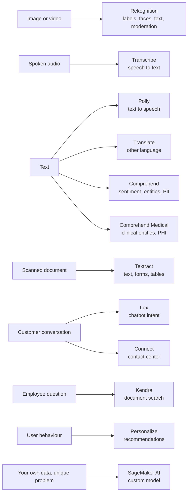
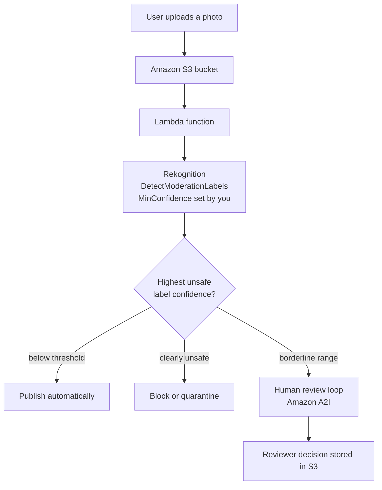
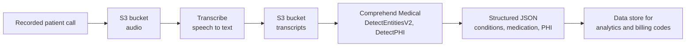
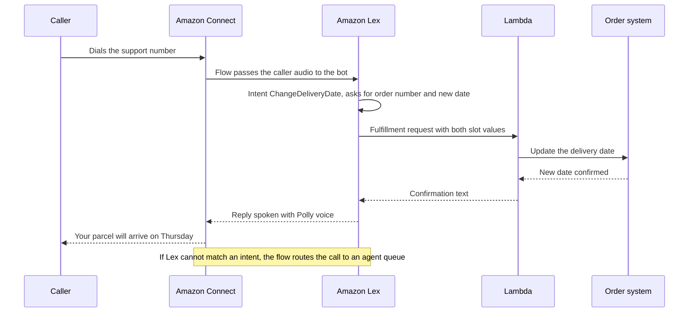
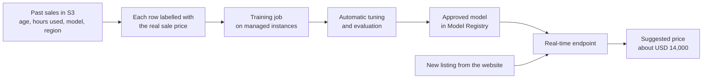
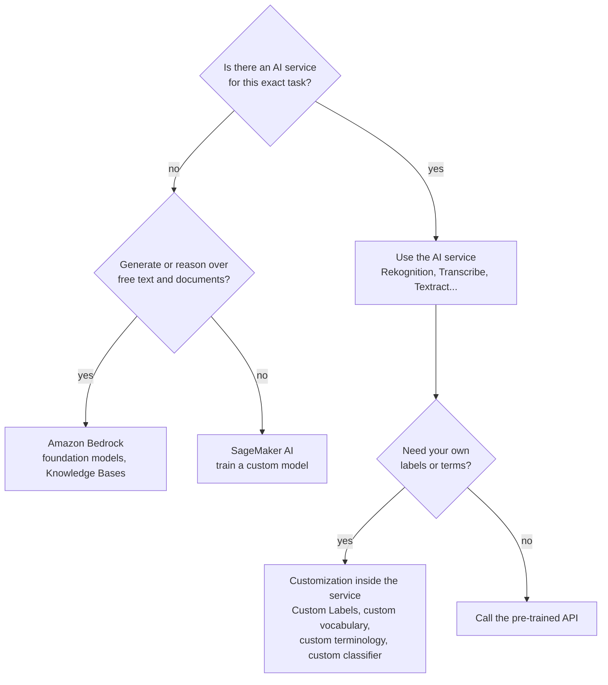

# Machine Learning

## Summary

AWS offers two very different ways to add machine learning to an architecture. The first is a shelf of **managed AI services**: pre-trained models behind a simple API, billed per request, that need no data science skills. You send an image to **Amazon Rekognition**, audio to **Amazon Transcribe**, text to **Amazon Polly**, **Amazon Translate** or **Amazon Comprehend**, a scanned form to **Amazon Textract**, and you get structured JSON back. **Amazon Lex** and **Amazon Connect** (renamed **Amazon Connect Customer** in 2026) build chatbots and contact centers, **Amazon Kendra** searches documents and **Amazon Personalize** produces recommendations. The second way is **Amazon SageMaker AI**, a fully managed platform where your own team prepares data, trains, tunes and hosts a custom model. On the exam, almost every ML question is a matching game: read the input (image, audio, text, document) and the desired output, then pick the one service built for that pair. Pick SageMaker AI only when the problem is unique to your business and no ready-made service fits.

## Key concepts

- **Managed AI services** are pre-trained, serverless and pay-per-use: call an API, get results, no models or servers to manage.
- **Rekognition** = computer vision on images and video: labels, text in images, faces, celebrities, unsafe content (moderation).
- **Content moderation** uses a **minimum confidence threshold** (default **50**), and borderline results can go to humans via **Amazon Augmented AI (A2I)**.
- **Transcribe** = speech to text (automatic speech recognition), with **PII redaction** and **automatic language identification**.
- **Polly** = text to speech; **lexicons** fix pronunciation, **SSML** controls pauses, emphasis, whispering and speaking style.
- **Translate** = neural machine translation of text and documents between **75** languages.
- **Comprehend** = natural language processing: language, entities, key phrases, **sentiment**, syntax, PII; **Comprehend Medical** does the same for clinical text and detects **PHI**.
- **Lex** = conversational bots (speech recognition + natural language understanding, the Alexa technology); **Connect** = cloud contact center that hands calls to Lex.
- **Textract** = extracts printed and handwritten text, **forms** (key-value pairs) and **tables** from scanned documents.
- **Kendra** = natural-language enterprise document search; **closed to new customers since 30 July 2026**.
- **Personalize** = real-time personalized recommendations, the same idea Amazon.com uses, without building a model yourself.
- **SageMaker AI** = build, train, tune and deploy **your own** models on fully managed infrastructure.

## The AWS machine learning toolbox

Think of AWS ML as three layers. At the top are the task-specific AI services in this lesson: each one does a single job (see, hear, speak, read, translate, recommend) with a model that AWS already trained on huge data sets. In the middle is **Amazon Bedrock**, which gives API access to general-purpose foundation models for generative AI. At the bottom is **SageMaker AI**, a workbench for training models of your own. The higher you go, the less ML knowledge and operational work you need, and the less you can customize.

> [!UPDATED] Current SAA-C03 scope
> The current SAA-C03 in-scope list names eight machine learning services: Comprehend, Lex, Polly, Rekognition, SageMaker AI, Textract, Transcribe and Translate. Kendra, Personalize and Connect are still taught in the course but are not on that (non-exhaustive) list, so know them at a one-line "what is it for" level.

## Amazon Rekognition: vision as a service

Rekognition analyzes pictures and video with deep learning. You point it at an image (in Amazon S3 or as bytes) or a video stored in S3 or arriving as a stream, and it returns what it found together with a **confidence score** from 0 to 100 for every result. Image calls are synchronous; stored-video calls are asynchronous jobs that notify an Amazon SNS topic when they finish.

| Capability | What you get back | Typical use |
|---|---|---|
| Label detection | Objects, scenes and concepts ("Car", "Beach", "Wedding") | Make a photo library searchable |
| Custom Labels | Your own classes, e.g. your logo or product line | Brand detection, defect spotting |
| Text detection | Printed or handwritten words in a photo or video frame | Read street signs, licence plates, captions |
| Face detection and analysis | Face position plus attributes such as age range, emotions, glasses, smile | Count people, crop thumbnails |
| Face comparison and face search | Whether two faces match, or which stored face matches (face **collections**) | User verification, finding a person in footage |
| Celebrity recognition | Names of well-known people | Media cataloguing |
| Content moderation | Unsafe or unwanted content labels | Social media, ads, e-commerce |
| PPE detection | Whether people wear protective equipment | Workplace safety |
| Face Liveness | Whether a real person is in front of the camera | Fraud-resistant selfie verification |

> [!UPDATED] People pathing has been retired
> The slides list pathing (tracking how people move, for example in sports analysis). AWS ended support for Rekognition people pathing on 31 October 2025, and new customers lost access a year earlier. Treat it as a historical feature; the other stored-video features (labels, faces, text, moderation, segment detection) remain.

> [!UPDATED] Streaming video and bulk image analysis closed to new customers
> Since 30 April 2026, Rekognition **Streaming Video** (analyzing a live Kinesis Video Streams feed, for example searching a camera feed for known faces) and **Bulk Image Analysis** (one asynchronous moderation job over a large set of S3 images) are no longer offered to new customers; accounts that used them in the previous 12 months keep access. AWS points new builds to the regular image APIs, called on frames pulled from the stream or on each S3 object from a Lambda function. Synchronous image calls and stored-video jobs are not affected. Older exam questions that pair Rekognition with Kinesis Video Streams for live face recognition can still appear.

### Content moderation with a confidence threshold

User-generated content is the classic Rekognition exam scenario: social networks, video platforms, ad networks and online shops all need to keep offensive material away from their users, protect advertisers' brands and meet local rules on harmful content. The moderation API checks an image or video against a three-level taxonomy of unsafe content (for example *Violence* at level 1, *Weapon Violence* at level 2). Every label comes with a confidence score, and you choose a **MinConfidence** value: labels below it are not returned. If you send nothing, Rekognition uses **50%**. A low threshold catches more bad content but flags more innocent images (more false positives); a high threshold flags less but may miss things. If the pre-trained model keeps misjudging your particular kind of images, **Custom Moderation** lets you train an adapter on a few of your own annotated images and pass it with each request.

AWS says this approach usually leaves human moderators reviewing only a small slice of the total volume, often 1-5%. For the grey zone, Rekognition integrates with **Amazon Augmented AI (A2I)**: you define conditions (such as "confidence for label X between 60 and 90") in a human review workflow, pass it with the request, and matching images go to a private workforce, vendors or Amazon Mechanical Turk.

> [!UPDATED] Amazon A2I is in maintenance mode
> AWS moved Amazon Augmented AI, along with several other SageMaker AI features (Ground Truth, Clarify, Model Monitor, Debugger), to maintenance: from 30 July 2026 it is no longer available to new customers, while existing users can keep using it. For a new design you may need to build the human review step yourself (for example a queue of flagged images in SQS and a small review app). The exam still describes A2I as the human-in-the-loop answer.

> [!EXAMPLE] A marketplace for second-hand goods
> Sellers upload product photos. A Lambda function triggered by the S3 upload calls `DetectModerationLabels` with MinConfidence 70. Photos with no label above 70 go live; photos above 95 are rejected; the rest wait for a moderator. The same function calls `DetectText` to catch phone numbers painted on images, which the marketplace forbids.

## Speech services: Transcribe and Polly

The two speech services are mirror images: **Transcribe hears** (audio in, text out) and **Polly speaks** (text in, audio out).

### Amazon Transcribe

Transcribe uses **automatic speech recognition (ASR)** to turn spoken audio into text with word-level timestamps. It works in two modes: **batch** jobs on a media file in S3 (MP3, MP4, WAV, FLAC, OGG and others) and **streaming** transcription of live audio.

Features that show up in exam scenarios:

- **PII redaction**: identify and mask personal data such as names, phone numbers, card numbers or SSNs; the transcript shows `[PII]` in their place. You can keep only the redacted transcript or both versions. Batch redaction supports a set of English, Spanish, French, German, Italian and Portuguese dialects.
- **Automatic language identification**: no need to know the language upfront; Transcribe detects the dominant language, or every language in multilingual audio.
- **Custom vocabularies** and custom language models for product names and jargon, **speaker diarization** (who said what), subtitles in WebVTT and SRT, toxic speech detection.
- **Call Analytics** for contact-center recordings and a medical variant for clinical conversations.

Typical uses: transcribe customer service calls for analysis, generate **closed captions and subtitles**, and create text metadata so an archive of audio and video becomes searchable.

> [!UPDATED] Billing granularity
> The current pricing page bills Transcribe per second with no minimum duration (older material mentions a 15-second minimum per request). Standard batch transcription now has one flat rate (USD 0.006 per minute in us-east-1 in the page's own example) instead of volume tiers, while PII redaction is still an extra, tiered per-minute charge.

> [!TRAP] Redaction plus language identification
> In batch jobs, PII redaction cannot be combined with automatic language identification: you must state the language code when you want redaction. A question that needs both may expect two steps.

### Amazon Polly

Polly turns text into natural-sounding speech so that applications can talk: reading articles aloud, voice prompts in an IVR, accessibility features, e-learning narration. It can return audio directly (`SynthesizeSpeech`, up to 3,000 billed characters per request) or run an asynchronous task that writes long audio to S3 (`StartSpeechSynthesisTask`, up to 100,000 billed characters).

| Engine | Character | Price per 1 million characters |
|---|---|---|
| Standard | Oldest technology, widest SSML support | USD 4 |
| Neural | More natural voices; newscaster style on a few voices | USD 16 |
| Long-form | Tuned for long content such as articles and audiobooks | USD 100 |
| Generative | Most expressive, human-like delivery | USD 30 |

There are two ways to control how Polly pronounces your text:

- **Pronunciation lexicons** are XML files in the W3C PLS format that you upload once per Region (up to 100 per account, each up to 40,000 characters) and reference by name, up to **five per request**. A lexicon maps a written form (grapheme) to either an **alias** or a phonetic spelling. Use it for stylized names ("Byt3Wise" read as "Bytewise") or for acronyms you want spoken in full ("IaC" read as "infrastructure as code").
- **SSML (Speech Synthesis Markup Language)** wraps the text in tags that control delivery for that one request.

| SSML tag | Effect | Engines |
|---|---|---|
| `<break time="1s"/>` | Pause | All |
| `` | Say something else in place of the written word | All |
| `<phoneme>` | Exact phonetic pronunciation | Standard, neural, long-form; partial on generative |
| `<emphasis>` | Stress a word or phrase | Standard only |
| `<amazon:effect name="whispered">` | Whisper | Standard only |
| `<amazon:auto-breaths>`, `<amazon:breath>` | Breathing sounds | Standard only |
| `<amazon:domain name="news">` | Newscaster speaking style | Neural only, select voices (Matthew, Joanna, Amy, Lupe) |

> [!UPDATED] SSML depends on the engine
> The slides list emphasis, phonemes, breathing, whispering and the newscaster style as if they all work together. Today Polly has four engines, and on the standard, neural and long-form engines a tag the engine does not support makes the request fail with an error: whispering, breathing and emphasis need a **standard** voice, while the newscaster style needs one of a few **neural** voices.

> [!TIP] Lexicon or SSML?
> Use a **lexicon** when the same word must always be pronounced the same way across all your content (brand names, acronyms). Use **SSML** for one-off delivery choices in a specific sentence (a pause here, a whisper there).

## Text and language services

### Amazon Translate

Translate is a neural machine translation service for localizing websites, apps, product catalogues, chat and support tickets for international users, and for translating large volumes of text cost-effectively. It supports **75 languages**, real-time translation of text or a single document (plain text, HTML, Word) and **batch** jobs over many files in S3 (adding Excel, PowerPoint and XLIFF). Set the source to `auto` and Translate asks Comprehend to detect the language for you. Customization options include **custom terminology** (always translate a brand name the same way), **parallel data** for style (Active Custom Translation), **formality**, **profanity masking** and **brevity**.

> [!EXAMPLE] Multilingual support desk
> Tickets arrive in Japanese, German and Portuguese. A Lambda function translates each ticket to English for the agents with source language `auto`, and translates the agent's reply back. A custom terminology file keeps product names untranslated.

### Amazon Comprehend

Comprehend is the **natural language processing (NLP)** service: fully managed and serverless, it reads unstructured text and tells you what is in it. The pre-trained model needs no training data.

| Insight | Example output |
|---|---|
| Dominant language | "fr", confidence 0.99 |
| Entities | People, places, organizations, brands, dates, quantities, events |
| Key phrases | "late delivery", "broken screen" |
| Sentiment | Positive, negative, neutral or mixed for the whole text |
| Targeted sentiment | Sentiment per entity ("battery" negative, "camera" positive) |
| Syntax | Tokens with parts of speech (noun, verb...) |
| PII | Names, addresses, account numbers and their positions |
| Custom classification and custom entities | Your own categories or terms, trained with AutoML on your labelled examples |
| Topic modeling | Groups a large collection of documents into topics (asynchronous job) |

Real-time calls handle one document or a small batch; asynchronous jobs process a whole S3 prefix. A typical scenario is analyzing thousands of customer emails or reviews to learn what drives positive and negative experiences.

> [!UPDATED] Topic modeling closed to new customers
> The slides use topic modeling to group articles by subject. Since 30 April 2026 Comprehend **topic modeling, event detection and prompt safety classification** are no longer available to new customers (accounts that used them in the last 12 months keep access). AWS suggests foundation models in Amazon Bedrock for topics and events. Entity, key phrase, sentiment, language, syntax, PII and custom models are unaffected.

### Amazon Comprehend Medical

Comprehend Medical applies NLP to **unstructured clinical text**: doctors' notes, discharge summaries, test results, case notes. It extracts medical conditions, medications with dosage and frequency, tests, treatments and anatomy, and can link them to standard codes (ICD-10-CM, RxNorm, SNOMED CT). The **DetectPHI** operation finds **protected health information** such as patient names, ages, addresses and record numbers. It works on US English text, is HIPAA eligible, and does not persistently store the text you send.

Getting the text to it is an architecture question. Notes already written down can sit in S3 and be processed in batches. Text that arrives continuously (for example from a clinical app) can be streamed through Amazon Data Firehose into S3 and analyzed from there. Spoken patient narratives first go through Transcribe (or its medical variant) so that Comprehend Medical receives text.

> [!UPDATED] Firehose naming
> The slides mention Kinesis Data Firehose for streaming clinical text. The service is now called **Amazon Data Firehose**.

## Conversations: Amazon Lex and Amazon Connect

**Amazon Lex** builds chatbots and voice bots using the same technology as Alexa. It combines **automatic speech recognition** (speech to text) with **natural language understanding** (figuring out what the user wants). You design a bot from:

- **Intents**: what the user wants to do, such as `BookAppointment`, each with sample utterances ("I need to see a doctor on Friday").
- **Slots**: the pieces of information an intent needs (date, time, doctor), which Lex asks for until it has them.
- **Fulfillment**: usually an AWS Lambda function that does the real work once the slots are filled.

**Amazon Connect** is a cloud-based virtual contact center. You claim phone numbers, design **flows** (the call routing and IVR logic) in a drag-and-drop editor, route contacts to queues and agents, and integrate with CRM systems such as Salesforce or with any AWS service through Lambda. There is no upfront payment or seat licence: you pay per minute of voice and per message.

> [!UPDATED] Names and versions
> In 2026 AWS split Amazon Connect into a family of products, and the contact center is now **Amazon Connect Customer**; "contact flows" are simply called **flows**. **Lex V1** reached end of support on 15 September 2025, so all bots are Lex V2. The exam may still say "Amazon Connect".

> [!UPDATED] No general "80% cheaper" figure on current AWS pages
> The course quotes Connect as 80% cheaper than traditional contact center systems. The current [pricing](https://aws.amazon.com/connect/pricing/) and [FAQ](https://aws.amazon.com/connect/faqs/) pages give no general savings percentage; they stress pay-as-you-go with no minimums, no long-term contract and no per-seat licence. The only percentages are single customers' results: the pricing page quotes one customer whose platform costs fell by half, and a [2019 AWS blog post](https://aws.amazon.com/blogs/contact-center/amazon-connect-costs-less/) quoted customers who cut costs by about 80%. Treat any percentage as an anecdote, not an exam fact; what to remember is "pay per use, no upfront commitment".

## Documents, search and recommendations

### Amazon Textract

Textract goes further than plain OCR: it reads printed and handwritten text from scanned documents and images, and it understands structure. **Forms** become key-value pairs ("Policy number" : "HX-40917"), **tables** keep their rows and columns, and **queries** let you ask for one field in plain English ("What is the invoice total?").

| API | Purpose |
|---|---|
| `DetectDocumentText` | Lines and words only, cheapest |
| `AnalyzeDocument` | Adds `FORMS`, `TABLES`, `QUERIES`, `SIGNATURES`, `LAYOUT` |
| `AnalyzeExpense` | Invoices and receipts (vendor, totals, line items) |
| `AnalyzeID` | Identity documents (US passports and driver's licences) |
| Analyze Lending | Classifies and extracts mortgage loan packages |

Synchronous calls handle one page (JPEG, PNG, single-page PDF or TIFF up to 10 MB); asynchronous jobs process multi-page PDF or TIFF files in S3 up to 500 MB and 3,000 pages. Handwriting is recognized in English only. Industries in exam questions: financial services (invoices, reports), healthcare (medical records, insurance claims) and the public sector (tax forms, ID documents).

> [!TRAP] Textract or Rekognition text detection?
> Both read text. Rekognition `DetectText` is for short text in natural scenes (signs, plates, captions in video). Textract is for **documents** where structure matters: forms, tables, invoices, IDs.

### Amazon Kendra

Kendra is an ML-powered enterprise search service. It **indexes** documents from many repositories (S3, databases, SharePoint, OneDrive, Google Drive, Confluence and dozens of other connectors) and answers natural-language questions. Ask "How many unused holiday days can I carry into next year?" and it can return the answer itself ("up to five days") pulled out of the HR handbook or an FAQ file, not just a list of links. It learns from user clicks and feedback to promote better results (**incremental learning**), and administrators can tune relevance by field, freshness or custom attributes. Supported formats include text, HTML, PDF, Word, PowerPoint and FAQ files.

> [!UPDATED] Kendra is closed to new customers
> AWS put Amazon Kendra into maintenance mode on 30 June 2026 and stopped accepting new customers on 30 July 2026; existing customers keep full support and security fixes. The recommended path for new search and retrieval-augmented generation (RAG) projects is **Amazon Bedrock Knowledge Bases** (the Kendra migration guide calls the fully managed option a Bedrock Managed Knowledge Base). It has fewer built-in connectors (7 against Kendra's 32+) and no incremental learning, but it can generate answers with a foundation model. On the exam, "intelligent search over internal documents with natural-language questions" still points to Kendra.

### Amazon Personalize

Personalize is a fully managed recommendation service built on the same kind of technology Amazon.com uses. You give it three kinds of data: **interactions** (user X viewed, clicked or bought item Y), **items** (catalogue metadata) and **users** (profile attributes). Historical data is imported in bulk from S3, and new events arrive in real time through an event-tracking API. Personalize trains and hosts the models for you, so a team can go live in days instead of building an ML pipeline for months.

Outputs include personalized item lists ("Recommended for you"), similar items ("More like this"), **re-ranking** of a list you already have (search results, a category page), next best action, and **user segments** for targeted marketing. Results feed websites, mobile apps, emails and SMS campaigns. Typical customers are retailers (product recommendations), media and streaming companies ("watch next") and travel or news sites that want each visitor to see a different ordering of the same catalogue.

> [!EXAMPLE] Garden centre web shop
> A customer bought a spade and pruning shears last week. Personalize, trained on the shop's order history in S3 and fed live click events, puts gloves and a hose reel at the top of the home page for that customer and re-ranks the search results for "hose" by what similar gardeners bought.

## Build your own model: Amazon SageMaker AI

When no AI service matches your problem, for example predicting your own customers' churn or the price of a used machine part, you need a custom model. Doing that by hand means collecting and labelling data, provisioning servers for training, tuning, then hosting a scalable endpoint. **SageMaker AI** is a fully managed service that brings all those steps into one place for developers and data scientists.

| Stage | SageMaker AI features (examples) |
|---|---|
| Prepare and label data | Data Wrangler, Ground Truth {{updated: Ground Truth entered maintenance; closed to new customers from 30 July 2026}}, Feature Store |
| Build without code | SageMaker Canvas (no-code AutoML), JumpStart (pre-trained and foundation models) |
| Train and tune | Managed training jobs, automatic model tuning, HyperPod for very large models |
| Deploy | Real-time endpoints, serverless inference, asynchronous inference, batch transform |
| Operate | Pipelines (MLOps), Model Registry, Model Monitor {{updated: Model Monitor entered maintenance; closed to new customers from 30 July 2026}} |

| Inference option | Best for |
|---|---|
| Real-time endpoint | Steady traffic needing low latency |
| Serverless inference | Spiky or intermittent traffic that tolerates cold starts; no instances to choose |
| Asynchronous inference | Large payloads (up to 1 GB) or long processing (up to one hour), queued |
| Batch transform | Scoring a whole data set offline with no persistent endpoint |

> [!UPDATED] SageMaker naming
> On 3 December 2024 the ML service was renamed **Amazon SageMaker AI**, and the name **Amazon SageMaker** now covers a wider unified data, analytics and AI platform (SageMaker Unified Studio, Lakehouse, Bedrock and more). API names, CLI commands and console URLs still say `sagemaker`.

## Choosing the right service

| Scenario signal | Service |
|---|---|
| Detect objects, faces, celebrities or unsafe content in photos or video | Rekognition |
| Subtitles, call transcripts, searchable audio archive | Transcribe |
| App that reads text aloud, IVR prompts | Polly |
| Localize a website or translate user messages | Translate |
| Sentiment of reviews, entities in emails, PII in text | Comprehend |
| Diagnoses, medications or PHI in doctors' notes | Comprehend Medical |
| Chatbot or voice bot that understands intent | Lex |
| Cloud call center, IVR, agent routing | Connect |
| Extract fields and tables from invoices, forms, IDs | Textract |
| Ask questions in natural language over internal documents | Kendra (Bedrock Knowledge Bases for new builds) |
| "Customers who bought X also like", personalized marketing | Personalize |
| Custom prediction from your own data, full control of the model | SageMaker AI |

> [!NOTE] Beyond the slides: generative AI
> Amazon Bedrock is a fully managed service that offers foundation models from Amazon and other providers through one API, for chat, summarization, content generation and RAG over your documents. It is where AWS now points customers for tasks the retired features used to cover (Comprehend topic modeling, Kendra-style search).

## Exam tips

> [!EXAM] Match input to output
> Image or video in → **Rekognition**. Audio in, text out → **Transcribe**. Text in, audio out → **Polly**. Text in another language → **Translate**. Meaning of text → **Comprehend**. Scanned forms → **Textract**. The service names are the answers to most ML questions.

> [!EXAM] Moderation with humans in the loop
> "Flag inappropriate user-uploaded images, send uncertain ones to human reviewers" → Rekognition content moderation with a **minimum confidence threshold** and **Amazon A2I** for human review.

> [!EXAM] Remove personal data
> "Remove credit card numbers and names from call recordings' transcripts" → **Transcribe PII redaction**. "Find PII in text" → **Comprehend** PII detection. "Find PHI in clinical notes" → **Comprehend Medical DetectPHI**.

> [!EXAM] Pipelines of AI services
> Services chain together: Transcribe → Comprehend for call sentiment, Transcribe → Translate → Polly for speech translation, Textract → Comprehend for document classification, Connect → Lex → Lambda for automated phone self-service.

> [!EXAM] Least operational overhead
> When a managed AI service fits, it beats SageMaker AI for "least operational overhead" or "no ML expertise". Choose SageMaker AI when the question stresses a **custom model**, your own algorithm, training on proprietary data, or data scientists.

- "Same technology as Alexa", "chatbot", "intent" → **Lex**.
- "Recommendations", "real-time personalization", "re-rank" → **Personalize**.
- "Natural-language search of company documents" → **Kendra**.
- "Pronounce acronyms or brand names correctly" → Polly **lexicon**; "whisper, pause, newscaster" → **SSML**.
- "Multilingual audio, language unknown" → Transcribe **automatic language identification**.

## Common traps

> [!TRAP] Comprehend vs Comprehend Medical vs Textract
> Comprehend reads general text; Comprehend Medical reads clinical text and finds PHI. Neither reads a scanned image: if the input is a photo or PDF of a document, Textract (or Transcribe for audio) must turn it into text first.

> [!TRAP] Transcribe vs Polly direction
> Transcribe is speech **to** text; Polly is text **to** speech. Distractors often swap them.

> [!TRAP] Lex vs Connect
> Lex is the bot brain (understands intent); Connect is the phone system and contact center. A phone-based self-service bot usually needs both: Connect receives the call and hands the conversation to Lex.

> [!TRAP] Rekognition is not a document reader
> Rekognition text detection reads words in scenes; it does not return forms or tables. For invoices, tax forms or passports use Textract.

> [!TRAP] Translate does not transcribe
> Translate works on text. To translate spoken audio, transcribe it first (Transcribe), translate the text, then optionally speak it (Polly).

> [!TRAP] SageMaker AI is not the default
> SageMaker AI is powerful but requires ML skills and more operations. If a pre-trained service already does the job, picking SageMaker AI is usually the wrong "most efficient" answer.

> [!TRAP] Confidence threshold direction
> Raising Rekognition's MinConfidence returns **fewer** labels (fewer false positives, more misses); lowering it returns more. Questions about "too many innocent images flagged" want a higher threshold.
