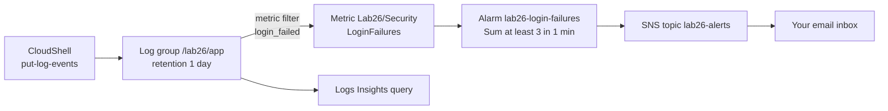

This lab rebuilds the classic "alert me when this appears in the logs" pattern without any servers. You play the application yourself: AWS CloudShell writes JSON log lines into CloudWatch Logs, a **metric filter** turns each failed login into a data point, and a **CloudWatch alarm** emails you through **Amazon SNS** when too many arrive in one minute. You then use **Logs Insights** for the after-the-fact investigation, which is exactly the split the exam expects: metric filter plus alarm for alerting, Logs Insights for ad-hoc questions.



## Prerequisites

- An AWS account and a user or role allowed to use CloudWatch, CloudWatch Logs and SNS (for example the `CloudWatchFullAccess` and `AmazonSNSFullAccess` managed policies, or administrator access in a personal account).
- An email address you can open during the lab, for the SNS subscription.
- One Region for the whole lab; the steps use `us-east-1`. Everything in the CLI tabs runs in **AWS CloudShell** (open it from the CloudShell icon in the console's top bar), which already has the AWS CLI v2 and Python 3. Keep the same CloudShell tab open because later commands reuse shell variables.
- Even if you prefer the console tabs, you need CloudShell for Steps 3 and 5: the console has no button that writes log events.

## Steps

### Step 1: Create an SNS topic and subscribe your email

:::console
1. Open the **Amazon SNS** console and choose **Topics** in the navigation pane (on a brand-new account you may land on the SNS home page first), then **Create topic**.
2. Under **Details**, set **Type** to **Standard** and **Name** to `lab26-alerts`. Leave the other sections at their defaults and choose **Create topic**.
3. In the navigation pane choose **Subscriptions** → **Create subscription**.
4. For **Topic ARN** pick the `lab26-alerts` ARN, set **Protocol** to **Email**, enter your address in **Endpoint**, and choose **Create subscription**.
5. Open the email titled *AWS Notification - Subscription Confirmation* and click **Confirm subscription**.
:::

:::cli
```bash
EMAIL="you@example.com"   # replace with your address
TOPIC_ARN=$(aws sns create-topic --name lab26-alerts --query TopicArn --output text)
aws sns subscribe --topic-arn "$TOPIC_ARN" --protocol email \
  --notification-endpoint "$EMAIL"
echo "Topic: $TOPIC_ARN"
# After clicking the link in the confirmation email:
aws sns list-subscriptions-by-topic --topic-arn "$TOPIC_ARN" \
  --query 'Subscriptions[].[Protocol,Endpoint,SubscriptionArn]' --output table
```
:::

> [!CHECK]
> The subscription's status in the SNS console changes from **Pending confirmation** to **Confirmed** (in the CLI the `SubscriptionArn` column shows a full ARN instead of `PendingConfirmation`). Nothing will reach your inbox until this happens.

### Step 2: Create the log group, set retention and add a log stream

New log groups keep data forever by default, so the first habit to build is setting retention.

:::console
1. Open the **CloudWatch** console. In the navigation pane choose **Log Management** (some console pages still label it **Logs** → **Log groups**).
2. Choose **Actions** → **Create log group**, enter `/lab26/app` as the name, keep the **Standard** log class if a class choice is shown, and choose **Create log group**.
3. Back in the list, find `/lab26/app`. In its **Retention** column choose **Never expire**, set **Expire events after** to **1 day**, and choose **Save**.
4. Choose the log group name, open the **Log streams** tab and choose **Create log stream**. Name it `web-1` and choose **Create**.
:::

:::cli
```bash
LG=/lab26/app
aws logs create-log-group --log-group-name "$LG"
aws logs put-retention-policy --log-group-name "$LG" --retention-in-days 1
aws logs create-log-stream --log-group-name "$LG" --log-stream-name web-1
aws logs describe-log-groups --log-group-name-prefix "$LG" \
  --query 'logGroups[].[logGroupName,retentionInDays,logGroupClass]' --output table
```
:::

> [!CHECK]
> The log group shows a retention of **1 day** and the **Standard** class. Standard matters: an Infrequent Access log group would not support the metric filter you add next.

### Step 3: Create the metric filter, then send one harmless event

A metric filter only counts events that arrive **after** it exists, so create it before the "attack". Every matching line adds 1 to the metric; when log events arrive but none match, the **default value** 0 is published, which makes the metric appear in the console straight away.

The application writes one JSON object per line, for example `{"level":"WARN","event":"login_failed","user":"ana","ip":"203.0.113.10"}`.

:::console
1. Choose the `/lab26/app` log group, then **Actions** → **Create metric filter**.
2. For **Filter pattern** enter `{ $.event = "login_failed" }`.
3. Under **Test pattern**, paste these two lines into **Log event messages** and choose **Test pattern**; only the first line should match:

   ```
   {"level":"WARN","event":"login_failed","user":"ana","ip":"203.0.113.10"}
   {"level":"INFO","event":"login_ok","user":"ben","ip":"198.51.100.7"}
   ```

4. Choose **Next**. For **Filter name** enter `login-failed`.
5. Under **Metric details**: **Metric namespace** `Lab26/Security` (keep **Create new** selected), **Metric name** `LoginFailures`, **Metric value** `1`, **Default value** `0`, **Unit** **Count**. Add no dimensions (a filter with dimensions cannot have a default value).
6. Choose **Next**, review, and choose **Create metric filter**.
7. Switch to **CloudShell**, run `LG=/lab26/app` (later steps reuse this variable), then run the CLI tab's commands from the `python3` line onward to send one successful login.
:::

:::cli
```bash
aws logs put-metric-filter --log-group-name "$LG" --filter-name login-failed \
  --filter-pattern '{ $.event = "login_failed" }' \
  --metric-transformations \
    metricName=LoginFailures,metricNamespace=Lab26/Security,metricValue=1,defaultValue=0,unit=Count

# Send one non-matching event (a successful login) so the metric is published with value 0.
python3 - > ok.json <<'EOF'
import json, time
msg = {"level": "INFO", "event": "login_ok", "user": "ben", "ip": "198.51.100.7"}
print(json.dumps([{"timestamp": int(time.time() * 1000), "message": json.dumps(msg)}]))
EOF
aws logs put-log-events --log-group-name "$LG" --log-stream-name web-1 \
  --log-events file://ok.json
```
:::

> [!CHECK]
> `put-log-events` returns a `nextSequenceToken` (or an empty response) with no `rejectedLogEventsInfo`. Within a few minutes, **Metrics** → **All metrics** → **Lab26/Security** → **Metrics with no dimensions** lists `LoginFailures` with a value of 0. The log group's **Metric filters** tab shows `login-failed`.

### Step 4: Create an alarm that emails you on three or more failures per minute

:::console
1. In the CloudWatch navigation pane choose **Alarms** → **All alarms** → **Create alarm** → **Select metric**.
2. Choose **Lab26/Security** → **Metrics with no dimensions**, tick **LoginFailures**, open the **Graphed metrics** tab, set **Statistic** to **Sum** and **Period** to **1 minute**, then choose **Select metric**.
3. Under **Conditions** choose **Static**, **Greater/Equal**, and enter `3` for the threshold.
4. Expand **Additional configuration**: keep **Datapoints to alarm** at **1 out of 1** and set **Missing data treatment** to **Treat missing data as good (not breaching threshold)**, so quiet minutes count as OK. Choose **Next**.
5. Under **Notification** keep **In alarm** and choose **Select an existing SNS topic** → `lab26-alerts`. Choose **Next**.
6. Name the alarm `lab26-login-failures`, add a description such as `More than 2 failed logins in one minute`, choose **Next**, then **Create alarm**.
:::

:::cli
```bash
aws cloudwatch put-metric-alarm --alarm-name lab26-login-failures \
  --alarm-description "More than 2 failed logins in one minute" \
  --namespace Lab26/Security --metric-name LoginFailures \
  --statistic Sum --period 60 --evaluation-periods 1 --datapoints-to-alarm 1 \
  --threshold 3 --comparison-operator GreaterThanOrEqualToThreshold \
  --treat-missing-data notBreaching \
  --alarm-actions "$TOPIC_ARN"
aws cloudwatch describe-alarms --alarm-names lab26-login-failures \
  --query 'MetricAlarms[].[AlarmName,StateValue]' --output table
```
:::

> [!CHECK]
> The new alarm starts in **Insufficient data** and moves to **OK** within a minute or two. Every new alarm begins in INSUFFICIENT_DATA; that is expected, not an error.

### Step 5: Simulate a burst of failed logins

Send six failed logins from two IP addresses, plus three successful ones, in a single batch. The events in one batch must be in chronological order, which the script takes care of.

:::console
1. In **CloudShell**, run the CLI tab's commands for this step (there is no console way to write log events).
2. Return to **Alarms** → **All alarms** and refresh every 30 seconds or so.
:::

:::cli
```bash
python3 - > burst.json <<'EOF'
import json, time
now = int(time.time() * 1000)
events = []
for i in range(6):
    ip = "203.0.113.10" if i % 3 else "203.0.113.99"
    msg = {"level": "WARN", "event": "login_failed", "user": f"user{i}", "ip": ip}
    events.append({"timestamp": now + i, "message": json.dumps(msg)})
for i in range(3):
    msg = {"level": "INFO", "event": "login_ok", "user": f"staff{i}", "ip": "198.51.100.7"}
    events.append({"timestamp": now + 10 + i, "message": json.dumps(msg)})
print(json.dumps(events))
EOF
aws logs put-log-events --log-group-name "$LG" --log-stream-name web-1 \
  --log-events file://burst.json

# Poll the alarm state for about three minutes.
for i in $(seq 1 12); do
  aws cloudwatch describe-alarms --alarm-names lab26-login-failures \
    --query 'MetricAlarms[0].StateValue' --output text
  sleep 15
done
```
:::

> [!CHECK]
> Within roughly one to three minutes the alarm turns **In alarm** and you receive an email whose subject starts with *ALARM: "lab26-login-failures"*. The graph on the alarm page shows a single data point of 6 for that minute, above the red threshold line at 3. A minute or two later, with no new failures, the alarm returns to **OK** on its own (no email, because only the ALARM state has an action).

> [!TIP]
> If the alarm stays OK, check that the metric shows 6 for the minute you sent the burst. The usual causes are a typo in the filter pattern or sending the burst before the metric filter was saved; filters never count older events.

### Step 6: Investigate with CloudWatch Logs Insights

The alarm told you *that* something happened; Logs Insights tells you *who*. Because the log lines are JSON, Logs Insights discovers `event`, `user` and `ip` as fields automatically.

Query:

```
fields @timestamp, user, ip
| filter event = "login_failed"
| stats count(*) as failures by ip
| sort failures desc
```

:::console
1. In the CloudWatch navigation pane choose **Logs** → **Logs Insights**.
2. Keep the default query language (Logs Insights QL). In **Select log group(s)** choose `/lab26/app`.
3. Set the time range to the last **1 hour**, replace the sample query with the one above, and choose **Run**.
4. Optional: open the **Fields** panel on the right to see the discovered fields, and try changing the last two lines to `| sort @timestamp desc | limit 20` to list the raw events.
:::

:::cli
```bash
QID=$(aws logs start-query --log-group-name "$LG" \
  --start-time $(( $(date +%s) - 3600 )) --end-time "$(date +%s)" \
  --query-string 'filter event = "login_failed" | stats count(*) as failures by ip | sort failures desc' \
  --query queryId --output text)
sleep 5
aws logs get-query-results --query-id "$QID"
```
:::

> [!CHECK]
> The results show two rows: `203.0.113.10` with 4 failures and `203.0.113.99` with 2. The query scanned only a few kilobytes; Logs Insights is billed per GB scanned, which is why narrowing the time range and log groups matters on real workloads.

### Step 7: Test the notification path with set-alarm-state

On a real team you verify that the pager works before go-live, without generating fake load. Forcing the state runs the alarm's actions; the next evaluation puts the real state back.

:::console
1. The console has no button to force an alarm state, so run the CLI tab's first command in **CloudShell**.
2. Refresh **Alarms** → **All alarms**: `lab26-login-failures` briefly shows **In alarm**, then returns to **OK** at the next evaluation.
3. Open the alarm and choose the **History** tab to see both transitions and the action that ran.
:::

:::cli
```bash
aws cloudwatch set-alarm-state --alarm-name lab26-login-failures \
  --state-value ALARM --state-reason "Lab 26: testing the notification path"
sleep 90
aws cloudwatch describe-alarm-history --alarm-name lab26-login-failures \
  --history-item-type StateUpdate --max-records 4 \
  --query 'AlarmHistoryItems[].[Timestamp,HistorySummary]' --output table
```
:::

> [!CHECK]
> A second *ALARM* email arrives whose reason text reads "Lab 26: testing the notification path", and the history shows the forced transition to ALARM followed by an automatic return to OK.

## Cleanup

Delete in this order. The custom metric `Lab26/Security / LoginFailures` cannot be deleted; it stops costing anything as soon as no new data arrives and disappears from the console after 15 months.

- [ ] **Alarm `lab26-login-failures`**: **Alarms** → **All alarms** → select it → **Actions** → **Delete** → confirm. CLI: `aws cloudwatch delete-alarms --alarm-names lab26-login-failures`.
- [ ] **Metric filter `login-failed`**: log group `/lab26/app` → **Metric filters** tab → select it → **Delete**. CLI: `aws logs delete-metric-filter --log-group-name /lab26/app --filter-name login-failed`. (Deleting the log group in the next item also removes it.)
- [ ] **Log group `/lab26/app`** (with its log stream `web-1`): **Log Management** → select the log group → **Actions** → **Delete log group(s)** → **Delete**. CLI: `aws logs delete-log-group --log-group-name /lab26/app`.
- [ ] **SNS topic `lab26-alerts`** (deleting the topic also deletes its email subscription): SNS console → **Topics** → select it → **Delete** → type `delete me` → **Delete**. CLI: `aws sns delete-topic --topic-arn "$TOPIC_ARN"`.
- [ ] **CloudShell files `ok.json` and `burst.json`**: `rm -f ok.json burst.json`.
- [ ] **Final check**: **Alarms** shows no `lab26-*` alarm, **Log Management** shows no `/lab26/app`, and SNS shows no `lab26-alerts` topic or subscription in this Region.

## Progress checklist

- [ ] Step 1: Created `lab26-alerts` and confirmed the email subscription
- [ ] Step 2: Created `/lab26/app` with 1-day retention and the `web-1` stream
- [ ] Step 3: Created the `login-failed` metric filter and saw `LoginFailures` appear at 0
- [ ] Step 4: Created `lab26-login-failures` and watched it reach OK
- [ ] Step 5: Sent the burst, received the ALARM email and saw the alarm return to OK
- [ ] Step 6: Found the noisiest IP address with Logs Insights
- [ ] Step 7: Tested the notification path with `set-alarm-state`
- [ ] Cleanup done
