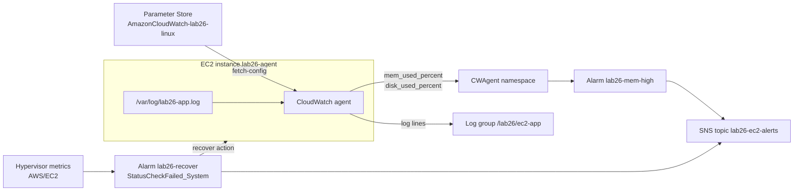

> [!COST]
> The `t3.micro` instance bills per second while it runs (about USD 0.0104 per hour in us-east-1) unless Free Tier credits or the legacy Free Tier cover it, and its public IPv4 address costs USD 0.005 per hour. The two metrics the agent publishes (`mem_used_percent`, `disk_used_percent`) are custom metrics at USD 0.30 per metric per month, prorated by the hour, and fall inside the 10 free custom metrics if you have not used them elsewhere. A Standard-tier Parameter Store parameter, two alarm metrics, a few kilobytes of logs and SNS email are free at this scale. Terminate the instance in **Cleanup** as soon as you finish.

Out of the box, EC2 metrics come from the hypervisor, so CloudWatch can show CPU and network but **not memory or file-system usage**, and no log file ever leaves the instance on its own. In this lab you close both gaps with the **unified CloudWatch agent**, keep its configuration centrally in **SSM Parameter Store** (the way you would for a fleet), and finish with the single-instance self-healing pattern: an alarm on `StatusCheckFailed_System` with the **Recover this instance** action.



## Prerequisites

- An AWS account and a user or role allowed to manage EC2, IAM roles and instance profiles, Systems Manager, CloudWatch and SNS (administrator access in a personal lab account is simplest).
- A Region with its **default VPC**; the steps use `us-east-1`. Default subnets give instances a public IPv4 address, which the instance needs to reach the Systems Manager and CloudWatch endpoints (no inbound rules are needed).
- An email address for the SNS notification.
- For the CLI tabs: **AWS CloudShell** (or AWS CLI v2 with credentials) and a Bash shell. Keep one terminal open; later commands reuse shell variables. Commands marked *on the instance* run inside the Session Manager session instead.

## Steps

### Step 1: Create an IAM role for the instance

The agent needs permission to put metrics and logs and to read its configuration from Parameter Store; Session Manager needs the core Systems Manager permissions. Two AWS managed policies cover both.

:::console
1. Open the **IAM** console, choose **Roles** → **Create role**.
2. Under **Trusted entity type** keep **AWS service**; for **Use case** choose **EC2**. Choose **Next**.
3. Search for and tick **CloudWatchAgentServerPolicy** and **AmazonSSMManagedInstanceCore**. Choose **Next**.
4. For **Role name** enter `lab26-cwagent-role` and choose **Create role**. The console also creates an instance profile with the same name.
:::

:::cli
```bash
cat > ec2-trust.json <<'EOF'
{"Version":"2012-10-17","Statement":[{"Effect":"Allow","Principal":{"Service":"ec2.amazonaws.com"},"Action":"sts:AssumeRole"}]}
EOF
aws iam create-role --role-name lab26-cwagent-role \
  --assume-role-policy-document file://ec2-trust.json
aws iam attach-role-policy --role-name lab26-cwagent-role \
  --policy-arn arn:aws:iam::aws:policy/CloudWatchAgentServerPolicy
aws iam attach-role-policy --role-name lab26-cwagent-role \
  --policy-arn arn:aws:iam::aws:policy/AmazonSSMManagedInstanceCore
aws iam create-instance-profile --instance-profile-name lab26-cwagent-role
aws iam add-role-to-instance-profile --instance-profile-name lab26-cwagent-role \
  --role-name lab26-cwagent-role
```
:::

> [!NOTE]
> `CloudWatchAgentServerPolicy` allows `ssm:GetParameter` only on parameters whose names start with `AmazonCloudWatch-`, which is why the next step uses that prefix. Its current version also includes `logs:PutRetentionPolicy`, so the agent may set the retention of the log group it creates. On an on-premises server you would use an IAM user's access keys with the same policy instead of a role.

### Step 2: Store the agent configuration in Parameter Store

The configuration asks for memory used (percent), disk used (percent) for the root file system only, and one application log file. `append_dimensions` adds the instance ID to every metric (and stops the agent from adding a `host` dimension), which makes the metrics easy to alarm on.

```json
{
  "agent": { "metrics_collection_interval": 60 },
  "metrics": {
    "namespace": "CWAgent",
    "append_dimensions": { "InstanceId": "${aws:InstanceId}" },
    "metrics_collected": {
      "mem": { "measurement": ["mem_used_percent"] },
      "disk": { "measurement": ["used_percent"], "resources": ["/"] }
    }
  },
  "logs": {
    "logs_collected": {
      "files": {
        "collect_list": [
          {
            "file_path": "/var/log/lab26-app.log",
            "log_group_name": "/lab26/ec2-app",
            "log_stream_name": "{instance_id}",
            "retention_in_days": 1
          }
        ]
      }
    }
  }
}
```

:::console
1. Open the **AWS Systems Manager** console and choose **Parameter Store** in the navigation pane, then **Create parameter**.
2. **Name**: `AmazonCloudWatch-lab26-linux`. **Tier**: **Standard**. **Type**: **String**. **Data type**: **text**.
3. Paste the JSON above into **Value** and choose **Create parameter**.
:::

:::cli
```bash
cat > cwagent-config.json <<'EOF'
{
  "agent": { "metrics_collection_interval": 60 },
  "metrics": {
    "namespace": "CWAgent",
    "append_dimensions": { "InstanceId": "${aws:InstanceId}" },
    "metrics_collected": {
      "mem": { "measurement": ["mem_used_percent"] },
      "disk": { "measurement": ["used_percent"], "resources": ["/"] }
    }
  },
  "logs": {
    "logs_collected": {
      "files": {
        "collect_list": [
          { "file_path": "/var/log/lab26-app.log", "log_group_name": "/lab26/ec2-app",
            "log_stream_name": "{instance_id}", "retention_in_days": 1 }
        ]
      }
    }
  }
}
EOF
aws ssm put-parameter --name AmazonCloudWatch-lab26-linux --type String \
  --tier Standard --value file://cwagent-config.json
```
:::

> [!CHECK]
> **Parameter Store** lists `AmazonCloudWatch-lab26-linux` as a **Standard** `String` parameter, version 1.

### Step 3: Launch an instance with the role and connect through Session Manager

:::console
1. Open the **EC2** console and choose **Launch instance**.
2. **Name and tags**: `lab26-agent`. **Application and OS Images (Amazon Machine Image)**: keep **Amazon Linux 2023** from **Quick Start**. **Instance type**: **t3.micro**.
3. **Key pair (login)**: choose **Proceed without a key pair (not recommended)**; you will connect with Session Manager, which needs no SSH key or open port.
4. **Network settings**: choose **Edit**, keep the default VPC and **Auto-assign public IP** **Enable**. For **Firewall (security groups)** choose **Select existing security group** and pick **default** (it has no rule open to the internet).
5. Expand **Advanced details**. For **IAM instance profile** choose `lab26-cwagent-role`. Leave **Detailed CloudWatch monitoring** disabled; the agent is what adds memory, not detailed monitoring.
6. Choose **Launch instance**. When the instance is **Running** and its **Status check** column shows the checks passed (two to three minutes), select it and choose **Connect** → **Session Manager** → **Connect**.
:::

:::cli
```bash
AMI=$(aws ssm get-parameters \
  --names /aws/service/ami-amazon-linux-latest/al2023-ami-kernel-default-x86_64 \
  --query 'Parameters[0].Value' --output text)
IID=$(aws ec2 run-instances --image-id "$AMI" --instance-type t3.micro \
  --iam-instance-profile Name=lab26-cwagent-role \
  --tag-specifications 'ResourceType=instance,Tags=[{Key=Name,Value=lab26-agent}]' \
  --query 'Instances[0].InstanceId' --output text)
aws ec2 wait instance-status-ok --instance-ids "$IID"
echo "Instance: $IID"
# Connect from a terminal that has the Session Manager plugin (not needed in the console):
# aws ssm start-session --target "$IID"
```
If `run-instances` reports that the instance profile is invalid, wait 10 to 20 seconds for IAM to propagate and run it again. Without `--security-group-ids` and `--subnet-id`, the instance uses the default VPC's default security group and a default subnet.
:::

> [!CHECK]
> The Session Manager tab opens a shell prompt such as `sh-5.2$` as `ssm-user`. If **Connect** says the instance is not a managed node, wait a few more minutes and confirm that the IAM instance profile is attached (**Actions** → **Security** → **Modify IAM role**).

### Step 4: Install the agent and start it with the Parameter Store configuration

Run these commands *on the instance* in the Session Manager shell. The log file is created first so the agent has something to tail.

:::console
1. In the Session Manager shell, run the four commands shown in the CLI tab (they are the same for both paths).
2. Leave the session open; you will write to the log file again in Step 5.
:::

:::cli
```bash
# On the instance (Session Manager shell)
sudo dnf install -y amazon-cloudwatch-agent
echo "$(date -Is) INFO app started" | sudo tee -a /var/log/lab26-app.log
sudo /opt/aws/amazon-cloudwatch-agent/bin/amazon-cloudwatch-agent-ctl \
  -a fetch-config -m ec2 -s -c ssm:AmazonCloudWatch-lab26-linux
sudo /opt/aws/amazon-cloudwatch-agent/bin/amazon-cloudwatch-agent-ctl -m ec2 -a status
```
:::

> [!CHECK]
> The status command prints JSON with `"status": "running"` and the agent version. If it says `stopped`, read `/opt/aws/amazon-cloudwatch-agent/logs/configuration-validation.log` and `/opt/aws/amazon-cloudwatch-agent/logs/amazon-cloudwatch-agent.log`; a typo in the JSON or a parameter name without the `AmazonCloudWatch-` prefix are the usual causes.

> [!TIP]
> The AWS documentation shows the install as `sudo yum install amazon-cloudwatch-agent`; on Amazon Linux 2023 `yum` is an alias for `dnf`, so either works. For a real fleet you would push the same `fetch-config` call with Systems Manager Run Command (document `AmazonCloudWatch-ManageAgent`) instead of logging in to each server.

### Step 5: Find the new metrics and the application log in CloudWatch

Write a few more lines, then look for the data. The first data points take two to five minutes to appear.

:::console
1. In the Session Manager shell, run the `for` loop from the CLI tab to append five lines to the log.
2. Open the **CloudWatch** console → **Metrics** → **All metrics**. Choose the **CWAgent** namespace. Under **InstanceId** tick `mem_used_percent`; under **InstanceId, device, fstype, path** tick `disk_used_percent` for path `/`.
3. For comparison, open **AWS/EC2** → **Per-Instance Metrics** for the same instance and note that there is CPU, network and status-check data but nothing about memory.
4. In the navigation pane choose **Log Management** (or **Logs** → **Log groups**), open `/lab26/ec2-app`, then the log stream named after your instance ID.
:::

:::cli
```bash
# On the instance
for i in 1 2 3 4 5; do
  echo "$(date -Is) ERROR payment timeout order=$i" | sudo tee -a /var/log/lab26-app.log
done

# Back in CloudShell
aws cloudwatch list-metrics --namespace CWAgent \
  --dimensions Name=InstanceId,Value="$IID" \
  --query 'Metrics[].MetricName' --output text
aws logs tail /lab26/ec2-app --since 15m
```
:::

> [!CHECK]
> `CWAgent` shows `mem_used_percent` (dimension `InstanceId`) at roughly 20 to 40 percent on an idle `t3.micro`, and `disk_used_percent` for `/`. The log stream contains the start line and the five `ERROR payment timeout` lines. Agent metrics are billed as **custom metrics**, which is why this lab collects only two.

### Step 6: Alarm on memory and test the notification

:::console
1. In CloudWatch choose **Alarms** → **All alarms** → **Create alarm** → **Select metric**, then **CWAgent** → **InstanceId** → tick `mem_used_percent` for your instance. On **Graphed metrics** set **Statistic** **Average** and **Period** **1 minute**; choose **Select metric**.
2. **Conditions**: **Static**, **Greater**, threshold `80`. Under **Additional configuration** set **Datapoints to alarm** to **3** out of **3**. Choose **Next**.
3. **Notification**: **In alarm**, choose **Create new topic**, name it `lab26-ec2-alerts`, enter your email address, and choose **Create topic**. Confirm the subscription from the email you receive. Choose **Next**.
4. Name the alarm `lab26-mem-high`, choose **Next**, then **Create alarm**.
5. Force a test notification by running the CLI tab's `set-alarm-state` command in CloudShell.
:::

:::cli
```bash
EMAIL="you@example.com"   # replace with your address
TOPIC_ARN=$(aws sns create-topic --name lab26-ec2-alerts --query TopicArn --output text)
aws sns subscribe --topic-arn "$TOPIC_ARN" --protocol email --notification-endpoint "$EMAIL"
# Confirm the subscription from your inbox, then:
aws cloudwatch put-metric-alarm --alarm-name lab26-mem-high \
  --namespace CWAgent --metric-name mem_used_percent \
  --dimensions Name=InstanceId,Value="$IID" \
  --statistic Average --period 60 --evaluation-periods 3 --datapoints-to-alarm 3 \
  --threshold 80 --comparison-operator GreaterThanThreshold \
  --alarm-actions "$TOPIC_ARN"

aws cloudwatch set-alarm-state --alarm-name lab26-mem-high \
  --state-value ALARM --state-reason "Lab 26: memory alarm test"
```
:::

> [!CHECK]
> The alarm reaches **OK** (memory is far below 80 percent), the forced state sends an *ALARM: "lab26-mem-high"* email, and the alarm returns to **OK** at the next evaluation.

### Step 7: Add a recovery alarm on the system status check

This is the exam's "keep the same instance ID and IP addresses if the host fails" answer. AWS recommends two one-minute evaluation periods for recover alarms and the `Minimum` statistic.

:::console
1. **Alarms** → **All alarms** → **Create alarm** → **Select metric** → **EC2** → **Per-Instance Metrics**. Tick the row with your instance and **StatusCheckFailed_System**, then choose **Select metric**.
2. On **Graphed metrics**/**Specify metric and conditions** set **Statistic** to **Minimum** and **Period** to **1 minute**.
3. **Conditions**: **Static**, **Greater**, threshold `0`. **Additional configuration**: **Datapoints to alarm** **2** out of **2**; keep **Missing data treatment** as **Treat missing data as missing**. Choose **Next**.
4. **Notification**: **In alarm** → select `lab26-ec2-alerts`.
5. Choose **Add EC2 action**: **Alarm state trigger** **In alarm**, **Take the following action** **Recover this instance**. Choose **Next**.
6. Name it `lab26-recover`, choose **Next**, then **Create alarm**.
:::

:::cli
```bash
REGION=$(aws configure get region || echo "$AWS_REGION")
aws cloudwatch put-metric-alarm --alarm-name lab26-recover \
  --namespace AWS/EC2 --metric-name StatusCheckFailed_System \
  --dimensions Name=InstanceId,Value="$IID" \
  --statistic Minimum --period 60 --evaluation-periods 2 --datapoints-to-alarm 2 \
  --threshold 0 --comparison-operator GreaterThanThreshold \
  --treat-missing-data missing \
  --alarm-actions "arn:aws:automate:${REGION}:ec2:recover" "$TOPIC_ARN"
aws cloudwatch describe-alarms --alarm-names lab26-recover \
  --query 'MetricAlarms[0].[StateValue,AlarmActions]'
```
:::

> [!CHECK]
> `lab26-recover` settles in **OK** and its **Actions** list both the SNS topic and the EC2 recover action. You cannot trigger a real host failure, so this alarm is not tested here.

> [!WARNING]
> Do not use `set-alarm-state` on `lab26-recover`: forcing it into ALARM runs its actions, and the recover action could start a recovery (an unplanned reboot onto other hardware). Test notification paths on alarms that only notify, as you did in Step 6.

> [!NOTE]
> Supported instances such as this `t3.micro` also get **simplified automatic recovery** by default, with no alarm. The alarm-based recover action adds SNS notifications, customizable conditions and a faster recovery attempt. Either way the recovered instance keeps its instance ID, private, public and Elastic IP addresses, metadata, placement group, EBS volumes and AZ, and loses whatever was in RAM. The recover action is not supported on `StatusCheckFailed_Instance`; an alarm on that metric would use the reboot action instead.

## Cleanup

Delete in this order:

- [ ] **Alarms `lab26-recover` and `lab26-mem-high`**: **Alarms** → **All alarms** → select both → **Actions** → **Delete**. CLI: `aws cloudwatch delete-alarms --alarm-names lab26-recover lab26-mem-high`.
- [ ] **Instance `lab26-agent`**: EC2 console → **Instances** → select it → **Instance state** → **Terminate (delete) instance** → confirm. This also deletes its root EBS volume and releases its public IP. CLI: `aws ec2 terminate-instances --instance-ids "$IID"` then `aws ec2 wait instance-terminated --instance-ids "$IID"`.
- [ ] **Log group `/lab26/ec2-app`**: CloudWatch → **Log Management** → select it → **Actions** → **Delete log group(s)**. CLI: `aws logs delete-log-group --log-group-name /lab26/ec2-app`. (Its 1-day retention would also empty it, but the group itself would remain.)
- [ ] **Parameter `AmazonCloudWatch-lab26-linux`**: Systems Manager → **Parameter Store** → select it → **Delete** → confirm. CLI: `aws ssm delete-parameter --name AmazonCloudWatch-lab26-linux`.
- [ ] **SNS topic `lab26-ec2-alerts`** (and its email subscription): SNS → **Topics** → select it → **Delete** → type `delete me`. CLI: `aws sns delete-topic --topic-arn "$TOPIC_ARN"`.
- [ ] **IAM role and instance profile `lab26-cwagent-role`**: IAM → **Roles** → select `lab26-cwagent-role` → **Delete** → type the role name → **Delete** (the console removes the attached policies and the instance profile). CLI:
  ```bash
  aws iam remove-role-from-instance-profile --instance-profile-name lab26-cwagent-role --role-name lab26-cwagent-role
  aws iam delete-instance-profile --instance-profile-name lab26-cwagent-role
  aws iam detach-role-policy --role-name lab26-cwagent-role --policy-arn arn:aws:iam::aws:policy/CloudWatchAgentServerPolicy
  aws iam detach-role-policy --role-name lab26-cwagent-role --policy-arn arn:aws:iam::aws:policy/AmazonSSMManagedInstanceCore
  aws iam delete-role --role-name lab26-cwagent-role
  ```
- [ ] **CloudShell files `ec2-trust.json` and `cwagent-config.json`**: `rm -f ec2-trust.json cwagent-config.json`.
- [ ] **Final check**: no running or stopped `lab26-agent` instance in this Region, no `lab26-*` alarms, and the next day **Billing and Cost Management** → **Bills** shows no new EC2 charges. The `CWAgent` metrics cannot be deleted; they stop accruing charges once the agent is gone and expire after 15 months.

## Progress checklist

- [ ] Step 1: Created `lab26-cwagent-role` with the agent and Systems Manager policies
- [ ] Step 2: Stored the agent configuration as `AmazonCloudWatch-lab26-linux`
- [ ] Step 3: Launched `lab26-agent` and connected with Session Manager
- [ ] Step 4: Installed the agent and confirmed it is running
- [ ] Step 5: Found `mem_used_percent`, `disk_used_percent` and the application log
- [ ] Step 6: Created `lab26-mem-high` and received the test notification
- [ ] Step 7: Created `lab26-recover` with the SNS and recover actions
- [ ] Cleanup done
