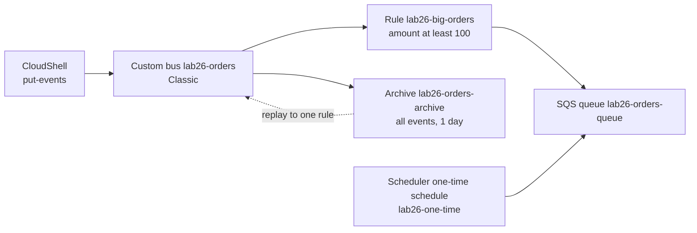

> [!COST]
> Custom events published to a classic bus have no free tier: they cost USD 1.00 per million (each 64 KB chunk counts as one event), and replayed events are charged like custom events. Archives cost USD 0.10 per GB processed plus USD 0.023 per GB-month of storage. At the volume in this lab (about a dozen tiny events) the total is a fraction of a cent. SQS and EventBridge Scheduler usage stays inside their free monthly allowances.

The scenario: a shop publishes `OrderPlaced` events to its own event bus. A fulfilment service only cares about orders of USD 100 or more, so a rule filters on the **content** of each event and delivers matches to an SQS queue. Every event is also kept in an **archive**. Later you pretend the fulfilment consumer had a bug, and you **replay** the archived window to that one rule. Finally you use **EventBridge Scheduler**, the recommended way to run something at a set time, to drop a one-time message into the same queue.



## Prerequisites

- An AWS account and a user or role allowed to manage EventBridge, EventBridge Scheduler, SQS and IAM roles (administrator access in a personal lab account is simplest).
- One Region for the whole lab; the steps use `us-east-1`. Events are sent from **AWS CloudShell** in both paths, so keep one CloudShell tab open: later commands reuse shell variables.
- About 10 minutes of slack between Step 5 and Step 6. AWS recommends waiting that long before replaying, because events can reach the archive with a short delay.

> [!NOTE]
> Since September 2026 EventBridge has two kinds of custom bus. The new **Custom Event Bus** uses subscribers and built-in retention; the older rule-and-target bus is now called **Custom Event Bus - Classic**. This lab deliberately uses the classic bus because rules, archives and replays are what SAA-C03 questions describe. The `aws events` CLI commands below create classic buses; the new bus type has its own `aws eventsv2` commands.

## Steps

### Step 1: Create the SQS queue that receives matching events

:::console
1. Open the **Amazon SQS** console and choose **Create queue**.
2. Keep **Type** **Standard**, enter the **Name** `lab26-orders-queue`, leave every other setting at its default, and choose **Create queue**.
:::

:::cli
```bash
QUEUE_URL=$(aws sqs create-queue --queue-name lab26-orders-queue \
  --query QueueUrl --output text)
QUEUE_ARN=$(aws sqs get-queue-attributes --queue-url "$QUEUE_URL" \
  --attribute-names QueueArn --query Attributes.QueueArn --output text)
echo "$QUEUE_URL"; echo "$QUEUE_ARN"
```
:::

> [!CHECK]
> The queue's **Details** page shows type **Standard** and **Messages available** 0.

### Step 2: Create a classic custom event bus

:::console
1. Open the **Amazon EventBridge** console and choose **Event buses** → **Create event bus**. If the console asks which kind of bus to create, choose **Custom Event Bus - Classic** (the new **Custom Event Bus** has no rules or archives, so the rest of this lab would not apply).
2. Enter the name `lab26-orders`. Keep **Use AWS owned key** for encryption and the default **Logs - optional** settings (or clear them if you do not want an extra log group).
3. Leave **Archives**, **Schema discovery** and the resource-based policy unset (you create the archive separately in Step 4), and choose **Create**.
:::

:::cli
```bash
BUS_ARN=$(aws events create-event-bus --name lab26-orders \
  --query EventBusArn --output text)
echo "$BUS_ARN"
```
:::

> [!CHECK]
> **Event buses** lists `lab26-orders` with the type **Custom Event Bus - Classic**, next to the account's **default** bus. If the console created a log group for bus logging, note its name for cleanup.

### Step 3: Create a rule that matches only orders of 100 or more

The event pattern matches on three things: the `source`, the `detail-type`, and a numeric comparison inside `detail`. Anything that does not match is simply not delivered to this rule's target.

```json
{
  "source": ["lab26.shop"],
  "detail-type": ["OrderPlaced"],
  "detail": { "amount": [{ "numeric": [">=", 100] }] }
}
```

:::console
1. In EventBridge choose **Rules** → **Create rule**, and on the builder selection page choose **Advanced Builder**.
2. **Name**: `lab26-big-orders`. **Event bus**: `lab26-orders`. **Rule type**: **Rule with an event pattern**. Choose **Next**.
3. **Event source**: **Other** (custom events from your own applications). **Creation method**: **Custom pattern (JSON editor)**. Paste the pattern above into **Event pattern**.
4. Optional test: under **Sample events** choose **Enter my own**, paste the event below, and choose **Test pattern**; it should match. Change `250` to `40` and test again; it should not.
   `{"version":"0","id":"1","detail-type":"OrderPlaced","source":"lab26.shop","account":"123456789012","time":"2026-10-04T10:00:00Z","region":"us-east-1","resources":[],"detail":{"orderId":"T-1","amount":250}}`
5. Choose **Next**. **Target types**: **AWS service**; **Select a target**: **SQS queue**; **Queue**: `lab26-orders-queue`. If an **Execution role** option is shown, keep **Create a new role for this specific resource**; otherwise the console adds a statement to the queue's access policy that lets EventBridge send to it.
6. Choose **Next**, skip tags with **Next**, review, and choose **Create rule**.
:::

:::cli
```bash
cat > pattern.json <<'EOF'
{
  "source": ["lab26.shop"],
  "detail-type": ["OrderPlaced"],
  "detail": { "amount": [{ "numeric": [">=", 100] }] }
}
EOF
RULE_ARN=$(aws events put-rule --name lab26-big-orders --event-bus-name lab26-orders \
  --event-pattern file://pattern.json --query RuleArn --output text)
aws events put-targets --rule lab26-big-orders --event-bus-name lab26-orders \
  --targets "Id"="orders-queue","Arn"="$QUEUE_ARN"

# Allow this rule (and only this rule) to send messages to the queue.
cat > queue-policy.json <<EOF
{"Version":"2012-10-17","Statement":[{"Sid":"AllowLab26Rule","Effect":"Allow",
 "Principal":{"Service":"events.amazonaws.com"},"Action":"sqs:SendMessage",
 "Resource":"$QUEUE_ARN","Condition":{"ArnEquals":{"aws:SourceArn":"$RULE_ARN"}}}]}
EOF
python3 -c 'import json; print(json.dumps({"Policy": open("queue-policy.json").read()}))' > queue-attrs.json
aws sqs set-queue-attributes --queue-url "$QUEUE_URL" --attributes file://queue-attrs.json
echo "$RULE_ARN"
```
The rule ARN on a custom bus includes the bus name (`rule/lab26-orders/lab26-big-orders`), and the queue policy's `aws:SourceArn` condition must use that exact ARN.
:::

> [!CHECK]
> The rule shows **Enabled** on bus `lab26-orders` with one SQS target. In SQS, the queue's **Access policy** tab now contains a statement for the `events.amazonaws.com` service principal (unless the console used an execution role instead).

### Step 4: Archive every event on the bus

:::console
1. In EventBridge choose **Archives** → **Create archive**.
2. **Name**: `lab26-orders-archive`. **Source**: `lab26-orders`. **Retention period**: clear **Indefinite** and enter `1` day. Keep **Use AWS owned key**. Choose **Next**.
3. Skip the optional event pattern so that every event is archived, and choose **Create archive**.
:::

:::cli
```bash
ARCHIVE_ARN=$(aws events create-archive --archive-name lab26-orders-archive \
  --event-source-arn "$BUS_ARN" --retention-days 1 \
  --query ArchiveArn --output text)
aws events describe-archive --archive-name lab26-orders-archive --query State
```
:::

> [!CHECK]
> The archive state is **Enabled** (the CLI prints `ENABLED`). Behind the scenes EventBridge has added a managed rule to the bus that keeps replayed events out of the archive; if it appears in the bus's rule list you cannot edit it, and it goes away when you delete the archive.

### Step 5: Publish three orders and read the queue

One order is too small to match, so only two should reach the queue. Note the start time: the replay in Step 6 needs it.

:::console
1. In **CloudShell**, run the CLI tab's commands (the console path uses the same commands to send events, since it keeps the timestamps you need for the replay).
2. In the SQS console open `lab26-orders-queue`, choose **Send and receive messages**, then **Poll for messages**. Open each message to read its body.
3. Choose **Purge** on the queue page (or run the `purge-queue` command) so the queue is empty before the replay.
:::

:::cli
```bash
START=$(date -u +%Y-%m-%dT%H:%M:%SZ)
cat > orders.json <<'EOF'
[
  {"EventBusName":"lab26-orders","Source":"lab26.shop","DetailType":"OrderPlaced","Detail":"{\"orderId\":\"A-1\",\"amount\":250}"},
  {"EventBusName":"lab26-orders","Source":"lab26.shop","DetailType":"OrderPlaced","Detail":"{\"orderId\":\"A-2\",\"amount\":40}"},
  {"EventBusName":"lab26-orders","Source":"lab26.shop","DetailType":"OrderPlaced","Detail":"{\"orderId\":\"A-3\",\"amount\":120}"}
]
EOF
aws events put-events --entries file://orders.json
echo "START=$START"

sleep 10
aws sqs receive-message --queue-url "$QUEUE_URL" --max-number-of-messages 10 \
  --wait-time-seconds 10 --query 'Messages[].Body' --output text
aws sqs purge-queue --queue-url "$QUEUE_URL"
```
:::

> [!CHECK]
> `put-events` returns `"FailedEntryCount": 0` and three event IDs. The queue held exactly **two** messages, for `A-1` (250) and `A-3` (120); the 40-dollar order was filtered out by the rule. Each message body is the full EventBridge event, with the standard envelope (`version`, `id`, `detail-type`, `source`, `account`, `time`, `region`, `resources`) around your `detail`.

### Step 6: Replay the archived window to the rule

Pretend the fulfilment consumer mishandled those orders and has been fixed. Wait at least 10 minutes after Step 5, then replay the window to the one rule that needs it.

:::console
1. In EventBridge choose **Replays** → **Start new replay** (or select the archive under **Archives** and choose **Replay**).
2. **Name**: `lab26-replay-1`. **Source**: `lab26-orders-archive`. The destination is fixed to the bus the events came from.
3. Choose **Specify rules** and select `lab26-big-orders`.
4. Under **Replay time frame** set **Start time** to a minute or two before you ran Step 5 and **End time** to now (check **Time zone**). Choose **Start replay**.
5. Wait until the replay status is **Completed**, then poll the queue again as in Step 5.
:::

:::cli
```bash
END=$(date -u +%Y-%m-%dT%H:%M:%SZ)
aws events start-replay --replay-name lab26-replay-1 \
  --event-source-arn "$ARCHIVE_ARN" \
  --event-start-time "$START" --event-end-time "$END" \
  --destination "{\"Arn\":\"$BUS_ARN\",\"FilterArns\":[\"$RULE_ARN\"]}"

# Check progress until the state is COMPLETED, then read the queue.
aws events describe-replay --replay-name lab26-replay-1 --query State --output text
aws sqs receive-message --queue-url "$QUEUE_URL" --max-number-of-messages 10 \
  --wait-time-seconds 10 --query 'Messages[].Body' --output text
```
:::

> [!CHECK]
> The queue again receives the `A-1` and `A-3` orders, and each body now contains an extra top-level field `"replay-name": "lab26-replay-1"`, which is how a consumer can tell a replayed event from a live one. The archive still holds the original events; replaying never removes them.

> [!TIP]
> If the replay completes but nothing arrives, the events were probably not in the archive yet or the time window missed them. Wait a few more minutes and start `lab26-replay-2` with a wider window. Replays run minute by minute through the window, so strict ordering is not guaranteed.

### Step 7: Fire a one-time EventBridge Scheduler schedule

Scheduled rules on an event bus still work, but AWS now calls them legacy and recommends **EventBridge Scheduler**, which adds one-time schedules, time zones, flexible windows and retries.

:::console
1. In the EventBridge console navigation pane choose **Schedules** (under **Scheduler**), then **Create schedule**.
2. **Schedule name**: `lab26-one-time`. **Schedule group**: `default`.
3. **Occurrence**: **One-time schedule**. **Date and time**: about five minutes from now, with your **time zone** selected. **Flexible time window**: **Off**. Choose **Next**.
4. **Select target**: **Templated targets** → **Amazon SQS SendMessage**. **SQS queue**: `lab26-orders-queue`. **Target** (payload): `Hello from EventBridge Scheduler`. Choose **Next**.
5. On **Settings - optional**, under **Action after schedule completion** choose **DELETE**. Under **Permissions** choose **Create new role for this schedule** and accept the generated name (note it for cleanup). Choose **Next**, then **Create schedule**.
6. After the scheduled time, poll the queue.
:::

:::cli
```bash
cat > scheduler-trust.json <<'EOF'
{"Version":"2012-10-17","Statement":[{"Effect":"Allow","Principal":{"Service":"scheduler.amazonaws.com"},"Action":"sts:AssumeRole"}]}
EOF
SCHED_ROLE_ARN=$(aws iam create-role --role-name lab26-scheduler-role \
  --assume-role-policy-document file://scheduler-trust.json --query Role.Arn --output text)
aws iam put-role-policy --role-name lab26-scheduler-role --policy-name send-to-lab26-queue \
  --policy-document "{\"Version\":\"2012-10-17\",\"Statement\":[{\"Effect\":\"Allow\",\"Action\":\"sqs:SendMessage\",\"Resource\":\"$QUEUE_ARN\"}]}"
sleep 15   # give IAM a moment to propagate the new role

AT=$(date -u -d '+3 minutes' +%Y-%m-%dT%H:%M:%S)
aws scheduler create-schedule --name lab26-one-time \
  --schedule-expression "at($AT)" --schedule-expression-timezone UTC \
  --flexible-time-window '{"Mode":"OFF"}' \
  --action-after-completion DELETE \
  --target "{\"Arn\":\"$QUEUE_ARN\",\"RoleArn\":\"$SCHED_ROLE_ARN\",\"Input\":\"Hello from EventBridge Scheduler\"}"
echo "Fires at $AT UTC"

# After that time:
aws sqs receive-message --queue-url "$QUEUE_URL" --wait-time-seconds 10 \
  --query 'Messages[].Body' --output text
```
:::

> [!CHECK]
> A message with the body `Hello from EventBridge Scheduler` arrives at the scheduled time (the replayed orders may show up again too, because receiving a message without deleting it only hides it for the visibility timeout), and because of the **DELETE** completion action the schedule disappears from **Schedules** shortly afterwards. A recurring job would use a cron or rate expression instead, for example `rate(4 hours)` or `cron(0 2 * * ? *)` with a time zone.

## Cleanup

Delete in this order. Replays cannot be deleted and cost nothing after they finish; EventBridge removes them after 90 days.

- [ ] **Schedule `lab26-one-time`** (only if it still exists, for example because it has not fired): EventBridge → **Schedules** → select it → **Delete**. CLI: `aws scheduler delete-schedule --name lab26-one-time`.
- [ ] **Scheduler execution role** (`lab26-scheduler-role`, or the role the console generated in Step 7): IAM → **Roles** → select it → **Delete**. CLI: `aws iam delete-role-policy --role-name lab26-scheduler-role --policy-name send-to-lab26-queue` then `aws iam delete-role --role-name lab26-scheduler-role`.
- [ ] **Rule `lab26-big-orders`** (remove its target first): EventBridge → **Rules** → choose bus `lab26-orders` → select the rule → **Delete** → confirm. CLI: `aws events remove-targets --rule lab26-big-orders --event-bus-name lab26-orders --ids orders-queue` then `aws events delete-rule --name lab26-big-orders --event-bus-name lab26-orders`.
- [ ] **Rule execution role**, only if the console created one in Step 3 (a role whose name starts with `Amazon_EventBridge_Invoke_Sqs`): IAM → **Roles** → select it → **Delete**.
- [ ] **Archive `lab26-orders-archive`** (this also removes its managed rule): EventBridge → **Archives** → select it → **Delete**. CLI: `aws events delete-archive --archive-name lab26-orders-archive`.
- [ ] **Event bus `lab26-orders`** (it must have no rules left): EventBridge → **Event buses** → select it → **Delete** → confirm. CLI: `aws events delete-event-bus --name lab26-orders`.
- [ ] **Bus log group**, only if the console created one for the bus's logs in Step 2: CloudWatch → **Log Management** → select it → **Actions** → **Delete log group(s)**.
- [ ] **Queue `lab26-orders-queue`**: SQS → select it → **Delete** → type `confirm` → **Delete**. CLI: `aws sqs delete-queue --queue-url "$QUEUE_URL"`.
- [ ] **CloudShell files**: `rm -f pattern.json queue-policy.json queue-attrs.json orders.json scheduler-trust.json`.
- [ ] **Final check**: EventBridge shows only the **default** bus, no `lab26-*` rules, archives or schedules; SQS shows no `lab26-orders-queue`; IAM shows no lab 26 roles.

## Progress checklist

- [ ] Step 1: Created `lab26-orders-queue`
- [ ] Step 2: Created the classic custom bus `lab26-orders`
- [ ] Step 3: Created `lab26-big-orders` with a numeric content filter and an SQS target
- [ ] Step 4: Created `lab26-orders-archive` covering all events for 1 day
- [ ] Step 5: Published three orders and saw only the two large ones in the queue
- [ ] Step 6: Replayed the window and saw the `replay-name` field
- [ ] Step 7: Received the one-time Scheduler message
- [ ] Cleanup done
