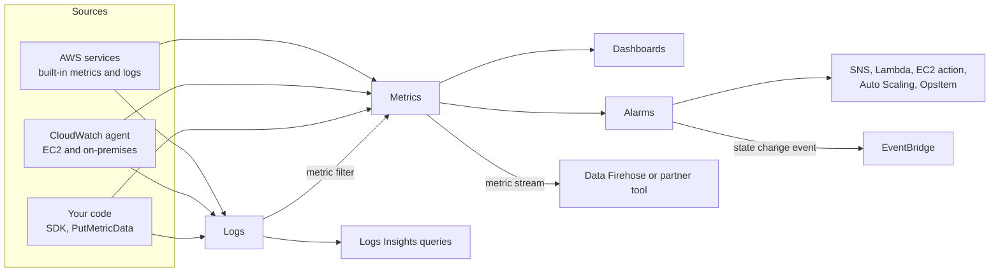
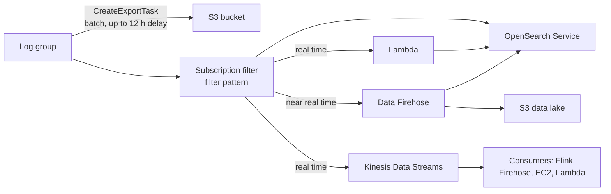
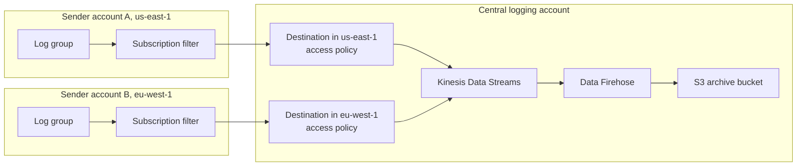
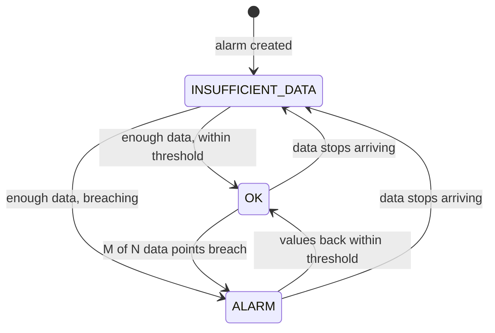
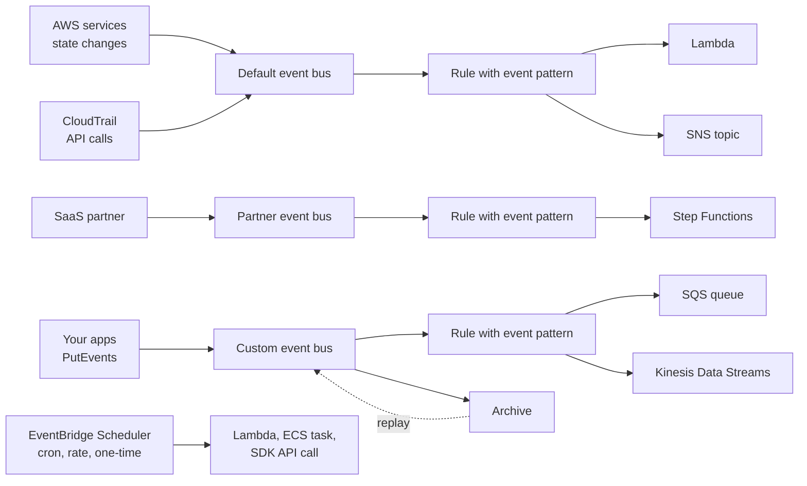
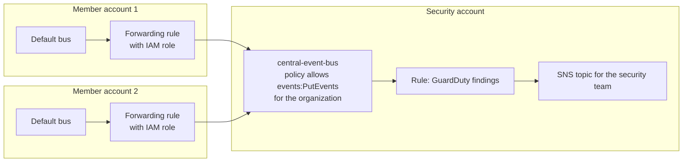

# Monitoring with CloudWatch & EventBridge

## Summary

**Amazon CloudWatch** is the place where AWS keeps the numbers and the text your workloads produce: **metrics** (time series such as CPU or queue depth), **logs** (lines written by applications and services), **alarms** that watch metrics and act, **dashboards**, and a family of "Insights" features that analyse containers, Lambda functions, log contributors and whole applications. **Amazon EventBridge** (formerly CloudWatch Events) is the event router that sits next to it: it receives events from AWS services, SaaS partners and your own code, matches them against rules and invokes targets such as Lambda, SQS, SNS or Step Functions; its companion **EventBridge Scheduler** runs things on a cron or rate schedule. Pick CloudWatch when the question is "how is my system performing, what did it log, and who should be told when a threshold is crossed"; pick EventBridge when the question is "when *this* happens somewhere in AWS (or on a schedule), automatically do *that*".

## Key concepts

- A **metric** is a time-ordered set of data points identified by a **namespace**, a **name** and up to **30 dimensions**; metrics are Regional and kept for **15 months**.
- AWS services publish metrics for free; EC2 **basic monitoring** is every **5 minutes**, **detailed monitoring** every **1 minute**; **memory and disk-space usage are not included**.
- **Custom metrics** (PutMetricData or the CloudWatch agent) can be **standard resolution (1 minute)** or **high resolution (1 second)**.
- **CloudWatch Logs**: **log group** (usually one per application) → **log streams** (one per instance, container or file); retention from **1 day to 10 years** or **never expire** (the default).
- Getting logs out: **S3 export** (`CreateExportTask`, batch, data can take **up to 12 hours** to be exportable) versus **subscription filters** (near-real-time to **Kinesis Data Streams, Data Firehose, Lambda or OpenSearch**).
- **Logs Insights** is an interactive **query engine** over stored logs, not a real-time alerting engine.
- A **metric filter** turns matching log lines into a metric you can **alarm** on; it only counts events that arrive **after** it is created.
- The **unified CloudWatch agent** pushes **logs and in-guest metrics** (RAM, disk, processes, swap, netstat) from **EC2 and on-premises** servers; its config can live in **SSM Parameter Store**. The old logs-only agent is deprecated.
- **Alarms** have three states: **OK**, **ALARM**, **INSUFFICIENT_DATA**; actions include **SNS, Lambda, EC2 stop/terminate/reboot/recover, Auto Scaling** and Systems Manager OpsItems/incidents.
- **Composite alarms** combine other alarms with **AND / OR / NOT** to cut alarm noise.
- An alarm on **StatusCheckFailed_System** with the **recover** action moves an instance to new hardware and keeps its **instance ID, IP addresses, metadata and placement group**.
- **Network Synthetic Monitor** measures **latency and packet loss** from a VPC to on-premises over **Direct Connect or VPN**, with **no agent** to install.
- **EventBridge rules** match **event patterns** (or run on a schedule) and send events to up to **5 targets**; buses are **default** (AWS services), **partner** (SaaS) and **custom** (your apps).
- EventBridge can **archive** events and **replay** them, infer and version event **schemas**, and accept events from **other accounts** through a **resource-based policy** on the bus.
- **Container Insights** (ECS, EKS, Kubernetes on EC2, Fargate), **Lambda Insights**, **Contributor Insights** (top-N talkers from logs) and **Application Insights** (automated problem dashboards) add ready-made analysis.

## CloudWatch at a glance

Think of CloudWatch as four connected pieces. **Metrics** answer "how much / how fast" with numbers over time. **Logs** answer "what exactly happened" with text. **Alarms** watch a metric and react. **Dashboards and Insights** turn both into something a human can read. Almost every AWS service feeds CloudWatch on its own; for anything inside an operating system (memory, a log file on disk) you install the agent or publish data from your own code.



## CloudWatch metrics

### Namespaces, dimensions and data points

A **metric** is simply a variable you watch over time, for example `CPUUtilization` of one EC2 instance or `ApproximateNumberOfMessagesVisible` of one SQS queue. Each data point has a **timestamp** and a value (and optionally a unit).

- **Namespace**: a container that keeps metrics from different sources apart. AWS uses `AWS/<service>` (`AWS/EC2`, `AWS/RDS`); you choose your own for custom metrics (`MyShop/Checkout`). There is no default namespace.
- **Dimension**: a name/value pair that is part of the metric's identity, such as `InstanceId=i-0abc`, `AutoScalingGroupName=web-asg` or `Environment=prod`. You can attach **up to 30 dimensions** to a metric. Every new combination of dimension values creates a *separate* metric, which matters for cost: a custom metric with an `InstanceId` dimension across 50 instances is billed as 50 metrics.
- **Region**: metrics live in the Region where they were published. Dashboards can still show several Regions (and accounts) side by side.

> [!EXAMPLE] Reading one metric's identity
> `AWS/EC2` + `CPUUtilization` + `InstanceId=i-0abc123` is one metric. EC2 also publishes a few ready-made aggregates: per `AutoScalingGroupName` for any instance, and across all instances or per `ImageId` / `InstanceType` only for instances with detailed monitoring. For **custom** metrics, CloudWatch does not aggregate across dimensions for you: you can only read back the exact combinations you published.

### Resolution, retention and EC2 monitoring levels

| Item | Value to remember |
|---|---|
| AWS service metrics | Standard resolution (1-minute granularity) by default, free |
| EC2 basic monitoring | One data point every **5 minutes**, free |
| EC2 detailed monitoring | One data point every **1 minute**, paid (counts as metrics) |
| Custom metric, standard resolution | 1-minute granularity |
| Custom metric, high resolution | **1-second** granularity, readable at 1, 5, 10, 30 seconds or multiples of 60 |
| Data under 60 s | Kept **3 hours** |
| 1-minute data | Kept **15 days**, then rolled up to 5 minutes |
| 5-minute data | Kept **63 days**, then rolled up to 1 hour |
| 1-hour data | Kept **455 days (15 months)** |
| Custom data point timestamp | Up to 2 weeks in the past and 2 hours in the future |

Metrics cannot be deleted; they expire once no new data has arrived for 15 months.

### Custom metrics

EC2's built-in metrics come from the hypervisor, so they cover CPU, network, disk I/O on instance store and status checks, but **not memory use, free disk space on a file system, or anything your application knows** (logged-in users, orders per minute). To get those you publish **custom metrics**, either with the `PutMetricData` API (CLI or SDK) or by running the **CloudWatch agent**. Custom metrics are billed per metric per month (USD 0.30 for the first 10,000 in us-east-1) after the free allowance of 10 metrics.

```bash
aws cloudwatch put-metric-data --namespace MyShop/Checkout \
  --metric-name OrdersPlaced --value 3 --unit Count \
  --dimensions Environment=prod
```

### Dashboards

A **dashboard** is a page of graphs, numbers, alarm widgets and Logs Insights results. Dashboards can mix metrics from **different Regions**, and with **cross-account observability** a monitoring account can graph metrics from many source accounts. The free tier includes 3 custom dashboards (up to 50 metrics each); after that a dashboard costs USD 3 per month. AWS also builds **automatic dashboards** per service.

### Metric Streams

Polling the CloudWatch API to copy metrics into another tool is slow and expensive. A **metric stream** pushes metric updates continuously, within minutes, to:

- an **Amazon Data Firehose** stream that you configure (and from there to S3, Redshift, OpenSearch, Splunk or HTTP endpoints, and to Athena for querying data in S3);
- a **quick S3 setup**, where CloudWatch creates the delivery resources for you;
- a **quick partner setup** for third-party observability tools: **Datadog, Dynatrace, Elastic, New Relic, Splunk Observability Cloud and Sumo Logic**.

You can stream everything or use up to 1,000 **include or exclude filters** by namespace or metric name (a stream uses one kind, not both). Output formats are JSON or OpenTelemetry. Typical exam signal: "send CloudWatch metrics to Datadog/Splunk in near real time" or "build a data lake of metrics in S3".

> [!UPDATED] Metric Streams destinations and setup options
> Kinesis Data Firehose is now named **Amazon Data Firehose**. Metric Streams now offers a **quick S3 setup** and a **quick partner setup** (the partner list also includes **Elastic**), and supports **OpenTelemetry 1.0.0** output.

## CloudWatch Logs

### Log groups, log streams and retention

- A **log event** is one timestamped line (or JSON document).
- A **log stream** is a sequence of events from one source, for example one EC2 instance, one container or one Lambda execution environment.
- A **log group** is a set of streams that share the same **retention, access control, encryption and filters**. You name it freely; usually one log group per application or component (`/prod/checkout/api`). There is no limit on streams per group.

**Retention** is set per log group: **never expire** (the default) or a fixed period from **1 day up to 10 years** (3,653 days). Expired events are removed, typically within 72 hours. Because the default keeps data forever, forgetting to set retention is a classic way to grow a storage bill (USD 0.03 per GB-month in us-east-1).

**Encryption**: log data is **always encrypted at rest** by default. For control over the key, associate a **customer managed AWS KMS key** with the log group (at creation or later, using the CLI or API: the console cannot add a key to an existing log group). The key policy must allow the CloudWatch Logs service principal.

> [!UPDATED] Log classes
> Log groups now come in two main classes, chosen at creation and not changeable later. **Standard** has every feature. **Infrequent Access** has a lower ingestion price (USD 0.25 instead of 0.50 per GB in us-east-1) for logs you only query occasionally, but it **does not support subscription filters, metric filters or Live Tail**. A third **Delivery** class exists only to pass Lambda logs on to S3 or Firehose.

### Where logs come from

| Source | How it arrives |
|---|---|
| Your code | SDK / `PutLogEvents` API |
| EC2 instances and on-premises servers | **CloudWatch agent** (nothing is sent by default) |
| AWS Lambda | Function output is sent automatically (the execution role needs log permissions) |
| Amazon ECS / Fargate | `awslogs` log driver on the task definition |
| AWS Elastic Beanstalk | Optional streaming of instance and application logs |
| VPC Flow Logs | Published to a log group (or S3 / Firehose) |
| API Gateway | Execution and access logging per stage |
| AWS CloudTrail | A trail can deliver its events to a log group, where you can filter them |
| Route 53 | Public DNS query logging and Resolver query logging |

### Getting logs out: export versus subscription

There are two ways to move log data somewhere else, and the exam likes to contrast them.

| | S3 export | Subscription filter |
|---|---|---|
| API | `CreateExportTask` | `PutSubscriptionFilter` |
| Timing | Batch job; freshly ingested events may need as long as **12 hours** before an export picks them up | Continuous; events usually delivered within a few minutes |
| Destinations | S3 bucket (same or another account; SSE-S3 or SSE-KMS) | **Kinesis Data Streams, Data Firehose, Lambda, OpenSearch Service** |
| Filtering | By time range | By **filter pattern** |
| Good for | One-off copies, occasional archives | Real-time processing, search clusters, continuous archiving |

AWS itself recommends subscriptions, not repeated exports, for continuous archiving.



### Subscription filters in practice

A **subscription filter** has a **filter pattern** (for example only events where `$.level = "ERROR"`, or everything) and a **destination**. Data arrives base64-encoded and gzip-compressed. Delivery is at least once, so a consumer may occasionally see a duplicate. If the destination throttles, CloudWatch Logs retries for up to 24 hours.

> [!UPDATED] More subscription filters per log group
> A log group can now have **up to five** subscription filters (older material says two, and some API reference pages still do; the CloudWatch Logs user guide and quotas page say five). There is also an **account-level subscription filter** (one per account per Region) that applies to all log groups at once, or to all except the ones you exclude.

### Aggregating logs across accounts and Regions

Security teams often want every account's logs in one place. The classic pattern:

1. In the central (recipient) account, create the stream (Kinesis Data Streams or Firehose) and an IAM role that CloudWatch Logs can assume to write to it.
2. Create a **CloudWatch Logs destination** in the central account that points at that stream, with a **destination access policy** naming the sender accounts that may subscribe.
3. In each sender account, create a subscription filter on the log groups, pointing at the destination's ARN.

The destination must be in the **same Region as the sending log group**, but the stream behind it can be in another Region, so you create one destination per Region and point them all at one stream.



> [!UPDATED] Built-in log centralization with AWS Organizations
> CloudWatch Logs now has **centralization rules**: from the Organizations management (or delegated admin) account you choose source accounts, Regions and log groups, and CloudWatch copies new log events into log groups in a central account, optionally with a backup Region. It only copies data that arrives after the rule exists. The subscription-filter pattern above still works and is still what most exam questions describe.

### CloudWatch Logs Insights

**Logs Insights** lets you search and analyse stored logs interactively. It **discovers fields automatically** for AWS service logs (Lambda, VPC Flow Logs, Route 53, CloudTrail) and any JSON log, then lets you pick fields, filter, aggregate, sort and limit:

```
fields @timestamp, @message
| filter level = "ERROR"
| stats count(*) as errors by bin(5m)
| sort errors desc
```

- Typical uses: find every request from a given IP, count `ERROR` lines per minute, list the slowest API calls.
- Save queries, rerun them and add results to **dashboards**.
- A **monitoring account** (cross-account observability) can query log groups in many source accounts in one query.
- You pay per GB of data scanned (USD 0.005 per GB in us-east-1), so narrow the time range and log groups.
- It is a **query engine, not a real-time stream**: for "alert me when X appears" use a metric filter plus alarm, or a subscription filter.

> [!UPDATED] More query languages and a longer timeout
> Besides its own query language, Logs Insights now accepts **OpenSearch PPL** and **OpenSearch SQL**, can generate a query from a **natural-language** prompt, and lets queries run for up to **60 minutes** (older screenshots show 15). Results are kept for 7 days.

### Metric filters: from log lines to alarms

A **metric filter** watches events as they are ingested, and every time the pattern matches it adds a value (usually 1, or a number taken from the log line) to a custom metric. That metric can then drive an alarm.

> [!EXAMPLE] Alert on repeated login failures
> An application writes JSON lines such as `{"level":"WARN","event":"login_failed","user":"ana"}`. A metric filter with pattern `{ $.event = "login_failed" }` publishes `LoginFailures` to namespace `MyApp/Security` with value 1 and default value 0. An alarm fires when the **Sum** over 5 minutes is at least 20 and notifies an SNS topic that emails the security team.

Things to remember: filters are **not retroactive**, they work only on the Standard log class, and the resulting metric is a normal custom metric (billed as such).

## The CloudWatch agent for EC2 and on-premises servers

By default **no log files and no in-guest metrics leave an EC2 instance**. You install an agent on the server (EC2 or a machine in your data center) and give it credentials: an **IAM role** with `CloudWatchAgentServerPolicy` on EC2, or an IAM user's keys on premises.

| | CloudWatch Logs agent (old) | Unified CloudWatch agent |
|---|---|---|
| Sends logs | Yes | Yes |
| Sends system metrics | No | Yes: memory, disk space, disk I/O, CPU detail, processes, swap, netstat |
| Custom app metrics | No | Yes, via StatsD and collectd |
| Traces | No | Yes (OpenTelemetry / X-Ray) |
| Central configuration | No | Config file can be stored in **SSM Parameter Store** and fetched by every server |
| Status | Deprecated, no longer supported | Current |

Metrics the agent collects land in the **`CWAgent`** namespace by default and are billed as **custom metrics**.

| Category | Examples (Linux) |
|---|---|
| CPU | `cpu_usage_active`, `cpu_usage_idle`, `cpu_usage_iowait`, `cpu_usage_steal`, `cpu_usage_user`, `cpu_usage_system` |
| Memory | `mem_used_percent`, `mem_available`, `mem_cached`, `mem_free`, `mem_total` |
| Disk space | `disk_used_percent`, `disk_free`, `disk_total`, inodes |
| Disk I/O | `diskio_reads`, `diskio_writes`, `diskio_read_bytes`, `diskio_io_time` |
| Network | `netstat_tcp_established`, `netstat_udp_socket`, `net_bytes_sent`, `net_packets_recv` |
| Processes | `processes_total`, `processes_running`, `processes_blocked`, `processes_zombies` |
| Swap | `swap_used_percent`, `swap_free` |

Compare this with the out-of-the-box EC2 metrics, which only show CPU, network, status checks and high-level disk I/O from outside the guest.

> [!UPDATED] The logs-only agent is retired
> AWS now documents the older CloudWatch Logs agent as **deprecated and no longer supported**; it needs an old Python version and does not even support Amazon Linux 2. Install the unified CloudWatch agent (on Amazon Linux 2023 it is one package: `sudo yum install amazon-cloudwatch-agent`).

## CloudWatch alarms

### States and evaluation

An alarm watches **one metric** (or a metric math expression) and compares it with a threshold. Its three settings are the **period** (seconds aggregated into one data point), the **evaluation periods** (N, how many recent points to look at) and **datapoints to alarm** (M, how many of those must breach). You can also pick the statistic (Average, Sum, Maximum, a percentile such as p99) and how **missing data** is treated (missing, breaching, not breaching, ignore).



Actions run on **state transitions**, not repeatedly while a state persists (Auto Scaling actions are the exception and keep being invoked).

**Period choices**: match the metric's resolution. An alarm on EC2 basic monitoring should use a period of at least 300 seconds; a shorter period just finds gaps between the 5-minute data points. A **high-resolution alarm** on a 1-second custom metric can use a **10-, 20- or 30-second** period (charged at a higher rate); any other alarm uses multiples of 60 seconds.

> [!UPDATED] High-resolution alarm periods
> Older material lists 10 or 30 seconds. The `PutMetricAlarm` API now accepts **10, 20 or 30 seconds** (or any multiple of 60) for alarms on high-resolution metrics.

### Alarm actions

| Action | Notes |
|---|---|
| **SNS topic** | Email, SMS, HTTPS, SQS, Lambda: from SNS "you can do almost anything" |
| **Lambda function** | Invoked directly by the alarm, the simplest way to run custom remediation |
| **EC2 action** | Stop, terminate, reboot or recover the instance; only for alarms on per-instance EC2 metrics |
| **Auto Scaling** | Run a step or simple scaling policy on an Auto Scaling group |
| **Systems Manager** | Create an OpsCenter OpsItem or an Incident Manager incident (ALARM state only) |
| **EventBridge** | Every alarm state change is also emitted as an event, so rules can react to it |

An alarm can have up to 5 actions per state. Pricing in us-east-1 is USD 0.10 per standard alarm metric per month (10 free) and USD 0.50 per composite alarm; a high-resolution alarm costs USD 0.30 per alarm metric, and the 10 free alarms apply only to standard-resolution ones.

> [!UPDATED] More alarm action types
> The original list of alarm targets was EC2 actions, Auto Scaling and SNS. Alarms can now also **invoke a Lambda function directly**, create **Systems Manager OpsItems or Incident Manager incidents**, and start a **CloudWatch investigation**.

### Composite alarms

A normal alarm looks at one metric. A **composite alarm** looks at the **states of other alarms** and combines them with **AND, OR and NOT** (and parentheses). Use it to stop "alarm storms": you keep the individual alarms silent and only notify on the composite.

> [!EXAMPLE] Only page when CPU and IOPS are both high
> `ALARM(web-cpu-high) AND ALARM(web-iops-high)` pages the on-call engineer only when both conditions hold together. `ALARM(api-5xx-high) AND NOT ALARM(deployment-in-progress)` suppresses noise during a planned deployment.

Composite alarms can notify **SNS**, invoke **Lambda**, create **OpsItems or incidents** and start investigations, but they **cannot perform EC2 or Auto Scaling actions**. A rule can reference up to 100 child alarms, and an **actions suppressor** alarm can hold back the composite's actions during maintenance.

### EC2 status checks and instance recovery

EC2 runs status checks every minute and exposes each as a metric (0 = pass, 1 = fail):

| Check | What it tests | Typical fix |
|---|---|---|
| **System status** (`StatusCheckFailed_System`) | The AWS host: power, network, host software and hardware | **Recover** (move to new hardware) or stop/start |
| **Instance status** (`StatusCheckFailed_Instance`) | Your instance: OS boot, networking config, exhausted memory, corrupted file system | Reboot or fix the OS yourself |
| **Attached EBS status** (`StatusCheckFailed_AttachedEBS`) | Whether attached EBS volumes can complete I/O (Nitro instances) | Wait, replace the volume, or stop/start |

To make a single instance self-healing, create an alarm on `StatusCheckFailed_System` (AWS's own procedure uses Minimum > 0 for 2 of 2 one-minute periods) with the **Recover this instance** action and an SNS notification. A recovered instance keeps its **instance ID, private and public IPv4 addresses, Elastic IPs, metadata, placement group, attached EBS volumes and AZ**; anything in **RAM** is lost and, with alarm-based recovery, so is **instance store** data. The recover action **does not work with `StatusCheckFailed_Instance`**, and instances in an **Auto Scaling group** cannot use it (the group replaces unhealthy instances instead).

> [!UPDATED] Recovery is on by default, and there is a fourth check
> Supported instances now get **simplified automatic recovery** by default, with no alarm needed; the alarm-based recover action is still available for faster, customizable recovery and SNS notifications. EC2 also added opt-in **application status checks** that probe an HTTP(S) path on the instance.

### Two more alarm facts that show up

- Alarms can use **metrics created by log metric filters**, which is how you alarm on log content.
- To **test** an alarm and its notifications without breaking anything, force its state from the CLI. The alarm runs its actions and returns to its real state at the next evaluation:

```bash
aws cloudwatch set-alarm-state --alarm-name "web-cpu-high" \
  --state-value ALARM --state-reason "testing the notification path"
```

## CloudWatch Network Synthetic Monitor

For **hybrid networks**, Network Synthetic Monitor checks the path between AWS and your data center. You choose a **VPC subnet** as the source and on-premises IP addresses (IPv4 or IPv6) as destinations; AWS runs the probes for you, so there is **no agent** to install on either side. Probes use **ICMP** or **TCP** and travel over **Direct Connect** or **Site-to-Site VPN**. Results (round-trip latency, packet loss, and a **network health indicator** that tells you whether the degradation is inside the AWS network) are published as **CloudWatch metrics** every 30 or 60 seconds, so you can graph and alarm on them. Each probe is billed per hour.

> [!UPDATED] IPv6 destinations
> Network Synthetic Monitor supports **IPv4 and IPv6** destinations (in separate monitors). It sits alongside Internet Monitor and Network Flow Monitor in CloudWatch's network monitoring tools.

## Amazon EventBridge

### Rules: event patterns and schedules

EventBridge is built around **events**: small JSON documents that say something happened. Every event has the same envelope (`version`, `id`, `detail-type`, `source`, `account`, `time`, `region`, `resources`) plus a service-specific `detail` object. A **rule** on an event bus either:

- **matches an event pattern**, for example "EC2 instance changed to `stopped`", "a CodeBuild build failed", "an object was created in this S3 bucket", "Trusted Advisor raised a finding", or "any API call recorded by CloudTrail, such as the root user signing in"; or
- **runs on a schedule** (cron or rate expression), for example every hour.

A matching rule sends the event (optionally trimmed or reshaped by an **input transformer**) to **up to 5 targets**: Lambda, AWS Batch job queues, ECS tasks, SQS queues, SNS topics, Kinesis Data Streams, Data Firehose, Step Functions, CodePipeline, CodeBuild, Systems Manager Run Command or Automation, EC2 stop/reboot/terminate API calls, API destinations (any HTTPS endpoint), another event bus and more. Failed deliveries are retried (by default for 24 hours, up to 185 attempts) and can go to an SQS **dead-letter queue**.

```json
{
  "source": ["aws.ec2"],
  "detail-type": ["EC2 Instance State-change Notification"],
  "detail": { "state": ["stopped", "terminated"] }
}
```



> [!UPDATED] Use EventBridge Scheduler for schedules
> AWS now calls scheduled rules a **legacy** feature and recommends **EventBridge Scheduler**: cron, rate and **one-time** schedules with time zones, flexible delivery windows, retries and DLQs, a wider set of targets, and 14 million free invocations per month. A scheduled rule still works and is what older exam questions describe as "a serverless cron job"; it cannot fire more often than once a minute.

### Event buses

| Bus | Receives | Notes |
|---|---|---|
| **Default event bus** | Events from AWS services in your account (and `PutEvents` calls) | One per account per Region; AWS service events are ingested free |
| **Partner event bus** | Events from SaaS partners (for example Salesforce, Zendesk or Datadog) | Created when you accept a partner event source |
| **Custom event bus** | Events your applications publish with `PutEvents` | Custom events cost USD 1.00 per million |

Any bus can carry a **resource-based policy** that allows other accounts (or a whole AWS Organization) to send events to it.

> [!UPDATED] A new kind of custom event bus (September 2026)
> EventBridge relaunched custom buses. The new **Custom Event Bus** keeps every event for a retention period you choose (24 hours by default, up to a year), delivers through **subscribers** that consumers create themselves (one target each), supports **ordered (FIFO) delivery** within an event group, publish-time **deduplication**, non-JSON payloads, and sharing through **AWS RAM**. The existing rule-and-target bus is now called **Custom Event Bus - Classic** and remains fully supported with unchanged APIs. AWS now suggests the new bus for new applications; it launched in 14 Regions and is priced mainly by data volume (GB published and delivered) instead of the classic USD 1.00 per million events. The exam material in this lesson describes the classic model (rules, archives, replay), and the lab uses a classic bus.

### Archive and replay

On any bus you can create an **archive** that stores all events, or only those matching an event pattern, for a set number of days or **indefinitely**. Later you can **replay** a time window of archived events back onto the **same source bus** (to all rules or chosen rules). Replayed events carry a `replay-name` field so targets can recognise them, and replays are processed minute by minute, so strict ordering is not guaranteed. Typical uses: reprocess events after fixing a bug in a consumer, or feed history to a brand-new consumer.

### Schema registry

EventBridge can **analyse the events on a bus and infer their schema** (schema discovery), keeping **versions** as the structure changes. AWS already publishes schemas for all AWS service events. From a schema you download **code bindings** so your application code knows the event's structure in advance instead of parsing raw JSON blindly.

### Resource-based policies and cross-account events

A bus's **resource-based policy** says who may put events on it. You can allow a specific account, a specific Region's rules, or every account in your organization (`aws:PrincipalOrgID` condition). The sending side creates a rule whose target is the other account's bus (since March 2023 such cross-account bus targets need an **IAM role**). Typical use: send security findings and key API events from every account in an organization to **one central bus** in a security account. Events forwarded to another account are charged to the sender as custom events.



### EventBridge, SNS or SQS?

| Need | Best fit |
|---|---|
| React to things AWS services do (state changes, API calls) | **EventBridge** default bus |
| Content-based routing on any field of a JSON event, SaaS sources, schema registry, replay | **EventBridge** |
| Push one message to many subscribers at very high throughput, SMS/email/mobile push | **SNS** |
| Buffer work so consumers pull it at their own pace | **SQS** |

## CloudWatch Insights for operational visibility

| Feature | What it analyses | How it collects | Exam signal |
|---|---|---|---|
| **Container Insights** | Metrics and logs for clusters, nodes, pods, tasks and services: CPU, memory, disk, network, restarts | ECS: setting on the cluster; EKS and Kubernetes on EC2: a **containerized CloudWatch agent** (EKS add-on); works with **Fargate** for both ECS and EKS | "Monitor ECS/EKS/Fargate containers" |
| **Lambda Insights** | Per-function system metrics (CPU time, memory, disk, network) and diagnostics such as **cold starts** and worker shutdowns | A CloudWatch **Lambda extension added as a Lambda layer** | "Memory usage / cold starts of Lambda functions" |
| **Contributor Insights** | **Top-N contributors** in log data (and unique-contributor counts): heaviest IP addresses, busiest hosts, URLs with the most errors | Rules over CloudWatch Logs (VPC Flow Logs, Route 53 logs, application JSON); sample and built-in rules exist | "Find the top 10 IP addresses hitting the app" |
| **Application Insights** | **Automated dashboards** of likely problems across an application on EC2 (Java, .NET, IIS, SQL Server, Oracle, SAP and more) plus RDS, ELB, ASG, Lambda, SQS, DynamoDB, S3, ECS, EKS, SNS, API Gateway | Scans a resource group and sets up metrics, logs and alarms; is powered in part by SageMaker; problems go to **EventBridge** and **Systems Manager OpsCenter** | "Reduce time to troubleshoot a .NET / SQL Server app with minimal setup" |

> [!UPDATED] Container Insights platforms and pricing
> Container Insights also supports **Red Hat OpenShift on AWS (ROSA)**, and EKS can use **enhanced observability** (charged per observation rather than per metric) or the newer **OTel Container Insights** with up to 150 labels per metric.

## Choosing the right tool

| Requirement in the question | Answer |
|---|---|
| Memory or disk-space usage of EC2 | CloudWatch **agent** (custom metrics in `CWAgent`) |
| Ship application log files from EC2 or on-premises | CloudWatch **agent** + IAM role (EC2) or IAM user (on-prem) |
| Alarm when a word appears in logs | **Metric filter** + alarm |
| Ad-hoc investigation of logs | **Logs Insights** |
| Real-time processing of logs, or logs into OpenSearch | **Subscription filter** (Lambda, Firehose, Kinesis Data Streams, OpenSearch) |
| Cheap long-term archive of logs | Subscription filter → Firehose → S3 (continuous) or export task (occasional) |
| Logs from many accounts in one place | Subscription filters to a cross-account **destination** → Kinesis → Firehose → S3 (or Logs centralization rules) |
| Metrics into Datadog, Splunk or an S3 data lake | **Metric Streams** |
| Reduce noisy alerts | **Composite alarm** |
| Keep an instance's IPs after host failure | Alarm on **StatusCheckFailed_System** with **recover** action |
| Notify when the root user signs in | **EventBridge** rule on the CloudTrail sign-in event → SNS |
| Run a script every hour without servers | **EventBridge Scheduler** (or scheduled rule) → Lambda |
| Reprocess yesterday's events | EventBridge **archive and replay** |
| Monitor hybrid link latency and packet loss | **Network Synthetic Monitor** |

## Exam tips

> [!EXAM] "Memory" or "disk space" on EC2
> EC2's default metrics never include RAM or file-system usage. The answer is to install the **unified CloudWatch agent** (with an IAM role) and publish them as custom metrics, not to enable detailed monitoring.

> [!EXAM] Near real time versus batch for logs
> "Near real time", "stream", "OpenSearch" or "process each log event" → **subscription filter** (Lambda, Firehose, Kinesis Data Streams). "Export logs to S3" with no time pressure → `CreateExportTask`, remembering data can take up to 12 hours to be exportable.

> [!EXAM] Central logging account
> Logs from many accounts and Regions → subscription filters in each account → a CloudWatch Logs **destination** in the central account → **Kinesis Data Streams** → **Data Firehose** → **S3**. The destination needs an access policy for the senders and an IAM role to write to the stream.

> [!EXAM] Count or alarm on log content
> "Notify when ERROR appears more than N times" → **metric filter** + **CloudWatch alarm** + SNS. "Search logs for an IP address" or "count errors in last week's logs" → **Logs Insights**.

> [!EXAM] Top talkers
> "Which IP addresses / users / URLs generate the most traffic or errors" → **Contributor Insights** (top-N contributors from logs such as VPC Flow Logs).

> [!EXAM] Picking an Insights feature
> ECS, EKS or Fargate → **Container Insights**. Lambda memory, CPU, cold starts → **Lambda Insights** (a layer). Automatic problem dashboards for an EC2-based .NET or SQL Server application → **Application Insights**.

> [!EXAM] Too many alarms firing
> "Reduce alarm noise" or "alert only when several conditions occur together" → **composite alarm** with AND/OR/NOT.

> [!EXAM] Self-healing single instance
> "Recover the instance with the same IP and instance ID if the underlying hardware fails" → CloudWatch alarm on **StatusCheckFailed_System** with the **EC2 recover** action (plus SNS). Failed **instance** status checks call for a **reboot** action instead.

> [!EXAM] Testing alarms
> "Verify the alarm's notifications work without waiting for a real incident" → `aws cloudwatch set-alarm-state --state-value ALARM`.

> [!EXAM] React to something happening in AWS
> "When an instance is terminated / a build fails / the root account signs in / an API call is made, then notify or run code" → **EventBridge rule** (CloudTrail-based events for API calls) with SNS, Lambda or SQS as target.

> [!EXAM] Serverless cron
> "Run a Lambda function every 4 hours" → **EventBridge Scheduler** or an EventBridge scheduled rule. No EC2 instance running cron.

> [!EXAM] Organization-wide events
> "Collect events from all accounts in one account" → **central event bus** with a **resource-based policy** (often scoped with `aws:PrincipalOrgID`) and rules in each account that forward to it.

> [!EXAM] Replay and schemas
> "Re-run past events after fixing a bug" → **archive and replay**. "Generate code that knows the event structure" → **schema registry** code bindings.

> [!EXAM] Hybrid network health
> "Detect packet loss or latency between the VPC and the data center over Direct Connect or VPN, without installing agents" → **CloudWatch Network Synthetic Monitor**.

## Common traps

> [!TRAP] Detailed monitoring does not add memory
> Detailed monitoring only changes EC2's metric interval from 5 minutes to 1 minute. It never adds RAM, swap or disk-space metrics; those need the agent.

> [!TRAP] S3 export is not real time
> `CreateExportTask` is a batch job with up to 12 hours of delay. Any requirement with "real time" or "near real time" rules it out in favour of a subscription filter.

> [!TRAP] Logs Insights is not an alerting tool
> It queries what is already stored when you run it. Continuous alerting comes from metric filters with alarms (or subscription filters feeding code).

> [!TRAP] Metric filters do not look backwards
> A filter only counts events ingested after you create it. It cannot produce a metric for last month's logs; use Logs Insights for that.

> [!TRAP] Composite alarms cannot stop or scale instances
> Composite alarms can notify SNS, call Lambda and create OpsItems or incidents, but EC2 actions and Auto Scaling actions belong only on metric alarms.

> [!TRAP] Recover is for system checks only
> The recover action works with `StatusCheckFailed_System`, not with `StatusCheckFailed_Instance`, and not for instances in an Auto Scaling group. Instance store data does not survive alarm-based recovery.

> [!TRAP] Never-expire is the default retention
> New log groups keep data forever unless you set retention. A question about rising CloudWatch Logs storage costs usually wants you to set a retention period (and archive to S3 if needed).

> [!TRAP] Subscriptions need the Standard log class
> Infrequent Access log groups are cheaper to ingest into, but they support neither subscription filters nor metric filters. A design that must stream or alarm on logs needs the Standard class.

> [!TRAP] High-resolution alarms need high-resolution metrics
> A 10-second alarm only makes sense on a custom metric published at 1-second resolution. On standard metrics it just sits in INSUFFICIENT_DATA much of the time.

> [!TRAP] Replays go back to the same bus
> An EventBridge archive replays only to the bus it was created on, and only events archived after the archive existed. It is not a general event store you can point anywhere.

> [!TRAP] Cross-account events need both sides configured
> The receiving bus needs a resource-based policy allowing the sender; the sending account needs a rule targeting that bus (with an IAM role). Configuring only one side delivers nothing.

> [!TRAP] CloudWatch versus CloudTrail
> CloudWatch measures performance and stores logs; CloudTrail records **who called which API**. EventBridge can react to CloudTrail-recorded API calls, but the audit trail itself is CloudTrail (next lesson).
