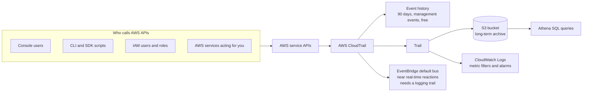
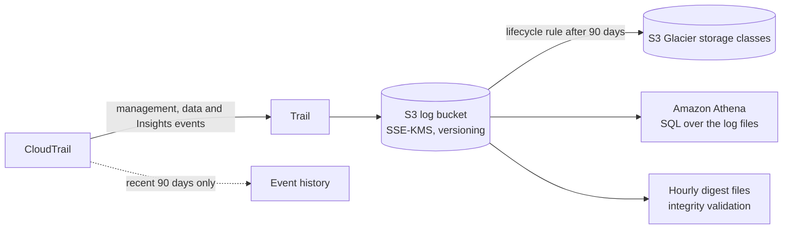
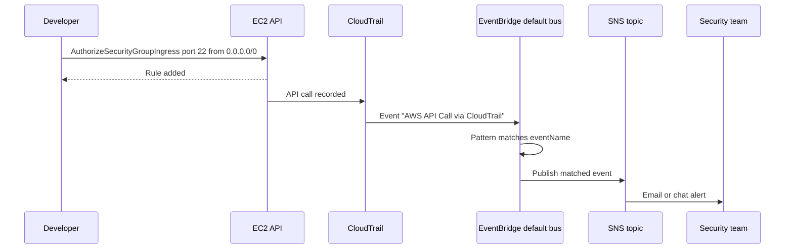
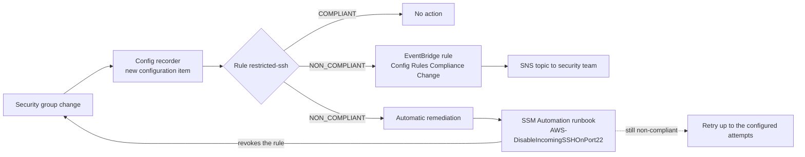
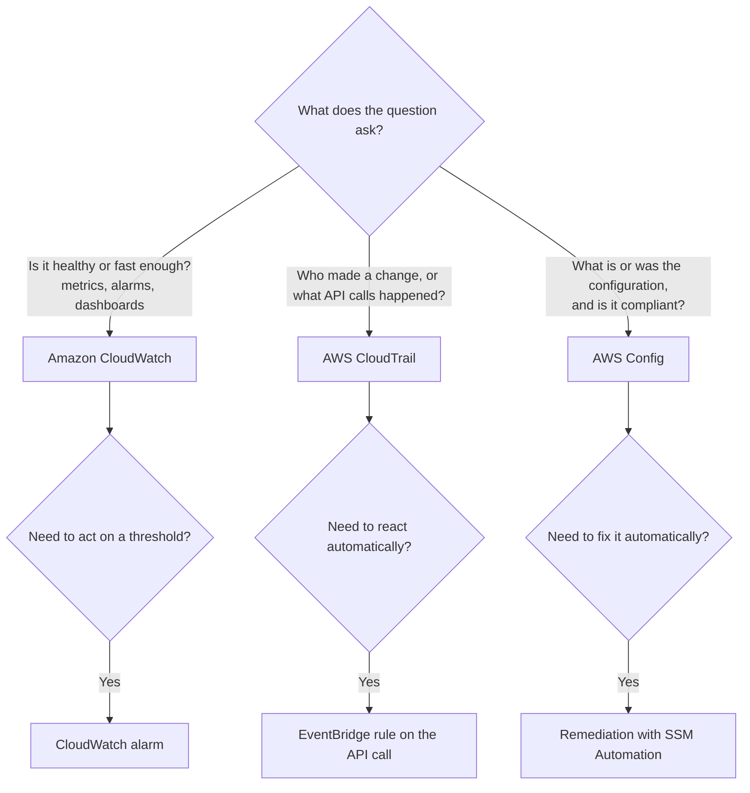

# Auditing with CloudTrail & Config

## Summary

AWS CloudTrail and AWS Config are the two auditing services of the exam, and they answer different questions. **CloudTrail** is the account's activity log: every API call made by a user, a role or an AWS service is recorded with who made it, when, from which IP address and with which parameters, so it is the first place to look when something was changed or deleted and nobody admits to it. **Config** is the account's configuration history and compliance checker: it records what each resource looks like after every change, keeps a timeline, and evaluates resources against rules such as "no security group may allow SSH from anywhere", optionally fixing violations with Systems Manager Automation. Use CloudTrail for *who did what*, Config for *what does it look like now, what did it look like before, and is that allowed*, and CloudWatch (previous lesson) for *how is it performing*. Both feed EventBridge, so either can trigger alerts or automated responses.

## Key concepts

- **CloudTrail records API activity** from the console, CLI, SDKs and AWS services; it is on by default through **Event history** (last **90 days** of management events, per Region, free).
- A **trail** delivers events continuously to an **S3 bucket** (optionally also **CloudWatch Logs** and EventBridge) for retention beyond 90 days; analyse those files with **Athena**.
- Trails created in the console are always **multi-Region**; a single-Region trail can only be created with the CLI or API.
- **Management events** (control plane, logged by default) vs **data events** (resource-level operations such as S3 `GetObject` or Lambda `Invoke`, high volume, off by default, always charged).
- Management and data events can be split into **read** and **write** events.
- **CloudTrail Insights** learns a baseline of API call rates and error rates and raises **Insights events** for unusual bursts; delivered to the console, S3 and EventBridge.
- **Log file integrity validation** (SHA-256 hashes in signed hourly digest files) proves log files were not changed or deleted after delivery.
- **EventBridge + CloudTrail** lets you react within minutes to any API call, for example alert on `DeleteTable`, `AssumeRole` or `AuthorizeSecurityGroupIngress`.
- **AWS Config** records **configuration items** (snapshots of a resource's settings and relationships) per **Region**; an **aggregator** gives a read-only view across accounts and Regions.
- **Config rules** (hundreds of **AWS managed** rules, or **custom** rules in Lambda or Guard) evaluate resources on configuration changes and/or **periodically**; they are **detective only** and never block a change.
- **Remediation** runs **SSM Automation runbooks** (AWS managed or custom, which can invoke Lambda) manually or automatically, with configurable **retries**.
- Config **notifications**: EventBridge for targeted, filtered reactions (for example only `NON_COMPLIANT` changes); SNS for the full stream of every change and compliance event.
- **CloudWatch = performance, CloudTrail = API calls, Config = configuration and compliance.**

## AWS CloudTrail: the account's activity log

Every action in AWS ends up as an API call. Clicking **Terminate** in the EC2 console, running `aws s3 rb` in a terminal, a Python script calling `put_item`, or Auto Scaling launching an instance on your behalf: each is a request to an AWS API. CloudTrail captures those requests as **events**. Each event is a JSON record that answers the auditor's questions:

| Question | Event field (examples) |
|---|---|
| Who? | `userIdentity`: IAM user, assumed role and session name, root, or AWS service |
| What? | `eventSource` (for example `ec2.amazonaws.com`) and `eventName` (for example `TerminateInstances`) |
| When? | `eventTime` (UTC) |
| From where? | `sourceIPAddress`, `userAgent` (console, CLI, SDK and version) |
| On what, with which settings? | `requestParameters`, `resources`, `responseElements` |
| Did it work? | `errorCode` and `errorMessage` when the call failed (for example `AccessDenied`) |

> [!EXAMPLE] The disappearing table
> On Monday morning the `orders` DynamoDB table is gone. In the CloudTrail console you open **Event history**, filter on **Event name** = `DeleteTable`, and find one event: Friday 18:42 UTC, identity `assumed-role/ci-deploy-role/github-run-8812`, source IP of the CI runner, user agent of the AWS SDK for Python. The deletion came from a CI pipeline using a role, not from a person, which tells you where to look next. This is why "a resource was deleted, find out who did it" points to CloudTrail first.

CloudTrail is **on by default** in every account: you do not have to switch anything on to get the Event history. What you do have to set up is longer retention, delivery to other tools and the optional, paid event types.



### Three ways to keep and query events

| Option | What it keeps | Retention | Cost | Use it for |
|---|---|---|---|---|
| **Event history** | Management events only, one Region and one account per search, one filter attribute at a time | 90 days, fixed | Free | Quick lookups of recent changes |
| **Trail** | The event types you select, delivered as gzip JSON files to S3 (plus CloudWatch Logs and EventBridge if configured) | As long as you keep the S3 objects | First copy of management events free; S3 storage billed; data, network activity and Insights events billed | Compliance archives, Athena analysis, alarms, organization-wide logging |
| **CloudTrail Lake** | Events in a managed, SQL-queryable event data store | Up to about 7 or 10 years depending on pricing option | Ingestion and query charges | Existing customers who already use it |

> [!UPDATED] CloudTrail Lake closed to new customers
> CloudTrail Lake, a managed SQL event store that newer course material sometimes mentions, stopped accepting new customers on **31 May 2026**. Existing users keep it (critical fixes only), and AWS points new users to Amazon CloudWatch for the same kind of analysis. Trails, Insights and Event history are not affected. For the exam, the long-term pattern to know is still **trail → S3 → Athena**.

### Trails

A trail is the configuration that ships events somewhere durable. The main settings:

- **Multi-Region or single-Region.** A multi-Region trail records activity in every enabled Region of the account (including Regions you enable later) and is the recommended default. Every trail created in the console is multi-Region; the CLI's `create-trail` makes a single-Region trail unless you add `--is-multi-region-trail`.
- **Destination.** One S3 bucket (it can belong to another account, for example a central log-archive account), an optional CloudWatch Logs log group in the same account, and an optional SNS topic that announces each delivered log file.
- **Encryption.** Log files in S3 are always encrypted: with SSE-S3 when no KMS key is chosen (what the CLI does unless you pass a key), or with **SSE-KMS** and your own KMS key, which the console preselects for new trails. SSE-KMS adds a second permission check, because anyone reading the logs also needs `kms:Decrypt` on that key.
- **Organization trail.** Created in the AWS Organizations management account (or a delegated administrator), it logs every member account into one bucket. Member accounts can see the trail but cannot change or delete it.

Practical numbers: you can have up to **5 trails per Region**, and CloudTrail delivers a log file on average **about 5 minutes** after the API call (not guaranteed). For CloudWatch Logs and EventBridge the maximum event size is 256 KB.

> [!UPDATED] All Regions is the only console choice
> The slides present "all Regions (default) or a single Region" as a choice when you create a trail. Today the console only creates multi-Region trails; single-Region trails are possible only through the CLI or API (where single-Region is actually the default). Since November 2021, events from global services (IAM, the global STS endpoint, CloudFront) are recorded in **us-east-1**, so a single-Region trail elsewhere misses them; another reason to use a multi-Region trail.

### Event types

| Event type | What it captures | Logged by default? | Examples | Cost on a trail |
|---|---|---|---|---|
| **Management events** | Control-plane operations: creating, configuring and deleting resources, plus some non-API events such as `ConsoleLogin` | Yes, read and write | IAM `AttachRolePolicy`, EC2 `CreateSubnet`, CloudTrail `CreateTrail` | First copy free, extra copies USD 2.00 per 100,000 events |
| **Data events** | Operations on or inside a resource, usually very high volume | No | S3 `GetObject` / `PutObject` / `DeleteObject`, Lambda `Invoke`, DynamoDB `GetItem` / `PutItem` | USD 0.10 per 100,000 events |
| **Network activity events** | API calls that pass through your VPC endpoints, including ones denied by the endpoint policy | No | A `VpceAccessDenied` call to KMS through an interface endpoint | USD 0.10 per 100,000 events |
| **Insights events** | Unusual API call volume or error rate compared with the account's baseline | No | A sudden burst of `TerminateInstances` calls | USD 0.35 per 100,000 management events analysed, for each insight type turned on |

Prices are us-east-1 list prices checked in October 2026.

**Read vs write.** Read events look without changing anything (`DescribeInstances`, `GetBucketPolicy`); write events create, change or delete (`RunInstances`, `DeleteBucket`). A trail can log only one side. A common cost saver is a trail that logs **write** management events only, or one that excludes AWS KMS events, because KMS `Decrypt` and `GenerateDataKey` calls can make up the vast majority of management event volume.

**Data events** are where the cost is. A bucket serving a website might see millions of `GetObject` calls a day, so data events are opt-in and can be narrowed with **advanced event selectors**: only one bucket, only write operations, only calls from a certain role, and so on. Turn them on when the question is "who read or deleted *this object*" or "who invoked *this function*".

> [!UPDATED] Data events cover far more than S3 and Lambda
> The slides list S3 object activity and Lambda `Invoke` as the data events. Basic event selectors still support S3, Lambda and DynamoDB, but advanced event selectors now cover well over 100 resource types (SNS topics, SQS queues, Kinesis streams, Bedrock resources, and more). **Network activity events** for VPC endpoints are also newer than the slides.

### CloudTrail Insights

Some attacks and mistakes are only visible as a change in *volume*: a leaked key used to launch hundreds of instances, a script stuck in a loop hitting a service limit, a sudden storm of `AccessDenied` errors, or a nightly maintenance job that silently stopped running. CloudTrail Insights watches for exactly that.

1. You enable Insights on a trail and choose the insight types: **API call rate** (needs write management events logged) and/or **API error rate** (needs read or write management events).
2. CloudTrail builds a **baseline** of normal call volumes and error rates for the account and Region.
3. When current activity deviates significantly, CloudTrail writes an **Insights event** describing the start and end of the unusual activity, the API involved and the baseline versus actual values.
4. Insights events appear on the **Insights** page of the CloudTrail console, are written to the trail's S3 bucket under a separate `CloudTrail-Insight` prefix, go to CloudWatch Logs if the trail sends there, and are emitted to **EventBridge** (detail type `AWS Insight via CloudTrail`) so you can automate a response.

The first Insights events can take **up to 36 hours** to appear after you enable the feature. Insights is billed per 100,000 events analysed, separately for each insight type, so turning on both call rate and error rate doubles that charge.

> [!UPDATED] Insights now analyses data events too
> The slides describe Insights as analysing management (write) events only. Insights can now also baseline **data events** (call rate and error rate), on trails only, billed separately at USD 0.03 per 100,000 data events analysed for each insight type.

### Retention, analysis and protecting the logs

Event history forgets after 90 days. Auditors often ask for one year, seven years or more, and investigations frequently need older data. The standard pattern:



- **Archive**: a trail writes compressed JSON files to S3 under `AWSLogs/<account-id>/CloudTrail/<region>/<yyyy>/<mm>/<dd>/`. Lifecycle rules can move older files to Glacier storage classes to cut storage cost.
- **Analyse**: create an Athena table over the bucket (the CloudTrail console can generate one) and run SQL such as "all `DeleteBucket` calls in March by any role whose name starts with `ci-`".
- **Prove integrity**: with **log file integrity validation** turned on, CloudTrail writes a **digest file every hour** containing a SHA-256 hash of each log file delivered in that hour, signed with a private key (SHA-256 with RSA). `aws cloudtrail validate-logs` later tells you whether any file was modified or deleted. This is the answer to "prove the logs have not been tampered with".
- **Protect the bucket**: a dedicated bucket, ideally in a separate log-archive account, with a restrictive bucket policy, versioning plus **MFA Delete** or **S3 Object Lock**, and SSE-KMS.

> [!TIP] CloudWatch Logs for alarms, S3 for history
> Sending a trail to CloudWatch Logs lets you build **metric filters and alarms** on API activity: alarm on any root user sign-in, on more than five `UnauthorizedOperation` errors in five minutes, or on changes to security groups, network ACLs or the trail itself. Keep S3 as the system of record and CloudWatch Logs for live detection with a shorter retention, because CloudWatch Logs storage costs more than S3.

## Reacting to API calls with EventBridge

CloudTrail only *records*; to *act* on an API call, combine it with Amazon EventBridge. CloudTrail emits each event to the account's **default event bus** with the detail type `AWS API Call via CloudTrail`. An EventBridge rule with a matching event pattern then sends it to a target: SNS for an email or chat alert, Lambda to undo the change, Step Functions for a workflow, SQS to buffer it.



Typical rules from exam scenarios:

| Watch for | Event pattern matches | Target and action |
|---|---|---|
| A table being deleted | `eventSource` `dynamodb.amazonaws.com`, `eventName` `DeleteTable` | SNS email to the database owners |
| Someone assuming a sensitive role | `eventSource` `sts.amazonaws.com`, `eventName` `AssumeRole`, role ARN in `requestParameters` | SNS alert, or Lambda that records the session |
| Inbound rules added to a security group | `eventSource` `ec2.amazonaws.com`, `eventName` `AuthorizeSecurityGroupIngress` | Lambda that inspects the rule and revokes `0.0.0.0/0` |
| Logging being turned off | `eventSource` `cloudtrail.amazonaws.com`, `eventName` `StopLogging` or `DeleteTrail` | Lambda that restarts logging, plus a page to on-call |

An event pattern for the security group case looks like this:

```json
{
  "source": ["aws.ec2"],
  "detail-type": ["AWS API Call via CloudTrail"],
  "detail": {
    "eventSource": ["ec2.amazonaws.com"],
    "eventName": ["AuthorizeSecurityGroupIngress"]
  }
}
```

Points that decide whether such a rule actually fires:

- **A trail must be logging.** EventBridge documentation requires an enabled trail for the CloudTrail detail types; Event history alone is not enough.
- **Write events by default.** A rule in the normal `ENABLED` state matches mutating (write) management events. Read-only management events such as `DescribeInstances` or `GetBucketPolicy` only reach rules whose state is `ENABLED_WITH_ALL_CLOUDTRAIL_MANAGEMENT_EVENTS`. Data events need the trail to log those data events.
- **Same Region as the call.** Events go to the default bus in the Region where the call was recorded. EC2 changes in eu-west-1 need the rule in eu-west-1; IAM changes are recorded in us-east-1, so IAM rules belong in us-east-1.
- **Near real time, not instant.** Expect seconds to a few minutes. If the requirement is to *prevent* the change, use IAM policies or SCPs instead; EventBridge only reacts afterwards.

## AWS Config: configuration history and compliance

CloudTrail tells you that `ModifyLoadBalancerAttributes` was called at 14:03. It does not tell you what the load balancer's full configuration was before and after, which other resources it is attached to, or whether the result breaks a company rule. AWS Config does.

Config's building blocks:

- **Configuration recorder**: discovers supported resources in the Region and records a **configuration item (CI)** every time one changes. A CI holds the resource's attributes, tags, relationships (this instance uses that security group, this volume is attached to that instance) and links to the related CloudTrail events. You choose which resource types to record.
- **Delivery channel**: where Config sends its output, namely configuration history files and snapshots to an **S3 bucket** (which you can query with Athena) and a stream of change and compliance notifications to an optional **SNS topic**.
- **Rules**: desired-state checks that mark each resource `COMPLIANT` or `NON_COMPLIANT`.
- **Aggregator**: collects configuration and compliance data from several accounts and Regions (or a whole organization) into one account and Region. It is a **read-only** view; you cannot deploy rules or change resources through it. Individual source accounts must authorize the aggregator; accounts of your organization need no authorization.

Config is a **regional** service: the recorder, rules and history exist per account per Region, so a company using four Regions turns it on in four Regions (or uses AWS Organizations and CloudFormation StackSets, Systems Manager Quick Setup or Control Tower to do it everywhere), then views everything through an aggregator. Record global IAM resource types (users, groups, roles, customer managed policies) in **one** Region only, to avoid duplicate configuration items and charges.

Questions Config answers well:

- Which security groups currently allow port 22 from `0.0.0.0/0`?
- Which S3 buckets allow public reads, and since when?
- What did the production ALB's listeners and attributes look like last Tuesday, and what changed since?
- Which EBS volumes are unencrypted, or not attached to anything?
- Was this IAM role's policy different on the day of the incident?

> [!UPDATED] Continuous or daily recording
> Config can now record each resource type either **continuously** (a CI for every change, USD 0.003 per CI in us-east-1) or **daily** (at most one CI per resource per day, only if the state changed, USD 0.012 per CI). Daily recording costs less for resources that change many times a day, such as instances in an Auto Scaling group, at the price of losing intermediate states. The slides only show the continuous price.

### Config rules

A rule describes a good configuration and Config checks resources against it.

| | AWS managed rules | Custom Lambda rules | Custom policy rules (Guard) |
|---|---|---|---|
| Who writes the logic | AWS (you set parameters) | You, as a Lambda function | You, in CloudFormation Guard policy-as-code |
| Examples | `restricted-ssh`, `s3-bucket-public-read-prohibited`, `encrypted-volumes`, `access-keys-rotated`, `elbv2-acm-certificate-required` | "Every EBS volume must be `gp3`", "Instances may only be `t3.micro` in dev" | "Every bucket must have tag `owner`", written as a few Guard lines instead of a Lambda function |
| Triggers | Set by AWS per rule (change, periodic or both) | Configuration changes, periodic or both | Configuration changes only |
| Extra cost | Rule evaluations | Rule evaluations plus Lambda invocations | Rule evaluations |
| When to choose | A managed rule already exists (check first; there are hundreds) | Logic needs code, calls to other APIs or a schedule | Declarative checks on a resource's own configuration |

> [!UPDATED] Hundreds of managed rules, and a second custom option
> The slides say "over 75" managed rules and that custom rules must be Lambda functions. The managed-rule list now has **more than 800** entries, and custom rules can also be written in **Guard** (custom policy rules) without a Lambda function.

**Triggers.** A rule is evaluated:

- on **configuration changes** to resources in its scope (by resource type, by type plus ID, or by tag), for example every time a security group is modified;
- **periodically** at a frequency you choose (1, 3, 6, 12 or 24 hours), for example a daily check that access keys are younger than 90 days;
- or both (**hybrid**). `restricted-ssh` is an example: it runs on security group changes and periodically.

**Evaluation modes.** **Detective** mode evaluates resources that already exist; every rule supports it. **Proactive** mode evaluates a *proposed* resource configuration before deployment (for example from a CloudFormation hook or a pipeline calling the `StartResourceEvaluation` API). Only a handful of managed rules offer it: the managed-rule list showed just two in October 2026 (`eip-attached` and `subnet-auto-assign-public-ip-disabled`). {{updated: Proactive mode is newer than the slides; in October 2026 only two managed rules supported it}}

**Detective, not preventive.** A rule never denies an API call. If a developer opens SSH to the world, the change succeeds and Config flags it afterwards. Even proactive mode only reports what *would* be non-compliant; it is the calling pipeline that decides to stop. To actually block actions, use IAM policies, permission boundaries or SCPs (covered in the advanced identity lesson).

> [!NOTE] Conformance packs
> A **conformance pack** bundles a set of rules and remediation actions into one YAML template that you deploy as a unit to an account, or across an organization. AWS provides sample packs for common frameworks (for example operational best practices for CIS or PCI DSS). Conformance pack evaluations are priced like rule evaluations.

**Pricing** (us-east-1, October 2026). There is no free tier for Config:

| Item | Price |
|---|---|
| Configuration item, continuous recording | USD 0.003 per CI |
| Configuration item, daily recording | USD 0.012 per CI |
| Rule evaluations, first 100,000 per month | USD 0.001 each |
| Rule evaluations, next 400,000 | USD 0.0008 each |
| Rule evaluations above 500,000 | USD 0.0005 each |
| Conformance pack evaluations | Same tiers as rule evaluations |
| Aggregators | No extra charge |

Prices are per account per Region (with consolidated billing, evaluations across accounts count towards the tiers). Custom Lambda rules add Lambda charges; S3 and SNS charges apply for the delivery channel.

> [!EXAMPLE] Estimating a small Config bill
> An account records 2,000 configuration changes a month continuously and runs 10 rules that together make 20,000 evaluations: 2,000 × 0.003 = USD 6.00 for CIs plus 20,000 × 0.001 = USD 20.00 for evaluations, so about USD 26 a month in that Region. Excluding noisy, short-lived resource types from recording or switching them to daily recording is the main way to lower the CI part.

### The resource view: one timeline per resource

Open any recorded resource in the Config console and choose **Resource Timeline**. The timeline combines three things on one time axis, which is what makes Config so useful during an investigation:

| Timeline filter | What you see | Example |
|---|---|---|
| **Configuration events** | Each configuration item, with a diff of what changed | Listener on port 80 added to the ALB at 14:03 |
| **Compliance events** | Each change in compliance state against your rules | ALB became `NON_COMPLIANT` with `alb-http-to-https-redirection-check` at 14:05 |
| **CloudTrail events** | The API calls related to that resource | `CreateListener` by `alice` from 203.0.113.10 at 14:03 |

Seeing the historical compliance events requires recording the `AWS::Config::ResourceCompliance` resource type (included when you record all resource types). Rules still evaluate, and the current compliance status still shows, without it; only the history on the timeline is missing.

### Remediation: fixing non-compliant resources

Detecting a problem is half the job. Config can also **remediate** by running an **AWS Systems Manager Automation runbook** against each non-compliant resource:

- **AWS managed runbooks** cover common fixes, for example `AWS-DisableIncomingSSHOnPort22` (removes unrestricted port 22 rules from a security group), `AWSConfigRemediation-RevokeUnusedIAMUserCredentials` (deactivates unused or expired access keys and passwords) or runbooks that turn on S3 Block Public Access or encryption.
- **Custom runbooks** can do anything Automation can do, including invoking a Lambda function for logic that no managed runbook offers.
- **Manual or automatic.** With manual remediation, an operator selects the resource and chooses **Remediate**. With automatic remediation, Config starts the runbook as soon as a resource is evaluated as non-compliant (and, when you first turn it on, for every resource already non-compliant). Either way the runbook needs an IAM role that Systems Manager assumes to make the change; for automatic remediation it must be passed in the runbook's **AutomationAssumeRole** parameter.
- **Retries.** If the resource is still non-compliant after a remediation attempt, Config can try again: you set the number of attempts (1 to 25, default 5) within a time window in seconds, for example 5 attempts in 300 seconds. Each Automation step is billed (USD 0.002 per step).
- The **resource ID parameter** passes the ID of the non-compliant resource (the security group ID, the IAM user ID) into the runbook.



> [!EXAMPLE] Expired access keys
> The managed rule `access-keys-rotated` (periodic) flags any IAM user whose active access key is older than 90 days. Automatic remediation with `AWSConfigRemediation-RevokeUnusedIAMUserCredentials`, the user ID passed as the resource ID parameter and `MaxCredentialUsageAge` set to 90, deactivates the stale keys. Retries handle a transient IAM throttling error without anyone being paged.

### Notifications: EventBridge or SNS

| | EventBridge | SNS delivery channel |
|---|---|---|
| What is sent | Config events such as `Config Rules Compliance Change` and `Config Configuration Item Change` on the default bus | Every notification Config produces: configuration changes, compliance changes, snapshot and history delivery status |
| Filtering | Event pattern on rule name, resource type, compliance type (for example only `NON_COMPLIANT` for `restricted-ssh`) | None at the source; use **SNS subscription filter policies** or filter in the subscriber |
| Targets | Lambda, SNS, SQS, Step Functions, other buses and more | Whatever subscribes to the topic: email, SQS, Lambda, HTTPS |
| Best for | Targeted alerts and automated reactions | A complete feed for an archive, a SIEM or a ticketing system |

So "email the security team only when a resource becomes non-compliant with rule X" points to **EventBridge**, while "send every configuration change to our external monitoring tool" points to the **SNS** delivery channel.

## CloudWatch vs CloudTrail vs Config

The exam loves to put all three in the same answer list. Keep the one-word definitions in mind: **performance**, **API calls**, **configuration**.

| | Amazon CloudWatch | AWS CloudTrail | AWS Config |
|---|---|---|---|
| Core question | How is it performing, and is something wrong right now? | Who did what, when and from where? | What does it look like, what did it look like, and is that allowed? |
| Data | Metrics, logs, alarms, dashboards, events | API call records (management, data, network activity, Insights events) | Configuration items, relationships, rule evaluations |
| Scope | Regional (cross-account and cross-Region dashboards possible) | Regional events; multi-Region and organization trails collect everything in one place | Regional; aggregators give a multi-account, multi-Region view |
| Acts by | Alarms (SNS, Auto Scaling, EC2 actions), EventBridge rules | EventBridge rules on API calls; CloudWatch Logs metric filters | Rules, SSM Automation remediation, EventBridge and SNS notifications |
| Typical exam keywords | CPU, latency, error rate, dashboard, alarm, log aggregation | Audit, investigate, deleted resource, who made the change, API history | Compliance, configuration drift, history of settings, non-compliant resources, remediation |

> [!NOTE] Is CloudTrail global or regional?
> Course material often lists CloudTrail as a "global" service, in contrast to the regional Config. The practical meaning: one multi-Region trail (or one organization trail) captures every Region, and every account, into a single bucket, so you configure it once. Under the hood, events are still recorded in the Region where each call happened, Event history is searched one Region at a time, and EventBridge receives each event in its own Region. Config has no equivalent of a multi-Region trail: you turn on a recorder in every Region and use an aggregator to see the result in one place.

Applied to one Application Load Balancer:

| Need | Service |
|---|---|
| Graph the number of incoming requests and active connections | CloudWatch metrics |
| Show 4xx and 5xx responses as a percentage over time on a dashboard | CloudWatch metrics and dashboards |
| Alarm when target response time goes above one second | CloudWatch alarm |
| Keep a history of the load balancer's listeners, attributes and security group rules | Config |
| Check continuously that every HTTPS listener has a certificate from ACM | Config rule (for example `elbv2-acm-certificate-required`) |
| Find out who deleted a listener on Friday evening | CloudTrail |



## Exam tips

> [!EXAM] Deleted resource, unknown culprit
> "A resource was deleted or modified and the company needs to know who did it" → **CloudTrail** (Event history for the last 90 days, or the trail's S3 logs for older events). Config can show *what* changed, but the identity comes from the CloudTrail event.

> [!EXAM] Audit logs older than 90 days
> "Keep API activity for one year (or seven years) and query it with SQL" → create a **trail** to **S3** (multi-Region, ideally an organization trail to a central bucket) and query with **Athena**; add S3 lifecycle rules to Glacier for cost.

> [!EXAM] Prove the logs were not altered
> "Detect whether CloudTrail log files were modified or deleted after delivery" → enable **log file integrity validation**. Protect the bucket with a restrictive bucket policy, MFA Delete or Object Lock, and SSE-KMS.

> [!EXAM] Object-level access
> "Record who downloaded or deleted objects in a specific bucket" or "who invoked a Lambda function" → **CloudTrail data events** (not enabled by default). S3 server access logs are the cheaper, best-effort alternative for S3 only.

> [!EXAM] Unusual API activity
> "Automatically detect unusual spikes in API calls or errors, such as a burst of `RunInstances` or IAM actions" → **CloudTrail Insights**, with EventBridge reacting to the Insights events.

> [!EXAM] React to a specific API call
> "Notify the security team within minutes when someone deletes a table, assumes a role or changes a security group" → **EventBridge rule on `AWS API Call via CloudTrail`** with an SNS (or Lambda) target.

> [!EXAM] Compliance and configuration history
> "Check continuously that resources follow rules (no public buckets, no open SSH, encrypted volumes) and keep a history of configuration changes" → **AWS Config** with managed rules. "Across all accounts and Regions" → add an **aggregator** (or organization rules and conformance packs).

> [!EXAM] Auto-fix
> "Automatically correct non-compliant resources with the least operational overhead" → **Config rule + automatic remediation** with an **SSM Automation runbook** (managed where one exists), with retries.

> [!EXAM] Alert only on non-compliance
> "Notify only when a resource becomes NON_COMPLIANT" → **EventBridge** rule on `Config Rules Compliance Change`. The SNS delivery channel sends *everything*.

## Common traps

> [!TRAP] Config does not prevent changes
> An answer saying a Config rule will "deny" or "block" a non-compliant change is wrong. Config only detects and (with remediation) corrects afterwards. Prevention means IAM policies, permission boundaries or SCPs.

> [!TRAP] CloudTrail does not measure performance
> CPU, latency, request counts and error rates are **CloudWatch**. CloudTrail records API calls, not metrics, and Config records configuration, not utilization.

> [!TRAP] Event history is not long-term storage
> Event history keeps only 90 days of **management** events and cannot be extended. It never shows data, network activity or Insights events. Anything older or richer needs a trail.

> [!TRAP] Data events are off by default
> A question about who read a specific S3 object will not be answered by a default trail. Data events must be enabled explicitly and are charged per event.

> [!TRAP] Config is regional
> Turning on Config in one Region does not record resources elsewhere. Multi-Region visibility needs Config enabled in each Region plus an aggregator. The aggregator is read-only, so it cannot deploy rules.

> [!TRAP] Single-Region trails miss things
> A single-Region trail outside us-east-1 misses IAM, global STS and CloudFront events, and any activity in other Regions. The console only creates multi-Region trails; a CLI-created trail is single-Region unless you ask otherwise.

> [!TRAP] EventBridge rule in the wrong place or state
> A rule for an IAM API call created in eu-west-1 never fires because IAM events are recorded in us-east-1. A rule in the normal `ENABLED` state does not see read-only management events. And without a logging trail, CloudTrail-based rules do not receive events.

> [!TRAP] Insights is not GuardDuty
> CloudTrail Insights flags unusual **volume** of API calls and errors in your own account's pattern. Threat detection based on threat intelligence, malicious IPs and compromised instances is **Amazon GuardDuty** (security lesson).
