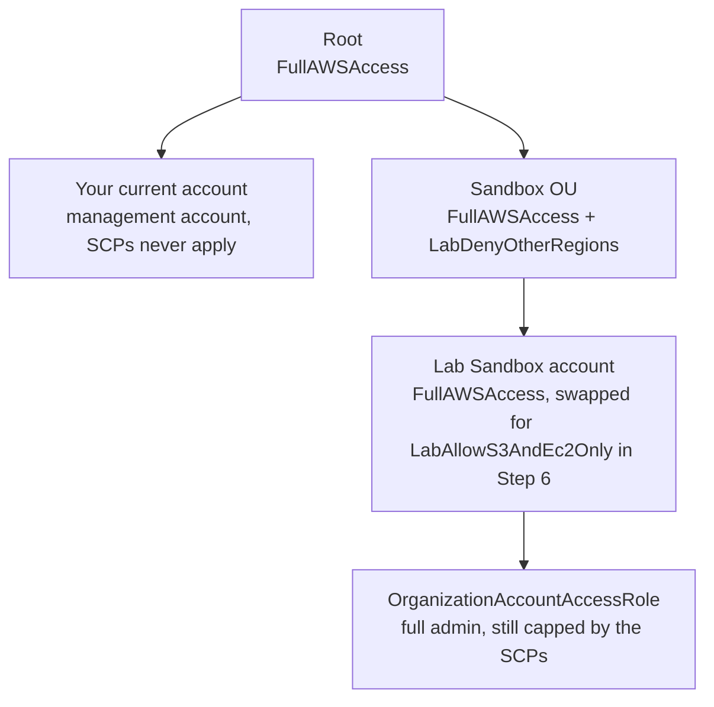

> [!WARNING] Read this before you create an organization
> - If your account is on the **Free plan** (opened on or after 15 July 2025), creating an organization upgrades it to the paid plan and any unused Free Tier credits expire straight away. Do this lab in an account where that is acceptable.
> - Step 3 creates a **real, separate AWS account**. You cannot delete it on the spot: closing it puts it in a suspended state for up to 90 days, during which it still counts toward the organization's account quota and blocks deleting the organization.
> - Never run this lab in a company account that already belongs to an organization.

You will build this tree, then test what an administrator inside the sandbox account can and cannot do:



## Prerequisites

- A standalone AWS account that is **not** part of any organization; it becomes the management account. It needs a valid payment method and verified contact details.
- Sign in as an **IAM user or role with administrator permissions** (for example the admin user from the IAM labs). The root user cannot assume roles, and Steps 4 to 6 depend on assuming one.
- A **second email address** that has never been used for an AWS account, for the new member account. If your mail provider supports plus addressing, `you+lab-sandbox@example.com` works and lands in your normal inbox.
- **AWS CloudShell** for the CLI tabs (no setup needed). Keep the same CloudShell tab open for the whole lab, because later commands reuse shell variables and functions. The lab uses `us-east-1` as its working Region; Organizations itself is global.

## Steps

### Step 1: Create the organization

:::console
1. Open the **AWS Organizations** console.
2. On the introduction page choose **Create an organization**, then confirm with **Create an organization** in the dialog box. The organization is created with **all features** enabled, which you need for SCPs.
3. You land on the **AWS accounts** page. Your account appears under **Root** with a **Management account** label.
4. If AWS sends a verification email to the account's address, open it and verify within 24 hours.
:::

:::cli
```bash
aws organizations create-organization --feature-set ALL
aws organizations describe-organization \
  --query 'Organization.[Id,MasterAccountId,FeatureSet]' --output table
ROOT_ID=$(aws organizations list-roots --query 'Roots[0].Id' --output text)
echo "Root: $ROOT_ID"
```
:::

> [!CHECK]
> The organization ID looks like `o-` followed by at least 10 lowercase letters and digits, the feature set is `ALL`, and the root ID starts with `r-`. Write down the organization ID: it is exactly the value an `aws:PrincipalOrgID` condition in a bucket policy would compare against.

### Step 2: Create an OU for sandbox accounts

:::console
1. On the **AWS accounts** page, select the check box next to **Root**.
2. Choose **Actions** and, under **Organizational unit**, choose **Create new**.
3. For **Organizational unit name** enter `Sandbox` and choose **Create organizational unit**.
:::

:::cli
```bash
SANDBOX_OU=$(aws organizations create-organizational-unit --parent-id "$ROOT_ID" \
  --name Sandbox --query 'OrganizationalUnit.Id' --output text)
echo "Sandbox OU: $SANDBOX_OU"
```
:::

### Step 3: Create a member account and move it into the OU

:::console
1. On the **AWS accounts** page choose **Add an AWS account**. **Create an AWS account** is selected by default.
2. For **AWS account name** enter `Lab Sandbox`.
3. For **Email address of the account's owner** enter your unused address (for example `you+lab-sandbox@example.com`).
4. Leave the **IAM role name** empty so the default `OrganizationAccountAccessRole` is created.
5. Choose **Create AWS account**. Refresh the page after a minute or two until the account appears under **Root**.
6. Select the check box next to `Lab Sandbox` (not its name), choose **Actions** and, under **AWS account**, choose **Move**.
7. Choose the radio button next to **Sandbox** and choose **Move AWS account**.
:::

:::cli
```bash
# Replace the email with your own unused address.
REQ_ID=$(aws organizations create-account --email "you+lab-sandbox@example.com" \
  --account-name "Lab Sandbox" --query 'CreateAccountStatus.Id' --output text)

until [ "$(aws organizations describe-create-account-status --create-account-request-id "$REQ_ID" \
  --query 'CreateAccountStatus.State' --output text)" != "IN_PROGRESS" ]; do sleep 10; done
aws organizations describe-create-account-status --create-account-request-id "$REQ_ID" \
  --query 'CreateAccountStatus.[State,AccountId,FailureReason]' --output text

SANDBOX_ID=$(aws organizations describe-create-account-status --create-account-request-id "$REQ_ID" \
  --query 'CreateAccountStatus.AccountId' --output text)
aws organizations move-account --account-id "$SANDBOX_ID" \
  --source-parent-id "$ROOT_ID" --destination-parent-id "$SANDBOX_OU"
aws organizations list-accounts-for-parent --parent-id "$SANDBOX_OU" \
  --query 'Accounts[].[Name,Id,Status]' --output table
```
:::

> [!CHECK]
> `Lab Sandbox` shows a 12-digit account ID, status **Active**, and sits under the **Sandbox** OU. If you get an error saying the organization is still initializing, wait a while and try again. If the error says you exceeded the account quota, your new organization may have started with a quota below the default of 10: check **Service Quotas** → **AWS Organizations** in `us-east-1` and request an increase, or ask AWS Support.

> [!NOTE] Nobody knows the new account's root password
> A created account has a root user with no password. That is fine: you administer it from the management account through the role that Organizations put inside it. If you ever need the root user, use **Forgot password** on the root sign-in page with the account's email address.

### Step 4: Work inside the member account through OrganizationAccountAccessRole

Organizations created this role with full administrative permissions and a trust policy that names the management account, so assuming it makes you an administrator of the sandbox account. It is still subject to the SCPs that apply to that account.

:::console
1. Note the `Lab Sandbox` account ID from the **AWS accounts** page.
2. Choose your user name on the navigation bar (upper right), then choose **Switch role**.
3. Enter the sandbox **Account ID**, the **IAM role name** `OrganizationAccountAccessRole`, a **Display name** such as `Sandbox`, pick a **Display color**, and choose **Switch Role**.
4. Open the **EC2** console in **US East (N. Virginia)** and look at the dashboard, then open the **S3** console. Both load normally: you are an administrator.
5. Stay switched in for now; you come back to this browser tab in Step 5.
:::

:::cli
```bash
# Two helpers: one swaps this shell to a role session in the sandbox account,
# the other drops back to your own management-account credentials.
sandbox_session() {
  unset AWS_ACCESS_KEY_ID AWS_SECRET_ACCESS_KEY AWS_SESSION_TOKEN
  read -r AK SK ST <<< "$(aws sts assume-role \
    --role-arn "arn:aws:iam::${SANDBOX_ID}:role/OrganizationAccountAccessRole" \
    --role-session-name scp-lab \
    --query 'Credentials.[AccessKeyId,SecretAccessKey,SessionToken]' --output text)"
  export AWS_ACCESS_KEY_ID="$AK" AWS_SECRET_ACCESS_KEY="$SK" AWS_SESSION_TOKEN="$ST"
}
management_session() { unset AWS_ACCESS_KEY_ID AWS_SECRET_ACCESS_KEY AWS_SESSION_TOKEN; }

sandbox_session
aws sts get-caller-identity --query Arn --output text
aws ec2 describe-vpcs --region eu-west-1 --query 'Vpcs[].VpcId' --output text
aws iam get-role --role-name OrganizationAccountAccessRole \
  --query 'Role.AssumeRolePolicyDocument.Statement[].Principal' --output json
management_session
```
:::

> [!CHECK]
> The caller ARN reads `arn:aws:sts::<sandbox-id>:assumed-role/OrganizationAccountAccessRole/scp-lab`, the default VPC ID in `eu-west-1` is printed, and the trust policy's principal is the management account (`arn:aws:iam::<management-id>:root`). No SCP limits you yet.

### Step 5: Turn on SCPs and fence the Sandbox OU with a deny list

The SCP below blocks every Regional action outside two approved Regions (global services are exempt through `NotAction`) and stops accounts from leaving the organization.

```json
{
  "Version": "2012-10-17",
  "Statement": [
    {
      "Sid": "StayInApprovedRegions",
      "Effect": "Deny",
      "NotAction": ["iam:*", "organizations:*", "sts:*", "support:*", "cloudfront:*", "route53:*", "budgets:*"],
      "Resource": "*",
      "Condition": { "StringNotEquals": { "aws:RequestedRegion": ["us-east-1", "us-west-2"] } }
    },
    {
      "Sid": "NeverLeaveTheOrg",
      "Effect": "Deny",
      "Action": "organizations:LeaveOrganization",
      "Resource": "*"
    }
  ]
}
```

:::console
1. Choose **Switch back** from the role menu on the navigation bar so you are in the management account again.
2. In the Organizations console choose **Policies** → **Service control policies** → **Enable service control policies**.
3. Choose **Create policy**. For **Policy name** enter `LabDenyOtherRegions` and add a short description.
4. In the **Policy** editor, replace the starter JSON with the policy above and choose **Create policy**.
5. Go to **AWS accounts**, choose the **Sandbox** OU by its name, open the **Policies** tab and, under **Service control policies**, choose **Attach**. Select `LabDenyOtherRegions` and choose **Attach policy**.
6. Switch role into the sandbox account again (the role now appears in the role history on the account menu). Open the **EC2** console in **US East (N. Virginia)**, then use the Region selector to change to **Europe (Ireland)**.
:::

:::cli
```bash
management_session
aws organizations enable-policy-type --root-id "$ROOT_ID" --policy-type SERVICE_CONTROL_POLICY

cat > deny-regions-scp.json <<'EOF'
{
  "Version": "2012-10-17",
  "Statement": [
    {
      "Sid": "StayInApprovedRegions",
      "Effect": "Deny",
      "NotAction": ["iam:*", "organizations:*", "sts:*", "support:*", "cloudfront:*", "route53:*", "budgets:*"],
      "Resource": "*",
      "Condition": { "StringNotEquals": { "aws:RequestedRegion": ["us-east-1", "us-west-2"] } }
    },
    {
      "Sid": "NeverLeaveTheOrg",
      "Effect": "Deny",
      "Action": "organizations:LeaveOrganization",
      "Resource": "*"
    }
  ]
}
EOF
DENY_SCP=$(aws organizations create-policy --name LabDenyOtherRegions \
  --type SERVICE_CONTROL_POLICY --description "Sandbox: approved Regions only, cannot leave the org" \
  --content file://deny-regions-scp.json --query 'Policy.PolicySummary.Id' --output text)
aws organizations attach-policy --policy-id "$DENY_SCP" --target-id "$SANDBOX_OU"
sleep 30   # give the new SCP a moment to propagate

sandbox_session
aws ec2 describe-vpcs --region us-east-1 --query 'Vpcs[].VpcId' --output text
aws ec2 describe-vpcs --region eu-west-1 --query 'Vpcs[].VpcId' --output text
management_session
aws ec2 describe-vpcs --region eu-west-1 --query 'Vpcs[].VpcId' --output text
```
:::

> [!CHECK]
> As the sandbox administrator role, `us-east-1` still works but `eu-west-1` fails with an `UnauthorizedOperation` error that points to an explicit deny in a service control policy; in the console the EC2 dashboard for Europe (Ireland) fills with permission errors. The same call from your management-account credentials succeeds, because SCPs never apply to the management account. On the Sandbox OU's **Policies** tab you see two SCPs: `FullAWSAccess` (added automatically when you enabled SCPs) and `LabDenyOtherRegions`.

> [!WARNING] Do not test the second statement
> Leave `organizations:LeaveOrganization` untested. The point of the statement is that nobody should ever call it.

### Step 6: Try an allow list on the account itself

Now replace the account-level `FullAWSAccess` with an allow list. Because the allow must be present at every level, the account is left with S3 and EC2 only, and the OU's Region deny still applies on top.

```json
{
  "Version": "2012-10-17",
  "Statement": [
    { "Sid": "OnlyS3AndEc2", "Effect": "Allow", "Action": ["s3:*", "ec2:*"], "Resource": "*" }
  ]
}
```

:::console
1. In the management account, create another SCP named `LabAllowS3AndEc2Only` with the JSON above.
2. On **AWS accounts**, open `Lab Sandbox` by its name, choose the **Policies** tab and **Attach** `LabAllowS3AndEc2Only`.
3. Still on that tab, select **FullAWSAccess** and choose **Detach**, then confirm with **Detach policy**. Attach the allow list **first**: an account must always keep at least one SCP.
4. Switch role into the sandbox account. Open **S3** (works), then open **IAM** and choose **Roles**, then open **Amazon SNS** in US East (N. Virginia).
5. Switch back to the management account. On the sandbox account's **Policies** tab, **Attach** `FullAWSAccess` again, then **Detach** `LabAllowS3AndEc2Only`.
:::

:::cli
```bash
management_session
cat > allow-s3-ec2-scp.json <<'EOF'
{
  "Version": "2012-10-17",
  "Statement": [
    { "Sid": "OnlyS3AndEc2", "Effect": "Allow", "Action": ["s3:*", "ec2:*"], "Resource": "*" }
  ]
}
EOF
ALLOW_SCP=$(aws organizations create-policy --name LabAllowS3AndEc2Only \
  --type SERVICE_CONTROL_POLICY --description "Allow-list experiment" \
  --content file://allow-s3-ec2-scp.json --query 'Policy.PolicySummary.Id' --output text)
aws organizations attach-policy --policy-id "$ALLOW_SCP" --target-id "$SANDBOX_ID"
aws organizations detach-policy --policy-id p-FullAWSAccess --target-id "$SANDBOX_ID"
aws organizations list-policies-for-target --target-id "$SANDBOX_ID" \
  --filter SERVICE_CONTROL_POLICY --query 'Policies[].Name' --output text
sleep 30

sandbox_session
aws s3 ls
aws ec2 describe-vpcs --region us-east-1 --query 'Vpcs[].VpcId' --output text
aws iam list-roles --max-items 1
aws sns list-topics --region us-east-1
management_session

# Put the account back the way it was
aws organizations attach-policy --policy-id p-FullAWSAccess --target-id "$SANDBOX_ID"
aws organizations detach-policy --policy-id "$ALLOW_SCP" --target-id "$SANDBOX_ID"
```
:::

> [!CHECK]
> While the allow list is in place, S3 and EC2 in `us-east-1` work, but IAM and SNS calls fail with an access denied error that says no service control policy allows the action, even though the role has full administrator permissions. That is an **implicit** deny: nothing on the account level allows IAM any more. After you restore `FullAWSAccess`, `list-policies-for-target` should show only `FullAWSAccess` on the account again.

> [!TIP] Read the result like the exam does
> Effective permissions = what the IAM policy grants, intersected with what every SCP level allows, minus any explicit deny on the path. The management account sees none of this.

## Cleanup

If you continue with lab 02 (IAM Identity Center), keep the organization and the `Lab Sandbox` account for now and come back here after lab 02. Otherwise, delete in this order:

- [ ] **SCP `LabAllowS3AndEc2Only`** (already detached in Step 6): **Policies** → **Service control policies** → choose the policy name → check that the **Targets** tab is empty → **Delete** at the top of the page → type the policy name → **Delete**. CLI: `aws organizations delete-policy --policy-id "$ALLOW_SCP"`.
- [ ] **SCP `LabDenyOtherRegions`**: choose the policy name → **Targets** tab → select the **Sandbox** OU → **Detach** and confirm → **Delete** at the top → type the name → **Delete**. CLI: `aws organizations detach-policy --policy-id "$DENY_SCP" --target-id "$SANDBOX_OU"` then `aws organizations delete-policy --policy-id "$DENY_SCP"`.
- [ ] **Move `Lab Sandbox` back to Root**: on **AWS accounts** select the account's check box → **Actions** → under **AWS account** choose **Move** → choose **Root** → **Move AWS account**. CLI: `aws organizations move-account --account-id "$SANDBOX_ID" --source-parent-id "$SANDBOX_OU" --destination-parent-id "$ROOT_ID"`.
- [ ] **OU `Sandbox`** (must be empty): select its check box → **Actions** → under **Organizational unit** choose **Delete** → type the OU name → **Delete**. CLI: `aws organizations delete-organizational-unit --organizational-unit-id "$SANDBOX_OU"`.
- [ ] **Account `Lab Sandbox`**: select it on **AWS accounts** → **Close** → read the guidance, enter the account ID → **Close account**. CLI: `aws organizations close-account --account-id "$SANDBOX_ID"`, then `aws organizations describe-account --account-id "$SANDBOX_ID" --query Account.Status` moves from `PENDING_CLOSURE` to `SUSPENDED`. The account shows a **CLOSED** label for up to 90 days and is then removed for good; AWS Support can reopen it only during those 90 days.
- [ ] **SCP feature (optional)**: **Policies** → **Service control policies** → **Disable service control policies** → type `disable` → **Disable**. Any remaining SCP attachments are removed (the policies themselves are kept). CLI: `aws organizations disable-policy-type --root-id "$ROOT_ID" --policy-type SERVICE_CONTROL_POLICY`.
- [ ] **CloudShell files**: `rm -f deny-regions-scp.json allow-s3-ec2-scp.json`, then close the CloudShell tab (this also forgets the helper functions and any exported credentials).
- [ ] **The organization itself (optional, later)**: it costs nothing to keep. You can delete it only after every member account is gone, which for a closed account means waiting until it is removed (up to 90 days). Then: **Settings** → **Delete organization** → enter the organization ID → **Delete organization**; CLI `aws organizations delete-organization`. Your account becomes a standalone account again.
- [ ] **Final check**: the **AWS accounts** page lists only the management account (plus the closed sandbox with its **CLOSED** label), no `Lab*` SCPs remain, and **Billing and Cost Management** shows no charges from this lab.

## Progress checklist

- [ ] Step 1: Created the organization with all features and noted its ID
- [ ] Step 2: Created the `Sandbox` OU
- [ ] Step 3: Created `Lab Sandbox` and moved it into the OU
- [ ] Step 4: Switched into the account through `OrganizationAccountAccessRole`
- [ ] Step 5: Saw the Region deny block the sandbox role but not the management account
- [ ] Step 6: Saw an account-level allow list cut an administrator down to S3 and EC2, then restored `FullAWSAccess`
- [ ] Cleanup done (or deferred until after lab 02)
