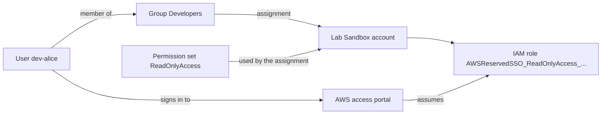

> [!WARNING] Organizations side effect
> An organization instance needs AWS Organizations. If you skipped lab 01 and your account is not yet in an organization, enabling Identity Center creates one with your account as the management account, and a **Free plan** account is upgraded to the paid plan (remaining credits expire). Lab 01's warning applies here too.

This lab turns the lesson's sign-in flow into something you can click through: one person, one group, one permission set, one account.



## Prerequisites

- The organization from lab 01 with the `Lab Sandbox` member account still open. If you skipped lab 01, you can assign the permission set to the **management account** instead; that needs the `IAMFullAccess` policy or equivalent permissions on your admin identity.
- Sign in to the management account as an administrator through an **IAM user or role**. The root user can enable Identity Center, but it cannot switch or assume roles, which Step 7 needs.
- A third email address you can read for the test user, for example `you+dev-alice@example.com`. Identity Center users each need a unique email address.
- An authenticator app on your phone (or a passkey/security key). By default Identity Center makes a new user register an MFA device at first sign-in.
- A **private/incognito browser window**, so you can be the admin in one window and the developer in another.
- AWS CloudShell for the CLI tabs, opened in the **same Region** where you enable Identity Center. The steps use `us-east-1`.

## Steps

### Step 1: Enable IAM Identity Center

Identity Center lives in one Region per organization. Pick the Region where your team works; moving it later means deleting the instance and starting again.

:::console
1. In the Region selector choose **US East (N. Virginia)** (or your preferred Region), then open the **IAM Identity Center** console.
2. If you see **Instance configuration**, choose **Single-Region instance**. (A multi-Region instance replicates to a second Region and creates a billed KMS key.)
3. Keep **Enable multi-account permissions** turned on; without it the **AWS accounts** page does not appear.
4. Under **Enable IAM Identity Center**, choose **Enable**. If your account is standalone, a page titled **Enable IAM Identity Center with AWS Organizations** appears; review it and choose **Enable** again.
5. When the dashboard loads, find the **Settings summary** section and copy the **AWS access portal URL**.
:::

:::cli
```bash
# There is no CLI call that enables an ORGANIZATION instance: sso-admin create-instance
# only creates account instances, and it is refused in a management account.
# After enabling it in the console, read its identifiers:
export AWS_REGION=us-east-1   # the Region where you enabled Identity Center
read -r INSTANCE_ARN IDSTORE_ID <<< "$(aws sso-admin list-instances \
  --query 'Instances[0].[InstanceArn,IdentityStoreId]' --output text)"
echo "Instance: $INSTANCE_ARN   Identity store: $IDSTORE_ID"
```
:::

> [!CHECK]
> The portal URL looks like `https://d-xxxxxxxxxx.awsapps.com/start`, and the **Identity source** is the **Identity Center directory** (the default). The CLI prints an instance ARN starting `arn:aws:sso:::instance/` and an identity store ID starting `d-`.

### Step 2: Create a group

Grant access to groups, not to individual people, so that joining or leaving a team is a single membership change.

:::console
1. In the navigation pane choose **Groups** → **Create group**.
2. For **Group name** enter `Developers`, optionally add a description, and choose **Create group**.
:::

:::cli
```bash
GROUP_ID=$(aws identitystore create-group --identity-store-id "$IDSTORE_ID" \
  --display-name Developers --description "Lab: developers with read-only access" \
  --query GroupId --output text)
echo "Group: $GROUP_ID"
```
:::

### Step 3: Add a user and put them in the group

:::console
1. Choose **Users** → **Add user**.
2. **Username**: `dev-alice` (it cannot be changed later).
3. **Password**: choose **Generate a one-time password that you can share with this user**. (The other option, an email invitation, also works if you prefer.)
4. **Email address** and **Confirm email address**: your test address. **First name** `Alice`, **Last name** `Dev`; keep the suggested **Display name**.
5. Choose **Next**. On the groups page select `Developers` and choose **Next**.
6. Review and choose **Add user**. The console now shows the portal URL, the username and the one-time password: copy them somewhere safe for Step 6.
:::

:::cli
```bash
# Users created through the API get no password; you still set one in the console
# (Users > dev-alice > Reset password > generate a one-time password).
USER_ID=$(aws identitystore create-user --identity-store-id "$IDSTORE_ID" \
  --user-name dev-alice --display-name "Alice Dev" \
  --name GivenName=Alice,FamilyName=Dev \
  --emails Value=you+dev-alice@example.com,Type=work,Primary=true \
  --query UserId --output text)
MEMBERSHIP_ID=$(aws identitystore create-group-membership --identity-store-id "$IDSTORE_ID" \
  --group-id "$GROUP_ID" --member-id UserId="$USER_ID" --query MembershipId --output text)
aws identitystore list-group-memberships --identity-store-id "$IDSTORE_ID" \
  --group-id "$GROUP_ID" --query 'GroupMemberships[].MemberId.UserId' --output text
```
:::

> [!CHECK]
> `dev-alice` appears under **Users**, and the `Developers` group shows one member. If you used the CLI, open the user's details page and use **Reset password** to generate the one-time password now; Step 6 needs it.

### Step 4: Create a permission set

A permission set is only a template. Nothing exists in any account until you assign it.

:::console
1. Under **Multi-account permissions** choose **Permission sets** → **Create permission set**.
2. For **Permission set type** choose **Predefined permission set**, and under **Policy for predefined permission set** choose **ReadOnlyAccess**. Choose **Next**.
3. Keep the name `ReadOnlyAccess` and the default **Session duration** of 1 hour. Choose **Next**.
4. Review and choose **Create**.
:::

:::cli
```bash
PS_ARN=$(aws sso-admin create-permission-set --instance-arn "$INSTANCE_ARN" \
  --name ReadOnlyAccess --description "Lab: read-only access" --session-duration PT1H \
  --query PermissionSet.PermissionSetArn --output text)
aws sso-admin attach-managed-policy-to-permission-set --instance-arn "$INSTANCE_ARN" \
  --permission-set-arn "$PS_ARN" --managed-policy-arn arn:aws:iam::aws:policy/ReadOnlyAccess
```
:::

### Step 5: Assign the group to the member account

:::console
1. Under **Multi-account permissions** choose **AWS accounts**. The organization tree is shown.
2. Select the check box for **Lab Sandbox** (or the management account if you skipped lab 01) and choose **Assign users or groups**.
3. **Select users and groups**: find and select the `Developers` group, then choose **Next**.
4. **Select permission sets**: select `ReadOnlyAccess`, choose **Next**.
5. **Review and submit assignments**: check both, then choose **Submit**. Wait for the message that the account has been configured.
:::

:::cli
```bash
SANDBOX_ID=111122223333   # replace with your Lab Sandbox (or management) account ID
REQ=$(aws sso-admin create-account-assignment --instance-arn "$INSTANCE_ARN" \
  --target-id "$SANDBOX_ID" --target-type AWS_ACCOUNT \
  --permission-set-arn "$PS_ARN" --principal-type GROUP --principal-id "$GROUP_ID" \
  --query AccountAssignmentCreationStatus.RequestId --output text)
sleep 15
aws sso-admin describe-account-assignment-creation-status --instance-arn "$INSTANCE_ARN" \
  --account-assignment-creation-request-id "$REQ" \
  --query AccountAssignmentCreationStatus.Status --output text
```
:::

> [!CHECK]
> The assignment status is `SUCCEEDED`. On the account's page, **Assigned users and groups** lists `Developers` with the `ReadOnlyAccess` permission set.

### Step 6: Sign in as the developer

:::console
1. Open a **private window** and go to the AWS access portal URL from Step 1.
2. Sign in as `dev-alice` with the one-time password. Set a new password when asked.
3. Register an MFA device when prompted (scan the QR code with your authenticator app and enter the code). This is the default **Require them to register an MFA device at sign in** behaviour.
4. The portal lists the accounts you can reach. Expand **Lab Sandbox**: it shows the `ReadOnlyAccess` role with two links, the role name (opens the console) and **Access keys** (short-term CLI credentials).
5. Choose `ReadOnlyAccess`. In the console, open **S3** and choose **Create bucket**, enter any unique name and try to create it.
6. If the sandbox still carries lab 01's Region SCP, change the Region selector to **Europe (Ireland)** and open the **EC2** console.
:::

:::cli
```bash
# The portal sign-in is browser-only. From the admin CloudShell, list what the
# assignment produced for the user:
aws sso-admin list-account-assignments --instance-arn "$INSTANCE_ARN" \
  --account-id "$SANDBOX_ID" --permission-set-arn "$PS_ARN" \
  --query 'AccountAssignments[].[PrincipalType,PrincipalId]' --output table
```
:::

> [!CHECK]
> The navigation bar shows something like `AWSReservedSSO_ReadOnlyAccess_.../dev-alice`. Browsing works, but bucket creation fails with an access denied message because `ReadOnlyAccess` has no write actions. In Europe (Ireland) the EC2 console shows errors: the lab 01 SCP limits Identity Center roles exactly like any other role in the member account.

### Step 7: Find the role Identity Center created

Identity Center does not bypass IAM; it provisions a normal IAM role in each assigned account and keeps it in sync with the permission set.

:::console
1. Back in your admin window, switch role into the sandbox account (`OrganizationAccountAccessRole`, as in lab 01).
2. Open **IAM** → **Roles** and search for `AWSReservedSSO`.
3. Open the role. Note its path (`/aws-reserved/sso.amazonaws.com/`), the attached `ReadOnlyAccess` policy, and the **Trust relationships** tab, which trusts a SAML provider that Identity Center manages rather than a user or account.
4. Choose **Switch back**.
:::

:::cli
```bash
# Assume the admin role in the sandbox account just for this one command
read -r AK SK ST <<< "$(aws sts assume-role \
  --role-arn "arn:aws:iam::${SANDBOX_ID}:role/OrganizationAccountAccessRole" \
  --role-session-name sso-peek \
  --query 'Credentials.[AccessKeyId,SecretAccessKey,SessionToken]' --output text)"
AWS_ACCESS_KEY_ID="$AK" AWS_SECRET_ACCESS_KEY="$SK" AWS_SESSION_TOKEN="$ST" \
  aws iam list-roles --path-prefix /aws-reserved/sso.amazonaws.com/ \
  --query 'Roles[].[RoleName,Path]' --output table
```
:::

> [!CHECK]
> One role named `AWSReservedSSO_ReadOnlyAccess_<random suffix>` is listed. Do not edit it by hand: Identity Center owns it, and if you remove every assignment of the permission set from this account the role is deleted (a later assignment creates one with a new suffix).

### Step 8: Use the same identity from the AWS CLI

Developers should get short-term CLI credentials from Identity Center instead of IAM access keys.

:::console
1. In the developer's private window, on the portal, choose **Access keys** next to `ReadOnlyAccess`.
2. In the **Get credentials** dialog, look at the **IAM Identity Center credentials** method: it shows the **SSO start URL** and **SSO Region** you need for `aws configure sso`.
3. Do the CLI tab, either on your own computer (AWS CLI v2) or in CloudShell.
:::

:::cli
```bash
# On your own computer: plain `aws configure sso` (it opens your browser).
# In CloudShell, which has no browser of its own, add --use-device-code and open the
# printed URL in the developer's private window.
aws configure sso --use-device-code
#   SSO session name (Recommended): lab-sso
#   SSO start URL [None]: https://d-xxxxxxxxxx.awsapps.com/start
#   SSO region [None]: us-east-1
#   SSO registration scopes [None]: sso:account:access
#   (approve in the browser, pick the account and ReadOnlyAccess)
#   Default client Region [None]: us-east-1
#   CLI default output format (json if not specified) [None]: json
#   Profile name [...]: lab-dev

aws sts get-caller-identity --profile lab-dev
aws s3 ls --profile lab-dev
aws s3 mb "s3://lab-dev-write-test-$RANDOM" --profile lab-dev
aws sso logout
```
:::

> [!CHECK]
> `get-caller-identity` returns an `assumed-role/AWSReservedSSO_ReadOnlyAccess_.../dev-alice` ARN in the sandbox account, `s3 ls` works, and `s3 mb` fails with `AccessDenied`. No access key was ever created: the CLI caches a short-lived token and refreshes role credentials from it until the session ends.

> [!TIP] Where ABAC would fit
> With attributes for access control turned on, a user attribute such as `Department` would arrive in this session as a principal tag, and one permission set could compare `aws:PrincipalTag/Department` with resource tags. Changing the attribute in the directory would then change the user's access without touching any policy.

## Cleanup

Delete in this order, then finish lab 01's cleanup if you deferred it.

- [ ] **CLI profile**: run `aws sso logout`, then open `~/.aws/config` and delete the `[profile lab-dev]` and `[sso-session lab-sso]` sections.
- [ ] **Account assignment**: **AWS accounts** → choose **Lab Sandbox** by name → under **Assigned users and groups** select `Developers` → **Remove access** → **Remove access**. CLI: `aws sso-admin delete-account-assignment --instance-arn "$INSTANCE_ARN" --target-id "$SANDBOX_ID" --target-type AWS_ACCOUNT --permission-set-arn "$PS_ARN" --principal-type GROUP --principal-id "$GROUP_ID"`. This also removes the `AWSReservedSSO_ReadOnlyAccess_...` role from the account.
- [ ] **Permission set `ReadOnlyAccess`**: **Permission sets** → choose `ReadOnlyAccess` → **Delete** and confirm. CLI: `aws sso-admin delete-permission-set --instance-arn "$INSTANCE_ARN" --permission-set-arn "$PS_ARN"`.
- [ ] **User `dev-alice`**: **Users** → select `dev-alice` → **Delete users** → confirm. CLI: `aws identitystore delete-group-membership --identity-store-id "$IDSTORE_ID" --membership-id "$MEMBERSHIP_ID"` (only if you created the membership with the CLI), then `aws identitystore delete-user --identity-store-id "$IDSTORE_ID" --user-id "$USER_ID"`. Delete the authenticator entry on your phone.
- [ ] **Group `Developers`**: **Groups** → select it → **Delete group** → confirm. CLI: `aws identitystore delete-group --identity-store-id "$IDSTORE_ID" --group-id "$GROUP_ID"`.
- [ ] **Identity Center instance (optional)**: keeping it costs nothing. To remove it: **Settings** → **Management** tab → **Delete IAM Identity Center configuration** → **Delete** → tick each acknowledgement, type the instance name → **Confirm**. CLI (management account only): `aws sso-admin delete-instance --instance-arn "$INSTANCE_ARN"`. If you plan to delete the organization later, remove the instance first: an organization instance cannot work without its organization.
- [ ] **Lab 01 resources**: go back to lab 01 and complete its Cleanup (SCPs, Sandbox OU, closing `Lab Sandbox`).
- [ ] **Final check**: Identity Center shows no `dev-alice`, no `Developers`, no `ReadOnlyAccess` permission set, and the sandbox account has no `AWSReservedSSO_` roles.

## Progress checklist

- [ ] Step 1: Enabled a single-Region organization instance and copied the portal URL
- [ ] Step 2: Created the `Developers` group
- [ ] Step 3: Added `dev-alice` to the group
- [ ] Step 4: Created the `ReadOnlyAccess` permission set
- [ ] Step 5: Assigned `Developers` + `ReadOnlyAccess` to the account
- [ ] Step 6: Signed in through the portal with MFA and hit a read-only wall
- [ ] Step 7: Found the `AWSReservedSSO_` role in the member account
- [ ] Step 8: Used the identity from the AWS CLI without access keys
- [ ] Cleanup done, including lab 01's
