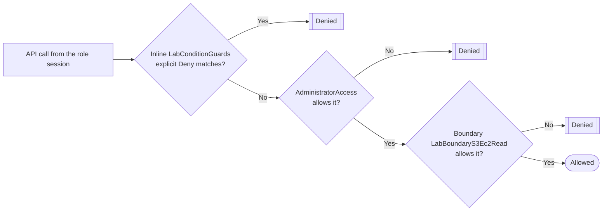

The lesson says three things about guardrails: they never grant anything, an explicit deny always wins, and effective access is the overlap of every layer. This lab lets you see each rule fire on a role you control.



## Prerequisites

- An AWS account where you are signed in as an **IAM user or IAM Identity Center user with administrator permissions**. The root user cannot assume roles, and Steps 3 and 4 rely on assuming one.
- **AWS CloudShell** in `us-east-1` for the CLI tabs and for the live tests. Keep one CloudShell tab open for the whole lab; later steps reuse variables and helper functions.
- Optional, for the MFA part of Step 4: your IAM user has a virtual MFA device (set up in the IAM section's lab on MFA).

## Steps

### Step 1: Create the boundary policy

The boundary is an ordinary customer managed policy. It only becomes a boundary when you attach it in the boundary slot of a user or role.

```json
{
  "Version": "2012-10-17",
  "Statement": [
    {
      "Sid": "BoundaryS3Read",
      "Effect": "Allow",
      "Action": ["s3:ListAllMyBuckets", "s3:ListBucket", "s3:GetBucketLocation", "s3:GetObject"],
      "Resource": "*"
    },
    {
      "Sid": "BoundaryEc2Describe",
      "Effect": "Allow",
      "Action": "ec2:Describe*",
      "Resource": "*"
    }
  ]
}
```

:::console
1. Open the **IAM** console and choose **Policies** → **Create policy**.
2. In the **Policy editor**, choose **JSON**, replace the content with the policy above, and choose **Next**.
3. For **Policy name** enter `LabBoundaryS3Ec2Read`, add a description such as `Lab: maximum permissions for lab-boundary-role`, and choose **Create policy**.
:::

:::cli
```bash
ACCOUNT_ID=$(aws sts get-caller-identity --query Account --output text)
cat > boundary.json <<'EOF'
{
  "Version": "2012-10-17",
  "Statement": [
    {
      "Sid": "BoundaryS3Read",
      "Effect": "Allow",
      "Action": ["s3:ListAllMyBuckets", "s3:ListBucket", "s3:GetBucketLocation", "s3:GetObject"],
      "Resource": "*"
    },
    {
      "Sid": "BoundaryEc2Describe",
      "Effect": "Allow",
      "Action": "ec2:Describe*",
      "Resource": "*"
    }
  ]
}
EOF
BOUNDARY_ARN=$(aws iam create-policy --policy-name LabBoundaryS3Ec2Read \
  --description "Lab: maximum permissions for lab-boundary-role" \
  --policy-document file://boundary.json --query Policy.Arn --output text)
echo "$BOUNDARY_ARN"
```
:::

### Step 2: Create a role with AdministratorAccess and the boundary

:::console
1. In IAM choose **Roles** → **Create role**.
2. For the trusted entity type choose **AWS account**, then **This account**. Leave **Require external ID** and **Require MFA** cleared. Choose **Next**.
3. Search for and select **AdministratorAccess**.
4. Open the **Set permissions boundary** section, choose **Use a permissions boundary to control the maximum role permissions**, and select `LabBoundaryS3Ec2Read`. Choose **Next**.
5. For **Role name** enter `lab-boundary-role`, review, and choose **Create role**.
:::

:::cli
```bash
cat > trust.json <<EOF
{
  "Version": "2012-10-17",
  "Statement": [{
    "Effect": "Allow",
    "Principal": { "AWS": "arn:aws:iam::${ACCOUNT_ID}:root" },
    "Action": "sts:AssumeRole"
  }]
}
EOF
aws iam create-role --role-name lab-boundary-role \
  --assume-role-policy-document file://trust.json \
  --permissions-boundary "$BOUNDARY_ARN"
aws iam attach-role-policy --role-name lab-boundary-role \
  --policy-arn arn:aws:iam::aws:policy/AdministratorAccess
aws iam get-role --role-name lab-boundary-role \
  --query 'Role.PermissionsBoundary.PermissionsBoundaryArn' --output text
```
:::

> [!CHECK]
> On the role's **Permissions** tab, **AdministratorAccess** is listed under permissions policies and `LabBoundaryS3Ec2Read` appears in the **Permissions boundary** section. The trust policy names your own account, so any administrator in it may assume the role.

### Step 3: Assume the role and feel the boundary

Run these in CloudShell. The two helper functions swap the shell between a session of the lab role and your own identity.

:::console
1. Open **CloudShell** from the console navigation bar (Region **US East (N. Virginia)**).
2. Paste and run the commands in the CLI tab. If you created the role in the console, first set `ACCOUNT_ID` with the first line of Step 1's CLI tab.
:::

:::cli
```bash
as_lab_role() {
  unset AWS_ACCESS_KEY_ID AWS_SECRET_ACCESS_KEY AWS_SESSION_TOKEN
  read -r AK SK ST <<< "$(aws sts assume-role \
    --role-arn "arn:aws:iam::${ACCOUNT_ID}:role/lab-boundary-role" \
    --role-session-name boundary-test "$@" \
    --query 'Credentials.[AccessKeyId,SecretAccessKey,SessionToken]' --output text)"
  export AWS_ACCESS_KEY_ID="$AK" AWS_SECRET_ACCESS_KEY="$SK" AWS_SESSION_TOKEN="$ST"
}
as_me() { unset AWS_ACCESS_KEY_ID AWS_SECRET_ACCESS_KEY AWS_SESSION_TOKEN; }

as_lab_role
aws sts get-caller-identity --query Arn --output text
aws s3 ls
aws ec2 describe-vpcs --query 'Vpcs[].VpcId' --output text
aws iam list-users --max-items 1
aws ec2 create-security-group --group-name lab-should-fail --description "boundary test"
as_me
```
:::

> [!CHECK]
> The caller is `assumed-role/lab-boundary-role/boundary-test`. Listing buckets and describing VPCs work. `iam list-users` fails with `AccessDenied` and creating a security group fails with `UnauthorizedOperation`, even though the role has **AdministratorAccess**: neither action is inside the boundary, and the error text usually says that no permissions boundary allows the action. If the security group was created anyway, your boundary is wrong; delete the group and recheck Step 1.

### Step 4: Add Region and MFA conditions as an inline Deny

```json
{
  "Version": "2012-10-17",
  "Statement": [
    {
      "Sid": "Ec2OnlyInUsEast1",
      "Effect": "Deny",
      "Action": "ec2:*",
      "Resource": "*",
      "Condition": { "StringNotEquals": { "aws:RequestedRegion": "us-east-1" } }
    },
    {
      "Sid": "ListingBucketsNeedsMfa",
      "Effect": "Deny",
      "Action": "s3:ListAllMyBuckets",
      "Resource": "*",
      "Condition": { "BoolIfExists": { "aws:MultiFactorAuthPresent": "false" } }
    }
  ]
}
```

:::console
1. In IAM open **Roles** → `lab-boundary-role` → **Permissions** tab.
2. Choose **Add permissions** → **Create inline policy**, switch the editor to **JSON**, paste the policy above and choose **Next**.
3. For **Policy name** enter `LabConditionGuards` and choose **Create policy**.
4. Run the tests in the CLI tab from CloudShell.
:::

:::cli
```bash
cat > conditions.json <<'EOF'
{
  "Version": "2012-10-17",
  "Statement": [
    {
      "Sid": "Ec2OnlyInUsEast1",
      "Effect": "Deny",
      "Action": "ec2:*",
      "Resource": "*",
      "Condition": { "StringNotEquals": { "aws:RequestedRegion": "us-east-1" } }
    },
    {
      "Sid": "ListingBucketsNeedsMfa",
      "Effect": "Deny",
      "Action": "s3:ListAllMyBuckets",
      "Resource": "*",
      "Condition": { "BoolIfExists": { "aws:MultiFactorAuthPresent": "false" } }
    }
  ]
}
EOF
aws iam put-role-policy --role-name lab-boundary-role \
  --policy-name LabConditionGuards --policy-document file://conditions.json
sleep 15

as_lab_role
aws ec2 describe-vpcs --region us-east-1 --query 'Vpcs[].VpcId' --output text
aws ec2 describe-vpcs --region eu-west-1 --query 'Vpcs[].VpcId' --output text
aws s3 ls
as_me

# Optional: assume the role again WITH MFA (IAM users with a virtual MFA device only)
MFA_ARN=$(aws iam list-mfa-devices --query 'MFADevices[0].SerialNumber' --output text)
as_lab_role --serial-number "$MFA_ARN" --token-code 123456   # use the current code from your app
aws s3 ls
as_me
```
:::

> [!CHECK]
> `us-east-1` still answers, `eu-west-1` is refused with an explicit deny, and `aws s3 ls` is refused too: a session from `AssumeRole` without MFA carries `aws:MultiFactorAuthPresent` set to `false` (or no key at all), and `BoolIfExists` matches either case. If `aws s3 ls` still works here, MFA context from your own sign-in reached the role session; the Region test still shows the explicit deny. If you did the optional part, the session created with `--serial-number` and `--token-code` lists buckets again. Notice that the identity policy (AdministratorAccess) never changed; only denies and the boundary decided these results.

> [!NOTE] Why the IfExists matters
> Requests signed with long-term access keys carry no `aws:MultiFactorAuthPresent` key at all. With plain `Bool`, a missing key does not match, so the Deny would let those requests through. `BoolIfExists` treats "missing" as a match and closes that gap.

### Step 5: Explain the results with the policy simulator

> [!UPDATED] The simulator now lives in the IAM console
> AWS no longer maintains the standalone simulator site (policysim.aws.amazon.com). Use **Policy simulator** in the IAM console navigation pane, or the `simulate-*` CLI commands.

:::console
1. In the IAM console navigation pane choose **Policy simulator**.
2. Stay in **Principal mode** and select the role `lab-boundary-role`. The side panel lists `AdministratorAccess`, the inline `LabConditionGuards` policy and the permissions boundary.
3. Add the actions `iam:CreateUser`, `s3:ListAllMyBuckets` and `ec2:DescribeVpcs`, leaving resources at all resources.
4. In the global request conditions, set `aws:MultiFactorAuthPresent` to `true` and `aws:RequestedRegion` to `us-east-1`, then run the simulation and read the results table.
5. Change `aws:MultiFactorAuthPresent` to `false` and `aws:RequestedRegion` to `eu-west-1`, and run it again.
6. Exclude the permissions boundary in the side panel and run once more; watch `iam:CreateUser`.
:::

:::cli
```bash
ROLE_ARN="arn:aws:iam::${ACCOUNT_ID}:role/lab-boundary-role"
sim() {   # $1 = MFA true/false, $2 = Region, any further args are passed through
  aws iam simulate-principal-policy --policy-source-arn "$ROLE_ARN" \
    --action-names iam:CreateUser s3:ListAllMyBuckets ec2:DescribeVpcs \
    --context-entries \
      "ContextKeyName=aws:MultiFactorAuthPresent,ContextKeyValues=$1,ContextKeyType=boolean" \
      "ContextKeyName=aws:RequestedRegion,ContextKeyValues=$2,ContextKeyType=string" \
    "${@:3}" \
    --query 'EvaluationResults[].[EvalActionName,EvalDecision]' --output table
}
sim true us-east-1
sim false eu-west-1
# What if the boundary allowed everything? (overrides the attached boundary for this run only)
sim true us-east-1 --permissions-boundary-policy-input-list \
  '{"Version":"2012-10-17","Statement":[{"Effect":"Allow","Action":"*","Resource":"*"}]}'
```
:::

> [!CHECK]
> Run 1: `iam:CreateUser` **implicitDeny** (outside the boundary), the other two **allowed**. Run 2: `s3:ListAllMyBuckets` and `ec2:DescribeVpcs` turn into **explicitDeny** because the inline conditions now match. Run 3 (boundary removed or replaced): `iam:CreateUser` becomes **allowed**, which proves the boundary was the only thing holding it back.

### Step 6: Solve an explicit-deny puzzle in custom mode

Custom mode tests a policy that is not attached to anything. This one denies a whole service and then tries to allow one action of it.

```json
{
  "Version": "2012-10-17",
  "Statement": [
    { "Effect": "Deny", "Action": "sns:*", "Resource": "*" },
    { "Effect": "Allow", "Action": "sns:Publish", "Resource": "*" }
  ]
}
```

Before running it, predict the result for `sns:CreateTopic`, `sns:Publish` and `s3:ListAllMyBuckets`.

:::console
1. In **Policy simulator**, switch to **Custom mode**.
2. Paste the policy above into the policy editor.
3. Add the three actions and run the simulation.
:::

:::cli
```bash
cat > puzzle.json <<'EOF'
{
  "Version": "2012-10-17",
  "Statement": [
    { "Effect": "Deny", "Action": "sns:*", "Resource": "*" },
    { "Effect": "Allow", "Action": "sns:Publish", "Resource": "*" }
  ]
}
EOF
aws iam simulate-custom-policy --policy-input-list file://puzzle.json \
  --action-names sns:CreateTopic sns:Publish s3:ListAllMyBuckets \
  --query 'EvaluationResults[].[EvalActionName,EvalDecision]' --output table
```
:::

> [!CHECK]
> `sns:CreateTopic` **explicitDeny**, `sns:Publish` **explicitDeny** (the allow cannot beat the deny on `sns:*`), and `s3:ListAllMyBuckets` **implicitDeny** (nothing mentions it).

### Step 7: Catch the S3 bucket-versus-object ARN bug

This policy looks reasonable but puts both actions on the object ARN only.

```json
{
  "Version": "2012-10-17",
  "Statement": [
    { "Effect": "Allow", "Action": ["s3:ListBucket", "s3:GetObject"], "Resource": "arn:aws:s3:::lab-reports/*" }
  ]
}
```

:::console
1. Still in **Custom mode**, replace the policy with the one above.
2. Add `s3:ListBucket` with the specific resource `arn:aws:s3:::lab-reports`, and `s3:GetObject` with `arn:aws:s3:::lab-reports/2026/q3.csv`. Run the simulation.
3. Fix the policy by splitting it: `s3:ListBucket` on `arn:aws:s3:::lab-reports`, `s3:GetObject` on `arn:aws:s3:::lab-reports/*`. Run it again.
:::

:::cli
```bash
cat > s3-wrong.json <<'EOF'
{
  "Version": "2012-10-17",
  "Statement": [
    { "Effect": "Allow", "Action": ["s3:ListBucket", "s3:GetObject"], "Resource": "arn:aws:s3:::lab-reports/*" }
  ]
}
EOF
cat > s3-fixed.json <<'EOF'
{
  "Version": "2012-10-17",
  "Statement": [
    { "Effect": "Allow", "Action": "s3:ListBucket", "Resource": "arn:aws:s3:::lab-reports" },
    { "Effect": "Allow", "Action": "s3:GetObject", "Resource": "arn:aws:s3:::lab-reports/*" }
  ]
}
EOF
for p in s3-wrong.json s3-fixed.json; do
  echo "== $p"
  aws iam simulate-custom-policy --policy-input-list "file://$p" \
    --action-names s3:ListBucket --resource-arns arn:aws:s3:::lab-reports \
    --query 'EvaluationResults[].[EvalActionName,EvalResourceName,EvalDecision]' --output text
  aws iam simulate-custom-policy --policy-input-list "file://$p" \
    --action-names s3:GetObject --resource-arns arn:aws:s3:::lab-reports/2026/q3.csv \
    --query 'EvaluationResults[].[EvalActionName,EvalResourceName,EvalDecision]' --output text
done
```
:::

> [!CHECK]
> With the wrong policy, `s3:ListBucket` on the bucket ARN is **implicitDeny** while `s3:GetObject` on the object is **allowed**: listing fails, downloads of known keys work, exactly the symptom exam questions describe. With the fixed policy both are **allowed**. No bucket named `lab-reports` needs to exist; the simulator only evaluates policies.

## Cleanup

- [ ] **Role `lab-boundary-role`**, with its inline policy `LabConditionGuards` and its `AdministratorAccess` attachment: **Roles** → select it → **Delete** → type the role name → **Delete** (the console removes the inline policy and the attachment for you). The CLI needs three calls in this order: `aws iam delete-role-policy --role-name lab-boundary-role --policy-name LabConditionGuards`, then `aws iam detach-role-policy --role-name lab-boundary-role --policy-arn arn:aws:iam::aws:policy/AdministratorAccess`, then `aws iam delete-role --role-name lab-boundary-role`.
- [ ] **Policy `LabBoundaryS3Ec2Read`** (only after the role is gone, because a policy in use as a boundary cannot be deleted): **Policies** → select it → **Actions** → **Delete** → type the name → **Delete**. CLI: `aws iam delete-policy --policy-arn "$BOUNDARY_ARN"`.
- [ ] **Security group `lab-should-fail`**: only if Step 3 created it by mistake; EC2 → **Security Groups** → select → **Actions** → **Delete security groups**. CLI: `aws ec2 delete-security-group --group-name lab-should-fail`.
- [ ] **CloudShell files and session**: `rm -f boundary.json trust.json conditions.json puzzle.json s3-wrong.json s3-fixed.json`, run `as_me`, then close the CloudShell tab.
- [ ] **Final check**: searching **Roles** for `lab-` and **Policies** for `LabBoundary` returns nothing.

## Progress checklist

- [ ] Step 1: Created the `LabBoundaryS3Ec2Read` policy
- [ ] Step 2: Created `lab-boundary-role` with AdministratorAccess capped by the boundary
- [ ] Step 3: Saw IAM and write actions denied despite AdministratorAccess
- [ ] Step 4: Saw the Region and MFA conditions deny matching calls
- [ ] Step 5: Reproduced every result in the policy simulator and isolated the boundary's effect
- [ ] Step 6: Confirmed that an explicit deny beats an allow in the same policy
- [ ] Step 7: Found and fixed the S3 bucket-versus-object ARN bug
- [ ] Cleanup done
