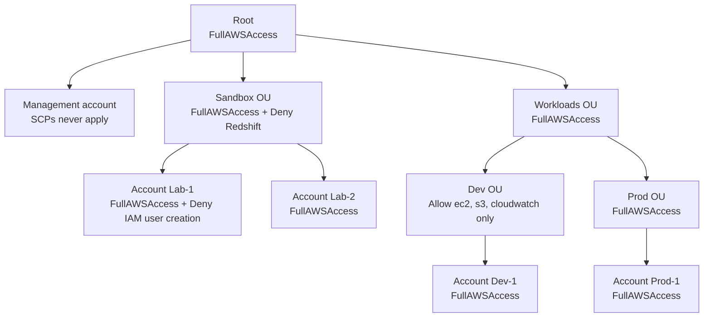
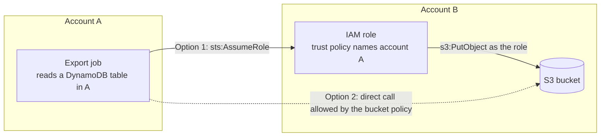
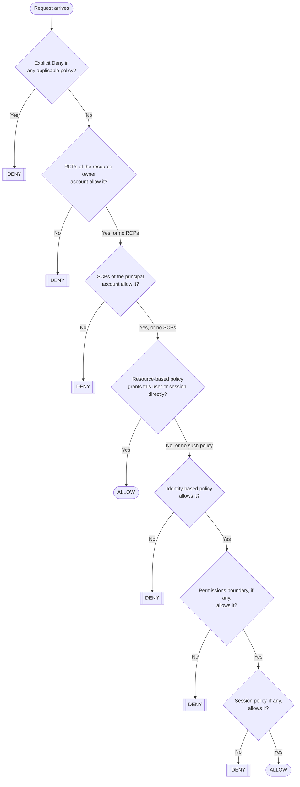
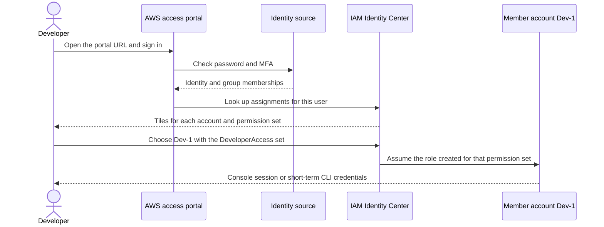
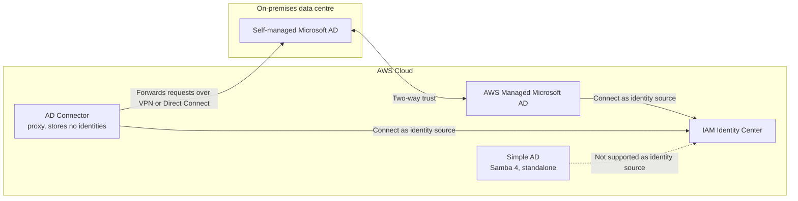
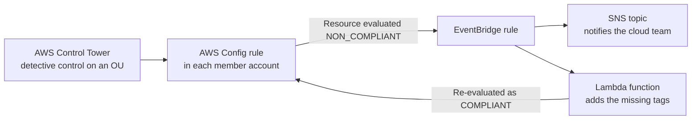

# Advanced Identity

## Summary

Once a company outgrows a single AWS account, identity questions change from "what can this user do?" to "what can anyone in this whole group of accounts do, and who signs in where?". **AWS Organizations** groups accounts into a tree of organizational units, pays for them on one bill and lets you put guardrails on them: **service control policies (SCPs)** cap what principals in member accounts may do, **resource control policies (RCPs)** cap what can be done to their resources, and **tag policies** keep tagging consistent. Inside each account, IAM **conditions**, **resource-based policies** and **permissions boundaries** fine-tune access, and the **policy evaluation logic** decides the result when all of these meet. **IAM Identity Center** gives the workforce one sign-in for every account and business app, using its own directory, an external identity provider or Microsoft Active Directory through **AWS Directory Service**. **AWS Control Tower** wraps all of this into a ready-made, governed multi-account landing zone with preventive, detective and proactive controls. Pick Organizations and SCPs for account-wide limits, boundaries for limits on one user or role, Identity Center for human sign-in, Directory Service when Windows workloads or existing AD users are involved, and Control Tower when you want the whole best-practice setup automated.

## Key concepts

- **AWS Organizations** is global: one **management account** pays for and administers many **member accounts**; an account belongs to only **one** organization at a time.
- **Consolidated billing** gives one bill, aggregated volume pricing and shared **Reserved Instance and Savings Plans** discounts across accounts, at no extra cost.
- **Organizational units (OUs)** group accounts (by business unit, environment or project) and can be nested up to **five levels** below the root.
- **SCPs** never grant anything; they set the **maximum** permissions for IAM users and roles (including the root user) in **member** accounts, never the management account, and never service-linked roles.
- An action survives SCPs only if it is **allowed at every level** from the root down to the account and **denied at none**; the default **FullAWSAccess** SCP provides the allow.
- **RCPs** are the resource-side twin of SCPs: they cap access to resources in member accounts even for callers from outside the organization.
- **Tag policies** standardize tag keys and values, can block noncompliant tagging, and report compliance; untagged resources are not evaluated.
- Key **condition keys**: `aws:SourceIp`, `aws:RequestedRegion`, `aws:ResourceTag` / `ec2:ResourceTag`, `aws:PrincipalTag`, `aws:MultiFactorAuthPresent`, `aws:PrincipalOrgID`.
- S3 needs two ARN shapes: `arn:aws:s3:::bucket` for **bucket-level** actions such as `s3:ListBucket`, `arn:aws:s3:::bucket/*` for **object-level** actions.
- **Assuming a role** swaps your permissions for the role's; a **resource-based policy** lets you keep your own permissions while touching the shared resource.
- A **permissions boundary** is a managed policy that sets the maximum permissions of one **user or role** (not a group); effective access is the intersection with its identity policies.
- **Evaluation order**: an explicit deny anywhere wins; RCPs and SCPs must allow; then a resource-based or identity-based policy must grant it, within any boundary and session policy.
- **IAM Identity Center** (successor to AWS Single Sign-On) provides one login for all accounts and SAML 2.0 apps; access to accounts is granted with **permission sets**.
- **AWS Directory Service**: **AWS Managed Microsoft AD** (real AD, trusts, MFA), **AD Connector** (proxy to on-premises AD) and **Simple AD** (Samba-based, standalone, now closed to new customers).
- **AWS Control Tower** builds a governed landing zone on Organizations; its **controls** (formerly guardrails) are **preventive** (SCPs/RCPs), **detective** (AWS Config rules) or **proactive** (CloudFormation hooks).

## AWS Organizations: managing many accounts as one

A single AWS account works for a hobby project. A real company quickly wants separate accounts: production apart from development, one account per team, a locked-down account for security logs. Separate accounts give hard boundaries for security (a mistake in the sandbox cannot touch production), for quotas and for cost tracking. AWS Organizations is the free, global service that lets you run those accounts as one estate.

### The building blocks

- The **management account** is the account that created the organization. It creates or invites accounts, attaches policies, pays the whole bill and cannot be swapped for another account later. Treat it as a vault: keep workloads out of it, because SCPs do not restrict anyone in it.
- **Member accounts** are every other account. Each can be in only one organization at a time.
- The **root** is the top container of the tree. Everything (OUs and accounts) sits under it.
- **Organizational units (OUs)** are folders of accounts. An OU can contain accounts and other OUs, up to five levels deep under the root. Policies attached to an OU apply to everything below it.
- **Delegated administrators** are member accounts that the management account allows to run a service (for example IAM Identity Center or Security Hub) or to manage organization policies, so day-to-day administration happens outside the management account.

New accounts can be **created** from the management account with the console, CLI or the `CreateAccount` API (handy for automated "account vending"), or existing accounts can be **invited**. A created account automatically gets an IAM role (named `OrganizationAccountAccessRole` unless you choose another name) that administrators in the management account can assume to work inside it.

| Quota (defaults, checked 2026-10) | Value |
|---|---|
| Accounts per organization | 10 by default, adjustable through Service Quotas (new organizations may start lower) |
| OUs per organization | 2,000 |
| OU nesting | 5 levels below the root |
| Roots per organization | 1 |
| Member accounts created at the same time | 5 |

> [!WARNING] Free plan accounts
> AWS accounts on the **Free plan** (accounts opened on or after 15 July 2025) are upgraded to the paid plan when they create or join an organization or set up a Control Tower landing zone, and any remaining Free Tier credits expire immediately. Do the Organizations and Identity Center labs in an account where that does not matter.

### Consolidated billing

Every organization has consolidated billing: the management account receives one bill and pays for every member account. Because usage is combined, the organization climbs volume pricing tiers faster (for example S3 storage or data transfer tiers), and **Reserved Instances and Savings Plans** bought in one account can discount matching usage in other accounts. The management account can switch that sharing off for chosen accounts, and AWS has added group-based sharing modes that keep a commitment's benefit inside a defined set of accounts first. Consolidated billing itself costs nothing.

> [!EXAMPLE] Shared discounts
> The data team bought a Compute Savings Plan in account A but now runs fewer jobs. Account B, in the same organization, runs steady Fargate tasks. With sharing on, the unused part of A's commitment automatically discounts B's usage instead of going to waste.

An organization can run in one of two feature sets. **All features** (the default and the one you want) includes consolidated billing plus policies, service integrations and delegated administration. **Consolidated billing only** gives the shared bill and nothing else; you cannot attach SCPs in that mode.

### Ways to shape the OU tree

There is no single correct tree. Pick the grouping that matches how you apply controls, because policies flow down the tree.

| Strategy | Example top-level OUs | Good when |
|---|---|---|
| Business unit | Sales, Retail, Finance | Each division owns its budget and needs its own controls |
| Environment lifecycle | Prod, Dev, Test | Controls differ mainly by environment (strict prod, relaxed dev) |
| Project | Project-Atlas, Project-Nova | Short-lived, isolated projects that are created and retired as a whole |

Many real organizations mix them, for example a `Security` OU for log and audit accounts, a `Sandbox` OU for experiments, and a `Workloads` OU split into `Prod` and `NonProd`.

### Multi-account habits the exam expects

- Prefer **separate accounts** over one account with many VPCs when you need strong isolation of permissions, quotas and billing.
- Apply a **tagging standard** so cost allocation works across accounts.
- Turn on **CloudTrail for every account** (an organization trail) and deliver the logs to an S3 bucket in a dedicated, locked-down logging account; send **CloudWatch Logs** to a central logging account too.
- Use **cross-account IAM roles** for administrators instead of IAM users in every account.
- Use **SCPs** to put limits on member accounts that their own administrators cannot remove.

> [!UPDATED] Root credentials for member accounts can be managed centrally
> With centralized root access management, the management account (or a delegated IAM administrator) can delete root user passwords and keys from member accounts and run the few root-only tasks on their behalf, such as unlocking an S3 bucket policy that denies everyone. This post-dates the course slides.

### Organization policy types at a glance

| Policy type | Category | What it controls | Applies to the management account? |
|---|---|---|---|
| Service control policy (SCP) | Authorization | Maximum permissions of IAM users and roles in member accounts | No |
| Resource control policy (RCP) | Authorization | Maximum permissions on resources in member accounts, for any caller | No |
| Tag policy | Declarative | Allowed tag keys, values and capitalization; optional enforcement | Yes |
| Backup policy | Declarative | AWS Backup plans pushed to accounts | Yes |
| AI services opt-out policy | Declarative | Whether AWS AI services may store and use your content | Yes |
| Other declarative policies (EC2, S3, Security Hub, Inspector, GuardDuty, Bedrock and more) | Declarative | Baseline service settings enforced across accounts | Yes |

> [!UPDATED] More policy types than the slides show
> Resource control policies arrived in late 2024, and the second family, now called **declarative policies** in the Organizations guide, keeps growing (EC2, S3, Security Hub, Inspector, GuardDuty and Bedrock policies, among others). For the exam, SCPs remain the star; know that RCPs exist and what they are for.

## Service control policies (SCPs)

An SCP is a JSON policy, written in almost the same language as an IAM policy, that you attach to the root, an OU or an account. It never gives anyone permission to do anything. It only draws the outer fence: a user in a member account can do something only if both an IAM policy grants it and the SCPs leave room for it.

### What SCPs affect and what they do not

| Affected by SCPs | Not affected by SCPs |
|---|---|
| IAM users and roles in member accounts | Anyone in the **management account** |
| The **root user** of member accounts | **Service-linked roles** (AWS services acting on your behalf) |
| Member accounts that are delegated administrators | Principals from accounts outside the organization (even when a bucket policy lets them in) |

### Inheritance: allow all the way down, deny anywhere

When you turn SCPs on, Organizations attaches an AWS managed SCP called **FullAWSAccess** (allow everything) to the root, every OU and every account. Two rules then decide the result for a given account:

1. **Allow must be continuous.** There has to be an `Allow` covering the action at the root, at every OU on the path, and on the account itself. Replace FullAWSAccess at any level with a narrower allow list and everything below that level is limited to that list.
2. **One deny is enough.** An explicit `Deny` attached at any level on the path blocks the action for every account below it, whatever the other levels allow.



| Account | What its users and roles can do (if their IAM policies allow it) | Why |
|---|---|---|
| Management | Everything | SCPs never apply here |
| Lab-1 | Everything except Redshift and creating IAM users | Deny inherited from Sandbox OU plus its own deny |
| Lab-2 | Everything except Redshift | Deny inherited from Sandbox OU |
| Dev-1 | Only EC2, S3 and CloudWatch | Dev OU replaced FullAWSAccess with an allow list; FullAWSAccess on the account cannot widen it |
| Prod-1 | Everything | Allow at every level, no deny on the path |

### Deny list versus allow list

| Strategy | How it works | Pros | Cons |
|---|---|---|---|
| **Deny list** (default) | Keep FullAWSAccess everywhere and add SCPs with `Deny` statements for what is forbidden | Simple; new AWS services work automatically | Something new may be usable before you decide to block it |
| **Allow list** | Remove FullAWSAccess and attach SCPs that `Allow` only approved services | Tightest control; new services are blocked until approved | More maintenance; easy to lock accounts out by mistake |

A deny-list SCP that stops anyone in the attached accounts from leaving the organization or touching the organization trail:

```json
{
  "Version": "2012-10-17",
  "Statement": [
    { "Sid": "StayInOrg", "Effect": "Deny", "Action": "organizations:LeaveOrganization", "Resource": "*" },
    { "Sid": "ProtectTrail", "Effect": "Deny", "Action": ["cloudtrail:StopLogging", "cloudtrail:DeleteTrail"], "Resource": "*" }
  ]
}
```

An allow-list SCP for a data-science OU (attach it, then detach FullAWSAccess from that OU):

```json
{
  "Version": "2012-10-17",
  "Statement": [
    { "Effect": "Allow", "Action": ["s3:*", "athena:*", "glue:*", "sagemaker:*", "cloudwatch:*"], "Resource": "*" }
  ]
}
```

> [!TIP] Test before you attach to the root
> AWS recommends trying a new SCP on a test OU first and using IAM "service last accessed" data or CloudTrail to see what accounts really use. A careless SCP at the root can lock every member account out of AWS.

> [!UPDATED] SCPs now accept the full IAM policy language and are bigger
> Since September 2025, SCPs support conditions, `NotAction` and individual resource ARNs in `Allow` statements, plus `NotResource`, so allow lists can be far more precise. In May 2026 AWS raised the limits to **10 SCPs per root, OU or account** (was 5) and **10,240 characters per SCP** (was 5,120). Older practice questions may still quote 5 and 5,120.

> [!VERIFY] Resource ARNs in Allow statements: one AWS page still disagrees
> Checked 2026-10-04. The [What's New post of 19 September 2025](https://aws.amazon.com/about-aws/whats-new/2025/09/aws-organizations-iam-language-service-control-policies/) says `Allow` statements in SCPs now accept conditions, `NotAction` and individual resource ARNs, and the elements table at the top of the [SCP syntax page](https://docs.aws.amazon.com/organizations/latest/userguide/orgs_manage_policies_scps_syntax.html) lists `Resource`, `NotResource`, `Condition` and `NotAction` for both `Allow` and `Deny`. Further down, the `Resource` section of that same page still says an `Allow` statement can name only `"*"`, which looks like text left over from before the change, but AWS has not corrected it yet. Go with the newer behaviour. Before a real organization depends on a resource-scoped `Allow`, attach the SCP to a test OU and confirm it is accepted and works as intended. SAA-C03 questions test deny lists versus allow lists, not this detail.

### Resource control policies (RCPs)

SCPs look at **who** is calling: principals in your member accounts. They cannot stop an outsider whom a careless bucket policy lets in. RCPs fill that gap by looking at **what** is being accessed: they cap the permissions available on resources in member accounts, for every caller, including principals from other organizations. A typical RCP denies access to every S3 object in the organization unless the caller's `aws:PrincipalOrgID` matches yours, creating a **data perimeter** that a single misconfigured bucket policy cannot break.

RCPs work like SCPs (they grant nothing, a deny anywhere wins, an AWS managed `RCPFullAWSAccess` is always attached and cannot be detached), do not apply to resources in the management account or to calls made by service-linked roles, and cover a growing list of services including S3, KMS, SQS, Secrets Manager, STS and DynamoDB. RCPs kept the older limits: up to 5 per root, OU or account (`RCPFullAWSAccess` counts as one) and 5,120 characters each.

### Tag policies

Tags only help with cost allocation and attribute-based access control if everyone spells them the same way. A tag policy lists the tag keys you care about, their exact capitalization (`CostCenter`, not `costcenter`) and, optionally, the allowed values (`Environment` must be `prod`, `dev` or `test`).

- You can **enforce** a tag policy for chosen resource types: noncompliant tagging requests are then rejected. Resources that carry no tags, and tag keys the policy does not mention, are not evaluated.
- Each account can see its own noncompliant resources; the management account can generate an **organization-wide compliance report** (from `us-east-1`, written to an S3 bucket).
- **EventBridge** receives "Tag Change on Resource" events with a `tag-policy-compliant` field, so you can alert on or auto-fix bad tags.

## IAM conditions you must recognise

The `Condition` block makes a statement apply only in certain circumstances. The exam usually shows a short policy and asks what it does, so learn to read these keys.

| Condition key | What it compares | Typical use |
|---|---|---|
| `aws:SourceIp` | The public IP address the API call came from | Allow or deny calls only from the corporate IP range |
| `aws:RequestedRegion` | The Region the API call is sent to | Keep workloads inside approved Regions |
| `aws:ResourceTag/key` (or `ec2:ResourceTag/key`) | A tag on the resource being acted on | Let people stop only instances tagged with their project |
| `aws:PrincipalTag/key` | A tag on the calling user or role (or session tag) | ABAC: match the caller's team tag to the resource's team tag |
| `aws:MultiFactorAuthPresent` | Whether the temporary credentials were obtained with MFA | Require MFA for destructive actions |
| `aws:PrincipalOrgID` | The organization ID of the calling principal | Let every account in your organization use a shared resource |
| `aws:SecureTransport` | Whether the request used TLS | Deny plain-HTTP access to a bucket |

Deny any API call that does not come from the office network (note that `aws:SourceIp` holds only public addresses and is absent when the call arrives through a VPC endpoint, where VPC keys such as `aws:VpcSourceIp`, `aws:SourceVpc` or `aws:SourceVpce` apply instead):

```json
{
  "Version": "2012-10-17",
  "Statement": [{
    "Effect": "Deny",
    "Action": "*",
    "Resource": "*",
    "Condition": { "NotIpAddress": { "aws:SourceIp": ["198.51.100.0/24"] } }
  }]
}
```

Keep everything except global services in two Regions (a classic SCP):

```json
{
  "Version": "2012-10-17",
  "Statement": [{
    "Sid": "OnlyApacRegions",
    "Effect": "Deny",
    "NotAction": ["iam:*", "organizations:*", "route53:*", "cloudfront:*", "support:*", "sts:*"],
    "Resource": "*",
    "Condition": { "StringNotEquals": { "aws:RequestedRegion": ["ap-southeast-1", "ap-southeast-2"] } }
  }]
}
```

Let people start and stop only the instances that belong to their own team (ABAC):

```json
{
  "Version": "2012-10-17",
  "Statement": [{
    "Effect": "Allow",
    "Action": ["ec2:StartInstances", "ec2:StopInstances"],
    "Resource": "arn:aws:ec2:*:*:instance/*",
    "Condition": { "StringEquals": { "aws:ResourceTag/Team": "${aws:PrincipalTag/Team}" } }
  }]
}
```

Block instance termination unless the session was authenticated with MFA:

```json
{
  "Version": "2012-10-17",
  "Statement": [{
    "Effect": "Deny",
    "Action": "ec2:TerminateInstances",
    "Resource": "*",
    "Condition": { "BoolIfExists": { "aws:MultiFactorAuthPresent": "false" } }
  }]
}
```

> [!NOTE] Why BoolIfExists?
> `aws:MultiFactorAuthPresent` is missing entirely from requests signed with long-term access keys. A plain `Bool` test against `false` would not match a missing key, so those requests would slip through. `BoolIfExists` treats "missing" as a match and denies them too.

### S3: bucket-level versus object-level permissions

S3 actions act on two different resource types, and the ARN must match the type:

| Action examples | Resource type | ARN in the policy |
|---|---|---|
| `s3:ListBucket`, `s3:GetBucketLocation` | The bucket | `arn:aws:s3:::team-assets` |
| `s3:GetObject`, `s3:PutObject`, `s3:DeleteObject` | Objects inside it | `arn:aws:s3:::team-assets/*` |

```json
{
  "Version": "2012-10-17",
  "Statement": [
    { "Effect": "Allow", "Action": "s3:ListBucket", "Resource": "arn:aws:s3:::team-assets" },
    { "Effect": "Allow", "Action": ["s3:GetObject", "s3:PutObject"], "Resource": "arn:aws:s3:::team-assets/*" }
  ]
}
```

Writing `s3:ListBucket` against `team-assets/*`, or `s3:GetObject` against `team-assets`, is a classic bug: the policy looks right but grants nothing.

### aws:PrincipalOrgID in resource-based policies

Listing every account ID in a bucket policy breaks the day a new account joins. Instead, allow all principals and add a condition on the organization ID; any current or future account in the organization gets in, nobody outside does:

```json
{
  "Version": "2012-10-17",
  "Statement": [{
    "Effect": "Allow",
    "Principal": "*",
    "Action": ["s3:GetObject", "s3:PutObject"],
    "Resource": "arn:aws:s3:::acme-shared-reports/*",
    "Condition": { "StringEquals": { "aws:PrincipalOrgID": "o-a1b2c3d4e5" } }
  }]
}
```

`aws:PrincipalOrgPaths` narrows this further to one OU. Be careful: AWS services that write into a bucket as service principals (for example CloudTrail log delivery) do not belong to your organization, so this statement does not cover them. They need their own statement, and if you turn the idea into a Deny for everyone outside the organization, they need an explicit exception.

## Cross-account access: roles versus resource-based policies

There are two ways to let a principal in account A use something in account B.



| | Assume a role in account B | Resource-based policy on the resource in B |
|---|---|---|
| What happens to the caller's own permissions | Set aside for the session: you act only with the role's permissions | Kept: you act as yourself |
| Can read from A and write to B in the same call flow | Awkward: the role session has only the role's permissions, so it cannot read A's table unless account A also grants that role access (for example through a DynamoDB resource-based policy) | Natural: the job reads A's table with its own rights and writes to B's bucket through the bucket policy |
| Works for any service | Yes | Only for services that support resource-based policies (S3 buckets, SNS topics, SQS queues, KMS keys, Lambda functions, Secrets Manager secrets, and others) |
| Cross-account requirement | Trust policy in B plus `sts:AssumeRole` permission in A | Allow in the resource policy in B **and** an allow in the caller's identity policy in A |

> [!EXAMPLE] Scan in A, dump in B
> A Lambda function in account A must scan a DynamoDB table in A and write the export to a bucket in account B. If it assumed a role in B, it would lose its access to the table. A bucket policy in B that allows the function's role to `s3:PutObject` lets it do both jobs with one identity. This is the scenario where the exam wants "resource-based policy".

### Who gives EventBridge permission to call a target?

An EventBridge rule needs permission to invoke each of its targets, and there are two mechanisms. Some targets accept a **resource-based policy** that names `events.amazonaws.com` as the principal: Lambda functions, SNS topics, SQS queues, CloudWatch Logs log groups and API Gateway APIs. Other targets require an **IAM execution role** that EventBridge assumes: Kinesis Data Streams, ECS tasks, Step Functions state machines, Systems Manager Run Command and the EC2 API actions, for example.

> [!UPDATED] Execution roles now work for every target
> Since March 2025, Lambda, SNS and SQS targets can also use an execution role instead of a resource-based policy (CloudWatch Logs still uses only its resource policy). The current target list in the EventBridge guide also names neither S3 buckets nor EC2 Auto Scaling as rule targets, although older course material shows them.

## Permissions boundaries

A permissions boundary is a **managed policy** (AWS managed or customer managed) that you set on an IAM **user or role** to define the most that entity can ever do. It grants nothing by itself. Groups cannot have boundaries.

The effective permissions are what the identity-based policies grant **and** the boundary allows. If the user also lives in a member account, the SCPs must allow it as well.

| Boundary allows | Identity policy allows | Effective result |
|---|---|---|
| `s3:*`, `cloudwatch:*`, `ec2:*` | `iam:CreateUser` | Nothing: the only granted action is outside the boundary |
| `s3:*`, `cloudwatch:*`, `ec2:*` | `s3:GetObject`, `ec2:DescribeInstances`, `iam:CreateUser` | `s3:GetObject` and `ec2:DescribeInstances` |
| `s3:*` | `AdministratorAccess` | All S3 actions and nothing else |

Boundaries shine in **delegation**:

- **Let non-administrators create IAM users or roles safely.** Give a team lead `iam:CreateUser` and `iam:AttachUserPolicy` only with a condition (`iam:PermissionsBoundary`) that every user they create must carry a specific boundary. Whatever policy they attach, the new user can never exceed it.
- **Let developers manage their own permissions without escalating.** Developers can create roles for their Lambda functions, but those roles must carry the boundary, so nobody can mint an admin role.
- **Restrict one specific user or role**, where an SCP would hit the entire account.

> [!TIP] Boundary versus SCP
> SCP: one policy, every principal in the account or OU, managed centrally in Organizations. Boundary: one user or role at a time, managed inside the account with IAM. They combine: a request must pass both.

## Putting it together: the policy evaluation logic

When a request reaches AWS, every applicable policy type is consulted. A simplified view of the flow inside one account:



Three rules cover most exam questions:

1. **Everything starts as an implicit deny.** Something must explicitly allow the request.
2. **An explicit deny in any policy wins** over every allow, everywhere.
3. **Guardrails (RCPs, SCPs, boundaries, session policies) only subtract.** They can turn an allow into a deny, never the reverse.

Within one account, an allow from **either** the identity policy or the resource policy is usually enough. Across accounts, **both** sides must allow: the identity policy in the caller's account and the resource policy in the owner's account.

> [!EXAMPLE] A quick puzzle
> A user has exactly one policy with two statements: `Deny sqs:*` on all resources, and `Allow sqs:DeleteQueue` on all resources. Can they call `sqs:CreateQueue`? No: explicit deny. `sqs:DeleteQueue`? Still no: the explicit deny on `sqs:*` beats the allow. `ec2:DescribeInstances`? No: nothing allows it, so the implicit deny stands.

> [!TIP] Test before you guess
> The **IAM policy simulator** answers "would this be allowed?" without making the real call. It evaluates identity policies, a permissions boundary, SCPs and a resource policy you supply, and lets you set condition values such as `aws:MultiFactorAuthPresent` or `aws:RequestedRegion`. It does not evaluate RCPs. {{updated: The simulator now lives in the IAM console (Policy simulator in the navigation pane); the old standalone policysim site is no longer maintained}}

> [!UPDATED] RCPs are part of the flowchart
> The IAM evaluation diagram in the slides goes deny check, SCPs, resource-based policies, identity policies, boundaries, session policies. The current IAM User Guide inserts a resource control policy step before the SCP step.

## AWS IAM Identity Center

IAM Identity Center (called AWS Single Sign-On until July 2022) is the recommended way to give **people** access to AWS. Instead of an IAM user in every account, each person has one identity, signs in once to the **AWS access portal**, and sees tiles for every account and application assigned to them.

What a user can reach with that one login:

- **AWS accounts** in your organization, with a choice of role per account (console or short-term CLI credentials).
- **Business cloud applications** pre-integrated through SAML 2.0 (Salesforce, Box, Microsoft 365 and many more), plus your own **custom SAML 2.0 applications**. For a custom app you exchange the setup details by hand: the app's sign-in (ACS) URL and SAML metadata go into Identity Center, and Identity Center's certificate and metadata go into the app.
- **AWS managed applications** that integrate with Identity Center, such as Amazon Redshift or Amazon Quick.
- **EC2 Windows instances** through Systems Manager Fleet Manager Remote Desktop, without typing Windows credentials.

There is no extra charge for IAM Identity Center.

### Identity sources

Identity Center keeps exactly one identity source per organization:

| Identity source | Users and passwords live in | Choose when |
|---|---|---|
| Identity Center directory (default) | IAM Identity Center itself | Small teams with no existing directory |
| External identity provider | Okta, Microsoft Entra ID, OneLogin, Ping and others (SAML 2.0, usually with SCIM provisioning) | The company already runs a cloud IdP |
| Active Directory | AWS Managed Microsoft AD, or a self-managed AD reached through AD Connector or a trust | The company's users are in Microsoft AD |



### Permission sets and assignments

A **permission set** is a reusable template of access: one or more AWS managed policies, customer managed policies, an inline policy and optionally a permissions boundary, plus a session duration (1 hour by default, up to 12 hours). You **assign** a user or group plus a permission set to one or more accounts. Identity Center then creates and maintains a matching IAM role in each of those accounts; when the user picks that tile, they assume the role.

> [!EXAMPLE] One group, two levels of access
> The `Developers` group gets the `PowerUser` permission set on the two Dev accounts and the `ReadOnly` permission set on the two Prod accounts. When Alice joins the team, adding her to the group is the only change needed: she immediately sees four tiles with the right access in each.

### Attribute-based access control (ABAC)

Identity Center can pass user attributes (team, cost center, job title, location) from the identity source into the AWS session as tags. Policies then compare `aws:PrincipalTag/...` with resource tags. You write one permission set once; when someone moves to another team, you change the attribute in the directory and their access follows, with no policy edits.

> [!UPDATED] Organization and account instances, multi-Region
> An **organization instance** (enabled in the management account, best administered from a delegated administrator member account) is the only kind that manages access to AWS accounts. **Account instances** exist for isolated use of AWS managed applications in a single account. An organization instance can now be replicated to additional Regions for resilience, and the newer IAM **account access manager** feature lets you assign existing IAM roles to Identity Center users alongside permission sets.

## AWS Directory Service

### A one-minute primer on Active Directory

Microsoft Active Directory (AD) is the directory that runs on Windows Server with AD Domain Services. It stores objects such as user accounts, computers, printers, file shares and security groups, and servers called **domain controllers** check passwords and apply policies centrally. Objects are organized into **domains** arranged in **trees**, and a group of trees is a **forest**. When a Windows laptop or server is "joined to the domain", its users sign in with their AD credentials.

### The options in AWS

| | AWS Managed Microsoft AD | AD Connector | Simple AD |
|---|---|---|---|
| What it is | A real Microsoft AD run by AWS (domain controllers in two AZs, patching, snapshots) | A proxy that forwards sign-in and lookup requests to your on-premises AD | A basic AD-compatible directory based on Samba 4 |
| Where users are managed | In the managed AD (and, through a trust, in your on-premises AD) | Only in your on-premises AD; nothing is cached in AWS | In Simple AD |
| Trust with on-premises AD | Yes (one-way or two-way forest trusts) | Not needed; it is a pass-through | No |
| MFA | Yes (RADIUS) | Yes (RADIUS on your existing MFA servers) | No |
| Sizes | Standard (about 30,000 objects) and Enterprise (about 500,000 objects) | Small and Large | Small (500 users) and Large (5,000 users) |
| Works as an Identity Center source | Yes | Yes | No |
| Typical use | AD-aware apps in AWS (SQL Server, SharePoint, RDS for SQL Server, FSx for Windows), or extending on-premises AD to the cloud | Let on-premises users sign in to WorkSpaces, the console or Identity Center without copying the directory | Low-cost, standalone directory for basic domain join and LDAP |

> [!UPDATED] Simple AD closes to new customers; Hybrid Edition is new
> AWS states that Simple AD is no longer open to new customers from **30 July 2026**; existing customers keep full functionality and AWS points everyone else to AWS Managed Microsoft AD or AD Connector. AWS has also added **AWS Managed Microsoft AD (Hybrid Edition)**, which extends an existing self-managed AD into AWS without setting up a trust.

### Connecting IAM Identity Center to Active Directory



- **Users already in AWS Managed Microsoft AD**: connect the directory to Identity Center directly; integration is built in.
- **Users in a self-managed (on-premises) AD**: either create AWS Managed Microsoft AD and a **two-way trust** with the on-premises domain, or create an **AD Connector** that proxies to it.
- The directory must live in the management account or in the Identity Center delegated administrator account, and an AWS Managed Microsoft AD directory must be in the same Region as the Identity Center instance. Only one connected directory can be used at a time.

## AWS Control Tower

Setting up a well-governed multi-account environment by hand means creating an organization, OUs, logging and audit accounts, an organization trail, AWS Config everywhere, SSO, and a pile of SCPs. **AWS Control Tower** does it for you in about an hour, following AWS best practice, and keeps it in shape afterwards. It runs on top of AWS Organizations (accounts are created through it) and AWS Service Catalog, and by default sets up IAM Identity Center for sign-in (you can opt out and manage access yourself).

What you get:

- A **landing zone**: the governed multi-account environment itself, traditionally with a Security OU holding a **Log Archive** account and an **Audit** account, plus an optional Sandbox OU.
- **Account Factory**: a template-driven "account vending machine" that creates new accounts already configured and enrolled.
- **Controls** (formerly called guardrails): high-level rules applied to whole OUs.
- A **dashboard** showing accounts, enabled controls and noncompliant resources.

Control Tower itself has no charge; you pay for the services it switches on, such as AWS Config, CloudTrail and S3.

### Controls

| Control type | What it does | Implemented with | Example |
|---|---|---|---|
| **Preventive** | Stops the action from happening | SCPs (and RCPs) | Deny use of Regions outside the approved list |
| **Detective** | Finds noncompliant resources after the fact | AWS Config rules | Detect EBS volumes that are not encrypted, or resources without required tags |
| **Proactive** | Checks resources before CloudFormation provisions them | CloudFormation hooks | Reject a template that creates a public S3 bucket |

Each control also carries guidance: **mandatory** (always on, cannot be removed), **strongly recommended** or **elective**. Like SCPs, controls do not restrict the management account.



> [!UPDATED] Controls, not guardrails, and a lighter way in
> AWS renamed guardrails to **controls** and added the **proactive** type. Since November 2025 a **controls-dedicated experience** lets an existing organization use Control Tower's catalog of managed controls without deploying a full landing zone, and landing zone version 4.0 no longer forces a Security OU. Exam questions may still say "guardrail"; treat it as the same thing.

## Exam tips

> [!EXAM] Restrict what whole accounts can do
> "Prevent all users, including administrators and the root user, in member accounts from using a service or Region" → **SCP** attached to the OU or account. IAM policies cannot do this because account administrators could remove them.

> [!EXAM] Management account surprises
> "The SCP works in member accounts but not in the account that owns the organization" → SCPs never apply to the management account. Move workloads out of it.

> [!EXAM] Share a resource with the whole organization
> "Allow every account in the organization, including future ones, to read a bucket" → bucket policy with `aws:PrincipalOrgID`. Listing account IDs is the high-maintenance distractor.

> [!EXAM] Keep your own permissions while accessing another account
> "Read from a table in account A and write to a bucket in account B" → **resource-based policy** on the bucket. Assuming a role would drop the permissions for account A.

> [!EXAM] Delegate IAM without privilege escalation
> "Let developers create roles for their own Lambda functions but never more powerful than X" → **permissions boundary** plus an `iam:PermissionsBoundary` condition on role creation.

> [!EXAM] One login for the workforce
> "Employees need single sign-on to many AWS accounts and to Salesforce/Microsoft 365, using existing corporate credentials" → **IAM Identity Center** connected to the corporate IdP or AD. Permission sets define the access per account.

> [!EXAM] Which directory?
> "Use existing on-premises AD users in AWS, keep no copy of the directory in the cloud" → **AD Connector**. "Run AD-aware apps in AWS, need trusts and MFA" → **AWS Managed Microsoft AD**. "Cheap, basic standalone directory, no trust" → Simple AD (closed to new customers from July 2026).

> [!EXAM] Governed multi-account setup in a few clicks
> "Set up a new multi-account environment following best practices with ongoing compliance checks and automated account provisioning" → **AWS Control Tower** (landing zone, Account Factory, controls). Preventive control = SCP, detective control = AWS Config rule.

> [!EXAM] Cheaper bills across accounts
> "Several accounts, want volume discounts and to share Reserved Instances or Savings Plans" → AWS Organizations with **consolidated billing**.

- "Standardize tag keys and values across accounts" → **tag policies** (enforcement optional, compliance reports).
- "Require MFA for sensitive actions" → `aws:MultiFactorAuthPresent` with `BoolIfExists` in a Deny statement.
- "Restrict the Regions people can use" → SCP with `aws:RequestedRegion` and `StringNotEquals`.
- "Block access to bucket data from anyone outside our organization, even if a bucket policy is wrong" → **RCP** (data perimeter).

## Common traps

> [!TRAP] "The SCP grants S3 access"
> An SCP never grants anything. If the SCP allows S3 but the user has no IAM policy for S3, the user still cannot use S3.

> [!TRAP] Removing FullAWSAccess without a replacement
> Detaching FullAWSAccess from an OU and attaching only a Deny SCP leaves nothing allowed: every account below loses all access. Allow lists must be explicit.

> [!TRAP] Allow lower down cannot undo a deny or a missing allow higher up
> An `Allow S3` SCP on an account does not help if the parent OU denies S3, or if the parent OU's allow list does not include S3.

> [!TRAP] Permissions boundaries on groups
> Boundaries attach only to users and roles. Answers that put a boundary on an IAM group are wrong.

> [!TRAP] Boundaries and SCPs are not permission grants
> A boundary of `s3:*` with no identity policy gives zero access. Effective permissions are the intersection, never the union.

> [!TRAP] Wrong ARN for S3 actions
> `s3:ListBucket` needs the bucket ARN; `s3:GetObject` needs `bucket/*`. A policy that mixes them up silently grants nothing.

> [!TRAP] "Assume a role" when a resource policy is needed
> A role session has only the role's permissions. If the task needs the caller's original permissions at the same time, choose a resource-based policy.

> [!TRAP] AD Connector does not store users or support trusts
> AD Connector is a pass-through proxy, one per domain. If the question needs a directory in AWS that keeps working when the link to on-premises is down, or needs trusts, the answer is AWS Managed Microsoft AD.

> [!TRAP] Simple AD with IAM Identity Center
> Identity Center cannot use Simple AD as an identity source. Use the Identity Center directory, an external IdP, AWS Managed Microsoft AD or AD Connector.

> [!TRAP] Detective versus preventive controls
> A detective control (AWS Config rule) only reports a violation; it does not stop it. "Prevent" in the question points to a preventive control (SCP).

> [!TRAP] Tag policies and untagged resources
> Tag policies do not force anyone to add tags; they only check tags that are present. To require tags at creation time, use an SCP or IAM condition (for example on `aws:RequestTag`) or a proactive control.
