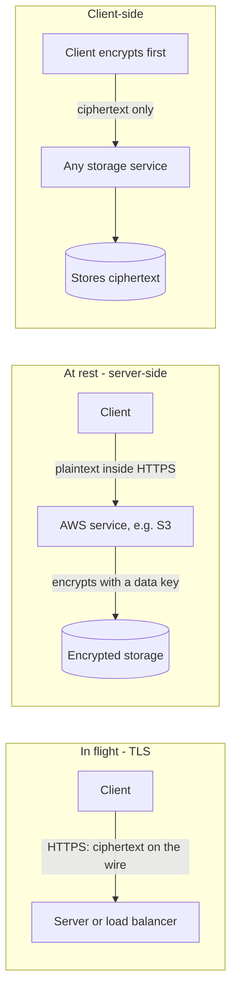
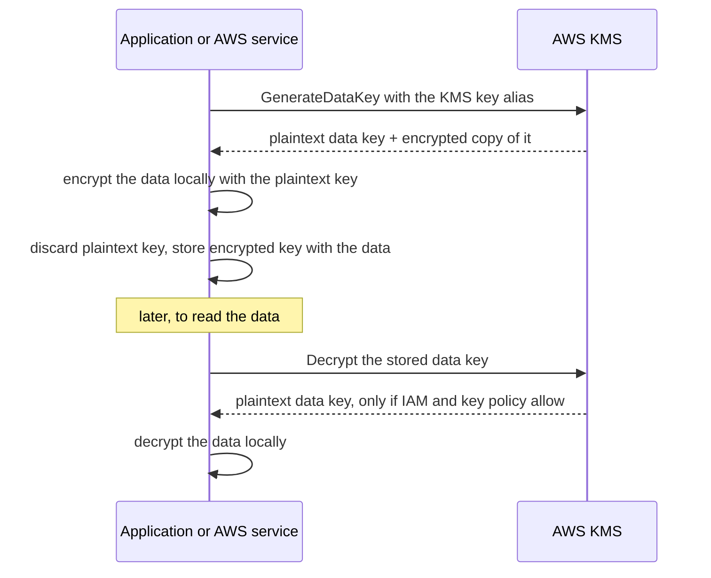
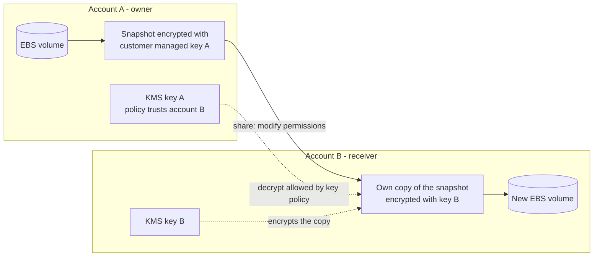
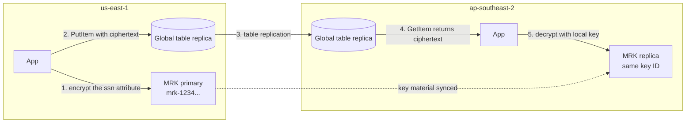
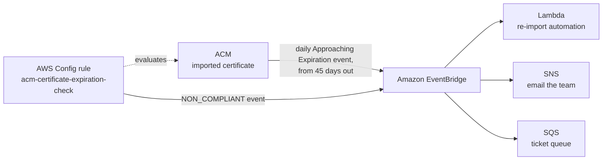
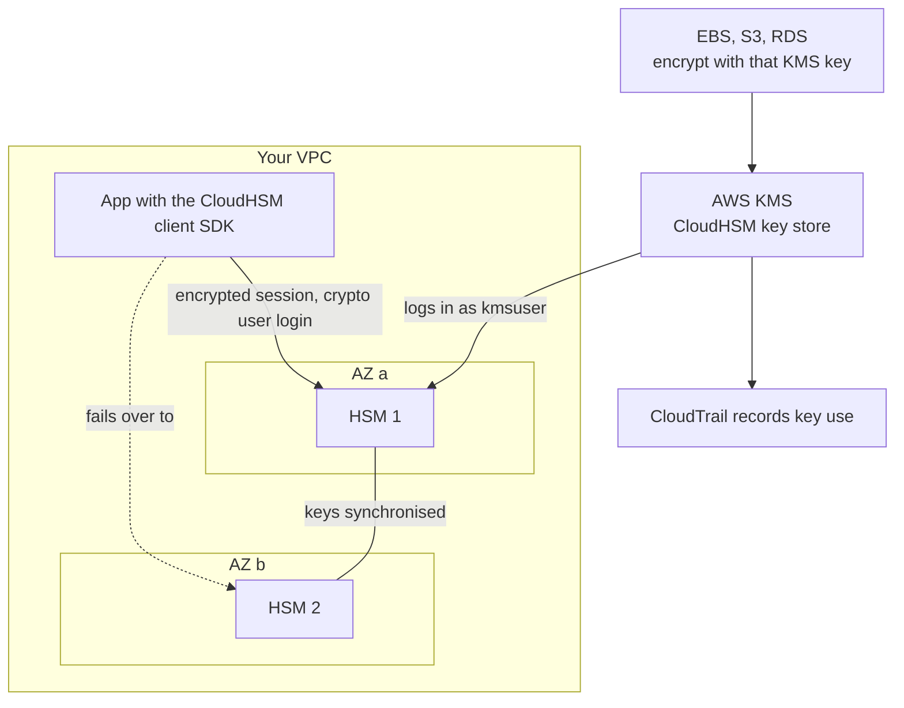

# Encryption, Keys & Secrets

## Summary

These services protect data with cryptography and keep sensitive values out of code. **AWS KMS** creates and guards the keys that almost every AWS service uses for encryption at rest, and **multi-Region keys** let ciphertext move between Regions. **SSM Parameter Store** is a free, hierarchical store for configuration and encrypted values. **AWS Secrets Manager** adds automatic rotation and cross-Region replicas for credentials. **ACM** issues and renews the TLS certificates behind HTTPS on load balancers, CloudFront and API Gateway. **AWS CloudHSM** provides dedicated HSMs when you, not AWS, must control the keys. Exam questions hinge on three clues: who must control the key, whether rotation must be automatic, and where the data or certificate is used.

## Key concepts

- **In flight** (TLS) protects the network path, **at rest** protects storage, and with **client-side** encryption the service only ever sees ciphertext.
- **AWS KMS** is the default answer for "encrypt data in an AWS service": IAM plus key policies decide access, and **CloudTrail** logs every use.
- **Envelope encryption**: KMS encrypts at most **4 KB** directly. Larger data is encrypted with a data key from `GenerateDataKey`.
- **AWS owned** keys are free and invisible. **AWS managed** keys (`aws/<service>`) have no monthly fee, rotate yearly and cannot be shared. **Customer managed** keys cost **USD 1 per month** and give full control.
- **Symmetric** keys (AES-256-GCM) never leave KMS. **Asymmetric** keys offer a downloadable public key for users who cannot call KMS.
- Every KMS key has a **key policy**. Without a statement trusting the account, IAM policies cannot grant access.
- **KMS keys are Regional**, so cross-Region copies are re-encrypted. **Multi-Region keys** share one key ID and key material across chosen Regions.
- Sharing **encrypted snapshots or AMIs** across accounts needs a **customer managed key** whose policy trusts the other account.
- **S3 replication** skips SSE-KMS objects unless you opt in and name a destination-Region key.
- **Parameter Store**: standard is free (up to 10,000 parameters of 4 KB). Advanced costs USD 0.05 per parameter per month (up to 100,000 parameters of 8 KB, plus policies such as Expiration).
- **Secrets Manager**: USD 0.40 per secret per month, automatic rotation (Lambda, or managed for RDS, Aurora, Redshift, DocumentDB) and cross-Region replicas.
- **ACM**: free, auto-renewed public certificates for ELB, CloudFront and API Gateway. **Imported** certificates never renew. CloudFront and edge-optimized APIs need the certificate in **us-east-1**.
- **CloudHSM**: single-tenant FIPS 140-3 Level 3 HSMs in your VPC. You own keys and HSM users, spread HSMs across AZs, and can back a KMS custom key store.

## Three places to encrypt

Encryption answers one question: who can read the data, and where? AWS offers three answers, and the exam expects you to match the requirement to the right one.



| Model | Who encrypts and decrypts | What it protects against | Typical AWS tools | Pick it when the question says… |
|---|---|---|---|---|
| **In flight** (TLS / HTTPS) | The sender encrypts and the receiver decrypts. The keys live in TLS certificates | Eavesdropping and man-in-the-middle attacks on the network | ACM certificates on ALB, NLB, CloudFront, API Gateway | "Encrypt data in transit", "HTTPS", "TLS" |
| **Server-side at rest** | The AWS service encrypts on write and decrypts on read, using a key it can access | Stolen disks, snapshots or backups, and reading of raw storage | SSE-S3, SSE-KMS, EBS and RDS encryption with KMS | "Encrypt data at rest" with the least effort |
| **Client-side** | Your application encrypts before sending and decrypts after receiving | The storage provider, database admins, anyone with read access to the table or bucket | AWS Encryption SDK, AWS Database Encryption SDK, S3 Encryption Client | "AWS must never see plaintext", "protect fields even from DBAs" |

> [!EXAMPLE] A login form, three ways
> A user submits a password on an HTTPS site. TLS keeps it unreadable on the internet (in flight). The application stores the user profile in S3, where SSE-KMS encrypts the object on disk (at rest). Before saving, the application also encrypts the national ID field with the AWS Encryption SDK, so even a DBA or an admin with S3 read access sees only ciphertext (client-side). One request, three layers.

The models stack: most production systems use TLS **and** server-side encryption, and add client-side encryption only for the most sensitive fields.

## Envelope encryption and data keys

KMS keys are not meant to encrypt your files directly. The `Encrypt` API accepts at most **4,096 bytes**, which is enough for a password or an API token but not for a video or a database page. Instead, AWS services and the encryption SDKs use **envelope encryption**:



Bulk data never travels to KMS. Only the small data key does (32 bytes in plaintext, a couple of hundred bytes when encrypted). Control stays central: whoever may call `Decrypt` on the KMS key can read the data, and disabling the key makes every data key it protects useless. Each `GenerateDataKey` and `Decrypt` call lands in CloudTrail. S3 with SSE-KMS, EBS, RDS, Secrets Manager and the client-side SDKs all work this way.

## AWS KMS (Key Management Service)

When a question mentions encrypting data inside an AWS service and nothing else stands out, assume KMS. AWS runs the hardware, stores the keys and keeps them available. You decide who may use each key.

### What KMS gives you

Keys live inside FIPS-validated HSMs and never leave them in plaintext. Access is decided by key policies, IAM policies and grants, and CloudTrail records every call, including those that S3 or EBS make for you. EBS, S3, RDS, DynamoDB, EFS, SQS, SNS, Secrets Manager, Parameter Store, Lambda and many more integrate with KMS. Your own code can also call the API (SDK, CLI) to encrypt a small secret, sign data or generate data keys.

> [!WARNING] Never ship plaintext secrets
> Passwords and API keys hard-coded in source, AMIs or plain environment variables end up in Git history, logs and screenshots. At minimum, encrypt them with KMS. Better still, keep them in Parameter Store or Secrets Manager and fetch them at runtime.

> [!UPDATED] Validation level and terminology
> The slides call KMS HSMs FIPS 140-2 Level 3. AWS now documents them as **FIPS 140-3 Security Level 3** validated (except in the China Regions). "Customer master key (CMK)" is the old name. The current term is simply **KMS key**, and the API parameter `CustomerMasterKeySpec` is deprecated in favour of `KeySpec`.

### Symmetric and asymmetric keys

| | Symmetric (default) | Asymmetric | HMAC |
|---|---|---|---|
| Key material | One 256-bit AES key (AES-256-GCM, `SYMMETRIC_DEFAULT`) | A public/private key pair: RSA, elliptic curve (ECC) and, newer, ML-DSA (post-quantum signing) | A secret key for message authentication codes |
| Operations | Encrypt, decrypt, re-encrypt, generate data keys | Encrypt/decrypt **or** sign/verify **or** derive shared secrets (one usage per key) | GenerateMac and VerifyMac |
| Can you get the key? | No. Every use is a KMS API call | You can download the **public** key. The private key never leaves KMS unencrypted | No |
| Used by AWS services for encryption at rest | **Yes**, every integrated service uses symmetric keys | No | No |
| Typical use | Everything at rest in AWS, envelope encryption | Outside parties without AWS credentials encrypt with the public key, or verify signatures offline. Code signing | Token or message integrity checks |

> [!UPDATED] More key types than the slides show
> Besides RSA and ECC pairs, KMS now supports **HMAC keys** and **ML-DSA** keys (ML_DSA_44, ML_DSA_65, ML_DSA_87) for quantum-resistant digital signatures. SM2 keys exist only in the China Regions.

### Who owns the key

| | AWS owned key | AWS managed key | Customer managed key |
|---|---|---|---|
| Examples | Default encryption for S3 (SSE-S3), SQS (SSE-SQS), DynamoDB (default table key) | `aws/ebs`, `aws/rds`, `aws/s3`, `aws/ssm`, `aws/secretsmanager` | Keys you create (`alias/app-data`), including keys with imported material |
| Visible in your account | No | Yes, under **AWS managed keys** | Yes, under **Customer managed keys** |
| Monthly fee | None | None | **USD 1 per key per month**, prorated hourly |
| Request fees | None | Yes (some services pay them for you) | Yes |
| You edit the key policy | No | No (you can read it) | **Yes** |
| Rotation | Decided by the owning service | Automatic, every year, cannot be changed | Optional automatic rotation (period you choose), on-demand, or manual |
| Usable from other accounts | Not applicable | **No** | **Yes**, through the key policy |
| CloudTrail record of use | No | Yes | Yes |
| Delete or disable | No | No | Yes |

> [!NOTE] AWS managed keys are legacy
> AWS documents AWS managed keys as a legacy type that new services stopped creating in 2021. Newer services encrypt by default with AWS owned keys and let you choose a customer managed key when you need control.

**Rule of thumb**: choose an AWS owned or AWS managed key when "encrypt at rest" is the only requirement. Choose a customer managed key as soon as the question mentions controlling who uses the key, sharing across accounts, a custom rotation schedule, disabling or deleting the key, or bringing your own key material.

### What KMS costs

| Item | Price (checked 2026-10) |
|---|---|
| Customer managed key, any type (symmetric, asymmetric, HMAC, imported, each multi-Region primary and replica, keys in a custom key store) | USD 1 per month, prorated hourly |
| Key rotation | The 1st and 2nd rotations each add USD 1 per month. Later rotations are free |
| Symmetric API requests (Encrypt, Decrypt, GenerateDataKey…) | USD 0.03 per 10,000 requests |
| Free tier | 20,000 requests per month across all Regions (asymmetric operations such as Sign and GetPublicKey are excluded) |
| Key scheduled for deletion | No monthly charge |
| AWS managed and AWS owned keys | No monthly fee. Requests on AWS managed keys are billed |

> [!UPDATED] Rotation now adds key storage cost
> The slides list only USD 1 per key per month plus requests. AWS now also charges for retained key material versions: the first and second rotation of a key each add USD 1 per month, and the increase stops after the second rotation.

### Key rotation

Rotating a KMS key creates new **key material** but keeps the same key ID, ARN, aliases and policy. KMS keeps every older version, so data encrypted years ago still decrypts without changes. Rotation does **not** re-encrypt existing data or rotate the data keys already issued.

| Key type | Automatic rotation | On-demand rotation | Manual rotation (new key + move the alias) |
|---|---|---|---|
| AWS managed key | Always on, every year (about 365 days) | No | No |
| Customer managed, symmetric, KMS-generated material | Optional. Period 90–2,560 days, default 365 | Yes, up to 25 times per key | Possible |
| Customer managed with **imported** material | No | **Yes**, after you import the new material | Possible |
| Asymmetric, HMAC, or keys in a custom key store | No | No | **Only option** |
| Multi-Region key | Configured on the primary and synced to replicas | Start it on the primary | Possible |

> [!UPDATED] Rotation options grew
> The slides say customer managed keys rotate once a year and imported keys can only be rotated manually with an alias. Since 2024, you can set a custom automatic rotation period of **90 to 2,560 days** and trigger **on-demand** rotation (up to 25 times per key). On-demand rotation now also works for symmetric keys with **imported key material**, once you have imported the new material.

**Manual rotation** means creating a new KMS key and pointing the application's alias at it, for example `alias/app-data` moving from key A to key B. Keep key A enabled until nothing needs to decrypt old data with it.

### Key policies, IAM and grants

A **key policy** is the resource policy attached to a KMS key. It works much like an S3 bucket policy, with one big difference: **every KMS key must have one, and nobody (not even the account) has access unless the key policy says so**.

- **Default key policy (API/CLI)**: one statement that gives the account principal (`arn:aws:iam::<account-id>:root`) `kms:*`. That statement does not let everyone in. It **delegates** to IAM, so any IAM user or role whose IAM policy allows KMS actions on the key can use it.
- **Default key policy (console)**: the same statement, plus key administrators (manage but not use the key), key users (encrypt, decrypt, generate data keys) and permission for key users to let integrated AWS services create **grants**.
- **Custom key policy**: name exact roles as administrators or users, restrict usage to one service with `kms:ViaService`, or allow another AWS account.

Cross-account use always needs **two** permissions: the key policy in the owning account must trust the other account, **and** an IAM policy in the other account must allow its role to use the key. Here is a statement you might add to a key in account 111122223333 so a role in account 444455556666 can copy EBS snapshots that the key protects:

```json
{
  "Sid": "LetPartnerAccountUseKeyThroughEC2",
  "Effect": "Allow",
  "Principal": { "AWS": "arn:aws:iam::444455556666:role/SnapshotCopyRole" },
  "Action": ["kms:Decrypt", "kms:DescribeKey", "kms:CreateGrant", "kms:ReEncrypt*", "kms:GenerateDataKey*"],
  "Resource": "*",
  "Condition": { "StringEquals": { "kms:ViaService": "ec2.us-east-1.amazonaws.com" } }
}
```

**Grants** are temporary, narrowly scoped permissions that AWS services create for themselves. For example, EC2 creates a grant so it can decrypt an EBS volume while the instance is running. That is why `kms:CreateGrant` keeps appearing in snapshot and AMI sharing permissions.

### Disabling and deleting keys

- **Disable** a customer managed key to stop all cryptographic use immediately. It is reversible, so it is the safe first step.
- **Schedule deletion** with a waiting period of **7 to 30 days** (default 30). During that time the key is unusable and can still be recovered. After it, the key material is gone and **every ciphertext under that key is unrecoverable**.
- You cannot disable or delete AWS managed or AWS owned keys.

### Request quotas

KMS limits how many cryptographic requests per second each account can make in each Region. The shared symmetric quota is 10,000 requests per second by default, 20,000 in Regions such as us-east-2, eu-west-2 and ap-southeast-2, and 100,000 in us-east-1, us-west-2 and eu-west-1 {{updated: Values from the KMS quota table (checked 2026-10). An older paragraph on the same docs page still quotes 5,500 / 10,000 / 50,000; Service Quotas shows the value that applies to your account}}. Requests that services make for you count too: every SSE-KMS upload to S3 is a `GenerateDataKey` call and every download is a `Decrypt` call. When you hit the limit, KMS returns `ThrottlingException`, and S3 requests that depend on KMS can fail with HTTP 503 errors. Fixes: retry with exponential backoff, enable **S3 Bucket Keys**, cache data keys in the Encryption SDK, or request a quota increase in **Service Quotas** (all request quotas except the CloudHSM key store quota are adjustable).

## Moving encrypted data between Regions and accounts

### Copying an EBS snapshot to another Region

KMS keys never leave their Region, so a key in `eu-west-2` cannot decrypt anything in `ap-southeast-2`. When you copy an encrypted EBS snapshot across Regions, you choose a KMS key **in the destination Region** and EBS re-encrypts the copy with it. If you pick nothing, it uses that Region's default EBS encryption key, which is `aws/ebs` unless you configured another one. The same idea applies to encrypted RDS snapshots and AMIs: a cross-Region copy always means "decrypt with key A here, encrypt with key B there". AWS handles it, but key B must exist in the target Region first.

> [!NOTE] Copies under a new key are full copies
> A snapshot copy encrypted with a different KMS key, or copied to a new Region, is a full, non-incremental copy, so expect extra storage and cross-Region data transfer charges.

### Sharing an encrypted snapshot with another account



1. In account A, encrypt the snapshot with a **customer managed key**. Snapshots encrypted with the default `aws/ebs` key **cannot** be shared.
2. Edit key A's policy so account B (or a specific role in it) can use the key.
3. Share the snapshot with account B's ID (**Modify permissions** → **Private** → add the account).
4. In account B, **copy** the shared snapshot and encrypt the copy with a key B that account B owns. Now account B no longer depends on account A's key: if A revokes access later, B's copy keeps working.
5. Create volumes from the copy.

Encrypted snapshots can only be shared privately with named accounts. Only unencrypted snapshots can be made public.

### Sharing an AMI backed by encrypted snapshots

The flow is almost the same, but you share the **AMI**, not each snapshot:

1. The AMI's snapshots are encrypted with a customer managed key in the source account. AMIs backed by snapshots encrypted with the default `aws/ebs` key cannot be shared.
2. Add a **launch permission** for the target account (**Edit AMI permissions** in the console, or `modify-image-attribute`).
3. Share the KMS key used by the snapshots through its key policy.
4. The role or user in the target account needs IAM permission for at least `kms:DescribeKey`, `kms:ReEncrypt*`, `kms:CreateGrant` and `kms:Decrypt` on that key. EBS also documents `kms:GenerateDataKey*`.
5. When launching an instance, the target account can choose one of **its own** keys so the new volumes are re-encrypted under keys it controls.

AMIs are Regional too: copy the AMI to another Region first, then share the copy there.

### S3 replication and encryption

| Source object encryption | Replicated by default? | What you must configure |
|---|---|---|
| Unencrypted | Yes | Nothing. The replica uses the destination bucket's default encryption |
| SSE-S3 | Yes | Nothing. The replica keeps SSE-S3 |
| SSE-C | Yes | Nothing extra, as long as the destination bucket allows SSE-C {{updated: Since April 2026, new buckets block SSE-C by default, and replication requests that use SSE-C are rejected by a bucket that blocks it}}. Existing objects need S3 Batch Replication |
| SSE-KMS or DSSE-KMS | **No** | Opt in (`SseKmsEncryptedObjects` enabled), name a **KMS key in the destination Region** (`ReplicaKmsKeyID`), allow the replication role `kms:Decrypt` on the source key and `kms:Encrypt` on the destination key, and make sure the destination key policy allows it |

Heavy SSE-KMS replication can hit KMS request quotas. Ask for an increase in Service Quotas. Multi-Region KMS keys do not help here: S3 treats them like independent single-Region keys and still decrypts and re-encrypts every replica.

## KMS multi-Region keys

A **multi-Region key** is a set of KMS keys in different Regions that share the **same key ID and key material**, so ciphertext produced in one Region decrypts in another **without a cross-Region call and without re-encrypting**. Their key IDs start with `mrk-`.

- You create a **primary** key in one Region and **replicate** it to the Regions you pick. It is **not global**: nothing is created anywhere you did not ask for.
- **Shared** (synced from the primary): key ID, key material, key spec, key usage, origin and rotation settings.
- **Independent** (set in each Region): key policy, grants, aliases, tags, description and enabled/disabled state. Each replica is a full KMS key with its own USD 1 monthly fee.
- You cannot convert an existing single-Region key into a multi-Region key, or back.
- AWS recommends single-Region keys unless you really need the same key in several Regions, because multi-Region keys weaken Regional isolation.

Good uses: global **client-side** encryption, disaster recovery where backups must be decryptable in the standby Region, active-active applications, and digital signatures that must be identical in every Region.

### Client-side encryption on global databases



- **DynamoDB global tables**: an app encrypts sensitive attributes, such as a social security number, with the **AWS Database Encryption SDK**, using the primary multi-Region key. The global table copies the ciphertext to other Regions. Apps there decrypt with the replica key in their own Region, a fast local KMS call. Anyone without permission on the key, table admins included, sees only ciphertext.
- **Aurora Global Database**: the same pattern with the **AWS Encryption SDK** encrypting individual columns before they are written. Replication carries the ciphertext, readers in the secondary Region decrypt locally, and the fields stay hidden even from database administrators.

> [!UPDATED] DynamoDB Encryption Client renamed
> The client-side library the slides call the "Amazon DynamoDB Encryption Client" is now the **AWS Database Encryption SDK** (for DynamoDB). It adds attribute-level encryption, signing and searchable encryption. Note also that the Aurora feature is called **Aurora Global Database**, not "global tables".

## SSM Parameter Store

**Parameter Store** is a feature of AWS Systems Manager that stores configuration values and secrets. It is serverless, durable and free at the standard tier, and apps read it through a simple SDK call.

- **Types**: `String`, `StringList` and `SecureString`. A SecureString is encrypted with KMS, using `aws/ssm` by default or a customer managed key. To read it in plaintext the caller needs both `ssm:GetParameter` with decryption **and** `kms:Decrypt` on the key.
- **Versioning, IAM and events**: every update creates a version, IAM policies can allow whole branches of the hierarchy, and changes or policy events go to **Amazon EventBridge**.
- **Integrations**: CloudFormation (dynamic references and parameter types such as the latest AMI ID), Lambda, ECS task definitions, EC2 user data and CodeBuild.

### Hierarchies and reserved paths

Parameters are named like file paths, so you can organise and authorise them by environment:

```text
/finance/payroll-app/dev/db-url
/finance/payroll-app/dev/db-password      (SecureString)
/finance/payroll-app/prod/db-url
/finance/payroll-app/prod/db-password     (SecureString)
```

A dev Lambda function's role gets access to `/finance/payroll-app/dev/*` only and loads everything with one `GetParametersByPath` call. The prod function's role gets the prod branch. Two reserved prefixes are worth knowing:

- `/aws/reference/secretsmanager/<secret-name>` reads a **Secrets Manager** secret through the Parameter Store API (`GetParameter` or `GetParameters` only). It is a pass-through, so Parameter Store stores nothing.
- `/aws/service/...` holds **public parameters** published by AWS, for example `/aws/service/ami-amazon-linux-latest/al2023-ami-kernel-default-x86_64` always returns the newest Amazon Linux 2023 AMI ID in your Region.

> [!UPDATED] Amazon Linux 2023 parameter paths
> The slides show the Amazon Linux 2 path (`amzn2-ami-hvm-x86_64-gp2`). It still exists, but new workloads use the **Amazon Linux 2023** paths, such as `al2023-ami-kernel-default-x86_64` or `al2023-ami-kernel-default-arm64`.

### Standard and advanced tiers

| | Standard | Advanced |
|---|---|---|
| Parameters per account and Region | 10,000 | 100,000 |
| Maximum value size | 4 KB | 8 KB |
| Parameter policies (TTL, notifications) | No | Yes |
| Share with other accounts (via AWS RAM) | No | Yes {{updated: Cross-account sharing of advanced parameters was added after the slides were made}} |
| Storage price | Free | USD 0.05 per parameter per month, prorated hourly |
| API interactions, standard throughput | Free | USD 0.05 per 10,000 |
| API interactions, higher throughput | USD 0.05 per 10,000 | USD 0.05 per 10,000 |
| Change tier later | Can be upgraded to advanced | **Cannot** be downgraded. Delete and recreate it instead |

### Parameter policies (advanced tier only)

Parameter policies make Parameter Store act on a parameter by itself. You can attach several, up to 10 per parameter:

| Policy | What it does | Example |
|---|---|---|
| **Expiration** | Deletes the parameter at a given date and time (a TTL) | A temporary vendor password deleted at the end of the contract |
| **ExpirationNotification** | Sends an EventBridge event a set number of days or hours before expiration | Warn the team 15 days before that password disappears |
| **NoChangeNotification** | Sends an EventBridge event if the parameter has **not** changed for a set time | Nag if the approved AMI ID has not been reviewed in 30 days |

## AWS Secrets Manager

**Secrets Manager** is built for secrets that have a lifecycle: database passwords, API keys and OAuth tokens that should change regularly without anyone editing code.

- **Automatic rotation** on a schedule you set (`rate()` or `cron()`), as often as every **4 hours** and as rarely as every **999 days**, within a rotation window.
- **Rotation by Lambda function** for any secret type: the function creates a new value, updates the target system, tests it, then marks it current.
- **Managed rotation** without your own Lambda for secrets that **Amazon RDS, Aurora, Redshift and DocumentDB** create for their admin users. When you create an RDS instance you can let RDS keep the master password in Secrets Manager.
- **Encryption**: every secret is encrypted with KMS, using `aws/secretsmanager` (free) or a customer managed key. A customer managed key is required if another account must read the secret through a resource policy.
- **Versions** with staging labels (`AWSCURRENT`, `AWSPREVIOUS`, `AWSPENDING`) so apps keep working during rotation.
- **Price**: USD 0.40 per secret per month plus USD 0.05 per 10,000 API calls. A secret holds up to 64 KB.

> [!UPDATED] Partner secrets and more managed rotation
> Secrets Manager now also offers **managed external secrets**: rotation without Lambda for secrets held by supported third-party partners. Managed rotation also covers TLS certificates from AWS Private CA used by ECS Service Connect.

### Multi-Region secrets

You can **replicate** a secret to other Regions. Replicas keep the same name and ARN (only the Region changes), are encrypted with a KMS key in their own Region, and are kept in sync by Secrets Manager. Rotation runs on the primary and the new value flows to all replicas. In a disaster you can **promote a replica to a standalone secret** in the surviving Region. Use cases: multi-Region applications, disaster recovery, and multi-Region databases such as Aurora Global Database, where each Region's app needs the same credentials locally.

Each replica is billed as a distinct secret, so a secret replicated to two extra Regions costs 3 × USD 0.40 per month.

### Parameter Store or Secrets Manager?

| Need | SSM Parameter Store | AWS Secrets Manager |
|---|---|---|
| Plain configuration (URLs, feature flags, AMI IDs) | **Best fit**, free | Overkill |
| Encrypted value that rarely changes | SecureString, free at the standard tier | Works, USD 0.40 per month |
| **Automatic rotation** of database or API credentials | No built-in rotation (an Expiration policy only deletes the parameter) | **Yes**, with Lambda or managed rotation |
| RDS, Aurora, Redshift or DocumentDB admin password managed for you | No | **Yes** |
| Same secret available in several Regions | Copy it yourself | **Built-in replicas** |
| Cross-account access | Advanced parameters shared through AWS RAM | Resource policy plus a customer managed KMS key |
| Hierarchy and bulk reads by path | **Yes** | No (names can contain `/` but there is no path query) |
| Value size | 4 KB standard, 8 KB advanced | 64 KB |

> [!TIP] They work together
> Code that already reads Parameter Store can fetch a Secrets Manager secret through `/aws/reference/secretsmanager/<name>`, so you can move a credential to Secrets Manager for rotation without changing how the app reads it.

## AWS Certificate Manager (ACM)

**ACM** provisions, stores, deploys and renews **TLS certificates** so your sites and APIs can serve HTTPS. It supports **public** certificates (trusted by browsers) and **private** certificates (issued from an AWS Private CA, which is billed separately).

- Public certificates are **free** when used with integrated services.
- ACM **renews** the certificates it issued automatically, and the ARN stays the same.
- **Integrated services** include Elastic Load Balancing (ALB, NLB, CLB), CloudFront, API Gateway, Elastic Beanstalk (through its load balancer), App Runner, Amplify, Cognito custom domains and AWS Network Firewall.
- Certificates are **Regional**: a certificate in `eu-west-1` can only be attached to resources in `eu-west-1`. CloudFront is the exception that proves the rule: it only uses certificates from **us-east-1**.
- You cannot install a normal ACM certificate directly on an EC2 instance. Instances need Nitro Enclaves, or one of the newer exportable or ACME options below.

> [!UPDATED] Exportable certificates and ACME
> Since June 2025, you can request an **exportable public certificate** and install it anywhere, including on EC2 or on premises. It costs USD 7 per fully qualified domain name or USD 79 per wildcard, charged at issuance and at each renewal. ACM also offers paid **ACME** automation for certificates on servers you manage (from USD 1 per domain, certificates valid for at most 45 days). Standard certificates used with integrated services remain free.

### Requesting a public certificate

1. **List the names**: a fully qualified domain name such as `shop.example.com`, a wildcard such as `*.example.com`, or both. A wildcard covers exactly one level (`a.example.com`, not `a.b.example.com`) and does **not** cover the apex `example.com`, so add the apex as a second name if you need it.
2. **Choose validation**:
   - **DNS validation** (recommended): ACM gives you a CNAME record to add to your DNS. With Route 53, the console can create it in one click. As long as the CNAME stays in place, renewals are fully automatic.
   - **Email validation**: ACM emails `admin@`, `administrator@`, `hostmaster@`, `postmaster@` and `webmaster@` at the domain. Someone must click a link at every renewal.
3. **Choose a key algorithm**: RSA 2048 (default), ECDSA P-256 or ECDSA P-384.
4. **Wait for validation**: usually minutes once the DNS record exists. ACM keeps trying for 72 hours before the request times out.
5. **Automatic renewal**: certificates that are in use and DNS-validated are renewed well before expiry.

> [!UPDATED] Shorter certificates, later renewal, no WHOIS
> The slides say ACM renews 60 days before expiry and sends validation email to WHOIS contacts. ACM public certificates are now valid for **198 days**, and renewal of DNS-validated certificates starts **45 days** before expiry (older 395-day certificates renewed at 60 days). ACM **no longer uses WHOIS** contacts for email validation and only mails the five common admin addresses.

### Imported certificates and expiry monitoring

You can generate a certificate elsewhere, for example from a commercial CA, and **import** it into ACM to use with integrated services. ACM will **never renew an imported certificate**. You must re-import a new one before it expires. Two ways to catch that in time:



- **ACM events**: ACM sends an **ACM Certificate Approaching Expiration** event to EventBridge every day, starting 45 days before expiry for imported and private certificates (30 days for public ones). You can change that number of days for the account.
- **AWS Config**: the managed rule **acm-certificate-expiration-check** flags certificates expiring within a number of days you set (default 14). Non-compliance events also reach EventBridge.

### ACM with an Application Load Balancer

The usual web pattern terminates TLS at the ALB:

- An **HTTPS:443 listener** uses an ACM certificate (or several, chosen by SNI).
- An **HTTP:80 listener** has a single **redirect** rule that sends clients to HTTPS:443 with HTTP 301.
- The ALB talks to EC2 instances in an Auto Scaling group over HTTP (or HTTPS if end-to-end encryption is required).

ACM renews the certificate in place, so the listener never needs editing.

### ACM with API Gateway

API Gateway REST APIs come in three **endpoint types**:

| Endpoint type | How clients reach it | Best for | Certificate for a custom domain |
|---|---|---|---|
| **Edge-optimized** (default for REST APIs) | Through CloudFront points of presence. The API itself still lives in one Region | Clients spread around the world | ACM certificate in **us-east-1** (the CloudFront Region), whatever Region the API is in |
| **Regional** | Directly to the Region's endpoint. You can put your own CloudFront distribution in front for more caching control | Clients in the same Region, or multi-Region APIs with Route 53 latency routing | ACM certificate in the **same Region** as the API |
| **Private** | Only from your VPC through an **interface VPC endpoint**. Access is controlled with a resource policy | Internal APIs | Private custom domain names are supported {{updated: Private custom domain names for private REST APIs were added after the slides}} |

For a public custom domain, such as `api.example.com`, create the **custom domain name** in API Gateway, attach the certificate, map it to the API stage, then point DNS at the domain's target, ideally with a **Route 53 alias** (A/AAAA) record rather than a CNAME.

## AWS CloudHSM

With KMS, AWS runs the encryption software and the HSM fleet, and you rent keys. With **CloudHSM**, AWS provisions **dedicated hardware security modules** in your VPC, and **you alone manage the keys and the HSM users**. AWS cannot see or recover your keys.

- **Single-tenant**, tamper-resistant HSMs. The current `hsm2m.medium` type is validated at **FIPS 140-3 Level 3** in FIPS mode. A non-FIPS mode also exists, and the mode cannot be changed after the cluster is created.
- **Symmetric and asymmetric** keys, signing and hashing: SSL/TLS private keys, certificate authority keys, Oracle TDE.
- Apps use the **CloudHSM client SDK** (PKCS #11, JCE, Microsoft KSP/CNG and others) over an encrypted session.
- **IAM controls only the cluster** (create, delete, back up HSMs). **Keys and HSM users** (crypto officers, crypto users) live inside the HSMs, with optional quorum and MFA.
- **No free tier** (billed per HSM per hour), and **high availability is your job**: put the cluster's HSMs in **different AZs** so keys sync and clients fail over.

> [!UPDATED] hsm1 is gone, FIPS 140-3 is current
> The slides state FIPS 140-2 Level 3. That applied to the older `hsm1.medium` type, which reached end of support on 31 March 2026 (AWS began migrating remaining clusters automatically in January 2026). New clusters use `hsm2m.medium`, validated at FIPS 140-3 Level 3, which also adds a non-FIPS mode, more key storage and mutual TLS between client and HSM.



**Integration with AWS services** goes through KMS. You create a **CloudHSM key store** (a KMS custom key store) backed by your cluster, which needs at least two active HSMs in different AZs before it can create keys. KMS keys created there have their key material generated and used inside **your** HSMs, yet EBS, S3, RDS and every other KMS-integrated service can use them like any customer managed key, with usage logged in CloudTrail. Limits: symmetric keys only, no automatic rotation, no multi-Region keys and no imported material. Each key store handles about 1,800 requests per second, and that quota cannot be raised.

> [!UPDATED] Redshift's direct HSM option needs the retired CloudHSM Classic
> The slides list Redshift as supporting CloudHSM for database encryption. The Redshift documentation still describes a direct HSM connection, but states that it supports only **CloudHSM Classic**, a generation AWS no longer offers. With today's CloudHSM, encrypt the cluster with a customer managed KMS key created in a **CloudHSM key store**. For the exam, "Redshift + CloudHSM" still means the keys can live in HSMs you control.

CloudHSM is also a natural place to keep keys for **SSE-C** if you want S3 to encrypt with keys that never live in KMS. Remember that since April 2026, SSE-C is blocked by default on new S3 buckets, and on existing buckets in accounts that held no SSE-C objects, until you unblock it in the bucket's default encryption settings (see the S3 Security lesson).

### KMS vs CloudHSM

| | AWS KMS | AWS CloudHSM |
|---|---|---|
| Tenancy | Multi-tenant managed service | Single-tenant HSMs dedicated to you |
| Validation | FIPS 140-3 Level 3 HSMs | FIPS 140-3 Level 3 (`hsm2m.medium`, FIPS mode) |
| Who controls the keys | You, through policies. AWS operates the HSMs | Only you. AWS has no access to the keys |
| Key options | AWS owned, AWS managed, customer managed. Symmetric, asymmetric, HMAC | Whatever you create: symmetric, asymmetric, signing, hashing |
| Access control | IAM, key policies, grants | HSM users and passwords you create. IAM only for cluster management |
| Integration with AWS services | Native, nearly everything | Through a KMS CloudHSM key store, or directly from your apps |
| Where keys can be used | In their Region (multi-Region keys if needed) | Inside your VPC. Other VPCs can reach the cluster through peering or Transit Gateway |
| Acceleration | None | SSL/TLS offload, Oracle TDE |
| High availability | Built in | You add HSMs in several AZs |
| Audit | CloudTrail, CloudWatch | CloudTrail (cluster API), CloudWatch Logs (HSM audit logs), MFA and quorum for users |
| Pricing | USD 1 per key per month plus requests, 20,000 free requests per month | Per HSM per hour, no free tier: about USD 1.60 per hour in us-east-1 (USD 1.45 in us-west-2), so two HSMs for high availability cost roughly USD 2,300 per month (checked 2026-10) |

> [!NOTE] External key store
> KMS can also use an **external key store (XKS)**: key material stays in an HSM you run outside AWS, reached through a proxy. It is the strictest "hold your own key" option and rarely tested in depth.

## Exam tips

> [!EXAM] Default choice for encryption
> "Encrypt data at rest in S3, EBS, RDS or DynamoDB with minimal effort" → the service's built-in encryption with KMS (or the default key). Add "control who can use the key", "audit key usage", "rotate on our schedule" or "share across accounts" → a **customer managed KMS key**.

> [!EXAM] Dedicated hardware or sole control
> "Single-tenant", "dedicated HSM", "we must manage the keys ourselves", "AWS must not have access to keys", "FIPS 140 Level 3 HSM under our control", "offload SSL/TLS" or "Oracle TDE" → **CloudHSM**. If AWS services must also use those keys → a **KMS CloudHSM key store**.

> [!EXAM] Secrets with rotation
> "Rotate database credentials automatically every 30 days", "RDS/Aurora password rotation", "replicate secrets to the DR Region" → **Secrets Manager**. "Store configuration and a few encrypted values cheaply", "hierarchy per environment", "latest AMI ID" → **Parameter Store**.

> [!EXAM] Data must be readable in several Regions
> "Encrypt client-side in one Region and decrypt in another without re-encrypting" or "DynamoDB global tables / Aurora Global Database with client-side field encryption" → **KMS multi-Region keys**.

> [!EXAM] Sharing encrypted resources with another account
> "Share an encrypted snapshot or AMI" → re-encrypt with a **customer managed key** (never `aws/ebs`), add the other account to the **key policy**, share the resource, and let the receiver copy it with its own key.

> [!EXAM] Certificates
> "HTTPS on ALB / CloudFront / API Gateway, free and auto-renewed" → **ACM** with DNS validation. "CloudFront" or "edge-optimized API custom domain" → certificate in **us-east-1**. "Imported certificate about to expire" → EventBridge expiry events or the Config rule **acm-certificate-expiration-check**, then re-import.

- "S3 replication is not copying some objects" → they are probably **SSE-KMS** encrypted and the rule lacks the KMS opt-in and destination key.
- "KMS ThrottlingException / S3 503 with SSE-KMS at high request rates" → S3 Bucket Keys, data key caching, or a quota increase.
- "Users outside AWS must encrypt data that only we can decrypt" → **asymmetric** KMS key and its downloadable public key.

## Common traps

> [!TRAP] Rotation does not re-encrypt your data
> Enabling KMS key rotation keeps old key material to decrypt old data. It does not re-encrypt objects or rotate data keys. If a question needs existing data protected by a new key, you must re-encrypt it, for example by copying objects or snapshots.

> [!TRAP] AWS managed keys cannot be shared
> `aws/ebs`, `aws/rds` and the other AWS managed keys have fixed key policies. Anything encrypted with them cannot be shared with another account. The fix is always a customer managed key.

> [!TRAP] Multi-Region keys are not global and not automatic
> They exist only in the Regions where you replicate them, each replica has its own policy and fee, and services like S3 replication ignore the multi-Region relationship. They also cannot be made from an existing single-Region key.

> [!TRAP] Parameter Store does not rotate secrets
> An **Expiration** policy deletes a parameter and a notification only reminds you. Neither creates a new password. "Rotate automatically" means Secrets Manager.

> [!TRAP] Wrong Region for the certificate
> An ALB in `eu-west-1` needs an ACM certificate in `eu-west-1`. CloudFront and edge-optimized API Gateway custom domains need one in `us-east-1`. A certificate in the "wrong" Region simply does not appear in the drop-down.

> [!TRAP] Imported certificates do not renew
> ACM renews only the certificates it issued. Imported ones expire unless you re-import, so an answer that relies on "ACM auto-renewal" for an imported certificate is wrong.

> [!TRAP] CloudHSM is not "KMS with a dedicated box"
> With CloudHSM, IAM does not control key use. HSM users do. Losing the crypto officer credentials means losing access to the keys, and AWS cannot help. High availability needs at least two HSMs in different AZs.

- Deleting a KMS key is permanent once the 7 to 30 day waiting period ends, and data under it is lost. Disable the key first.
- An IAM policy that allows `kms:Decrypt` does nothing if the key policy does not trust the account (or the role).
