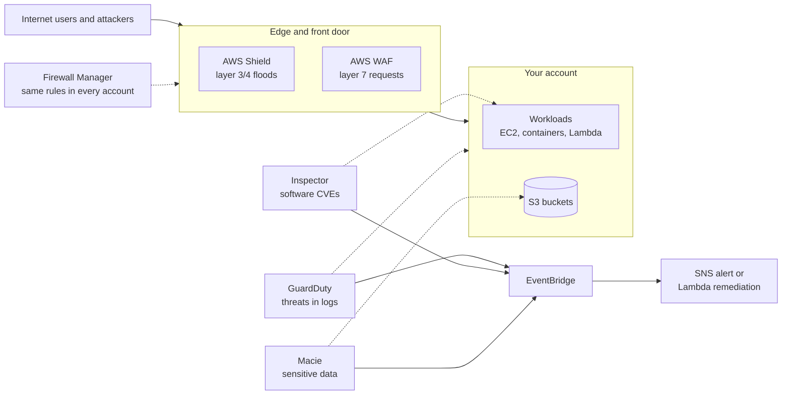
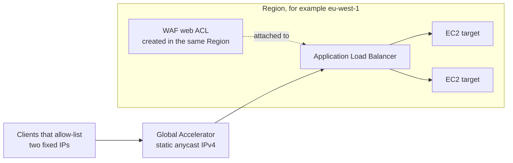
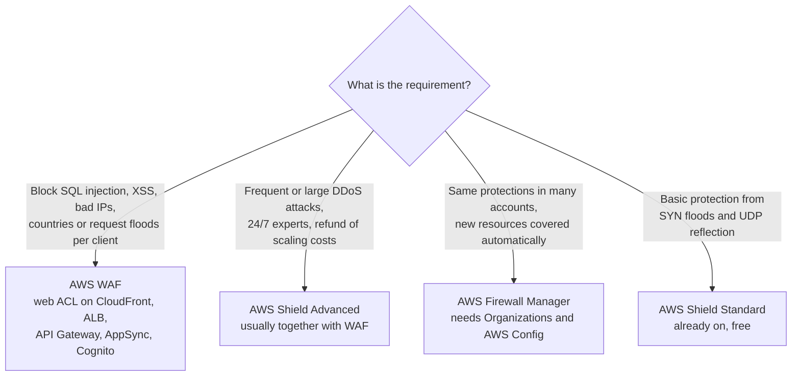
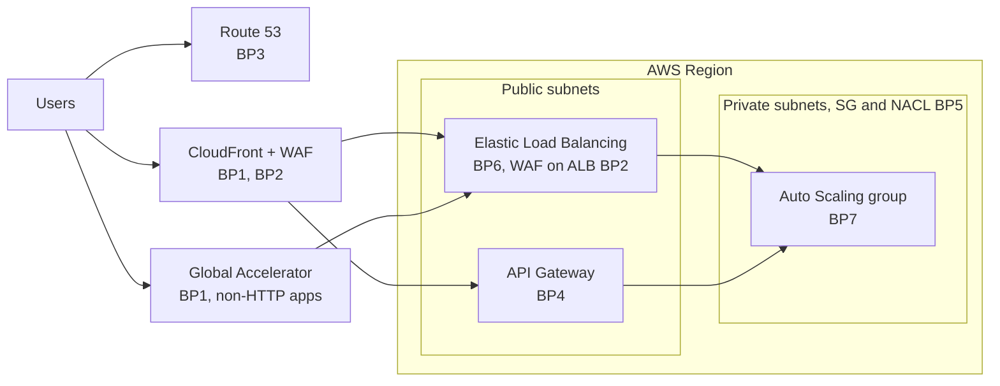
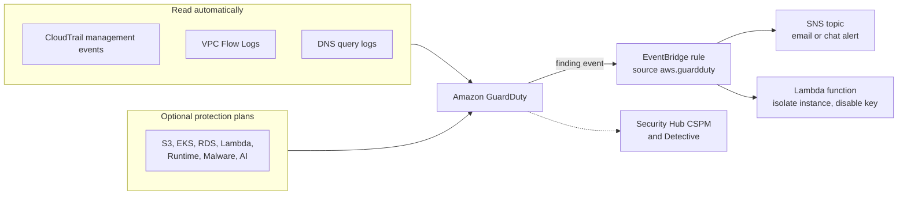
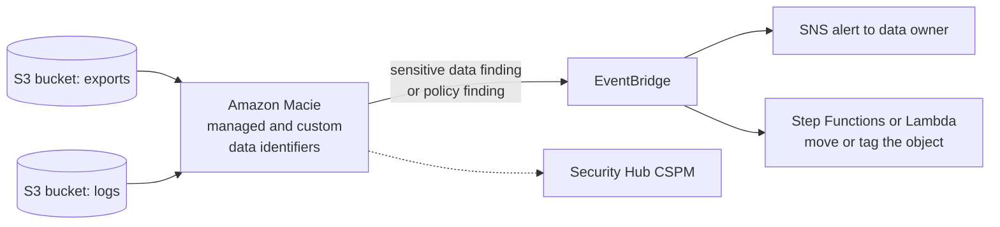

# Threat Protection & Detection

## Summary

This lesson covers two families of security services. The **protect** family stops bad traffic before it reaches your application: **AWS WAF** filters HTTP requests (layer 7), **AWS Shield** absorbs distributed denial-of-service (DDoS) floods, and **AWS Firewall Manager** rolls the same firewall rules out to every account in an AWS Organization. The **detect** family watches what is already inside your account: **Amazon GuardDuty** spots threats such as stolen credentials or crypto-mining, **Amazon Inspector** finds software vulnerabilities and open network paths in EC2, container images and Lambda, and **Amazon Macie** finds personal and other sensitive data sitting in S3. On the exam, the trick is to match the noun in the question (an HTTP exploit, a flood, many accounts, a compromised instance, a CVE, PII in a bucket) to the one service built for it.

## Key concepts

- **AWS WAF** inspects HTTP/HTTPS requests (layer 7) and attaches to **CloudFront, ALB, API Gateway REST APIs, AppSync, Cognito user pools** and a few newer resource types, but **never to an NLB**.
- A **web ACL** (called a **protection pack** in the new WAF console) holds ordered **rules** and reusable **rule groups**; each resource can have only one web ACL.
- **IP sets** hold up to **10,000** CIDR ranges each; **rate-based rules** block a client that exceeds a request count in a 1, 2, 5 or 10 minute window (minimum limit **10**).
- Web ACLs are **Regional** (same Region as the resource), except for CloudFront, which uses the global scope created in **us-east-1**.
- Need a **static IP plus WAF**? Put **Global Accelerator** in front of an **ALB** that carries the web ACL.
- **Shield Standard** is free and automatic for every customer against common layer 3/4 attacks.
- **Shield Advanced** costs **USD 3,000 per month** (1-year commitment, one fee per organization's payer account) and adds the **Shield Response Team (SRT)**, **cost protection**, attack visibility, WAF fees covered for protected resources and automatic layer 7 mitigation.
- **Firewall Manager** needs **AWS Organizations** and **AWS Config**; it applies WAF, Shield Advanced, security group, network ACL, Network Firewall, DNS Firewall and third-party firewall policies to current **and future** accounts and resources.
- DDoS best practices: serve from the **edge** (CloudFront, Global Accelerator, Route 53), **scale** (ELB, Auto Scaling), **filter** (WAF, Shield Advanced) and **hide** the backend (API Gateway, ELB, security groups, NACLs).
- **GuardDuty** reads **CloudTrail management events, VPC Flow Logs and DNS logs** on its own (no agents, no logging setup), uses threat intelligence and machine learning, and has a **30-day free trial** per Region.
- GuardDuty findings flow to **EventBridge**, which can trigger **SNS** or **Lambda** for alerting and auto-remediation.
- **Inspector** continuously scans **EC2 instances, ECR container images and Lambda functions** for CVEs, and EC2 for **network reachability**; findings carry a risk score and go to **Security Hub CSPM** and **EventBridge**.
- **Macie** uses machine learning and pattern matching to find **PII and other sensitive data in S3** and also flags buckets whose security got weaker.

## The big picture: protect versus detect

Before looking at each service, it helps to see where each one sits. The protect services sit in the request path or define rules for it. The detect services sit beside your workloads, reading logs, software inventories or object contents, and raise findings that you route with EventBridge.

## AWS WAF

AWS WAF is a web application firewall: it looks inside each HTTP or HTTPS request (method, URI, query string, headers, cookies, body, source IP and country) and decides whether to let it through. Because it understands HTTP, it can stop attacks that a network firewall cannot see, such as a SQL injection string hidden in a query parameter.

**Layer 7 versus layer 4.** Layer 4 is the transport layer (TCP and UDP ports and packets); layer 7 is the application protocol, here HTTP. Security groups and network ACLs work at layers 3 and 4. WAF works at layer 7, which is why it can only be attached to services that terminate HTTP.

### Where you can attach a web ACL

| Resource | Scope | Notes |
|---|---|---|
| Amazon CloudFront distribution | Global (create in **us-east-1** / "Global (CloudFront)") | Filters at edge locations, before traffic reaches the Region |
| Application Load Balancer | Regional | Not available for ALBs on Outposts |
| Amazon API Gateway REST API (a stage) | Regional | HTTP APIs and WebSocket APIs are not in the supported list |
| AWS AppSync GraphQL API | Regional | |
| Amazon Cognito user pool | Regional | Protects sign-up and sign-in endpoints |
| AWS App Runner service, AWS Verified Access instance, Amazon Bedrock AgentCore Gateway | Regional | {{updated: Added to the WAF resource list after the slides were made}} |
| AWS Amplify app | Uses a **CloudFront-scope** web ACL | {{updated: Amplify Hosting can now be protected with WAF}} |
| Network Load Balancer, Classic Load Balancer, EC2 instance | **Not supported** | Use an ALB, CloudFront or AWS Network Firewall instead |

> [!UPDATED] More resource types and a new console name
> The slides list five resource types. AWS now also supports App Runner, Verified Access, Amplify and Bedrock AgentCore Gateway. The new WAF console calls a web ACL a **protection pack (web ACL)**; it is the same WAFv2 web ACL underneath, and the standard console (still reachable from the navigation pane) keeps the old "web ACL" wording.

### Web ACLs, rules and rule groups

A **web ACL** is an ordered list of rules plus a **default action** (Allow or Block) for requests that no rule matched. Each **rule** has a statement (what to match) and an action (what to do). Rules are evaluated by **priority**, lowest number first, and the first terminating action wins.

| Rule statement | What it matches | Example |
|---|---|---|
| IP set | Source IP in a list of up to **10,000** CIDRs per IP set | Block a list of known attacker ranges; use several IP sets for more |
| Geo match | Country (or Region) of the source IP | Block countries you do not serve |
| String / regex match | Text in URI, query string, headers, cookies or body | Block requests with header `User-Agent: BadBot` |
| SQL injection / XSS | Built-in detection of SQL injection and cross-site scripting patterns | Stop `' OR 1=1 --` in a query parameter |
| Size constraint | Length of a request component | Reject query strings over 2 KB |
| Rate-based | Requests per client in a time window | Block any IP sending more than 2,000 requests per 5 minutes |
| Label match | Labels added by earlier rules | Count or block requests a managed group labelled as bots |

A **rule group** is a reusable bundle of rules that you add to one or many web ACLs. You can write your own, use **AWS Managed Rules** (most are included in the normal rule price), or subscribe to groups from AWS Marketplace sellers.

Useful AWS managed rule groups for the exam:

| Managed rule group | What it blocks |
|---|---|
| Core rule set (`AWSManagedRulesCommonRuleSet`) | General OWASP-style attacks: XSS, path traversal, oversized requests, missing User-Agent |
| SQL database (`AWSManagedRulesSQLiRuleSet`) | SQL injection patterns |
| Known bad inputs | Exploit patterns such as Log4j and Java deserialization |
| Amazon IP reputation list | IPs Amazon threat intelligence has seen attacking, scanning or taking part in DDoS |
| Anonymous IP list | VPNs, proxies, Tor nodes and hosting providers |
| Bot Control, account takeover / creation fraud prevention, Anti-DDoS | Paid add-ons for bots, credential stuffing, fake sign-ups and HTTP floods (the Anti-DDoS group is included with Shield Advanced) |

> [!NOTE] Capacity units
> Every rule costs **web ACL capacity units (WCUs)**: an IP set rule is cheap, the core rule set uses 700. A web ACL can hold up to 5,000 WCUs; beyond 1,500 WCUs you pay an extra per-request fee.

### Rule actions

| Action | Effect | Terminating? |
|---|---|---|
| **Allow** | Send the request on to the resource | Yes |
| **Block** | Return HTTP 403 (or a custom response) | Yes |
| **Count** | Record a match and keep evaluating; used to test new rules safely | No |
| **CAPTCHA** / **Challenge** | Make a browser solve a puzzle or a silent JavaScript challenge to prove it is not a bot | Depends on whether the client already holds a valid token |

### Rate-based rules

A rate-based rule counts requests for each **aggregation key** (by default the source IP; you can also use a forwarded IP header or custom keys such as a header or URI) over an **evaluation window** of 60, 120, 300 (the default) or 600 seconds. When one key goes above the **limit** (minimum 10), WAF applies the rule's action (Block, Count, CAPTCHA or Challenge) to that key's further requests until its rate drops back. A **scope-down statement** narrows what is counted, for example only `POST /login`.

> [!EXAMPLE] Slowing a brute-force login
> An e-commerce site sees one IP address trying thousands of passwords against `/login`. A rate-based rule with a scope-down statement on the URI path `/login`, a limit of 100 and a 5-minute window starts blocking that address shortly after it goes past 100 attempts in five minutes (WAF enforces the limit approximately, not at exactly the 101st request), while normal shoppers browsing other pages are never counted.

> [!UPDATED] Lower minimum and selectable windows
> Older material describes a fixed 5-minute window with a minimum of 100 requests. Today you choose a 1, 2, 5 or 10 minute evaluation window and the lowest allowed limit is 10.

### Logging and monitoring

WAF publishes CloudWatch metrics per rule, keeps a sample of recent requests you can view in the console, and can write full logs to **CloudWatch Logs**, **Amazon S3** or **Amazon Data Firehose**. Logs are what you (or the Shield Response Team) analyze during an attack.

### Fixed IP addresses with WAF: Global Accelerator in front of an ALB

Some clients need to allow-list a fixed IP address in their own firewall. An ALB does not have static IPs, and an NLB (which can have Elastic IPs) cannot carry a WAF web ACL. The standard answer is to place **AWS Global Accelerator** in front: it provides two static anycast IPv4 addresses, and its endpoint is an **ALB** with the web ACL attached in the ALB's Region.

## AWS Shield

A **DDoS** (distributed denial of service) attack uses thousands of machines to flood a target with more traffic or requests than it can handle. Attacks come in layers: **network and transport floods** (SYN floods, UDP reflection that bounces amplified replies off open DNS or NTP servers) and **application floods** (huge numbers of legitimate-looking HTTP requests).

| | **Shield Standard** | **Shield Advanced** |
|---|---|---|
| Cost | Free, no sign-up | USD 3,000 per month per organization's payer account, 1-year commitment, plus data transfer out fees |
| Turned on | Automatically for every AWS customer | You subscribe and choose resources (or use a Firewall Manager policy) |
| Protects against | Common layer 3/4 attacks such as SYN floods and UDP reflection | Larger and more sophisticated attacks at layers 3, 4 and 7 |
| Resources | All, with the strongest coverage for CloudFront, Route 53 and Global Accelerator | CloudFront, Route 53 hosted zones, Global Accelerator standard accelerators, ALB, CLB, Elastic IPs (and through them EC2 instances and NLBs) |
| Expert help | None | 24/7 **Shield Response Team (SRT)** and optional proactive engagement (SRT access needs a Business or Enterprise tier AWS Support plan) |
| Bill shock during an attack | You pay for the scaling | **Cost protection**: request a limited refund of scaling charges caused by a DDoS |
| Visibility | Basic | Near real-time attack metrics, reports and CloudWatch alarms |
| Layer 7 | None | Automatic application layer DDoS mitigation in WAF: the included Anti-DDoS managed rule group, or the older auto-mitigation rule group {{updated: Anti-DDoS managed rule group is the default since 26 March 2026}} |
| WAF fees | Normal | Standard WAF fees for protected resources included (up to 50 billion requests a month); Firewall Manager policies included |

> [!UPDATED] Anti-DDoS managed rule group replaces Layer 7 auto mitigation
> The slides describe Shield Advanced automatically creating, testing and deploying WAF rules during a layer 7 attack. From 26 March 2026 AWS made the WAF **Anti-DDoS managed rule group** (`AWSManagedRulesAntiDDoSRuleSet`) the default answer to HTTP floods; it reacts within seconds and is included in a Shield Advanced subscription. Existing Shield Advanced customers can keep the older automatic mitigation (new subscribers must ask AWS Support for it), which still adds a 150-WCU rule group to the web ACL and needs 24 hours to 30 days to learn a traffic baseline. For the exam, "Shield Advanced protects against layer 7 DDoS with automatic WAF rules" is still the right idea.

> [!NOTE] Response team name
> The slides call it the DDoS Response Team (DRT) in one place and the Shield Response Team (SRT) in another. AWS documentation now uses **Shield Response Team (SRT)**.

## AWS Firewall Manager

WAF and Shield are configured per account. In a company with dozens of accounts, someone will forget to attach the web ACL to the new ALB in the new account. **Firewall Manager** solves this: from one administrator account you define a **security policy** once, and Firewall Manager applies it to every in-scope account and resource, including accounts that join the organization later and resources created later. It reports which resources are non-compliant and can **auto-remediate** them.

| Policy type | What it enforces |
|---|---|
| AWS WAF | A web ACL with "first" and "last" rule groups chosen centrally; account owners can add their own rules in between. Targets ALB, API Gateway, CloudFront and other WAF resources |
| AWS Shield Advanced | Shield Advanced protection on chosen resource types (ALB, CLB, Elastic IPs, CloudFront, and so on) |
| Amazon VPC security group | Common baseline security groups on EC2 instances and ENIs, plus audits that flag over-permissive rules or unused groups |
| Amazon VPC network ACL | Baseline first and last NACL rules across subnets {{updated: Network ACL policies were added after the slides were made}} |
| AWS Network Firewall | Deploys Network Firewall into the organization's VPCs |
| Route 53 Resolver DNS Firewall | Associates DNS Firewall rule groups with VPCs |
| Third-party firewall | Palo Alto Networks Cloud NGFW or Fortigate CNF from AWS Marketplace |

Things to remember:

- **Prerequisites**: an organization in **AWS Organizations** (all features), a designated Firewall Manager **administrator account**, and **AWS Config** turned on in each account and Region.
- **Policies are Regional.** To protect resources in three Regions you create three policies; to protect CloudFront you create the policy in the **Global** Region.
- Scope a policy by accounts, organizational units and **resource tags**.
- **Pricing**: USD 100 per policy per Region per month, plus AWS Config and the underlying WAF or Network Firewall usage. For Shield Advanced subscribers the Firewall Manager policy fee is included.

### WAF, Shield or Firewall Manager?

The three are designed to be used together: you write rules in WAF, Shield handles volumetric attacks, and Firewall Manager makes sure both are applied everywhere.

| Need | Best fit |
|---|---|
| Fine-grained control of HTTP requests for one application | WAF on its own |
| Roll WAF rules out across accounts, speed up setup, protect new resources automatically | Firewall Manager with WAF |
| Specialist help during attacks, advanced reporting, cost protection | Shield Advanced (on top of WAF) |
| A business that is a frequent DDoS target | Shield Advanced |

## AWS best practices for DDoS resiliency

AWS publishes a whitepaper that tags each recommendation with a code from BP1 to BP7. You do not need the numbers, but you do need the idea behind each layer.

| Code | Service | Role |
|---|---|---|
| BP1 | CloudFront, Global Accelerator | Serve traffic from edge locations; absorb SYN floods and UDP reflection at the edge |
| BP2 | AWS WAF | Filter malicious HTTP requests at the edge (with CloudFront) or in the Region (with ALB) |
| BP3 | Route 53 | DNS answered from the edge, with built-in DDoS protection |
| BP4 | API Gateway | Single, managed front door that hides EC2 or Lambda backends; throttling |
| BP5 | VPC security groups and network ACLs | Allow only the traffic you expect, at instance or subnet level |
| BP6 | Elastic Load Balancing | Spread and absorb load across many targets in several AZs |
| BP7 | Auto Scaling (EC2, ECS, EKS) and Lambda | Add capacity during a surge, whether a flash sale or an attack |

### Mitigation at the edge (BP1, BP3)

- **CloudFront** delivers your site from hundreds of edge locations, so a flood is spread out and filtered before it reaches your Region. It also caches static content, so many requests never touch your servers, and it can **block whole countries** with geographic restrictions.
- **Global Accelerator** gives the same edge protection to applications that CloudFront does not fit, such as TCP or UDP game servers or other non-HTTP protocols, and it integrates with Shield.
- **Route 53** answers DNS from the edge; a DNS service that stays up is the first requirement of staying online.

### Infrastructure layer defense (BP1, BP3, BP6, BP7)

Keep EC2 instances out of the direct line of fire by putting the edge services and **Elastic Load Balancing** in front of them. The load balancer scales with traffic and spreads it over many instances, and an **Auto Scaling group** adds instances when a sudden surge arrives, whether it is a flash crowd from a marketing campaign or an attack.

### Application layer defense (BP1, BP2)

- Let **CloudFront cache** whatever it can, so the backend serves fewer requests.
- Put **WAF** on CloudFront and on the ALB to filter requests by their signatures.
- Use **WAF rate-based rules** to block the IP addresses that send too many requests.
- Use **managed rule groups** to block known bad IP reputations and anonymizing services.
- With **Shield Advanced**, let AWS create and deploy mitigation rules automatically during an HTTP flood.

### Attack surface reduction (BP1, BP4, BP5, BP6)

- **Hide the backend.** Users talk to CloudFront, API Gateway or a load balancer; EC2 instances and Lambda functions are never directly reachable.
- **Filter with security groups and NACLs** so that only the expected ports and sources reach each subnet and ENI. Elastic IP addresses can be protected by Shield Advanced.
- **Protect API endpoints.** AWS recommends a **Regional** API Gateway endpoint behind **your own CloudFront distribution** (rather than the edge-optimized endpoint whose CloudFront distribution API Gateway manages for you), so you can add WAF and control caching. Add throttling (rate and burst limits per method), a secret header such as `x-api-key` sent by CloudFront so that direct calls to the API are rejected, and proper authentication (IAM, Cognito, Lambda or JWT authorizers).

> [!TIP] Requests blocked at the edge are free
> CloudFront charges no request fee and no data transfer out for requests that AWS WAF blocks {{updated: Free since 25 October 2024}} (WAF still bills its own per-request inspection fee), which is another reason to block as close to the user as possible. The new **CloudFront flat-rate pricing plans** go further: they bundle CloudFront, WAF and DDoS protection for a fixed monthly price with no charge for blocked attack traffic.

## Amazon GuardDuty

GuardDuty is a **threat detection** service. It continuously analyzes activity in your account and raises a **finding** when something looks malicious or anomalous: an EC2 instance talking to a known command-and-control server, API calls from a Tor exit node using an IAM user's keys, a crypto-mining process, or a burst of `DeleteObject` calls that looks like ransomware. It combines **threat intelligence** (lists of malicious IPs, domains and file hashes), **machine learning** and **anomaly detection**.

Turning it on is one click per Region. There is nothing to install for the foundational sources, and GuardDuty reads its own independent copy of the logs, so you **do not need to enable VPC Flow Logs, create a trail or turn on Route 53 query logging** yourself, and your own logging configuration is not changed.

### What GuardDuty analyzes

| Source | Enabled | What it reveals |
|---|---|---|
| **CloudTrail management events** | Always (foundational) | Unusual API calls: disabling CloudTrail, creating access keys from a strange location, deploying resources nobody expected |
| **VPC Flow Logs** (EC2 traffic) | Always (foundational) | Traffic to known bad IPs, port scans, unusual internal traffic |
| **Route 53 Resolver DNS query logs** | Always, if instances use the AWS DNS resolver | Instances resolving malware or mining domains, or hiding stolen data inside DNS queries |
| **S3 Protection** (CloudTrail S3 data events) | Protection plan | Suspicious `GetObject`, `ListObjects`, `DeleteObject` patterns, data exfiltration |
| **EKS Protection** (Kubernetes audit logs) | Protection plan | Suspicious activity in EKS control planes |
| **Runtime Monitoring** | Protection plan, agent-based, off by default | OS-level process, file and network events on EKS, EC2 and ECS (including Fargate) |
| **Malware Protection** for EC2, for S3 and for AWS Backup | Protection plan | Malware on EBS volumes, newly uploaded S3 objects, or backups |
| **RDS Protection** | Protection plan | Anomalous login activity on Aurora and RDS |
| **Lambda Protection** | Protection plan | Lambda functions talking to malicious hosts or mining |
| **AI Protection** | Protection plan | Threats to Bedrock, Bedrock AgentCore and SageMaker AI workloads |

The first time you enable GuardDuty in a Region, it also switches on the protection plans available there, except **Runtime Monitoring**, and includes them in the 30-day trial. Malware Protection for S3 (configured per bucket), Malware Protection for AWS Backup and on-demand EC2 malware scans are set up separately and are not part of that trial. You can turn any plan off.

> [!UPDATED] Protection plans, attack sequences and a Critical severity
> The slides list S3 data events next to the always-on sources. AWS now groups S3 data events, EKS audit logs, RDS logins, EBS malware scanning and Lambda network activity under optional **protection plans**, and has added **Runtime Monitoring**, **Malware Protection for S3** (which can even run without GuardDuty itself), **Malware Protection for AWS Backup** and **AI Protection**. **Extended Threat Detection**, on by default at no extra cost, links individually harmless events into an **attack sequence** finding with the new **Critical** severity.

### Findings

Each finding has a type written as `ThreatPurpose:ResourceType/ThreatFamily.Variant`, for example `CryptoCurrency:EC2/BitcoinTool.B!DNS` (an instance resolving a domain associated with Bitcoin or other cryptocurrency activity) or `UnauthorizedAccess:EC2/SSHBruteForce`. GuardDuty has dedicated finding types for **cryptocurrency mining**, which is a favourite exam scenario.

| Severity | Score | Meaning |
|---|---|---|
| Critical | 9.0 to 10.0 | An attack sequence is probably in progress |
| High | 7.0 to 8.9 | A resource is compromised and actively misused |
| Medium | 4.0 to 6.9 | Suspicious activity that deviates from normal |
| Low | 1.0 to 3.9 | Attempted activity that did not succeed, such as a port scan |

GuardDuty keeps findings for **90 days**; export them to S3 for longer retention. You can upload **trusted IP lists** (no findings for them) and **threat lists**, and use **suppression rules** to auto-archive expected findings. In a multi-account setup, a **delegated administrator** account in AWS Organizations sees every member's findings.

### Responding automatically with EventBridge

GuardDuty publishes every finding to **Amazon EventBridge** (new findings in near real time; repeat occurrences are grouped, every 6 hours by default, configurable to 15 minutes or 1 hour). An EventBridge rule then sends the finding where you want it.

> [!EXAMPLE] Auto-quarantine a compromised instance
> An EventBridge rule matches GuardDuty findings whose type starts with `CryptoCurrency:EC2/`. Its target is a Lambda function that replaces the instance's security groups with an empty "quarantine" group and snapshots its volumes for forensics. A second target, an SNS topic, emails the security team.

## Amazon Inspector

Inspector is a **vulnerability management** service. Once activated, it automatically discovers eligible resources and keeps scanning them for known software vulnerabilities (CVEs from databases such as the National Vulnerability Database) and unintended network exposure. You do not schedule scans: Inspector rescans when you install a package, deploy new code, or when a new CVE that affects your software is published.

| Resource | What Inspector checks | How |
|---|---|---|
| **EC2 instances** | OS and programming language package vulnerabilities; **network reachability** (open network paths that make ports reachable from outside the VPC) | **Agent-based** using the **SSM Agent** on managed instances, or **agentless** using EBS snapshots for instances without the agent; network reachability is checked every 12 hours |
| **ECR container images** | Package vulnerabilities in the image | When an image is **pushed**, then continuously (ECR enhanced scanning) for a configurable period |
| **Lambda functions and layers** | Standard scanning: vulnerable package dependencies; code scanning: flaws in your own code | When a function is **deployed or updated**, and when new CVEs appear |
| Code repositories | First-party code, dependencies and infrastructure as code | Code Security, a newer optional feature |

> [!UPDATED] Agentless EC2 scanning and Lambda code scanning
> The slides tie EC2 scanning to the SSM Agent. Inspector can now also scan EC2 instances **without an agent** by taking EBS snapshots (hybrid mode). Lambda scanning is split into **standard scanning** (package dependencies) and optional **code scanning** (your own code). The 15-day free trial and per-resource pricing (for example about USD 1.26 per agent-scanned instance per month and USD 0.09 per newly pushed container image in us-east-1) are useful context, not exam facts.

> [!VERIFY] Default EC2 scan mode
> Checked 2026-10-04. Four AWS sources say a newly activated account starts in **hybrid** scanning (agent-based plus agentless): the [April 2024 announcement](https://aws.amazon.com/about-aws/whats-new/2024/04/amazon-inspector-agentless-vulnerability-assessments-ec2-ga/) that made agentless scanning generally available, the [Inspector FAQ](https://aws.amazon.com/inspector/faqs/), [Getting started with Amazon Inspector](https://docs.aws.amazon.com/inspector/latest/user/getting_started.html) and the introduction of [Scanning Amazon EC2 instances](https://docs.aws.amazon.com/inspector/latest/user/scanning-ec2.html). The **Managing scan mode** section of that same EC2 page still names agent-based scanning as the default for new accounts, and AWS has not resolved the conflict. Accounts activated before April 2024 had to switch to hybrid themselves. Expect hybrid on a new account, and confirm it in your own Inspector console under **General settings** → **EC2 scanning settings** → **Scan mode**.

Every finding gets an **Inspector risk score**: the CVSS base score adjusted to your environment. For example, a network-exploitable CVE on an instance with no path from the internet gets a lower score, which helps you fix the most dangerous issues first. Findings go to the Inspector console, to **AWS Security Hub CSPM** and to **EventBridge**. When you patch, Inspector notices and closes the finding.

> [!TRAP] Inspector only knows three resource types
> Inspector scans **EC2 instances, container images in ECR and Lambda functions** (plus code repositories with Code Security). It does not scan RDS databases, S3 objects or your IAM policies. "Find CVEs in the OS of our EC2 fleet" is Inspector; "find suspicious API calls" is GuardDuty.

## Amazon Macie

Macie is a **data security** service for Amazon S3. It does two things:

1. **Monitors bucket security.** As soon as you enable it, Macie inventories your general purpose buckets and raises a **policy finding** when a bucket becomes less secure, for example when Block Public Access is turned off, the bucket becomes public, or it is shared or replicated with an account outside your organization.
2. **Finds sensitive data in objects.** Using machine learning and pattern matching, Macie inspects object contents for **personally identifiable information (PII)** such as names, addresses, passport numbers and Social Security numbers, financial data such as credit card and bank account numbers, and credentials such as AWS secret keys or private keys. It produces **sensitive data findings** (`SensitiveData:S3Object/Personal`, `/Financial`, `/Credentials`, `/CustomIdentifier` or `/Multiple`).

| Discovery option | How it works | When to use |
|---|---|---|
| **Automated sensitive data discovery** | Macie continuously samples representative objects across all buckets | Broad, low-cost visibility of where sensitive data lives |
| **Sensitive data discovery job** | You choose buckets, sampling depth, object criteria and schedule (one-time, daily, weekly, monthly) | Deep, targeted analysis of specific buckets, compliance evidence |

You can extend detection with **custom data identifiers** (a regex plus optional keywords, for example your employee ID format) and reduce noise with **allow lists**. Findings are kept 90 days and are published to **EventBridge** and, if you choose, **Security Hub CSPM**. Macie has a 30-day free trial that covers bucket monitoring and automated discovery (discovery jobs are not part of the trial). Data analysis costs about USD 1 per GB, and automated discovery gets its first 1 GB each month free.

> [!VERIFY] Does the 1 GB monthly free tier cover discovery jobs?
> Checked 2026-10-04. The Macie user guide page [Understanding estimated usage costs](https://docs.aws.amazon.com/macie/latest/user/account-mgmt-costs-calculations.html) says the monthly 1 GB free tier applies to analysis by both sensitive data discovery jobs and automated discovery. The worked examples on the [Macie pricing page](https://aws.amazon.com/macie/pricing/) subtract 1 GB only for automated discovery and bill a targeted job from its first GB. AWS's two pages disagree, so it is unknown which one your bill follows. Budget discovery jobs as if every GB is charged, and check the Macie console's **Usage** page or your bill after a run.

## Choosing the right security service

| Question signal | Service | Why not the others |
|---|---|---|
| SQL injection, XSS, block IPs or countries for a website or API | **AWS WAF** | Shield handles floods, not request content; security groups cannot read HTTP |
| Large DDoS attacks, 24/7 response team, protection from scaling bills | **Shield Advanced** | Shield Standard has no SRT or cost protection |
| Apply WAF or security group rules to all accounts, including new ones | **Firewall Manager** | WAF alone is per account |
| Compromised instance, stolen credentials, crypto-mining, unusual API calls | **GuardDuty** | Inspector looks at software, not behaviour |
| CVEs in EC2 packages, container images or Lambda dependencies; ports open to the internet | **Inspector** | GuardDuty does not scan software inventories |
| PII or credit card numbers in S3; buckets that became public | **Macie** | GuardDuty S3 Protection watches access patterns, not object contents |
| One dashboard of findings and compliance checks across services | **Security Hub CSPM** | It aggregates findings; it does not generate threat detections itself |
| Root-cause investigation of a finding with graphs | **Amazon Detective** | GuardDuty raises the alert; Detective helps you investigate it |
| Filter VPC traffic at layers 3 to 7, including non-HTTP | **AWS Network Firewall** | WAF only inspects HTTP on supported resources |

> [!UPDATED] Security Hub is now "Security Hub CSPM"
> The slides send Inspector findings to "AWS Security Hub". AWS now documents that posture-management service as **AWS Security Hub CSPM** (Cloud Security Posture Management). It still runs best-practice checks and aggregates findings from GuardDuty, Inspector and Macie in the AWS Security Finding Format (ASFF). Since December 2025 the name **AWS Security Hub** belongs to a newer, separate service that correlates signals from GuardDuty, Inspector, Security Hub CSPM and Macie to rank exposures and risks. For SAA-C03, "one place to see security findings and compliance checks" still means Security Hub.

## Exam tips

> [!EXAM] Layer 7 filtering
> "Protect the web application from SQL injection and cross-site scripting" or "block requests from certain countries at the ALB" → **AWS WAF** web ACL with managed rule groups or a geo match rule.

> [!EXAM] Static IP and WAF
> "Clients need fixed IP addresses to allow-list, and the application must be protected by WAF" → **Global Accelerator in front of an ALB** with a web ACL. An NLB with Elastic IPs is a trap because WAF cannot attach to it.

> [!EXAM] HTTP flood from a few IPs
> "A small number of IP addresses send far more requests than normal" → a **WAF rate-based rule**. If the scenario adds "frequent DDoS attacks" and "24/7 expert help" → **Shield Advanced**.

> [!EXAM] Many accounts
> "Ensure every current and future account in the organization has the same WAF rules / security groups" → **AWS Firewall Manager** (requires AWS Organizations and AWS Config).

- "Protection from unexpected charges caused by a DDoS attack" → **Shield Advanced cost protection**.
- "Mitigate SYN floods and UDP reflection at no extra cost" → **Shield Standard** (already on).
- "Reduce the attack surface of EC2 instances" → put them in private subnets behind **ALB/CloudFront/API Gateway**, lock down **security groups and NACLs**.
- "Detect crypto-mining", "detect compromised EC2 instances", "detect unusual API activity" → **GuardDuty**, alerts via **EventBridge → SNS/Lambda**.
- "Notify the security team when GuardDuty finds something" → **EventBridge rule** with the finding as event, target **SNS**.
- "Assess EC2 instances / ECR images / Lambda functions for software vulnerabilities (CVEs)" → **Inspector**.
- "Identify PII in S3 buckets" → **Macie**.
- "WAF for CloudFront" → create the web ACL in **us-east-1** (global scope).

## Common traps

> [!TRAP] WAF on a Network Load Balancer
> WAF works only with HTTP-terminating services. An answer that attaches a web ACL to an NLB, an EC2 instance or a security group is wrong.

> [!TRAP] Security groups or NACLs for HTTP content
> Security groups and network ACLs can filter by IP and port, but they cannot read a URL or a query string. Blocking SQL injection needs WAF. (NACLs are, however, a cheap way to block a handful of IPs at the subnet when the traffic does not come through CloudFront.)

> [!TRAP] Paying for Shield Standard
> Shield Standard is automatic and free. An option such as "subscribe to Shield Standard" is meaningless; the paid tier is Shield Advanced.

> [!TRAP] Shield Advanced is not a firewall rule engine
> Shield Advanced adds DDoS expertise, detection, cost protection and automatic layer 7 mitigation, but you still write your own application rules in WAF. "Use Shield Advanced to block SQL injection" is wrong.

> [!TRAP] GuardDuty versus Inspector versus Macie
> GuardDuty = **behaviour** (threats seen in logs). Inspector = **software** (CVEs and reachable ports). Macie = **data** (sensitive content in S3). None of them blocks traffic; they produce findings.

> [!TRAP] Turning on logs for GuardDuty
> You do not have to enable VPC Flow Logs or create a CloudTrail trail for GuardDuty. It pulls its own copy. An answer that adds "first enable flow logs" is unnecessary work. DNS findings only work while instances use the AWS-provided DNS resolver.

> [!TRAP] Wrong Region for the web ACL
> A Regional web ACL must be in the same Region as its ALB or API; a CloudFront web ACL must be created in us-east-1. A web ACL in eu-west-1 cannot be attached to an ALB in us-east-1.

> [!TRAP] Firewall Manager without prerequisites
> Firewall Manager cannot work in a standalone account. It needs AWS Organizations, a Firewall Manager administrator account and AWS Config.
