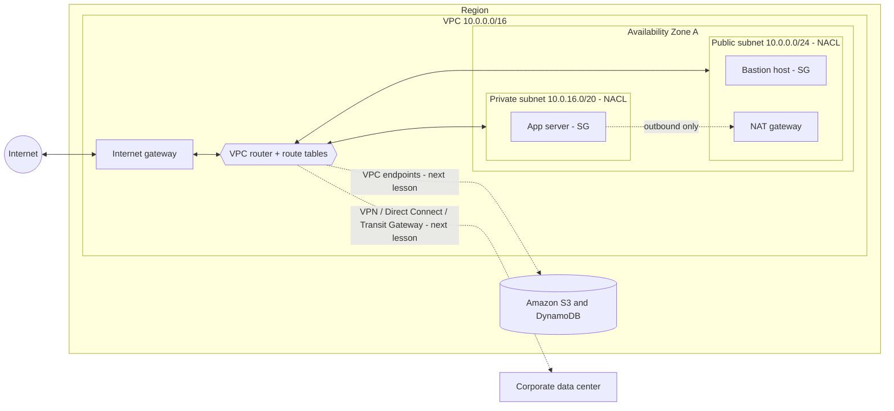
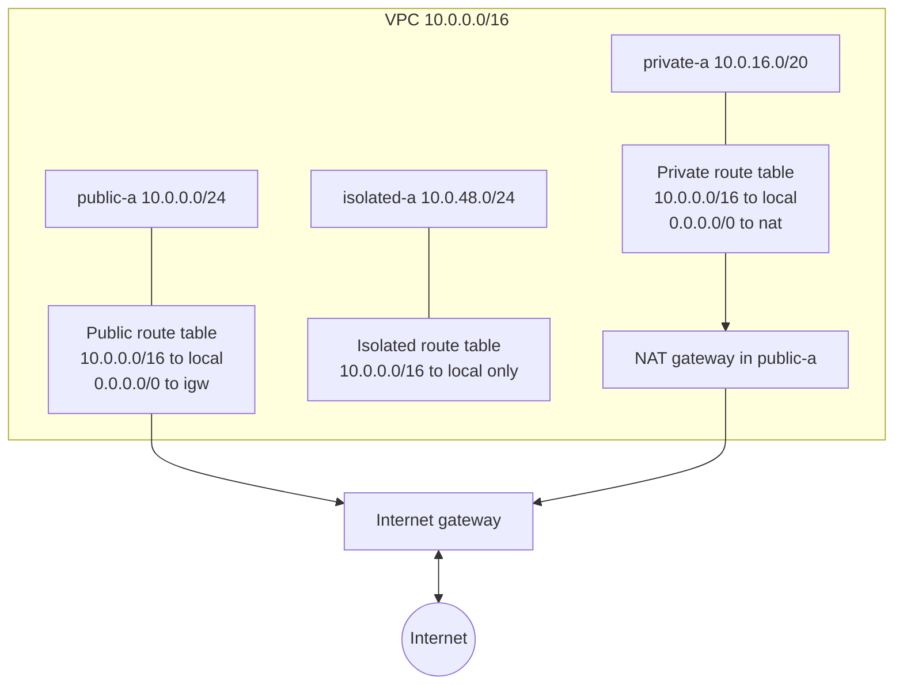
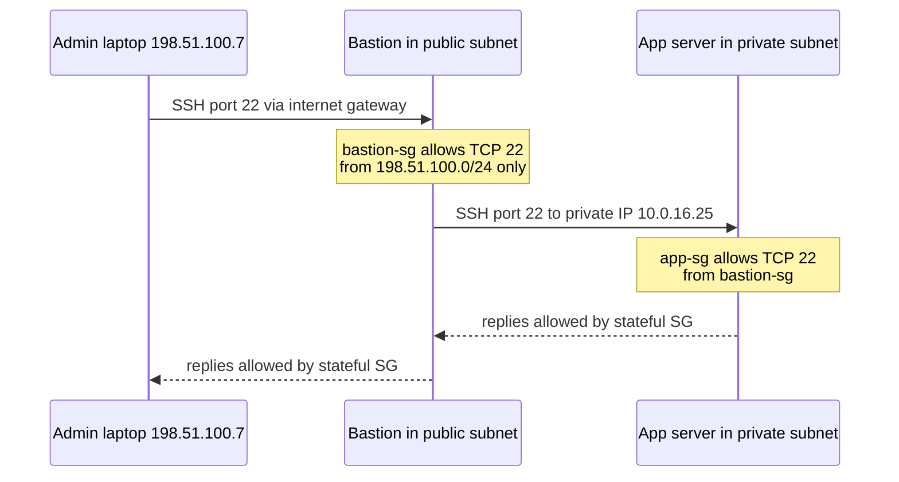
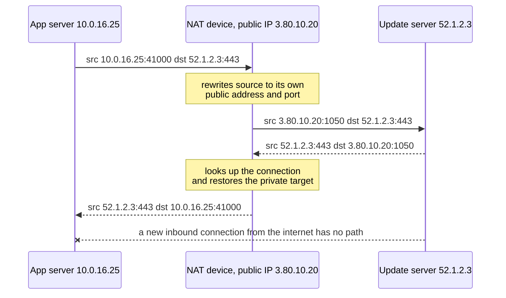
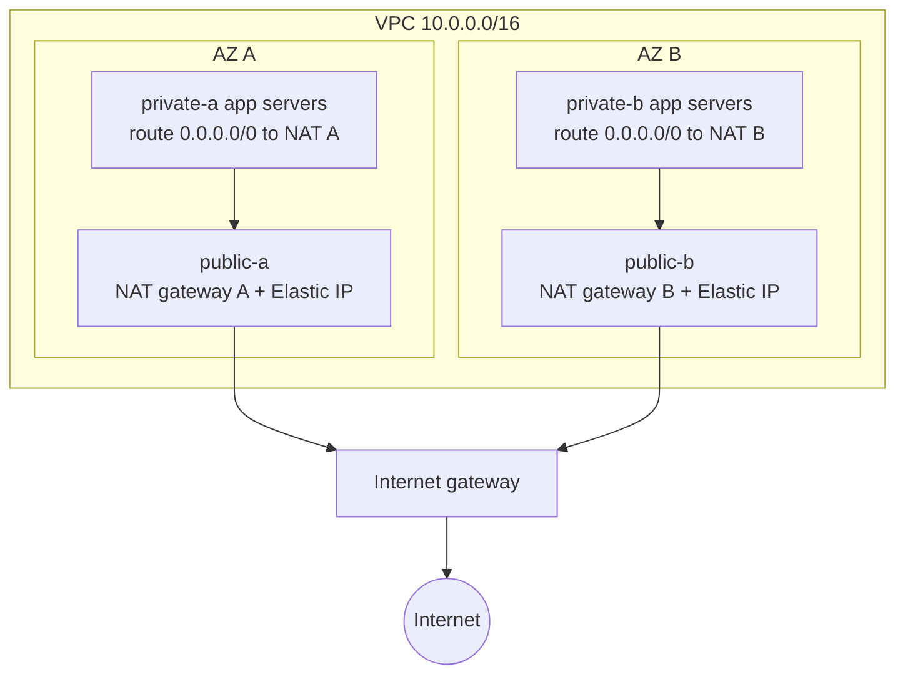
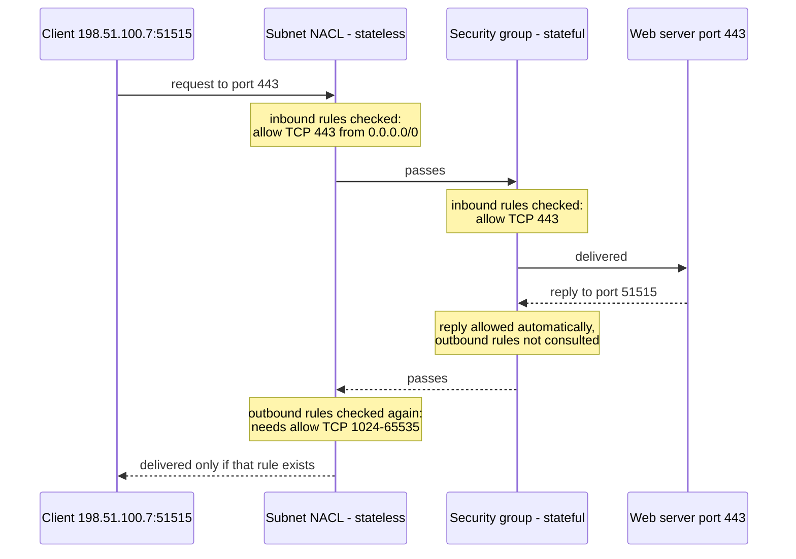

# VPC Fundamentals

## Summary

An **Amazon VPC** (Virtual Private Cloud) is your own isolated network inside one AWS Region: you choose its IPv4 address range in **CIDR** notation, slice it into **subnets** that each live in one Availability Zone, and decide with **route tables** where traffic may go. An **internet gateway** plus a `0.0.0.0/0` route makes a subnet *public*; everything else stays *private*. Private instances that still need to download patches or call public APIs go out through **NAT** (a managed **NAT gateway**, or a self-managed **NAT instance** on older designs), and administrators reach them through a **bastion host** or, today, Session Manager or EC2 Instance Connect Endpoint. Two firewalls guard the network: stateless **network ACLs** at the subnet edge and stateful **security groups** on each instance. Expect exam questions on sizing a subnet, making a subnet public, giving private instances outbound-only internet in a highly available way, and choosing between a NACL and a security group to block or allow traffic.

## Key concepts

- **CIDR** (`10.0.0.0/16`) = a base address plus a prefix length; a `/n` block holds **2^(32−n)** IPv4 addresses.
- VPCs use **private (RFC 1918) ranges**: `10.0.0.0/8`, `172.16.0.0/12`, `192.168.0.0/16`; never overlap with networks you will connect to.
- A VPC or subnet IPv4 block must be between **/16 (65,536 addresses) and /28 (16 addresses)**.
- **5 VPCs per Region** and **5 IPv4 CIDR blocks per VPC** by default; both are soft limits (CIDRs up to 50).
- Every **default VPC** is `172.31.0.0/16` with a **/20 public subnet in each AZ**, an internet gateway and public IPv4 addresses on by default.
- AWS **reserves 5 addresses per subnet**: the first four and the last one.
- A subnet is **public** only if its route table sends `0.0.0.0/0` to an **internet gateway** (one IGW per VPC); instances also need a public IPv4 or Elastic IP.
- A **bastion host** in a public subnet relays SSH to private instances; lock its security group to your corporate CIDR.
- A **NAT gateway** is managed, scales from 5 to 100 Gbps, lives in **one AZ**, needs an Elastic IP and an IGW, has **no security group**, and is billed per hour plus per GB.
- For high availability, deploy **one NAT gateway per AZ** and route each AZ's private subnets to their local one, or use the newer **regional NAT gateway**.
- A **NAT instance** is an EC2 instance you run yourself: public subnet, public or Elastic IP, **source/destination check disabled**, security groups, your own failover.
- **Network ACLs** work at the subnet level, are **stateless**, support **allow and deny**, and evaluate numbered rules **lowest first, first match wins**.
- Because NACLs are stateless, return traffic must be allowed on the client's **ephemeral ports** (open `1024-65535` in practice).
- **Security groups** work at the instance (ENI) level, are **stateful**, support **allow rules only**, and evaluate all rules together.

## The big picture: what lives in a VPC

Think of a VPC as a private data center floor plan drawn on top of AWS's network. You pick the address plan, draw rooms (subnets) in different buildings (Availability Zones), place doors to the outside (gateways) and write the signposts (route tables) that tell packets which door to use. Guards check traffic at the room door (network ACL) and at each desk (security group).

This lesson covers everything inside the VPC box: addressing, subnets, the internet gateway, route tables, bastions, NAT and the two firewalls. The dotted links at the edges are only signposts. VPC peering, VPC endpoints, flow logs, Site-to-Site VPN, Direct Connect and Transit Gateway build on these foundations in the next lesson (*VPC Connectivity & Network Costs*).

There is no charge for the VPC itself, its subnets, route tables, internet gateway, network ACLs or security groups. You pay for things such as NAT gateways, public IPv4 addresses, data transfer and some optional tools.

## CIDR notation and IPv4 address ranges

### Reading a CIDR block

An IPv4 address is 32 bits, written as four 8-bit numbers called **octets** (`10.0.4.17`). A CIDR block such as `10.0.4.0/22` has two parts:

- the **base address** (`10.0.4.0`), the first address of the range;
- the **prefix length** or **subnet mask** (`/22`), the number of leading bits that are fixed. The remaining `32 − 22 = 10` bits are free, so the block contains `2^10 = 1,024` addresses (`10.0.4.0` to `10.0.7.255`).

The same mask can be written in dotted form: `/8` = `255.0.0.0`, `/16` = `255.255.0.0`, `/24` = `255.255.255.0`, `/32` = `255.255.255.255`. A handy rule: each step of 8 in the prefix frees one more whole octet, and each step of 1 doubles or halves the size.

| Prefix | Addresses | Usable in an AWS subnet (minus 5) | Example block and range | Typical use |
|---|---|---|---|---|
| `/32` | 1 | n/a | `203.0.113.25/32` = that one address | One host in a security group or NACL rule |
| `/28` | 16 | 11 | `10.0.0.0/28` = `10.0.0.0`-`10.0.0.15` | Smallest allowed VPC or subnet |
| `/27` | 32 | 27 | `10.0.0.32/27` = `.32`-`.63` | Small subnet |
| `/26` | 64 | 59 | `10.0.0.64/26` = `.64`-`.127` | Small tier |
| `/24` | 256 | 251 | `10.0.1.0/24` = `10.0.1.0`-`10.0.1.255` | Common public subnet |
| `/20` | 4,096 | 4,091 | `172.31.32.0/20` = `172.31.32.0`-`172.31.47.255` | Default VPC subnets, roomy private subnets |
| `/16` | 65,536 | n/a (VPC size) | `10.10.0.0/16` = `10.10.0.0`-`10.10.255.255` | Largest single VPC CIDR block |
| `/0` | all 4.3 billion | n/a | `0.0.0.0/0` = every IPv4 address | "Anywhere" in routes and firewall rules |

> [!EXAMPLE] Practice before the exam
> - `10.10.0.0/16` → the last two octets are free → `10.10.0.0` to `10.10.255.255`, 65,536 addresses.
> - `172.31.32.0/20` → 12 free bits → 4,096 addresses, `172.31.32.0` to `172.31.47.255` (32 + 16 = 48, so the third octet stops at 47).
> - `203.0.113.25/32` → nothing is free → exactly one address.
> - `0.0.0.0/0` → every bit is free → the whole IPv4 internet.
> When in doubt, any online "CIDR calculator" gives the first and last address instantly.

### Private versus public IPv4 addresses

IANA set aside three blocks (RFC 1918) for private networks. Routers on the internet do not carry them, so the same private range can be reused in millions of homes and offices. Every other address is a **public** address that is unique on the internet.

| Private block | Range | Size | Where you typically meet it |
|---|---|---|---|
| `10.0.0.0/8` | `10.0.0.0`-`10.255.255.255` | about 16.7 million | Large corporate networks; most custom VPCs |
| `172.16.0.0/12` | `172.16.0.0`-`172.31.255.255` | about 1 million | AWS default VPCs (`172.31.0.0/16`) |
| `192.168.0.0/16` | `192.168.0.0`-`192.168.255.255` | 65,536 | Home routers and small offices |

## The default VPC

Every Region of every account starts with a **default VPC** so you can launch an instance without designing a network first. If you launch an EC2 instance and do not pick a subnet, it lands here. AWS builds it like this:

- IPv4 CIDR `172.31.0.0/16`;
- one **default subnet per AZ**, each a `/20` (4,096 addresses);
- an **internet gateway**, with the main route table sending `0.0.0.0/0` to it, so every default subnet is public;
- default subnets give each new instance a **public IPv4 address**, and DNS hostnames are on, so instances get both a private and a public DNS name;
- a default security group and a default network ACL.

> [!UPDATED] Public IPv4 addresses are billed
> Since February 2024 AWS charges for every public IPv4 address, in use or idle, at USD 0.005 per hour (about USD 3.60 a month), including the ones the default VPC hands out automatically. Accounts on the legacy 12-month Free Tier get 750 hours a month of in-use public IPv4 on EC2 at no charge; accounts created on or after 15 July 2025 pay these charges from their Free Tier credits. This is a good reason to keep most instances in private subnets.

The default VPC is fine for experiments and simple public sites. For anything real you design your own VPC so that you control the address plan and keep back-end tiers private.

## Creating your own VPC

When you create a VPC you give it a primary IPv4 CIDR block and, optionally, add secondary blocks later (for example `10.0.0.0/16` and later `10.1.0.0/16`). Rules worth remembering:

| Setting | Value |
|---|---|
| Scope | One Region; a VPC spans all AZs of that Region |
| VPCs per Region | 5 by default, adjustable (to hundreds) |
| IPv4 CIDR blocks per VPC | 5 by default (primary + secondary), adjustable {{updated: Slides call 5 the maximum; the quota is adjustable up to 50 CIDR blocks per VPC}} |
| Block size | Between `/28` (16 addresses) and `/16` (65,536 addresses); an existing block cannot be resized, only added or removed |
| Subnets per VPC | 200 by default, adjustable |
| Recommended ranges | RFC 1918 private ranges |

> [!UPDATED] Not only RFC 1918 ranges
> The slides say only the three private ranges are allowed. The current VPC documentation *recommends* RFC 1918 ranges but also lets you use publicly routable blocks you do not own and the `100.64.0.0/10` range, with some combination rules. Blocks that are always refused include `0.0.0.0/8`, `127.0.0.0/8`, `169.254.0.0/16` and `224.0.0.0/4`, and AWS advises avoiding `172.17.0.0/16` because some services use it internally. For the exam, the safe answer is still "pick a private RFC 1918 range".

> [!WARNING] Plan the address space before you build
> Pick a VPC range that does **not overlap** your corporate network or any other VPC you may ever connect to. Overlapping ranges cannot be peered or routed over VPN and Direct Connect without painful re-addressing. A `/16` per VPC drawn from a company-wide plan (for example `10.0.0.0/16` for dev, `10.1.0.0/16` for prod) avoids most future pain.

## Subnets

A **subnet** is a slice of the VPC's address range that lives in **exactly one Availability Zone**. You place resources into subnets, and you spread copies of each tier across subnets in two or more AZs for high availability. Subnet blocks must sit inside a VPC block, cannot overlap each other, and follow the same `/16` to `/28` size limits.

### The five reserved addresses

AWS keeps five addresses of every subnet for itself. For a private subnet `10.0.16.0/20` (4,096 addresses, `10.0.16.0` to `10.0.31.255`):

| Address | Reserved for |
|---|---|
| `10.0.16.0` | The network address |
| `10.0.16.1` | The VPC router |
| `10.0.16.2` | Amazon DNS (the resolver itself sits at the VPC base address plus two, `10.0.0.2` here; the +2 address is reserved in every subnet) |
| `10.0.16.3` | Future use by AWS |
| `10.0.31.255` | The broadcast address (VPCs do not support broadcast, so it is simply blocked) |

So a `/20` gives 4,091 usable addresses, a `/24` 251, and the smallest `/28` only 11.

> [!EXAMPLE] Sizing a subnet for a given number of hosts
> A team needs room for **60** instances in one subnet. A `/26` has 64 addresses, minus 5 reserved = **59**: one short. The right answer is a `/25` (128 − 5 = 123). Always subtract the 5 reserved addresses before comparing, and leave headroom for load balancers, Lambda or container network interfaces that also consume addresses in the subnet.

### Public, private, and how a subnet becomes public

"Public" and "private" are not checkboxes on a subnet. A subnet is **public** when the route table associated with it has a route to an internet gateway; otherwise it is **private**. Public subnets usually hold internet-facing load balancers, bastion hosts and NAT gateways. Private subnets hold application servers and databases.

A related subnet setting, **Enable auto-assign public IPv4 address**, decides whether instances launched there get a public IPv4 address automatically. It is on for default subnets and off for subnets you create.

## Internet gateway and route tables

### Internet gateway

An **internet gateway (IGW)** is the VPC's door to the internet for IPv4 and IPv6. AWS runs it as a horizontally scaled, redundant service, so it is never a bandwidth bottleneck or a single point of failure, and it costs nothing (data transfer is billed as usual). Facts the exam likes:

- You create it as a separate resource and **attach** it to a VPC. A VPC can have **one** internet gateway at a time, and a gateway attaches to one VPC.
- Attaching it changes nothing by itself: you must add a **route** to it.
- For IPv4 it performs **one-to-one NAT**: the instance only knows its private address; the IGW swaps it for the instance's public IPv4 or Elastic IP on the way out and back on the way in. An instance with no public address cannot use the IGW directly, even in a public subnet.

### Route tables

Every VPC has an implicit router, and **route tables** tell it where to send packets based on their destination address.

- Every route table has a **local route** for each VPC CIDR (`10.0.0.0/16 → local`), so all subnets in a VPC can reach each other by default.
- The **main route table** is created with the VPC; any subnet without an explicit association uses it. A good practice is to leave the main table with only the local route and to associate every subnet explicitly with a custom table.
- A subnet is associated with **one route table at a time**; one route table can serve many subnets.
- When several routes match, the **most specific (longest prefix) wins**: traffic to `10.0.5.9` follows `10.0.0.0/16 → local`, not `0.0.0.0/0 → igw`.

> [!TIP] The four-step recipe for internet access
> 1. Create and attach an internet gateway.
> 2. Add `0.0.0.0/0 → igw-…` to the subnet's route table (and `::/0` for IPv6).
> 3. Give the instance a public IPv4 address or Elastic IP (or an IPv6 address).
> 4. Allow the traffic in the security group and network ACL.
> Miss any one step and the instance is unreachable. Troubleshooting questions usually hide exactly one missing step.

> [!NOTE] VPC Block Public Access
> Since November 2024, VPC Block Public Access lets an account (or an AWS Organization) switch off internet gateway traffic for all VPCs in a Region, either in both directions or inbound only, with per-VPC or per-subnet exclusions. It overrides route tables and security groups, which makes it a strong guardrail for regulated accounts.

## Bastion hosts

Instances in a private subnet have no public address, so you cannot SSH to them from your laptop. The classic answer is a **bastion host** (jump box): a small, hardened EC2 instance in a public subnet that you SSH into first, and from which you hop to the private instances.

Security group design is the exam point:

- **Bastion security group**: inbound TCP 22 only from a narrow source, such as your company's public CIDR or your own `/32`. Never `0.0.0.0/0` in production.
- **Private instance security group**: inbound TCP 22 with the **bastion's security group as the source** (or the bastion's private IP). Referencing a security group keeps working when the bastion is replaced and gets a new IP.

> [!UPDATED] Modern alternatives to a bastion
> AWS now offers two ways to reach private instances without any bastion or open inbound port 22 from the internet. **Session Manager** (part of AWS Systems Manager) opens a browser or CLI shell controlled by IAM, with session logging to CloudWatch Logs or S3. **EC2 Instance Connect Endpoint** is an identity-aware TCP proxy placed in a subnet that tunnels SSH or RDP to private IPs, at no extra cost (cross-AZ data transfer aside). Exam questions that stress "no bastion", "no SSH keys" or "audit every session" point to Session Manager.

## NAT: outbound internet for private subnets

Private instances often need to *start* connections to the internet (OS updates, package downloads, calls to a payment API) while nobody on the internet should be able to start a connection to them. **Network Address Translation (NAT)** does this: the NAT device rewrites the private source address to its own public address on the way out, remembers the connection, and rewrites the reply on the way back.

### NAT instance (legacy, still examinable)

A **NAT instance** is an ordinary EC2 instance configured to forward and translate traffic. To make it work you must:

1. launch it in a **public subnet**, with a **public IPv4 or Elastic IP** (the slides insist on an Elastic IP; the docs accept either, an Elastic IP simply keeps the address stable);
2. **disable the source/destination check** on the instance, because by default EC2 drops packets whose source or destination is not the instance itself, and a NAT instance forwards other machines' traffic;
3. point the private subnets' route `0.0.0.0/0` at the NAT instance;
4. manage its **security group**: for example inbound HTTP/HTTPS from the private subnets' CIDRs, inbound SSH from your network for administration, outbound HTTP/HTTPS to the internet.

You also own its availability (an Auto Scaling group across AZs plus a script that rewrites routes on failover), its bandwidth (limited by the instance type) and its patching.

> [!UPDATED] The NAT AMI is end-of-life
> The ready-made NAT AMI was built on Amazon Linux AMI 2018.03, which reached end of standard support on 31 December 2020 and end of maintenance support on 31 December 2023. AWS recommends migrating to NAT gateways; if you really need a NAT instance, build your own AMI from Amazon Linux 2023 (enable IP forwarding and an iptables masquerade rule), as lab 02 does.

### NAT gateway

A **NAT gateway** is the managed replacement. You create it in a **public subnet of one AZ**, give it an **Elastic IP**, and add `0.0.0.0/0 → nat-…` to the private subnets' route tables. Its own subnet keeps sending `0.0.0.0/0` to the internet gateway, so the path is *private subnet → NAT gateway → internet gateway*.

| Property | NAT gateway |
|---|---|
| Bandwidth | 5 Gbps, scaling automatically to 100 Gbps |
| Packets | 1 million packets per second, scaling to 10 million |
| Connections | 55,000 simultaneous connections per unique destination for each IP address; add secondary addresses (up to 8 in total) to go higher |
| Elastic IPs | 2 per public NAT gateway by default, adjustable up to 8 |
| Protocols | TCP, UDP, ICMP |
| Firewall | **No security group** can be attached; use the subnet's NACL and the instances' security groups |
| Ports used | 1024-65535 (matters for NACL rules) |
| Quota | 5 per Availability Zone by default, adjustable |
| Price (US East) | About USD 0.045 per hour plus USD 0.045 per GB processed, plus normal data transfer |

Two details explain common distractors. First, instances **in the NAT gateway's own subnet do not use it**: that subnet's route table points `0.0.0.0/0` at the internet gateway (which the NAT gateway itself needs), so the NAT gateway serves *other* subnets. Second, it is a **public** NAT gateway by default; a **private** NAT gateway (no Elastic IP) exists for translating traffic toward other VPCs or on-premises networks through a transit gateway or virtual private gateway, not the internet.

> [!TIP] Cut NAT gateway bills
> Traffic to Amazon S3 or DynamoDB does not need to cross a NAT gateway at all: a **gateway VPC endpoint** (next lesson) is free and keeps that traffic private. Also keep each instance and its NAT gateway in the same AZ to avoid cross-AZ data transfer.

### High availability: one NAT gateway per AZ

A zonal NAT gateway is redundant *inside* its AZ, but if that AZ fails, every private subnet that routes through it loses internet access. The resilient design is one NAT gateway per AZ, with each AZ's private route table pointing at its local gateway. No cross-AZ failover is needed: if an AZ goes down, its instances go down with it, and the other AZs keep their own NAT path.

### Regional NAT gateway

> [!UPDATED] Regional availability mode (November 2025)
> Since 19 November 2025 a NAT gateway can be created in **regional** availability mode instead of the classic **zonal** mode. One regional NAT gateway is attached to the VPC rather than to a subnet, so you need **no public subnet** to host it. It automatically expands into any AZ where your VPC has network interfaces (this can take up to 60 minutes; until then traffic is handled from an existing AZ) and contracts from AZs without workloads. The VPC still needs an attached **internet gateway**: AWS's NAT gateway troubleshooting guide lists "no internet gateway attached" as a reason creation fails, and AWS gives the regional NAT gateway its own route table with a ready-made default route to that internet gateway. Your private subnets in every AZ can share one route `0.0.0.0/0 → nat-…`. In the recommended automatic mode AWS also allocates and manages the public IP addresses in each AZ; a regional NAT gateway supports up to 32 IP addresses per AZ, against 8 for a zonal one. It is billed per hour **for each AZ it is active in**, plus data processing. It does **not** support private connectivity (use zonal private NAT gateways for that).

Exam questions written for SAA-C03 describe the zonal pattern (one NAT gateway per AZ in public subnets). Recognise the regional mode as the simpler modern option when a question stresses "no public subnets" or "least operational overhead across AZs".

### NAT gateway versus NAT instance

| Aspect | NAT gateway | NAT instance |
|---|---|---|
| Who runs it | AWS; no patching or sizing | You: AMI, OS patches, instance size |
| Availability | Redundant inside one AZ; one per AZ (or regional mode) for zone independence | Single instance; you script failover (for example an ASG across AZs) |
| Bandwidth | 5 Gbps up to 100 Gbps automatically | Whatever the instance type provides |
| Cost model | Per hour + per GB processed | EC2 instance hours (+ public IPv4, data transfer) |
| Public address | Elastic IP chosen at creation | Elastic IP or auto-assigned public IP |
| Private address | Taken from its subnet (picked for you unless you specify one) | Taken from its subnet, like any instance |
| Security groups | Not supported | Supported (you must manage them) |
| Network ACLs | Apply to its subnet | Apply to its subnet |
| Port forwarding | Not supported | Possible with custom configuration |
| Use as bastion | No | Yes |
| Idle-timeout behaviour | Sends RST to the client | Sends FIN to the client |

Pick the NAT gateway in almost every scenario ("highly available", "least operational overhead", "high bandwidth"). A NAT instance only wins when the question explicitly needs port forwarding, a combined bastion, a custom security group on the NAT device, or the absolute lowest cost for a tiny dev workload.

## Network ACLs and security groups

### Two layers of filtering

Traffic entering an instance passes the **network ACL** of the subnet first, then the instance's **security group**. Traffic leaving goes through the security group first, then the NACL. The key difference is memory: the security group remembers connections (stateful), the NACL does not (stateless).

### Network ACL rules

- A NACL is a firewall for **subnets**. Each subnet is associated with exactly **one** NACL; one NACL can cover many subnets. New subnets get the VPC's **default NACL**.
- Rules have a **number from 1 to 32766**. They are evaluated **from the lowest number upward** and the **first match decides**; later rules are ignored. Example: rule `100 ALLOW 10.0.0.10/32` and rule `200 DENY 10.0.0.10/32` → the address is allowed, because 100 is evaluated first.
- Every NACL ends with an unchangeable `*` rule that **denies** anything that matched nothing.
- Leave gaps between numbers (10s or 100s) so you can insert rules later.
- Quota: **20 inbound and 20 outbound rules** per NACL by default, adjustable to 40 each.
- NACLs support **deny** rules, which makes them the tool for **blocking a specific IP address or range** at the subnet edge.
- NACLs do not filter traffic to the Amazon DNS resolver, instance metadata (IMDS), Amazon Time Sync or DHCP.

| | Default NACL | New custom NACL |
|---|---|---|
| Inbound | Rule 100 allows all traffic, then `*` deny | Only `*` deny: **everything blocked** |
| Outbound | Rule 100 allows all traffic, then `*` deny | Only `*` deny: **everything blocked** |
| Associated with | Every subnet not explicitly associated elsewhere | Nothing until you associate subnets |
| Advice | Leave it permissive; build custom NACLs for restrictions | Add allow rules for requests **and** for return traffic |

### Ephemeral ports

A client connects to a fixed, well-known port on the server (443, 22, 3306) and picks a temporary **ephemeral port** on its own side for the reply. Security groups track this automatically. NACLs do not, so the side that *receives* replies must allow that ephemeral range.

| Client | Ephemeral range it uses |
|---|---|
| Many Linux kernels, including Amazon Linux | 32768-60999 on current kernels (the AWS NACL page still prints 32768-61000, the older default) |
| Windows Server 2008 and later (and modern Windows) | 49152-65535 |
| Elastic Load Balancing, NAT gateway, AWS Lambda | 1024-65535 |

Because you rarely control every client OS, the usual practice is to allow **1024-65535** for return traffic and, if needed, place specific deny rules *before* that broad allow.

> [!EXAMPLE] Web tier talking to a MySQL tier in separate subnets
> Web subnets: `10.0.0.0/24` and `10.0.1.0/24`. Database subnets: `10.0.48.0/24` and `10.0.49.0/24`. Each tier has its own NACL.
>
> | NACL | Direction | Rule |
> |---|---|---|
> | web-nacl | Outbound | Allow TCP **3306** to each DB subnet CIDR |
> | db-nacl | Inbound | Allow TCP **3306** from each web subnet CIDR |
> | db-nacl | Outbound | Allow TCP **1024-65535** to each web subnet CIDR (replies to the web servers' ephemeral ports) |
> | web-nacl | Inbound | Allow TCP **1024-65535** from each DB subnet CIDR (those replies arriving) |
>
> Forget either of the last two rules and every query times out, even though port 3306 looks open. When a tier spans several AZs, add rules for **every** subnet CIDR of the other tier (or a summarised CIDR that covers them).

### Security groups versus network ACLs

| | Security group | Network ACL |
|---|---|---|
| Level | Instance (network interface) | Subnet |
| Applies to | Only the resources you attach it to | Every resource in the associated subnets, automatically |
| Rule types | Allow only | Allow and deny |
| State | **Stateful**: replies are allowed automatically | **Stateless**: replies need their own rule (ephemeral ports) |
| Evaluation | All rules considered together; any allow lets traffic in | Numbered order, lowest first; first match wins |
| Sources | CIDRs, prefix lists, **other security groups** | CIDRs only |
| Default for new ones | No inbound, all outbound allowed | Deny everything (custom); allow everything (default NACL) |
| Default quotas | 60 inbound + 60 outbound rules; 5 per network interface (up to 16) | 20 inbound + 20 outbound rules (up to 40 each) |
| Typical job | Primary, fine-grained access control between tiers | Coarse subnet guardrail; **blocking specific IPs** |

AWS recommends security groups as the main control and NACLs as a second, coarse layer (defence in depth).

## Exam tips

> [!EXAM] Sizing questions
> "Needs N IP addresses in a subnet" → subtract 5 from each candidate size: a `/27` gives 27 usable, `/26` 59, `/25` 123, `/24` 251. Pick the smallest block whose usable count is at least N.

> [!EXAM] Public subnet checklist
> "Instance in a public subnet cannot be reached from the internet" → look for the missing piece: IGW attached, `0.0.0.0/0 → igw` in the **subnet's** route table, a public IPv4 or Elastic IP, security group and NACL rules.

> [!EXAM] Outbound-only internet for private instances
> "Private instances must download patches; the internet must not reach them" → **NAT gateway** in a public subnet plus a `0.0.0.0/0` route from the private route table. "Highly available" → **one NAT gateway per AZ** with per-AZ route tables. For IPv6 the equivalent is an **egress-only internet gateway** (next lesson).

> [!EXAM] NAT instance signals
> Answers that mention **disabling source/destination checks**, managing a security group on the NAT, or using the NAT box as a bastion are about a **NAT instance**, never a NAT gateway.

> [!EXAM] Block one attacker IP
> "Block traffic from a specific IP address or range" → **network ACL deny rule** with a lower number than any allow rule. Security groups cannot deny.

> [!EXAM] Stateless symptoms
> "Requests reach the instance but responses never come back after adding a NACL" → the NACL is missing the **outbound ephemeral port** rule (`1024-65535`). Security groups never cause this, because they are stateful.

> [!EXAM] Bastion security group
> Bastion inbound 22 from the corporate CIDR only; private instances allow 22 **from the bastion's security group**. If the question says "without a bastion" or "without opening SSH", pick **Session Manager**.

## Common traps

> [!TRAP] Attaching an internet gateway is enough
> An attached IGW with no route does nothing. The **route table of the subnet** must send `0.0.0.0/0` to it, and the instance needs a public address.

> [!TRAP] Forgetting the five reserved addresses
> A `/27` has 32 addresses but only **27** usable; a `/28` only 11. Distractors often quote the raw block size.

> [!TRAP] One NAT gateway for the whole VPC is "highly available"
> A NAT gateway is redundant only inside its own AZ. If all private subnets route to one gateway and its AZ fails, every AZ loses internet access. The resilient answer is one per AZ (or a regional NAT gateway).

> [!TRAP] Putting a security group on a NAT gateway
> NAT gateways do not support security groups. Control their traffic with the subnet's NACL and with the security groups of the instances behind them.

> [!TRAP] Placing the NAT gateway in the private subnet
> The NAT gateway (zonal mode) must sit in a **public** subnet whose route table points at the internet gateway; the private subnets point at the NAT gateway. A NAT gateway in a private subnet has no path out.

> [!TRAP] Trying to block an IP with a security group
> Security groups have allow rules only. Removing an allow rule stops traffic, but you cannot write "deny 203.0.113.9" in a security group; use a NACL (or AWS WAF for HTTP traffic in front of a load balancer).

> [!TRAP] Rule order in NACLs
> A broad `ALLOW` with a low number beats a later specific `DENY`. To block one address inside an allowed range, give the deny a **smaller** number than the allow.

> [!TRAP] A new custom NACL behaves like the default one
> The default NACL allows everything, but a freshly created custom NACL **denies everything** until you add rules. Associating it with a busy subnet without rules causes an outage.

> [!TRAP] Overlapping CIDR blocks
> Two VPCs (or a VPC and the office network) with overlapping ranges cannot be peered or cleanly routed. Questions about future hybrid connectivity reward choosing non-overlapping blocks up front.
