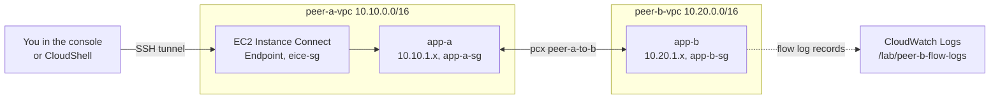

> [!COST]
> Two `t3.micro` instances bill about USD 0.0104 per hour each in us-east-1, and each 8 GiB gp3 root volume about USD 0.64 per month (prorated by the hour) unless Free Tier credits or the legacy Free Tier cover them. VPC peering has no hourly charge, traffic between the two VPCs stays in one Availability Zone (free), and EC2 Instance Connect Endpoint has no extra charge. CloudWatch Logs bills flow log ingestion and storage per GB, which is a fraction of a cent for this lab. Nothing here uses a public IPv4 address or a NAT gateway. Run the **Cleanup** section when you finish, or after lab 02 / lab 03 if you continue.

You will build two VPCs with **no internet access at all**, then make an instance in VPC A ping an instance in VPC B. Each step removes one blocker, and the flow log on VPC B shows you what the network decided. Labs 02 and 03 reuse VPC A, its instance and the EC2 Instance Connect Endpoint, so if you plan to continue, leave everything running and skip this lab's Cleanup.



## Prerequisites

- An AWS account and a user or role that can manage VPC, EC2, CloudWatch Logs and IAM roles (in a personal learning account, `AdministratorAccess` is simplest). Creating the flow log role also needs `iam:CreateRole` and `iam:PassRole`.
- One Region for the whole lab. The steps use `us-east-1`; any Region works.
- Everything goes in **one Availability Zone** so traffic between the VPCs is free. Pick an AZ where `t3.micro` is offered (the CLI tab below finds one for you).
- For the CLI tabs: **AWS CloudShell** (AWS CLI v2 and an SSH client are preinstalled) or AWS CLI v2 configured locally with a Bash shell. Keep the same terminal open, because later commands reuse shell variables.
- No key pair is needed: you connect through an **EC2 Instance Connect Endpoint**, which pushes a temporary key for you.

## Steps

### Step 1: Create the two VPCs

Each VPC gets one private subnet and its own route table, and nothing else: no route to the internet, no NAT gateway, no endpoints.

:::console
1. Open the **VPC** console and choose **Create VPC**.
2. For **Resources to create**, choose **VPC and more**.
3. Keep **Name tag auto-generation** selected and enter `peer-a`.
4. For **IPv4 CIDR block**, enter `10.10.0.0/16`. For **IPv6 CIDR block**, choose **No IPv6 CIDR block**. Keep **Tenancy** **Default**.
5. For **Number of Availability Zones (AZs)**, choose **1**, expand **Customize AZs** and pick an AZ (for example `us-east-1a`). Write it down; VPC B must use the same AZ.
6. For **Number of public subnets**, choose **0**. For **Number of private subnets**, choose **1**. Expand **Customize subnets CIDR blocks** and set the private subnet to `10.10.1.0/24`.
7. For **NAT gateways**, choose **None**. For **VPC endpoints**, choose **None**.
8. Under **DNS options**, keep both options selected (DNS hostnames and DNS resolution).
9. Check the **Preview** pane (one VPC, one private subnet, one route table) and choose **Create VPC**.
10. Choose **Create VPC** again and repeat with the name `peer-b`, IPv4 CIDR `10.20.0.0/16`, the **same AZ**, and private subnet `10.20.1.0/24`.

The wizard names resources with your prefix, for example `peer-a-vpc`, `peer-a-subnet-private1-us-east-1a` and `peer-a-rtb-private1-us-east-1a`.
:::

:::cli
```bash
# An AZ where t3.micro is offered; everything in this lab uses it.
AZ=$(aws ec2 describe-instance-type-offerings --location-type availability-zone \
  --filters Name=instance-type,Values=t3.micro \
  --query 'InstanceTypeOfferings[0].Location' --output text)
echo "Using $AZ"

# VPC A: VPC, DNS hostnames, private subnet, its own route table
VPC_A=$(aws ec2 create-vpc --cidr-block 10.10.0.0/16 \
  --tag-specifications 'ResourceType=vpc,Tags=[{Key=Name,Value=peer-a-vpc}]' \
  --query Vpc.VpcId --output text)
aws ec2 modify-vpc-attribute --vpc-id "$VPC_A" --enable-dns-hostnames '{"Value":true}'
SUBNET_A=$(aws ec2 create-subnet --vpc-id "$VPC_A" --cidr-block 10.10.1.0/24 \
  --availability-zone "$AZ" \
  --tag-specifications 'ResourceType=subnet,Tags=[{Key=Name,Value=peer-a-subnet-private1}]' \
  --query Subnet.SubnetId --output text)
RTB_A=$(aws ec2 create-route-table --vpc-id "$VPC_A" \
  --tag-specifications 'ResourceType=route-table,Tags=[{Key=Name,Value=peer-a-rtb-private1}]' \
  --query RouteTable.RouteTableId --output text)
aws ec2 associate-route-table --route-table-id "$RTB_A" --subnet-id "$SUBNET_A"

# VPC B: same pattern, same AZ, different CIDR
VPC_B=$(aws ec2 create-vpc --cidr-block 10.20.0.0/16 \
  --tag-specifications 'ResourceType=vpc,Tags=[{Key=Name,Value=peer-b-vpc}]' \
  --query Vpc.VpcId --output text)
aws ec2 modify-vpc-attribute --vpc-id "$VPC_B" --enable-dns-hostnames '{"Value":true}'
SUBNET_B=$(aws ec2 create-subnet --vpc-id "$VPC_B" --cidr-block 10.20.1.0/24 \
  --availability-zone "$AZ" \
  --tag-specifications 'ResourceType=subnet,Tags=[{Key=Name,Value=peer-b-subnet-private1}]' \
  --query Subnet.SubnetId --output text)
RTB_B=$(aws ec2 create-route-table --vpc-id "$VPC_B" \
  --tag-specifications 'ResourceType=route-table,Tags=[{Key=Name,Value=peer-b-rtb-private1}]' \
  --query RouteTable.RouteTableId --output text)
aws ec2 associate-route-table --route-table-id "$RTB_B" --subnet-id "$SUBNET_B"
echo "VPC A $VPC_A / $SUBNET_A / $RTB_A   VPC B $VPC_B / $SUBNET_B / $RTB_B"
```
:::

> [!CHECK]
> **Your VPCs** lists `peer-a-vpc` (10.10.0.0/16) and `peer-b-vpc` (10.20.0.0/16). Open each private route table's **Routes** tab: it has a single `local` route. With no route to an internet gateway or NAT gateway, nothing in these VPCs can reach the internet, and nothing yet connects them to each other.

### Step 2: Create the security groups

You need three groups: one for the EC2 Instance Connect Endpoint, one for the instance in VPC A (SSH only from the endpoint), and one for the instance in VPC B (no inbound rules yet, on purpose).

:::console
1. In the **VPC** console choose **Security groups** → **Create security group**.
2. **Security group name** `eice-sg`, **Description** `EC2 Instance Connect Endpoint`, **VPC** `peer-a-vpc`. Leave **Inbound rules** empty and keep the default outbound rule. Choose **Create security group**.
3. Create another group: name `app-a-sg`, description `Instance in VPC A`, VPC `peer-a-vpc`. Under **Inbound rules** choose **Add rule**, **Type** **SSH**, **Source** **Custom**, and pick `eice-sg` in the search box. Choose **Create security group**. **Copy its security group ID** (`sg-...`); you need it in Step 9.
4. Create a third group: name `app-b-sg`, description `Instance in VPC B`, VPC `peer-b-vpc`, with **no** inbound rules. Choose **Create security group**.
:::

:::cli
```bash
EICE_SG=$(aws ec2 create-security-group --group-name eice-sg \
  --description "EC2 Instance Connect Endpoint" --vpc-id "$VPC_A" \
  --query GroupId --output text)
APP_A_SG=$(aws ec2 create-security-group --group-name app-a-sg \
  --description "Instance in VPC A" --vpc-id "$VPC_A" \
  --query GroupId --output text)
aws ec2 authorize-security-group-ingress --group-id "$APP_A_SG" \
  --protocol tcp --port 22 --source-group "$EICE_SG"
APP_B_SG=$(aws ec2 create-security-group --group-name app-b-sg \
  --description "Instance in VPC B" --vpc-id "$VPC_B" \
  --query GroupId --output text)
echo "eice-sg $EICE_SG  app-a-sg $APP_A_SG  app-b-sg $APP_B_SG"
```
:::

### Step 3: Turn on a flow log for VPC B

Create the flow log now so it is already recording when the interesting traffic starts.

:::console
1. In the **VPC** console choose **Your VPCs**, select `peer-b-vpc`, then choose **Actions** → **Create flow log**.
2. **Name** `peer-b-flow-log`. **Filter** **All**. **Maximum aggregation interval** **1 minute**.
3. **Destination** **Send to CloudWatch Logs**. For **Destination log group**, type `/lab/peer-b-flow-logs` (CloudWatch Logs creates the group when the first records arrive).
4. For **Service access**, choose the option to **create a new service role**. Note the role name the console shows; you delete it in Cleanup.
5. **Log record format** **AWS default format**. Choose **Create flow log**.
:::

:::cli
```bash
cat > flowlogs-trust.json <<'EOF'
{
  "Version": "2012-10-17",
  "Statement": [{
    "Effect": "Allow",
    "Principal": { "Service": "vpc-flow-logs.amazonaws.com" },
    "Action": "sts:AssumeRole"
  }]
}
EOF
cat > flowlogs-policy.json <<'EOF'
{
  "Version": "2012-10-17",
  "Statement": [{
    "Effect": "Allow",
    "Action": ["logs:CreateLogGroup", "logs:CreateLogStream", "logs:PutLogEvents",
               "logs:DescribeLogGroups", "logs:DescribeLogStreams"],
    "Resource": "*"
  }]
}
EOF
FL_ROLE_ARN=$(aws iam create-role --role-name lab-flowlogs-role \
  --assume-role-policy-document file://flowlogs-trust.json \
  --query Role.Arn --output text)
aws iam put-role-policy --role-name lab-flowlogs-role \
  --policy-name lab-flowlogs-to-cwl --policy-document file://flowlogs-policy.json
sleep 15   # a new IAM role takes a few seconds to become usable

FLOW_LOG_ID=$(aws ec2 create-flow-logs --resource-type VPC --resource-ids "$VPC_B" \
  --traffic-type ALL --max-aggregation-interval 60 \
  --log-destination-type cloud-watch-logs --log-group-name /lab/peer-b-flow-logs \
  --deliver-logs-permission-arn "$FL_ROLE_ARN" \
  --tag-specifications 'ResourceType=vpc-flow-log,Tags=[{Key=Name,Value=peer-b-flow-log}]' \
  --query 'FlowLogIds[0]' --output text)
echo "$FLOW_LOG_ID"
```
:::

> [!CHECK]
> On `peer-b-vpc` → **Flow logs** tab, the flow log shows **Status** **Active**, destination type `cloud-watch-logs` and an IAM role. The log group does not exist yet; it appears once VPC B has traffic.

### Step 4: Launch one instance in each VPC

:::console
1. Open the **EC2** console and choose **Instances** → **Launch instances**.
2. **Name** `app-a`. Under **Application and OS Images**, keep **Amazon Linux 2023** (it includes EC2 Instance Connect). **Instance type** **t3.micro**.
3. **Key pair (login)**: **Proceed without a key pair (not recommended)**.
4. **Network settings** → **Edit**: **VPC** `peer-a-vpc`, **Subnet** the `peer-a` private subnet, **Auto-assign public IP** **Disable**. **Firewall (security groups)**: **Select existing security group** → `app-a-sg`.
5. Choose **Launch instance**.
6. Repeat for `app-b`: **VPC** `peer-b-vpc`, the `peer-b` private subnet, **Auto-assign public IP** **Disable**, security group `app-b-sg`.
7. When `app-b` is running, select it and copy its **Private IPv4 address** (10.20.1.x) from the **Details** tab.
:::

:::cli
```bash
AMI=$(aws ssm get-parameters \
  --names /aws/service/ami-amazon-linux-latest/al2023-ami-kernel-default-x86_64 \
  --query 'Parameters[0].Value' --output text)

APP_A=$(aws ec2 run-instances --image-id "$AMI" --instance-type t3.micro \
  --subnet-id "$SUBNET_A" --security-group-ids "$APP_A_SG" --no-associate-public-ip-address \
  --tag-specifications 'ResourceType=instance,Tags=[{Key=Name,Value=app-a}]' \
  --query 'Instances[0].InstanceId' --output text)
APP_B=$(aws ec2 run-instances --image-id "$AMI" --instance-type t3.micro \
  --subnet-id "$SUBNET_B" --security-group-ids "$APP_B_SG" --no-associate-public-ip-address \
  --tag-specifications 'ResourceType=instance,Tags=[{Key=Name,Value=app-b}]' \
  --query 'Instances[0].InstanceId' --output text)
aws ec2 wait instance-running --instance-ids "$APP_A" "$APP_B"

B_IP=$(aws ec2 describe-instances --instance-ids "$APP_B" \
  --query 'Reservations[0].Instances[0].PrivateIpAddress' --output text)
echo "app-a $APP_A   app-b $APP_B   app-b private IP: $B_IP"
```
:::

> [!CHECK]
> Both instances are **Running** in the same AZ, and neither has a **Public IPv4 address**. `app-b`'s private address is in 10.20.1.0/24.

### Step 5: Create an EC2 Instance Connect Endpoint and log in to app-a

The endpoint gives you SSH access to private instances without a bastion host, a public IP or an internet gateway.

:::console
1. In the **VPC** console choose **Endpoints** → **Create endpoint**.
2. **Name tag** `peer-a-eice`. For **Type**, choose **EC2 Instance Connect Endpoint**.
3. **VPC** `peer-a-vpc`. **Security groups** `eice-sg`. **Subnet** the `peer-a` private subnet. If **IP address type** is shown, choose **IPv4**.
4. Choose **Create endpoint** and wait until **Status** is **Available** (a few minutes).
5. In the **EC2** console select `app-a` and choose **Connect**. On the **EC2 Instance Connect** tab, for **Connection type** choose **Connect using a Private IP**, select **Private IPv4 address**, and for **EC2 Instance Connect Endpoint** choose `peer-a-eice`. Keep **Username** `ec2-user` and choose **Connect**.
:::

:::cli
```bash
EICE_ID=$(aws ec2 create-instance-connect-endpoint --subnet-id "$SUBNET_A" \
  --security-group-ids "$EICE_SG" \
  --tag-specifications 'ResourceType=instance-connect-endpoint,Tags=[{Key=Name,Value=peer-a-eice}]' \
  --query InstanceConnectEndpoint.InstanceConnectEndpointId --output text)
until [ "$(aws ec2 describe-instance-connect-endpoints --instance-connect-endpoint-ids "$EICE_ID" \
  --query 'InstanceConnectEndpoints[0].State' --output text)" = "create-complete" ]; do
  echo "waiting for $EICE_ID..."; sleep 20
done

# Opens an SSH session on app-a. Type 'exit' to come back to CloudShell.
aws ec2-instance-connect ssh --instance-id "$APP_A" --os-user ec2-user --connection-type eice
```
:::

> [!CHECK]
> A terminal opens with a prompt like `[ec2-user@ip-10-10-1-x ~]$`. You reached an instance that has no public IP, in a VPC with no route to the internet. The `ping` commands in Steps 6-9 run **in this session on app-a**. Console users keep this browser tab open and do the console steps in another tab. CLI users type `exit` to get back to CloudShell (where the shell variables live) before each CLI block, then reconnect with the `aws ec2-instance-connect ssh` command above to ping again; a second CloudShell tab would not have the variables.

### Step 6: Try to reach app-b before any peering exists

In the app-a session, replace `10.20.1.x` with app-b's private IP:

```bash
ping -c 3 -W 2 10.20.1.x
```

> [!CHECK]
> `3 packets transmitted, 0 received, 100% packet loss`. VPC A's route table only knows `10.10.0.0/16 → local`, so packets for 10.20.0.0/16 have nowhere to go and are dropped inside VPC A. They never reach VPC B, so its flow log records nothing for them.

### Step 7: Create and accept the peering connection

:::console
1. In the **VPC** console choose **Peering connections** → **Create peering connection**.
2. **Name** `peer-a-to-b`. **VPC ID (Requester)** `peer-a-vpc`.
3. Under **Select another VPC to peer with**, keep **Account** **My account** and **Region** **This Region**, and choose `peer-b-vpc` for **VPC ID (Accepter)**.
4. Choose **Create peering connection**.
5. With the new connection selected (status **Pending acceptance**), choose **Actions** → **Accept request**, then **Accept request** again to confirm. If the console offers **Modify my route tables now**, close the dialog instead; you add routes in Step 8.
6. Run the same `ping` in the app-a session.
:::

:::cli
```bash
PCX=$(aws ec2 create-vpc-peering-connection --vpc-id "$VPC_A" --peer-vpc-id "$VPC_B" \
  --tag-specifications 'ResourceType=vpc-peering-connection,Tags=[{Key=Name,Value=peer-a-to-b}]' \
  --query VpcPeeringConnection.VpcPeeringConnectionId --output text)
aws ec2 wait vpc-peering-connection-exists --vpc-peering-connection-ids "$PCX"
aws ec2 accept-vpc-peering-connection --vpc-peering-connection-id "$PCX" \
  --query VpcPeeringConnection.Status.Code --output text
```
:::

> [!CHECK]
> The peering connection status becomes **Active**. The ping **still fails**: a peering connection is only a path, and neither route table sends traffic to it yet.

### Step 8: Add a route on both sides

:::console
1. In the **VPC** console choose **Route tables**, select the `peer-a` private route table, open the **Routes** tab and choose **Edit routes**.
2. Choose **Add route**: **Destination** `10.20.0.0/16`, **Target** **Peering Connection** → `peer-a-to-b`. Choose **Save changes**.
3. Select the `peer-b` private route table and add the return route: **Destination** `10.10.0.0/16`, **Target** **Peering Connection** → `peer-a-to-b`. Choose **Save changes**.
4. Run the `ping` again in the app-a session.
:::

:::cli
```bash
aws ec2 create-route --route-table-id "$RTB_A" \
  --destination-cidr-block 10.20.0.0/16 --vpc-peering-connection-id "$PCX"
aws ec2 create-route --route-table-id "$RTB_B" \
  --destination-cidr-block 10.10.0.0/16 --vpc-peering-connection-id "$PCX"
```
:::

> [!CHECK]
> Both route tables now show a `pcx-...` route with **Status** **Active**. The ping **still fails**, but for a new reason: the packets now arrive at app-b, and `app-b-sg` has no inbound rule that allows ICMP. This time VPC B's flow log records them as **REJECT**.

### Step 9: Allow ICMP from app-a's security group across the peering

Because both VPCs are in the same account and Region, app-b's security group can reference app-a's security group directly, even though it lives in another VPC.

:::console
1. In the **VPC** console choose **Security groups**, select `app-b-sg`, and choose **Actions** → **Edit inbound rules**.
2. Choose **Add rule**: **Type** **All ICMP - IPv4**, **Source** **Custom**, and **paste the ID of `app-a-sg`** that you copied in Step 2. Groups from a peered VPC are not listed in the search box, so you must type or paste the `sg-...` ID.
3. Choose **Save rules**, then run the `ping` again in the app-a session.
:::

:::cli
```bash
aws ec2 authorize-security-group-ingress --group-id "$APP_B_SG" \
  --ip-permissions "IpProtocol=icmp,FromPort=-1,ToPort=-1,UserIdGroupPairs=[{GroupId=$APP_A_SG}]"
```
:::

> [!CHECK]
> `3 packets transmitted, 3 received, 0% packet loss`, with replies in about a millisecond (same AZ). The reply leaves app-b without an outbound rule because security groups are stateful. Three things had to be true at once: an active peering, a route in **each** VPC, and a security group rule.

### Step 10: Read the evidence in the flow log

Wait about 5-10 minutes after the last ping so the 1-minute records are delivered.

:::console
1. Open the **CloudWatch** console. In the navigation pane choose **Logs** → **Logs Insights**.
2. In **Select log group(s)**, choose `/lab/peer-b-flow-logs`. Set the time range to the last hour.
3. Replace the query with the one below and choose **Run**.

```
fields @timestamp, srcAddr, dstAddr, protocol, action
| filter protocol = 1
| sort @timestamp desc
| limit 50
```
:::

:::cli
```bash
QID=$(aws logs start-query --log-group-name /lab/peer-b-flow-logs \
  --start-time $(( $(date +%s) - 3600 )) --end-time "$(date +%s)" \
  --query-string 'fields @timestamp, srcAddr, dstAddr, protocol, action | filter protocol = 1 | sort @timestamp desc | limit 50' \
  --query queryId --output text)
sleep 10
aws logs get-query-results --query-id "$QID" --query 'results[*][*].value' --output text
```
:::

> [!CHECK]
> You see ICMP records (`protocol` 1) from app-a's 10.10.1.x address to app-b's 10.20.1.x address with **REJECT** (Step 8, blocked by the security group), followed by **ACCEPT** records in both directions (Step 9: the request in and the reply out). There are no records at all for Step 6, because those packets never left VPC A.

> [!TIP]
> Turn this into an exam habit: no flow log record means a routing problem upstream; REJECT means a security group or network ACL; inbound ACCEPT with outbound REJECT means a stateless network ACL.

## Cleanup

Skip this section if you are continuing to lab 02 or lab 03; their Cleanup sections include everything below. Otherwise exit the SSH session (`exit`) and delete in this order:

- [ ] **Instances `app-a` and `app-b`**: **EC2** → **Instances** → select both → **Instance state** → **Terminate (delete) instance**. CLI: `aws ec2 terminate-instances --instance-ids "$APP_A" "$APP_B"` then `aws ec2 wait instance-terminated --instance-ids "$APP_A" "$APP_B"`.
- [ ] **EC2 Instance Connect Endpoint `peer-a-eice`**: **VPC** → **Endpoints** → select it → **Actions** → **Delete VPC endpoints**, type `delete`, choose **Delete**. CLI: `aws ec2 delete-instance-connect-endpoint --instance-connect-endpoint-id "$EICE_ID"`.
- [ ] **Flow log `peer-b-flow-log`**: **VPC** → **Your VPCs** → `peer-b-vpc` → **Flow logs** tab → select it → **Actions** → **Delete flow logs**, type `delete`, choose **Delete**. CLI: `aws ec2 delete-flow-logs --flow-log-ids "$FLOW_LOG_ID"`.
- [ ] **Log group `/lab/peer-b-flow-logs`** (deleting the flow log does not delete its data): **CloudWatch** → **Logs** → **Log groups** → select it → **Actions** → **Delete log group(s)** → **Delete**. CLI: `aws logs delete-log-group --log-group-name /lab/peer-b-flow-logs`.
- [ ] **Flow log IAM role**: **IAM** → **Roles** → select the role the console created in Step 3 (or `lab-flowlogs-role` from the CLI) → **Delete**, enter the role name, choose **Delete**. Before deleting, open its **Permissions** tab: if the console attached a customer managed policy (not an inline one), delete that policy too under **IAM** → **Policies**. CLI: `aws iam delete-role-policy --role-name lab-flowlogs-role --policy-name lab-flowlogs-to-cwl` then `aws iam delete-role --role-name lab-flowlogs-role`.
- [ ] **Peering connection `peer-a-to-b`**: **VPC** → **Peering connections** → select it → **Actions** → **Delete peering connection**, type `delete`, choose **Delete**. CLI: `aws ec2 delete-vpc-peering-connection --vpc-peering-connection-id "$PCX"`.
- [ ] **VPC `peer-b-vpc`** with its subnet, route table and `app-b-sg`: **VPC** → **Your VPCs** → select it → **Actions** → **Delete VPC**, type `delete`, choose **Delete** (the console deletes the subnet, route tables and security groups with it). CLI: `aws ec2 delete-security-group --group-id "$APP_B_SG"`, `aws ec2 delete-subnet --subnet-id "$SUBNET_B"`, `aws ec2 delete-route-table --route-table-id "$RTB_B"`, then `aws ec2 delete-vpc --vpc-id "$VPC_B"`.
- [ ] **VPC `peer-a-vpc`** with its subnet, route table, `app-a-sg` and `eice-sg`: same console steps. If it reports a dependency, wait a minute for the endpoint's network interface to disappear and retry. CLI: `aws ec2 delete-security-group --group-id "$APP_A_SG"` (first, because it references `eice-sg`), `aws ec2 delete-security-group --group-id "$EICE_SG"`, `aws ec2 delete-subnet --subnet-id "$SUBNET_A"`, `aws ec2 delete-route-table --route-table-id "$RTB_A"`, then `aws ec2 delete-vpc --vpc-id "$VPC_A"`.
- [ ] **Local files** (CLI path): `rm -f flowlogs-trust.json flowlogs-policy.json`.
- [ ] **Final check**: in this Region, **EC2** shows no running instances named `app-*`, **VPC** → **Your VPCs** shows no `peer-*` VPCs, **Peering connections** shows `peer-a-to-b` as **Deleted** (or nothing), and the next day **Billing and Cost Management** → **Bills** shows no new EC2 charges from this lab.

## Progress checklist

- [ ] Step 1: Created `peer-a-vpc` and `peer-b-vpc`, each with one private subnet in the same AZ
- [ ] Step 2: Created `eice-sg`, `app-a-sg` (SSH from the endpoint) and `app-b-sg` (no inbound rules)
- [ ] Step 3: Turned on a 1-minute flow log for `peer-b-vpc` to CloudWatch Logs
- [ ] Step 4: Launched `app-a` and `app-b` without public IPs
- [ ] Step 5: Created `peer-a-eice` and logged in to `app-a`
- [ ] Step 6: Saw the ping fail with no peering
- [ ] Step 7: Created and accepted `peer-a-to-b`, and saw the ping still fail
- [ ] Step 8: Added routes in both VPCs, and saw the ping still fail (security group)
- [ ] Step 9: Allowed ICMP from `app-a-sg` and got replies
- [ ] Step 10: Found the REJECT and ACCEPT records in Logs Insights
- [ ] Cleanup done (or deferred to lab 02 / lab 03)
