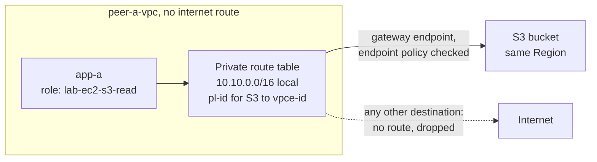

> [!COST]
> Gateway endpoints have **no charge**, and S3 traffic through them inside the same Region has no data transfer charge. What keeps billing is the pair of `t3.micro` instances from lab 01 (about USD 0.0104 per hour each plus their gp3 volumes) and a few S3 requests and bytes of storage, which round to zero. If you compare this with a NAT gateway path (USD 0.045 per hour plus USD 0.045 per GB in us-east-1), you see why the exam keeps choosing gateway endpoints. Run the **Cleanup** section when you finish.

This lab reuses `peer-a-vpc`, its private subnet and route table, the instance `app-a` and the endpoint `peer-a-eice` from lab 01. VPC A has **no route to an internet gateway and no NAT gateway**, so it is a perfect place to watch a gateway endpoint open exactly one door.



## Prerequisites

- Lab 01 completed through Step 5, **without** its Cleanup: `peer-a-vpc` (with DNS hostnames and DNS resolution enabled), its private subnet and route table, `app-a` running, and `peer-a-eice` available. VPC B is not needed but can stay.
- Permissions for S3, EC2, VPC endpoints and IAM roles (in a personal learning account, `AdministratorAccess` is simplest).
- The same Region as lab 01 (the steps use `us-east-1`). The bucket **must** be in the VPC's Region, because a gateway endpoint only serves its own Region.
- For the CLI tabs: AWS CloudShell or AWS CLI v2 with Bash. If this is a new shell, recover the lab 01 IDs first:

```bash
REGION=${AWS_REGION:-us-east-1}
VPC_A=$(aws ec2 describe-vpcs --filters Name=tag:Name,Values=peer-a-vpc \
  --query 'Vpcs[0].VpcId' --output text)
RTB_A=$(aws ec2 describe-route-tables \
  --filters Name=vpc-id,Values="$VPC_A" Name=association.main,Values=false \
  --query 'RouteTables[0].RouteTableId' --output text)
APP_A=$(aws ec2 describe-instances \
  --filters Name=tag:Name,Values=app-a Name=instance-state-name,Values=running \
  --query 'Reservations[0].Instances[0].InstanceId' --output text)
echo "$REGION $VPC_A $RTB_A $APP_A"
```

## Steps

### Step 1: Create a bucket with a test object

:::console
1. Open the **S3** console and choose **Create bucket**.
2. Keep **Bucket type** **General purpose**. Enter a globally unique **Bucket name**, for example `lab-gwe-<your-account-id>-<random-digits>`, and make sure the Region shown is the VPC's Region.
3. Keep **Block all public access** turned on and the other defaults. Choose **Create bucket**.
4. Open the bucket, choose **Upload** → **Add files**, pick any small text file (or create `hello.txt` with one line of text), and choose **Upload**. Write down the bucket name.
:::

:::cli
```bash
REGION=${AWS_REGION:-us-east-1}
ACCOUNT=$(aws sts get-caller-identity --query Account --output text)
BUCKET="lab-gwe-$ACCOUNT-$RANDOM"
aws s3 mb "s3://$BUCKET" --region "$REGION"
echo "hello from S3 through a gateway endpoint" > hello.txt
aws s3 cp hello.txt "s3://$BUCKET/hello.txt" --region "$REGION"
echo "Bucket: $BUCKET"
```
:::

### Step 2: Give app-a an IAM role that can read S3

Credentials are not the point of this lab, so give the instance a role up front. Then any failure you see next is a network failure.

:::console
1. Open the **IAM** console, choose **Roles** → **Create role**.
2. **Trusted entity type** **AWS service**. **Service or use case** **EC2**, use case **EC2**. Choose **Next**.
3. Search for and select **AmazonS3ReadOnlyAccess**. Choose **Next**.
4. **Role name** `lab-ec2-s3-read`. Choose **Create role** (the console also creates an instance profile with the same name).
5. In the **EC2** console select `app-a`, choose **Actions** → **Security** → **Modify IAM role**, choose `lab-ec2-s3-read`, and choose **Update IAM role**.
:::

:::cli
```bash
cat > ec2-trust.json <<'EOF'
{
  "Version": "2012-10-17",
  "Statement": [{
    "Effect": "Allow",
    "Principal": { "Service": "ec2.amazonaws.com" },
    "Action": "sts:AssumeRole"
  }]
}
EOF
aws iam create-role --role-name lab-ec2-s3-read \
  --assume-role-policy-document file://ec2-trust.json
aws iam attach-role-policy --role-name lab-ec2-s3-read \
  --policy-arn arn:aws:iam::aws:policy/AmazonS3ReadOnlyAccess
aws iam create-instance-profile --instance-profile-name lab-ec2-s3-read
aws iam add-role-to-instance-profile --instance-profile-name lab-ec2-s3-read \
  --role-name lab-ec2-s3-read
sleep 15   # let the new instance profile propagate
aws ec2 associate-iam-instance-profile --instance-id "$APP_A" \
  --iam-instance-profile Name=lab-ec2-s3-read
```
:::

> [!CHECK]
> On `app-a` → **Security** tab, **IAM Role** shows `lab-ec2-s3-read`.

### Step 3: Prove that app-a cannot reach S3

Connect to `app-a` as in lab 01 Step 5 (console: **Connect** → **EC2 Instance Connect** → **Connect using a Private IP** → `peer-a-eice`; CLI: `aws ec2-instance-connect ssh --instance-id "$APP_A" --os-user ec2-user --connection-type eice`). In the session on app-a, replace `BUCKET_NAME` and run:

```bash
# The role is attached: instance metadata hands out its name
TOKEN=$(curl -s -X PUT http://169.254.169.254/latest/api/token -H "X-aws-ec2-metadata-token-ttl-seconds: 300")
curl -s -H "X-aws-ec2-metadata-token: $TOKEN" http://169.254.169.254/latest/meta-data/iam/security-credentials/; echo

# S3's regional name resolves to public IP addresses
getent hosts s3.us-east-1.amazonaws.com

# Fail fast instead of retrying for minutes
export AWS_MAX_ATTEMPTS=1
aws s3 ls s3://BUCKET_NAME --region us-east-1 --cli-connect-timeout 5
```

> [!CHECK]
> The metadata call prints `lab-ec2-s3-read`, so credentials are fine. `getent` returns public IP addresses for S3. The `aws s3 ls` command fails with an error like **Connect timeout on endpoint URL**: the VPC has no route to those public addresses, because no route table entry points to an internet gateway or NAT gateway. (Use your own Region in both commands if it is not `us-east-1`.)

### Step 4: Create the S3 gateway endpoint

:::console
1. In the **VPC** console choose **Endpoints** → **Create endpoint**.
2. **Name tag** `peer-a-s3-gateway`. For **Type**, choose **AWS services**.
3. In **Services**, add the filter **Type = Gateway** and select `com.amazonaws.us-east-1.s3` (your Region's name in the middle).
4. **VPC** `peer-a-vpc`.
5. **Route tables**: select the `peer-a` private route table (the one associated with app-a's subnet).
6. **Policy** **Full access** for now. Choose **Create endpoint**.
:::

:::cli
```bash
VPCE=$(aws ec2 create-vpc-endpoint --vpc-id "$VPC_A" --vpc-endpoint-type Gateway \
  --service-name "com.amazonaws.$REGION.s3" --route-table-ids "$RTB_A" \
  --tag-specifications 'ResourceType=vpc-endpoint,Tags=[{Key=Name,Value=peer-a-s3-gateway}]' \
  --query VpcEndpoint.VpcEndpointId --output text)
echo "$VPCE"
aws ec2 describe-route-tables --route-table-ids "$RTB_A" \
  --query 'RouteTables[0].Routes[].[DestinationCidrBlock,DestinationPrefixListId,GatewayId,State]' \
  --output table
```
:::

> [!CHECK]
> The endpoint shows **Status** **Available** and **Endpoint type** **Gateway**. On the private route table's **Routes** tab there is a new route whose destination is a prefix list `pl-...` (named for the S3 service) and whose target is `vpce-...`. You did not type that route; associating the route table created it. A gateway endpoint has no network interface, no IP address and no security group.

### Step 5: Read from S3 through the endpoint

Back in the app-a session (reconnect if you exited):

```bash
export AWS_MAX_ATTEMPTS=1
aws s3 ls s3://BUCKET_NAME --region us-east-1 --cli-connect-timeout 5
aws s3 cp s3://BUCKET_NAME/hello.txt - --region us-east-1
```

> [!CHECK]
> The listing shows `hello.txt`, and the second command prints its contents. The instance still has no route to the internet: try `curl -m 5 -sI https://aws.amazon.com` and it times out. Only S3 in this Region became reachable, and that traffic never left the AWS network.

> [!NOTE]
> The endpoint only helps subnets whose route table you associated, and only buckets in its own Region. A request to a bucket in another Region would still time out here. VPC B, peered with VPC A in lab 01, cannot borrow this endpoint either, because peering has no edge-to-edge routing; it would need its own endpoint.

### Step 6: Restrict the endpoint to one bucket with an endpoint policy

An endpoint policy is a resource policy on the endpoint. A request must be allowed by **both** the caller's IAM permissions and the endpoint policy.

Policy to use (replace `BUCKET_NAME` twice):

```json
{
  "Version": "2012-10-17",
  "Statement": [
    {
      "Sid": "OnlyTheLabBucket",
      "Effect": "Allow",
      "Principal": "*",
      "Action": ["s3:ListBucket", "s3:GetObject"],
      "Resource": ["arn:aws:s3:::BUCKET_NAME", "arn:aws:s3:::BUCKET_NAME/*"]
    }
  ]
}
```

:::console
1. In the **VPC** console choose **Endpoints** and select `peer-a-s3-gateway`.
2. Choose **Actions** → **Manage policy**, select **Custom**, paste the policy with your bucket name, and choose **Save**.
3. Wait a minute or two (policy changes take a few minutes), then run the commands below in the app-a session.
:::

:::cli
```bash
sed "s/BUCKET_NAME/$BUCKET/g" > endpoint-policy.json <<'EOF'
{
  "Version": "2012-10-17",
  "Statement": [
    {
      "Sid": "OnlyTheLabBucket",
      "Effect": "Allow",
      "Principal": "*",
      "Action": ["s3:ListBucket", "s3:GetObject"],
      "Resource": ["arn:aws:s3:::BUCKET_NAME", "arn:aws:s3:::BUCKET_NAME/*"]
    }
  ]
}
EOF
aws ec2 modify-vpc-endpoint --vpc-endpoint-id "$VPCE" --policy-document file://endpoint-policy.json
```
:::

In the app-a session:

```bash
export AWS_MAX_ATTEMPTS=1
aws s3 ls s3://BUCKET_NAME --region us-east-1
aws s3 ls --region us-east-1
```

> [!CHECK]
> Listing your bucket still works. Listing **all** buckets now fails with **AccessDenied** for the `ListBuckets` operation, even though the instance role (`AmazonS3ReadOnlyAccess`) allows it: the endpoint policy does not. This is how companies stop data from being copied out to unapproved buckets through an endpoint.

## Cleanup

Skip this section if you are continuing to lab 03; its Cleanup includes everything below. Otherwise exit the SSH session (`exit`) and delete in this order. Lab 01 resources are included, because this lab ran on them; their full console and CLI steps are in lab 01's Cleanup (recover IDs by their Name tags if your shell is new).

- [ ] **Gateway endpoint `peer-a-s3-gateway`**: **VPC** → **Endpoints** → select it → **Actions** → **Delete VPC endpoints**, type `delete`, choose **Delete** (its route disappears from the route table). CLI: `aws ec2 delete-vpc-endpoints --vpc-endpoint-ids "$VPCE"`.
- [ ] **S3 bucket and its object**: **S3** → select the bucket → **Empty**, type `permanently delete`, then **Delete** and type the bucket name. CLI: `aws s3 rb "s3://$BUCKET" --force`.
- [ ] **Instances `app-a` and `app-b`** (lab 01): terminate both and wait until they show **Terminated**. CLI: `aws ec2 terminate-instances --instance-ids "$APP_A" "$APP_B"` then `aws ec2 wait instance-terminated --instance-ids "$APP_A" "$APP_B"`.
- [ ] **IAM role and instance profile `lab-ec2-s3-read`** (now that no instance uses it): **IAM** → **Roles** → select `lab-ec2-s3-read` → **Delete**, enter the name, choose **Delete** (the console also detaches the managed policy and deletes the same-named instance profile). CLI: `aws iam remove-role-from-instance-profile --instance-profile-name lab-ec2-s3-read --role-name lab-ec2-s3-read`, `aws iam delete-instance-profile --instance-profile-name lab-ec2-s3-read`, `aws iam detach-role-policy --role-name lab-ec2-s3-read --policy-arn arn:aws:iam::aws:policy/AmazonS3ReadOnlyAccess`, then `aws iam delete-role --role-name lab-ec2-s3-read`.
- [ ] **EC2 Instance Connect Endpoint `peer-a-eice`** (lab 01): **VPC** → **Endpoints** → **Actions** → **Delete VPC endpoints**.
- [ ] **Flow log `peer-b-flow-log`**, **log group `/lab/peer-b-flow-logs`** and the **flow log IAM role** (console-created, or `lab-flowlogs-role`) (lab 01).
- [ ] **Peering connection `peer-a-to-b`** (lab 01).
- [ ] **VPC `peer-b-vpc`** (with its subnet, route table and `app-b-sg`) and **VPC `peer-a-vpc`** (with its subnet, route table, `app-a-sg` and `eice-sg`) (lab 01): **Your VPCs** → **Actions** → **Delete VPC**.
- [ ] **Local files** (CLI path): `rm -f hello.txt ec2-trust.json endpoint-policy.json flowlogs-trust.json flowlogs-policy.json`.
- [ ] **Final check**: no running `app-*` instances, no `peer-*` VPCs, no `lab-gwe-*` bucket and no `lab-ec2-s3-read` role remain; the next day, **Billing and Cost Management** → **Bills** shows no new charges from these labs.

## Progress checklist

- [ ] Step 1: Created a bucket in the VPC's Region and uploaded `hello.txt`
- [ ] Step 2: Attached the `lab-ec2-s3-read` role to `app-a`
- [ ] Step 3: Saw `aws s3 ls` time out from the private subnet
- [ ] Step 4: Created `peer-a-s3-gateway` and found the `pl-...` route
- [ ] Step 5: Listed and read the object through the endpoint
- [ ] Step 6: Restricted the endpoint to one bucket and saw `ListBuckets` denied
- [ ] Cleanup done (or deferred to lab 03)
