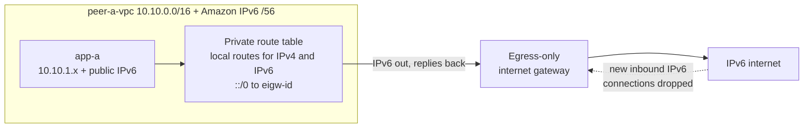

> [!COST]
> IPv6 addresses carry **no hourly charge** (unlike public IPv4 at USD 0.005 per hour), and an egress-only internet gateway has **no charge** of its own; you pay only normal data transfer out, and the test traffic here is a few KB. The running cost is the pair of `t3.micro` instances from lab 01 (about USD 0.0104 per hour each plus their gp3 volumes). Run the **Cleanup** section when you finish.

This lab reuses `peer-a-vpc`, its private subnet and route table, `app-a`, `app-a-sg` and `peer-a-eice` from lab 01. Lab 02 is optional; if its gateway endpoint is still there, it does not interfere.



## Prerequisites

- Lab 01 completed through Step 5, **without** its Cleanup: `peer-a-vpc`, its private subnet and route table, `app-a` (a `t3.micro`, which supports IPv6), `app-a-sg` and `peer-a-eice`.
- Permissions for VPC and EC2 (in a personal learning account, `AdministratorAccess` is simplest).
- The same Region as lab 01 (the steps use `us-east-1`).
- For the CLI tabs: AWS CloudShell or AWS CLI v2 with Bash. If this is a new shell, recover the lab 01 IDs first:

```bash
VPC_A=$(aws ec2 describe-vpcs --filters Name=tag:Name,Values=peer-a-vpc \
  --query 'Vpcs[0].VpcId' --output text)
SUBNET_A=$(aws ec2 describe-subnets --filters Name=vpc-id,Values="$VPC_A" \
  --query 'Subnets[0].SubnetId' --output text)
RTB_A=$(aws ec2 describe-route-tables \
  --filters Name=vpc-id,Values="$VPC_A" Name=association.main,Values=false \
  --query 'RouteTables[0].RouteTableId' --output text)
APP_A=$(aws ec2 describe-instances \
  --filters Name=tag:Name,Values=app-a Name=instance-state-name,Values=running \
  --query 'Reservations[0].Instances[0].InstanceId' --output text)
APP_A_SG=$(aws ec2 describe-security-groups \
  --filters Name=vpc-id,Values="$VPC_A" Name=group-name,Values=app-a-sg \
  --query 'SecurityGroups[0].GroupId' --output text)
echo "$VPC_A $SUBNET_A $RTB_A $APP_A $APP_A_SG"
```

## Steps

### Step 1: Add an Amazon-provided IPv6 block to the VPC

:::console
1. In the **VPC** console choose **Your VPCs** and select `peer-a-vpc`.
2. Choose **Actions** → **Edit CIDRs** → **Add new IPv6 CIDR**.
3. Choose **Amazon-provided IPv6 CIDR block**, keep the default **Network Border Group** (your Region), and choose **Select CIDR**. Then choose **Close**.
:::

:::cli
```bash
aws ec2 associate-vpc-cidr-block --vpc-id "$VPC_A" --amazon-provided-ipv6-cidr-block
sleep 10
VPC6=$(aws ec2 describe-vpcs --vpc-ids "$VPC_A" \
  --query 'Vpcs[0].Ipv6CidrBlockAssociationSet[0].Ipv6CidrBlock' --output text)
echo "VPC IPv6 block: $VPC6"
```
:::

> [!CHECK]
> The VPC now lists an IPv6 CIDR ending in **/56** next to its 10.10.0.0/16 block. The IPv4 block stays: a VPC always keeps its primary IPv4 CIDR. Open the private route table: AWS added a second `local` route for the IPv6 block. Open `app-a-sg` → **Outbound rules**: AWS also added an **All traffic** rule to `::/0`, because the group still had its original outbound rule. The default network ACL likewise gained IPv6 allow rules, because it was never modified.

> [!TIP]
> If `app-a-sg` has no `::/0` outbound rule (for example because you edited its outbound rules earlier), add one: **Edit outbound rules** → **Add rule** → **Type** **All traffic**, **Destination** **Custom** `::/0` → **Save rules**. CLI: `aws ec2 authorize-security-group-egress --group-id "$APP_A_SG" --ip-permissions 'IpProtocol=-1,Ipv6Ranges=[{CidrIpv6=::/0}]'`.

### Step 2: Give the private subnet a /64

:::console
1. Choose **Subnets**, select the `peer-a` private subnet, and choose **Actions** → **Edit IPv6 CIDRs**.
2. Choose **Add IPv6 CIDR**, keep the VPC's IPv6 block, and keep the suggested **/64** (the first block, ending in `00::/64`). Choose **Save**.
:::

:::cli
```bash
SUBNET6="${VPC6%/56}/64"     # the first /64 inside the VPC's /56
aws ec2 associate-subnet-cidr-block --subnet-id "$SUBNET_A" --ipv6-cidr-block "$SUBNET6"
echo "Subnet IPv6 block: $SUBNET6"
```
:::

> [!CHECK]
> The subnet shows both `10.10.1.0/24` and an IPv6 **/64**. A /64 holds about 18 quintillion addresses, which is why IPv6 never runs out in a subnet, while the /24 IPv4 range (251 usable addresses) can.

### Step 3: Assign an IPv6 address to app-a

:::console
1. In the **EC2** console select `app-a` and choose **Actions** → **Networking** → **Manage IP addresses**.
2. Expand the network interface. Under **IPv6 addresses**, choose **Assign new IP address**, leave the field blank so EC2 picks one, and choose **Save** (confirm if asked).
3. On the instance's **Networking** tab, note the new **IPv6 address**.
:::

:::cli
```bash
ENI_A=$(aws ec2 describe-instances --instance-ids "$APP_A" \
  --query 'Reservations[0].Instances[0].NetworkInterfaces[0].NetworkInterfaceId' --output text)
aws ec2 assign-ipv6-addresses --network-interface-id "$ENI_A" --ipv6-address-count 1
aws ec2 describe-network-interfaces --network-interface-ids "$ENI_A" \
  --query 'NetworkInterfaces[0].Ipv6Addresses[].Ipv6Address' --output text
```
:::

Connect to `app-a` through `peer-a-eice` (console: **Connect** → **EC2 Instance Connect** → **Connect using a Private IP** → **Private IPv4 address**; CLI: `aws ec2-instance-connect ssh --instance-id "$APP_A" --os-user ec2-user --connection-type eice`) and run:

```bash
ip -6 addr show scope global
```

> [!CHECK]
> The output lists the IPv6 address you just assigned, with `scope global`: it is a **public**, globally unique address, not a private one. If nothing appears after a minute, reboot the instance (**Instance state** → **Reboot instance**, or `aws ec2 reboot-instances --instance-ids "$APP_A"`), reconnect and check again.

### Step 4: Confirm there is no IPv6 path to the internet yet

In the app-a session:

```bash
ping -6 -c 3 -W 2 2001:4860:4860::8888
curl -6 -m 5 -sI https://www.google.com | head -n 1
```

> [!CHECK]
> The ping shows **100% packet loss** and `curl` prints nothing after 5 seconds. A public IPv6 address alone does not give internet access: the route table has no `::/0` route, so the VPC drops the packets.

### Step 5: Create the egress-only internet gateway and route ::/0 to it

:::console
1. In the **VPC** console choose **Egress-only internet gateways** → **Create egress only internet gateway**.
2. **Name** `peer-a-eigw`, **VPC** `peer-a-vpc`. Choose **Create egress only internet gateway**.
3. Choose **Route tables**, select the `peer-a` private route table, open the **Routes** tab and choose **Edit routes**.
4. Choose **Add route**: **Destination** `::/0`, **Target** **Egress Only Internet Gateway** → `peer-a-eigw`. Choose **Save changes**.
:::

:::cli
```bash
EIGW=$(aws ec2 create-egress-only-internet-gateway --vpc-id "$VPC_A" \
  --tag-specifications 'ResourceType=egress-only-internet-gateway,Tags=[{Key=Name,Value=peer-a-eigw}]' \
  --query EgressOnlyInternetGateway.EgressOnlyInternetGatewayId --output text)
aws ec2 create-route --route-table-id "$RTB_A" \
  --destination-ipv6-cidr-block ::/0 --egress-only-internet-gateway-id "$EIGW"
aws ec2 describe-route-tables --route-table-ids "$RTB_A" \
  --query 'RouteTables[0].Routes[].[DestinationCidrBlock,DestinationIpv6CidrBlock,GatewayId,EgressOnlyInternetGatewayId,State]' \
  --output table
```
:::

> [!CHECK]
> The private route table now has `::/0 → eigw-...` with **Status** **Active**, next to the two `local` routes (and the `pl-...` route if lab 02's endpoint still exists). There is still no `0.0.0.0/0` route.

### Step 6: Test outbound IPv6 and IPv4 again

In the app-a session:

```bash
ping -6 -c 3 -W 2 2001:4860:4860::8888
curl -6 -m 5 -sI https://www.google.com | head -n 1
curl -4 -m 5 -sI https://www.google.com | head -n 1
```

> [!CHECK]
> The IPv6 ping gets replies and `curl -6` prints an HTTP status line such as `HTTP/2 200`: the egress-only internet gateway is stateful, so replies to connections that app-a opened come back. `curl -4` still prints nothing after 5 seconds, because an egress-only internet gateway carries **IPv6 only**; outbound IPv4 from a private subnet would need a NAT gateway (and a public subnet with an internet gateway).

> [!NOTE]
> Nothing on the internet can open a new connection to app-a's IPv6 address, even though the address is public: the egress-only internet gateway drops inbound connection attempts. Proving that needs an IPv6-capable host outside AWS, so this lab leaves it as a fact to remember. For a public web server you would route `::/0` to an internet gateway instead and control access with security groups.

## Cleanup

Exit the SSH session (`exit`) and delete in this order. This list covers labs 01-03; skip the lab 02 items if you did not do it (or already cleaned it up). The console's **Delete VPC** removes the egress-only internet gateway, the IPv6 blocks and the extra security group rule together with VPC A; the CLI needs the separate commands shown. CLI variables such as `$APP_B`, `$EICE_ID` or `$VPCE` exist only in the shell where you created those resources; in a new shell, look the IDs up by their Name tags (as in the Prerequisites) or use the console.

- [ ] **Gateway endpoint `peer-a-s3-gateway`** (lab 02): **VPC** → **Endpoints** → select it → **Actions** → **Delete VPC endpoints**. CLI: `aws ec2 delete-vpc-endpoints --vpc-endpoint-ids "$VPCE"`.
- [ ] **S3 bucket `lab-gwe-...`** and its object (lab 02): **Empty**, then **Delete**. CLI: `aws s3 rb s3://<bucket> --force`.
- [ ] **Instances `app-a` and `app-b`** (lab 01): terminate both and wait until they show **Terminated**. This also releases app-a's IPv6 address. CLI: `aws ec2 terminate-instances --instance-ids "$APP_A" "$APP_B"` then `aws ec2 wait instance-terminated --instance-ids "$APP_A" "$APP_B"`.
- [ ] **IAM role and instance profile `lab-ec2-s3-read`** (lab 02, now that no instance uses it): **IAM** → **Roles** → select it → **Delete** (removes both). CLI steps are in lab 02's Cleanup.
- [ ] **EC2 Instance Connect Endpoint `peer-a-eice`** (lab 01): **VPC** → **Endpoints** → **Actions** → **Delete VPC endpoints**. CLI: `aws ec2 delete-instance-connect-endpoint --instance-connect-endpoint-id "$EICE_ID"`.
- [ ] **Flow log `peer-b-flow-log`**, **log group `/lab/peer-b-flow-logs`** and the **flow log IAM role** (lab 01; console and CLI steps are in lab 01's Cleanup).
- [ ] **Peering connection `peer-a-to-b`** (lab 01).
- [ ] **Egress-only internet gateway `peer-a-eigw`** and its `::/0` route (this lab): console users can skip this item, because **Delete VPC** below removes the gateway. CLI: `aws ec2 delete-route --route-table-id "$RTB_A" --destination-ipv6-cidr-block ::/0` then `aws ec2 delete-egress-only-internet-gateway --egress-only-internet-gateway-id "$EIGW"` (it must be gone before `aws ec2 delete-vpc` for VPC A).
- [ ] **VPC `peer-b-vpc`** (with its subnet, route table and `app-b-sg`) and **VPC `peer-a-vpc`** (with its subnet, route table, `app-a-sg`, `eice-sg` and the IPv6 /56 and /64 blocks): **Your VPCs** → **Actions** → **Delete VPC**. CLI: as in lab 01's Cleanup (deleting the subnet and the VPC also releases their IPv6 blocks).
- [ ] **Local files** (CLI path): `rm -f hello.txt ec2-trust.json endpoint-policy.json flowlogs-trust.json flowlogs-policy.json`.
- [ ] **Final check**: no running `app-*` instances, no `peer-*` VPCs, no egress-only internet gateways and no `lab-gwe-*` bucket remain in this Region; the next day, **Billing and Cost Management** → **Bills** shows no new charges from these labs.

## Progress checklist

- [ ] Step 1: Added an Amazon-provided IPv6 /56 to `peer-a-vpc`
- [ ] Step 2: Gave the private subnet an IPv6 /64
- [ ] Step 3: Assigned a public IPv6 address to `app-a` and saw it in the OS
- [ ] Step 4: Saw IPv6 internet access fail without a `::/0` route
- [ ] Step 5: Created `peer-a-eigw` and routed `::/0` to it
- [ ] Step 6: Reached the internet over IPv6 but still not over IPv4
- [ ] Cleanup done for labs 01-03
