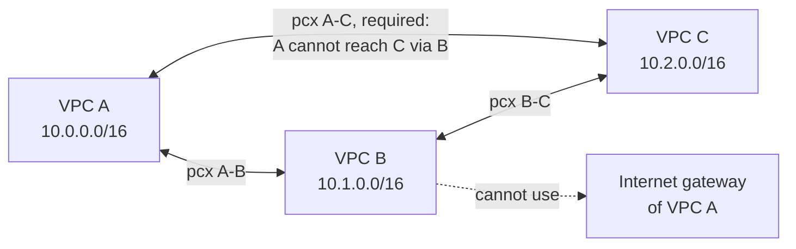
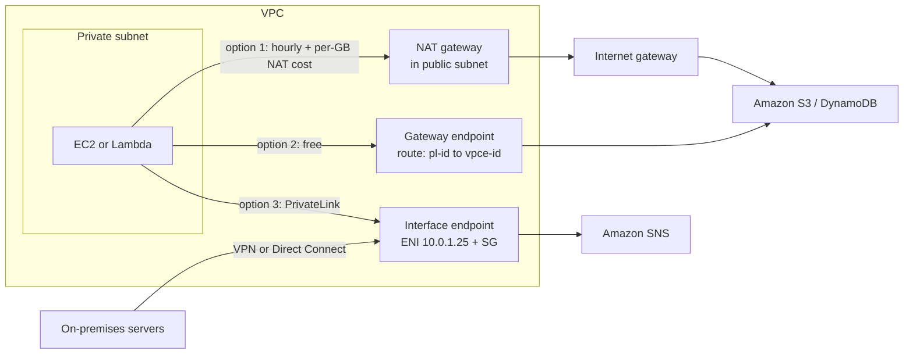
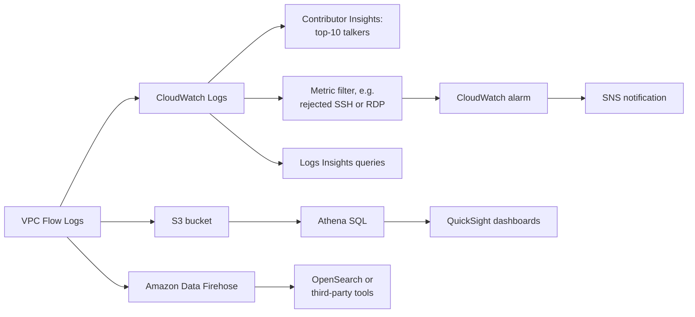
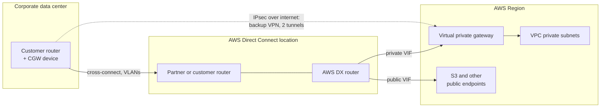
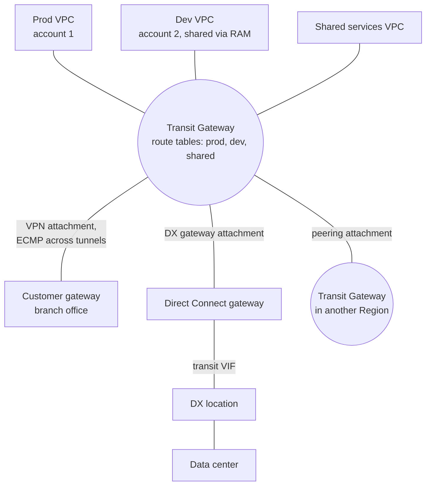
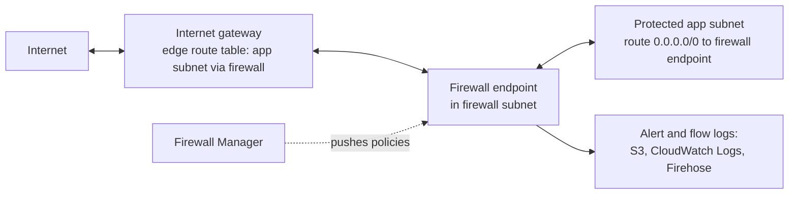

# VPC Connectivity & Network Costs

## Summary

A single VPC is rarely the whole story. Real workloads need to talk to other VPCs, to AWS services such as S3 and DynamoDB, and to the company data center, and every one of those paths has a cheaper, safer or faster option. This lesson covers the tools for each path: **VPC peering** and **Transit Gateway** to join VPCs, **VPC endpoints** (gateway and interface / PrivateLink) to reach AWS services without the internet, **Site-to-Site VPN** and **Direct Connect** to reach on-premises networks, plus **VPC Flow Logs** and **Traffic Mirroring** to see what is happening, **IPv6** and the **egress-only internet gateway**, what data transfer actually costs, and **AWS Network Firewall** for inspecting traffic across a whole VPC. On the exam, pick peering for a few VPCs, Transit Gateway for many, a gateway endpoint whenever private S3/DynamoDB access is needed, VPN for quick encrypted hybrid links, and Direct Connect for steady, high-volume private bandwidth.

## Key concepts

- **VPC peering** joins exactly two VPCs (any account, any Region) with no overlapping CIDRs; it is **not transitive** and needs a route in **both** VPCs.
- **Gateway endpoints** (S3 and DynamoDB only) are a route-table target with **no charge**; **interface endpoints** are ENIs with private IPs and a security group, billed per hour per AZ plus per GB.
- Only **interface endpoints** can be used from on-premises (VPN/Direct Connect), from a peered VPC in another Region, or through a transit gateway.
- **VPC Flow Logs** record IP traffic metadata per ENI (VPC, subnet or ENI level) and publish to **CloudWatch Logs, S3 or Amazon Data Firehose**; the `action` field (ACCEPT/REJECT) helps tell a security group problem from a NACL problem.
- **Site-to-Site VPN** = customer gateway (your device) + virtual private gateway or transit gateway (AWS side), two IPsec tunnels over the internet, up to **1.25 Gbps per standard tunnel**.
- Enable **route propagation** for the virtual private gateway on the subnet route tables, or traffic never finds the VPN.
- **VPN CloudHub** links several branch sites through one virtual private gateway in a low-cost hub-and-spoke over the internet.
- **Direct Connect (DX)** is a private physical link to an AWS Direct Connect location: dedicated ports of **1, 10, 100 or 400 Gbps**, hosted connections from **50 Mbps to 25 Gbps**, weeks to set up, and **not encrypted** by default.
- A **Direct Connect gateway** is a global object that lets one DX connection reach VPCs in many Regions (and accounts).
- Resilient DX means **two connections at two locations** (high, 99.9% SLA) or **two at each of two locations on separate devices** (maximum, 99.99%); a VPN is the cheap backup.
- **Transit Gateway** is a regional hub that gives **transitive** routing between thousands of VPCs, VPNs and DX gateways, with route tables for segmentation, RAM sharing, inter-Region peering, **IP multicast** and **ECMP** to aggregate VPN tunnels.
- **Traffic Mirroring** copies packets from ENIs to an ENI, NLB or Gateway Load Balancer endpoint for deep inspection.
- AWS IPv6 addresses from Amazon's pool are **public and globally unique**; a VPC still needs an IPv4 CIDR; the **egress-only internet gateway** is the IPv6 equivalent of a NAT gateway (outbound only).
- **Data transfer**: inbound is free, same-AZ private traffic is free, cross-AZ costs about **USD 0.01/GB each way**, inter-Region about **USD 0.02/GB**, internet egress about **USD 0.09/GB**.
- **AWS Network Firewall** inspects layer 3 to 7 traffic for a whole VPC in every direction, using Suricata-compatible rules, and is managed at scale with **Firewall Manager**.

## VPC peering

**VPC peering** creates a private link between two VPCs over the AWS backbone so that instances in both behave as if they shared one network: they talk to each other on private IP addresses, with no gateway, VPN or extra hop in the middle.

How it works:

1. The owner of the *requester* VPC sends a peering request to the *accepter* VPC (the same account or another account, the same Region or another Region).
2. The accepter owner accepts it. An unanswered request expires after **7 days**.
3. **Each** side adds a route in the subnet route tables that use the link: destination = the other VPC's CIDR (or part of it), target = the peering connection (`pcx-...`).
4. Security groups and NACLs on both sides must allow the traffic.

The rules the exam tests:

- **CIDRs must not overlap.** If any IPv4 or IPv6 block of the two VPCs overlaps, the peering fails, even if you only intended to use the non-overlapping block.
- **No transitive peering.** If A is peered with B and B with C, A still cannot reach C through B. Every pair that must talk needs its own peering connection, so a full mesh of *n* VPCs needs *n(n-1)/2* connections (10 VPCs = 45).
- **No edge-to-edge routing.** A peered VPC cannot borrow the other VPC's internet gateway, NAT gateway, VPN, Direct Connect link or gateway endpoint.
- **One peering per VPC pair**, and a default quota of **50 active peerings per VPC** (adjustable up to 125).
- **Security group references across the link** work only when both VPCs are in the **same Region**. Same account: use the group ID (`sg-...`). Other account: prefix the account, as in `123456789012/sg-1a2b3c4d`. For a peer in another Region, use its CIDR block instead.

> [!EXAMPLE] Shared services in a small company
> A company runs a `shared-tools` VPC (10.50.0.0/16) with a build server, and separate `dev` (10.10.0.0/16) and `prod` (10.20.0.0/16) VPCs. Peering `dev`↔`shared-tools` and `prod`↔`shared-tools` lets both reach the build server, while `dev` and `prod` stay isolated because peering is not transitive. That isolation is a feature here.

**Cost:** there is no hourly charge for a peering connection. Traffic that stays in one Availability Zone is free; traffic crossing AZs is billed at the normal in-Region rate (about USD 0.01/GB in each direction); inter-Region peering traffic is billed at inter-Region rates.

## VPC endpoints and AWS PrivateLink

Every AWS service exposes **public** API endpoints, such as `s3.us-east-1.amazonaws.com` or `sns.us-east-1.amazonaws.com`. An EC2 instance in a private subnet cannot reach them unless you give it a path: either a NAT gateway plus an internet gateway, or a **VPC endpoint**. Endpoints keep the traffic on the AWS network, remove the need for an internet gateway or NAT for that service, and are redundant and scaled by AWS.

### Gateway endpoints vs interface endpoints

| | Gateway endpoint | Interface endpoint (AWS PrivateLink) |
|---|---|---|
| Services | **Amazon S3 and DynamoDB** only | Most AWS services (SNS, SQS, KMS, CloudWatch, Systems Manager, ECR...), also S3 and DynamoDB, plus partner and your own endpoint services |
| What gets created | A route in the route tables you pick: destination = AWS-managed **prefix list** (`pl-...`), target = `vpce-...` | An **ENI with a private IP** in each subnet (AZ) you choose |
| Security group | None on the endpoint (use route tables, NACLs and the endpoint policy) | **Yes**, attached to the endpoint ENIs |
| DNS | Clients keep using the normal public service name | Endpoint-specific names, or the normal name when **private DNS** is enabled |
| Reachable from on-premises, another Region's peered VPC, or via a transit gateway | **No** (endpoint connections cannot be extended out of the VPC) | **Yes** |
| Price | **Free** | About **USD 0.01 per hour per AZ** + **USD 0.01/GB** processed (first PB, us-east-1) |
| Endpoint policy | Yes | Yes |

> [!UPDATED] More endpoint types than the slides show
> The slides describe two kinds of endpoint and say DynamoDB uses a gateway endpoint. Today **DynamoDB supports interface endpoints too**, and the PrivateLink family also includes **Gateway Load Balancer endpoints** (to send traffic to inspection appliances), **resource endpoints** (reach a shared database or IP in another VPC without a load balancer), **service-network endpoints** (VPC Lattice) and **tunnel endpoints**. Interface endpoints for some AWS services can also be created as **cross-Region** endpoints (an **Enable cross Region endpoint** option in the console). For the exam, the gateway-vs-interface comparison above is still what matters.

### Which endpoint for S3?

At the exam, the **gateway endpoint** is almost always the answer: it is free and needs only a route table change. Choose an **interface endpoint** for S3 when the requests come from **outside the VPC**: on-premises servers over Site-to-Site VPN or Direct Connect, a VPC in another Region, or VPCs connected through a transit gateway. You can run both in the same VPC: in-VPC traffic uses the free gateway endpoint and on-premises traffic uses the interface endpoint (the interface endpoint option **Enable private DNS only for inbound endpoint** sets this up, and it requires the gateway endpoint to exist).

### Worked example: Lambda in a VPC reading DynamoDB

A Lambda function attached to a VPC gets ENIs in your private subnets, not a public IP. To call DynamoDB, which is a public service, it can go the long way (NAT gateway in a public subnet plus an internet gateway, paying NAT hourly and per-GB charges) or the short way: create a **DynamoDB gateway endpoint** and associate it with the private subnets' route tables. The second option is free, has fewer moving parts and keeps the traffic private.

### When an endpoint "does not work"

1. **DNS**: with the Amazon DNS server, the VPC needs **DNS resolution** (`enableDnsSupport`) and, for gateway endpoints and private DNS on interface endpoints, **DNS hostnames** (`enableDnsHostnames`) turned on.
2. **Route tables**: a gateway endpoint only affects subnets whose route table is associated with it; look for the `pl-...` route.
3. **Security groups / NACLs**: an interface endpoint's security group must allow HTTPS (443) from the clients; the instance's outbound rules and the subnet NACL must allow the traffic.
4. **Endpoint policy and bucket policy**: a restrictive endpoint policy, or a bucket policy using `aws:sourceVpce`, can block requests.
5. **Region**: a gateway endpoint only serves buckets in its own Region; requests to a bucket in another Region still need another path.

### Offering your own service privately (endpoint services)

PrivateLink also works for your own applications. A *service provider* puts the service behind a **Network Load Balancer** (or a Gateway Load Balancer for appliances) and creates an **endpoint service**; each *consumer* VPC creates an interface endpoint to it. No peering, internet gateway, NAT or route table changes are needed, CIDRs can overlap, and only the one service is exposed rather than the whole network. This is the standard answer for "expose a service to hundreds of customer VPCs".

## VPC Flow Logs

**VPC Flow Logs** capture metadata about the IP traffic going to and from network interfaces: who talked to whom, on which ports, how many bytes, and whether it was accepted or rejected. They do not capture packet contents (that is Traffic Mirroring).

- **Scope:** create a flow log for a **VPC**, a **subnet** or a single **ENI**; VPC and subnet flow logs cover every ENI inside. This includes ENIs that AWS services create for you, such as Elastic Load Balancing, RDS, ElastiCache, Redshift, WorkSpaces, NAT gateways and transit gateways.
- **Filter:** capture **All**, only **Accept**, or only **Reject** traffic.
- **Destinations:** **CloudWatch Logs**, **Amazon S3**, or **Amazon Data Firehose**.
- **Aggregation interval:** 10 minutes by default, or 1 minute (Nitro instances always aggregate at 1 minute or less). Delivery typically takes about 5 minutes to CloudWatch Logs and 10 minutes to S3. Flow logs sit outside the traffic path, so they never slow the network.
- **Immutable:** you cannot change a flow log's format, role or destination after creation; delete it and create a new one.
- **Not logged:** traffic to the Amazon DNS server, instance metadata (`169.254.169.254`), Amazon Time Sync, DHCP, ARP, Windows license activation and the reserved VPC router address.

> [!UPDATED] Kinesis Data Firehose is now Amazon Data Firehose
> The slides list "Kinesis Data Firehose" as a destination. The service was renamed **Amazon Data Firehose**; it is the same destination. Flow logs have also gained many custom fields since the slides (for example `flow-direction`, `traffic-path`, `pkt-srcaddr`, ECS task fields and `reject-reason`).

### Reading a record

The default format (version 2) writes 14 space-separated fields per record. Grouped by purpose, in order:

- identity of the record: `version`, `account-id`, `interface-id`
- the conversation (5-tuple): `srcaddr`, `dstaddr`, `srcport`, `dstport`, `protocol`
- volume: `packets`, `bytes`
- time window (Unix seconds): `start`, `end`
- outcome: `action`, `log-status`

Example: `2 123456789012 eni-0a1b2c 203.0.113.12 10.0.1.25 51544 22 6 4 240 1759480000 1759480060 REJECT OK` means a host at 203.0.113.12 tried SSH (port 22, protocol 6 = TCP) to 10.0.1.25 and was **rejected**.

| Field | What it tells you |
|---|---|
| `srcaddr` / `dstaddr` | Which IP is misbehaving or being blocked |
| `srcport` / `dstport` | Which port (22 SSH, 3389 RDP, 443 HTTPS, ephemeral 1024-65535 for replies) |
| `protocol` | IANA number: 6 TCP, 17 UDP, 1 ICMP |
| `action` | `ACCEPT` or `REJECT` (blocked by a security group or NACL) |
| `log-status` | `OK`, `NODATA` (no traffic in the interval) or `SKIPDATA` (some records dropped) |

### Telling a security group problem from a NACL problem

Security groups are **stateful** (a reply to allowed traffic is always allowed); NACLs are **stateless** (the reply needs its own rule, usually for ephemeral ports). So look at the pair of records for a conversation:

| Direction of the original request | What you see in the flow log | Likely culprit |
|---|---|---|
| Incoming (client → your ENI) | Inbound **REJECT** | Security group **or** NACL inbound rule |
| Incoming | Inbound **ACCEPT**, outbound reply **REJECT** | **NACL** outbound rule (a security group would never block the reply) |
| Outgoing (your ENI → server) | Outbound **REJECT** | Security group **or** NACL outbound rule |
| Outgoing | Outbound **ACCEPT**, inbound reply **REJECT** | **NACL** inbound rule (ephemeral ports) |

### Analysing flow logs

- **CloudWatch Logs Insights** for quick interactive queries; it auto-discovers fields such as `srcAddr`, `dstPort` and `action`.
- **Athena** over S3 for cheap SQL on large volumes, with **QuickSight** for dashboards.
- **Metric filter + alarm + SNS** to alert on, for example, repeated rejected SSH attempts.

**Permissions:** to publish to CloudWatch Logs, the flow log uses an **IAM role** that `vpc-flow-logs.amazonaws.com` can assume, with `logs:CreateLogGroup`, `logs:CreateLogStream`, `logs:PutLogEvents`, `logs:DescribeLogGroups` and `logs:DescribeLogStreams`. The person creating the flow log also needs `iam:PassRole`. Delivery to S3 is authorised by the bucket policy instead of a role.

## Site-to-Site VPN

**AWS Site-to-Site VPN** builds encrypted **IPsec** tunnels over the public internet between your network and AWS. It is quick to set up (minutes once your device is configured) and cheap (USD 0.05 per connection-hour in us-east-1, plus data transfer out).

The parts:

- **Customer gateway device**: the physical router/firewall or software appliance in your data center.
- **Customer gateway (CGW)**: the AWS resource that describes that device: its static, internet-routable IP and, for dynamic routing, its BGP ASN. If the device sits behind a NAT that supports **NAT traversal (NAT-T)**, use the **public IP of the NAT device** (and allow UDP 500 and 4500).
- **Virtual private gateway (VGW)**: the VPN concentrator on the AWS side, attached to **one VPC**. You can keep the Amazon default ASN or set a custom private ASN. The other choice for the AWS side is a **transit gateway**.
- **VPN connection**: always **two tunnels** to two AWS endpoints for redundancy; configure your device to use both.

Two steps people forget:

1. **Route propagation**: on the route table of each subnet that must reach on-premises, enable **route propagation** for the VGW (or add static routes pointing to it). Without it, instances have no route back.
2. **Security groups**: allow the on-premises CIDR in inbound rules, and add **ICMP** if you want to `ping` instances from the data center.

| Item | Limit or price (verified) |
|---|---|
| Bandwidth per standard tunnel | Up to **1.25 Gbps** (about 140,000 packets/s) |
| Large bandwidth tunnel | Up to **5 Gbps**, only on a transit gateway or Cloud WAN, USD 0.60/hour {{updated: large bandwidth tunnels are newer than the slides}} |
| VPN connections per VGW | 10 (adjustable) |
| MTU | 1446 bytes; no jumbo frames |
| Standard connection price | USD 0.05/hour (us-east-1) |

> [!TIP] Accelerated VPN
> If remote sites are far from the Region and internet paths are erratic, **Accelerated Site-to-Site VPN** (on a transit gateway) enters the AWS global network at the nearest edge through AWS Global Accelerator, at extra cost.

### AWS VPN CloudHub

If you have several branch offices, each with its own Site-to-Site VPN connection to the **same VGW**, **VPN CloudHub** lets the branches reach **each other** through AWS, not just the VPC. It is a hub-and-spoke design over the internet, cheap enough for primary or backup links between sites. Requirements: dynamic (BGP) routing, a **unique BGP ASN per customer gateway**, and non-overlapping site prefixes. You pay the normal VPN hourly rate per connection plus data transfer.

## AWS Direct Connect

**Direct Connect (DX)** gives you a dedicated, private network connection from your network to an **AWS Direct Connect location** (a colocation facility), and from there to AWS. Traffic never crosses the public internet. Over one physical connection you create **virtual interfaces (VIFs)**, each on its own VLAN:

| Virtual interface | Reaches | Typical use |
|---|---|---|
| **Private VIF** | One VPC through its **virtual private gateway**, or many VPCs through a **Direct Connect gateway** | EC2, RDS and other private resources |
| **Public VIF** | **Public AWS endpoints** (S3, DynamoDB, public IPs of AWS services) in all public Regions | Bulk S3 transfer without the internet |
| **Transit VIF** | One or more **transit gateways** through a Direct Connect gateway | Many VPCs at scale |

**Why choose DX:** higher and steadier bandwidth for large data sets (often at a lower per-GB price: data transfer out over DX is about USD 0.02/GB from US Regions vs USD 0.09/GB to the internet), a more **consistent latency** for real-time feeds, and **hybrid** architectures where on-premises and cloud work as one network. It supports IPv4 and IPv6.

### Connection types

| | Dedicated connection | Hosted connection |
|---|---|---|
| Who provisions | You request the port from AWS; an AWS Direct Connect Partner usually completes the circuit | An AWS Direct Connect Partner provisions it for you; you accept it |
| Speeds | **1, 10, 100 or 400 Gbps** physical port for one customer | **50 Mbps up to 25 Gbps** (50/100/200/300/400/500 Mbps, 1/2/5/10/25 Gbps) |
| Change speed | Order a new connection | The partner can change it (if it supports that) |
| MACsec encryption | On 10, 100 and 400 Gbps ports at selected locations | Not supported |

**Lead time:** AWS's own step, reviewing a dedicated connection request and provisioning the port, can take up to **72 business hours**. After that come the letter of authorization (LOA-CFA), the cross-connect and usually a new partner circuit, so a net-new dedicated connection typically takes **several weeks to a few months** end to end. A hosted connection over a partner circuit you already have can be ready in hours to days {{updated: AWS documents only its own port step (up to 72 business hours); the weeks-to-months range is illustrative guidance from AWS's archived hybrid connectivity whitepaper, not a commitment}}. If a question says the link is needed **next week**, Direct Connect is the wrong answer; a VPN is right.

### Direct Connect gateway

A **Direct Connect gateway** is a **global** resource: attach a private VIF (or transit VIF) to it once, then associate virtual private gateways or transit gateways from **any Region** (except China). This is how one DX connection in us-east-1 reaches a VPC in us-west-1. The VPC CIDRs must not overlap, and the gateway does not route VPC-to-VPC traffic between its associations.

> [!UPDATED] Direct Connect gateways work across accounts
> The slides describe a Direct Connect gateway for many Regions "in the same account". Today other accounts can send **association proposals** for their virtual private gateways or transit gateways, and the gateway owner accepts them, so one DX gateway can serve several accounts.

### Encryption

Data on Direct Connect is **private but not encrypted**. Options when encryption is required:

- **Site-to-Site VPN over Direct Connect**: IPsec on top of the DX link (over a public VIF, or a private IP VPN through a transit gateway). Strong end-to-end encryption, more setup.
- **MACsec**: layer 2 encryption between your router and the AWS device at the DX location, on dedicated 10/100/400 Gbps connections. It is point-to-point, not end-to-end. {{updated: MACsec is a newer option not covered by the slides}}

### Resiliency

| Model (Resiliency Toolkit) | Layout | Protects against | SLA |
|---|---|---|---|
| Development and test | 2 connections on separate devices at **one** location | Device failure only | No multi-location SLA (each connection only has the 95% single-connection SLA) |
| **High resiliency** | 1 connection at each of **two** locations | Fiber cut, device failure, loss of a whole location | 99.9% |
| **Maximum resiliency** | 2 connections on separate devices at **each of two** locations | All of the above, with redundancy left after a location is lost | 99.99% |

A second Direct Connect connection is the expensive backup; a **Site-to-Site VPN as backup** is the cheap one. When both advertise the same routes, AWS prefers the Direct Connect path and falls back to the VPN if DX goes down.

## AWS Transit Gateway

Once you have more than a handful of VPCs, peering plus VPNs plus Direct Connect becomes a tangle of point-to-point links and route entries. **AWS Transit Gateway (TGW)** replaces the mesh with a **hub-and-spoke (star)**: every VPC, VPN and Direct Connect gateway attaches once to the hub, and the hub routes between them **transitively**.

- **Regional** resource; connect Regions by **peering transit gateways** (static routes only).
- **Attachments**: VPCs (one ENI per chosen AZ), Site-to-Site VPN connections, **Direct Connect gateways** (through a transit VIF), Connect attachments (SD-WAN appliances over GRE), peering attachments and, newer, **Network Firewall attachments**.
- **Route tables** decide which attachments can talk: associate production VPCs with one table and development with another, like VRFs in a traditional network. Blackhole routes drop traffic on purpose.
- **Cross-account** through **AWS Resource Access Manager (RAM)**: share the TGW, then other accounts attach their VPCs.
- **IP multicast** between attached VPCs (TGW is the AWS answer when a question mentions multicast).
- **Scale**: up to 5,000 attachments per TGW, up to 100 Gbps per VPC attachment per AZ.
- **Price** (us-east-1): USD 0.05 per attachment-hour + USD 0.02 per GB processed.

### More VPN bandwidth with ECMP

**Equal-cost multi-path (ECMP)** routing lets a router spread traffic over several paths that are equally good. A VPN to a **virtual private gateway** uses one tunnel at a time (about 1.25 Gbps). A VPN to a **transit gateway** with ECMP enabled (dynamic BGP routing required) uses **both tunnels at once**, and you can add more VPN connections to keep adding bandwidth:

| Setup | Approximate VPN throughput |
|---|---|
| 1 VPN connection to a virtual private gateway | 1.25 Gbps (one active tunnel) |
| 1 VPN connection to a transit gateway with ECMP | 2.5 Gbps (2 tunnels) |
| 2 VPN connections to a transit gateway with ECMP | 5.0 Gbps |
| 3 VPN connections to a transit gateway with ECMP | 7.5 Gbps |

Remember that TGW adds its per-GB processing charge on top. The newer 5 Gbps large bandwidth tunnels raise each of these numbers further.

### Sharing one Direct Connect across accounts

Put a **transit VIF** on the DX connection, attach it to a **Direct Connect gateway**, associate the gateway with a **transit gateway**, and share that transit gateway with other accounts through **RAM**. Every account's VPCs then reach the data center over the one DX link.

### Peering vs Transit Gateway vs PrivateLink

| Need | VPC peering | Transit Gateway | PrivateLink endpoint service |
|---|---|---|---|
| Best for | A few VPCs, full network access between pairs | Dozens to thousands of VPCs plus VPN/DX | Exposing one service to many consumer VPCs |
| Transitive | No | Yes | Not applicable (one service only) |
| Overlapping CIDRs | Not allowed | Not allowed between routed VPCs | Allowed |
| Hourly cost | None | Per attachment | Per endpoint per AZ (consumer side) |
| Per-GB cost | Only cross-AZ / cross-Region transfer | Processing fee per GB | Processing fee per GB |
| Bandwidth limit | No aggregate limit (per-instance and per-flow limits apply) | Up to 100 Gbps per VPC attachment per AZ | 10 Gbps per endpoint per AZ, scaling automatically to 100 Gbps |

## VPC Traffic Mirroring

**Traffic Mirroring** copies the actual packets (not just metadata) from an ENI and sends them, wrapped in **VXLAN (UDP 4789)**, to security and monitoring tools you run.

- **Source**: ENIs of supported (Nitro-based) instance types.
- **Target**: another **ENI**, a **Network Load Balancer** with a UDP 4789 listener, or a **Gateway Load Balancer endpoint** {{updated: Gateway Load Balancer endpoints are a newer target type than the slides list}}. NLB or GWLB endpoint targets are recommended for high availability.
- **Filters**: mirror everything or only the traffic you care about (direction, protocol, ports, CIDRs), and optionally **truncate** packets to keep only headers.
- Source and target can be in different VPCs (peered or via a transit gateway) and even different accounts.
- **Uses**: content inspection, threat monitoring, troubleshooting. **Cost**: about USD 0.015 per session-hour plus data transfer and load balancer processing.

Flow Logs answer "who talked to whom and was it allowed?"; Traffic Mirroring answers "what exactly was in the packets?".

## IPv6 in a VPC

IPv4 has about 4.3 billion addresses and is effectively exhausted; **IPv6** has about 3.4 × 10^38. An IPv6 address is 128 bits written as eight groups of four hex digits, for example `2001:db8:3333:4444:5555:6666:7777:8888`. Shortening rules: drop leading zeros in a group, and replace **one** run of all-zero groups with `::`.

| Written form | Means |
|---|---|
| `::` | All eight groups are zero |
| `2001:db8::` | The last six groups are zero |
| `::1234:5678` | The first six groups are zero |
| `2001:db8::1234:5678` | The four middle groups are zero |

**In AWS:**

- A VPC **always has an IPv4 CIDR**; you cannot remove it. You can add IPv6 to run **dual-stack**: Amazon gives the VPC a fixed **/56** from its pool (or you bring your own range, or use IPAM for /44 to /60), and each subnet usually takes a **/64** (sizes from /44 to /64 are possible inside the VPC's block).
- IPv6 addresses from Amazon's pool are **globally unique and public**, so reachability is controlled by routes, security groups and NACLs rather than by NAT. An instance in a dual-stack subnet gets a private IPv4 and a public IPv6, and can reach the internet over either through the internet gateway.
- There are **no Elastic IPs for IPv6**: IPv6 addresses already stay with the ENI.
- IPv6 addresses are free, while every **public IPv4** address costs USD 0.005 per hour.

> [!UPDATED] IPv6-only subnets and private IPv6 now exist
> The slides say IPv4 cannot be disabled for subnets and that every AWS IPv6 address is public. Since then AWS added **IPv6-only subnets** (the VPC still has an IPv4 CIDR; instances must be Nitro-based) and **private IPv6** ranges (ULA, or your own GUA marked private) allocated through **VPC IPAM**, which are never advertised to the internet. Amazon-provided IPv6 is still public.

### "I can't launch an instance" in a dual-stack subnet

The IPv6 space of a /64 is effectively unlimited, so the failure is almost never IPv6. Because every instance still needs a private **IPv4** address, a full subnet means the **IPv4 range is exhausted**. Fix: add a secondary IPv4 CIDR to the VPC (if needed) and create a **new subnet** with a fresh IPv4 range; you cannot resize an existing subnet.

### Egress-only internet gateway

The **egress-only internet gateway** does for IPv6 what a NAT gateway does for IPv4: instances can open **outbound** IPv6 connections (for patches, APIs) but nothing on the internet can **initiate** an IPv6 connection to them. It is stateful, free (you pay only data transfer), has no security group, and needs a `::/0` route.

| Destination | Public subnet route table | Private subnet route table |
|---|---|---|
| `10.0.0.0/16` (VPC IPv4) | local | local |
| `2001:db8:1234:1a00::/56` (VPC IPv6) | local | local |
| `0.0.0.0/0` | internet gateway (`igw-...`) | NAT gateway (`nat-...`) |
| `::/0` | internet gateway (`igw-...`) | egress-only internet gateway (`eigw-...`) |

## Networking costs in AWS

Data transfer is one of the most overlooked items on an AWS bill. A simplified per-GB picture for EC2 in us-east-1 (other Regions vary):

| Traffic | Price per GB | Notes |
|---|---|---|
| Into AWS from the internet | Free | Ingress is generally free |
| Between instances in the **same AZ** using **private IPs** | Free | Also free over VPC peering inside one AZ |
| Between AZs in the same Region using private IPs | USD 0.01 **each direction** | So effectively USD 0.02 per GB moved |
| Same Region via **public or Elastic IP** | USD 0.01 each direction | Even inside one AZ, using a public IP costs money and is slower |
| To another Region | About **USD 0.02** (USD 0.01 between us-east-1 and us-east-2) | Charged on the sending side |
| Out to the internet | **USD 0.09** for the first 10 TB/month, then lower tiers | First 100 GB/month free, aggregated across services and Regions |
| Public IPv4 address | USD 0.005/hour each | In use or idle {{updated: the public IPv4 charge started in February 2024, after the course's cost slides were designed}} |

Cost-saving habits:

- **Use private IPs** between your own resources: cheaper and faster than going out and back through a public IP.
- **Keep chatty traffic in one AZ** when you can, accepting that putting everything in one AZ reduces availability. A good compromise is AZ-aware routing (send each request to the backend in its own AZ while still deploying to several AZs).
- **Minimise egress**: ingress is free and egress is not, so move compute to the data. If an on-premises app pulls 100 MB of rows to compute a 50 KB answer, running that app in AWS next to the database turns 100 MB of egress per query into 50 KB.
- **Direct Connect** reduces the per-GB egress rate, especially when the DX location is associated with the same Region as your workload.

### S3, CloudFront and replication

| Path | Price per GB (US) |
|---|---|
| Upload into S3 | Free |
| S3 directly to the internet | USD 0.09 |
| **S3 Transfer Acceleration** | Adds USD 0.04 (US, Europe, Japan edges) or USD 0.08 (other edges) on top; charged only when it actually speeds up the transfer, which AWS says can be 50-500% faster for long-distance transfers of large objects |
| S3 to **CloudFront** | **Free** |
| CloudFront to the internet | USD 0.085 for the first 10 TB, cheaper at higher tiers; 1 TB/month in the always-free tier |
| S3 Cross-Region Replication | Inter-Region rate, about USD 0.02 (plus replication requests) |

CloudFront also caches, so fewer requests reach S3 and users get lower latency.

> [!UPDATED] Requests are not "7x cheaper" with CloudFront
> The slides say S3 request costs drop about sevenfold behind CloudFront. Current US list prices (checked 2026-10-04) do not support any such ratio: CloudFront pay-as-you-go bills USD 0.0100 per 10,000 HTTPS requests (USD 0.0075 for HTTP), while S3 Standard GETs cost USD 0.0004 per 1,000, which is USD 0.004 per 10,000. Per request, CloudFront is the more expensive of the two. A cache hit skips the S3 GET, but CloudFront bills its own request fee instead. The real savings are free S3-to-CloudFront transfer, slightly cheaper egress per GB, the always-free 1 TB and 10 million requests each month, and fewer requests reaching (and loading) your origin.

> [!UPDATED] CloudFront flat-rate plans
> CloudFront now also sells **flat-rate monthly plans** (Free, Pro, Business, Premium) that bundle CDN, WAF and DDoS protection with no overage charges, as an alternative to pay-as-you-go per-GB pricing.

### NAT gateway vs gateway endpoint: a worked bill

Two private subnets each push **1 TB per month** to an S3 bucket in the **same Region**:

| Path | Monthly cost (us-east-1) |
|---|---|
| Subnet 1 through a NAT gateway | 730 h × USD 0.045 = USD 32.85 hourly, plus 1,000 GB × USD 0.045 processing = USD 45; **about USD 78** (S3 same-Region transfer itself is free) |
| Subnet 2 through a **gateway endpoint** | **USD 0** for the endpoint and the transfer |
| (For comparison) through an interface endpoint in one AZ | 730 h × USD 0.01 + 1,000 GB × USD 0.01 = **about USD 17** |

If the bucket were in another Region, the NAT path would also pay inter-Region transfer, and a gateway endpoint would not help at all because it only serves its own Region.

## Network protection and AWS Network Firewall

So far the toolbox for protecting a network has been:

| Tool | Layer / scope | Good at |
|---|---|---|
| Network ACLs | Subnet, stateless, layer 3/4 | Broad allow/deny by IP and port, including explicit denies |
| Security groups | ENI, stateful, layer 3/4 | Least-privilege access between tiers |
| AWS WAF | Layer 7 on CloudFront, ALB, API Gateway, AppSync, Cognito | SQL injection, XSS, rate limiting, bad bots |
| AWS Shield / Shield Advanced | Edge and resources | DDoS protection |
| AWS Firewall Manager | Organization-wide | Enforcing all of the above across accounts |

What is missing is one place to **inspect every packet entering or leaving a VPC**, with intrusion prevention and domain filtering. That is **AWS Network Firewall**:

- **Whole-VPC protection, layer 3 to layer 7**, in any direction: VPC-to-VPC, outbound to the internet, inbound from the internet, and to/from Direct Connect and Site-to-Site VPN.
- **How it is placed**: you dedicate a small **firewall subnet** per AZ, and **route tables** send traffic through the firewall endpoints. Under the hood these endpoints use **Gateway Load Balancer** technology, but AWS runs the appliances.
- **Rules**: thousands of them (up to 30,000 stateful rules per firewall policy). Stateless rules match 5-tuples (IP, port, protocol); stateful rules use the **Suricata**-compatible engine: tens of thousands of IPs, protocol detection (for example, block SMB going outbound), **domain lists** (only allow outbound HTTPS to `*.mycorp.com` and a software repository), regex pattern matching and **intrusion prevention** signatures.
- **Actions**: pass, drop, alert or reject traffic that matches.
- **Logs** (alert, flow and TLS logs) go to **S3, CloudWatch Logs or Amazon Data Firehose**.
- **Central management** across accounts and many VPCs with **AWS Firewall Manager**.
- **Price** (us-east-1): USD 0.395 per firewall endpoint-hour + USD 0.065 per GB processed.

> [!UPDATED] TLS inspection and Transit Gateway attachments
> Network Firewall can now **decrypt and inspect TLS** traffic (with a TLS inspection configuration and certificates), and it can attach **directly to a transit gateway** as a network function attachment, so you no longer have to build a separate inspection VPC for centralized inspection.

## VPC section recap

The two VPC lessons together cover these building blocks:

| Component | One-line reminder |
|---|---|
| CIDR, VPC, subnets | VPC = list of IPv4 (and optional IPv6) CIDRs; each subnet lives in one AZ |
| Internet gateway + route tables | IGW gives IPv4/IPv6 internet access; routes decide which subnets use it, a peering, an endpoint... |
| Bastion host | Public instance you SSH into to reach private instances (EC2 Instance Connect Endpoint or Session Manager are modern alternatives) |
| NAT instance / NAT gateway | Outbound IPv4 internet for private subnets; the instance is legacy (disable source/destination check), the gateway is managed |
| NACL vs security group | Stateless subnet rules (remember ephemeral ports) vs stateful ENI rules |
| VPC peering | Two VPCs, no overlap, not transitive |
| VPC endpoints | Private access to AWS services: gateway (S3, DynamoDB) or interface |
| Flow logs | VPC/subnet/ENI traffic metadata, ACCEPT and REJECT; analyse with Athena or Logs Insights |
| Site-to-Site VPN, CloudHub | CGW on premises + VGW on the VPC over the internet; CloudHub links many sites |
| Direct Connect, DX gateway | Private physical link; DX gateway reaches VPCs in many Regions |
| PrivateLink endpoint services | Expose a service to other VPCs through an NLB, without peering or routes |
| Transit Gateway | Transitive hub for VPCs, VPN and DX |
| Traffic Mirroring | Copy packets from ENIs to analysis tools |
| Egress-only IGW | Outbound-only IPv6, the IPv6 NAT gateway |

> [!UPDATED] ClassicLink is gone
> The slides' summary still lists **ClassicLink** (linking EC2-Classic instances to a VPC). EC2-Classic was fully retired in **August 2023**, so ClassicLink no longer exists; you will not need it for SAA-C03.

## Exam tips

> [!EXAM] Picking the connectivity option
> - "Connect two VPCs privately", few VPCs, lowest cost → **VPC peering** (and remember routes in both VPCs).
> - "Hundreds of VPCs", "transitive", "hub-and-spoke", "simplify network topology", "IP multicast" → **Transit Gateway**.
> - "Expose a service to many other VPCs / customers without peering", overlapping CIDRs → **PrivateLink endpoint service** behind an **NLB**.

> [!EXAM] Private access to AWS services
> - "Private subnet must reach S3 or DynamoDB without internet / reduce NAT gateway cost" → **gateway endpoint** + route table update.
> - "On-premises servers (over VPN/DX) must reach S3 privately" or "from another Region" → **interface endpoint** for S3.
> - "Lambda in a VPC needs DynamoDB" → **DynamoDB gateway endpoint**, not a NAT gateway.
> - Endpoint created but still failing → check **DNS resolution/hostnames** and **route tables**.

> [!EXAM] Hybrid connectivity
> - "Encrypted connection quickly", "over the internet", "within days" → **Site-to-Site VPN** (CGW + VGW or TGW).
> - "Consistent network performance", "dedicated", "large data sets", "bypass the internet" → **Direct Connect**.
> - "Direct Connect must be encrypted" → **VPN over Direct Connect** (or MACsec on dedicated ports).
> - "VPCs in several Regions over one DX" → **Direct Connect gateway**.
> - "Cost-effective backup for DX" → **Site-to-Site VPN**; "maximum resilience" → **separate connections on separate devices at two or more DX locations**.
> - "Increase VPN bandwidth beyond 1.25 Gbps" → **VPNs to a transit gateway with ECMP**.
> - "Branch offices must talk to each other through AWS over VPN" → **VPN CloudHub**.

> [!EXAM] Visibility, IPv6 and protection
> - "Capture IP traffic metadata / troubleshoot rejected connections" → **VPC Flow Logs** (inbound ACCEPT + outbound REJECT means **NACL**).
> - "Inspect packet contents with an IDS appliance" → **Traffic Mirroring**.
> - "IPv6 instances need outbound internet only" → **egress-only internet gateway**.
> - "Cannot launch instances in a dual-stack subnet" → **IPv4 addresses exhausted**: create a new subnet with a new IPv4 CIDR.
> - "Filter traffic for the whole VPC, domain allow-lists, intrusion prevention" → **AWS Network Firewall**; "across many accounts" → plus **Firewall Manager**.

> [!EXAM] Cost questions
> - Reduce data transfer cost → **private IPs**, **same AZ**, **gateway endpoints**, **CloudFront in front of S3** (S3 to CloudFront is free).
> - Slow uploads from far away to one bucket → **S3 Transfer Acceleration**.

## Common traps

> [!TRAP] Assuming peering is transitive
> A↔B and B↔C does **not** let A reach C, and a peered VPC cannot use the other VPC's IGW, NAT gateway, VPN, DX or gateway endpoint. If the scenario needs that, the answer is a new peering or a transit gateway.

> [!TRAP] Gateway endpoints from on-premises or other Regions
> A gateway endpoint only serves resources inside its own VPC and Region. On-premises clients over VPN/DX, a peered VPC in another Region, or VPCs behind a transit gateway need an **interface endpoint**.

> [!TRAP] Interface endpoints are not free
> When "most cost-effective" private S3 or DynamoDB access from inside the VPC is asked, the free **gateway** endpoint beats the hourly-billed interface endpoint.

> [!TRAP] Thinking Direct Connect is encrypted or fast to set up
> DX is private, **not encrypted**, and takes **weeks**. A requirement for encryption needs VPN over DX (or MACsec); a deadline of days needs a VPN.

> [!TRAP] Forgetting route propagation
> A VPN connection that shows **UP** but no traffic flows usually means the subnet route tables have no route to the VGW: enable **route propagation** (or add static routes).

> [!TRAP] One VPN tunnel, one VGW, more bandwidth
> Adding VPN connections to a **virtual private gateway** does not aggregate bandwidth. ECMP across tunnels needs a **transit gateway** and dynamic (BGP) routing.

> [!TRAP] Egress-only IGW for IPv4
> The egress-only internet gateway handles **IPv6 only**. For outbound-only IPv4, use a NAT gateway.

> [!TRAP] Blaming IPv6 for launch failures
> A dual-stack subnet that cannot launch instances has run out of **IPv4** addresses, not IPv6.

> [!TRAP] Flow logs vs Traffic Mirroring vs CloudTrail
> Flow Logs show traffic **metadata** (IPs, ports, ACCEPT/REJECT), Traffic Mirroring copies **packet contents**, and CloudTrail records **API calls**. Pick the one that matches the question's verb.

> [!TRAP] "Same AZ is always best"
> Putting everything in one AZ is cheapest for data transfer but sacrifices high availability. Unless the question explicitly prioritises cost over resilience, keep multi-AZ.
