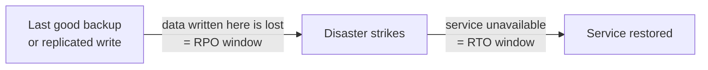
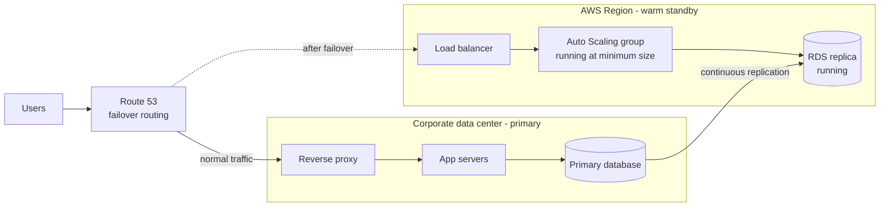
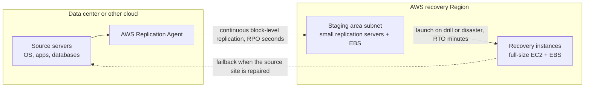
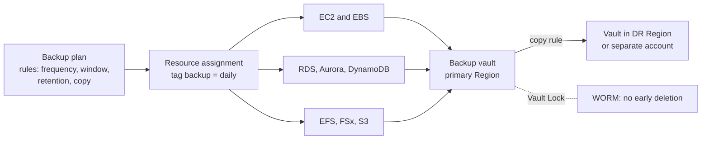
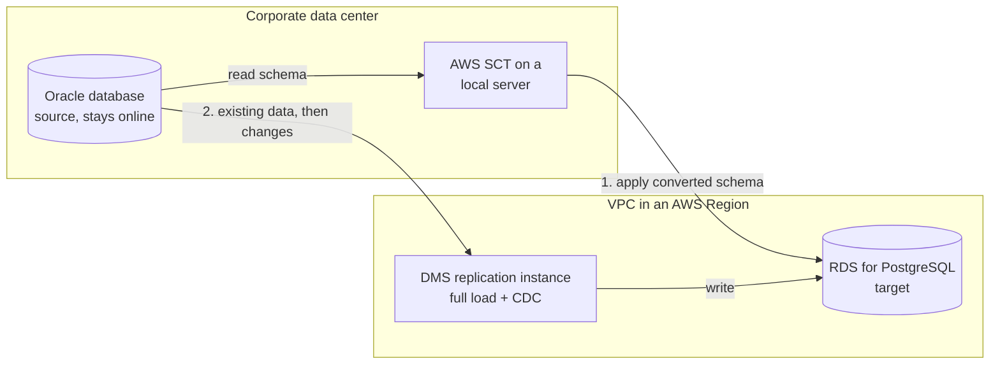
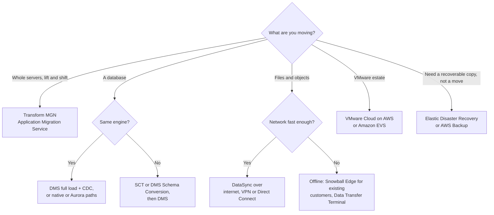

# Disaster Recovery & Migrations

## Summary

This lesson covers two closely related jobs: keeping a business running when something breaks badly (disaster recovery, DR) and moving existing workloads into AWS (migration). For DR you pick one of four strategies, **backup and restore**, **pilot light**, **warm standby** or **multi-site active/active**, by trading money against two targets, the **RPO** (how much data you can lose) and the **RTO** (how long you can be down). **AWS Backup** centralizes and locks backups, and **AWS Elastic Disaster Recovery** keeps servers continuously replicated so they can be launched in AWS within minutes. For migration, **AWS DMS** moves databases while the source keeps running (with **SCT** or DMS Schema Conversion when the engine changes), **AWS Transform MGN** (formerly Application Migration Service) rehosts whole servers, **Application Discovery Service** and **AWS Transform** help you plan, and the right data-transfer path depends on how many terabytes you must move and how fast your link is.

## Key concepts

- **RPO** (Recovery Point Objective) = the maximum age of data you can afford to lose; set by how often you back up or replicate.
- **RTO** (Recovery Time Objective) = the maximum time the service can be down after a disaster; set by how much of the recovery site is already running.
- The four DR strategies in order of **lower RTO and higher cost**: **Backup and restore → Pilot light → Warm standby → Multi-site active/active**.
- **Pilot light** keeps only the core (usually the replicated database) running; app servers must be started. **Warm standby** runs a complete but scaled-down copy that can take traffic at once and then scales out.
- **AWS Elastic Disaster Recovery (DRS)** = continuous block-level replication of physical, virtual or cloud servers into a low-cost staging area in AWS; RPO of seconds, RTO of minutes, with failback.
- **AWS Backup** = one place to schedule, retain, copy (cross-Region, cross-account) and audit backups for many AWS services, driven by **backup plans** and **tags**.
- **AWS Backup Vault Lock** = WORM protection for a backup vault: while it is on, nobody (not even the root user) can delete a backup early; in **compliance mode** the lock itself becomes permanent after a grace time of at least 72 hours.
- **AWS DMS** migrates databases with the **source still online**: a **full load** plus **CDC** (change data capture) keeps the target in sync until cutover.
- **Homogeneous** migration (same engine, e.g. PostgreSQL to RDS for PostgreSQL) needs no schema conversion; **heterogeneous** migration (e.g. SQL Server to Aurora PostgreSQL) needs **AWS SCT** or **DMS Schema Conversion** first.
- **DMS Multi-AZ** keeps a synchronous standby replication instance in another AZ for redundancy during long CDC runs.
- **RDS MySQL/PostgreSQL to Aurora**: restore a snapshot as Aurora, or create an **Aurora read replica** and promote it when lag reaches zero. External MySQL: **Percona XtraBackup** files in S3 (fast) or **mysqldump** (slower).
- **AWS Transform MGN** (renamed from AWS Application Migration Service in June 2026) = the lift-and-shift (rehost) tool for whole servers; it replaced CloudEndure Migration and AWS SMS.
- **Application Discovery Service** collects server inventory, utilization and dependencies to plan a migration; it and **Migration Hub** are closed to new customers, and **AWS Transform** takes over these jobs.
- **Data transfer time** ≈ data size ÷ usable bandwidth; if the network needs weeks or months, use a dedicated link or an offline/physical option, and use **DataSync** or **DMS** for ongoing replication.

## Disasters and where you recover to

A disaster is any event serious enough to stop the business or cost it a lot of money: a flood in the data center, a Region-wide outage, a ransomware attack that encrypts your databases, or an engineer who drops the production table by mistake. **Disaster recovery** is the plan, the infrastructure and the practice that get you back to work afterward.

It helps to separate three ideas that are often mixed up:

| Idea | Protects against | Typical AWS tools |
|---|---|---|
| **High availability** | Losing one server or one AZ | Multi-AZ RDS, Auto Scaling across AZs, ELB, EFS, S3 |
| **Backup** | Data loss, corruption, deletion, ransomware | AWS Backup, EBS snapshots, RDS automated backups, S3 Versioning |
| **Disaster recovery** | Losing a whole site or Region, or a data disaster | A recovery Region or account, replication, IaC, a tested failover runbook |

Replication alone is not a backup. If a bug corrupts data, continuous replication copies the corruption to the DR site within seconds. A complete DR plan always keeps **point-in-time backups** as well.

There are three common recovery topologies:

- **On-premises to on-premises**: a second data center you own. Traditional, and expensive because you buy and maintain a second set of hardware that mostly sits idle.
- **On-premises to AWS** (hybrid recovery): AWS is the recovery site for your data center. You pay for little until you need it.
- **AWS Region to AWS Region**: the workload already runs in AWS and a second Region (often in a separate account) is the recovery site.

## RPO and RTO

Every DR conversation starts with two numbers the business must agree on.

- **RPO, Recovery Point Objective**: how far back in time your last good copy of the data may be when disaster strikes. If you back up every 6 hours, you can lose up to 6 hours of data, so your RPO is 6 hours. Continuous replication can bring it down to seconds.
- **RTO, Recovery Time Objective**: how long it may take, from the moment of the disaster, until users can work again. Restoring a 2 TB database from backup and rebuilding servers may take many hours; switching DNS to an already-running copy may take minutes.

> [!EXAMPLE] Same company, different targets
> An online shop decides its checkout database may lose at most **1 minute** of orders (RPO 1 min) and be down at most **15 minutes** (RTO 15 min). Its internal wiki can lose a day of edits (RPO 24 h) and be down for a day (RTO 24 h). The shop protects the checkout database with continuous cross-Region replication and a warm standby, and protects the wiki with nightly backups copied to another Region. Different systems in one company usually get different strategies.

Lower RPO and RTO always cost more: more frequent backups, more replication, and more infrastructure running in the recovery site. The art is choosing the cheapest strategy that still meets the agreed numbers.

## The four DR strategies

AWS describes four strategies on a spectrum: backup and restore, pilot light, warm standby and multi-site active/active. Each step along it keeps more of the recovery site already running, so recovery gets faster and the monthly bill gets higher. The comparison table at the end of this section puts them side by side.

### Backup and restore

You copy data regularly to the recovery location and rebuild everything else only after the disaster.

- **From on-premises**: send backups to Amazon S3 through **Storage Gateway** (for example Tape Gateway or Volume Gateway snapshots), or ship a large first copy offline on a **Snowball Edge** device (existing Snow customers only today). S3 Lifecycle rules then move older backups to S3 Glacier storage classes.
- **Inside AWS**: scheduled **EBS snapshots**, **RDS** automated backups and snapshots, **Redshift** snapshots, **DynamoDB** backups, all of which can be copied to another Region. **AWS Backup** can run all of these from one plan.
- **Recovery**: launch EC2 instances from **AMIs**, restore databases from snapshots, and redeploy networking and configuration, ideally with **CloudFormation** or the CDK so the rebuild is fast and repeatable.

RPO is the backup interval (often hours) and RTO is the restore and rebuild time (often hours). It is the cheapest option and still the right answer for many non-critical systems, and AWS notes it is often enough when the "disaster" you plan for is losing a single data center for an otherwise Multi-AZ workload.

### Pilot light

Named after the small flame in a gas heater that is always lit so the burner can ignite quickly. The **core that holds state**, usually the database, runs all the time in the recovery site and receives **continuous replication**. Everything else (application servers, workers) is defined and ready, for example as AMIs and a CloudFormation template or an Auto Scaling group with zero capacity, but is not running.

On failover you switch on the application tier, scale it to production size and point DNS at it. Because the data is already current, RPO is low (seconds to minutes) and RTO is tens of minutes rather than hours. The idle cost is mainly the running database. Note the key distinction: a pilot light **cannot serve requests until you take action**.

### Warm standby

A **complete copy of the production stack runs all the time, but at minimum size**: a load balancer, a small Auto Scaling group, and a database replica. It can serve traffic immediately (at reduced capacity) and is easy to test continuously. On failover you promote the database replica, raise the Auto Scaling group's desired capacity to production levels and shift DNS. RTO is minutes.

In a **pilot light** version of this diagram, the Auto Scaling group would have no running instances (and possibly no load balancer) until failover.

> [!NOTE] Auto Scaling is a control-plane dependency
> Scaling out during a Region-wide event depends on EC2 APIs in the recovery Region. AWS's DR whitepaper calls this a trade-off: a warm standby that already runs enough capacity for the first wave of traffic recovers more reliably than one that must scale from almost nothing. Also check that the **service quotas** in the recovery Region allow scaling to full production size.

### Multi-site active/active (and hot standby)

The full production stack runs at full size in two or more locations. In **active/active**, all sites serve users at the same time, for example with Route 53 latency or weighted routing or AWS Global Accelerator, and losing one site just shifts traffic to the others. In **hot standby** (active/passive), the second site is fully scaled but takes no traffic until failover. RTO is near zero for infrastructure failures, but the cost is roughly double, and you must design how writes are handled in more than one place.

An **all-AWS multi-Region** design typically uses:

- **Aurora Global Database**: one primary Region for writes, read-only secondary Regions with typical replication lag under a second, and promotion of a secondary in under a minute ("write global").
- **DynamoDB global tables**: every Region accepts reads and writes, with last-writer-wins conflict resolution ("write local").
- **S3 Cross-Region Replication**, plus Route 53 or Global Accelerator to spread users across Regions.

Even with active/active you still need point-in-time backups: a corrupting bug or a malicious delete is replicated to every Region.

### Comparing the strategies

| Strategy | What runs in the recovery site before a disaster | Typical RPO | Typical RTO | Cost | Failover action |
|---|---|---|---|---|---|
| Backup and restore | Only stored backups | Hours (backup interval) | Hours | Lowest | Restore data, rebuild infrastructure |
| Pilot light | Replicated database and core services | Seconds to minutes | Tens of minutes | Low | Start app tier, scale up, switch DNS |
| Warm standby | Whole stack at minimum size | Seconds | Minutes | Medium | Promote DB, scale out, switch DNS |
| Multi-site active/active | Whole stack at full size, serving users | Near zero | Near zero | Highest | Route traffic away from the failed site |

The RPO and RTO figures are rough orders of magnitude to help you rank the options; the real numbers depend on your data size and automation.

## Building blocks for DR on AWS

The strategies are assembled from a small set of recurring services:

| Area | What to use | Why |
|---|---|---|
| **Backups** | EBS snapshots, RDS automated backups and snapshots, AWS Backup; regular copies to S3, S3 Standard-IA or Glacier with Lifecycle rules; Cross-Region Replication | Point-in-time copies to recover from data loss or corruption |
| **Backups from on-premises** | Storage Gateway, offline transfer devices, DataSync | Get data center data into AWS storage |
| **High availability** | RDS Multi-AZ, ElastiCache Multi-AZ, EFS and S3 (multi-AZ by design), Route 53 health checks and failover | Survive AZ failures without invoking DR |
| **Network resilience** | Site-to-Site VPN as a backup path for Direct Connect | A cheap second path if the dedicated link fails |
| **Replication** | RDS cross-Region read replicas, Aurora Global Database, DynamoDB global tables, DMS from on-premises databases, Storage Gateway | Keep the recovery site's data current (low RPO) |
| **Automation** | CloudFormation (StackSets for many Regions and accounts), Elastic Beanstalk, Lambda, EventBridge | Rebuild or scale the recovery environment quickly and identically |
| **Instance recovery** | EC2 **simplified automatic recovery** (on by default for supported instances) or a CloudWatch alarm with a **recover** action | Move an instance off failed hardware while keeping its ID, IP addresses and EBS volumes |
| **Testing (chaos engineering)** | **AWS Fault Injection Service (FIS)** | Inject failures on purpose (stop instances, add latency) to prove the design works |

A few practical points that show up in architecture questions:

- **Route 53 failover routing** with health checks is the classic way to move users to the recovery site. AWS recommends relying on data-plane actions during a crisis; **Amazon Application Recovery Controller (ARC)** routing controls act as on/off switches for this. **Global Accelerator** gives static anycast IPs and fails over without waiting for DNS caches, and **CloudFront origin failover** retries a secondary origin per request.
- **Test your DR plan regularly.** An untested restore is a hope, not a plan. **AWS Resilience Hub** can assess whether a workload is likely to meet its RTO and RPO targets, and Netflix-style chaos testing (its "Simian Army" famously terminated random instances) is now available as a managed service through FIS.
- **Use separate accounts for backups and the recovery Region** where you can, so that one set of compromised credentials cannot delete both production and its backups.

## AWS Elastic Disaster Recovery (DRS)

**AWS Elastic Disaster Recovery** (DRS, the successor of CloudEndure Disaster Recovery) protects servers rather than individual databases or volumes. You install the **AWS Replication Agent** on each source server (physical, VMware, Hyper-V, another cloud, or EC2 in another Region or AZ). The agent streams **block-level changes** of every disk continuously into a **staging area subnet** in your AWS account, where small replication servers (t3.small by default) write them to cheap EBS volumes and take point-in-time snapshots.

When you need to recover, DRS converts the replicated disks to boot natively on EC2 and launches full-size **recovery instances** in minutes, from the latest state or from an earlier point in time (useful after ransomware). When the original site is healthy again you **fail back**, replicating the recovery instances' changes back to the source. You can run **drills** at any time without disturbing replication.

| Point | Detail |
|---|---|
| Strategy it implements | Pilot light: data is live in AWS, compute is launched only when needed |
| What it protects | Whole servers, including databases such as Oracle, MySQL or SQL Server and apps such as SAP, on supported Windows and Linux |
| RPO / RTO | Seconds / minutes |
| Price | **USD 0.028 per source server per hour**, plus the staging EC2, EBS and snapshots it creates |
| Not for | Managed services such as RDS; use their own cross-Region features or AWS Backup |

> [!NOTE] Exam scope
> DRS is not named in the current SAA-C03 in-scope service list (AWS says that list is not exhaustive). The course still covers it, and its keywords (continuous block-level replication, recovery in minutes, failback) are worth recognizing in DR scenarios.

> [!EXAMPLE] Ransomware recovery
> A manufacturer replicates 40 on-premises Windows and Linux servers with DRS. Ransomware encrypts the file servers on a Tuesday afternoon. The team launches recovery instances from a point-in-time snapshot taken on Tuesday morning, before the infection, and the plant works from AWS while the local servers are rebuilt. Afterward they fail back.

## AWS Backup

**AWS Backup** is a fully managed service that replaces per-service backup scripts with one policy engine. You define **what** to protect, **when**, **how long** to keep it and **where** to copy it, and AWS Backup runs the jobs, tracks them and alerts you.

### How it is organized

- **Backup vault**: a container for recovery points, with its own KMS key and access policy.
- **Backup plan**: one or more **rules**. Each rule sets a **frequency** (hourly, every 12 hours, daily, weekly, monthly, or a cron expression), a **backup window** (start time, "start within" default 8 hours, "complete within" default 7 days), a **lifecycle** (optional move to cold storage, total retention), optional **continuous backups** for point-in-time restore, and optional **copy to another Region or account**.
- **Resource assignment**: which resources the plan covers, by resource type, by ID, or most commonly by **tag** (for example every resource tagged `backup=daily`).
- **On-demand backups**: start a one-off backup at any time, for example before a risky change.

### Supported resources

| Category | Resources AWS Backup can protect today |
|---|---|
| Compute and block storage | EC2 instances (as AMIs), EBS volumes, Windows VSS-consistent backups, SAP HANA on EC2 |
| Databases | RDS (all engines), Aurora, Aurora DSQL, DynamoDB, DocumentDB, Neptune, Redshift (provisioned and Serverless), Timestream |
| File and object storage | S3, EFS, FSx for Windows File Server, Lustre, NetApp ONTAP and OpenZFS |
| Hybrid and other | Storage Gateway volumes, VMware virtual machines (on-premises or VMware Cloud on AWS), CloudFormation stacks, EKS clusters |

> [!UPDATED] More resource types than the slides list
> The slides list EC2/EBS, S3, RDS/Aurora/DynamoDB, DocumentDB/Neptune, EFS, FSx for Lustre and Windows, and Storage Gateway. AWS Backup now also covers FSx for ONTAP and OpenZFS, Redshift, Timestream, SAP HANA on EC2, VMware VMs, CloudFormation stacks, EKS and Aurora DSQL. The console also offers an **hourly** frequency in addition to the 12-hour, daily, weekly, monthly and cron options.

### Retention, cold storage and point-in-time restore

- Snapshot backups can be kept from 1 day to 100 years, or indefinitely. **Continuous backups** (point-in-time restore) are kept up to **35 days** and are available for resources such as RDS, Aurora, S3 and SAP HANA on EC2.
- **Cold storage** is cheaper but only some resource types support it (for example EFS, EBS through EBS Snapshots Archive, DynamoDB with AWS Backup advanced features, Timestream, VMware, CloudFormation). A backup must stay in cold storage for at least **90 days**, so total retention must be at least 90 days longer than the "move to cold" setting.
- **Cross-Region** and **cross-account** copies (for most resource types) put backups out of reach of a Regional outage or a compromised account. With **AWS Organizations backup policies**, a central team can push plans to every account.

### AWS Backup Vault Lock

**Vault Lock** gives a vault **WORM** (write once, read many) behavior. While the lock is active, any attempt to delete a recovery point early or shorten its retention is refused, including attempts by the account's root user. You can also set a minimum and maximum retention; new backup and copy jobs that fall outside the range fail.

| | Governance mode | Compliance mode |
|---|---|---|
| Who can remove the lock | Users with enough IAM permissions | Nobody after the grace time, not even AWS |
| Grace time | None | You choose it, **minimum 3 days (72 hours)**; during it you can still change or delete the lock |
| Use case | Stop accidental or unauthorized deletion while admins keep control | Regulatory retention (assessed for SEC 17a-4, CFTC, FINRA) and strong ransomware protection |
| Deleting the vault | Possible after removing the lock and its backups | Impossible while it holds recovery points; you pay for storage until every retention period ends |

> [!WARNING] Compliance mode is permanent
> After the grace time a compliance-mode vault and its lock cannot be changed or deleted by anyone. A recovery point with "keep forever" retention is then stored, and billed, forever. Test with governance mode first.

> [!UPDATED] Newer protection features
> Beyond the slides, AWS Backup now offers **logically air-gapped vaults** (compliance-mode locked by default, encrypted with an AWS owned key unless you choose your own, and shareable to a recovery account through AWS RAM for fast restores), **restore testing** (scheduled automatic restores to prove backups work), **Backup Audit Manager** (compliance reports against controls you define), and malware scanning of backups with GuardDuty.

## Database migrations with AWS DMS

**AWS Database Migration Service (DMS)** copies data from a source database to a target with minimal downtime. The key property for the exam: **the source stays fully usable during the migration**, so applications keep writing while DMS works, and you cut over only when the target has caught up. DMS restarts failed work automatically, which makes it resilient for long migrations.

### How a DMS migration works

1. **Endpoints**: connection details for the source and the target.
2. **Replication instance**: the compute that reads from the source, transforms if needed and writes to the target. DMS provisions and manages it for you as an EC2-based instance inside your VPC (you pick the class and size). Alternatively, **DMS Serverless** provisions and scales capacity automatically, billed per DMS capacity unit (DCU) hour.
3. **Task** with one of three migration types:
   - **Full load** (*Migrate existing data*): copy everything once.
   - **Full load + CDC** (*Migrate existing data and replicate ongoing changes*): copy everything, then keep applying changes read from the source's transaction log (MySQL binlog, PostgreSQL logical replication, Oracle redo logs, SQL Server transaction log).
   - **CDC only** (*Replicate data changes only*): when the target was loaded another way.

> [!UPDATED] You no longer manage an EC2 instance for DMS
> The slides say you must create an EC2 instance to run replication tasks. In today's DMS you create a **replication instance**, which DMS provisions and patches for you (it runs on EC2 behind the scenes), or you skip sizing entirely with **DMS Serverless**. For same-engine moves, DMS also offers **homogeneous data migrations**, which use the engines' native tools.

### Sources and targets

DMS supports most commercial and open-source engines in both directions (but one endpoint must be in AWS).

| | Main options |
|---|---|
| **Sources** | Oracle, SQL Server, MySQL, MariaDB, PostgreSQL, MongoDB, SAP ASE, IBM Db2 (LUW and z/OS) running on-premises or on EC2; Azure SQL Database and other managed databases in Azure, Google Cloud and OCI; all RDS engines and Aurora; Amazon S3; DocumentDB |
| **Targets** | The same relational engines on-premises or on EC2; all RDS engines, Aurora (including Serverless v2), Redshift and Redshift Serverless, DynamoDB, S3, OpenSearch Service, Kinesis Data Streams, Apache Kafka (Amazon MSK or self-managed), DocumentDB, Neptune, Timestream, ElastiCache (Redis OSS), Babelfish for Aurora PostgreSQL |

> [!UPDATED] Wider source list
> Compared with the slides, DMS now also reads from Azure Database for PostgreSQL and MySQL flexible servers, Google Cloud SQL for MySQL and PostgreSQL, OCI MySQL HeatWave and IBM Db2 for z/OS, and writes to Redshift Serverless, Aurora Serverless v2 and RDS for Db2. The slide's "Redis" target is **ElastiCache (Redis OSS)** or self-managed Redis OSS.

### Converting the schema: AWS SCT and DMS Schema Conversion

DMS moves **data**; it creates only basic tables and primary keys on the target. When the engine changes, you first convert the **schema** (tables, views, stored procedures, functions) to the target's dialect.

- **AWS Schema Conversion Tool (SCT)** is a desktop application. It converts OLTP schemas (for example SQL Server or Oracle to MySQL, PostgreSQL or Aurora) and data warehouse schemas (for example Teradata, Oracle, Netezza, Snowflake or BigQuery to **Redshift**), produces an assessment report of what needs manual work, and can also convert embedded SQL in application code. Run it on a machine with plenty of CPU, since conversion is compute-heavy.
- **DMS Schema Conversion** is the managed, browser-based version built on the same engine, inside the DMS console. It is free to use (you pay only for S3 storage of its artifacts) and can use generative AI to convert objects the rules cannot, on paths such as Oracle or SQL Server to PostgreSQL. SCT still supports more source engines.
- **No conversion is needed for a homogeneous move.** Moving on-premises PostgreSQL to RDS for PostgreSQL or Aurora PostgreSQL keeps the same engine; RDS is only the hosting platform.

| Migration | Example | Schema conversion? | Tools |
|---|---|---|---|
| Homogeneous | MySQL on-premises → RDS for MySQL | No | DMS (or native dump and restore, or DMS homogeneous data migrations) |
| Heterogeneous OLTP | SQL Server → Aurora PostgreSQL | Yes | SCT or DMS Schema Conversion, then DMS |
| Data warehouse | Teradata → Redshift | Yes | SCT (with its data extraction agents) |

### DMS Multi-AZ

When you enable **Multi-AZ** on a replication instance, DMS keeps a **synchronous standby replica in a second AZ** and fails over to it automatically. This gives data redundancy, avoids I/O freezes during backups and smooths latency spikes. Turn it on for production migrations, especially long-running CDC.

> [!EXAMPLE] Near-zero-downtime cutover
> A retailer moves a 3 TB Oracle order database to Aurora PostgreSQL. Week 1: SCT converts the schema and flags 40 stored procedures for manual rewrite. Week 2: a Multi-AZ DMS task runs a full load, then CDC keeps Aurora a few seconds behind Oracle while testers validate. Cutover night: the application is stopped for a few minutes, the last changes drain through CDC, connection strings switch to Aurora, and the application restarts.

## Moving MySQL and PostgreSQL into Aurora

Aurora has dedicated, faster paths for MySQL- and PostgreSQL-compatible sources.

| Starting point | Options | Notes |
|---|---|---|
| **RDS for MySQL → Aurora MySQL** | 1) Restore an **RDS snapshot** as an Aurora MySQL cluster. 2) Create an **Aurora read replica** of the RDS instance, wait until replica lag is 0, then **promote** it to a standalone cluster | The replica path keeps downtime small but takes time (roughly hours per TiB) and you pay for both databases meanwhile |
| **External MySQL → Aurora MySQL** | 1) Back up with **Percona XtraBackup**, upload the files to S3, choose **Restore from S3** to create a new Aurora cluster. 2) Load with **mysqldump** into an existing Aurora cluster | Physical restore from S3 is much faster than mysqldump, which replays every statement; works for MySQL 5.7 and 8.0 into the same major version |
| **RDS for PostgreSQL → Aurora PostgreSQL** | 1) Restore an **RDS snapshot** as Aurora PostgreSQL. 2) **Aurora read replica**, then promote when lag is 0 | Same trade-off as MySQL |
| **External PostgreSQL → Aurora PostgreSQL** | Export data to S3 and load it with the **`aws_s3` extension** (`aws_s3.table_import_from_s3`), or dump and restore with native tools | The extension imports CSV, text or gzip files into tables; it is a data load, not a full physical restore |
| **Both databases running, need minimal downtime** | **DMS** with full load + CDC | Works for any of the above and for heterogeneous sources |

> [!TIP] Picking quickly
> Already on RDS? Use a snapshot (simple, needs a downtime window) or an Aurora read replica (less downtime). Outside AWS and large? Physical files through S3. Must keep the source live until the last second? DMS.

## Planning and rehosting servers

Large migrations follow a pattern: **discover** what you have, **plan** waves of applications, **move** them (often rehost first, modernize later) and **track** progress.

### Discovery: Application Discovery Service

**AWS Application Discovery Service** gathers the facts you need to plan: server inventory, configuration, CPU, memory and disk utilization, and **dependencies** between servers (which machines talk to which), so you can group servers into applications and right-size EC2 targets.

| | Agentless Collector | Discovery Agent |
|---|---|---|
| Deployment | One OVA appliance in VMware vCenter | Installed on each server (Windows or Linux) |
| Works for | VMware VMs (any guest OS); can also inventory databases | VMware VMs and physical servers |
| Collects | VM inventory, configuration, utilization (average and peak CPU, RAM, disk I/O) | Configuration, detailed performance time series, **running processes**, inbound and outbound **network connections** |
| Granularity | About every 60 minutes | About every 15 seconds |

The Agentless Collector cannot look inside a VM, so it never sees running processes; when you need that level of detail for dependency mapping, you install the Discovery Agent on the servers that matter.

You can also import data from a spreadsheet template or other tools. Results appear in **AWS Migration Hub**, which tracks migration status across tools in a home Region.

> [!UPDATED] Discovery and tracking moved to AWS Transform
> **Application Discovery Service** and **AWS Migration Hub** stopped accepting new customers on **7 November 2025**; existing customers can finish their projects. Their capabilities (discovery, dependency mapping, wave planning, EC2 recommendations, tracking) are now in **AWS Transform**, an agentic AI migration and modernization service launched in May 2025. The slides' "AWS Agentless Discovery Connector" has also been replaced by the **Agentless Collector**. Neither service appears in the current SAA-C03 in-scope list, but the concepts still help you read migration questions.

### Rehosting: AWS Transform MGN (Application Migration Service)

**MGN** is the recommended **lift-and-shift (rehost)** service. It works like DRS: the **Replication Agent** on each source server (physical, VMware, Hyper-V, Azure or another cloud) continuously replicates disks to a low-cost **staging area**; you launch **test instances** without disturbing the source; and at **cutover** MGN launches converted, natively bootable EC2 instances, typically within a cutover window of minutes. You can group servers into applications and waves, and use launch and post-launch templates to automate settings.

- **Free period**: 2,160 hours per source server (90 days of continuous replication); you still pay for the staging EC2 and EBS resources it creates.
- **History**: MGN replaced **CloudEndure Migration** and **AWS Server Migration Service (SMS)**, which are retired.

> [!UPDATED] Renamed in June 2026
> On 8 June 2026 AWS renamed AWS Application Migration Service to **AWS Transform MGN**. It is the same replication engine and console (still at `console.aws.amazon.com/mgn`), and it now also runs behind the agentic migration workflow of AWS Transform. The SAA-C03 in-scope list still uses the old name, so expect "Application Migration Service" in questions.

| | Elastic Disaster Recovery (DRS) | Transform MGN (Application Migration Service) |
|---|---|---|
| Goal | Keep a recoverable copy; recover and fail back repeatedly | Move a server to AWS once |
| Replication | Continuous block-level, indefinitely | Continuous block-level until cutover |
| Final step | Recovery (failover), later failback | Cutover, then source is retired |
| Pricing model | Per source server hour | Free for 2,160 hours per server, then hourly |

### VM Import/Export and Amazon Linux images

- **VM Import/Export** turns existing VM images (from VMware, Hyper-V and similar) into **AMIs**, EC2 instances or EBS snapshots, and can export instances that originally came from VM Import back to your hypervisor. Uses: one-off migrations, copying an approved image catalog, and keeping a **DR repository** of your on-premises VMs as ready-to-launch AMIs. There is no extra charge beyond the S3, EBS and EC2 resources used.
- **Amazon Linux as an on-premises VM**: you can run Amazon Linux in your own hypervisor to develop and test on the same OS you run in AWS.

> [!UPDATED] Use Amazon Linux 2023 images
> The slides mention downloading Amazon Linux 2 as a VM image. **Amazon Linux 2 reached end of support on 30 June 2026.** Its successor **AL2023** is provided as KVM (`qcow2`), VMware (`OVA`) and Hyper-V (`vhdx`) images, with support through June 2029.

### VMware workloads on AWS

Many data centers run on VMware vSphere. Two AWS options keep VMware tools and skills while gaining AWS capacity:

- **VMware Cloud on AWS**: VMware's managed cloud service running on dedicated AWS bare-metal hosts, managed with the same vCenter tools as on-premises. Use cases: extend data center capacity, migrate vSphere workloads without converting them, run hybrid production, and use AWS as a VMware-based **DR site**. Workloads can still use native AWS services such as EC2, S3, FSx, RDS, Redshift and Direct Connect. It is in the SAA-C03 in-scope list.
- **Amazon Elastic VMware Service (Amazon EVS)**: an AWS-native service, generally available since August 2025, that deploys **VMware Cloud Foundation directly on EC2 bare-metal instances inside your own VPC**, using your own VCF licenses.

> [!UPDATED] Who sells VMware Cloud on AWS
> Since **30 April 2024** AWS and its resellers no longer sell VMware Cloud on AWS; new subscriptions and renewals come from **Broadcom** or its partners. The service itself continues. Amazon EVS is newer than the slides.

## Moving large amounts of data

Before choosing a transfer method, do the arithmetic: **time ≈ data size × 8 ÷ usable bandwidth in bits per second.** One terabyte here is 10^12 bytes.

> [!EXAMPLE] 120 TB to move
> 120 TB is 120 × 10^12 × 8 = 9.6 × 10^14 bits.
> - Over a **100 Mbps** internet link or Site-to-Site VPN: 9.6 × 10^14 ÷ 10^8 = 9.6 million seconds ≈ **111 days**, and more in practice because you never get 100% of the link.
> - Over a **1 Gbps** Direct Connect: ≈ 960,000 s ≈ **11 days**, but a new dedicated connection can itself take weeks to provision (exam questions treat it as a month or more).
> - Over **10 Gbps**: ≈ **1.1 days** of pure transfer.
> - **Offline/physical**: about a week end to end with a shipped device, independent of your link.

| Need | Good choice | Why |
|---|---|---|
| Small or moderate one-time copy, decent link | Internet or **Site-to-Site VPN** (quick to set up) with DataSync or the CLI | No setup delay |
| Large data, months of runway, ongoing hybrid use | **Direct Connect** (hosted connections can be temporary) with **DataSync** | Stable, private, high throughput; DataSync can saturate 10 Gbps |
| Huge one-time load, slow link, short deadline | **Offline transfer**: Snowball Edge (existing customers) or **AWS Data Transfer Terminal** | Bandwidth of a truck or a facility uplink |
| Ongoing database replication after the bulk load | **DMS** over VPN or Direct Connect | CDC keeps the target in sync |
| Ongoing file replication | **DataSync** over VPN or Direct Connect | Scheduled, incremental, keeps metadata |

Offline and online methods combine well: ship the bulk of the database as files or a device, then let DMS apply the changes made since.

> [!UPDATED] Offline options for new customers
> AWS no longer sells Snowball Edge or any other Snow Family device to new customers. AWS now points them to **DataSync** (optionally over a temporary Direct Connect hosted connection) for online moves and to **AWS Data Transfer Terminal**, physical AWS facilities where you upload from your own drives (currently offered to Enterprise Support customers), for offline moves. Snow Family is still in the SAA-C03 in-scope list, so "Snowball" remains a valid exam answer for huge offline transfers.

## Exam tips

> [!EXAM] Matching the DR strategy to the numbers
> "Lowest cost, RTO/RPO of hours is acceptable" → **backup and restore**. "Only the database must be running; servers can start on failover; tens of minutes" → **pilot light**. "Scaled-down copy already serving, scale out on failover; minutes" → **warm standby**. "Near-zero downtime, users in several Regions, cost is secondary" → **multi-site active/active**.

> [!EXAM] Replicate servers into AWS for DR
> "Continuously replicate on-premises physical or virtual servers to AWS, RPO in seconds, RTO in minutes, fail back later" → **AWS Elastic Disaster Recovery**. "Move servers to AWS with minimal downtime, rehost" → **Application Migration Service (MGN)**.

> [!EXAM] Backups that nobody can delete
> "Prevent anyone, including administrators and the root user, from deleting backups before retention ends" or "WORM for backups" → **AWS Backup Vault Lock in compliance mode**. "Centrally manage backups across services and accounts with tags" → **AWS Backup** with backup plans (and Organizations backup policies).

> [!EXAM] Database migration signals
> "Migrate while the source stays available" or "continuous replication / CDC" → **DMS**. "Different engine" (Oracle or SQL Server to Aurora PostgreSQL, Teradata to Redshift) → **SCT** (or DMS Schema Conversion) **plus DMS**. "High availability for the migration itself" → **DMS Multi-AZ**.

> [!EXAM] Aurora migration shortcuts
> "RDS for MySQL to Aurora with minimal downtime" → **Aurora read replica, promote when lag is 0**. "Large external MySQL to Aurora, fastest" → **Percona XtraBackup to S3, then restore from S3**.

- "Plan a migration: collect utilization and server dependencies" → **Application Discovery Service** (Agent for processes and network connections, Agentless Collector for VMware inventory), viewed in **Migration Hub**; new customers get the same capabilities in **AWS Transform**.
- "Keep using VMware tools while using AWS capacity or a DR site" → **VMware Cloud on AWS**.
- "Import VM images as AMIs / keep a DR repository of VMs" → **VM Import/Export**.
- "Hundreds of TB, slow link, weeks of deadline" → offline transfer (**Snowball Edge** in exam answers); "ongoing replication after the initial load" → **DataSync** or **DMS** over **VPN or Direct Connect**.
- "Backup path if Direct Connect fails" → **Site-to-Site VPN**.

## Common traps

> [!TRAP] Pilot light versus warm standby
> Both keep data replicated in the recovery site. The difference is whether the application tier is **running**. If the question says the environment can take traffic immediately at reduced capacity, it is warm standby; if servers must first be started or deployed, it is pilot light.

> [!TRAP] Replication is not backup
> Read replicas, Aurora Global Database, DynamoDB global tables and DRS replicate corruption and deletions too. When a question mentions ransomware, accidental deletion or "restore to yesterday", the answer needs **point-in-time backups** (AWS Backup, snapshots, PITR, S3 Versioning) or DRS point-in-time recovery, not just a replica.

> [!TRAP] Using SCT for a same-engine move
> SCT is only needed when the database engine changes. On-premises MySQL to RDS for MySQL or Aurora MySQL is homogeneous: no schema conversion, just DMS or a native or Aurora-specific path.

> [!TRAP] DMS does not create your full schema
> DMS creates tables and primary keys but not secondary indexes, stored procedures or most constraints. For heterogeneous moves, convert and apply the schema first with SCT or DMS Schema Conversion.

> [!TRAP] Governance mode is not immutable
> Vault Lock in **governance mode** can be removed by users with the right IAM permissions. Only **compliance mode**, after its grace time of at least 72 hours, stops everyone including the root user.

> [!TRAP] MGN versus DRS
> They share the same replication engine, so the wording decides: a one-time move ending in cutover is **MGN**; an ongoing protection that ends in failover and failback is **DRS**.

> [!TRAP] Direct Connect for an urgent one-time transfer
> A new Direct Connect connection is not instant; if the deadline is short and the link is slow, an offline transfer usually wins. Direct Connect fits large ongoing or repeated transfers.
