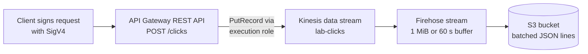

> [!COST]
> The only resource billed by the hour is the **Kinesis data stream**: USD 0.015 per shard-hour in us-east-1 for the single provisioned shard, about USD 11 per month if forgotten. Firehose has no hourly charge here (you pay per GB ingested, with each record rounded up to 5 KB), and the API, IAM roles and the few small S3 objects cost a fraction of a cent. Do the **Cleanup** section as soon as you finish.

The lesson's ingestion example puts API Gateway in front of Kinesis with **no Lambda function**: API Gateway signs a `PutRecord` call with an IAM execution role and reshapes the client's JSON with a mapping template, and Firehose turns the stream into files in S3. You will build exactly that, and protect the method with **AWS IAM** authorization so that the endpoint is never open to the internet.



## Prerequisites

- An AWS account and an IAM identity that can manage API Gateway, Kinesis, Firehose, S3 and IAM roles, and that is allowed to call `execute-api:Invoke` (an administrator role in a personal sandbox account is simplest).
- One Region for the whole lab; the steps use `us-east-1`.
- **AWS CloudShell** in that Region (AWS CLI v2, Python 3 with Boto3, and `jq` are preinstalled). Keep one tab open; later commands reuse shell variables. Step 7 uses CloudShell even if you follow the console tabs.

## Steps

### Step 1: Create the Kinesis data stream

:::console
1. Open the **Kinesis** console and choose **Create data stream**.
2. Enter `lab-clicks` as the data stream name.
3. Under capacity mode choose **Provisioned** and set the number of provisioned shards to `1`.
4. Leave the other settings at their defaults and choose **Create Kinesis stream**. Wait until **Status** is **Active**.
:::

:::cli
```bash
REGION=${AWS_REGION:-$(aws configure get region)}
ACCOUNT_ID=$(aws sts get-caller-identity --query Account --output text)
aws kinesis create-stream --stream-name lab-clicks \
  --stream-mode-details StreamMode=PROVISIONED --shard-count 1
aws kinesis wait stream-exists --stream-name lab-clicks
STREAM_ARN=$(aws kinesis describe-stream-summary --stream-name lab-clicks \
  --query StreamDescriptionSummary.StreamARN --output text)
echo "$REGION $STREAM_ARN"
```
:::

> [!CHECK]
> `lab-clicks` is **Active** with **1** open shard in **Provisioned** mode.

### Step 2: Create the S3 bucket and the Firehose stream

Firehose reads the data stream and writes a file to S3 whenever 1 MiB has accumulated or 60 seconds have passed, whichever comes first. Records are written back to back, so turn on the newline delimiter to get one JSON document per line (handy for Athena).

:::console
1. Open the **S3** console → **General purpose buckets** → **Create bucket**. Enter a unique name such as `lab-clicks-<your-initials>-<random digits>`, keep the defaults and choose **Create bucket**.
2. Open the **Amazon Data Firehose** console and choose **Create Firehose stream**.
3. For the source choose **Amazon Kinesis Data Streams**; for the destination choose **Amazon S3**.
4. Under **Source settings**, pick `lab-clicks` as the **Kinesis data stream**.
5. For **Firehose stream name**, enter `lab-clicks-to-s3`.
6. Leave **Transform and convert records** off.
7. Under **Destination settings**, choose your bucket for **S3 bucket** and set **New line delimiter** to **Enabled**. Leave dynamic partitioning disabled and the prefixes empty.
8. Expand the buffer settings and set **Buffer size** to `1` MiB and **Buffer interval** to `60` seconds. Leave compression off.
9. Under **Advanced settings**, keep the option that creates a new IAM role for the stream, then choose **Create Firehose stream**. Wait until the status is **Active**.
:::

:::cli
```bash
BUCKET=lab-clicks-$RANDOM$RANDOM
aws s3api create-bucket --bucket "$BUCKET" --region "$REGION" \
  $( [ "$REGION" != "us-east-1" ] && echo "--create-bucket-configuration LocationConstraint=$REGION" )

cat > firehose-trust.json <<'EOF'
{"Version": "2012-10-17",
 "Statement": [{"Effect": "Allow", "Principal": {"Service": "firehose.amazonaws.com"},
                "Action": "sts:AssumeRole"}]}
EOF
FH_ROLE_ARN=$(aws iam create-role --role-name lab-clicks-firehose-role \
  --assume-role-policy-document file://firehose-trust.json --query Role.Arn --output text)
cat > firehose-perms.json <<EOF
{"Version": "2012-10-17",
 "Statement": [
  {"Effect": "Allow",
   "Action": ["s3:AbortMultipartUpload", "s3:GetBucketLocation", "s3:GetObject",
              "s3:ListBucket", "s3:ListBucketMultipartUploads", "s3:PutObject"],
   "Resource": ["arn:aws:s3:::$BUCKET", "arn:aws:s3:::$BUCKET/*"]},
  {"Effect": "Allow",
   "Action": ["kinesis:DescribeStream", "kinesis:GetShardIterator",
              "kinesis:GetRecords", "kinesis:ListShards"],
   "Resource": "$STREAM_ARN"}]}
EOF
aws iam put-role-policy --role-name lab-clicks-firehose-role \
  --policy-name lab-clicks-firehose-access --policy-document file://firehose-perms.json
sleep 15   # let IAM propagate the new role

cat > s3-destination.json <<EOF
{"RoleARN": "$FH_ROLE_ARN",
 "BucketARN": "arn:aws:s3:::$BUCKET",
 "BufferingHints": {"SizeInMBs": 1, "IntervalInSeconds": 60},
 "CompressionFormat": "UNCOMPRESSED",
 "ProcessingConfiguration": {"Enabled": true,
   "Processors": [{"Type": "AppendDelimiterToRecord"}]}}
EOF
aws firehose create-delivery-stream --delivery-stream-name lab-clicks-to-s3 \
  --delivery-stream-type KinesisStreamAsSource \
  --kinesis-stream-source-configuration "KinesisStreamARN=$STREAM_ARN,RoleARN=$FH_ROLE_ARN" \
  --extended-s3-destination-configuration file://s3-destination.json
until [ "$(aws firehose describe-delivery-stream --delivery-stream-name lab-clicks-to-s3 \
  --query DeliveryStreamDescription.DeliveryStreamStatus --output text)" = "ACTIVE" ]; do
  echo "waiting..."; sleep 10
done; echo "lab-clicks-to-s3 is ACTIVE"
```
:::

> [!CHECK]
> `lab-clicks-to-s3` is **Active** with source `lab-clicks` and your bucket as destination. The API still calls it a delivery stream (`create-delivery-stream`), while the console says "Firehose stream".

> [!TIP]
> If you used the console, set the variables in CloudShell before continuing: `REGION=${AWS_REGION:-$(aws configure get region)}`, `ACCOUNT_ID=$(aws sts get-caller-identity --query Account --output text)`, `BUCKET=<your bucket name>` and the `STREAM_ARN=...` line from Step 1.

### Step 3: Create the execution role that API Gateway uses to call Kinesis

API Gateway needs its own IAM role, trusted by `apigateway.amazonaws.com`, with permission to call `kinesis:PutRecord` on this one stream and nothing else.

:::console
1. Open the **IAM** console → **Roles** → **Create role**.
2. For **Trusted entity type** choose **AWS service**; for **Use case** choose **API Gateway**. Choose **Next**, then **Next** again (the use case attaches a CloudWatch Logs push policy, which is harmless here).
3. **Role name** `lab-apigw-kinesis-role`, then **Create role**.
4. Open the role, choose **Add permissions** → **Create inline policy** → **JSON**, paste the policy below with your stream ARN, choose **Next**, name it `put-to-lab-clicks` and choose **Create policy**.
5. Copy the role **ARN** from the role's **Summary**.

```json
{
  "Version": "2012-10-17",
  "Statement": [{
    "Effect": "Allow",
    "Action": "kinesis:PutRecord",
    "Resource": "arn:aws:kinesis:REGION:ACCOUNT_ID:stream/lab-clicks"
  }]
}
```
:::

:::cli
```bash
cat > apigw-trust.json <<'EOF'
{"Version": "2012-10-17",
 "Statement": [{"Effect": "Allow", "Principal": {"Service": "apigateway.amazonaws.com"},
                "Action": "sts:AssumeRole"}]}
EOF
APIGW_ROLE_ARN=$(aws iam create-role --role-name lab-apigw-kinesis-role \
  --assume-role-policy-document file://apigw-trust.json --query Role.Arn --output text)
cat > apigw-perms.json <<EOF
{"Version": "2012-10-17",
 "Statement": [{"Effect": "Allow", "Action": "kinesis:PutRecord", "Resource": "$STREAM_ARN"}]}
EOF
aws iam put-role-policy --role-name lab-apigw-kinesis-role \
  --policy-name put-to-lab-clicks --policy-document file://apigw-perms.json
sleep 15
echo "$APIGW_ROLE_ARN"
```
:::

> [!CHECK]
> The role's **Trust relationships** tab names `apigateway.amazonaws.com`, and its inline policy allows only `kinesis:PutRecord` on `lab-clicks`.

### Step 4: Create the REST API with an AWS service integration

The method is `POST /clicks`. Its integration calls the Kinesis `PutRecord` action directly, and **Authorization** is set to **AWS IAM**, so only signed requests from identities allowed to call `execute-api:Invoke` get through.

:::console
1. Open the **API Gateway** console, choose **Create API**, and under **REST API** choose **Build**.
2. Choose **New API**, enter the **API name** `lab-clicks-api`, keep the **API endpoint type** **Regional** and choose **Create API**.
3. With the `/` resource selected, choose **Create resource**. Enter the **Resource name** `clicks`, keep **CORS** off and choose **Create resource**.
4. Select `/clicks` and choose **Create method**:
   - **Method type**: **POST**
   - **Integration type**: **AWS service**
   - **AWS Region**: your Region; **AWS service**: **Kinesis**; leave **AWS subdomain** blank
   - **HTTP method**: **POST** (Kinesis actions are always called with POST)
   - **Action type**: **Use action name**; **Action name**: `PutRecord`
   - **Execution role**: the ARN of `lab-apigw-kinesis-role`
   - **Content handling**: **Passthrough**; keep **Default timeout** on
   - Expand **Method request settings** and set **Authorization** to **AWS IAM**
5. Choose **Create method**.
:::

:::cli
```bash
API_ID=$(aws apigateway create-rest-api --name lab-clicks-api \
  --endpoint-configuration types=REGIONAL --query id --output text)
ROOT_ID=$(aws apigateway get-resources --rest-api-id "$API_ID" \
  --query 'items[?path==`/`].id' --output text)
RES_ID=$(aws apigateway create-resource --rest-api-id "$API_ID" \
  --parent-id "$ROOT_ID" --path-part clicks --query id --output text)
aws apigateway put-method --rest-api-id "$API_ID" --resource-id "$RES_ID" \
  --http-method POST --authorization-type AWS_IAM
echo "API $API_ID, resource /clicks $RES_ID"
```
:::

> [!CHECK]
> The **Resources** tree shows `/clicks` with a **POST** method. The method's **Method request** panel shows **Authorization: AWS_IAM**, and the **Integration request** panel shows an **AWS** integration with Kinesis action `PutRecord`.

### Step 5: Map the client request to a Kinesis PutRecord call

Kinesis expects a JSON body with `StreamName`, base64-encoded `Data` and a `PartitionKey`, sent with the content type `application/x-amz-json-1.1`. The mapping template builds that body from whatever JSON the client posts, and uses the API Gateway request ID as a partition key so records spread across shards when you add more.

```
{
  "StreamName": "lab-clicks",
  "Data": "$util.base64Encode($input.body)",
  "PartitionKey": "$context.requestId"
}
```

:::console
1. Select the **POST** method under `/clicks`, open the **Integration request** tab and choose **Edit**.
2. For **Request body passthrough**, choose **When there are no templates defined (recommended)**.
3. Expand **URL request headers parameters** and choose **Add request headers parameter**. **Name** `Content-Type`, **Mapped from** `'application/x-amz-json-1.1'` (keep the single quotes: they mark a fixed value).
4. Expand **Mapping templates**, choose **Add mapping template**, enter the **Content type** `application/json` and paste the template above into **Template body**.
5. Choose **Save**.
:::

:::cli
```bash
# Unquoted heredoc: \$ keeps the VTL variables literal, \" stays as JSON escaping.
cat > integration.json <<EOF
{
  "restApiId": "$API_ID",
  "resourceId": "$RES_ID",
  "httpMethod": "POST",
  "type": "AWS",
  "integrationHttpMethod": "POST",
  "uri": "arn:aws:apigateway:$REGION:kinesis:action/PutRecord",
  "credentials": "$APIGW_ROLE_ARN",
  "passthroughBehavior": "WHEN_NO_TEMPLATES",
  "requestParameters": {
    "integration.request.header.Content-Type": "'application/x-amz-json-1.1'"
  },
  "requestTemplates": {
    "application/json": "{\"StreamName\": \"lab-clicks\", \"Data\": \"\$util.base64Encode(\$input.body)\", \"PartitionKey\": \"\$context.requestId\"}"
  }
}
EOF
aws apigateway put-integration --cli-input-json file://integration.json
aws apigateway put-method-response --rest-api-id "$API_ID" --resource-id "$RES_ID" \
  --http-method POST --status-code 200
# No selection pattern = the default response; no template = Kinesis's JSON is passed through.
aws apigateway put-integration-response --rest-api-id "$API_ID" --resource-id "$RES_ID" \
  --http-method POST --status-code 200
aws apigateway get-integration --rest-api-id "$API_ID" --resource-id "$RES_ID" \
  --http-method POST --query '{uri: uri, header: requestParameters, template: requestTemplates}'
```
:::

> [!CHECK]
> The integration shows the `Content-Type` header mapped from `'application/x-amz-json-1.1'` and one mapping template for `application/json` that contains `$util.base64Encode($input.body)`.

### Step 6: Test the method and send a few click events

The console **Test** tab and the CLI `test-invoke-method` command run the real integration (records really reach Kinesis) but skip authorization, so you can test before handling signatures.

:::console
1. Select the **POST** method and open the **Test** tab.
2. In **Request body** enter `{"user":"u1","page":"/home"}` and choose **Test**.
3. Repeat with four more bodies, for example `{"user":"u2","page":"/product/42"}`.
:::

:::cli
```bash
for i in 1 2 3 4 5; do
  aws apigateway test-invoke-method --rest-api-id "$API_ID" --resource-id "$RES_ID" \
    --http-method POST --headers Content-Type=application/json \
    --body "{\"user\":\"u$i\",\"page\":\"/product/$i\"}" \
    --query '[status, body]' --output text
done
```
:::

> [!CHECK]
> Each test returns **status 200** with a body like `{"SequenceNumber":"4960...","ShardId":"shardId-000000000000"}`: that is the Kinesis `PutRecord` response passed straight back to the client. If you get a 500 with an access denied error in the log, the execution role or its policy from Step 3 is wrong.

### Step 7: Deploy the API and see IAM authorization at work

:::console
1. Choose **Deploy API**. For **Stage** choose **\*New stage\***, enter the **Stage name** `dev` and choose **Deploy**.
2. Copy the **Invoke URL** from the **Stage details** (it looks like `https://abc123.execute-api.us-east-1.amazonaws.com/dev`).
3. In CloudShell set `INVOKE_URL=<the invoke URL>` and `REGION=<your Region>`, then run the two commands in the CLI tab after the `create-deployment` line.
:::

:::cli
```bash
aws apigateway create-deployment --rest-api-id "$API_ID" --stage-name dev
INVOKE_URL="https://$API_ID.execute-api.$REGION.amazonaws.com/dev"
sleep 10

# 1) An unsigned request, the way an anonymous internet client would call it:
curl -s -i -X POST "$INVOKE_URL/clicks" -H 'Content-Type: application/json' \
  -d '{"user":"anonymous","page":"/home"}' | sed -n '1p;$p'

# 2) The same request signed with Signature Version 4 using your CloudShell credentials:
python3 - "$INVOKE_URL/clicks" "$REGION" <<'EOF'
import json, sys, urllib.request
import boto3
from botocore.auth import SigV4Auth
from botocore.awsrequest import AWSRequest

url, region = sys.argv[1], sys.argv[2]
body = json.dumps({"user": "signed-user", "page": "/checkout"})
req = AWSRequest(method="POST", url=url, data=body,
                 headers={"Content-Type": "application/json"})
SigV4Auth(boto3.Session().get_credentials(), "execute-api", region).add_auth(req)
call = urllib.request.Request(url, data=body.encode(), headers=dict(req.headers), method="POST")
with urllib.request.urlopen(call) as resp:
    print(resp.status, resp.read().decode())
EOF
```
:::

> [!CHECK]
> The unsigned `curl` call gets **HTTP 403** with a message such as `Missing Authentication Token`: API Gateway rejected it before Kinesis was ever called. The signed call prints **200** and a Kinesis sequence number. Throttling, usage plans and AWS WAF could be added at this same front door without touching the backend.

### Step 8: Find the batched files in S3

:::console
1. Wait about two minutes after your last request (the 60-second buffer plus delivery time).
2. Open your bucket. Firehose wrote objects under a `YYYY/MM/DD/HH/` prefix. Open the newest object (choose it, then **Open** or **Download**).
:::

:::cli
```bash
sleep 90
aws s3 ls "s3://$BUCKET" --recursive
KEY=$(aws s3api list-objects-v2 --bucket "$BUCKET" \
  --query 'sort_by(Contents, &LastModified)[-1].Key' --output text)
aws s3 cp "s3://$BUCKET/$KEY" -
```
:::

> [!CHECK]
> One or two objects exist under a date and hour prefix, and together they contain the six click events (five test invocations and the signed call), **one JSON document per line**. No server and no function code touched the data at any point: API Gateway wrote to Kinesis, and Firehose batched the stream into S3.

## Cleanup

Delete in this order:

- [ ] **REST API `lab-clicks-api`** (this also deletes the `dev` stage and the deployment): API Gateway → **APIs** → select it → **Delete**, then confirm. CLI: `aws apigateway delete-rest-api --rest-api-id "$API_ID"`.
- [ ] **Note the Firehose role**: if the console created it, open `lab-clicks-to-s3` and copy the IAM role name shown under service access (CLI path: `lab-clicks-firehose-role`).
- [ ] **Firehose stream `lab-clicks-to-s3`**: Firehose console → select it → **Delete**, then confirm. CLI: `aws firehose delete-delivery-stream --delivery-stream-name lab-clicks-to-s3`.
- [ ] **Data stream `lab-clicks`** (the hourly charge): Kinesis console → select it → **Actions** → **Delete**, then confirm. CLI: `aws kinesis delete-stream --stream-name lab-clicks`.
- [ ] **S3 bucket and its objects**: S3 console → select the bucket → **Empty** (type the confirmation), then **Delete** (type the bucket name). CLI: `aws s3 rb "s3://$BUCKET" --force`.
- [ ] **IAM role `lab-apigw-kinesis-role`**: IAM → **Roles** → select it → **Delete**, type the role name. CLI: `aws iam delete-role-policy --role-name lab-apigw-kinesis-role --policy-name put-to-lab-clicks`, then (if the console attached the CloudWatch Logs policy) `aws iam detach-role-policy --role-name lab-apigw-kinesis-role --policy-arn arn:aws:iam::aws:policy/service-role/AmazonAPIGatewayPushToCloudWatchLogs`, then `aws iam delete-role --role-name lab-apigw-kinesis-role`.
- [ ] **Firehose IAM role** you noted: IAM → **Roles** → select it → **Delete**; if the console created it, also delete the customer managed policy shown on its **Permissions** tab from **Policies**. CLI: `aws iam delete-role-policy --role-name lab-clicks-firehose-role --policy-name lab-clicks-firehose-access`, then `aws iam delete-role --role-name lab-clicks-firehose-role`.
- [ ] **Firehose log group**, if the console created one (`/aws/kinesisfirehose/lab-clicks-to-s3` under CloudWatch → **Log groups**): select → **Actions** → **Delete log group(s)**. CLI: `aws logs delete-log-group --log-group-name /aws/kinesisfirehose/lab-clicks-to-s3`.
- [ ] **Local files** in CloudShell: `rm -f firehose-trust.json firehose-perms.json s3-destination.json apigw-trust.json apigw-perms.json integration.json`.
- [ ] **Final check**: `aws kinesis list-streams` and `aws firehose list-delivery-streams` return empty lists in this Region, `aws apigateway get-rest-apis --query "items[?name=='lab-clicks-api']"` returns `[]`, the bucket is gone, and the next day **Billing and Cost Management** → **Bills** shows no new Kinesis charges.

## Progress checklist

- [ ] Step 1: Created the `lab-clicks` data stream with one shard
- [ ] Step 2: Created the bucket and `lab-clicks-to-s3` with a 1 MiB / 60 s buffer and newline delimiter
- [ ] Step 3: Created `lab-apigw-kinesis-role` allowing only `kinesis:PutRecord`
- [ ] Step 4: Created `POST /clicks` with an AWS service integration and AWS IAM authorization
- [ ] Step 5: Added the Content-Type mapping and the PutRecord mapping template
- [ ] Step 6: Got Kinesis sequence numbers back from test invocations
- [ ] Step 7: Saw an unsigned call rejected with 403 and a signed call accepted
- [ ] Step 8: Found the click events as JSON lines in S3
- [ ] Cleanup done
