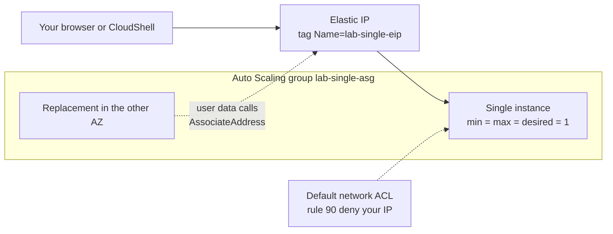

> [!COST]
> Auto Scaling is free, but the group keeps one `t3.micro` running (USD 0.0104 per hour unless Free Tier credits or the legacy Free Tier cover it) until you delete the **group**. Every public IPv4 address costs USD 0.005 per hour, attached or not: the Elastic IP for the whole lab, plus each instance's auto-assigned address for the minute or two before the Elastic IP replaces it. An **unattached Elastic IP keeps billing** until you release it, so finish with the **Cleanup** section.

This lab builds the lesson's "highly available single instance" design: one instance at a time, a public IP that never changes, and automatic recovery into another AZ. It ends with the simplest case of the "block an IP address" scenario, an instance reached directly on its public IP, where a network ACL can see and deny the client.



## Prerequisites

- An AWS account and an IAM identity that can manage EC2, EC2 Auto Scaling, VPC network ACLs and IAM roles (an administrator role in a personal sandbox account is simplest).
- A Region with a **default VPC**; the steps use `us-east-1`.
- **AWS CloudShell** in that Region for the CLI tabs (keep one tab open; later commands reuse shell variables), and a web browser.
- No other workloads you care about in the default VPC during Step 8, because the temporary network ACL rule applies to every default subnet.

## Steps

### Step 1: Allocate an Elastic IP and tag it

The instance's user data will find the address by its **tag**, so the launch template never needs to change if you replace the address.

:::console
1. Open the **EC2** console and choose **Elastic IPs** (under **Network & Security**) → **Allocate Elastic IP address**.
2. Keep **Amazon's pool of IPv4 addresses**. Under **Tags**, choose **Add new tag**: **Key** `Name`, **Value** `lab-single-eip`.
3. Choose **Allocate** and note the **Allocated IPv4 address**.
:::

:::cli
```bash
REGION=${AWS_REGION:-$(aws configure get region)}
ALLOC_ID=$(aws ec2 allocate-address --domain vpc \
  --tag-specifications 'ResourceType=elastic-ip,Tags=[{Key=Name,Value=lab-single-eip}]' \
  --query AllocationId --output text)
EIP=$(aws ec2 describe-addresses --allocation-ids "$ALLOC_ID" \
  --query 'Addresses[0].PublicIp' --output text)
echo "Elastic IP $EIP ($ALLOC_ID)"
```
:::

> [!CHECK]
> **Elastic IPs** lists the new address with the name `lab-single-eip` and no **Associated instance ID** yet. It is already billed at USD 0.005 per hour.

### Step 2: Create an instance role that may move the Elastic IP

The instance calls `DescribeAddresses` (to find the tagged address) and `AssociateAddress` (to attach it). `DisassociateAddress` is included because re-associating an address that is still attached to the old instance moves it away from that instance.

```json
{
  "Version": "2012-10-17",
  "Statement": [{
    "Effect": "Allow",
    "Action": ["ec2:DescribeAddresses", "ec2:AssociateAddress", "ec2:DisassociateAddress"],
    "Resource": "*"
  }]
}
```

:::console
1. Open the **IAM** console → **Roles** → **Create role**.
2. **Trusted entity type** **AWS service**, **Use case** **EC2**. Choose **Next**, skip the permissions page with **Next**.
3. **Role name** `lab-eip-role`, then **Create role**. (The console also creates an instance profile with the same name.)
4. Open the role → **Add permissions** → **Create inline policy** → **JSON**, paste the policy above, choose **Next**, name it `move-lab-eip` and choose **Create policy**.
:::

:::cli
```bash
cat > ec2-trust.json <<'EOF'
{"Version": "2012-10-17",
 "Statement": [{"Effect": "Allow", "Principal": {"Service": "ec2.amazonaws.com"},
                "Action": "sts:AssumeRole"}]}
EOF
cat > eip-perms.json <<'EOF'
{"Version": "2012-10-17",
 "Statement": [{"Effect": "Allow",
   "Action": ["ec2:DescribeAddresses", "ec2:AssociateAddress", "ec2:DisassociateAddress"],
   "Resource": "*"}]}
EOF
aws iam create-role --role-name lab-eip-role \
  --assume-role-policy-document file://ec2-trust.json --query Role.Arn --output text
aws iam put-role-policy --role-name lab-eip-role \
  --policy-name move-lab-eip --policy-document file://eip-perms.json
aws iam create-instance-profile --instance-profile-name lab-eip-role
aws iam add-role-to-instance-profile --instance-profile-name lab-eip-role \
  --role-name lab-eip-role
sleep 15   # instance profiles take a few seconds to become usable
```
:::

> [!CHECK]
> `lab-eip-role` trusts `ec2.amazonaws.com` and has the inline policy `move-lab-eip`. CLI: `aws iam get-instance-profile --instance-profile-name lab-eip-role --query 'InstanceProfile.Roles[].RoleName'` returns `lab-eip-role`.

### Step 3: Create a security group for the web server

:::console
1. In the EC2 console choose **Security Groups** → **Create security group**.
2. **Security group name** `lab-single-sg`, **Description** `HTTP from anywhere`, default **VPC**.
3. Under **Inbound rules** choose **Add rule**: **Type** **HTTP**, **Source** **Anywhere-IPv4**. Notice that the rule editor has no **Deny** option at all.
4. Choose **Create security group**.
:::

:::cli
```bash
VPC_ID=$(aws ec2 describe-vpcs --filters Name=is-default,Values=true \
  --query 'Vpcs[0].VpcId' --output text)
SG_ID=$(aws ec2 create-security-group --group-name lab-single-sg \
  --description "HTTP from anywhere" --vpc-id "$VPC_ID" --query GroupId --output text)
aws ec2 authorize-security-group-ingress --group-id "$SG_ID" \
  --protocol tcp --port 80 --cidr 0.0.0.0/0
echo "$VPC_ID $SG_ID"
```
:::

### Step 4: Create the launch template with the Elastic IP user data

The script installs a web page that shows the instance ID and AZ, then finds the tagged Elastic IP and attaches it. Amazon Linux 2023 ships with the AWS CLI, which picks up the instance role's credentials automatically; the loop retries in case those credentials are not ready in the first seconds after boot.

```bash
#!/bin/bash
dnf install -y httpd
TOKEN=$(curl -s -X PUT "http://169.254.169.254/latest/api/token" -H "X-aws-ec2-metadata-token-ttl-seconds: 300")
MD=http://169.254.169.254/latest/meta-data
ID=$(curl -s -H "X-aws-ec2-metadata-token: $TOKEN" $MD/instance-id)
AZ=$(curl -s -H "X-aws-ec2-metadata-token: $TOKEN" $MD/placement/availability-zone)
REGION=$(curl -s -H "X-aws-ec2-metadata-token: $TOKEN" $MD/placement/region)
echo "<h1>The only instance: $ID in $AZ</h1>" > /var/www/html/index.html
systemctl enable --now httpd
for attempt in 1 2 3 4 5 6; do
  ALLOC=$(aws ec2 describe-addresses --region "$REGION" \
    --filters Name=tag:Name,Values=lab-single-eip \
    --query 'Addresses[0].AllocationId' --output text) && \
  aws ec2 associate-address --region "$REGION" --instance-id "$ID" \
    --allocation-id "$ALLOC" --allow-reassociation && break
  sleep 10
done
```

:::console
1. In the EC2 console choose **Launch Templates** → **Create launch template**.
2. **Launch template name** `lab-single-lt`; under **Auto Scaling guidance** select the check box.
3. **Application and OS Images (Amazon Machine Image)**: **Quick Start** → **Amazon Linux** → **Amazon Linux 2023 AMI**.
4. **Instance type**: `t3.micro`. **Key pair (login)**: **Don't include in launch template**.
5. **Network settings**: leave **Subnet** as **Don't include in launch template**; for **Firewall (security groups)** choose **Select existing security group** and pick `lab-single-sg`.
6. **Resource tags**: **Key** `Name`, **Value** `lab-single`, **Resource types** **Instances**.
7. Expand **Advanced details**. For **IAM instance profile** choose `lab-eip-role`, then paste the script above into **User data**.
8. Choose **Create launch template**.
:::

:::cli
```bash
# Save the user data script above as user-data.sh in the current directory first.
AMI=$(aws ssm get-parameters \
  --names /aws/service/ami-amazon-linux-latest/al2023-ami-kernel-default-x86_64 \
  --query 'Parameters[0].Value' --output text)
cat > lt-data.json <<EOF
{
  "ImageId": "$AMI",
  "InstanceType": "t3.micro",
  "IamInstanceProfile": {"Name": "lab-eip-role"},
  "SecurityGroupIds": ["$SG_ID"],
  "UserData": "$(base64 -w0 user-data.sh)",
  "TagSpecifications": [
    {"ResourceType": "instance", "Tags": [{"Key": "Name", "Value": "lab-single"}]}
  ]
}
EOF
aws ec2 create-launch-template --launch-template-name lab-single-lt \
  --launch-template-data file://lt-data.json \
  --query 'LaunchTemplate.[LaunchTemplateId,LatestVersionNumber]' --output text
```
:::

> [!CHECK]
> **Launch Templates** lists `lab-single-lt` version 1. Its details show the instance profile `lab-eip-role` and the security group `lab-single-sg`. Nothing runs yet.

### Step 5: Create the Auto Scaling group of one across two AZs

Minimum, maximum and desired capacity are all **1**: the group never runs two copies in normal operation, but it always replaces a missing one, in either AZ.

:::console
1. Choose **Auto Scaling Groups** → **Create Auto Scaling group**.
2. **Auto Scaling group name** `lab-single-asg`, **Launch template** `lab-single-lt`, version **Latest**. Choose **Next**.
3. Keep the default **VPC** and under **Availability Zones and subnets** select **two** default subnets in different AZs. Keep **Availability Zone distribution** at **Balanced best effort**. Choose **Next**.
4. On the integration page leave **No load balancer** and the default EC2 health checks. Choose **Next**.
5. Set **Desired capacity** to `1`, and under **Scaling limits** set **Min desired capacity** `1` and **Max desired capacity** `1`. Keep **No scaling policies**. Choose **Next**.
6. Skip notifications and tags with **Next**, review and choose **Create Auto Scaling group**.
:::

:::cli
```bash
AZS=$(aws ec2 describe-instance-type-offerings --location-type availability-zone \
  --filters Name=instance-type,Values=t3.micro \
  --query 'InstanceTypeOfferings[].Location' --output text | tr '\t' ',')
read SUBNET_A SUBNET_B <<< "$(aws ec2 describe-subnets \
  --filters Name=vpc-id,Values="$VPC_ID" Name=default-for-az,Values=true \
            Name=availability-zone,Values="$AZS" \
  --query 'Subnets[0:2].SubnetId' --output text)"
aws autoscaling create-auto-scaling-group --auto-scaling-group-name lab-single-asg \
  --launch-template LaunchTemplateName=lab-single-lt,Version='$Latest' \
  --min-size 1 --max-size 1 --desired-capacity 1 \
  --vpc-zone-identifier "$SUBNET_A,$SUBNET_B"
show() {
  aws autoscaling describe-auto-scaling-groups --auto-scaling-group-names lab-single-asg \
    --query 'AutoScalingGroups[0].Instances[].[InstanceId,AvailabilityZone,LifecycleState]' \
    --output table
  aws ec2 describe-addresses --allocation-ids "$ALLOC_ID" \
    --query 'Addresses[0].[PublicIp,InstanceId]' --output text
}
sleep 120; show
```
:::

> [!CHECK]
> After two or three minutes the group has one instance **InService**, and **Elastic IPs** shows `lab-single-eip` associated with that instance ID. Opening `http://<Elastic IP>` in a browser (or `curl -s http://$EIP` in CloudShell) shows "The only instance: i-... in <AZ>". If the address stays unassociated, check the instance's role in Step 4 and the system log (**Actions** → **Monitor and troubleshoot** → **Get system log**).

### Step 6: Simulate an instance failure

:::console
1. Go to **Instances**, select the `lab-single` instance, and choose **Instance state** → **Terminate (delete) instance** → **Terminate (delete)**.
2. Refresh `http://<Elastic IP>` every 30 seconds, and watch **Auto Scaling Groups** → `lab-single-asg` → **Activity**.
:::

:::cli
```bash
OLD=$(aws autoscaling describe-auto-scaling-groups --auto-scaling-group-names lab-single-asg \
  --query 'AutoScalingGroups[0].Instances[0].InstanceId' --output text)
aws ec2 terminate-instances --instance-ids "$OLD" > /dev/null; echo "terminated $OLD"
for i in $(seq 1 12); do
  printf '%s  ' "$(date +%T)"; curl -s -m 3 "http://$EIP" || echo "(no answer)"; echo; sleep 20
done
show
```
:::

> [!CHECK]
> The page stops answering for a few minutes (this design trades a short outage for running only one instance), then returns with a **new instance ID** on the **same Elastic IP**. The **Activity** tab shows the unhealthy instance being terminated and a replacement being launched. Clients never had to learn a new address.

### Step 7: Simulate the loss of an Availability Zone

Removing the current instance's AZ from the group is a safe stand-in for an AZ outage. Auto Scaling rebalances by launching in the remaining AZ **before** terminating the old instance (it may briefly exceed the maximum by one instance for this), so the new instance takes the Elastic IP away from the old one with `--allow-reassociation`.

:::console
1. Note the AZ shown on the web page.
2. Open `lab-single-asg` → **Details** → **Network** → **Edit**, remove the subnet in that AZ (keep the other one) and choose **Update**.
3. Watch the **Activity** tab and refresh the page.
4. When the page shows the other AZ, edit **Network** again and add the removed subnet back.
:::

:::cli
```bash
CUR_SUBNET=$(aws ec2 describe-instances --instance-ids "$(aws autoscaling describe-auto-scaling-groups \
  --auto-scaling-group-names lab-single-asg --query 'AutoScalingGroups[0].Instances[0].InstanceId' \
  --output text)" --query 'Reservations[0].Instances[0].SubnetId' --output text)
OTHER_SUBNET=$([ "$CUR_SUBNET" = "$SUBNET_A" ] && echo "$SUBNET_B" || echo "$SUBNET_A")
aws autoscaling update-auto-scaling-group --auto-scaling-group-name lab-single-asg \
  --vpc-zone-identifier "$OTHER_SUBNET"
sleep 180; show; curl -s "http://$EIP"; echo
# Put both AZs back so the group can survive the next failure:
aws autoscaling update-auto-scaling-group --auto-scaling-group-name lab-single-asg \
  --vpc-zone-identifier "$SUBNET_A,$SUBNET_B"
```
:::

> [!CHECK]
> The **Activity** tab shows a launch in the remaining AZ followed by the termination of the old instance. The page now reports the **other AZ** on the **same Elastic IP**. If the instance kept data on an EBS volume, it would now be missing: the volume stayed in the old AZ, which is why the lesson adds lifecycle hooks and snapshots.

### Step 8: Try to block your own IP, first with the security group, then with a network ACL

Pretend your own address is the attacker. Because clients reach the instance directly on its public IP, the subnet's network ACL sees the real source address. Find the address the test will come from: visit `https://checkip.amazonaws.com` in the browser you will test with, or run `curl -s https://checkip.amazonaws.com` in CloudShell if you test from CloudShell.

:::console
1. Open `lab-single-sg` → **Inbound rules** → **Edit inbound rules** and look for a way to deny one address: there is none, only rules that allow. Choose **Cancel**.
2. Open the **VPC** console → **Network ACLs**, and select the network ACL of your default VPC whose **Default** column says **Yes** (it is associated with all default subnets).
3. On **Inbound rules** choose **Edit inbound rules** → **Add new rule**: **Rule number** `90`, **Type** **HTTP (80)**, **Source** `<your IP>/32`, **Allow/Deny** **Deny**. Choose **Save changes**.
4. Reload `http://<Elastic IP>` from the same place: it times out. Ask someone else, or use another network such as your phone without Wi-Fi, and the page still loads for them.
5. Edit the inbound rules again, **Remove** rule `90` and choose **Save changes**. The page loads for you again.
:::

:::cli
```bash
MY_IP=$(curl -s https://checkip.amazonaws.com)
NACL_ID=$(aws ec2 describe-network-acls \
  --filters Name=vpc-id,Values="$VPC_ID" Name=default,Values=true \
  --query 'NetworkAcls[0].NetworkAclId' --output text)
aws ec2 create-network-acl-entry --network-acl-id "$NACL_ID" --ingress \
  --rule-number 90 --protocol tcp --port-range From=80,To=80 \
  --cidr-block "$MY_IP/32" --rule-action deny
sleep 10
curl -s -m 5 "http://$EIP" || echo "blocked: no answer from $EIP for $MY_IP"
aws ec2 delete-network-acl-entry --network-acl-id "$NACL_ID" --ingress --rule-number 90
sleep 10
curl -s -m 5 "http://$EIP"; echo
```
:::

> [!CHECK]
> With rule 90 in place your request gets **no answer**, while rule 100 (allow all) still serves everyone else: rules are evaluated from the lowest number and the first match wins. After you remove rule 90 the page answers again. Had the instance been behind an ALB, this NACL on the instance subnet would only have seen the ALB's addresses, and behind CloudFront only CloudFront's: that is when AWS WAF becomes the answer.

> [!WARNING]
> Remove rule 90 before you leave. A forgotten deny rule in the default network ACL silently blocks your address from every default subnet in this VPC.

## Cleanup

Delete in this order:

- [ ] **Network ACL rule 90**, if it still exists: VPC → **Network ACLs** → default ACL → **Inbound rules** → **Edit inbound rules** → **Remove** → **Save changes**. CLI: `aws ec2 delete-network-acl-entry --network-acl-id "$NACL_ID" --ingress --rule-number 90`.
- [ ] **Auto Scaling group `lab-single-asg`** (this terminates its instance): **Auto Scaling Groups** → select → **Actions** → **Delete**, type `delete`. CLI: `aws autoscaling delete-auto-scaling-group --auto-scaling-group-name lab-single-asg --force-delete`, then wait until `aws ec2 describe-instances --filters Name=tag:Name,Values=lab-single Name=instance-state-name,Values=pending,running,shutting-down --query 'Reservations[].Instances[].InstanceId'` returns `[]`.
- [ ] **Launch template `lab-single-lt`**: **Launch Templates** → select → **Actions** → **Delete template**, type `Delete`. CLI: `aws ec2 delete-launch-template --launch-template-name lab-single-lt`.
- [ ] **Elastic IP `lab-single-eip`** (keeps billing while allocated): **Elastic IPs** → select → **Actions** → **Release Elastic IP addresses** → **Release**. CLI: `aws ec2 release-address --allocation-id "$ALLOC_ID"`.
- [ ] **Security group `lab-single-sg`** (after the instance is gone): **Security Groups** → select → **Actions** → **Delete security groups**. CLI: `aws ec2 delete-security-group --group-id "$SG_ID"`.
- [ ] **IAM role and instance profile `lab-eip-role`**: IAM → **Roles** → select → **Delete**, type the role name (the console removes its instance profile too). CLI: `aws iam remove-role-from-instance-profile --instance-profile-name lab-eip-role --role-name lab-eip-role`, `aws iam delete-instance-profile --instance-profile-name lab-eip-role`, `aws iam delete-role-policy --role-name lab-eip-role --policy-name move-lab-eip`, then `aws iam delete-role --role-name lab-eip-role`.
- [ ] **Local files** in CloudShell: `rm -f ec2-trust.json eip-perms.json user-data.sh lt-data.json`.
- [ ] **Service-linked role `AWSServiceRoleForAutoScaling`**: created automatically with your first group. It is free and can stay; delete it in IAM only if you use no Auto Scaling groups in any Region.
- [ ] **Final check**: **Elastic IPs** shows no `lab-single-eip`, **Auto Scaling Groups** and **Instances** show nothing named `lab-single*` running in this Region, the default network ACL has only rule 100 and the `*` rule inbound, and the next day **Billing and Cost Management** → **Bills** shows no new public IPv4 or EC2 charges from this lab.

## Progress checklist

- [ ] Step 1: Allocated and tagged the Elastic IP `lab-single-eip`
- [ ] Step 2: Created `lab-eip-role` with permission to move the address
- [ ] Step 3: Created `lab-single-sg` and saw that security groups have no deny rules
- [ ] Step 4: Created `lab-single-lt` with the instance profile and Elastic IP user data
- [ ] Step 5: Created `lab-single-asg` (1/1/1 across two AZs) and reached the page on the Elastic IP
- [ ] Step 6: Terminated the instance and saw a replacement take over the same IP
- [ ] Step 7: Removed the instance's AZ and saw the group move to the other AZ on the same IP
- [ ] Step 8: Blocked your own IP with network ACL rule 90, then removed the rule
- [ ] Cleanup done
