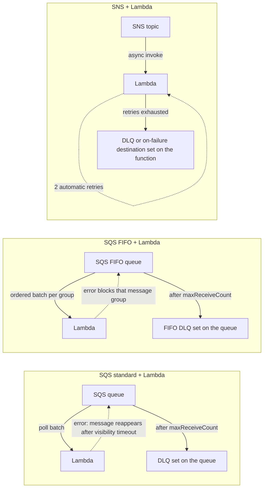
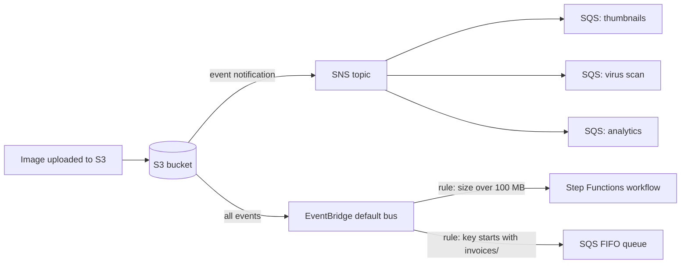
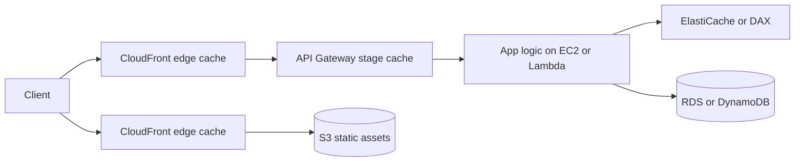
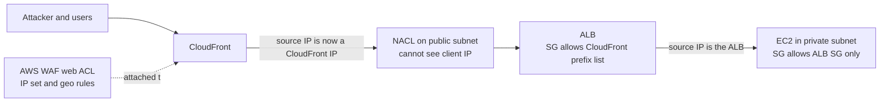
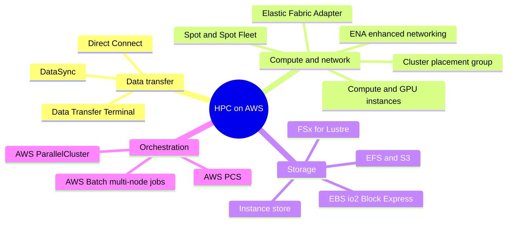
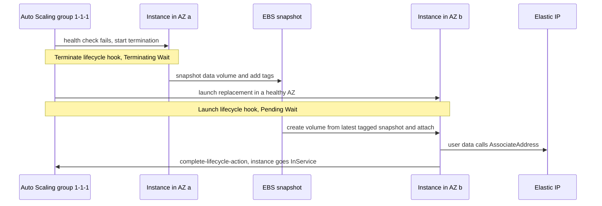

# More Solutions Architecture

## Summary

This lesson is a tour of small, reusable designs that SAA-C03 likes to test in scenario questions. First come **event-driven patterns**: how Lambda behaves behind SQS, SQS FIFO and SNS (who retries and where failed messages land), the SNS-to-SQS **fan-out**, **S3 event notifications** (native or through **EventBridge**), alerting on API calls with **CloudTrail + EventBridge**, and using **API Gateway** as a serverless front door straight into Kinesis. Then a set of **operational patterns**: where to cache along a request path, how to **block a client IP address** depending on whether an ALB, NLB, WAF or CloudFront sits in front of your instances, which services build a **high performance computing (HPC)** platform, and how to make a **single EC2 instance highly available** with an Elastic IP, an Auto Scaling group of one, and EBS snapshots. Pick these patterns when a question describes one of these exact shapes; the right answer usually swaps a fragile custom piece for a managed feature.

## Key concepts

- **SQS + Lambda**: Lambda polls the queue and invokes the function per batch; failed messages reappear after the **visibility timeout** and move to a **DLQ configured on the queue** after `maxReceiveCount` receives.
- **SQS FIFO + Lambda**: order is kept per **message group**; a failing message blocks the rest of its group until it succeeds or reaches the DLQ.
- **SNS + Lambda** is an **asynchronous** invocation: Lambda retries twice by default, then sends the event to a **DLQ or on-failure destination configured on the function**.
- **Fan-out**: publish once to an SNS topic and let it copy the message into several SQS queues, instead of the producer writing to each queue.
- **S3 event notifications** go to SNS, SQS, Lambda or EventBridge; filters are prefix and suffix only, and there is a quota of **100 notification configurations per bucket**.
- **S3 → EventBridge** sends *every* bucket event; EventBridge rules then filter on any field (size, key, requester) and add archive, replay, retries and many more target types.
- **CloudTrail → EventBridge**: any API call recorded by CloudTrail can trigger a rule, for example "alert me when someone calls `DeleteTable`".
- **API Gateway AWS service integration** lets clients write to Kinesis, SQS or Step Functions with no Lambda in between.
- **Caching layers**: CloudFront at the edge, API Gateway cache at the API, ElastiCache or DAX next to the app; caching closer to the user is faster and cheaper but staler.
- **Blocking an IP**: security groups cannot deny; **NACLs** can; behind an **ALB** the instance sees the ALB's IP; behind **CloudFront** the NACL sees CloudFront's IPs, so use **AWS WAF** or **geo restriction** instead.
- **HPC building blocks**: Direct Connect or DataSync for data, **cluster placement groups**, **ENA** and **EFA** for networking, **FSx for Lustre** for storage, **AWS Batch** multi-node jobs, **ParallelCluster** or **AWS PCS** for Slurm clusters.
- **EFA** gives OS-bypass, low-latency networking for tightly coupled MPI and NCCL workloads on Linux.
- **Highly available single instance**: an **Auto Scaling group with min = max = desired = 1** across two AZs plus user data that re-attaches an **Elastic IP**; add **lifecycle hooks** and **EBS snapshots** to carry disk data to the new AZ.

## Lambda with SQS, SQS FIFO and SNS

Lambda can sit behind a queue or a topic, but the three combinations behave very differently when the function fails. The difference is *who holds the message while it is being retried* and *where the dead-letter queue (DLQ) is configured*.

| Pattern | How Lambda is invoked | Retry behaviour | Where failed messages end up | Ordering |
|---|---|---|---|---|
| SQS standard + Lambda | Event source mapping long-polls the queue and invokes the function **synchronously** with a batch (default 10 messages) | Message stays in the queue; after the visibility timeout it becomes visible and is retried | **DLQ on the source queue** (SQS redrive policy, `maxReceiveCount`) | None (best effort) |
| SQS FIFO + Lambda | Same polling model; batches keep the order inside each message group | The same failed messages are retried before anything newer **from that group** is processed | **DLQ on the source queue** (must also be FIFO) | Per message group ID |
| SNS + Lambda | SNS invokes the function **asynchronously**; Lambda keeps the event in its own internal queue | Lambda retries **2 more times** by default (1 minute, then 2 minutes apart); events can wait up to 6 hours | **DLQ on the Lambda function** (standard SQS queue or SNS topic) or an **on-failure destination** | None |



### SQS and Lambda in practice

With an event source mapping, Lambda does the polling for you. When a batch succeeds, Lambda deletes the messages; when the function throws, the whole batch returns to the queue unless you enable **partial batch responses** (`ReportBatchItemFailures`) so that only the failed message IDs come back. Two settings matter for reliability:

- Set the queue's **visibility timeout to at least six times the function timeout**, so a slow or throttled batch does not reappear while it is still being processed.
- Give the queue a **redrive policy** with `maxReceiveCount` of **at least 5** and a DLQ, so a "poison" message stops looping after a few attempts.

With a FIFO queue, ordering is the whole point, so Lambda will not skip a failing message: it keeps retrying it, and every later message with the same **message group ID** waits behind it. Other groups keep flowing, and concurrency is capped by the number of active message groups. This is why the DLQ (with a sensible `maxReceiveCount`) is essential on FIFO queues: without it, one bad order can stall a customer's entire stream.

> [!EXAMPLE] Order processing
> An e-commerce site sends order events to `orders.fifo` with the customer ID as the message group ID. A malformed event for customer 42 fails every time. Customer 42's later events wait, while customers 7 and 99 are unaffected. After five receives the bad event moves to `orders-dlq.fifo`, and customer 42's queue starts moving again.

### SNS and Lambda in practice

When SNS delivers to Lambda, SNS hands the event over and Lambda queues it internally. If the function errors, Lambda retries twice (you can lower this to 0 or 1) and keeps throttled events for up to 6 hours by default. After that the event is discarded **unless** you configured either:

- a **dead-letter queue** on the function (a standard SQS queue or standard SNS topic; FIFO is not supported), which receives the original event as-is, with only the request ID, an error code and the first 1 KB of the error message attached as message attributes; or
- an **on-failure destination** (SQS, SNS, Lambda, EventBridge, or an S3 bucket), which receives a JSON invocation record: the event *plus* the request context, the retry condition and the function's full response. Because destinations accept more target types and carry that extra context, they are usually the better pick for new designs.

> [!UPDATED] Lambda on-failure destinations now include Amazon S3
> Besides SQS, SNS, Lambda and EventBridge, an S3 bucket can now receive records of failed asynchronous invocations (on failure only).

> [!NOTE] SNS has its own DLQ too
> If SNS cannot even reach the function (for example the function was deleted or SNS lacks permission), SNS retries for AWS endpoints up to 100,015 times over 23 days and can then send the message to a **subscription-level DLQ**. That is separate from the Lambda function's DLQ, which catches errors *inside* your code.

## Fan-out: publish once, deliver to many queues

Suppose an order service must notify a fraud check, a shipping service and an analytics pipeline. The naive approach has the producer call `SendMessage` three times. It works until one call fails halfway, a fourth consumer is added (a code change and redeploy), or the producer slows down because of extra network round trips.

The **fan-out pattern** puts an **SNS topic** in the middle. The producer publishes once; every SQS queue subscribed to the topic receives its own copy and is processed at its own pace. Adding a consumer means adding a subscription, not changing the producer.

| | Producer writes to each queue | SNS + SQS fan-out |
|---|---|---|
| Producer code | Knows every queue | Knows one topic |
| Adding a consumer | Code change | New subscription |
| Partial failure | Producer must handle it | SNS retries each delivery independently |
| Filtering | Custom logic | **Subscription filter policies** |
| Ordering | Per queue only | SNS FIFO topic to SQS FIFO queues |

To make it work, each queue's **access policy** must allow `sns.amazonaws.com` to call `sqs:SendMessage` (ideally with an `aws:SourceArn` condition naming the topic). If the queue is encrypted with a customer managed KMS key, the key policy must also let SNS use it. SNS can deliver to queues in other accounts and other Regions.

A classic use: **S3 to several queues**. One S3 event (same event type and overlapping key filter) can only have one destination, so you point the S3 notification at an SNS topic and fan out from there (or use EventBridge, below).



## S3 event notifications

S3 can emit an event when something happens to an object: created (`s3:ObjectCreated:*`, or a specific API such as `Put` or `CompleteMultipartUpload`), removed, restored from Glacier, replicated, transitioned by Lifecycle, tagged, and more. The textbook example is generating a **thumbnail** whenever an image lands in a bucket.

Native destinations are **SNS topics, SQS queues and Lambda functions** in the same Region as the bucket. Facts worth remembering:

- **Filtering is by key prefix and suffix only** (for example prefix `uploads/`, suffix `.jpg`). Wildcards such as `*.jpg` are not accepted; use the suffix `.jpg`.
- Delivery is **at least once**, usually within seconds but occasionally a minute or more; events are **not guaranteed to be in order** and can be duplicated, so consumers should be idempotent.
- **SQS FIFO queues and SNS FIFO topics are not supported** as native destinations. Route through EventBridge if you need a FIFO queue.
- The destination needs a **resource policy** that lets `s3.amazonaws.com` publish (SNS, SQS) or invoke (Lambda; the S3 console adds this for you).
- Avoid **recursive loops**: a function that writes back into the same bucket and prefix triggers itself again. Use a second bucket or separate prefixes.

> [!UPDATED] There is a limit on notification configurations
> The slides say you can create as many S3 events as you like. The current S3 quota is **100 event notification configurations per bucket**, and it cannot be raised.

### S3 events through Amazon EventBridge

You can also switch on **EventBridge delivery** for a bucket (one on/off setting). S3 then sends **all** its events to the account's default event bus, and you write **EventBridge rules** to pick what you need.

| | Native S3 notifications | S3 → EventBridge |
|---|---|---|
| Setup | One configuration per event type + key filter | Turn on once; write rules |
| Filtering | Prefix and suffix of the key | Any field in the event: key prefix/suffix/wildcard, object size, source IP, requester, reason and more |
| Destinations | SNS, SQS (standard), Lambda | Up to 5 targets per rule from a long list: Step Functions, Kinesis Data Streams, Amazon Data Firehose, SQS including FIFO, ECS tasks, Batch jobs, API destinations, other event buses... |
| Extras | None | **Archive and replay**, configurable retry policy (24 hours / 185 attempts by default), target DLQ |
| Typical use | Simple trigger to one consumer | Multiple consumers, rich filters, auditing, replays |

> [!TIP] Use EventBridge when the question mentions filtering on metadata
> "Only process objects larger than 1 GB", "send the event to a Step Functions workflow" or "replay last week's events" all point to S3 + EventBridge rather than native notifications.

## Reacting to API calls with CloudTrail and EventBridge

CloudTrail records API calls in your account. Those records also flow to the **EventBridge default event bus** with the detail type `AWS API Call via CloudTrail`, which means you can react to *any* API call in near real time without writing a log parser.

> [!EXAMPLE] Alert when a DynamoDB table is deleted
> A rule on the default bus matches this pattern and targets an SNS topic that emails the team:
> ```json
> {
>   "source": ["aws.dynamodb"],
>   "detail-type": ["AWS API Call via CloudTrail"],
>   "detail": {
>     "eventSource": ["dynamodb.amazonaws.com"],
>     "eventName": ["DeleteTable"]
>   }
> }
> ```
> The same idea works for `StopLogging` on CloudTrail, `AuthorizeSecurityGroupIngress` with `0.0.0.0/0`, or root console sign-ins (`AWS Console Signin via CloudTrail`).

Points to know: the EventBridge documentation says you need a **CloudTrail trail with logging enabled** for these events; they always arrive on the **default** bus; and **read-only** calls (`Get*`, `List*`, `Describe*`) are matched only by rules whose state is `ENABLED_WITH_ALL_CLOUDTRAIL_MANAGEMENT_EVENTS`. Many services (EC2, Auto Scaling, S3 with EventBridge enabled) also publish their own native events, such as `EC2 Instance State-change Notification`, which do not depend on CloudTrail.

> [!UPDATED] CloudWatch Events is now Amazon EventBridge
> Older material (and slide diagrams) say "CloudWatch Event". The service and console are Amazon EventBridge; the old rules API still works under it.

## API Gateway as a front door to AWS services

API Gateway does not have to call Lambda. A REST API method can use an **AWS service integration**: API Gateway signs a request to another AWS API using an **IAM execution role** and reshapes the client's JSON with a **mapping template**. A popular example is a data ingestion API:

1. Clients send JSON records to `PUT /streams/clicks/record` on API Gateway.
2. The integration calls **Kinesis Data Streams** `PutRecord` (or `PutRecords` for batches).
3. **Amazon Data Firehose** reads the stream, buffers by size or time, and writes batched **JSON files to S3** for Athena or a data lake.

You get authentication (IAM, Cognito, Lambda authorizers), API keys and usage plans, throttling and AWS WAF at the front door, while the "backend" is entirely managed: no servers and no Lambda code. The same approach can send to **SQS** (`SendMessage`), start **Step Functions** executions, or write to **DynamoDB**.

Limits to keep in mind: the REST API **payload limit is 10 MB**, and the **integration timeout is 29 seconds** by default.

> [!UPDATED] Kinesis Data Firehose is now Amazon Data Firehose
> The service was renamed; "delivery stream" is now called a **Firehose stream**. Exam questions may use either name.

> [!UPDATED] Integration timeout can exceed 29 seconds
> For **Regional and private** REST APIs you can request a higher integration timeout through Service Quotas (this may reduce your account's throttle quota). Edge-optimized APIs stay capped at 29 seconds.

## Caching strategies

A request can be cached at several points on its way from the user to the database. Each layer answers the same three questions differently: *what* is cached, *how long* it stays (**TTL**), and *who* can invalidate it.



| Layer | Service | Good for | Notes |
|---|---|---|---|
| Edge | **CloudFront** | Static files from S3, cacheable API responses, media | Closest to users; TTLs via cache policies; invalidations cost after a free allowance |
| API | **API Gateway cache** (REST APIs) | Repeated identical `GET` requests | Per stage, 0.5 GB to 237 GB, TTL default **300 s**, max **3,600 s**; billed hourly and **not** Free Tier |
| Application | **ElastiCache** (Valkey, Redis OSS, Memcached) | Session data, computed results, query results for any database | Your code decides what to cache (lazy loading, write-through) |
| Database | **DAX** | DynamoDB reads in microseconds | Drop-in for DynamoDB API calls; DynamoDB only |
| Database | RDS **read replicas** | Read-heavy SQL | Not a cache, but offloads reads |

The trade-off runs along the path. Caching **near the user** saves the most latency, network and compute, and costs the least per request, but the data can be stale and you have the least control over invalidation (you may need TTLs measured in seconds or versioned file names). Caching **near the database** returns fresher data and is easy to invalidate from your code, but every request still travels through the network and your application. Many architectures combine layers: CloudFront for images and CSS, ElastiCache for the product catalogue, nothing at all for the shopping cart.

> [!UPDATED] ElastiCache engines
> ElastiCache now supports **Valkey** as well as **Memcached** and **Redis OSS**, and offers a **serverless** option. "Redis" in older material maps to Redis OSS or Valkey today.

## Blocking an IP address

A favourite exam scenario: "a single IP address is attacking our application; block it". The right control depends on what sits in front of the instance, because each hop can change the **source IP** that the next control sees.

| Control | Level | Can it **deny**? | Notes |
|---|---|---|---|
| **Security group** | ENI / instance | **No**, allow rules only | Stateful. You can only stop allowing a range, not single out one bad IP from "anywhere" |
| **Network ACL** | Subnet | **Yes**, allow and deny rules | Stateless, rules evaluated by number (lowest first, first match wins). Default quota **20 rules per direction**, up to 40 |
| OS firewall | Inside the instance | Yes | iptables, Windows Firewall; uses instance CPU and must be managed on every instance |
| **AWS WAF** IP set | ALB, API Gateway, CloudFront, AppSync, Cognito, App Runner, Verified Access, Amplify | **Yes** | Up to 10,000 CIDRs per IP set; also rate-based and geo rules. Cannot attach to an NLB or directly to EC2 |
| **CloudFront geo restriction** | Distribution | Yes, by **country** | Allow list or block list; blocked users get HTTP 403 |

### Instance directly on the internet

The client connects straight to the instance's public IP, so both the **NACL** of the public subnet and the instance see the real client IP. Add a **deny rule with a lower number** than your allow rules in the NACL (for example rule 90 deny `203.0.113.7/32`, rule 100 allow all). A host firewall is an optional extra layer.

### Behind an Application Load Balancer

An ALB **terminates** the client connection and opens a new one to the target. The instance (ideally in a private subnet, with a security group that only allows the ALB's security group) sees the **ALB's private IP**; the client's address travels in the `X-Forwarded-For` header. So:

- the instance's NACL and security group cannot single out the attacker;
- the **NACL on the ALB's public subnets** still sees the client IP and can deny it;
- the best answer for HTTP traffic is **AWS WAF on the ALB** with an IP set (and rate-based rules for floods).

### Behind a Network Load Balancer

An NLB does not terminate TCP connections in the same way: with instance targets, **client IP preservation** is on by default, so traffic reaches the instance with the client's address. The NACL (of the NLB subnets or of the instance subnet) can block it. NLBs can now have **security groups**, but those are allow-only like any other. WAF **cannot** be attached to an NLB; for layer 3/4 attacks think **Shield**, and consider AWS Network Firewall for deep inspection.

> [!UPDATED] Network Load Balancers support security groups
> Since 2023 an NLB can have security groups. They must be attached **when the NLB is created**; an NLB created without one can never get one later.

### Behind CloudFront

With CloudFront in front of the ALB, every request reaching your VPC comes **from CloudFront edge servers**. The NACL on the ALB subnet only sees CloudFront IPs, so blocking the client there is **not possible** (and blocking CloudFront IPs would take your site down). Instead:

- attach a **WAF web ACL to the CloudFront distribution** (created in `us-east-1` / Global) with an IP set rule;
- use **CloudFront geo restriction** to block whole countries;
- stop attackers from bypassing CloudFront by allowing only the **CloudFront managed prefix list** (`com.amazonaws.global.cloudfront.origin-facing`) in the ALB security group, or by using **CloudFront VPC origins** with a private ALB.

With VPC origins, CloudFront reaches the origin through a service-managed network interface, and the CloudFront documentation states that inbound NACL rules are not evaluated for that traffic at all, which is one more reason the NACL is the wrong tool in this design.



> [!UPDATED] CloudFront VPC origins and new WAF wording
> CloudFront can now reach ALBs, NLBs and EC2 instances in **private subnets** through **VPC origins**, so the origin needs no public exposure at all. The new AWS WAF console calls a web ACL a **protection pack (web ACL)**.

## High performance computing on AWS

HPC means running huge, often tightly coupled calculations: genome sequencing, molecular simulation, financial risk models, weather and climate forecasts, crash simulation, ML training, autonomous-driving simulation. The cloud suits HPC because you can rent thousands of cores for a few hours, finish sooner by adding more nodes, and stop paying when the job ends. The SAA-C03 angle is knowing which service covers each layer.



### Getting the data in

| Need | Service | Notes |
|---|---|---|
| Continuous, private, high-bandwidth link | **AWS Direct Connect** | Dedicated ports of 1, 10, 100 or {{updated: 400 Gbps dedicated ports are now offered}} 400 Gbps |
| Online copy of files and objects | **AWS DataSync** | Agent reads NFS, SMB, HDFS or object storage; writes to S3, EFS and every FSx file system; also copies between AWS services and from other clouds |
| Petabytes, poor network | Physical transfer | See the update below |

> [!UPDATED] Snowball is closed to new customers and Snowmobile is retired
> AWS Snowball Edge is **no longer available to new customers**, and the Snowball documentation adds that AWS no longer offers any Snow Family device for new customers to order. New customers are pointed to DataSync (optionally over a Direct Connect hosted connection), the **AWS Data Transfer Terminal** (reserve a slot at an AWS facility and upload from your own storage devices at high speed) or partner solutions. The truck-sized **Snowmobile** is gone for everyone: the AWS General Reference lists it among services in full shutdown, with end of support on 14 March 2024 {{updated: AWS's full-shutdown list now confirms Snowmobile ended on 14 March 2024}}. Exam questions written earlier may still list Snowball for "petabytes over a slow link".

### Compute and networking

- **Instance choice**: compute optimized (C family), GPU and accelerator instances (P, G, Trn, Inf) and the dedicated **HPC instances** (Hpc6a, Hpc6id, Hpc7a, Hpc7g, Hpc8a). **Spot Instances and Spot Fleet** cut cost for jobs that can checkpoint and restart; Auto Scaling or a scheduler adds and removes nodes.
- **Cluster placement group**: packs instances close together inside **one AZ** on a high-bisection-bandwidth segment of the network. Instances in the group get up to **10 Gbps per single flow** (5 Gbps outside a cluster group). Launch all nodes in one request with one instance type to avoid capacity errors.
- **Enhanced networking (SR-IOV)**: higher bandwidth, more packets per second and lower, steadier latency, at no extra charge. The **Elastic Network Adapter (ENA)** supports up to 100 Gbps on supported types (all Nitro instances use it); the **Intel 82599 VF** (up to 10 Gbps) only exists on old instance families.
- **Elastic Fabric Adapter (EFA)**: an ENA plus an extra device that lets MPI or NCCL applications **bypass the operating system kernel** (through Libfabric) using AWS's SRD protocol. Use it for **tightly coupled** jobs where nodes exchange messages constantly. EFA traffic stays inside one AZ and one VPC and is not routable.

| | ENA | EFA |
|---|---|---|
| What it is | Enhanced networking NIC for normal IP traffic | ENA + OS-bypass device for HPC/ML |
| Best for | Any high-throughput workload | Tightly coupled MPI and NCCL jobs |
| OS | Linux and Windows | Linux (on Windows it behaves as a plain ENA, except for CDI SDK apps) |
| Cost | No extra charge | No extra charge |

> [!UPDATED] Placement and EFA details have moved on
> The slides describe a cluster placement group as "same rack"; the EC2 docs now say instances are **not isolated to a single rack**, only grouped in a high-bisection segment of one AZ. EFA now also comes as an **EFA-only** interface and supports NVIDIA NCCL and NIXL for ML as well as MPI.

### Storage

| Storage | Performance highlights | When to use for HPC |
|---|---|---|
| **EBS io2 Block Express** | Up to 256,000 IOPS, 4,000 MiB/s, 64 TiB per volume | Per-node scratch or database volumes that need consistent sub-millisecond latency |
| **EBS gp3** | Up to {{updated: gp3 limits were raised to 80,000 IOPS, 2,000 MiB/s and 64 TiB}} 80,000 IOPS | Cheaper general block storage |
| **Instance store** | Millions of IOPS, very low latency | Temporary data that can be lost when the instance stops |
| **Amazon S3** | Massive throughput, object API | Input and output datasets, not a POSIX file system |
| **Amazon EFS** | Elastic throughput (default) scales automatically; Bursting throughput scales with stored size; Provisioned throughput is set by you | Shared home directories and moderate parallel I/O |
| **Amazon FSx for Lustre** | Sub-millisecond latency, up to multiple TB/s, millions of IOPS | The HPC parallel file system; links to an **S3 bucket** as a data repository and writes results back |

> [!UPDATED] EFS throughput modes
> The slides tie EFS performance to file system size or provisioned IOPS. Today **Elastic throughput is the default and recommended mode**; "scales with size" describes the older Bursting mode, and Provisioned throughput is set in MiB/s rather than IOPS.

### Automation and orchestration

| | AWS Batch | AWS ParallelCluster | AWS Parallel Computing Service (PCS) |
|---|---|---|---|
| What it is | Managed job scheduler that launches EC2 (or Fargate) capacity for queued jobs | Open-source tool that builds a full HPC cluster from a **YAML** config file | Managed service that runs **Slurm** clusters for you |
| HPC feature | **Multi-node parallel jobs**: one job spans many instances (a main node plus child nodes) | Slurm scheduler, EFA and placement groups per queue, FSx for Lustre/EFS shared storage, can create the VPC and subnets in its setup wizard | AWS operates the Slurm controller and patching |
| You manage | Job definitions and queues | The cluster lifecycle (CLI, API or web UI) | Node groups and queues |
| Cost | Free; pay for compute | Free; pay for resources | Service fee plus compute |

Multi-node parallel jobs work best with a **cluster placement group** in one AZ and are **not supported on Spot** compute environments.

> [!UPDATED] Scheduler changes
> AWS ParallelCluster no longer supports **AWS Batch as a scheduler from version 3.16.0**; Slurm is the scheduler. **AWS PCS** (launched 2024) is the fully managed alternative when you want Slurm without running the head node yourself.

## Making a single EC2 instance highly available

Some applications can only run as **one instance at a time** (a licence bound to one server, a legacy app that keeps state on disk) yet clients must reach them at a fixed public IP. Three designs, from most manual to most automated:

### Option 1: standby instance and event-driven failover

The active instance holds an **Elastic IP**. A **standby** instance (stopped, to save money, or running) waits in another AZ. A **CloudWatch alarm** on a health metric, or an **EventBridge** rule on an instance state change, triggers a **Lambda function** that starts the standby and calls `AssociateAddress` to move the Elastic IP. It works, but you write and test the failover code yourself and pay for the standby's EBS (and compute, if it runs).

### Option 2: an Auto Scaling group of one

Create an **Auto Scaling group with minimum 1, maximum 1, desired 1** spread over **at least two AZs**. If the instance or its AZ fails, the group launches a replacement, possibly in the other AZ. The replacement's **user data** finds the Elastic IP (for example by a tag) and attaches it with the AWS CLI. The instance needs an **IAM role** that allows `ec2:DescribeAddresses` and `ec2:AssociateAddress`. Recovery takes a few minutes (launch plus boot), and there is no idle standby to pay for.

### Option 3: carry the disk across AZs with EBS snapshots and lifecycle hooks

An EBS volume lives in **one AZ**, so a replacement instance in another AZ cannot attach the old volume. Add two **lifecycle hooks** to the group:

- a **terminate hook** pauses the old instance in `Terminating:Wait` while a script or Lambda function **snapshots** its data volume and **tags** the snapshot;
- a **launch hook** pauses the new instance in `Pending:Wait` while a new **volume is created from the latest tagged snapshot** in the new AZ and attached; the script then calls `complete-lifecycle-action`.



Lifecycle hooks wait **one hour by default** (heartbeat timeout), and termination hooks are **best effort**: if the AZ disappears abruptly, the hook may never run. Pair this design with scheduled snapshots (AWS Backup or Data Lifecycle Manager) so there is always a recent copy, or move shared data to **EFS**, which is already multi-AZ.

### Comparing the options

| Design | Recovery | Data on disk | Extra cost | Effort |
|---|---|---|---|---|
| EC2 **automatic recovery** (on by default) | Minutes, same instance ID, IPs and Elastic IP | Kept (same EBS volumes) | None | None, but **same AZ only** and only for host failures |
| Standby + Lambda failover | Minutes | Standby must already have the data | Standby volumes (and compute if running) | Custom code |
| ASG 1-1-1 + user data | Minutes, any AZ | Lost unless stored elsewhere | None idle | Small script + IAM role |
| ASG + lifecycle hooks + snapshots | Minutes, any AZ | Restored from the snapshot | Snapshot storage | Most moving parts |
| ALB + multi-AZ ASG with 2+ instances | Seconds, no single point | Must be shared (EFS, RDS, S3) | More instances | Requires a stateless app |

> [!NOTE] Elastic IPs are billed
> Every public IPv4 address, including an Elastic IP whether attached or idle, costs about USD 0.005 per hour. Release Elastic IPs you no longer need.

## Exam tips

> [!EXAM] Where to configure the DLQ
> "Messages from an SQS queue that Lambda keeps failing on" → set a **redrive policy and DLQ on the SQS queue**. "Events from SNS (or S3, or any async source) that fail in Lambda" → configure a **DLQ or on-failure destination on the Lambda function**.

> [!EXAM] Ordered processing with a stuck message
> A FIFO queue feeding Lambda "stops processing for one customer" → a failing message is blocking its **message group**; fix with a DLQ and a `maxReceiveCount`, or partial batch responses that return the failed and later messages.

> [!EXAM] One event, many consumers
> "The same message must reach several independent services or queues" → **SNS topic fanning out to SQS queues** (SNS FIFO + SQS FIFO if order matters). For S3 events to multiple consumers → S3 → SNS fan-out, or **S3 → EventBridge** with several rules.

> [!EXAM] Rich filtering, replay, more targets
> "Filter S3 events by object size", "send S3 events to Step Functions or a FIFO queue", "archive and replay events" → **S3 event notifications to EventBridge**.

> [!EXAM] React to a specific API call
> "Notify the security team whenever someone deletes a table / stops CloudTrail / changes a security group" → **CloudTrail + EventBridge rule → SNS** (or Lambda for automatic remediation).

> [!EXAM] Ingest data with no servers
> "Expose an HTTPS endpoint that writes records into Kinesis (or SQS) without managing compute" → **API Gateway AWS service integration**; then **Data Firehose → S3** for storage.

> [!EXAM] Blocking an IP
> Instance or NLB path → **NACL deny rule**. ALB path → **WAF IP set on the ALB** (or NACL on the ALB subnets). CloudFront in front → **WAF on CloudFront** or **geo restriction**; NACLs are useless there. "Security group deny rule" is never the answer.

> [!EXAM] HPC keywords
> "Low-latency, tightly coupled, MPI, inter-node" → **EFA + cluster placement group**. "High-performance parallel file system for HPC backed by S3" → **FSx for Lustre**. "Run a single job across many instances" → **AWS Batch multi-node parallel jobs**. "Deploy and manage an HPC cluster with Slurm" → **AWS ParallelCluster** (self-managed, open source) or **AWS PCS** (managed). "Millions of IOPS, temporary" → **instance store**.

> [!EXAM] One instance, highly available, fixed IP
> "Only one instance can run, must survive an AZ failure, clients use a fixed IP" → **ASG min/max/desired 1 across two AZs + user data attaching an Elastic IP + IAM role**. If the disk must follow, add **lifecycle hooks with EBS snapshots**.

## Common traps

> [!TRAP] DLQ on the wrong resource
> Putting a DLQ on the Lambda function when the source is an SQS event source mapping does nothing for those messages: SQS owns them, so the DLQ belongs on the queue. The reverse is also true for SNS and other asynchronous sources.

> [!TRAP] Assuming S3 notifications support FIFO or wildcards
> Native S3 notifications cannot target SQS FIFO queues or SNS FIFO topics, and filters accept only a literal prefix and suffix. Choose EventBridge when those features are required.

> [!TRAP] "S3 notifications are ordered and exactly once"
> They are at-least-once, usually fast but not guaranteed, and can arrive out of order or twice. Design consumers to be idempotent.

> [!TRAP] Blocking at the instance behind a load balancer or CloudFront
> Behind an ALB the instance sees the ALB's IP; behind CloudFront the VPC sees CloudFront's IPs. A NACL or OS firewall on the instance cannot isolate the attacker in those cases.

> [!TRAP] WAF on a Network Load Balancer
> AWS WAF attaches to ALBs, API Gateway REST APIs, CloudFront and a few other HTTP services, never to an NLB or an EC2 instance directly.

> [!TRAP] Spread or partition group for low latency
> Only a **cluster** placement group gives the low-latency, high-throughput network HPC needs, and it lives in a single AZ. Spread and partition groups are for failure isolation.

> [!TRAP] EBS volume "moving" to another AZ
> An EBS volume cannot be attached across AZs. To recover data in another AZ you restore it from a snapshot (or keep the data on EFS, S3 or a database).

> [!TRAP] API Gateway cache on an HTTP API
> Response caching is a feature of **REST APIs**, not HTTP APIs, and it is billed hourly by cache size, so it is not a "free" performance fix.
